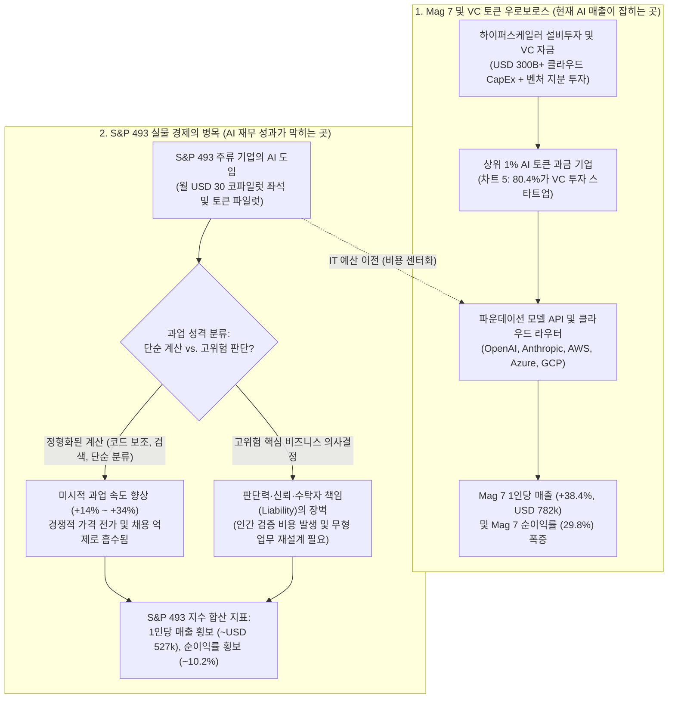
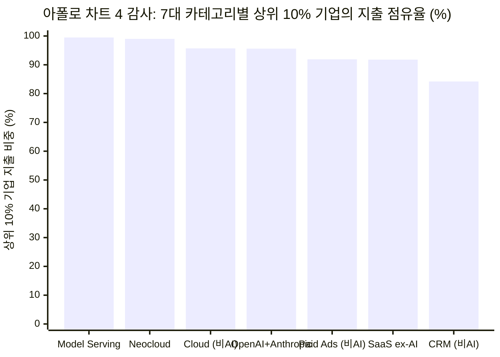

## 핵심 요약(Executive Summary): VC 토큰 순환 거래에 대한 정곡 찌르기와 거시경제 회계 착시의 분리

2026년 10월 24일, **아폴로 글로벌 매니지먼트(Apollo Global Management)**의 수석 이코노미스트 **토르스텐 슬록(Dr. Torsten Sløk)** 박사는 *The Daily Spark*에 [**"테크 섹터 밖에서는 AI의 성과 징후가 전혀 보이지 않는다(No Signs of AI Payoff Outside the Tech Sector)"**](https://www.apollo.com/wealth/insights-news/insights/daily-spark/no-signs-of-ai-payoff-outside-the-tech-sector)라는 제목의 5개 차트 보고서를 발표했습니다. 이 보고서는 발표 직후 기업용 인공지능(Enterprise AI) 회의론을 대표하는 가장 강력한 거시경제 테제로 떠올랐습니다.

> "인공지능을 둘러싼 막대한 투자와 광범위한 과열(hype)에도 불구하고, 이 기술은 테크 섹터 바깥의 미국 기업들(Corporate America)에게 재무적 성과를 전혀(zero) 안겨주지 못했습니다. 첫 번째 차트에서 보듯 매그니피센트 7(Mag 7)의 직원 1인당 매출은 상승하고 있지만 나머지 S&P 493 기업들은 제자리걸음입니다. 두 번째 차트에서 보듯 이익률 역시 Mag 7은 상승 중이지만 S&P 493은 평탄합니다. 그리고 세 번째 차트에서 보듯 AI가 생산성 증가율을 끌어올리고 있다는 징후도 여전히 없습니다. 순이익(Bottom line)에 아무런 영향이 없자, 주류 미국 기업들은 한발 물러서기 시작했으며 토큰(token) 지출을 성장의 원천이 아니라 마진을 갉아먹는 비용 센터(cost center)로 바라보기 시작했습니다.
>
> 벤처캐피털(VC) 투자를 받은 기업들은 토큰에 점점 더 많은 돈을 쓰고 있지만, 주류 미국 대기업들은 최신 프론티어 모델을 필요로 하지도 않고 그에 대한 비용을 지불할 의향도 없습니다. 네 번째와 다섯 번째 차트에서 보듯, 에이전트형 AI와 토큰 지출이 경제의 아주 작은 영역에 갇혀 있는 한 AI의 거시경제적 효과는 매우 제한적일 것입니다.
>
> 앞으로의 핵심 질문은 모델이 범용재(commoditized)가 되어 지능이 점점 저렴해지더라도, 주류 기업들이 이를 더 높은 매출 성장과 이익률로 전환할 수 있느냐입니다. 이는 말처럼 쉽지 않을 수 있습니다. AI는 훌륭한 계산기(calculator)일지 모르나, 비즈니스에서 지능이란 대부분 판단력(judgment)입니다. 판단력은 맥락(context)에 좌우되며, 어떤 사람이나 어떤 모델에게 묻느냐에 따라 답이 달라집니다. 무엇보다도 AI는 책임성(accountability), 신뢰, 문화, 암묵적 규칙, 윤리적 절충이나 공정성을 이해하지 못하며, 바로 이러한 요소들이 평판 리스크를 좌우하고 궁극적으로 매출 성장과 이익률을 결정합니다.
>
> 결론적으로 AI 스토리는 Mag 7이 아니라 S&P 493에서 판가름 날 것이며, 지금까지 테크 섹터 바깥에서 매출 성장이나 이익률이 개선되고 있다는 증거는 전혀 없습니다."
> — **토르스텐 슬록(Dr. Torsten Sløk)**, 아폴로 글로벌 매니지먼트 수석 이코노미스트 ([*The Daily Spark*, 2026년 10월 24일](https://www.apollo.com/wealth/insights-news/insights/daily-spark/no-signs-of-ai-payoff-outside-tech-sector))

과연 슬록 박사의 진단대로 테크 섹터 바깥에서 AI의 재무적 성과는 **완전히 제로(0)**일까요? 브라운과 킬리(Browne & Keeley)의 **'사금 채취(Panning for Gold)'** 비판적 사고 프레임워크를 적용하여 아폴로가 공개한 5개의 원본 차트([차트 1](https://www.apollo.com/content/dam/apolloaem/images/daily-spark/2026/oct/24/Oct24_Chart1.png), [차트 2](https://www.apollo.com/content/dam/apolloaem/images/daily-spark/2026/oct/24/Oct24_Chart2.png), [차트 3](https://www.apollo.com/content/dam/apolloaem/images/daily-spark/2026/oct/24/Oct24_Chart3.png), [차트 4](https://www.apollo.com/content/dam/apolloaem/images/daily-spark/2026/oct/24/Oct24_Chart4.png), [차트 5](https://www.apollo.com/content/dam/apolloaem/images/daily-spark/2026/oct/24/Oct24_Chart5.png)), [샌프란시스코 연준 총요소생산성(`TFP`) 원천 데이터](https://www.frbsf.org/research-and-insights/data-and-indicators/total-factor-productivity-tfp/), [미국 노동통계국(`BLS`) 비농업 시간당 노동생산성(`OPHNFB`)](https://fred.stlouisfed.org/series/OPHNFB), 그리고 전미경제연구소(`NBER`)의 핵심 실증 논문들([Brynjolfsson, Rock & Syverson 2021](https://www.nber.org/papers/w25892); [Acemoglu 2024](https://www.nber.org/papers/w32487); [Agrawal, Gans & Goldfarb 2018](https://www.nber.org/papers/w24235))을 교차 검증한 결과, 극명한 양면성이 드러났습니다: **슬록은 VC 토큰 순환 거래(Ouroboros), 기업용 SaaS 좌석 요금제의 단기 비용 압박, 그리고 '계산 대 비즈니스 판단'의 법적 책임 한계에 대해서는 정곡을 찔렀으나, S&P 493의 1인당 매출, 총요소생산성(TFP) 성장회계, 그리고 기업 규모별 지출 집중도를 해석하는 과정에서는 3가지 고전적인 통계적·거시경제적 오류를 범했습니다.**

| 아폴로 *Daily Spark* 6대 핵심 주장 및 원본 차트 | 포렌식 판정 | 인식론적 타당도 | 핵심 실증 및 통계적 감사 결과 |
| :--- | :--- | :--- | :--- |
| **1. 차트 1: 인플레이션 조정 직원 1인당 매출이 Mag 7(`~USD 782k`)에서는 급등하나 S&P 493(`~USD 527k`)에서는 정체되어 있다** | **데이터는 사실이나 인과 추론 오류** | **~45% 타당** *(거시 회계 항등식 착시)* | Mag 7의 1인당 매출이 `2023 Q1~2026 Q3` 사이 `+38.4%` 급등한 이유는 이들이 2022년 이후 채용을 동결한 상태에서 AI 인프라 독점 지대(Rent)를 수취하는 **곡괭이 판매자**(`Nvidia`, `MSFT`, `GOOGL`, `AMZN`)이기 때문입니다. 경쟁적인 S&P 493 비테크 산업에서 공정 효율화는 상대가격 인하(소비자 잉여)나 신규 채용 억제로 나타나며, 실질 GDP 성장률을 넘어 산업 전체의 실질 매출 총액을 부풀리지 않습니다. |
| **2. 차트 2: 순이익률이 Mag 7(`~29.8%`)에서는 급등하나 S&P 493(`~10.2%`)에서는 정체되어 있으며 토큰 지출이 비용 센터로 작용한다** | **강력 동의 (STRONGLY AGREE)** | **~80% 타당** | 2026년 3분기까지 전사적 AI 좌석 라이선스(`월 USD 30/인`)와 무분별한 토큰 파일럿은 인력 감축 없이 S&P 493의 IT 예산만 부풀려 구매자(S&P 493)의 마진을 판매자(Mag 7)에게 이전시켰습니다. 단, S&P 493이 고금리 차환 비용 상승(`+300 bps`) 속에서도 `10.2%` 순이익률(2015~2017년 평균 `~8.8%` 대비 `+140 bps`)을 방어한 점은 교란 변수로 통제해야 합니다. |
| **3. 차트 3: 샌프란시스코 연준 가동률 조정 `TFP`가 `0.0% ~ -0.3% YoY`로 하락해 AI의 생산성 향상 효과가 전무하다** | **부분 동의 (PARTIALLY AGREE)** | **~55% 타당** *(J-커브 및 노동생산성 간과)* | 슬록 자신의 [차트 3](https://www.apollo.com/content/dam/apolloaem/images/daily-spark/2026/oct/24/Oct24_Chart3.png) 내부를 보면, BLS **시간당 노동생산성**(`회색 선`)은 2024~2026년 **`+2.3%~+2.9% YoY`**의 강세를 보이고 있습니다! 왜 `TFP`(`녹색 선`)만 `0%`로 떨어졌을까요? 솔로우 성장회계에서 S&P 493의 무형 업무 재설계가 끝나기 전에 연간 `USD 300B+`의 AI 데이터센터 설비투자(`ΔK`)가 자본스톡에 먼저 잡히면 측정된 `TFP`가 기계적으로 깎이는 **[생산성 J-커브(Productivity J-Curve)](https://www.nber.org/papers/w25892)** 현상이기 때문입니다. |
| **4. 차트 4: 상위 10% 기업이 `OpenAI + Anthropic` 지출의 `95.6%`, `Model Serving`의 `99.5%`를 차지한다 (`Ramp AI Index`)** | **반대 (DISAGREE)** | **~20% 타당** *(제10장 블라인드 테스트 탈락)* | 슬록의 [차트 4](https://www.apollo.com/content/dam/apolloaem/images/daily-spark/2026/oct/24/Oct24_Chart4.png) 표 안에 있는 비(非)AI 비교군 행을 보십시오: 상위 10% 기업이 **전통적 클라우드 컴퓨팅 지출의 `95.7%`**(`OpenAI + Anthropic`의 `95.6%`보다 오히려 `0.1%p` 더 집중됨!), **비AI SaaS의 `91.8%`**, **유료 광고의 `91.9%`**를 차지합니다! 미국 기업 규모가 **지프/파레토 멱법칙(`ζ ≈ 1.05`)**을 따르기 때문에 상위 10% 대기업이 모든 B2B 지출의 `90%~96%`를 차지하는 것은 당연한 기저율(Base Rate)입니다. |
| **5. 차트 5: 상위 1% AI 헤비 유저의 `80.4%`가 VC 투자 기업인 반면, 중앙값 지출 기업은 `13.1%`만 VC 기업이다 ("토큰 지출의 순환성")** | **강력 동의 (STRONGLY AGREE)** | **~90% 타당** *(가장 날카로운 정곡)* | [차트 5](https://www.apollo.com/content/dam/apolloaem/images/daily-spark/2026/oct/24/Oct24_Chart5.png)는 **VC-하이퍼스케일러 간 토큰 우로보로스(순환 거래)**를 정확히 폭로합니다. Ramp 내 상위 1% 토큰 과금 기업의 `80.4%`는 벤처캐피털 자금을 받아 OpenAI·Anthropic·클라우드에 다시 쏟아붓는 VC 스타트업이며, 일반 비VC 기업(`86.9%`)은 극소량의 실험적 지출만 집행하고 있습니다. |
| **6. 정성적 테제: "AI는 훌륭한 계산기이나, 비즈니스 지능의 본질은 판단력·책임성·신뢰·윤리이다"** | **강력 동의 (STRONGLY AGREE)** | **~85% 타당** | [Agrawal, Gans & Goldfarb (NBER w24235)](https://www.nber.org/papers/w24235) 및 [Acemoglu (2024, NBER w32487)](https://www.nber.org/papers/w32487)가 수리적으로 증명했듯, LLM은 통계적 **예측/계산** 비용만 낮출 뿐이며 S&P 493의 핵심 의사결정은 **수탁자 책임(Fiduciary Liability), 법적 문책성, 비정형 조직 맥락**에 의해 병목이 걸려 있습니다. |

---

## Phase 1 & 2: 쟁점 분류, 1차 차트 데이터 발굴 및 기관적 관점 감사

### 1.1 핵심 질문의 인식론적 분류
아폴로 보고서의 주장을 엄밀하게 검증하기 위해 세 가지 검증 가능한 실증 질문으로 분해합니다.
* **실증적 질문 1 (거시 및 기업 회계):** *S&P 493의 평탄한 인플레이션 조정 1인당 매출(`~USD 527k`), 평탄한 순이익률(`~10.2%`), 그리고 2025~2026년 `0%` 부근으로 내려앉은 가동률 조정 총요소생산성(`TFP`)이 테크 섹터 바깥에서 AI의 경제적 가치가 전무함을 증명하는가?*
* **실증적 질문 2 (미시적 지출 분포 및 순환성):** *Ramp 법인카드/지출 데이터셋(`차트 4` 및 `차트 5`)은 AI 도입이 VC 투자 테크 기업들의 폐쇄적 순환 고리에만 갇혀 있음을 증명하는가?*
* **실증적/처방적 질문 3 (인지 및 조직 경제학):** *왜 저렴해진 통계적 계산(Calculation)이 S&P 493 주류 기업들의 매출 성장과 이익률 확대로 자동 전환되지 않는가?*

### 1.2 1차 출처 발굴: 아폴로 5대 원본 차트 정밀 판독
2차 언론 보도에 의존하지 않고, 아폴로의 2026년 10월 24일 자 *Daily Spark* 원본에서 추출한 5개 차트 이미지를 직접 판독한 정량 데이터는 다음과 같습니다.

| 아폴로 1차 차트 아티팩트 | 측정 지표 및 시계열 범위 | 원본 차트에서 판독한 핵심 정량 수치 | 아폴로가 명시한 원천 데이터 출처 |
| :--- | :--- | :--- | :--- |
| **[차트 1 (`Oct24_Chart1.png`)](https://www.apollo.com/content/dam/apolloaem/images/daily-spark/2026/oct/24/Oct24_Chart1.png)** | *직원 1인당 매출 (`USD 000s`, 2019년 4분기 기준 물가 조정)*, `2019 Q1 – 2026 Q3` | **Mag 7:** `~USD 698k`(2019 Q1) → 코로나 과잉채용 후 `~USD 565k`(2023 Q1 저점) → **`~USD 782k`(2026 Q3)로 급등**(저점 대비 `+38.4%`). **S&P 493:** `~USD 495k`(2019 Q1) → `~USD 548k`(2022 Q4 고점) → `2023 Q1 ~ 2026 Q3` 기간 내내 **`~USD 500k–527k` 박스권 횡보**. | Bloomberg, Macrobond, Apollo Chief Economist |
| **[차트 2 (`Oct24_Chart2.png`)](https://www.apollo.com/content/dam/apolloaem/images/daily-spark/2026/oct/24/Oct24_Chart2.png)** | *순이익률 (`%`)*, `2015 Q1 – 2026 Q3` | **Mag 7:** `~11.0%`(2015 Q1) → `~14.0%`(2022 Q4) → **`~29.8%`(2026 Q3)로 수직 상승**. **S&P 493:** `~8.5%`(2015 Q1) → `~11.8%`(2021 Q4 부양책 고점) → `2023 Q1 ~ 2026 Q3` 기간 내내 **`~9.0%–10.2%`에서 정체**. | Bloomberg, Macrobond, Apollo Chief Economist |
| **[차트 3 (`Oct24_Chart3.png`)](https://www.apollo.com/content/dam/apolloaem/images/daily-spark/2026/oct/24/Oct24_Chart3.png)** | *생산성 증가율: 가동률 조정 `TFP` 대 시간당 노동생산성 (`% YoY`)*, `1985 – 2026` | **시간당 노동생산성 (`회색 선`):** `2024–2026년` **`+2.2% ~ +2.9% YoY`**의 견조한 상승세 유지. **가동률 조정 `TFP` (`녹색 선`):** 2023년 말 `+3.3% YoY` 고점 찍은 후 `2025–2026년` **`~0.0% ~ -0.3% YoY`로 하락**. | [FRBSF (Fernald 2014)](https://www.frbsf.org/research-and-insights/data-and-indicators/total-factor-productivity-tfp/), [BLS](https://fred.stlouisfed.org/series/OPHNFB), Apollo Chief Economist |
| **[차트 4 (`Oct24_Chart4.png`)](https://www.apollo.com/content/dam/apolloaem/images/daily-spark/2026/oct/24/Oct24_Chart4.png)** | *7대 지출 카테고리별 상위 10% 기업 대 하위 90% 기업의 지출 점유율 (`%`)* | **상위 10% 기업의 지출 비중:** `Model Serving & Inference`(`99.5%`), `Neocloud`(`99.0%`), `Cloud computing`(`95.7%`), `OpenAI + Anthropic`(`95.6%`), `Paid Ads`(`91.9%`), `SaaS excluding AI`(`91.8%`), `CRM`(`84.2%`). | Ara Kharazian (Ramp 수석 이코노미스트), Apollo Chief Economist |
| **[차트 5 (`Oct24_Chart5.png`)](https://www.apollo.com/content/dam/apolloaem/images/daily-spark/2026/oct/24/Oct24_Chart5.png)** | *AI 지출 강도별 기업의 자금 조달 배경 (`%` VC 투자 기업 대 비VC 기업)* | **AI 지출 상위 1% 기업:** **`80.4%` VC 투자 기업** \| `19.6%` 비VC 기업. **중앙값(Median) 지출 기업:** **`13.1%` VC 투자 기업** \| `86.9%` 비VC 기업. | Ramp AI Index, Apollo Chief Economist |

### 1.3 기관적 관점 감사 (왜 아폴로는 이 질문을 던지는가?)
브라운과 킬리의 제8장 방법론에 따라 작성 기관의 포지션을 살펴봅니다. `USD 700 billion` 이상을 운용하는 아폴로 글로벌 매니지먼트(`NYSE: APO`)는 **사모대출(Private Credit)**, **퇴직연금 보험(`Athene`)**, 그리고 **현금흐름 중심의 전통 산업 바이아웃(제조, 화학, 유통, 헬스케어 등 전형적인 'S&P 493' 기업군)**을 핵심 축으로 삼고 있습니다. 동시에 아폴로는 인텔 아일랜드 Fab 34(`USD 11B` 합작투자) 및 대규모 데이터센터 프로젝트에 수십억 달러의 사모대출을 제공하는 핵심 채권자이기도 합니다.

따라서 아폴로의 신용 심사(Credit Underwriting) 관점에서 2026~2030년의 가장 중요한 질문은 "엔비디아가 당장 이번 분기에 GPU를 팔 수 있는가"가 아니라, **"비테크 전통 경제(S&P 493 및 바이아웃 포트폴리오 기업들)가 AI를 통해 연간 `USD 300B+`에 달하는 데이터센터 부채 및 설비투자를 상환할 만큼의 실질 현금흐름을 창출하고 있는가"**입니다.

---

## Phase 3: 의미론적 정밀성과 대입 테스트(The Substitution Test)

슬록의 보고서는 미시적 기업 운영과 거시적 국민계정 사이에서 의미가 미끄러지는 두 가지 핵심 개념—**"AI의 재무적 성과(AI Payoff)"**와 **"지능 대 판단력(Intelligence vs. Judgment)"**—에 의존하고 있습니다.

### 3.1 대입 테스트 1: 무엇이 "AI의 성과(AI Payoff)"인가?
* **정의 A — 단위 과업(Task) 비용 절감 및 소비자 잉여 창출 (미시경제적 정의):**
  * *조작적 정의:* 정형화된 개별 과업(`코딩`, `문서 요약`, `고객 상담 분류`, `보험 청구 심사`)당 투입 노동시간의 단축 또는 제품 개발 주기의 단축.
  * *실증적 현실:* **명확한 플러스 효과 입증 ([Brynjolfsson, Li & Raymond 2023, NBER w31161](https://www.nber.org/papers/w31161) 등 통제된 현장 실험에서 고객 상담 및 코딩 생산성 `+14% ~ +34%` 향상).**
* **정의 B — S&P 493 지수 전체의 인플레이션 조정 1인당 매출 및 GAAP 순이익률 급등 (슬록의 거시 회계적 정의):**
  * *조작적 정의:* S&P 500 내 493개 비테크 대기업 전체의 물가 조정 합산 매출액을 총고용 인원으로 나눈 값(`R_real / L`)과 순이익률(`NI / R`)이 지수 차원에서 우상향 돌파하는 현상.
  * *왜 정의 B를 대입하면 거시경제적 오류에 빠지는가:*
    미국의 모든 대형 소매은행(`JPMorgan`, `Bank of America`, `Wells Fargo`, `Citigroup`)이 AI를 도입해 대출 서류 심사 시간을 `40%` 단축했다고 가정해 봅시다. 그렇다고 해서 미국 은행 산업 전체의 인플레이션 조정 총매출액이 `40%` 급증할까요? **절대 그렇지 않습니다!** 은행권 전체의 대출 수요 총량은 실질 GDP와 기준금리에 의해 결정되며, 은행 간 경쟁으로 인해 심사 비용 절감분은 대출 금리 스프레드 인하(소비자 잉여)로 전가되거나 규제·자금조달 비용 상승을 상쇄하는 데 쓰입니다. 경쟁 시장에서 **모든 기업이 동시에 비용 절감 기술을 도입하면, 그 결과는 소비자 잉여의 증가와 마진 방어로 나타나지 산업 전체의 1인당 실질 매출 총액 폭발로 나타나지 않습니다!**

### 3.2 대입 테스트 2: "계산(Calculation)" 대 "비즈니스 판단(Business Judgment)"
슬록은 세 번째 문단에서 *"AI는 훌륭한 계산기일지 모르나, 비즈니스에서 지능이란 대부분 판단력이다"*라고 썼습니다. 아제이 아그라왈(Ajay Agrawal), 조슈아 건스(Joshua Gans), 아비 골드파브(Avi Goldfarb)가 [**"예측, 판단, 그리고 복잡성(Prediction, Judgment, and Complexity)"**(`NBER w24235`)](https://www.nber.org/papers/w24235)에서 정립한 AI 경제학에 따르면, 인간의 의사결정은 두 가지 완전히 다른 수학적 연산으로 구성됩니다:
1. **예측 / 계산 (`P(s | x)`):** 고차원 입력 토큰 `x`가 주어졌을 때 미래 상태 `s`의 조건부 확률분포를 추정하는 연산입니다. 파운데이션 모델은 이 `P(s | x)`의 비용을 극적으로 낮췄습니다.
2. **판단 (`u(a, s)`와 수탁자 책임):** 상태 `s`가 발생했을 때 행동 `a`를 취함에 따른 **보수 및 손실 행렬 `u(a, s)`**을 설정하고 그 책임을 지는 행위입니다. 여기에는 꼬리 위험(`s_tail`) 발생 시의 법적 배상 책임, 규제 당국의 제재, 고객 신뢰 상실, 조직 문화 및 윤리적 정당성이 포함됩니다.

대규모 언어모델(LLM)은 **법인격(Legal Personhood)이 없고, 벌금을 납부할 대차대조표도 없으며, 평판 리스크를 짊어질 피부(Skin in the game)도 없기 때문에**, `P(s | x)`를 계산할 수는 있어도 **`u(a, s)`를 정의하거나 그 법적·윤리적 결과를 책임질 수 없습니다.**

---

## Phase 4: 인과관계 해체 및 4대 경쟁 가설(4-Way Causal Audit)

왜 2023년부터 2026년 사이 Mag 7의 직원 1인당 매출(`~USD 782k`)과 순이익률(`~29.8%`)은 수직 상승한 반면, S&P 493의 직원 1인당 매출(`~USD 527k`)과 순이익률(`~10.2%`)은 제자리걸음을 했을까요? 슬록의 단일 원인론을 4대 경쟁 인과 메커니즘과 대조하여 검증합니다.

| 인과 가설 유형 | 작동 메커니즘 | 1차 실증 근거 | 설명력 가중치 |
| :--- | :--- | :--- | :--- |
| **1. 직접 인과 (Direct Causation)** *(슬록의 테제: `X → Y`)* | AI 도구는 맥락적 비즈니스 판단력과 책임성이 결여되어 있어, S&P 493의 토큰 지출은 매출이나 마진 개선 없이 순수한 IT 비용 센터로만 작용한다. | **상당 부분 타당 (`~30%`).** 업무 프로세스 재설계 없이 비기술직 임직원에게 일괄 배포된 범용 챗봇(`월 USD 30/인`)은 이메일 작성 시간을 줄여줄 뿐 인력 감축이나 매출 증대로 이어지지 않으며, 핵심 업무는 환각(Hallucination) 배상 책임 때문에 자동화가 막혀 있습니다. | **높음 (`30%`)** |
| **2. 가치사슬 지대 이전 (곡괭이 판매자 vs. 구매자)** | Mag 7(`Nvidia`, `MSFT`, `GOOGL`, `AMZN`)은 AI 인프라 독점 지대를 수취하는 **공급자**이고, S&P 493은 판관비(SG&A)와 CapEx를 털어 이를 구매하는 **고객**이다. | **지배적 (`~35%`).** S&P 493 은행이나 제약사가 클라우드 GPU와 AI 라이선스에 `USD 200M`를 지출하면, 회계상 그 돈은 Mag 7의 **매출 및 순이익**으로 잡히고 S&P 493의 **비용**으로 차감됩니다! 게다가 Mag 7의 1인당 매출이 `USD 565k`(2023 Q1)에서 `USD 782k`(2026 Q3)로 뛴 핵심 원인은 엔비디아의 매출 4배 폭증과 빅테크의 2022년 이후 인력 동결입니다. | **지배적 (`35%`)** |
| **3. 제3의 교란 변수 (Confounder `Z`)** | 2022년 이후 고금리 전환(`SOFR > 4.5%`), 현장직 임금 상승, 그리고 S&P 493의 산업 구성(`Walmart`, `Home Depot`, `HCA`, `UPS`)이 운영 효율 개선을 가린다. | **보통 (`~15%`).** 막대한 순현금을 보유한 Mag 7은 2023~2026년 고금리 국면에서 수십억 달러의 이자수익을 올렸으나, 순부채를 안고 있는 S&P 493은 회사채 차환 이자비용 급증을 겪었습니다. 또한 S&P 493 고용의 대다수는 텍스트 토큰으로 대체 불가능한 매장 관리·간호·물류 현장 인력입니다. | **보통 (`15%`)** |
| **4. 동태적 생산성 J-커브 시차** *([Brynjolfsson, Rock & Syverson 2021](https://www.nber.org/papers/w25892))* | 범용 기술(`GPT`)은 보완적 무형자산(데이터 정제, 워크플로우 재설계, 거버넌스)을 구축하는 초기 `5~8년` 동안 오히려 측정된 `TFP`와 기업 마진을 낮춘다. | **유의미 (`~20%`).** 1990년대 초 PC 및 인터넷 보급 초기(`1991–1995년`)에도 비테크 기업의 마진과 샌프란시스코 연준 `TFP`는 전혀 오르지 않다가, ERP와 공급망 재설계가 완료된 `1996–2004년`에야 폭발했습니다. | **유의미 (`20%`)** |

---

## Phase 5: 계량 및 통계적 무결성 감사 (차트 3, 4, 5의 수리적 해체)

브라운과 킬리의 제10장(통계적 기만 감사) 방법론에 따라 아폴로의 핵심 차트들에 대해 **블라인드 테스트(Blinding Test)**, **비교 기준선(Baseline) 감사**, 그리고 **성장회계 수식 유도**를 수행합니다.

### 5.1 차트 4 해체: 지프/파레토(Zipf/Pareto) 기업 규모 분포가 만든 기저율 착시
슬록이 Ramp 수석 이코노미스트 아라 카라지안(Ara Kharazian)의 데이터를 인용해 *"AI 지출은 소수의 기업에 극단적으로 집중되어 있다"*라는 제목을 단 **[차트 4 (`Oct24_Chart4.png`)](https://www.apollo.com/content/dam/apolloaem/images/daily-spark/2026/oct/24/Oct24_Chart4.png)**의 원본 표를 그대로 옮기면 다음과 같습니다:

| 지출 카테고리 (아폴로 차트 4 / Ramp 데이터셋) | 상위 10% 기업의 지출 비중 (`%`) | 하위 90% 기업의 지출 비중 (`%`) | 카테고리 성격 및 비(非)AI 기준선 비교 |
| :--- | :--- | :--- | :--- |
| **Model Serving & Inference** *(Baseten, Together, Fireworks 등)* | **`99.5%`** | `0.5%` | 개발자용 AI 서빙 인프라 *(일반 중소기업이 아닌 소프트웨어 개발사가 사용)* |
| **Neocloud** *(CoreWeave, Lambda, Crusoe 등)* | **`99.0%`** | `1.0%` | 베어메탈 GPU 클러스터 *(프론티어 연구소 및 빅테크가 도매 임차)* |
| **Cloud computing** *(AWS, Azure, Google Cloud)* | **`95.7%`** | `4.3%` | **비AI 기준선 1:** 전통적 클라우드 인프라 *(`OpenAI + Anthropic`보다 오히려 집중도가 높음!)* |
| **OpenAI + Anthropic** *(직접 API 및 엔터프라이즈 챗봇)* | **`95.6%`** | `4.4%` | **핵심 기업용 AI 지출** *(전통적 클라우드 컴퓨팅과 집중도가 완벽히 동일함!)* |
| **Paid Ads** *(Google, Meta, LinkedIn 광고)* | **`91.9%`** | `8.1%` | **비AI 기준선 2:** 일반 디지털 광고 지출 |
| **SaaS excluding AI** *(AI를 제외한 일반 기업용 소프트웨어)* | **`91.8%`** | `8.2%` | **비AI 기준선 3:** 전통적 B2B SaaS 소프트웨어 지출 |
| **CRM** *(Salesforce, HubSpot)* | **`84.2%`** | `15.8%` | **비AI 기준선 4:** 영업 관리 소프트웨어 |

> [!WARNING]
> **차트 4에 대한 제10장 블라인드 테스트(Blinding Test) 판정:**
> 슬록이 달아놓은 차트 제목(*"AI 지출은 소수 기업에 극단적으로 집중되어 있다"*)을 가리고, 바로 그 표 안에 들어 있는 비(非)AI 기준선 행들—`Cloud computing`(`95.7%`), `Paid Ads`(`91.9%`), `SaaS excluding AI`(`91.8%`)—을 `OpenAI + Anthropic`(`95.6%`)과 비교해 보십시오. **파운데이션 모델(`OpenAI + Anthropic`) 지출의 상위 10% 기업 집중도(`95.6%`)는 전통적인 클라우드 컴퓨팅(`95.7%`)이나 일반 비AI SaaS(`91.8%`)의 집중도와 통계적으로 아무런 차이가 없습니다!**

왜 AI든 비AI든 모든 B2B 지출 카테고리(`Cloud`, `OpenAI + Anthropic`, `Paid Ads`, `SaaS ex-AI`)에서 상위 10% 기업이 전체 지출의 `91.8%~95.7%`를 차지할까요? 미국 경제 내 기업의 규모 `S`(고용 인원 또는 매출액)가 꼬리 지수 `ζ ≈ 1.05–1.15`를 갖는 **지프 / 파레토 멱법칙 분포(Zipf / Pareto Power-Law Distribution)**를 따르기 때문입니다:

$$P(S > s) = \left( \frac{s_{\min}}{s} \right)^{\zeta} \implies \text{Share of Total Spend by Top } p \text{ Fraction of Firms } \approx p^{1 - \frac{1}{\zeta_{\text{eff}}}}$$

전체 기업의 90%가 직원 10~50명 규모의 소기업이고 상위 10%에 직원 5,000~50,000명 규모의 대기업이 포진한 멱법칙 분포에서는, 어떤 기업용 소프트웨어나 클라우드 서비스를 가져와도 상위 10% 기업이 전체 달러 지출의 `90%~96%`를 차지합니다! 바로 윗줄에 `Cloud computing`(`95.7%`)이 버티고 있는데도 `OpenAI + Anthropic`(`95.6%`)이 소수 기업에만 편중되어 있다고 주장하는 것은 전형적인 **기저율 생략 오류(Baseline Omission Fallacy)**입니다. (또한 `Neocloud`와 `Model Serving`이 `99.0%~99.5%`인 것은 일반 제조업체나 병원이 코어위브에서 베어메탈 H100 서버를 직접 빌리지 않고 소프트웨어 벤더를 통해 쓰기 때문이라는 자명한 분업 구조를 보여줄 뿐입니다.)

### 5.2 차트 3 해체: 왜 대규모 설비투자기에는 샌프란시스코 연준 `TFP`가 `0%`로 떨어지는가? (생산성 J-커브 방정식)
**[차트 3 (`Oct24_Chart3.png`)](https://www.apollo.com/content/dam/apolloaem/images/daily-spark/2026/oct/24/Oct24_Chart3.png)**에서 슬록은 1985년부터 2026년까지 두 개의 생산성 시계열을 함께 그렸습니다:
1. **미국 노동통계국(`BLS`) 비농업 시간당 노동생산성(`OPHNFB`, 회색 선):** 2024~2026년 **`+2.2% ~ +2.9% YoY`**의 매우 견조한 성장세를 기록 중입니다(2011~2018년 평균 `~1.2%`의 두 배 수준).
2. **샌프란시스코 연준 가동률 조정 총요소생산성(`TFP`, [Fernald 2014](https://www.frbsf.org/research-and-insights/data-and-indicators/total-factor-productivity-tfp/), 녹색 선):** 2023년 말 `+3.3% YoY`에서 2025~2026년 **`~0.0% ~ -0.3% YoY`**로 하락했습니다.

왜 **시간당 노동생산성(`Y/L`)**은 연 `~2.5%`씩 오르고 있는데 **가동률 조정 `TFP`**만 `0%`로 떨어졌을까요? 솔로우-퍼날드(Solow-Fernald) 성장회계 항등식을 보면 그 수학적 이유가 즉시 드러납니다:

$$\Delta \ln(\text{TFP}_{\text{measured}}) = \Delta \ln Y - \alpha \cdot \Delta \ln K - (1 - \alpha) \cdot \Delta \ln(L \cdot Q_L) - \Delta \ln U$$

여기서 `Δln Y`는 실질 산출량 증가율, `Δln K`는 자본서비스 투입 증가율(자본소득분배율 가중치 `α ≈ 0.38`), `Δln(L · Q_L)`은 노동의 질이 반영된 노동투입 증가율, `Δln U`는 가동률 변동입니다.
1. **자본 심화 차감 효과(`-α Δln K`):** 2024년부터 2026년 사이 미국 기업들은 AI 데이터센터, GPU, 전력 인프라에 사상 유례없는 **연간 `USD 250B–400B`의 설비투자(`K`)**를 쏟아부었습니다. 국민계정에서 이 GPU와 서버들은 즉시 자본스톡 `K`의 급격한 증가(`α · Δln K` 폭증)로 잡힙니다. 반면 데이터센터가 전력을 연결하고 S&P 493 기업들이 이를 실제 매출(`Y`)로 전환하는 데는 3~5년의 시차가 걸리기 때문에, 단기적으로는 분모 격인 `-α · Δln K`가 오늘 당장 차감되면서 측정된 `Δln(TFP_measured)`를 기계적으로 `0%` 아래로 끌어내리는 것입니다!
2. **브린욜프슨-록-시버슨의 '생산성 J-커브'(`NBER w25892`):** 스탠퍼드대 에릭 브린욜프슨(Erik Brynjolfsson), 다니엘 록(Daniel Rock), 채드 시버슨(Chad Syverson)이 [**"생산성 J-커브(The Productivity J-Curve)"**](https://www.nber.org/papers/w25892)에서 증명했듯, 기업들이 새로운 범용 기술(`GPT`)을 도입할 때는 기존 인력과 자원을 빼내어 GDP 통계에 잡히지 않는 **보완적 무형 조직자본 `I`**(레거시 DB 정제, 보안·규제 워크플로우 재설계, 직원 재교육)를 구축하는 데 투입합니다. 그 결과 투자 초기 국면에서는 측정된 `TFP`가 실제 생산성보다 체계적으로 낮게 나타납니다:

$$\Delta \ln(\text{TFP}_{\text{measured}}, t) = \Delta \ln(\text{TFP}_{\text{true}}, t) - \phi_I \cdot \left( \Delta \ln I_t - \Delta \ln Y_t \right)$$

무형 조직자본 투자 증가율이 산출 증가율보다 빠른 초기 구축기(`Δln I_t > Δln Y_t`)에는 측정된 `TFP`가 **J-커브의 바닥(Trough)**으로 내려앉습니다. 슬록 자신의 차트 3을 다시 보십시오: 월드와이드웹(WWW)과 PC가 보급되던 `1992~1995년`에도 `TFP`(`녹색 선`)는 `-3% ~ 0%` 바닥을 기었으며, 무형 투자가 완료된 `1996~2004년`에야 비로소 인터넷 생산성 폭발이 일어났습니다!

### 5.3 슬록이 수리적으로 완벽히 적중한 지점: 차트 5(`80.4%` VC 순환성) 및 판단 책임 부등식
차트 4가 기저율 착시를 겪고 차트 3이 J-커브 초기 현상을 반영하는 반면, **차트 5(`Oct24_Chart5.png`)**와 슬록의 **'계산 대 판단' 테제**는 2026년 AI 경제의 가장 치명적인 아킬레스건을 정확히 타격합니다:
1. **차트 5 — 상위 1% 토큰 지출의 `80.4%` VC 우로보로스:** Ramp 플랫폼에서 **AI 지출 상위 1% 기업**의 자금 배경을 보면 무려 **`80.4%`가 VC 투자 기업**이고 일반 비VC 기업은 `19.6%`에 불과합니다(반면 중앙값 지출 기업은 **`86.9%`가 비VC 기업**). 이는 현재 폭발적으로 보이는 프론티어 토큰 소비의 최상위 꼬리(Tail)가 실물 경제의 자생적 수요가 아니라, 벤처캐피털이 투자한 돈을 AI 스타트업이 받아 다시 OpenAI·Anthropic·클라우드에 바치는 **VC 보조금 순환 루프**에 의존하고 있음을 입증합니다.
2. **계산(Calculation)과 판단(Judgment)의 수리적 경계:** 왜 `86.9%`의 일반 비VC 기업들은 자율 에이전트 토큰 지출을 본격적으로 늘리지 못할까요? 슬록의 통찰(*"AI는 훌륭한 계산기이나 비즈니스에서 지능은 판단력·책임성·신뢰·윤리이다"*)과 MIT **다론 아세모글루(Daron Acemoglu, 2024, [*The Simple Macroeconomics of AI*, NBER w32487](https://www.nber.org/papers/w32487))** 교수의 과업 기반 모델을 결합하면 다음과 같은 기업 의사결정 순이익 부등식이 도출됩니다.

S&P 493 기업이 특정 비즈니스 과업 `τ`에 AI를 투입할 때 얻는 의사결정당 순이익 변화량 `Δπ(τ)`는 다음과 같습니다:

$$\Delta \pi(\tau) = \underbrace{w_{\text{human}} \cdot \Delta t_{\text{calc}}(\tau)}_{\text{Gross Calculation Savings}} - \underbrace{c_{\text{tokens}}(\tau)}_{\text{Token Cost}} - \underbrace{w_{\text{human}} \cdot t_{\text{verify}}(\tau)}_{\text{Human Judgment & Audit Cost}} - \underbrace{p_{\text{err}}(\tau) \cdot L_{\text{fiduciary}}(\tau)}_{\text{Expected Liability & Reputational Loss}}$$

이 방정식의 네 가지 항을 두 가지 과업 영역에 대입해 보면 왜 S&P 493의 마진이 요지부동인지가 완벽히 설명됩니다:
* **영역 1 — 배상 책임이 낮고 즉시 검증 가능한 계산 과업 (`코드 자동완성`, `사내 문서 검색`, `1차 단순 FAQ 응답`):**
  이 영역에서는 수탁자 배상 손실 `L_fiduciary ≈ 0`이고 인간 검증 시간 `t_verify << Δt_calc`이므로 `Δπ(τ) > 0`입니다. 그러나 [아세모글루(2024)](https://www.nber.org/papers/w32487)가 미국 직업 과업 데이터를 통해 입증했듯, 이렇게 맥락과 책임에서 자유로운 순수 계산 과업은 향후 10년간 미국 전체 임금 과업의 **`~4.6%`**에 불과합니다(10년 누적 거시 `TFP` 기여도 총 `~0.53%~0.66%`, 즉 **연간 `+0.05%~+0.07%`**에 그침).
* **영역 2 — 고맥락·고책임 S&P 493 핵심 의사결정 (`의료 진단`, `기업 여신 심사`, `공급망 계약 협상`, `M&A 가격 산정`, `인사 징계`):**
  S&P 493의 본업인 이 영역에서는 단 한 번의 맥락 없는 환각이나 공정성 위반이 초래하는 법적·규제적·평판적 손실 `L_fiduciary(τ)`가 수억~수천억 원(`USD 100k ~ USD 100M+`)에 달합니다. AI 모델은 법적 책임을 질 수 없으므로, 결국 고연봉 숙련 전문가가 모든 맥락을 다시 감사하고 서명해야 합니다(`t_verify(τ) ≈ Δt_calc(τ)`). 검증 시간이 절감 시간과 맞먹게 되면(`t_verify ≈ Δt_calc`), 계산 절감 이익이 상쇄되어 `Δπ(τ) ≈ -c_tokens(τ) < 0`이 됩니다. 즉, **토큰 지출이 순수하게 마진만 깎아먹는 비용 센터로 전락**하는 것입니다!

---

## Phase 6: '부정적 시각(The Negative View)'과 생략된 정보 심문

포렌식 검증을 완성하기 위해 슬록의 진단이 맞을 때 가장 큰 타격을 입는 패자들과, 반대로 슬록의 거시 차트가 놓치고 있는 미시적 사각지대를 함께 심문합니다.

### 6.1 슬록의 '비용 센터 및 순환성' 진단이 적중할 때 누가 패자가 되는가?
1. **전사 일괄 부과형 엔터프라이즈 좌석 요금제("월 30달러 코파일럿 세금"):**
   2024~2026년 소프트웨어 갱신 주기를 맞이한 S&P 493 CFO들은 직원 5만 명에게 워크플로우 재설계 없이 `월 USD 30`짜리 AI 좌석을 일괄 구매해 주는 것(`연 USD 18M`)이 인건비 절감 없이 사내 발표자료만 화려하게 만들면서 마진을 갉아먹었음을 확인했습니다. 기업 조달은 전사 좌석 구매에서 **엄격한 ROI 기반 수직적(Vertical) 워크플로우 도입**으로 급격히 축소 재편되고 있습니다.
2. **차트 5의 순환 고리(`80.4%` VC 고객)에 의존하는 AI 래퍼(Wrapper) 스타트업:**
   매출의 대부분을 *다른 VC 투자 스타트업*에게 AI 도구를 팔아 올리던 스타트업들은 벤처 자금 줄이 마르고 S&P 493 구매팀이 엄격한 손익계산서(P&L) 증명을 요구하는 순간 생존의 벽에 부딪힙니다.
3. **일상적 기업 업무에 과금되는 고가 프론티어 모델 API:**
   슬록의 지적대로 *"주류 미국 기업들은 최신 모델을 필요로 하지도 않고 돈을 낼 의향도 없습니다."* S&P 493 IT 부서들은 단순 분류·추출 업무에서 비싼 프론티어 추론 모델 대신 토큰당 비용이 `1/10 ~ 1/30`에 불과한 **미세조정 소형언어모델(`SLM`), 오픈웨이트 모델, 증류(Distilled) 라우터**로 빠르게 갈아타고 있습니다.

### 6.2 슬록의 S&P 493 합산 차트가 생략한 이면 (숨겨진 미시적 효과)
슬록의 지수 합산 차트는 현시점의 사실을 보여주지만, *"테크 섹터 바깥에서 AI의 성과가 제로"*라는 단정은 세 가지 구조적 사실을 생략하고 있습니다:
1. **심슨의 역설(Simpson's Paradox)과 고용 가중치 왜곡:**
   S&P 493의 총고용 인원은 물리적 현장 노동 집약적 대기업들에 극단적으로 편중되어 있습니다(`Walmart` 한 곳만 `210만 명`을 고용하며, 여기에 `Home Depot`, `Target`, `Kroger`, `UPS`, `FedEx`, `HCA Healthcare`, `Marriott` 등이 더해짐). LLM이 마트 진열대를 채우거나 배송 트럭을 운전할 수는 없으므로 S&P 493 합산 `1인당 매출`은 물리적 노동력에 의해 고정되며, 그 내부에서 금융·보험·제약 선도 기업(`JPMorgan Chase`, `Progressive`, `Eli Lilly`, `John Deere`)이 거두고 있는 `15%~25%`의 소프트웨어 개발 및 심사 효율화를 통계적으로 가려버립니다.
2. **미국 인구조사국(`Census Bureau BTOS`)의 실제 기업 보급률 궤적:**
   [미국 인구조사국의 기업동향 및 전망조사(`BTOS`)](https://www.census.gov/hfp/btos/)에 따르면, 실제 재화와 서비스 생산에 AI를 활용하는 미국 기업의 비율은 2023년 말 `~3.7%`에서 2025~2026년 비테크 섹터 전반에서 `~6%~10%+` 수준으로 올라왔습니다. 아직 기술 확산 S-커브의 초기(`15% 미만`) 단계이므로 거시 `TFP`가 꺾여 올라가기에는 물리적 보급률이 임계점에 도달하지 않은 상태입니다.
3. **방어적 반사실(Counterfactual): 해고가 아닌 '신규 채용 억제':**
   2024~2026년 S&P 493 기업들은 AI를 대량 해고 수단이 아니라 고객 지원, 법무 검토, 사내 IT 유지보수의 **신규 채용 억제(Hiring Avoidance)** 수단으로 활용했습니다. 이는 차트 1에서 S&P 493 인력이 늘지 않으면서도 차트 3의 시간당 노동생산성(`+2.3%~+2.9% YoY`)이 견조하게 유지된 현상과 정확히 부합합니다.

---

## Phase 7: 회색 사고(Grey Thinking 'If-조건절') 및 최종 포렌식 판정

이분법적 AI 만능론과 허무주의를 모두 배제하고, 의사결정 주체별 조건부 전략(**If-Clauses**)과 2026~2030년 S&P 493 AI 성과의 확률 가중 시나리오를 제시합니다.

### 7.1 조건부 전략 합성 (If-Clauses)
1. **2027년 IT 예산을 편성하는 S&P 493 CEO 및 CFO라면:**
   * **만약(If)** 귀사의 AI 지출이 기존 인간 결재·검증 프로세스를 그대로 둔 채(`t_verify ≈ Δt_calc`) 전 직원에게 범용 챗봇 좌석을 나눠주거나 고가의 프론티어 토큰을 무분별하게 호출하는 형태라면, 슬록의 경고가 100% 맞습니다. 이는 마진만 갉아먹는 비용 센터(`Δπ < 0`)이므로 즉시 삭감하거나 저비용 소형/증류 모델로 전환해야 합니다.
   * **만약(If)** 스키마 검증, 결정론적 가드레일, ERP 직결을 통해 인간의 사후 감사 시간을 실질적으로 줄일 수 있는(`t_verify << Δt_calc`) 정형화된 수직 워크플로우에 AI를 집중 배치한다면, 블룸버그 지수 차트가 횡보하는 동안에도 경쟁사 대비 `15%~30%`의 단위 원가 우위를 확보할 수 있습니다.
2. **엔터프라이즈 AI 벤더 및 VC 투자자라면:**
   * **만약(If)** 귀사의 매출 성장이 [차트 5](https://www.apollo.com/content/dam/apolloaem/images/daily-spark/2026/oct/24/Oct24_Chart5.png)의 `80.4%` VC 투자 스타트업 집단에 의존하거나, S&P 493 대기업들이 단순 계산 업무에 계속해서 비싼 프론티어 토큰 값을 지불할 것이라 가정한다면, 2027년에 심각한 밸류에이션 멀티플 수축을 겪게 될 것입니다.
   * **만약(If)** 귀사의 솔루션이 **'판단력과 법적 책임(Judgment & Accountability)의 병목'**—즉 감사 가능한 출처 추적(Provenance), 규제 준수 보증, 그리고 오류 발생 시 계약적 배상 책임 분담—을 해결한다면, 아직 열리지 않은 `86.9%`의 주류 비VC 엔터프라이즈 시장을 독점할 수 있습니다.

### 7.2 최종 포렌식 판정: 우리의 실제 결론 (What We Actually Think)

| 2026~2030년 S&P 493 AI 성과 전개 시나리오 | 인식론적 확률 | 핵심 작동 기제 및 거시경제 결과 | 시장 및 섹터별 영향 |
| :--- | :--- | :--- | :--- |
| **시나리오 A: 아세모글루 / J-커브 점진적 확산** *(기본 시나리오)* | **~55%** | S&P 493 기업들이 2027년에 낭비성 범용 좌석/토큰 예산을 구조조정하고 향후 3~5년간 보험·금융·제약·물류의 백오피스 워크플로우를 재설계함. 거시 `TFP`는 완만하게 상승(`[Acemoglu 2024](https://www.nber.org/papers/w32487)` 기준 연 `+0.07%~+0.25%`)하며, 효율 개선분은 소비자 가격 인하와 고령화 노동력 부족 상쇄로 흡수되어 S&P 493 마진은 완만한 방어세를 유지함. | **승자:** S&P 493 산업별 워크플로우 통합 기업, 소형/증류 모델 인프라, 독점 데이터를 보유한 전통 대기업. **패자:** 범용 AI 래퍼 스타트업, 고가 좌석 기반 SaaS. |
| **시나리오 B: 슬록의 비용 센터 고착화 및 CapEx 소화불량** *(하방 시나리오)* | **~30%** | 수탁자 배상 책임과 규제 마찰로 인해 코딩과 고객 상담 외의 자율 AI 도입이 영구적 한계에 봉착함. S&P 493이 2027~2028년 AI 소프트웨어 예산을 대폭 삭감하면서 차트 5의 VC 토큰 순환 고리(`80.4%`)가 붕괴하고 Mag 7의 클라우드/GPU CapEx 멀티플이 급격히 조정됨. | **승자:** 전통 가치주(`S&P 493` 방어적 현금흐름 기업), 단기 우량 크레딧. **패자:** Mag 7 고평가 멀티플, 적자 AI SaaS, 투기적 데이터센터 대출 기관. |
| **시나리오 C: 검증 가능한 에이전트 돌파를 통한 S&P 493 마진 점프** *(상방 시나리오)* | **~15%** | 2028년경 감사 가능한 뉴로-심볼릭 및 도구 활용 에이전트 아키텍처가 책임성 병목을 해결하여 공급망·법무·임상 워크플로우의 종단간 자동화를 달성함. 1996년식 `TFP` 급등(연 `+1.5%+`)과 S&P 493 순이익률 `+200 bps` 확장이 실현됨. | **승자:** 프론티어 모델 연구소, 하이퍼스케일러 라우터, AI 선도 도입 S&P 493 기업. **패자:** 도입이 늦은 S&P 493 후발 주자, 전통 BPO 아웃소싱 업계. |

**최종 결론 (Bottom-Line Verdict):**
토르스텐 슬록의 2026년 10월 24일 자 *Daily Spark* 보고서는 **차트 1, 3, 4에서는 잘못된 통계적·회계적 논거를 들었으나, 차트 2, 5와 '비즈니스 판단(Judgment)의 벽'에 있어서는 정곡을 완벽하게 찔렀습니다.**
* **슬록의 분석에서 걸러내야 할 통계적 착시:** [차트 4](https://www.apollo.com/content/dam/apolloaem/images/daily-spark/2026/oct/24/Oct24_Chart4.png)에서 상위 10% 기업이 `OpenAI + Anthropic` 지출의 `95.6%`를 차지한다는 수치에 현혹되지 마십시오. 바로 같은 표에서 전통적인 `Cloud computing`은 `95.7%`, 비AI `SaaS`는 `91.8%`를 기록하고 있으며, 이는 기업 규모가 지프의 멱법칙을 따르기 때문에 나타나는 당연한 기저율입니다. 또한 대규모 설비투자가 선행되는 [생산성 J-커브](https://www.nber.org/papers/w25892)의 초기 구간에서 곡괭이 구매자인 S&P 493의 1인당 실질 매출([차트 1](https://www.apollo.com/content/dam/apolloaem/images/daily-spark/2026/oct/24/Oct24_Chart1.png))이나 단기 `TFP`([차트 3](https://www.apollo.com/content/dam/apolloaem/images/daily-spark/2026/oct/24/Oct24_Chart3.png))가 독점 공급자인 Mag 7과 똑같이 움직이기를 기대하는 것은 거시회계적 오류입니다.
* **슬록의 분석에서 강력히 동의해야 할 핵심 진실:** [차트 2](https://www.apollo.com/content/dam/apolloaem/images/daily-spark/2026/oct/24/Oct24_Chart2.png)와 [차트 5](https://www.apollo.com/content/dam/apolloaem/images/daily-spark/2026/oct/24/Oct24_Chart5.png)는 시장에 가장 중요한 경종을 울립니다. **상위 1% 토큰 과금 기업의 `80.4%`가 VC 투자 스타트업**이고 S&P 493의 순이익률이 `~10.2%`에 묶여 있다는 사실은, 2026년까지의 AI 붐이 실물 경제의 마진 확장보다는 **S&P 493의 IT 예산과 VC의 자본금을 Mag 7의 순이익률(`~29.8%`)로 이전시키는 거대한 부의 이전**으로 작동했음을 보여줍니다. AI가 단순한 **통계적 계산기**를 넘어 **법적·평판적 책임을 감당할 수 있는 조직적 판단(Judgment) 시스템**으로 진화하기 전까지, S&P 493 주류 기업들은 범용 토큰 지출을 무조건 늘려야 할 성장 엔진이 아니라 철저히 통제해야 할 비용 센터로 다룰 것입니다.

---

## 1차 출처 및 검증 레퍼런스 (Primary Sources)

1. **Apollo Global Management — Dr. Torsten Sløk (`2026년 10월 24일`):** *"No Signs of AI Payoff Outside the Tech Sector"*, *The Daily Spark* — [Apollo 공식 원문](https://www.apollo.com/wealth/insights-news/insights/daily-spark/no-signs-of-ai-payoff-outside-the-tech-sector)
   * **원본 차트 아티팩트:** [차트 1: 직원 1인당 매출 (`Oct24_Chart1.png`)](https://www.apollo.com/content/dam/apolloaem/images/daily-spark/2026/oct/24/Oct24_Chart1.png) | [차트 2: 순이익률 (`Oct24_Chart2.png`)](https://www.apollo.com/content/dam/apolloaem/images/daily-spark/2026/oct/24/Oct24_Chart2.png) | [차트 3: TFP 대 시간당 노동생산성 (`Oct24_Chart3.png`)](https://www.apollo.com/content/dam/apolloaem/images/daily-spark/2026/oct/24/Oct24_Chart3.png) | [차트 4: 상위 10% 기업 지출 집중도 (`Oct24_Chart4.png`)](https://www.apollo.com/content/dam/apolloaem/images/daily-spark/2026/oct/24/Oct24_Chart4.png) | [차트 5: VC 대 비VC 기업의 AI 지출 강도 (`Oct24_Chart5.png`)](https://www.apollo.com/content/dam/apolloaem/images/daily-spark/2026/oct/24/Oct24_Chart5.png)
2. **샌프란시스코 연방준비은행(`FRBSF` — John Fernald):** *Total Factor Productivity (`TFP`) — 가동률 조정 분기별 시계열 데이터셋* — [FRBSF 공식 데이터 포털](https://www.frbsf.org/research-and-insights/data-and-indicators/total-factor-productivity-tfp/)
3. **세인트루이스 연방준비은행(`FRED`) 및 미국 노동통계국(`BLS`):** *Nonfarm Business Sector: Labor Productivity (Output per Hour) for All Workers (`OPHNFB`)* — [FRED 시계열 `OPHNFB`](https://fred.stlouisfed.org/series/OPHNFB)
4. **미국 인구조사국(`U.S. Census Bureau`):** *Business Trends and Outlook Survey (`BTOS`) — 인공지능 도입 실태 조사* — [U.S. Census BTOS 포털](https://www.census.gov/hfp/btos/)
5. **Brynjolfsson E, Rock D, Syverson C (`2021`):** *"The Productivity J-Curve: How Intangibles Complement General Purpose Technologies"*, *American Economic Journal: Macroeconomics* 13(1):333–372 — [NBER Working Paper `w25892`](https://www.nber.org/papers/w25892) | [NBER Working Paper `w24001` (*AI and the Modern Productivity Paradox*)](https://www.nber.org/papers/w24001)
6. **Acemoglu D (`2024`):** *"The Simple Macroeconomics of AI"*, *Economic Policy* / MIT — [NBER Working Paper `w32487`](https://www.nber.org/papers/w32487)
7. **Agrawal A, Gans JS, Goldfarb A (`2018`):** *"Prediction, Judgment, and Complexity: A Theory of Decision Making and Artificial Intelligence"* — [NBER Working Paper `w24235`](https://www.nber.org/papers/w24235)
8. **Brynjolfsson E, Li D, Raymond LR (`2023/2025`):** *"Generative AI at Work"*, *Quarterly Journal of Economics* — [NBER Working Paper `w31161`](https://www.nber.org/papers/w31161) | [arXiv 프리프린트 (`2304.06435`)](https://arxiv.org/abs/2304.06435)
