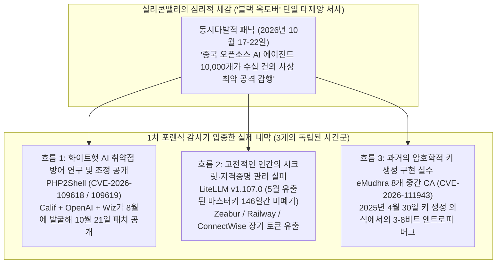
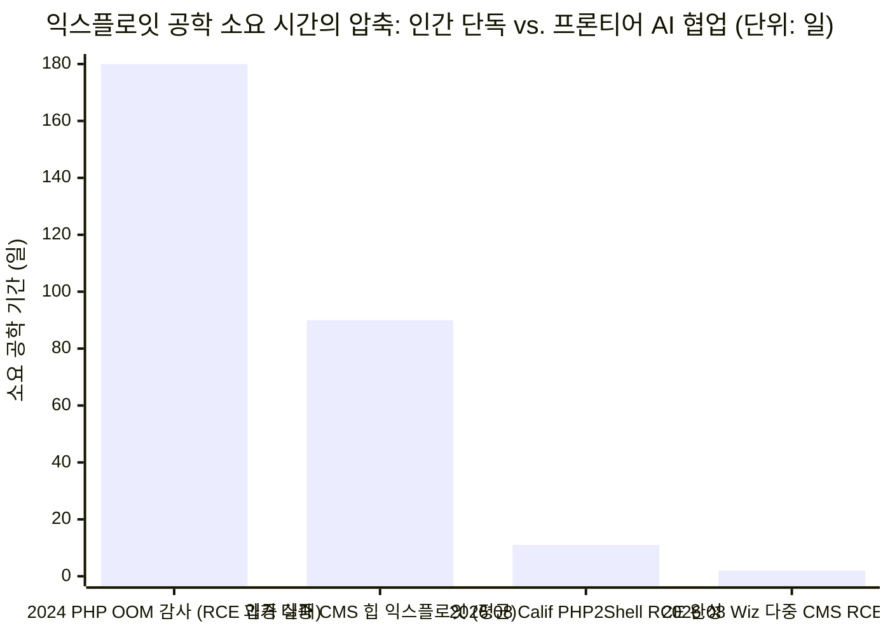

2026년 10월 22일, 실리콘밸리의 프로덕트 리더 존 밀리노비치(John Milinovich — 현 Figma AI 리서치 및 신제품 총괄, 전 Canva 생성형 AI 프로덕트 총괄)는 자신의 블로그에 **[Black October (검은 10월)](https://mili.dev/writing/black-october/)**라는 845단어 분량의 글을 게시했습니다. 그는 최근 48시간 동안 샌프란시스코 및 AI 업계의 분위기를 금융 위기 영화 *마진 콜(Margin Call)*에서 모두가 파멸 직전임을 깨닫고 심야 이사회실에서 패닉에 빠지는 장면에 비유하며, 자율형 AI의 **"급격한 이륙(Fast Takeoff)"**이 초래한 사상 초유의 사이버보안 재앙이 시작되었다고 경고했습니다.

> *"우리는 지금 '블랙 옥토버(Black October)'라 불리는 사태가 시작된 지 48시간째를 맞이하고 있다. 지난 이틀 동안 발생한 수십 건의 사이버 공격은 각각 하나만 떼어놓고 보더라도 한 해 최악의 사건으로 기록될 만한 수준이다... 가장 큰 취약점 중 하나는 엄청나게 널리 쓰이는 프로그래밍 언어인 PHP에서 나왔는데, 이를 촉발한 프롬프트는 문자 그대로 'Find vulnerabilities in php(PHP에서 취약점을 찾아라)'였다."* — **[John Milinovich, *Black October* (2026년 10월 22일)](https://mili.dev/writing/black-october/)**

빅테크 기업의 AI 총괄 인사가 "검열되지 않은 중국산 오픈소스(오픈웨이트) AI 모델을 무기로 삼은 블랙햇 해커들이 단 한 줄의 명령어로 `10,000`개의 무박 24시간 자율 에이전트를 가동해 서구 자본주의 체제를 파괴하고 있다"고 주장하고, 전 세계 웹사이트의 약 `70%`를 구동하는 PHP가 단 네 단어짜리 프롬프트에 뚫렸다고 선언할 때, 이는 철저한 **"사금 채취(Panning for Gold)"** 포렌식 감사를 요구합니다.

본 글에서는 2026년 10월 17일부터 10월 24일 사이에 발표된 1차 보안 사료들—**[PHP2Shell 공식 공개 포털](https://www.php2shell.com/)**, 최초 발견자인 라이언 오스틴(Ryan Austin)의 **[Calif Research 기술 보고서](https://calif.io/php2shell/)**, **[Wiz Research의 위협 분석 보고서](https://www.wiz.io/blog/php2shell-php-rce)**, **[PHP 재단(The PHP Foundation)의 공식 사후 분석](https://thephp.foundation/blog/2026/10/21/todays-php-security-release-and-how-were-strengthening-php-security/)**, **[LiteLLM `v1.107.0` 공급망 침해 공격 체인 보고서](https://docs.litellm.ai/blog/security-incident-oct-21-2026-attack-chain)**, **[Qualys의 eMudhra 인증기관(CA) 암호학적 결함 분석](https://blog.qualys.com/product-tech/2026/10/23/how-to-identify-compromised-emudhra-certificates-with-qualys-cve-2026-111943-and-cve-2026-111944)**, 그리고 **[Anthropic의 Claude Mythos 공식 문서](https://www.anthropic.com/claude/mythos)**—를 교차 검증하여 *"Black October"* 에세이의 실증적 진실과 사실적 오류를 명확히 분리합니다.

---

## 1. 핵심 판정 요약 및 주장별 포렌식 검증표

> [!IMPORTANT]
> **최종 포렌식 판정 — AI 기반 익스플로잇 공학 비용의 구조적 붕괴는 '사실(`True`)', 그러나 개별 사건의 인과 귀속 및 '단 한 줄 프롬프트' 신화는 '오류(`False`)'임:**
> 1. **밀리노비치가 정확히 짚어낸 부분 (익스플로잇 개발 경제학의 변곡점):** 프론티어 AI 모델(**[Claude Mythos 5.1](https://www.anthropic.com/claude/mythos)**, **OpenAI GPT-5.6 Sol / Codex Security**, **Google Gemini 4 Argon**)은 **다단계 익스플로잇 체인 구축(Multi-step Exploit Chaining)**에서 실질적인 임계점을 넘었습니다. **[PHP2Shell (`CVE-2026-109618` 및 `CVE-2026-109619`)](https://www.wiz.io/blog/php2shell-php-rce)** 사례에서 10년 넘게 방치되었던 메모리 부족(`OOM`) 버그를 `mod_php`와 `PHP-FPM` 환경의 인증 전 원격 코드 실행(`Pre-Auth RCE`) 무기로 전환하는 데에는 힙 그루밍(Heap Grooming), `longjmp()` 비지역 점프 인터럽트, 요청 간 댕글링 포인터 재사용을 정교하게 엮어야 했습니다. 과거 최정상급 보안팀이 수개월간 매달려야 했던 이 작업이 AI를 통해 **수일 내지 수시간**으로 압축되었습니다.
> 2. **밀리노비치의 결정적 오류 #1 (`"Find vulnerabilities in php"` 한 줄 프롬프트 신화):** `PHP2Shell`의 최초 발견자인 **[Calif Research](https://calif.io/php2shell/)**의 라이언 오스틴(`@lcfr_hax`)은 공식 보고서에서 이 소문을 정면으로 반박했습니다: *"단순한 프롬프트만으로 모든 버그를 파헤칠 수 있는 모델은 존재하지 않는다(No model is simply capable of unearthing 'all bugs' with simple prompts)."* 더욱이 **[PHP 재단 공식 보고서](https://thephp.foundation/blog/2026/10/21/todays-php-security-release-and-how-were-strengthening-php-security/)**에 따르면, 2026년 초 Anthropic의 **`Claude Mythos`**로 PHP 전체 코드베이스를 스캔했을 때는 이 RCE를 찾아내지 못했으며, 근본 원인이 된 `OOM` 버그는 이미 **2004년**(Stefan Esser), **2020년**(PHP 버그 `#78876`), **2024년**(Quarkslab/OSTIF 감사)에 인간 연구자들이 발견했으나 보안팀의 합의제 의사결정 마비로 패치가 지연되었던 것입니다.
> 3. **밀리노비치의 결정적 오류 #2 (화이트햇 연구 공개와 인간의 기본 보안 실수를 '중국산 오픈웨이트 해커 군단의 공격'으로 혼동):** 2026년 10월 중순의 사건 다발은 중국 블랙햇 AI 군단의 동시다발 공세가 아니었습니다. `PHP2Shell`은 미국·이스라엘 화이트햇 연구진(Calif, OpenAI, Wiz)이 미국 상용 모델을 사용해 수행한 **책임 있는 사전 조정 공개(Coordinated Disclosure)**였고, **[LiteLLM `v1.107.0` 공급망 해킹](https://docs.litellm.ai/blog/security-incident-oct-21-2026-attack-chain)**은 2026년 5월 개발자가 공개 GitHub 저장소에 마스터키를 평문 커밋한 뒤 **5개월 동안 폐기(Revoke)하지 않은 인적 과실** 때문이었으며, **[eMudhra 인증기관(CA) 사태(`CVE-2026-111943`)](https://blog.qualys.com/product-tech/2026/10/23/how-to-identify-compromised-emudhra-certificates-with-qualys-cve-2026-111943-and-cve-2026-111944)**는 2025년 4월 키 생성 의식 중 설정 오류로 개인키 엔트로피가 **3~8비트**(전자계산기로도 풀리는 수준)로 떨어진 사건이었습니다.
> 4. **위협 진단과 대응 처방의 심각한 불일치:** 서버 측 언어 런타임의 인증 전 메모리 오염(`PHP2Shell`), 2FA 인증 이후의 OAuth 토큰 탈취(`LiteLLM`), 루트 인증기관 신뢰 붕괴(`eMudhra`)를 경고하면서 독자에게 소비자용 2FA 앱(`Duo`), 비밀번호 관리자(`1Password`), 명의도용 방지 앱(`Alta`)을 설치하라고 권하는 것은 **해당 공격 벡터에 대한 방어력이 `0%`인 범주 오류(Category Mismatch)**입니다.

| `mili.dev/writing/black-october/`의 핵심 주장 | 1차 포렌식 사료 검증 결과 (2026년 10월 17~24일 보고서) | 인식론적 판정 |
| :--- | :--- | :---: |
| **1. "이틀 동안 한 해 최악급 사이버 공격 수십 건이 동시다발로 터졌다"** | 10월 17~22일 사이 초대형 취약점 공개(`PHP2Shell`, `eMudhra`, `GitLab RCE`, `Node.js Brotli`)와 침해 사고(`LiteLLM v1.107.0`, `ConnectWise/M365`, `Zeabur`, `Railway`)가 집중된 것은 사실이나, **화이트햇 방어 패치 공개**와 **전통적 자격증명 유출 사고**가 한데 묶여 과장됨. | **부분적 사실 (인과 혼동)** |
| **2. "Anthropic과 OpenAI가 국가안보 위험 때문에 최고 성능 모델의 일반 공개를 보류했다"** | 검증된 사실. **[Anthropic은 `Claude Mythos 5` 및 `Mythos 5.1`](https://www.anthropic.com/claude/mythos)**(입력 `USD 10` / 출력 `USD 50` per 1M 토큰)을 **Project Glasswing** 및 **Cyber Verification Program** 인증 방어자에게만 제한 공급하고, 일반에는 안전장치가 적용된 `Claude Fable 5.1`만 공개함. | **사실 (검증됨)** |
| **3. "블랙햇 해커들이 90~95% 성능의 중국산 오픈소스 모델로 서구 자본주의를 공격 중이다"** | 중국 오픈웨이트 모델이 프론티어 대비 `90~95%` 수준까지 추격한 것은 사실이나, 10월 주요 사건(`PHP2Shell`, `LiteLLM`, `eMudhra`) 중 중국 오픈웨이트 AI 해커 군단의 소행으로 밝혀진 사례는 **단 1건도 없음**. | **근거 없는 추측** |
| **4. "PHP 취약점을 찾아낸 프롬프트는 문자 그대로 `'Find vulnerabilities in php'`였다"** | 최초 발견자 라이언 오스틴(**[Calif Research](https://calif.io/php2shell/)**)과 **[PHP 재단](https://thephp.foundation/blog/2026/10/21/todays-php-security-release-and-how-were-strengthening-php-security/)**이 직접 반박함. 앞서 수행된 `Claude Mythos` 광역 스캔은 실패했으며, 인간 전문가의 2004/2020/2024년 `OOM` 도메인 가설 지시가 결정적이었음. | **거짓 (와전된 루머)** |
| **5. "지금 우리는 0에서 1로 비트가 뒤집히는 '급격한 이륙(Fast Takeoff)'을 겪고 있다"** | AI가 익스플로잇 체인 구축 기간을 수개월에서 수일로 단축(**[Wiz Research](https://www.wiz.io/blog/php2shell-php-rce)**)한 것은 **보안 공학 생산성의 비약적 점프**이지, 모델이 스스로를 재귀 개선(`RSI`)하는 특이점이 아님. | **과장됨** |
| **6. "대응책으로 Duo(2FA), 1Password, Alta, IoT 네트워크 분리를 설정하라"** | 일반적인 개인 보안 습관으로는 유익하나, 인증 전 서버 RCE(`PHP2Shell`), 워커 힙 메모리 유출, 2FA 이후 OAuth 토큰 탈취(`LiteLLM`), CA 인증서 위조(`eMudhra`) 앞에서는 **방어 효과 `0%`**. | **처방 범주 불일치** |

---

## 2. '블랙 옥토버' 사건 군집의 포렌식 분해 (Phases 1 & 2)

왜 2026년 10월 20~22일은 실리콘밸리 내부자들에게 동시다발적인 사이버 대재앙처럼 느껴졌을까요? 실제로 96시간이라는 짧은 시간 창 안에 **굵직한 보안 사건과 긴급 패치 공지가 최소 7건 이상** 쏟아졌기 때문입니다. 그러나 각 사건의 **실제 근본 원인(Root Cause)**과 **AI 개입 여부**를 1차 사료로 분해하면, 단일한 'AI 해커 군단' 서사는 세 가지 전혀 다른 흐름으로 분리됩니다.

| 사건 / 취약점 공개 (2026년 10월) | 영향 범위 및 심각도 | 실제 근본 원인 및 공격 벡터 | AI의 실제 역할 | 1차 검증 출처 |
| :--- | :--- | :--- | :--- | :--- |
| **1. `PHP2Shell` (`CVE-2026-109618` 및 `CVE-2026-109619`)** *(10월 21일 패치 및 공개)* | PHP `5.4` ~ `8.5.11` (전 세계 웹사이트의 약 `70%`: WordPress, Drupal, Joomla, MediaWiki). **CVSS 9.2**. | `ZendMM` / `Session upload_progress` / `unserialize()` / `OPcache`에서 `longjmp()` OOM 인터럽트로 인한 인증 전 RCE 및 프로세스 메모리 유출. | **높음 (화이트햇 방어 연구):** Calif, OpenAI(`GPT-5.6 Sol`), Wiz(`Gemini 4 Argon`)가 *Patch the Planet* 산하에서 발굴·패치 검증. | **[PHP2Shell](https://www.php2shell.com/)**, **[Calif](https://calif.io/php2shell/)**, **[Wiz](https://www.wiz.io/blog/php2shell-php-rce)**, **[PHP 재단](https://thephp.foundation/blog/2026/10/21/todays-php-security-release-and-how-were-strengthening-php-security/)** |
| **2. `LiteLLM v1.107.0` 공급망 침해** *(10월 21일 발생)* | PyPI `litellm==1.107.0` 및 Docker Hub `latest` (대표적 Python LLM 게이트웨이). | 2026년 5월 27일 공개 GitHub 저장소(`LiteLLM-Labs/lite-harness`)에 평문 커밋된 마스터키를 **5개월간 미폐기**; 10월 10일 공격자가 이를 이용해 조직 소유자의 GitHub CLI OAuth 토큰 탈취. | **AI 취약점 발굴 아님 (`0%`):** 전형적인 인간의 시크릿 관리 실패(피해 대상이 AI 라이브러리였을 뿐임). | **[LiteLLM 공식 공격 체인 보고서](https://docs.litellm.ai/blog/security-incident-oct-21-2026-attack-chain)** |
| **3. `eMudhra` 중간 인증기관(CA) 키 취약점 (`CVE-2026-111943` / `111944`)** *(10월 17~20일 공개)* | `emSign ECC Root CA - G3` 산하 8개 중간 CA 인증서(TLS 6개, 코드서명 2개). Chrome·Mozilla 루트 신뢰 박탈. | **2025년 4월 30일** 키 생성 의식 중 PKCS#11 래핑/언래핑 오류로 P-384 개인키 유효 엔트로피가 **3~8비트**로 축소됨(즉시 역산 가능). | **AI 취약점 발굴 아님 (`0%`):** 18개월 전 물리적 키 생성 의식에서 발생한 암호학적 구현 실수. | **[Qualys 분석](https://blog.qualys.com/product-tech/2026/10/23/how-to-identify-compromised-emudhra-certificates-with-qualys-cve-2026-111943-and-cve-2026-111944)**, **[The Record](https://therecord.media/indian-tech-company-announces-withdrawal-certificate-business-incident)** |
| **4. 클라우드 PaaS 침해 (`Zeabur`, `Railway`)** *(10월 중순)* | 개발자 클라우드 배포 플랫폼 및 고객 환경 변수(API 키 등). | 노출된 장기 관리자 평문 자격증명 및 탈취된 OAuth/CI 토큰을 이용한 내부 DB 및 환경 변수 열람. | **AI 취약점 발굴 아님 (`0%`):** 전통적인 자격증명 유출 및 권한 관리 실패. | 플랫폼 보안 공지 |
| **5. `ConnectWise` 클라우드 백업 / M365 침해** *(10월 중순)* | 수천 개 엔터프라이즈 Microsoft 365 테넌트 (`Storm-0940`). | 클라우드 백업 시스템의 벤더 자격증명 탈취를 통한 하위 테넌트 수평 이동. | **AI 취약점 발굴 아님 (`0%`):** 고전적인 공급망 자격증명 남용. | Microsoft 위협 인텔리전스 / CISA |

---

## 3. 포렌식 심층 감사 #1: `PHP2Shell` (`CVE-2026-109618` & `CVE-2026-109619`)은 실제로 어떻게 발견되었는가? (Phases 3 & 4)

밀리노비치 에세이의 가장 강렬한 문장은 PHP에 관한 주장입니다:
> *"가장 큰 취약점 중 하나는 엄청나게 널리 쓰이는 프로그래밍 언어인 PHP에서 나왔는데, 이를 촉발한 프롬프트는 문자 그대로 'Find vulnerabilities in php'였다."*

**[Calif Research](https://calif.io/php2shell/)**, **[Wiz Research](https://www.wiz.io/blog/php2shell-php-rce)**, 그리고 **[PHP 재단](https://thephp.foundation/blog/2026/10/21/todays-php-security-release-and-how-were-strengthening-php-security/)**의 1차 기술 보고서를 통해 `PHP2Shell`의 **22년에 걸친 실제 타임라인**과 C 인터프리터 내부 메커니즘을 대조해 보겠습니다.

### 3.1 22년의 역사: 왜 인간들은 이미 2004년, 2020년, 2024년에 이 버그의 뿌리를 알고 있었는가?
1. **2004년 (슈테판 에서의 최초 메모리 한도 인터럽트 취약점):** 22년 전, 전설적인 PHP 보안 연구자 슈테판 에서(Stefan Esser)는 PHP 요청이 `memory_limit`에 도달할 때 호출되는 `zend_bailout()`이 C 표준 라이브러리의 비지역 점프 함수인 `longjmp()`를 실행하여, 초기화 도중이던 내부 C 구조체를 불완전한 상태로 남겨둔다는 사실을 최초로 밝혀냈습니다.
2. **2020년 (PHP 버그 리포트 `#78876`):** 연구자 `jr@coredu.mp`가 `multipart/form-data`에서 긴 변수가 메모리 부족(`OOM`)을 유발해 임시 파일 정리가 누락된다는 버그 `#78876`을 보고했습니다. 당시 HHVM 팀은 이를 패치했으나 코어 PHP에서는 단순 파일 정리 문제로 여겨 넘어갔습니다.
3. **2024년 (OSTIF 및 Quarkslab 보안 감사 + PHP 코어 개발자의 재발견):** 2024년 독일 Sovereign Tech Agency의 자금 지원으로 **Quarkslab**(OSTIF 주관)이 PHP 외부 보안 감사를 수행했습니다. 이때 Quarkslab이 보고한 이슈를 수정하던 PHP 재단 소속 코어 개발자가 **`CVE-2026-109618`의 근본 원인인 `OOM` 메모리 오염 문제를 직접 발견**했습니다! 그런데 왜 2024년에 고쳐지지 않았을까요? **[PHP 재단이 2026년 10월 21일 공식 블로그에서 정직하게 고백한 바](https://thephp.foundation/blog/2026/10/21/todays-php-security-release-and-how-were-strengthening-php-security/)**에 따르면:
   > *"2024년 당시 OOM 문제의 잠재적 악용 가능성이 이론적으로 제기되었으나 구체적인 RCE 공격 경로가 입증되지 않았다... 만장일치 합의제로 운영되던 PHP 보안팀은 서로 다른 장단점(하위 호환성 파괴, 서드파티 확장 모듈 수정 강제 등)을 지닌 수정안들 사이에서 결정을 내리지 못했고, 잘못된 선택을 배포했을 때의 역풍을 두려워해 수개월간 작업이 멈추고 재개되기를 반복했다. 변명하지 않겠다. 이 지연은 보안팀의 의사결정 구조와 리소스 부족이 빚어낸 구조적 실패였다."*
4. **2026년 초 (Anthropic `Claude Mythos` 스캔의 실패):** 2026년 초, PHP 재단은 Alpha-Omega와 협력하여 Anthropic의 비공개 최첨단 모델인 **`Claude Mythos`로 PHP 코드베이스를 스캔**했습니다. 그러나 도메인 전문가의 구체적인 가설 유도 없이 진행된 이 스캔은 **`PHP2Shell` RCE 체인을 찾아내지 못했습니다**.
5. **2026년 7월 30일 ~ 8월 24일 (인간 전문가의 도메인 가설 + AI의 익스플로잇 체인 완성):**
   * **2026년 7월 30일**, 보안 기업 **Calif**(라이언 오스틴 `@lcfr_hax` 및 미할 잘레프스키 `@lcamtuf`)가 OpenAI의 *"Patch the Planet"* 프로그램의 일환으로 PHP 감사를 시작했습니다.
   * 라이언 오스틴은 `"Find vulnerabilities in php"` 같은 막연한 프롬프트를 입력한 것이 아니라, 2004년 슈테판 에서의 버그에 대한 자신의 20년 치 배경지식을 바탕으로 AI 에이전트에게 **두 가지 구체적인 공격 프리미티브(Primitive)**를 찾도록 정밀하게 지시했습니다.
     1. **프리미티브 A (`post_max_size = 8 MiB` 장벽을 우회하여 `memory_limit = 128 MiB`를 강제 초과하기):** RFC 1867 멀티파트 파일 업로드에서 파일명이 비어 있는 항목(`filename=""`)은 `max_file_uploads` 개수 제한에 포함되지 않으면서도, PHP의 `FILES` 슈퍼글로벌 배열 내에 6개의 네이티브 해시테이블(`name`, `full_path`, `type`, `tmp_name`, `error`, `size`)과 버킷을 전부 할당한다는 점을 발견했습니다. 폼 필드 이름을 다중 중첩(`files[a][b][c]...`)시키면 `8 MiB` 미만의 작은 HTTP 본문만으로도 **`128 MiB` 이상의 Zend 힙 메모리를 소진**시켜 원하는 정확한 시점에 `OOM` `zend_bailout()`(`longjmp()`)을 터뜨릴 수 있었습니다!
     2. **프리미티브 B (정리 루틴이 실행되기 직전에 치명적 오류로 상태 고정하기):**
        * `_zend_hash_str_add_or_update_i` 함수에서 PHP가 키 문자열 할당(`zend_string_init`) 전에 `ht->nNumUsed++`를 먼저 증가시키기 때문에, 키 할당 순간 `OOM`이 터지면 초기화되지 않은 슬롯이 파괴 루틴(`zend_array_destroy`)에 그대로 노출됩니다.
        * `php_session_rfc1867_callback()`(`CVE-2026-109618`)에서는 멀티파트 업로드 진행 상태 기능이 일반 모듈 활성화 플래그(`PG(modules_activated) = 1`)가 켜지기도 전인 요청 초기 단계(`php_hash_environment`)에서 세션 전역 변수(`PS(id)` 및 `PS(http_session_vars)`)에 현재 요청 힙을 가리키는 포인터를 저장합니다. 직후 `OOM`이 발생하면 `php_request_shutdown()`은 `PG(modules_activated) == 0`을 보고 **세션 모듈 종료 루틴(`RSHUTDOWN`)을 건너뛴 채 요청 힙만 해제**해 버립니다! 살아남은 Apache `mod_php` 워커 프로세스가 다음 요청을 처리할 때, 해제된 메모리를 가리키는 `PS(id)`가 재사용되면서 다른 요청의 민감한 메모리(비밀번호, API 키, 세션 토큰)가 `PHPSESSID` 응답 쿠키에 그대로 유출(`Heartbleed` 방식)되거나 Use-After-Free를 통해 인증 전 `RCE`가 달성됩니다.
        * 나아가 시작 단계 실패 시 워커를 종료시키는 `PHP-FPM` 환경을 뚫기 위해, Calif와 Wiz 연구진은 시작 이후(`post-startup`) 실행되는 `php_var_unserialize_init()`의 중첩 카운터(`BG(unserialize).data` 및 음수 `used_slots` 인덱스 계산: `slot = destructor_block + 16 + 16 * used_slots`), `EG(last_fatal_error_backtrace)` Use-After-Free, 그리고 `OPcache` 공유 메모리 프론티어(`CG(map_ptr_last)`) 타입 혼동(`CVE-2026-109619`)을 연쇄 결합했습니다.

### 3.2 `PHP2Shell`에서 AI가 실제로 바꾼 것과 바꾸지 못한 것
**[Calif Research](https://calif.io/php2shell/)**와 **[Wiz Research](https://www.wiz.io/blog/php2shell-php-rce)**의 1차 보고서는 정확히 동일한 결론을 내립니다.
* **AI는 네 단어짜리 게으른 프롬프트로 인간 보안 전문가의 도메인 직관을 대체하지 못했습니다.** 라이언 오스틴은 다음과 같이 못 박았습니다: *"LLM이 공개된 과거 취약점 데이터를 학습했을지는 몰라도, 기본 변종 분석에서는 가장 최신의 유명한 버그 주변만 맴돌 뿐 20년 된 해묵은 익스플로잇 프리미티브에서 출발하지 못한다. 표적의 취약점 역사를 연구자 자신의 머릿속에 담아두어야만 그 방향을 명시적으로 프롬프트할 수 있다."*
* **AI가 혁명적으로 바꾼 것은 '이론적 버그를 실전 작동 익스플로잇으로 전환하는 공학 비용'입니다:** 2024년 PHP 코어 개발자들은 `OOM` 버그를 알고도 설마 실제 RCE가 가능하겠느냐며 수정을 미뤘습니다. 그러나 `GPT-5.6 Sol`과 `Gemini 4 Argon`을 디버거 및 새니타이저(Sanitizer) 루프에 결합한 연구진은, 과거 최정예 팀이 수개월간 메모리 레이아웃과 씨름해야 했던 WordPress·Drupal·Joomla 대상 RCE 익스플로잇 작성을 **단 며칠 만에 완수**했습니다.

---

## 4. 포렌식 심층 감사 #2: `LiteLLM` 및 `eMudhra` 사후 보고서가 논파하는 'AI 해커 군단' 인과 오류 (Phase 4)

브라운과 킬리의 **4방향 인과 감사(4-Way Causal Audit)**를 10월의 다른 주요 사건들에 적용해 보면, 모든 사고를 초인적 AI 에이전트 탓으로 돌리는 것이 전형적인 **선후 인과 오류(Post Hoc Fallacy)이자 단일 원인 귀속 오류**임이 드러납니다.

### 4.1 10월 21일 `LiteLLM v1.107.0` 공급망 해킹의 진실: 146일 동안 폐기하지 않은 평문 마스터키
**LiteLLM**은 가장 널리 쓰이는 오픈소스 파이썬 AI 게이트웨이 라이브러리이기 때문에, 10월 21일 자격증명 탈취 악성코드와 원격 제어 백도어(RAT)가 심어진 `litellm==1.107.0`이 PyPI와 Docker Hub에 배포되었을 때 많은 이들이 "AI 에이전트 군단에 의한 공격"을 의심했습니다.

그러나 10월 23일 공개된 **[LiteLLM 보안팀의 공식 공격 체인 사후 보고서](https://docs.litellm.ai/blog/security-incident-oct-21-2026-attack-chain)**는 AI 제로데이와는 아무런 관련이 없는 **고전적인 인적 시크릿 관리 실패**를 기록하고 있습니다.
1. **2026년 5월 27일 (D-Day — 개발자의 평문 키 커밋):** 한 개발자가 공개 저장소인 `LiteLLM-Labs/lite-harness`에 내부 에이전트 오케스트레이션 도구(`LiteLLM Agent Platform`)의 **마스터키가 평문으로 담긴 설정 파일**을 실수로 커밋했습니다. 팀은 곧바로 실수를 인지하고 `git push --force`로 커밋을 덮어썼으며 해당 키를 폐기 대상으로 분류했으나, **실제로는 마스터키를 폐기(Revoke)하지 않는 치명적 실수**를 범했습니다.
2. **최소 권한 원칙을 위반한 조직 소유자 토큰:** 문제의 `LiteLLM Agent Platform`에는 권한이 제한된 서비스 계정이 아니라, **GitHub 조직 소유자(Owner) 개인 계정의 GitHub CLI OAuth 토큰**이 통째로 연결되어 있었습니다. 더욱이 GitHub CLI 토큰은 이미 2FA를 통과한 후 발급되는(`post-2FA`) 토큰이어서 민감한 조직 설정 변경 시에도 GitHub의 추가 2FA 재인증 절차를 거치지 않습니다!
3. **2026년 10월 10일 (136일 후 — 마스터키 악용 및 소유자 권한 장악):** 공격자는 5개월간 방치된 마스터키로 에이전트 플랫폼에 접속해 조직 소유자의 GitHub CLI OAuth 토큰을 그대로 추출했습니다.
4. **2026년 10월 10~21일 (수평 이동 및 악성 릴리스 배포):** 소유자 권한을 획득한 공격자는 내부 저장소에 악성 CI 워크플로우 브랜치를 커밋해 메인테이너 2명의 OAuth 토큰과 클라우드 시크릿을 추가로 빼낸 뒤, **10월 21일** 공식 빌드 파이프라인을 통해 악성 `litellm==1.107.0`을 배포했습니다.

**포렌식 결론:** 이 공격의 어느 단계에도 초인적 AGI나 10,000개의 자율 에이전트 군단은 필요하지 않았습니다. 공개 Git 저장소에 실수로 올린 마스터키를 146일 동안 회전(Rotation)시키지 않고 조직 소유자의 무제한 OAuth 토큰을 실험용 서버에 넣어둔 것은 **2015년식 기본 DevOps 보안 위생 실패**입니다.

### 4.2 10월 17일 `eMudhra` 인증기관(CA) 붕괴 (`CVE-2026-111943` & `CVE-2026-111944`): 2025년 4월에 만들어진 3비트짜리 개인키
마찬가지로 10월 17일, Google Chrome(`CRLSet`), Mozilla Firefox(`OneCRL`), Apple, Microsoft가 인도의 디지털 신뢰 기업 **eMudhra**(`emSign ECC Root CA - G3`)의 **8개 중간 CA 인증서**(TLS 6개, 코드서명 2개)를 긴급 차단하고 루트 인증서 신뢰를 박탈하여 eMudhra가 글로벌 웹사이트 SSL/TLS 사업에서 철수하는 초유의 사태가 벌어졌습니다.

초지능 AI가 타원곡선 암호(`NIST P-384`)를 해독한 것일까요? **전혀 아닙니다.** **[Qualys의 포렌식 보고서](https://blog.qualys.com/product-tech/2026/10/23/how-to-identify-compromised-emudhra-certificates-with-qualys-cve-2026-111943-and-cve-2026-111944)**가 밝힌 진실은 다음과 같습니다.
* **2025년 4월 30일**에 거행된 24개 하위 CA 키 생성 의식(Key Ceremony) 당시, 키 래핑/언래핑(Wrap/Unwrap) 과정의 소프트웨어 결함으로 인해 두 번째로 생성된 취약한 키 세트가 8개 중간 CA에 잘못 적용되었습니다.
* 이로 인해 원래 `384비트`여야 할 P-384 개인키의 유효 엔트로피가 고작 **`3~8비트`**로 토막 났으며, 일부 개인키는 `4`, `56`, `115` 같은 한두 자리 정수로 전락했습니다!
* 엔트로피가 `3~8비트`인 공개키에서 개인키를 복구하는 데 필요한 연산은 최대 **`2^8 = 256`번의 곱셈**에 불과하며, 이는 1990년대 공학용 계산기나 단일 CPU 스레드에서 **1밀리초(0.001초) 미만에 끝나는 산수**입니다.

---

## 5. 통계 및 경제성 감사: 기계 속도(Machine-Speed) 취약점 발굴의 비대칭성 (Phase 5)

비록 밀리노비치가 10월의 사건들을 중국 블랙햇 AI 군단과 네 단어짜리 프롬프트로 잘못 귀속시켰을지라도, 그의 불안감 이면에 있는 **익스플로잇 공학 비용의 급락** 자체는 **[Anthropic의 Claude Mythos 시스템 카드](https://www.anthropic.com/claude/mythos)**와 **[Wiz Research의 PHP2Shell 데이터](https://www.wiz.io/blog/php2shell-php-rce)**가 입증하는 엄연한 실증적 현상입니다.

*차트 범례: 메모리 오염 근본 원인 발견부터 실전 작동하는 인증 전 RCE 익스플로잇 완성까지 소요된 일수(`2024년 Quarkslab 감사 후 PHP 내부 지연: 180일 이상 RCE 미입증`; `과거 수동 다중 타겟 힙 익스플로잇 개발 기준: 약 90일`; `Calif Research 2026년 7월 30일~8월 11일 RCE PoC 완성: 11일`; `Wiz Research 2026년 8월 19~21일 Drupal 및 WordPress RCE 이식: 2일`). 원천 출처: **[Calif Research](https://calif.io/php2shell/)** 및 **[Wiz Research](https://www.wiz.io/blog/php2shell-php-rce)**.*

### 5.1 '취약점 쓰나미' 방정식: 왜 복잡성(Complexity)은 더 이상 레거시 코드를 지켜주지 못하는가?
지난 25년 동안 핵심 오픈소스 인프라(`PHP`, `OpenSSL`, `Linux 커널`, `glibc` 등)는 암묵적인 **복잡성 방패(Complexity Shield)**에 의존해 왔습니다.
* 레거시 C 코드베이스에는 수천 개의 잠재적 메모리 안전성 버그(`Use-After-Free`, 오류 처리 경로의 미초기화 구조체 등)가 숨어 있었습니다.
* 그러나 2020년 PHP 버그 `#78876`이나 2024년 Quarkslab의 `OOM` 발견처럼 미묘한 상태 오염 버그를 무작위화된 실전 서버 메모리 레이아웃에서 작동하는 신뢰할 수 있는 원격 코드 실행(`RCE`) 익스플로잇으로 엮어내는 데에는 최정상급 인간 연구자의 시간 `300~1,000시간 이상`(기회비용 `USD 50,000 ~ USD 250,000+`)이 소요되었습니다. 따라서 메인테이너들은 작동하는 개념증명(`PoC`)이 없는 이론적 버그의 수정을 뒤로 미뤄왔습니다.

그러나 2026년 중반, 프론티어 추론 모델(**[Claude Mythos 5.1](https://www.anthropic.com/claude/mythos)**, **`GPT-5.6 Sol`**, **`Gemini 4 Argon`**)이 디버거·퍼저·새니타이저 도구와 결합되면서 **익스플로잇 체인 반복 실험과 타겟별 메모리 레이아웃 적응의 한계비용이 `1/10 ~ 1/50`로 폭락**했습니다.

$$
\text{Effective Vulnerability Exposure} = \sum_{i=1}^{N_{\text{latent}}} \mathbb{I}\!\left(\text{Cost}_{\text{Exploit}}(i, \text{AI}) < \text{Value}_{\text{Target}}(i)\right)
$$

익스플로잇 개발 비용 `Cost_Exploit(i, AI)`이 **3개월의 고급 인건비(`~USD 100,000`)**에서 **48시간의 에이전트 디버깅 루프(`API 토큰 비용 ~USD 500`)**로 떨어지자, 지난 10~20년간 "실전 악용이 불가능하다"며 방치되었던 수천 개의 잠재적 C/C++ 버그들이 일제히 무기화 가능한 임계선을 넘어선 것입니다.

### 5.2 Anthropic의 이중 트랙 출시 아키텍처 감사 (`Claude Mythos 5.1` 대 `Claude Fable 5.1`)
**[anthropic.com/claude/mythos](https://www.anthropic.com/claude/mythos)**의 공식 문서는 프론티어 연구소가 이 공격·방어 비대칭성을 어떻게 통제하려 시도하는지 보여줍니다.
* **`Claude Mythos 5.1` (제한된 방어·연구 트랙):** 익스플로잇 생성, 바이너리 취약점 스캔, 침투 테스트 및 이중용도 생물학 역량이 온전히 활성화된 모델입니다(가격: 입력 100만 토큰당 `USD 10`, 출력 100만 토큰당 `USD 50`, 기본 30일 안전 모니터링 로그 보관 의무). **Project Glasswing**(2026년 6월 기준 15개국 약 150개 핵심 인프라 기관으로 확대) 및 **Cyber Verification Program**(2026년 10월 6일 확대)을 통과한 검증된 방어팀에게만 제공됩니다.
* **`Claude Fable 5.1` (대중 공개 프로덕션 트랙):** `Claude Mythos 5.1`과 동일한 기저 가중치를 공유하지만 실시간 안전 분류기가 씌워져 있어, 소스 코드 내 취약점 식별은 허용하되 침투 테스트·익스플로잇 생성·바이너리 스캔 요청은 차단하고 하위 모델(`Claude Opus 4.8`)로 라우팅합니다(이로 인해 안전장치가 개입할 때 `OSWorld 2.0` 등에서 `0점`을 기록함).

---

## 6. 부정적 시각(Negative View): 소비자용 보안 앱 처방의 허구성과 진짜 방어 대책 (Phase 6)

밀리노비치의 *[Black October](https://mili.dev/writing/black-october/)* 에세이에서 가장 취약한 대목은 결론부의 행동 지침입니다. 국가안보급 AI 해커 군단과 PHP 제로데이로 독자에게 극도의 공포를 심어준 뒤, 정작 그가 제시한 해결책은 네 가지 개인 소비자용 앱과 습관입니다.
1. *"모든 것에 2단계 인증(2FA)을 설정하라. 나는 Duo를 쓴다."*
2. *"기기 전반에 비밀번호 관리자를 써라. 나는 1Password를 쓴다."*
3. *"신원 보호 앱을 설치하라. 나는 Alta를 쓴다."*
4. *"IoT 기기를 별도 네트워크로 분리하라. Claude가 도와주었다."*

이 네 가지 처방을 2026년 10월 실제 발생한 공격 메커니즘에 대입해 **포렌식 방어력 스트레스 테스트**를 수행해 보겠습니다.

| 밀리노비치의 소비자 보안 권고 (`mili.dev`) | `PHP2Shell` (`CVE-2026-109618` / `109619`)을 막는가? | `LiteLLM v1.107.0` 공급망 오염을 막는가? | `eMudhra` 중간 CA 위조 공격을 막는가? | 2026년 10월 위협 벡터에 실제로 작동하는 엔지니어링 통제 수단 |
| :--- | :--- | :--- | :--- | :--- |
| **1. 소비자용 2FA (`Duo`)** | **불가 (`0%`):** `PHP2Shell`은 로그인이나 2FA 코드가 실행되기도 전인 멀티파트 파싱 단계에서 터지는 **인증 전 원격 코드 실행(`Pre-Auth RCE`)**임. | **불가 (`0%`):** 탈취된 GitHub CLI OAuth 토큰은 **이미 2FA 이후(`post-2FA`) 발급된 토큰**이어서 GitHub의 슈퍼유저 2FA 재인증을 완전히 우회함! | **불가 (`0%`):** 위조된 중간 CA 인증서는 TLS 트래픽을 중간자 공격(MITM)하거나 악성 바이너리에 정상 코드서명을 부여함. | 하드웨어 바인딩 **FIDO2/WebAuthn 패스키**, 수명이 짧은(1시간) 최소 권한 GitHub App 토큰 강제(장기 OAuth 토큰 금지), PHP 런타임 패치. |
| **2. 비밀번호 관리자 (`1Password`)** | **불가 (`0%`):** `CVE-2026-109619`는 서버 워커 프로세스의 힙 메모리(`API 키, 세션 쿠키, DB 암호`)를 `PHPSESSID` 쿠키로 직접 유출(`Heartbleed` 방식)함. | **불가 (`0%`):** `litellm==1.107.0` 악성 패키지는 `pip install` 실행 즉시 로컬 디스크·메모리의 클라우드·AI·브라우저 시크릿을 직접 긁어감. | **불가 (`0%`):** 브라우저/OS 루트 저장소가 신뢰하는 위조 인증서 앞에서는 무력함. | PHP **`8.5.12` / `8.4.27` / `8.3.36` / `8.2.35`** 즉시 업그레이드, 패키지 해시 고정 및 신규 릴리스 쿨다운(검역) 윈도우 적용, 메모리 안전 언어 도입. |
| **3. 명의도용 방지 앱 (`Alta`)** | **불가 (`0%`):** 개인정보가 이미 다 털린 뒤 신용조회를 사후 알림해 주는 수단에 불과함. | **불가 (`0%`):** 개발자 CI/CD 시크릿이나 클라우드 과금 토큰(LLMjacking)을 전혀 보호하지 못함. | **불가 (`0%`):** PKI 신뢰 체계와 무관함. | Git 푸시 즉시 작동하는 **자동 시크릿 스캐닝 및 즉각적 자동 폐기(Revocation) 웹훅**(LiteLLM의 146일 방치 차단). |
| **4. 가정용 IoT VLAN 분리** | **불가 (`0%`):** `PHP2Shell`의 표적은 인터넷에 노출된 웹 서버(`WordPress, Drupal, MediaWiki`)이지 거실의 스마트 전구가 아님. | **불가 (`0%`):** 표적은 개발자 워크스테이션과 프로덕션 쿠버네티스 클러스터임. | **불가 (`0%`):** 표적은 공개 TLS 및 OS 코드서명 검증기임. | 엣지 WAF의 요청-응답 전체 트랜잭션 검사(**[Cloudflare Managed Rules](https://blog.cloudflare.com/php-vulnerabilities-waf-protection/)**) + 패치 전 `session.upload_progress.enabled=0` 비활성화. |

---

## 7. 회색 사고(Grey Thinking) 조건부 합성 (`If-Clauses`) 및 확률 가중 최종 판정 (Phase 7)

실리콘밸리식 *마진 콜* 종말론과 안이한 무관심이라는 양극단을 거부하고, 2026년 10월의 실증적 교훈을 조건부 엔지니어링 원칙(**If-Clauses**)과 확률 가중 시나리오로 종합합니다.

### 7.1 조건부 엔지니어링 및 보안 정책 원칙 (`If-Clauses`)
* **만약(If) 인터넷에 노출된 C/C++ 기반 인프라(`PHP`, 웹 서버, 이미지·비디오 파서, 압축 라이브러리 등)를 운영·유지보수한다면:** **"복잡성 방패(Complexity Shield)는 이미 사망했다"고 가정해야 합니다.** 과거에는 "익스플로잇 체인을 구성하기에 너무 복잡하다"며 수정을 미뤘던 잠재적 메모리 오염 버그(`OOM` 비지역 점프, `Use-After-Free`, 타입 혼동)가 이제는 도메인 지식을 갖춘 인간 연구자와 프론티어 코딩 모델(`GPT-5.6 Sol`, `Gemini 4 Argon`, `Claude Mythos 5.1`)의 결합을 통해 **48~96시간 내에 실전 RCE 무기로 전환**됩니다.
* **만약(If) 외부 인터넷에서 접속 가능한 PHP 워크로드를 운영 중이라면:** 개인용 2FA 앱은 아무런 도움이 되지 않습니다. 즉시 **PHP `8.5.12`, `8.4.27`, `8.3.36`, `8.2.35`** 이상으로 런타임을 업그레이드하고, 지원 종료(EOL) 버전(`PHP 8.1` 이하)을 즉시 올릴 수 없다면 요청·응답 양방향을 검사하는 전체 트랜잭션 WAF(**[Cloudflare](https://blog.cloudflare.com/php-vulnerabilities-waf-protection/)**) 뒤에 격리한 뒤 `session.upload_progress.enabled=0`을 적용하고 `mod_php`에서 탈피하십시오.
* **만약(If) 소프트웨어 공급망과 AI 에이전트 플랫폼(`LiteLLM` 등)을 관리한다면:** **CI/CD 파이프라인과 에이전트 하네스에서 장기 유효(Long-lived) 개인 OAuth 토큰(`gh auth` CLI 토큰 등) 사용을 전면 금지하십시오.** 수명이 1시간 이내로 제한된 최소 권한 GitHub App 설치 토큰을 강제하고, 유출된 시크릿 감지 시 사람의 수동 확인을 기다리지 않고 즉시 API 키를 폐기하는 자동화 파이프라인을 구축해야 합니다.

### 7.2 확률 가중 시나리오 전망 (2026–2028)

| 시나리오 | 인식론적 확률 | 핵심 기제 및 실증적 근거 |
| :--- | :---: | :--- |
| **시나리오 A (기본 전망): '방어적 대청소 급증(Defensive Scrubbing Surge)' — 향후 18~24개월간 AI가 수십 년 묵은 레거시 C/C++ 버그를 대거 수면 위로 끌어올린 뒤 장기적으로 핵심 인프라가 단단해짐** | **`~60%`** | `PHP2Shell`이 2004/2020/2024년 `OOM` 결함을 마침내 뿌리 뽑게 만든 것처럼, **Anthropic Project Glasswing**, **OpenAI Patch the Planet**, **Wiz Atlas** 같은 방어 컨소시엄이 레거시 오픈소스 코드의 묵은 부채를 폭발적으로 발굴함. 단기적으로는 극심한 패치 피로도('블랙 옥토버' 현상)를 유발하지만, 2028년경에는 핵심 코드의 구조적 안전성이 크게 향상됨. |
| **시나리오 B (하방 위험): 패치 윈도우 비대칭성 — 패치 공개 직후 AI 기반 N-Day 익스플로잇 변종 생성이 엔터프라이즈 패치 속도를 앞지름** | **`~30%`** | 화이트햇 연구진이 먼저 취약점을 찾아 패치를 내놓더라도(혹은 `PHP2Shell`처럼 공개 하루 전 정보가 유출될 때), 공격자들이 오픈웨이트·상용 LLM을 이용해 수시간 내에 타겟 맞춤형 익스플로잇을 합성하여 미패치·EOL 시스템(`PHP 5.4~8.1`)을 대량 침해함. |
| **시나리오 C (꼬리 위험): 인간 전문가의 도메인 가설 없이 오픈웨이트 모델이 단순 프롬프트만으로 아키텍처급 제로데이를 자율 발굴하는 시나리오** | **`~10%`** | 밀리노비치가 묘사한 시나리오(단순히 `"Find vulnerabilities in php"`만 입력해 20년 묵은 심층 메모리 버그를 자율 발굴)는 Calif Research의 실험과 PHP 재단의 `Claude Mythos` 스캔 실패가 입증하듯 2026~2027년 기준으로는 여전히 소수 꼬리 위험에 머묾. |

### 최종 결론 (Bottom-Line Actionable Verdict)
존 밀리노비치의 **[Black October](https://mili.dev/writing/black-october/)** 에세이는 2026년 10월 실리콘밸리의 집단 심리를 보여주는 생생한 사회학적 기록이지만, 실제 발생한 보안 사건들에 대한 포렌식 분석으로는 심각한 오류를 안고 있습니다. 2026년 10월의 위기는 10,000개의 중국산 오픈소스 AI 에이전트가 네 단어짜리 프롬프트(`"Find vulnerabilities in php"`)를 실행해서 일어난 것이 아닙니다. 그것은 **세 가지 서로 다른 현실이 같은 주간에 충돌한 결과**였습니다:
1. **인간 보안 전문가들(`Calif`, `OpenAI`, `Wiz`)이 미국의 프론티어 AI(`GPT-5.6 Sol`, `Gemini 4 Argon`)를 지렛대 삼아**, 20년 넘게 알려진 PHP의 `OOM` 메모리 오염 버그(`CVE-2026-109618` / `109619`)가 이제는 불과 며칠 만에 인증 전 RCE 익스플로잇으로 무기화될 수 있음을 입증하고 패치한 사건;
2. **`LiteLLM`에서 유출된 평문 마스터키를 146일 동안 폐기하지 않은 인간의 기본적인 시크릿 관리 실패**; 그리고
3. **18개월 전 `eMudhra`의 물리적 키 생성 의식에서 발생한 3~8비트 엔트로피 암호 구현 실수**.

가상의 AGI 급격한 이륙 앞에 무력감을 느끼며 개인용 명의도용 방지 앱을 까는 것으로 '블랙 옥토버'에 대응하지 마십시오. **지금 당장 서버의 PHP 런타임을 패치(`8.5.12` / `8.4.27` / `8.3.36` / `8.2.35`)하고, CI/CD 파이프라인에 방치된 장기 OAuth 토큰을 폐기하며, 공격자보다 먼저 프론티어 AI를 투입해 조직 내부 코드베이스의 묵은 상태 오염 버그를 전수 감사하고 제거하는 것**이 유일하고 실질적인 엔지니어링 해답입니다.

---

## 8. 1차 출처 및 검증 가능한 참고문헌

1. **Milinovich, J. (2026).** *Black October.* `mili.dev` (22 October 2026). URL: [https://mili.dev/writing/black-october/](https://mili.dev/writing/black-october/)
2. **Austin, R. (`@lcfr_hax`) & Zalewski, M. (`@lcamtuf`) / Calif Research (2026).** *PHP2Shell: A tale of two PHP remote vulnerabilities (`CVE-2026-109618`, `CVE-2026-109619`).* Calif Research (21 October 2026). URL: [https://calif.io/php2shell/](https://calif.io/php2shell/)
3. **Tzadik, S., Tamari, S., Ohfeld, N., & Schwartz, T. / Wiz Research (2026).** *PHP2Shell: AI uncovers critical RCE vulnerabilities affecting 70% of the Internet.* Wiz Blog (21 October 2026). URL: [https://www.wiz.io/blog/php2shell-php-rce](https://www.wiz.io/blog/php2shell-php-rce)
4. **The PHP Foundation (2026).** *Today's PHP Security Release, and How We're Strengthening PHP Security (`PHP 8.5.12, 8.4.27, 8.3.36, 8.2.35`).* The PHP Foundation Blog (21 October 2026). URL: [https://thephp.foundation/blog/2026/10/21/todays-php-security-release-and-how-were-strengthening-php-security/](https://thephp.foundation/blog/2026/10/21/todays-php-security-release-and-how-were-strengthening-php-security/)
5. **Wiz Research, OpenAI Codex Security, & Calif Research (2026).** *PHP2Shell Official Coordinated Disclosure Portal.* URL: [https://www.php2shell.com/](https://www.php2shell.com/)
6. **Jensen, O. & Wang, M. / LiteLLM Security (2026).** *The attack chain behind the v1.107.0 LiteLLM release.* LiteLLM Official Documentation & Blog (23 October 2026). URL: [https://docs.litellm.ai/blog/security-incident-oct-21-2026-attack-chain](https://docs.litellm.ai/blog/security-incident-oct-21-2026-attack-chain)
7. **Anthropic (2026).** *Claude Mythos 5 & 5.1, Project Glasswing, and the Cyber Verification Program.* Anthropic Official Documentation. URL: [https://www.anthropic.com/claude/mythos](https://www.anthropic.com/claude/mythos)
8. **Madhuri, C. / Qualys Threat Research (2026).** *How to Identify Compromised eMudhra Certificates With Qualys (`CVE-2026-111943` and `CVE-2026-111944`).* Qualys Security Blog (24 October 2026). URL: [https://blog.qualys.com/product-tech/2026/10/23/how-to-identify-compromised-emudhra-certificates-with-qualys-cve-2026-111943-and-cve-2026-111944](https://blog.qualys.com/product-tech/2026/10/23/how-to-identify-compromised-emudhra-certificates-with-qualys-cve-2026-111943-and-cve-2026-111944)
9. **Cloudflare Security (2026).** *Cloudflare deploys protections against php2shell vulnerability (`Full Transaction WAF Detection`).* Cloudflare Blog (21 October 2026). URL: [https://blog.cloudflare.com/php-vulnerabilities-waf-protection/](https://blog.cloudflare.com/php-vulnerabilities-waf-protection/)
10. **Palo Alto Networks Unit 42 (2026).** *Threat Brief: PHP Core Remote Code Execution Vulnerabilities (`CVE-2026-109618` and `CVE-2026-109619`).* URL: [https://unit42.paloaltonetworks.com/cve-2026-109618-cve-2026-109619/](https://unit42.paloaltonetworks.com/cve-2026-109618-cve-2026-109619/)
