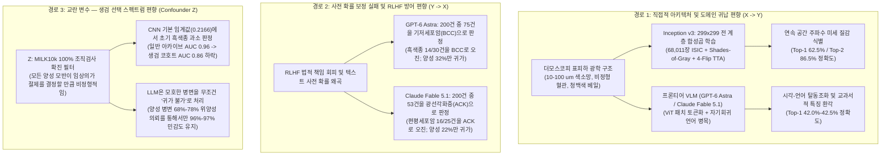

2026년 10월 25일, 영국 가이즈 병원(Guy's Hospital) 피부과 전문의이자 모스 미세도식 수술(Mohs Micrographic Surgery) 외과의이며 킹스칼리지 런던(King's College London) 성 존스 피부과학 연구소 명예 부교수(Honorary Reader)인 매그너스 린치(Dr. Magnus Lynch) 박사는 도발적인 제목의 실증 벤치마크 연구를 발표했습니다: **[10년 된 CNN이 피부암 진단에서 최첨단 LLM을 능가한다 (A 10-year-old CNN outperforms frontier LLMs for skin cancer diagnosis)](https://lynchlab.net/llm-skin-cancer)**.

린치 박사는 2026년 10월 기준 가장 뛰어난 두 개의 최첨단 멀티모달 대규모 언어 모델(**GPT-6 Astra** [OpenAI API] 및 **Claude Fable 5.1** [OpenRouter])과 2015년에 발표된 합성곱 신경망(**[Inception v3](https://arxiv.org/abs/1512.00567)** — 단일 NVIDIA H100 GPU에서 공개 **[ISIC 아카이브](https://www.isic-archive.com/)** 이미지 `68,011`장으로 약 20분간 파인튜닝되어 **[lynchlab.net/skin-ai-inception](https://lynchlab.net/skin-ai-inception)**에서 브라우저 내 WebGPU로 구동되는 모델)을 직접 비교했습니다. 평가 데이터셋은 2025년 공개된 **[MILK10k 데이터셋](https://doi.org/10.34970/648456)**에서 무작위로 추출한 **조직검사(생검) 확진 피부 병변 `N = 200`건**(절대 귀가 조치해서는 안 되는 악성·전암성 병변 `100`건과 귀가 조치해도 안전한 양성 병변 `100`건, 각 병변당 일반 근접 임상 사진과 편광 더모스코피[피부경] 사진 쌍으로 구성)이었습니다.

6개 조직병리학적 진단 분류(`MEL`, `BCC`, `SCC`, `ACK`, `NEV`, `SEK`)에서 10년 된 구형 CNN은 **1순위(Top-1) 진단 정확도 `125 / 200 (62.5%)`** 및 **1·2순위 합산(Top-2) 정확도 `173 / 200 (86.5%)`**를 기록하며, **Claude Fable 5.1(Top-1 `85 / 200 = 42.5%`; Top-2 `138 / 200 = 69.0%`)**과 **GPT-6 Astra(Top-1 `84 / 200 = 42.0%`; Top-2 `134 / 200 = 67.0%`)**를 모두 **20%포인트 이상** 압도했습니다.

그러나 본 연구의 요약표와 원본 데이터 아카이브(`[llm-skin-cancer-test.zip](https://d2gaqzonlm544h.cloudfront.net/skin-ai/data/llm-skin-cancer-test.zip)`) 속 JSONL 로그 및 파이썬 채점 스크립트를 정밀 해부하면, 표면적인 헤드라인만 읽는 독자들이 놓치기 쉬운 결정적인 **생물통계학적 작동점(Operating-Point) 역설**이 드러납니다.
* **사전 설정된 검증 임계값(Preset Validation Threshold)**을 그대로 적용했을 때, 진단 정확도가 가장 높았던 CNN은 오히려 **악성 흑색종 `30`건 중 `18`건(`60.0%` 위음성 퇴원율)을 안전하다고 잘못 귀가(Discharge) 조치**했으며, 위험 병변 `100`건 중 `77`건만 남기고 양성 병변 `100`건 중 `76`건을 귀가시켰습니다.
* 반면 임상의 프롬프트 하에서 **GPT-6 Astra**와 **Claude Fable 5.1**은 흑색종 `30`건 중 각각 **`3`건(`10.0%`)**과 **`4`건(`13.3%`)**만 잘못 귀가시켰고 위험 병변 `100`건 중 `97`건과 `96`건을 잡아냈지만, 이러한 외견상의 안전성은 **완전히 무해한 점(모반)과 지루각화증의 `68%`~`78%`까지 퇴원을 거부(`특이도 = 32.0% 및 22.0%`)**하는 극단적 방어 편향을 통해서만 달성된 것이었습니다.
* 실제로 CNN의 연속 확률 임계값을 수신자 조작 특성(`ROC-AUC = 0.86`) 곡선을 따라 이동시켜 두 LLM의 낮은 특이도(`32%` 또는 `22%`)에 **동일하게 맞추면(Threshold Matching)**, CNN은 **위험 병변 `100`건 중 `98`건 또는 `99`건을 잡아내고 흑색종 `30`건 중 단 `1`~`2`건(`3.3%`~`6.7%`)만 놓치며** 모든 작동점에서 두 최첨단 LLM을 완벽히 능가합니다.

본 글에서는 린치 박사의 원본 소스 코드, `1,200`건에 달하는 LLM 응답 JSONL 전문, `6 × 6` 혼동 행렬(Confusion Matrix), 언어적 확신도 보정(Confidence Calibration) 곡선, 그리고 멀티모달 아키텍처의 구조적 병목을 8단계 **"사금 채취(Panning for Gold)"** 프레임워크로 철저히 검증합니다.

---

## 1. 핵심 결론 요약 (Executive Verdict & Synthesis)

> [!IMPORTANT]
> **포렌식 최종 판정 — 다중 클래스 병리 식별력에서는 CNN의 압승(`+20.3%p` Top-1 우위), 단 임상 중증도 분류(Triage)에서는 유병률 기반 임계값 보정(Threshold Calibration)이 필수적임:**
> 1. **도메인 특화 픽셀 귀납 편향(Inductive Bias)이 범용 비전-언어 토크나이저를 압도한다:** `68,011`장의 더모스코피 및 임상 사진으로 전 계층(All-layer) 파인튜닝된 `2,380만` 파라미터 규모의 2015년형 CNN(**[Inception v3](https://arxiv.org/abs/1512.00567)** — **[Esteva 외 2017년 *Nature* 논문](https://www.nature.com/articles/nature21056)**에서 사용된 바로 그 아키텍처)은 표피·진피 유두층의 미세 구조(`10~100 µm` 단위의 색소 그물망, 수지상 혈관, 청백색 베일, 비립종 유사 낭종 등)를 연속적인 공간 주파수 특징 맵으로 직접 학습합니다. 반면 범용 멀티모달 LLM(**GPT-6 Astra**, **Claude Fable 5.1**)은 이미지를 이산적인 비전 트랜스포머(`ViT`) 패치 토큰으로 압축한 뒤 자기회귀 언어 병목을 통과시키므로, **시각-언어 탈동조화(Visual-Verbal Decoupling)**가 발생합니다. 즉, 픽셀에서 잘못된 병변 클래스를 추론한 뒤 그 진단명에 맞는 교과서적 피부경 소견을 유창하게 환각(Hallucination)해 냅니다.
> 2. **최첨단 LLM의 심각한 사전 확률 모드 붕괴(Mode Collapse):** `analyse_clinician.py`로 추출한 원본 혼동 행렬을 보면, **GPT-6 Astra**는 전체 `200`개 병변 중 무려 **`75`건(`37.5%`, 실제 비율은 `25 / 200 = 12.5%`)**을 기저세포암(`BCC`)으로 판정했으며, **악성 흑색종 `30`건 중 `14`건(`46.7%`)을 기저세포암으로 오진**했습니다. `GPT-6 Astra`가 기록한 `BCC` 재현율 `100% (25 / 25)`는 정밀도(`PPV`) **`33.3%`**라는 무차별 남발의 부산물입니다. 반대로 **Claude Fable 5.1**은 전체 `200`건 중 **`53`건(`26.5%`, 실제 비율은 `20 / 200 = 10.0%`)**을 전암성 병변인 광선각화증(`ACK`)으로 판정(`PPV = 22.6%`)하여, **침윤성·상피내 편평세포암(`SCC`) `25`건 중 `16`건(`64.0%`)을 전암성 광선각화증으로 과소평가**했습니다.
> 3. **일반 환자 프롬프트(`patient-clinical`)에서의 참담한 실패 (`N = 200`건 및 추가 흑색종 `N = 100`건):** 환자가 가정에서 스마트폰으로 찍은 일반 접사 사진만 올리고 질문하는 상황(`patient-clinical`)에서 첫 번째 언급 진단명 정확도는 **`23.5%`(`GPT-6 Astra`)**와 **`25.5%`(`Claude Fable 5.1`)**로 추락합니다. 더욱이 추가된 조직검사 확진 흑색종 `100`건(`cases-mel-100.csv`)에서 **Claude Fable 5.1**이 흑색종을 첫 번째 가능성으로 지목한 비율은 단 **`3 / 100 (3.0%)`**에 불과했고, 단일 진단을 선호한 `19`건에서는 **`0 / 19 (0% 정답, 100% 오답 — 12건을 양성 점으로 판정)`**을 기록했으며, 흑색종 환자 `14 / 100 (14.0%)`에게는 비응급 일반 진료(`ROUTINE`)를 권고하고 `1 / 100`건(`mel_046`, 침윤성 흑색종)에게는 그냥 두어도 된다(`LEAVE`)고 안내했습니다.

```mermaid
xychart-beta
    title "6대 피부 병변 조직병리 진단 정확도 (N = 200 생검 확진 병변, 1순위 정답률 %)"
    x-axis ["전체 200건", "흑색종 (30)", "기저세포암 (25)", "편평세포암 (25)", "광선각화증 (20)", "양성 모반 (50)", "지루각화증 (50)"]
    y-axis "1순위 진단 재현율 (%)" 0 --> 100
    bar [42.0, 26.7, 100.0, 48.0, 50.0, 32.0, 26.0]
    bar [42.5, 36.7, 72.0, 20.0, 60.0, 66.0, 12.0]
    bar [62.5, 43.3, 96.0, 64.0, 45.0, 74.0, 52.0]
```

*차트 범례: 막대 1 = **GPT-6 Astra** (`84/200 = 42.0%`), 막대 2 = **Claude Fable 5.1** (`85/200 = 42.5%`), 막대 3 = **Inception v3 CNN** (`125/200 = 62.5%`). 원천 데이터 출처: **[Lynch Lab Benchmark](https://lynchlab.net/llm-skin-cancer)** 및 **[llm-skin-cancer-test.zip](https://d2gaqzonlm544h.cloudfront.net/skin-ai/data/llm-skin-cancer-test.zip)**.*

---

## 2. 1차 사료 및 실험 설계 감사 (Phases 1 & 2)

2차 언론 보도의 에코 체임버를 배제하기 위해, 본 감사는 린치 박사가 공개한 데이터 아카이브(`[llm-skin-cancer-test.zip](https://d2gaqzonlm544h.cloudfront.net/skin-ai/data/llm-skin-cancer-test.zip)`)의 전체 파이썬 스크립트와 JSONL 원본, 그리고 실시간 WebGPU 추론 엔진(`[lynchlab.net/skin-ai-inception](https://lynchlab.net/skin-ai-inception)` / `skin-ai.js?v=23`)을 직접 추출하여 검증했습니다.

### 2.1 데이터셋 출처 및 표본 추출 프로토콜 (`make_selection_200.py`)
테스트 코호트는 2025년 **[국제피부영상협업(ISIC)](https://www.isic-archive.com/)**을 통해 공개된 **[MILK10k 데이터셋](https://doi.org/10.34970/648456)**에서 추출되었습니다. 각 병변은 **일반 근접 임상 사진(Clinical Close-up)**과 **더모스코피(Dermoscopic, 피부 현미경) 사진** 쌍으로 구성됩니다.
* **100% 조직병리(생검) 확진 필터링:** `scripts/make_selection_200.py`를 확인하면, `MILK10k` 내 후보 병변 중 `les["confirm"] == "histopathology"`(조직검사 확진) 조건과 임상·더모스코피 이미지 쌍이 모두 존재하는 병변만 엄격히 필터링하여 난수 시드(`SEED = 20261012`)로 무작위 추출했습니다.
* **계층화된 200개 병변 코호트 (`cases.csv`):**
  * **퇴원 불가 위험 병변 `100`건 (`discharge = "not safe"`):** 악성 흑색종 `30`건(`MEL`: 침윤성 흑색종 및 상피내 흑색종), 기저세포암 `25`건(`BCC`), 편평세포암 `25`건(`SCC`: 침윤성 편평세포암 및 보웬병[상피내암]), 광선각화증 `20`건(`ACK`: 냉동치료나 국소 항암연고 치료 및 추적 관찰이 필요한 전암성 일광각화증).
  * **퇴원 가능 안전 병변 `100`건 (`discharge = "safe"`):** 양성 멜라닌세포 모반 `50`건(`NEV`: 복합·진피내·경계성·선단·청색·선천성 모반 등) 및 지루각화증 `50`건(`SEK`: 흔한 양성 검버섯/사마귀성 병변).
* **추가 흑색종 100건 확장 코호트 (`cases-mel-100.csv`):** 일반 환자용 임상 사진 단독 프롬프트(`patient-clinical`)에서 흑색종 누락 위험을 정밀 검증하기 위해 `cases.csv`에 포함되지 않은 별도의 생검 확진 흑색종 `100`건을 무작위 추출(`scripts/make_selection_mel100.py`)했습니다.

### 2.2 베이스라인 CNN (`Inception v3`) 아키텍처 및 학습 파이프라인
`[lynchlab.net/skin-ai-inception](https://lynchlab.net/skin-ai-inception)` 및 `skin-ai.js?v=23` 소스 코드 분석을 통해 확인한 베이스라인 CNN의 정확한 엔지니어링 사양은 다음과 같습니다.
1. **백본 및 이중 헤드(Dual-Head) 토폴로지:** ImageNet-1k로 사전 학습된 표준 **[Inception v3](https://arxiv.org/abs/1512.00567)**(`timm` `inception_v3.tv_in1k`, 입력 해상도 `299 × 299`, `mean = 0.5`, `std = 0.5`)의 기존 1,000개 출력층을 제거하고, 동일한 이미지 특징 맵을 공유하는 두 개의 병렬 출력 헤드를 장착했습니다.
   * **9개 진단 그룹 분류 헤드:** `MEL`, `BCC`, `SCC`, `AK`, `NV`, `BKL`, `DF`, `VASC`, `OTHER_BENIGN` (200건 비교 실험에서는 두 이미지 점수를 결합하여 6개 대상 클래스 중 선택).
   * **촬영 양식(Modality) 판별 헤드:** 입력 이미지가 더모스코피(`dermoscopic`)인지 일반 임상 사진(`clinical`)인지 구분하며, 내부 테스트셋(`8,517`장)에서 **`99.5%` 정확도**를 기록하여 각 양식에 맞는 임계값을 자동 적용합니다.
2. **환자·병변 완전 분리 데이터 분할 (`87,206`장의 ISIC 아카이브 이미지):**
   * 동일 환자, 동일 병변, 유사 사진이 절대 서로 다른 세트에 섞이지 않도록 그룹 분할하여 **`68,011`장 학습(Training)**, **`8,523`장 검증(Validation)**, **`8,517`장 내부 테스트(Internal Test: `ROC-AUC = 0.944`, 생검 확진 `4,364`장에서는 `0.875`)**, **`1,286`장 외부 병원 테스트( 아르헨티나 부에노스아이레스 이탈리아 병원: `ROC-AUC = 0.934`)**, 그리고 **`869`장 LLM 비교용 홀드아웃 세트**로 분리했습니다.
3. **도메인 전처리 및 테스트 시점 데이터 증강 (`TTA`):** 추론 전 원형 더모스코피 검은 테두리를 자동 감지·크롭하고, 조명 색온도 왜곡을 제거하는 **Shades of Gray**(`p = 6` 민코프스키 노름) 색상 항상성 정규화를 거친 뒤, Lanczos 보간법으로 리사이징(`342 px` -> `299 × 299` 중앙 크롭)하고 **4방향 반전 사본(4-Flip TTA)**의 예측 확률을 평균합니다.
4. **연산 비용 및 경량성:** 단일 NVIDIA H100 GPU에서 희귀 진단 클래스 가중치를 균형화하여 20 에포크(에포크당 약 50초, **총 학습 시간 약 17~20분**) 동안 전 계층을 파인튜닝했습니다. `fp16` 기준 **`44 MB` ONNX 모델**(`fp32`는 `87 MB`)로 변환되어 스마트폰 브라우저 내 WebGPU에서 서버 전송 없이 즉시 실행됩니다.

| 모델 시스템 | 아키텍처 및 파라미터 규모 | 피부과 도메인 학습 여부 | 추론 방식 및 비용 (`N = 200` 임상의 프롬프트 기준) | 1순위(Top-1) 정확도 (`N = 200`) | 1·2순위(Top-2) 정확도 (`N = 200`) |
| :--- | :--- | :--- | :--- | :--- | :--- |
| **Inception v3 (2015년형 CNN)** | 48계층 CNN (`~2,380만` 파라미터; `44 MB` `fp16` ONNX) | ISIC 이미지 `68,011`장 전 계층 파인튜닝 (`1x H100 GPU` 약 17분) | 브라우저 로컬 WebGPU/WASM (`클라우드 토큰 0개`, 한계 API 비용 `USD 0.00`) | **`125 / 200 (62.5%)`** | **`173 / 200 (86.5%)`** |
| **Claude Fable 5.1 (2026년 10월)** | 최첨단 멀티모달 LLM (OpenRouter API) | 범용 사전학습 + RLHF (피부과 특화 파인튜닝 없음) | 입력 `227,200` + 출력 `49,610` 토큰 (추론 `23,719` 토큰; `USD 4.75`) | **`85 / 200 (42.5%)`** (`95% CI: 36–49%`) | **`138 / 200 (69.0%)`** (`95% CI: 62–75%`) |
| **GPT-6 Astra (2026년 10월)** | 최첨단 멀티모달 LLM (OpenAI API) | 범용 사전학습 + RLHF (피부과 특화 파인튜닝 없음) | 입력 `184,200` + 출력 `30,298` 토큰 (추론 `17,557` 토큰; `USD 3.36`) | **`84 / 200 (42.0%)`** (`95% CI: 35–49%`) | **`134 / 200 (67.0%)`** (`95% CI: 60–73%`) |

---

## 3. 의미론적 해체와 ROC 작동점의 역설 (Phase 3)

브라운과 킬리(Browne & Keeley)의 비판적 사고 프레임워크에서 **"피부암 진단 능력이 더 뛰어나다(outperforms for skin cancer diagnosis)"**라는 명제는 임상적으로 전혀 다른 두 가지 과제를 포괄하는 다의성을 지닙니다.
1. **다중 클래스 조직병리 분류 (Taxonomic Discrimination):** 6개 진단명(`MEL`, `BCC`, `SCC`, `ACK`, `NEV`, `SEK`) 중 실제 생검 결과와 일치하는 정확한 병명을 맞히는 능력.
2. **이진 임상 중증도 분류 ("남길 것인가, 귀가시킬 것인가" / Keep vs. Discharge):** 조직검사·치료·추적관찰이 필요한 위험 병변(`discharge = "no"`)과 안심하고 돌려보내도 되는 양성 병변(`discharge = "yes"`)을 가려내는 능력.

요약표에 **대체 테스트(Substitution Test)**를 적용하면, 왜 특이도(Specificity)를 고정하지 않은 채 이진 민감도(Sensitivity)만 단순 비교하는 것이 전형적인 **ROC 작동점 착시(Operating-Point Illusion)**를 유발하는지 명확히 드러납니다.

| 임상 및 진단 평가 지표 | GPT-6 Astra (임상의 프롬프트) | Claude Fable 5.1 (임상의 프롬프트) | Inception v3 CNN (사전 설정 검증 임계값) | Inception v3 CNN (LLM 특이도에 맞춘 보정 임계값) |
| :--- | :--- | :--- | :--- | :--- |
| **1순위(Top-1) 진단 정확도 (`200건 중`)** | `84 / 200` (`42.0%`) | `85 / 200` (`42.5%`) | **`125 / 200` (`62.5%`)** | **`125 / 200` (`62.5%`)** |
| **1·2순위(Top-2) 진단 정확도 (`200건 중`)** | `134 / 200` (`67.0%`) | `138 / 200` (`69.0%`) | **`173 / 200` (`86.5%`)** | **`173 / 200` (`86.5%`)** |
| **흑색종 1순위 정답 수 (`30건 중`)** | `8 / 30` (`26.7%`) | `11 / 30` (`36.7%`) | **`13 / 30` (`43.3%`)** | **`13 / 30` (`43.3%`)** |
| **위험 병변 잔류 건수 / 민감도 (`100건 중`)** | `97 / 100` (`97.0%`) | `96 / 100` (`96.0%`) | `77 / 100` (`77.0%`) | **`98 / 100` (`98.0%`) 또는 `99 / 100` (`99.0%`)** |
| **안전 병변 귀가 건수 / 특이도 (`100건 중`)** | `32 / 100` (`32.0%`) | `22 / 100` (`22.0%`) | **`76 / 100` (`76.0%`)** | `32 / 100` (`32.0%`) 또는 `22 / 100` (`22.0%`) *(동일 매칭)* |
| **잘못 귀가 조치된 흑색종 (`30건 중 위음성`)** | `3 / 30` (`10.0%`) | `4 / 30` (`13.3%`) | `18 / 30` (`60.0%`) | **`2 / 30` (`6.7%`) 또는 `1 / 30` (`3.3%`)** |
| **유덴 지수 (`Youden's J = 민감도 + 특이도 - 1`)** | `0.290` (`97% + 32% - 100%`) | `0.180` (`96% + 22% - 100%`) | **`0.530` (`77% + 76% - 100%`)** | `0.300` (`32%` 특이도) / `0.210` (`22%` 특이도) |
| **양성 우도비 (`LR+ = 민감도 / (1 - 특이도)`)** | `1.43` (`0.97 / 0.68`) | `1.23` (`0.96 / 0.78`) | **`3.21` (`0.77 / 0.24`)** | **`1.44` (`32%` 특이도) / `1.27` (`22%` 특이도)** |
| **음성 우도비 (`LR- = (1 - 민감도) / 특이도`)** | `0.094` (`0.03 / 0.32`) | `0.182` (`0.04 / 0.22`) | `0.303` (`0.23 / 0.76`) | **`0.063` (`32%` 특이도) / `0.045` (`22%` 특이도)** |

### 왜 CNN의 사전 설정 임계값은 보정 전에 흑색종 30건 중 18건을 놓쳤는가?
`skin-ai.js?v=23` 코드를 보면, CNN의 기본 `not_safe` 임계값(더모스코피 `P >= 0.2166`, 일반 임상 사진 `P >= 0.5321`)은 일반 ISIC 검증 이미지 `8,523`장에서 `90%` 민감도를 달성하도록 설정된 값입니다. 그런데 왜 `MILK10k` 200건에서는 민감도가 `77%`로 낮아졌을까요?
1. **일반 아카이브 기저율(Base-Rate) 대 생검 확진 코호트의 스펙트럼 편향(Spectrum Bias):** 일반 ISIC 아카이브(`68,011`장 학습 데이터)에 포함된 수만 장의 양성 모반(`NV`) 대다수는 조직검사조차 필요 없었던 전형적이고 쉬운 양성 점들이어서 모델이 `ROC-AUC = 0.944`(일반 아카이브 기준 `0.96`)로 쉽게 구분합니다. 반면 `MILK10k` 테스트셋 `200`건은 **양성 모반 `50`건과 지루각화증 `50`건을 포함한 전수(`100%`)가 전문의에게 악성 의심을 사서 실제 외과적 절제 생검을 거친 고난도 병변**들이며, 흑색종 `30`건 역시 상당수가 두께 `0.8 mm` 미만의 초기 침윤성 흑색종이거나 상피내 흑색종입니다.
2. **스펙트럼 이동에 따른 결정 경계 불일치:** 생검 대상 병변들만 모아 놓은 고난도 코호트에서는 양성 점과 초기 흑색종이 결정 경계 근처에 밀집하므로(`ROC-AUC = 0.86`), 일반 아카이브에서 설정된 임계값(`0.2166`)은 생검 코호트 기준으로는 **지나치게 높게(양성 판정에 관대하게)** 설정된 셈이 됩니다. 그 결과 CNN이 오진한 흑색종 `17`건 중 `8`건을 모반(`NEV`), `6`건을 지루각화증(`SEK`)으로 분류하여 기본 임계값에서 `18 / 30`건을 귀가 조치한 것입니다.
3. **연속 확률 출력의 결정적 우위:** 이산적인 텍스트(`"yes"` / `"no"`)만 내뱉는 LLM과 달리, CNN은 연속적인 확률값 `P(not_safe) in [0, 1]`을 출력하므로 임상 환경의 사전 유병률에 맞춰 임계값을 즉시 낮출 수 있습니다. 실제로 CNN의 임계값을 낮춰 두 LLM의 특이도(`32%` 및 `22%`)와 동일하게 맞추면, CNN은 **위험 병변 `100`건 중 `98~99`건을 잡아내고 흑색종 위음성을 `1~2`건(`3.3%~6.7%`)으로 줄여** LLM(`3~4`건 위음성)보다 더 안전하고 정확하게 작동합니다.

---

## 4. 4방향 인과관계 및 아키텍처 감사: 왜 2015년형 CNN이 2026년 최첨단 VLM을 이기는가? (Phase 4)

단 `2,380만` 파라미터의 2015년형 네트워크가 어떻게 수조 파라미터 규모의 2026년 프론티어 멀티모달 모델을 진단 정확도에서 `+20.3%p` 차이로 압도하는지 4가지 인과 경로를 통해 규명합니다.

### 4.1 직접 인과 (`X -> Y`): 미세 공간 주파수 귀납 편향 대 시각-언어 탈동조화 (Visual-Verbal Decoupling)
더모스코피 영상은 일상적인 자연 영상(`ImageNet`의 강아지, 자동차, 가구 사진)과 근본적으로 다릅니다. 편광 필터나 접촉 용액을 사용해 각질층(*stratum corneum*)의 표면 난반사를 제거함으로써 표피와 유두진피 내부 `10~100 µm` 스케일의 멜라닌 및 헤모글로빈 분포를 직접 시각화하기 때문입니다. 무멜라닌성(Amelanotic) 흑색종과 기저세포암을 구분하거나, 색소성 지루각화증과 상피내 흑색종을 감별하려면 서브밀리미터 단위의 미세 혈관 및 색소 패턴을 구별해야 합니다.

**Inception v3**는 `68,011`장의 피부과 영상에서 역전파(Backpropagation)를 통해 48개 합성곱 계층(`3 × 3`, `1 × 7`, `7 × 1` 인수분해 필터) 전체의 가중치를 직접 갱신하며 픽셀 질감 공간의 결정 경계를 최적화했습니다.

반면 **GPT-6 Astra**와 **Claude Fable 5.1**은 심각한 **시각-언어 탈동조화(Visual-Verbal Decoupling)**를 겪습니다.
1. 범용 비전 인코더(`ViT`)가 이미지를 패치 토큰으로 쪼개어 언어 모델의 임베딩 공간으로 투영하는 과정에서 미세 공간 주파수 정보가 손실됩니다.
2. 언어 디코더가 초기에 특정 진단 토큰(예: `"diagnosis": "SEK"` 또는 `"diagnosis": "BCC"`)을 선택하고 나면, 이후 생성되는 `"features"` 문장은 실제 이미지 픽셀이 아니라 **선택된 진단명에 결합된 의학 교과서 텍스트 확률 분포에 조건화되어 사후 합리화(Post-hoc Rationalization) 및 환각**을 일으킵니다.

이는 `results/gpt-6-astra-v2.jsonl` 및 `results/anthropic_claude-fable-5.1-v2.jsonl` 원본 로그에서 직접 입증됩니다.

| 증례 ID 및 실제 조직병리 | 임상 및 더모스코피 실제 소견 (`MILK10k`) | GPT-6 Astra 출력 (`진단`, `확신도`, `귀가 여부`, `관찰 특징`) | Claude Fable 5.1 출력 (`진단`, `확신도`, `귀가 여부`, `관찰 특징`) | 포렌식 인과 메커니즘 진단 |
| :--- | :--- | :--- | :--- | :--- |
| **`case_038`** (`ISIC_7403025` / `ISIC_4552372`) **침윤성 흑색종** (`< 0.8 mm`, 귀) | 귀에 발생한 초기 침윤성 흑색종. CNN은 더모스코피에서 정확히 **`MEL`**로 진단함. | **`SEK`** (확신도 `83%`, 2순위 `NEV`), **`discharge: "yes"`** — *"지문 모양의 융기, 균열, 다수의 창백한 비립종 유사 낭종(milia-like cysts)과 면포 유사 개구부가 보이는 경계가 명확한 갈색 병변."* | **`SEK`** (확신도 `65%`, 2순위 `NEV`), **`discharge: "yes"`** — *"뇌회상/자갈 모양 표면, 균열과 융기, 소수의 비립종 유사 낭종을 가진 작은 암갈색 병변으로 색소성 지루각화증에 부합함."* | **치명적 위음성 귀가 조치 (`MEL -> SEK`):** 두 LLM 모두 표면 각화/균열에만 매몰되어 지루각화증의 교과서적 문구를 환각해 내며 침윤성 흑색종 환자를 귀가 조치함. |
| **`case_024`** (`ISIC_1091183` / `ISIC_6551749`) **침윤성 흑색종** (`< 0.8 mm`, 저색소성) | 색소가 거의 없는 저색소성 침윤성 흑색종. CNN과 Claude는 **`MEL`**로 정답 판정. | **`BCC`** (확신도 `95%`, 2순위 `MEL`), **`discharge: "no"`** — 저색소성 흑색종을 `95%` 확신도로 기저세포암(`BCC`)이라 오진함. | **`MEL`** (확신도 `55%`, 2순위 `BCC`), **`discharge: "no"`** | **`GPT-6 Astra`의 `BCC` 모드 붕괴:** 분홍빛 저색소 병변에 혈관이 보이면 무조건 `BCC` 사전 확률이 작동하여 `95%` 과잉 확신으로 오진함. |
| **`case_200`** **상피내 흑색종** (*Melanoma in situ*) | 비교적 대칭적인 구상(Globular) 패턴의 암갈색 구진. | **`NEV`** (확신도 `82%`, 2순위 `SEK`), **`discharge: "yes"`** — *"주로 구상/자갈 패턴을 보이며 뚜렷한 흑색종 특이 소견이 없는 대칭적 돔 형태 갈색 구진."* | **`NEV`** (확신도 `75%`, 2순위 `MEL`), **`discharge: "yes"`** — *"비교적 대칭적인 구상/자갈 패턴을 보이는 작은 암갈색 구진으로 복합/진피내 모반에 부합함."* | **두 LLM 모두 상피내 흑색종을 귀가 조치:** 심지어 `Claude`는 2순위로 흑색종(`MEL`)을 적어놓고도 `"discharge": "yes"`를 출력함! |
| **`case_147`** **침윤성 흑색종** | 중심부 과색소침착을 동반한 침윤성 흑색종. | **`MEL`** (확신도 `78%`, 2순위 `NEV`), **`discharge: "no"`** | **`NEV`** (확신도 `80%`, 2순위 `MEL`), **`discharge: "yes"`** — *"규칙적인 망상/구상 패턴과 병변을 관통하는 털(hairs traversing the lesion)이 관찰되어 양성 모반에 부합함."* | **교과서적 휴리스틱 오남용 (`털 = 양성`):** `Claude`는 병변에 털이 나 있으면 양성 점이라는 얄팍한 텍스트 휴리스틱에 속아 침윤성 흑색종을 귀가 조치함. |

---

## 5. 통계 및 혼동 행렬 감사: LLM 모드 붕괴와 확신도 보정 실패 폭로 (Phase 5)

`scripts/analyse_clinician.py`를 원본 `200`건 JSONL 파일에 직접 실행하여 두 최첨단 LLM의 전체 `6 × 6` 혼동 행렬, 클래스별 양성예측도(`PPV` / 정밀도), 재현율(`Recall` / 민감도), 그리고 확신도 구간별 실제 정답률을 완벽히 재구성했습니다.

### 5.1 6대 클래스 전체 혼동 행렬 감사 (`GPT-6 Astra` 대 `Claude Fable 5.1`)

#### 표 5.1A: `GPT-6 Astra` 임상의 프롬프트 혼동 행렬 (`results/gpt-6-astra-v2.jsonl`, `N = 200`)
*`GPT-6 Astra`의 예측 분포: **`BCC = 75`건 (`37.5%`)**, `SCC = 35`건 (`17.5%`), `SEK = 28`건 (`14.0%`), `ACK = 26`건 (`13.0%`), `NEV = 19`건 (`9.5%`), `MEL = 16`건 (`8.0%`), `UNSURE = 1`건 (`0.5%`).*

| 실제 조직병리 (행) \ 모델 예측 (열) | 예측: `MEL` | 예측: `BCC` | 예측: `SCC` | 예측: `ACK` | 예측: `NEV` | 예측: `SEK` | 예측: `UNSURE` | 클래스 재현율 (민감도 및 Wilson 95% CI) | Inception v3 재현율 (비교) |
| :--- | :---: | :---: | :---: | :---: | :---: | :---: | :---: | :--- | :--- |
| **실제 `MEL` (`n = 30`)** | **`8`** | `14` | `2` | `1` | `2` | `3` | `0` | **`26.7%` (`8/30`)** `[14–44%]` | **`43.3%` (`13/30`)** |
| **실제 `BCC` (`n = 25`)** | `0` | **`25`** | `0` | `0` | `0` | `0` | `0` | **`100.0%` (`25/25`)** `[87–100%]` | `96.0%` (`24/25`) |
| **실제 `SCC` (`n = 25`)** | `0` | `6` | **`12`** | `7` | `0` | `0` | `0` | **`48.0%` (`12/25`)** `[30–67%]` | **`64.0%` (`16/25`)** |
| **실제 `ACK` (`n = 20`)** | `3` | `6` | `1` | **`10`** | `0` | `0` | `0` | **`50.0%` (`10/20`)** `[30–70%]` | `45.0%` (`9/20`) |
| **실제 `NEV` (`n = 50`)** | `5` | `15` | `1` | `0` | **`16`** | `12` | `1` | **`32.0%` (`16/50`)** `[21–46%]` | **`74.0%` (`37/50`)** |
| **실제 `SEK` (`n = 50`)** | `0` | `9` | `19` | `8` | `1` | **`13`** | `0` | **`26.0%` (`13/50`)** `[16–40%]` | **`52.0%` (`26/50`)** |
| **모델 예측 합계 (`N = 200`)** | `16` | **`75`** | `35` | `26` | `19` | `28` | `1` | **전체 정확도: `84/200 = 42.0%`** `[35–49%]` | **전체 정확도: `125/200 = 62.5%`** |
| **클래스 정밀도 (`PPV`)** | **`50.0%`** (`8/16`) | **`33.3%`** (`25/75`) | **`34.3%`** (`12/35`) | **`38.5%`** (`10/26`) | **`84.2%`** (`16/19`) | **`46.4%`** (`13/28`) | `0.0%` | **Top-2 정확도: `134/200 = 67.0%`** `[60–73%]` | **Top-2 정확도: `173/200 = 86.5%`** |

#### 표 5.1B: `Claude Fable 5.1` 임상의 프롬프트 혼동 행렬 (`results/anthropic_claude-fable-5.1-v2.jsonl`, `N = 200`)
*`Claude Fable 5.1`의 예측 분포: **`ACK = 53`건 (`26.5%`)**, `BCC = 42`건 (`21.0%`), `NEV = 42`건 (`21.0%`), `MEL = 32`건 (`16.0%`), `SCC = 21`건 (`10.5%`), `SEK = 10`건 (`5.0%`), `UNSURE = 0`건 (`0.0%`).*

| 실제 조직병리 (행) \ 모델 예측 (열) | 예측: `MEL` | 예측: `BCC` | 예측: `SCC` | 예측: `ACK` | 예측: `NEV` | 예측: `SEK` | 예측: `UNSURE` | 클래스 재현율 (민감도 및 Wilson 95% CI) | Inception v3 재현율 (비교) |
| :--- | :---: | :---: | :---: | :---: | :---: | :---: | :---: | :--- | :--- |
| **실제 `MEL` (`n = 30`)** | **`11`** | `4` | `3` | `2` | `7` | `3` | `0` | **`36.7%` (`11/30`)** `[22–54%]` | **`43.3%` (`13/30`)** |
| **실제 `BCC` (`n = 25`)** | `1` | **`18`** | `0` | `6` | `0` | `0` | `0` | **`72.0%` (`18/25`)** `[52–86%]` | **`96.0%` (`24/25`)** |
| **실제 `SCC` (`n = 25`)** | `0` | `4` | **`5`** | `16` | `0` | `0` | `0` | **`20.0%` (`5/25`)** `[9–39%]` | **`64.0%` (`16/25`)** |
| **실제 `ACK` (`n = 20`)** | `6` | `2` | `0` | **`12`** | `0` | `0` | `0` | **`60.0%` (`12/20`)** `[39–78%]` | `45.0%` (`9/20`) |
| **실제 `NEV` (`n = 50`)** | `10` | `4` | `1` | `1` | **`33`** | `1` | `0` | **`66.0%` (`33/50`)** `[52–78%]` | **`74.0%` (`37/50`)** |
| **실제 `SEK` (`n = 50`)** | `4` | `10` | `12` | `16` | `2` | **`6`** | `0` | **`12.0%` (`6/50`)** `[6–24%]` | **`52.0%` (`26/50`)** |
| **모델 예측 합계 (`N = 200`)** | `32` | `42` | `21` | **`53`** | `42` | `10` | `0` | **전체 정확도: `85/200 = 42.5%`** `[36–49%]` | **전체 정확도: `125/200 = 62.5%`** |
| **클래스 정밀도 (`PPV`)** | **`34.4%`** (`11/32`) | **`42.9%`** (`18/42`) | **`23.8%`** (`5/21`) | **`22.6%`** (`12/53`) | **`78.6%`** (`33/42`) | **`60.0%`** (`6/10`) | — | **Top-2 정확도: `138/200 = 69.0%`** `[62–75%]` | **Top-2 정확도: `173/200 = 86.5%`** |

### 5.2 `BCC`와 `ACK`에서의 통계적 착시 검증 ("한 가지를 증명하고 다른 결론을 내리는 오류")
정밀도(`PPV`)를 가린 채 클래스별 민감도(재현율) 막대그래프만 보면 심각한 착시에 빠집니다.
* **왜 `GPT-6 Astra`는 기저세포암(`BCC`)에서 `25 / 25 (100%)`를 기록하며 `Inception v3`(`24 / 25 = 96%`)를 앞섰는가?** `GPT-6 Astra`가 전체 `200`개 병변 중 **`75`건(`37.5%`)을 무조건 `BCC`라고 부르는 모드 붕괴**를 일으켰기 때문입니다! `75`번의 `BCC` 판정 중 `50`번이 오진(흑색종 `14`건, 양성 모반 `15`건, 지루각화증 `9`건, 편평세포암 `6`건, 광선각화증 `6`건)이어서 **정밀도(`PPV`)는 `33.3%`**에 불과합니다. 특히 **악성 흑색종의 절반 가까이(`14 / 30 = 46.7%`)를 기저세포암(`BCC`)으로 둔갑**시키는 것은 임상적으로 매우 위험합니다. 기저세포암은 전이율이 극히 낮아 일반 수술 일정이나 표재성 치료로 접근하는 경우가 많지만, 침윤성 흑색종은 즉각적인 광범위 국소 절제술(`WLE`) 및 감시림프절 생검(`SLNB`)이 필수적이기 때문입니다.
* **왜 `Claude Fable 5.1`은 광선각화증(`ACK`)에서 `12 / 20 (60%)`을 기록하며 `Inception v3`(`9 / 20 = 45%`)를 앞섰는가?** `Claude Fable 5.1`이 전체 `200`건 중 **`53`건(`26.5%`)을 `ACK`로 남발**(`PPV = 22.6%`)하면서, **침윤성·상피내 편평세포암(`SCC`) `25`건 중 `16`건(`64.0%`)과 기저세포암(`BCC`) `25`건 중 `6`건(`24.0%`)을 전암성 병변인 광선각화증으로 격하**시켰기 때문입니다! 그 결과 진짜 악성 종양(`MEL / BCC / SCC`, `n = 80`) 대 비악성(`ACK / NEV / SEK`, `n = 120`) 이진 분류에서 `Claude Fable 5.1`의 악성 민감도는 **`57.5%`(`46 / 80`)**에 그쳤습니다.

### 5.3 언어적 확신도 보정(Confidence Calibration) 감사 (`GPT-6 Astra` 대 `Claude Fable 5.1`)
임상의가 AI 보조 도구를 사용할 때 모델이 함께 제시하는 확신도 점수(`0–100`)를 신뢰할 수 있는지 검증한 결과, 두 모델의 보정 능력에서 극명한 차이가 확인되었습니다.

| 모델이 출력한 확신도 구간 (`0–100`) | GPT-6 Astra 해당 구간 건수 (`N = 200`) | GPT-6 Astra 실제 정답률 (`95% CI`) | Claude Fable 5.1 해당 구간 건수 (`N = 200`) | Claude Fable 5.1 실제 정답률 (`95% CI`) | 보정 무결성 진단 (Calibration Diagnostic) |
| :--- | :---: | :--- | :---: | :--- | :--- |
| **`0 – 59%` (낮은 확신도)** | `2 / 200` (`1.0%`) | **`0.0%` (`0 / 2`)** `[0–66%]` | `107 / 200` (`53.5%`) | **`29.0%` (`31 / 107`)** `[21–38%]` | `Claude`는 불확실할 때 절반 이상의 사례에 `60%` 미만 점수를 부여하나, `GPT-6 Astra`는 낮은 확신도를 거의 출력하지 않음. |
| **`60 – 74%` (중간 확신도)** | `37 / 200` (`18.5%`) | **`43.2%` (`16 / 37`)** `[29–59%]` | `72 / 200` (`36.0%`) | **`50.0%` (`36 / 72`)** `[39–61%]` | 중간 확신도 구간에서는 두 모델 모두 `43%~50%` 수준의 실제 정확도를 보임. |
| **`75 – 89%` (높은 확신도)** | `135 / 200` (`67.5%`) | **`38.5%` (`52 / 135`)** `[31–47%]` | `20 / 200` (`10.0%`) | **`85.0%` (`17 / 20`)** `[64–95%]` | **`GPT-6 Astra`의 치명적 과잉 확신:** 전체의 `67.5%`(`135`건)에 `75~89%` 고확신을 부여하지만 실제 정답률은 `38.5%`로 중간 구간(`43.2%`)보다 오히려 낮음! |
| **`90 – 100%` (초고확신 구간)** | `26 / 200` (`13.0%`) | **`61.5%` (`16 / 26`)** `[43–78%]` | `1 / 200` (`0.5%`) | **`100.0%` (`1 / 1`)** `[21–100%]` | `GPT-6 Astra`가 `90~100%` 확신한다고 답한 `26`건 중 **`10`건(`38.5%`)이 오진**임! |
| **평균 확신도 (정답 시 vs. 오답 시)** | **정답 시: `82.5%`** | **오답 시: `79.5%`** (`격차: +3.0%p`) | **정답 시: `64.6%`** | **오답 시: `56.5%`** (`격차: +8.1%p`) | `GPT-6 Astra`의 확신도 점수(`82.5%` 대 `79.5%`)는 정오답 변별력이 사실상 전무함(`ECE` 보정 실패). |

```mermaid
xychart-beta
    title "언어적 확신도 구간별 실제 Top-1 진단 정확도 (%) 비교"
    x-axis ["0-59% 확신", "60-74% 확신", "75-89% 확신", "90-100% 확신"]
    y-axis "실제 Top-1 진단 정확도 (%)" 0 --> 100
    bar [0.0, 43.2, 38.5, 61.5]
    bar [29.0, 50.0, 85.0, 100.0]
    line [30.0, 67.0, 82.0, 95.0]
```

*차트 범례: 막대 1 = **GPT-6 Astra 실제 정답률 (%)**, 막대 2 = **Claude Fable 5.1 실제 정답률 (%)**, 꺾은선 = **이상적 대각선 보정 기준선 (`30%`, `67%`, `82%`, `95%`)**. 원천 데이터 출처: `results/*-v2.jsonl`에 대한 `scripts/analyse_clinician.py` 실행 결과.*

---

## 6. 일반 환자용 스마트폰 프롬프트 감사: 환자가 집에서 물어볼 때 벌어지는 일 (Phase 5 계속)

임상의용 JSON 프롬프트 외에도, 린치 박사의 데이터 아카이브(`[llm-skin-cancer-test.zip](https://d2gaqzonlm544h.cloudfront.net/skin-ai/data/llm-skin-cancer-test.zip)`)에는 일반 환자가 질문하는 3가지 시나리오(`analyse_patient.py`, 실제 진단명을 가린 채 `gpt-6.1-sol`이 `grade_patient.py`로 블라인드 코딩한 `1,000`건의 응답)가 포함되어 있습니다.
1. **`patient` (`N = 200`):** 환자가 **임상 근접 사진과 더모스코피 사진 두 장을 모두 첨부**하여 질문한 경우.
2. **`patient-clinical` (`N = 200`):** 환자가 가정에서 피부경 없이 **일반 근접 임상 사진 한 장만 첨부**하여 질문한 경우.
3. **`patient-clinical-mel-100` (`N = 100`):** **추가된 조직검사 확진 흑색종 100건**(`cases-mel-100.csv`)에 대해 **일반 근접 임상 사진 한 장만 첨부**하여 질문한 경우.

여섯 개의 채점 완료 JSONL 파일에 `python3 scripts/analyse_patient.py`를 실행하여 추출한 전체 포렌식 결과는 다음과 같습니다.

| 환자 프롬프트 코호트 및 모델 | 단일 진단 선호 비율 (`%`) | 단일 진단 선호 시 실제 정답률 | 첫 번째 언급한 진단명 정답률 (`%`) | 흑색종을 첫 번째로 언급한 비율 (`MEL` Recall) | 제시한 진단 목록 내 실제 정답 포함 비율 | 위험 병변에 조속한 진료(`PROMPT/URGENT`) 권고율 | 안전한 양성 병변에 조속한 진료(`PROMPT/URGENT`) 권고율 | 그냥 두어도 된다(`LEAVE`)고 답한 비율 |
| :--- | :--- | :--- | :--- | :--- | :--- | :--- | :--- | :--- |
| **`N = 200` 쌍 이미지 (`patient`) — GPT-6 Astra** | `20 / 200` (`10.0%`) | `12 / 20` (`60.0%`) | **`67 / 200` (`33.5%`)** | **`2 / 30` (`6.7%`)** (`23/30` 목록 내 언급) | `132 / 200` (`66.0%`) (평균 `2.50`개 언급) | **`100 / 100` (`100%`)** (`99` P, `1` U) | **`97 / 100` (`97.0%`)** (특이도 `3%`!) | `0 / 200` (`0.0%`) |
| **`N = 200` 쌍 이미지 (`patient`) — Claude Fable 5.1** | `107 / 200` (`53.5%`) | `54 / 107` (`50.5%`) | **`76 / 200` (`38.0%`)** | **`4 / 30` (`13.3%`)** (`21/30` 목록 내 언급) | `158 / 200` (`79.0%`) (평균 `3.25`개 언급) | **`94 / 100` (`94.0%`)** (위험 병변 `6`건 `ROUTINE`!) | **`87 / 100` (`87.0%`)** (특이도 `13%`) | `0 / 200` (`0.0%`) |
| **`N = 200` 임상 사진 단독 (`patient-clinical`) — GPT-6 Astra** | `7 / 200` (`3.5%`) | `5 / 7` (`71.4%`) | **`47 / 200` (`23.5%`)** | **`2 / 30` (`6.7%`)** (`17/30` 목록 내 언급) | `100 / 200` (`50.0%`) (평균 `2.27`개 언급) | **`97 / 100` (`97.0%`)** (`BCC` `3`건 `ROUTINE`) | **`96 / 100` (`96.0%`)** (특이도 `4%`!) | `0 / 200` (`0.0%`) |
| **`N = 200` 임상 사진 단독 (`patient-clinical`) — Claude Fable 5.1** | `73 / 200` (`36.5%`) | `34 / 73` (`46.6%`) | **`51 / 200` (`25.5%`)** | **`0 / 30` (`0.0%`)** (`11/30` 목록 내 언급) | `139 / 200` (`69.5%`) (평균 `3.13`개 언급) | **`95 / 100` (`95.0%`)** (위험 병변 `5`건 `ROUTINE`) | **`72 / 100` (`72.0%`)** (특이도 `28%`) | `0 / 200` (`0.0%`) |
| **`N = 100` 추가 흑색종 임상 단독 (`mel-100`) — GPT-6 Astra** | `0 / 100` (`0.0%`) | `0 / 0` (`—`) | **`19 / 100` (`19.0%`)** | **`19 / 100` (`19.0%`)** (`60/100` 목록 내 언급) | `60 / 100` (`60.0%`) (평균 `2.25`개 언급) | **`100 / 100` (`100%`)** (저자 수동 판독 시 `99%`) | — (`100%` 흑색종 코호트) | `0 / 100` (`0.0%`) |
| **`N = 100` 추가 흑색종 임상 단독 (`mel-100`) — Claude Fable 5.1** | `19 / 100` (`19.0%`) | **`0 / 19` (`0.0%`!)** (`NEV` 12, `BCC` 3, `OB` 3, `SEK` 1) | **`3 / 100` (`3.0%`!)** | **`3 / 100` (`3.0%`!)** (`44/100` 목록 내 언급) | `44 / 100` (`44.0%`) (평균 `2.99`개 언급) | **`85 / 100` (`85.0%`)** (`83` P, `2` U, **`14` `ROUTINE`, `1` `LEAVE`**) | — (`100%` 흑색종 코호트) | **`1 / 100` (`1.0%`: `mel_046`)** |

### 일반 환자 프롬프트 로그가 폭로하는 3가지 충격적 진실:
1. **더모스코피 없이 일반 스마트폰 근접 사진(`patient-clinical`)만 주면 LLM의 1순위 진단 정확도는 `23.5%~25.5%`로 붕괴한다:** `200`건 코호트에서 임상 사진만 제시했을 때, **Claude Fable 5.1은 흑색종 `30`건 중 단 `0`건(`0.0%`)에서만 흑색종을 첫 번째로 언급**했고(목록 전체를 통틀어 흑색종을 언급한 비율도 `11 / 30 = 36.7%`에 불과), **GPT-6 Astra는 기저세포암 `25`건 중 `0`건(`0.0%`)에서만 기저세포암을 첫 번째로 언급**(`24 / 25`건에서 기타 양성 병변 `OTHER_BENIGN`을 첫 번째로 지목)했습니다.
2. **추가 흑색종 `100`건(`cases-mel-100.csv`)에서 `Claude Fable 5.1`은 흑색종 환자의 `15%`에게 비응급 일상 진료 또는 방치를 권고했다:**
   * 생검 확진 흑색종 `100`건의 임상 사진에 대해 `Claude Fable 5.1`은 **`47 / 100`건에서 양성 점(`NEV`)을 첫 번째 가능성으로 제시**했고, `25 / 100`건에서는 기타 양성 병변(`OTHER_BENIGN`), `16 / 100`건에서는 지루각화증(`SEK`)을 첫 번째로 꼽았으며, 흑색종(`MEL`)을 첫 번째로 언급한 사례는 **`3 / 100 (3.0%)`**뿐이었습니다.
   * 더 심각한 것은 `Claude Fable 5.1`이 가능성 나열을 넘어 **단일 진단을 가장 유력하다고 지목한 `19 / 100`건의 흑색종 사례 전수(`0 / 19 = 정답률 0%`)에서 틀렸다**는 점입니다(`12`건을 양성 모반으로, `3`건을 기타 양성으로, `3`건을 `BCC`로, `1`건을 지루각화증으로 판정).
   * 나아가 진료 권고 수위에서도 흑색종 `100`건 중 **`14`건(`14.0%`)에 대해 비응급 일반 예약(`ROUTINE`, 예: *"다음 정기 진료 때 보여주십시오"*)을 권고**했고, 침윤성 흑색종인 **`mel_046` 증례에서는 아예 병변이 변하지 않는 한 병원에 갈 필요가 없다(`LEAVE`)**고 잘못 안심시켰습니다.
3. **"모든 환자에게 병원 가라고 말하기(`96%~97%` 위양성 의뢰)"는 중증도 분류(Triage)가 아니다:** `GPT-6 Astra`가 환자 프롬프트에서 `99%~100%`의 의뢰 민감도를 기록한 비결은 **완전히 무해한 양성 점과 검버섯 환자의 `96%~97%`에게도 조속히 의사를 만나라고 지시(`특이도 3%~4%`)**했기 때문입니다. 동시에 답변 본문에서는 흑색종 환자 `100`명 중 `44`명에게 첫 번째 가능성으로 "양성 점(`NEV`)"을 먼저 언급하여 환자의 경각심을 흐리는 모순을 범했습니다.

---

## 7. 부정적 시각(Negative View), 누락된 정보 및 베이지안 기저율의 현실 (Phase 6)

엄격한 비판적 사고를 위해 본 벤치마크에서 생략된 구조적 한계와 실제 일차의료 배포 시 발생하는 베이지안 기저율 문제를 함께 점검합니다.

### 7.1 베이지안 기저율 함정 (일차의료 유병률 `3%`에서의 양성예측도 `PPV`)
실험 코호트(`cases.csv`)에서는 악성 종양(`MEL`, `BCC`, `SCC`)이 `80 / 200 = 40.0%`(`ACK` 포함 위험 병변 `50.0%`)를 차지합니다. 그러나 일반 소비자가 스마트폰으로 피부의 점을 찍어 물어보는 일차의료 스크리닝 환경에서 실제 피부암의 기저 유병률(`P(D)`)은 통상 **`1% ~ 5%`** 수준입니다.

베이즈 정리(Bayes' Theorem)에 따른 유병률 `P(D)`, 민감도 `Se`, 특이도 `Sp` 하에서의 양성예측도(`PPV`)는 다음과 같습니다.

$$
\text{PPV} = \frac{\text{Se} \cdot P(D)}{\text{Se} \cdot P(D) + (1 - \text{Sp}) \cdot (1 - P(D))}
$$

일차의료 기저 유병률을 **`P(D) = 3.0%`**로 가정할 때 각 모델의 "퇴원 불가 / 병원 진료 권고" 판정이 지니는 실제 `PPV`를 계산하면 다음과 같습니다.
* **GPT-6 Astra (임상의 프롬프트 `Se = 0.97`, `Sp = 0.32`; 환자 프롬프트 `Sp = 0.04`):**
  * 임상의 프롬프트 `PPV` = **`4.23%`** (의뢰 환자의 `95.8%`가 위양성 알람).
  * 환자 프롬프트 `PPV` = **`3.03%`** (기저 유병률 `3.0%`와 동일 — 사실상 전원 병원행 지시로 선별 가치 0).
* **Claude Fable 5.1 (임상의 프롬프트 `Se = 0.96`, `Sp = 0.22`):**
  * 임상의 프롬프트 `PPV` = **`3.67%`** (의뢰 환자의 `96.3%`가 위양성 알람).
* **Inception v3 CNN (일반 내부 테스트셋 더모스코피 기준 `Se = 0.92`, `Sp = 0.81`):**
  * 유병률 `3%`에서의 `PPV` = **`13.04%`** (`LR+ = 4.84`). 두 LLM 대비 **3배 이상 높은 정밀도**를 제공하지만, 여전히 단독 진단기가 아닌 전문의의 피부경 2차 확인을 거치는 선별 보조 도구로만 사용되어야 합니다.

### 7.2 연구 설계상의 4가지 구조적 한계와 누락 요인
1. **임상 병력 메타데이터의 부재 (이미지 단독 제로샷 제약):** 실제 피부과 전문의는 사진 픽셀만으로 진단하지 않으며, **병변의 시간적 변화 여부(`ABCDE` 수칙의 `E: Evolution`), 출혈·가려움증·궤양 등 자각 증상, 환자 연령, 발생 부위, 피부 광유형(Skin Phototype), 가족력**을 종합합니다. `MILK10k` 메타데이터에는 `age`, `sex`, `site`, `skin_tone_class`가 존재하지만 본 실험은 순수 시각 인식 능력을 분리 평가하기 위해 텍스트 병력을 제외했습니다.
2. **단일 실행(`n = 1`) 확률적 변동성과 흑색종 표본 크기(`n = 30`):** 전체 `200`건에서의 정확도 격차(`125/200 = 62.5%` 대 `84~85/200 = 42.0%~42.5%`)는 통계적으로 매우 유의미하나(`z = 4.05, p = 0.00005`), 흑색종 단독(`n = 30`)이나 광선각화증 단독(`n = 20`) 세부 구간에서는 Wilson `95%` 신뢰구간이 넓어 개별 클래스 간 미세 순위 비교에는 표본 한계가 존재합니다.
3. **어두운 피부톤(Fitzpatrick V–VI) 대표성 부족:** 린치 박사가 **[모델 설명 페이지](https://lynchlab.net/skin-ai-inception)**에 명시했듯, 공개 **[ISIC 아카이브](https://www.isic-archive.com/)** 데이터는 유럽·북미·호주 클리닉 중심의 밝은 피부톤에 편중되어 있어 유색인종 및 말단흑자성 흑색종(Acral Lentiginous Melanoma)에 대한 일반화 한계가 존재합니다.
4. **구형 베이스라인 대 최신 규제 승인 피부과 AI:** `Inception v3`는 격차를 극명하게 보여주기 위해 의도적으로 선택된 10년 전 베이스라인입니다. 최신 피부과 특화 파운데이션 모델(비전 트랜스포머 앙상블 및 수백만 장의 임상·더모스코피·병력 데이터를 결합한 다중모달 의료 모델)은 단일 2015년형 CNN보다도 훨씬 높은 성능을 보입니다.

---

## 8. 회색 사고(Grey Thinking) 조건부 합성 (`If-Clauses`) 및 확률 가중 최종 판정 (Phase 7)

"LLM은 의료에 무용지물이다"라거나 "범용 LLM이 곧 모든 의료 영상 모델을 대체할 것이다"라는 이분법적 극단을 배제하고, 아키텍처 선택을 위한 조건부 명제(**If-Clauses**)와 확률 가중 시나리오를 제시합니다.

### 8.1 조건부 아키텍처 설계 원칙 (`If-Clauses`)
* **만약(If) 임상 과제가 표피하 미세 구조나 고주파 공간 질감 식별(더모스코피, 안과 망막 OCT, 디지털 병리 슬라이드, 흉부 CT 미세 결절 등)을 요구한다면:** 생검 확진 픽셀 데이터로 종단간(End-to-End) 파인튜닝되고 연속적인 ROC 임계값 보정을 거친 **도메인 특화 비전 백본(`CNN` / 특화 `ViT` / `ConvNeXt`)**이 파라미터 수 `1 / 1,000` 이하, 클라우드 추론 한계비용 `USD 0.00`으로 제로샷 범용 멀티모달 LLM을 압도합니다.
* **만약(If) 피부과 워크플로우에 프론티어 LLM을 도입하고자 한다면:** LLM에게 **원시 픽셀로부터 직접 조직병리 클래스를 판별하라고 맡겨서는 절대 안 됩니다**. 반드시 보정된 도메인 특화 비전 인코더가 먼저 클래스별 확률 분포와 모달리티별 임계값 초과 여부를 산출하게 한 뒤, LLM은 이를 환자 문진 기록과 결합해 진료 의뢰서를 작성하거나 병리 보고서를 요약하는 **하위 언어 워크플로우 오케스트레이터**로만 제한해야 합니다.
* **만약(If) 일반 스크리닝 아카이브(`ISIC`, `ROC-AUC = 0.94~0.96`)에서 학습된 비전 모델을 고위험 생검 의뢰 코호트(`MILK10k`, `ROC-AUC = 0.86`)에 전이 적용한다면:** 일반 아카이브 기준의 **사전 설정 확률 임계값(`0.2166`)을 보정 없이 그대로 사용해서는 안 됩니다**. 반드시 목표 집단의 스펙트럼 편향에 맞춰 작동 임계값을 재보정해야 흑색종 위음성 귀가율(`보정 전 18/30 -> 보정 후 1~2/30`)을 차단할 수 있습니다.

### 8.2 확률 가중 시나리오 전망 (2026–2028)

| 시나리오 | 인식론적 확률 | 핵심 기제 및 실증적 근거 |
| :--- | :---: | :--- |
| **시나리오 A (기본 전망): 하이브리드 모듈형 의료 AI의 정착 (보정된 도메인 특화 비전 인코더 + LLM 워크플로우 결합)** | **`~65%`** | 범용 VLM의 패치 토큰 정보 손실, 확신도 보정 실패(`GPT-6 Astra: 정답 시 82.5% vs. 오답 시 79.5%`), RLHF 방어 편향(`환자 프롬프트에서 양성 병변 96%~97% 병원행 권고`)으로 인해, 실제 임상 현장은 경량 규제 승인 비전 모델(`40~200 MB`)이 영상 판독을 담당하고 LLM이 문진·문서화를 담당하는 결합 구조로 수렴함. |
| **시나리오 B (강세 전망): 의료 특화 비전 인코더를 결합한 차세대 멀티모달 파운데이션 모델의 격차 해소** | **`~25%`** | 프론티어 AI 연구소들이 범용 자연 영상 `ViT` 토크나이저 대신 `100만` 장 이상의 조직병리 연동 의료 영상으로 사전학습된 도메인 비전 인코더와 연속 로짓 보정 헤드를 결합할 경우, 전문 CNN/ViT 수준의 진단 정확도에 도달할 수 있으나 여전히 `44 MB` 온디바이스 모델 대비 추론 비용 격차는 남음. |
| **시나리오 C (하방 위험): 무분별한 소비자 직접(DTC) 스마트폰 LLM 피부 상담으로 인한 일차의료 마비 및 흑색종 진단 지연** | **`~10%`** | 일반 소비자가 스마트폰 접사 사진(`patient-clinical`)을 범용 챗봇에 올리는 관행이 확산되면서, 무해한 점의 `96%~97%`가 병원으로 몰리는 동시에 `Claude Fable 5.1`처럼 흑색종의 `47%`에서 양성 모반을 첫 번째로 언급하고 `15%`에서 비응급 진료(`ROUTINE`)나 방치(`LEAVE`)를 권고하여 치명적인 치료 지연을 초래함. |

### 최종 결론 (Bottom-Line Actionable Verdict)
매그너스 린치 박사의 연구는 의료 AI 검증의 모범 사례입니다. **단일 GPU에서 20분간 파인튜닝되어 스마트폰 브라우저에서 로컬로 돌아가는 `44 MB`짜리 2015년형 `Inception v3` CNN**이 2026년 10월의 최첨단 멀티모달 LLM 두 종(**GPT-6 Astra**, **Claude Fable 5.1**)을 **6대 피부암·피부병변 1순위 진단 정확도에서 `+20.0%p ~ +20.5%p` (`62.5%` 대 `42.0%~42.5%`)**, **Top-2 정확도에서 `+17.5%p ~ +19.5%p` (`86.5%` 대 `67.0%~69.0%`)**, 그리고 **동일 특이도로 보정된 위험 병변 검출 민감도에서 `98%~99%` 대 `96%~97%`**로 모두 능가했습니다. 생명을 다루는 정밀 의료 영상 영역에서는 **범용 언어 모델의 거대 규모보다 도메인 픽셀에 대한 종단간 감독 학습(End-to-End Supervision)과 엄밀한 ROC 확률 보정이 언제나 승리합니다.**

---

## 9. 1차 출처 및 검증 가능한 참고문헌

1. **Lynch, M. (2026).** *A 10-year-old CNN outperforms frontier LLMs for skin cancer diagnosis.* Lynch Lab, St John's Institute of Dermatology, King's College London (25 October 2026). URL: [https://lynchlab.net/llm-skin-cancer](https://lynchlab.net/llm-skin-cancer)
2. **Lynch, M. (2026).** *LLM Skin Cancer Test — Raw Data, Prompts, JSONL Model Replies, and Scoring Code (`llm-skin-cancer-test.zip`).* URL: [https://d2gaqzonlm544h.cloudfront.net/skin-ai/data/llm-skin-cancer-test.zip](https://d2gaqzonlm544h.cloudfront.net/skin-ai/data/llm-skin-cancer-test.zip)
3. **Lynch, M. (2026).** *Inception v3 Skin Lesion Classifier (Client-Side ONNX Runtime WebGPU / WebAssembly Research Demonstration).* Lynch Lab. URL: [https://lynchlab.net/skin-ai-inception](https://lynchlab.net/skin-ai-inception)
4. **MILK Study Team / International Skin Imaging Collaboration (2025).** *MILK10k: Paired Clinical and Dermoscopic Skin Lesion Benchmark Dataset.* ISIC Archive. DOI: [https://doi.org/10.34970/648456](https://doi.org/10.34970/648456)
5. **International Skin Imaging Collaboration (ISIC).** *The ISIC Archive: Open-Access Dermatology Imaging Repository.* URL: [https://www.isic-archive.com/](https://www.isic-archive.com/)
6. **Esteva, A., Kuprel, B., Novoa, R. A., Ko, J., Swetter, S. M., Blau, H. M., & Thrun, S. (2017).** *Dermatologist-level classification of skin cancer with deep neural networks.* **Nature**, 542(7639), 115–118. URL: [https://www.nature.com/articles/nature21056](https://www.nature.com/articles/nature21056)
7. **Szegedy, C., Vanhoucke, V., Ioffe, S., Shlens, J., & Wojna, Z. (2015).** *Rethinking the Inception Architecture for Computer Vision (`Inception v3`).* **arXiv:1512.00567** / CVPR 2016. URL: [https://arxiv.org/abs/1512.00567](https://arxiv.org/abs/1512.00567)
8. **Tschandl, P., Rinner, C., Apalla, Z., Argenziano, G., Codella, N., Halpern, A., ... & Kittler, H. (2020).** *Human–computer collaboration for skin cancer recognition.* **Nature Medicine**, 26(8), 1229–1234. URL: [https://www.nature.com/articles/s41591-020-0942-0](https://www.nature.com/articles/s41591-020-0942-0)
