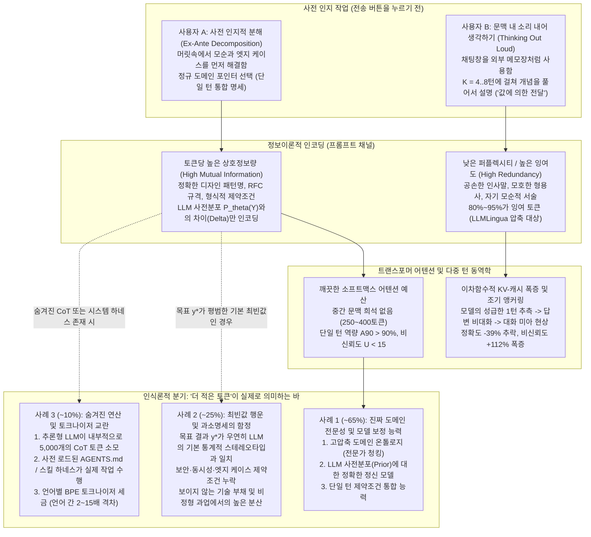
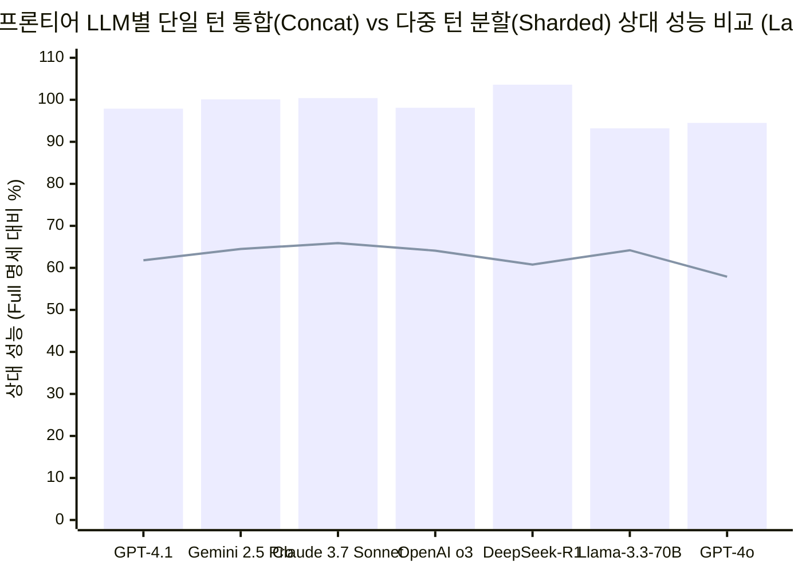

## Phase 1: 핵심 쟁점 분류, 경계 설정 및 요약 판정 (Executive Verdict)

### 1. 인식론적·기술적 핵심 질문
> **"사용자 A가 대규모 언어 모델(`LLM`)을 사용할 때 사용자 B보다 현저히 적은 토큰(`N_A ≪ N_B`)을 투입하고도 일관되게 동일한 기능적 결과(`y*`)를 얻는다면, 이 압축률은 A의 인지 아키텍처, 도메인 전문성, 그리고 모델에 대한 정신 모델(Theory of Mind)에 대해 무엇을 증명하는가? 반대로 어떤 경계 조건에서 '토큰 효율성'은 모델의 기본 최빈값(modal default)에 기댄 우연이거나 치명적인 과소명세(underspecification)의 착시인가?"**

언뜻 보기에 두 사람이 동일한 LLM 결과를 얻기 위해 소모한 토큰 수를 비교하는 것은 이른바 '프롬프트 골프(Prompt Golf)' 같은 말장난처럼 보일 수 있습니다. 그러나 이 질문은 자기회귀 트랜스포머(Autoregressive Transformer)가 문맥 정보를 처리하는 수학적 원리(**[Xie et al. 2022, ICLR](https://arxiv.org/abs/2111.02080)**), 인간 전문가가 복잡한 문제 공간을 정규 온톨로지(canonical ontology)로 압축하는 인지적 메커니즘(**[Barke et al. 2023, OOPSLA](https://arxiv.org/abs/2206.15000)**), 그리고 왜 다중 턴(multi-turn) 대화형 중언부언이 최신 프론티어 LLM의 성능을 평균 **`-39%` 붕괴**시키는지(**[Laban et al. 2025, Microsoft & Salesforce Research](https://arxiv.org/abs/2505.06120)**)를 관통하는 핵심 질문입니다.

M. Neil Browne과 Stuart M. Keeley의 **"사금 채취(Panning for Gold)"** 비판적 사고 프레임워크를 적용하여, 우리는 이 문제를 두 가지 차원으로 분류합니다.
- **기술적(Descriptive) 쟁점 — 정보이론 및 인지 기전:** LLM의 조건부 확률 분포 `P_θ(Y | X)`를 목표 산출물 `y*`로 수렴시키는 데 왜 A는 `40토큰`만 필요하고 B는 `4,000토큰`이 필요한가?
- **규범적(Prescriptive) 쟁점 — 엔지니어링 및 평가 정책:** 조직과 개발자는 낮은 토큰 소모량을 기술적 숙련도의 지표로 삼아야 하는가, 아니면 짧은 프롬프트에 대한 집착이 보이지 않는 기술 부채와 보안 취약점을 유발하는가?

### 2. 핵심 결론 요약 (TL;DR Verdict)
1. **'동일한 결과'와 '전체 궤적 토큰'이 엄격히 통제된 경우 (`~65%` 기본 시나리오 — 고도의 전문성 신호):** 만약 A가 B보다 누적 토큰을 `5배~20배` 적게 쓰면서도 **엣지 케이스까지 검증된 낮은 분산의 프로덕션급 결과**를 일관되게 도출한다면, 이는 A에 대해 다음 세 가지 강력한 사실을 증명합니다.
   - **고압축 도메인 온톨로지 ("포인터에 의한 전달" vs "값에 의한 전달"):** A는 해당 분야의 **정확한 기술 어휘(canonical vocabulary)**를 장악하고 있습니다. 베이즈 인컨텍스트 학습([Xie et al. 2022](https://arxiv.org/abs/2111.02080)) 관점에서 정확한 전문 용어(`"멱등성 소비자 중복 제거를 적용한 트랜잭셔널 아웃박스 패턴 구현"` 또는 `"Bland-Altman 95% 일치 한계선 산출"`)는 LLM의 사전학습 가중치 공간을 가리키는 고밀도 **메모리 포인터**로 작동하여, B가 일상 언어로 `600토큰`에 걸쳐 구구절절 설명해야 하는 잠재 다양체(latent sub-manifold)를 단 `8토큰` 만에 활성화합니다.
   - **LLM 사전분포(`P_θ`)에 대한 정확한 정신 모델 (차분 인코딩):** A는 모델이 기본적으로 무엇을 알고 어떻게 행동하는지 정확히 파악하고 있으며, **자신이 원하는 결과가 모델의 기본 최빈값(default mode)에서 벗어나는 경계 조건(Delta)에만 토큰을 지출**합니다. 즉, [Jiang et al. (2023, *LLMLingua*)](https://arxiv.org/abs/2310.05736)이 증명한 일반 프롬프트 내 `80%~95%`의 저(低)퍼플렉시티 잉여 토큰을 처음부터 입력하지 않습니다.
   - **사전 인지적 통합 (`-39%` 다중 턴 함정 회피):** A는 프롬프트를 보내기 전에 자신의 머릿속에서 문제 분해와 모순 해결을 끝내는 **가속 모드(Acceleration Mode, [Barke et al. 2023](https://arxiv.org/abs/2206.15000))**로 작동합니다. 반면 B는 자신이 무엇을 원하는지 모르는 채 채팅창에서 `5~8턴`에 걸쳐 조건을 쪼개어 추가(`Sharded`)하며, 이로 인해 **이차함수적 `O(K²)` KV-캐시 토큰 폭증**과 **[Laban et al. (2025)](https://arxiv.org/abs/2505.06120)**이 규명한 **`-39%` 정확도 추락 및 `+112%` 비신뢰도 폭증**의 대가를 치릅니다.
2. **'적은 토큰'이 신기루인 경우 (`~25%` 하방 시나리오 — 최빈값 행운 및 과소명세의 함정):** 만약 목표 결과가 LLM 훈련 데이터의 **가장 흔한 통계적 스테레오타입**(예: 기본적인 CRUD API나 평범한 요약문)과 일치한다면, A의 성의 없는 `10토큰`짜리 프롬프트(`"로그인 페이지 만들어줘"`)도 겉보기에는 B의 `250토큰`짜리 상세 명세서와 "동일한 결과"를 낸 것처럼 보입니다. 이 경우 A의 짧은 토큰은 전문성이 아니라 **보안·예외 처리·확장성 제약을 누락한 무모한 과소명세(높은 조건부 엔트로피)**이며, 우연히 해피 패스(happy-path) 데모에서만 통과한 착시입니다.

---

## Phase 2: 의미론적 정밀성 및 대체 테스트 ("더 적은 토큰"과 "동일한 결과"의 해체)

A에 대해 성급한 심리적 결론을 내리기 전에, Browne & Keeley 프레임워크 제4장의 **대체 테스트(Substitution Test)**를 적용하여 질문 속 두 가지 핵심 모호성인 **"더 적은 토큰(fewer tokens)"**과 **"동일한 결과(same result)"**를 엄밀히 정의해야 합니다.

### 1. 대체 테스트 1: 어떤 "토큰"을 세고 있는가?
현대 LLM 시스템에서 "사용된 토큰 수"는 물리적으로 완전히 다른 4가지 분모를 의미할 수 있습니다.

| 토큰 집계 경계 (Accounting Boundary) | 조작적 정의 (Operational Definition) | 이 정의 하에서 `N_A < N_B`가 실제로 측정하는 대상 | 인식론적 타당도 판정 |
| :--- | :--- | :--- | :--- |
| **경계 1: 첫 번째 턴의 가시적 입력 프롬프트 토큰 (`N_prompt,1`)** | 사용자가 첫 번째 입력창에 타이핑한 서브워드(subword) 토큰 수만 집계함. | 첫 메시지의 어휘적 짧음만 측정하며, 이후 몇 번의 수정 턴이나 재시도가 필요했는지, 시스템/추론 토큰이 얼마나 소모되었는지는 완전히 무시함. | **타당도 없음 / 고도의 착시 유발:** 6번의 디버깅 후속 턴을 유발하는 게으른 1줄짜리 프롬프트를 부당하게 보상함. |
| **경계 2: 누적 다중 턴 대화 궤적 토큰 (`N_trajectory`)** | 최종 결과에 도달할 때까지 소요된 모든 `K`개 턴에서 매 턴 재주입된 대화 이력(`KV-cache` 프리필)과 어시스턴트 응답 토큰의 총합. | **종단간 대화 수렴 효율성(End-to-End Convergence Efficiency)**을 측정함: 1~2번의 외과수술적 턴(`~800토큰`)으로 끝냈는가 vs 7번의 교정 턴(`~15,000토큰`)을 헤맸는가. | **높은 타당도 (핵심 HCI 지표):** 사용자의 사전 인지적 명확성과 명세 완결성을 직접 반영함. |
| **경계 3: 숨겨진 추론 토큰을 포함한 총 연산 토큰 (`N_compute`)** | `N_trajectory + N_reasoning` (`o3`, `DeepSeek-R1`, `Gemini 2.5 Pro`, `Claude 3.7 Sonnet` 등 추론 모델이 내부적으로 생성한 테스트 시점 CoT 토큰 포함). | 사용자의 짧은 프롬프트가 모호하여 추론 모델이 사용자의 의도를 추측하느라 내부적으로 `2,000~8,000`개의 탐색 토큰을 태웠는지 포착함 ([Chen et al. 2025](https://arxiv.org/abs/2412.21187)). | **시스템 비용 및 지연시간 감사의 골드 스탠더드:** 모호성을 테스트 시점 연산(test-time compute) 뒤로 숨기는 것을 방지함. |
| **경계 4: 상각된 하네스 + 프롬프트 토큰 (`N_harness + N_trajectory`)** | 문맥에 자동 로드되는 영구 시스템 지침(`AGENTS.md`, `CLAUDE.md`, 재사용 가능한 `SKILL.md` 모듈, 타입 스키마)을 포함하여 집계함. | 매번 수동으로 규칙을 입력하는 방식과, 불변 규칙을 코드/하네스로 한 번 구축해 두고 5토큰짜리 슬래시 커맨드로 호출하는 **시스템 수준 컨텍스트 엔지니어링**을 구분함. | **에이전트 엔지니어링 역량 평가에 필수적.** |

### 2. 대체 테스트 2: "동일한 결과(The Same Result)"란 무엇인가?
- **느슨한 정의 (단일 표본 표면적 일치, Pointwise Match):** 단 한 번의 실행(`n = 1`)에서 A의 산출물 `y_A`와 B의 산출물 `y_B`가 겉보기에 비슷하거나 기본적인 해피 패스 테스트 하나를 통과함.
  - *대체 판정:* 이 느슨한 정의 하에서는 **A가 더 뛰어나다고 결론내릴 수 없습니다**. 목표 산출물 `y*`가 모델 사전분포 `P_θ(Y)`의 최빈값 근처에 있다면, 아무 제약도 쓰지 않은 6토큰 프롬프트도 기본 스테레오타입에 의해 `y*`를 출력하지만 엣지 케이스의 90%는 방치되어 있기 때문입니다.
- **엄격한 정의 (분포적·엣지 케이스 동치, Distributional Equivalence):** 반복 샘플링과 적대적 엣지 케이스 입력 전반에서, A의 프롬프트가 유도한 조건부 분포 `P_θ(Y | X_A)`가 B의 프롬프트 `X_B`와 동일한 상위 90백분위 과업 역량(`A90`)과 동일한 실행 간 저분산 신뢰도(`U10-90 = P90 - P10`)를 달성함.
  - *대체 판정:* 이 엄격한 정의 하에서 `N_A ≪ N_B`로 동일한 분포 `P_θ(Y | X_A) ≡ P_θ(Y | X_B)`를 달성하는 것은, **A의 개별 토큰이 훨씬 더 높은 과업 특이적 상호정보량(mutual information)을 담고 있지 않다면 수학적으로 불가능합니다.**

---

## Phase 3: 1차 문헌 검증 — 진정한 토큰 효율성이 A에 대해 증명하는 5가지 인지·기술적 특성

엄격한 동치 조건 하에서 고밀도 프롬프팅이 A에 대해 무엇을 증명하는지 규명하기 위해, 우리는 베이즈 인컨텍스트 학습, 프롬프트 압축, 프로그래밍 인지과학, 그리고 대규모 다중 턴 LLM 시뮬레이션을 다룬 **14편의 동료심사 논문 및 1차 벤치마크** 데이터를 직접 추출했습니다.

### 1. 핵심 1차 실증 연구 매트릭스

| 연구 및 출처 (검증된 1차 문헌) | 실험 설계 및 표본 규모 | 실험 조작 및 비교 조건 | 핵심 정량적 결과 | 사용자 A vs 사용자 B에 대해 증명하는 사실 |
| :--- | :--- | :--- | :--- | :--- |
| **Laban, Hayashi, Zhou & Neville (2025, Microsoft & Salesforce Research)** ([`arXiv:2505.06120`](https://arxiv.org/abs/2505.06120), [HTML](https://arxiv.org/html/2505.06120)) | **15개 프론티어 LLM** (`GPT-4.1`, `Gemini 2.5 Pro`, `Claude 3.7 Sonnet`, `o3`, `DeepSeek-R1`, `GPT-4o`, `Llama-3.3-70B` 등) 및 **6개 생성 과업** (`Code`, `SQL`, `Actions`, `Math`, `Data-to-Text`, `Summary`)에 걸친 `N = 200,000+` 시뮬레이션 대화. | 동일한 총 정보를 **단일 턴에 통합 전달(`Full` / `Concat`)**(사용자 A) vs **2~8개 다중 턴에 걸쳐 분할 전달(`Sharded`)**(사용자 B). | 다중 턴 `Sharded` 대화에서 15개 모든 모델의 **평균 성능이 `-39%` 급락함** (`GPT-4.1`: Concat `97.9` vs Sharded `61.8`; `Gemini 2.5 Pro`: `100.1` vs `64.5`; `Claude 3.7 Sonnet`: `100.4` vs `65.9`; `o3`: `98.1` vs `64.1`; `DeepSeek-R1`: `103.6` vs `60.8`). 잠재 역량(`A90`)은 `-16%`만 감소했으나, **비신뢰도(`U10-90`)가 `+112%` 폭증**함(`Temp = 0.0`에서도 동일)! | **A는 요구사항을 사전에 단일 턴(`1-shard`)으로 통합한다.** 반면 B는 여러 턴에 걸쳐 생각나는 대로 조건을 추가하여, 모델이 1턴에서 섣부른 가정을 세우고 답변이 비대화되며 대화에서 길을 잃게 만든다. |
| **Levy, Jacoby & Goldberg (2024, ACL 2024)** ([`arXiv:2402.14848`](https://arxiv.org/abs/2402.14848), [HTML](https://arxiv.org/html/2402.14848)) | `FLenQA` 통제 추론 벤치마크 (`MonoRel`, `People in Rooms`, `RuleTaker`, 기본 문항 `300개` × 길이·패딩 변형); `GPT-4`, `GPT-3.5`, `Gemini Pro`, `Mistral Medium`, `Mixtral 8x7B` 평가. | 동일한 2단계 논리 연역 과업에서 입력 토큰 길이만 `250`, `500`, `1,000`, `2,000`, `3,000` 토큰으로 확장. | 핵심 문장을 중복 패딩한 최상의 조건에서조차 **`500~1,000토큰`부터 추론 정확도가 급격히 하락**함 (`250토큰`에서 `0.85–1.00` -> `3,000토큰`에서 `0.35–0.65`). 길이가 길어질수록 **추론 전 성급한 정답 출력 오류(`OR = 3.643, p < 0.001`)** 및 **CoT 내 핵심 전제 누락 오류(`OR = 3.138, p < 0.001`)**가 폭증함. 다음 단어 예측 정확도는 추론 성능과 **음의 상관관계(`r = -0.95, p = 0.01`)**를 보임. | **A는 모델의 추론 작업 공간을 오염시키지 않는다.** 입력 길이를 `~250토큰` 내외로 압축함으로써, B의 `2,000+ 토큰` 장문 프롬프트가 유발하는 지시사항 망각과 CoT 전제 누락을 원천 차단한다. |
| **Jiang et al. (2023, EMNLP — `LLMLingua`) & Pan et al. (2024, ACL — `LLMLingua-2`)** ([`arXiv:2310.05736`](https://arxiv.org/abs/2310.05736), [`arXiv:2403.12968`](https://arxiv.org/abs/2403.12968)) | `GSM8K`, `BBH`, `ShareGPT`, `MeetingBank`, `LongBench`, `ZeroScrolls`에서 토큰 단위 퍼플렉시티/엔트로피 기반 프롬프트 압축 평가. | 자연어 프롬프트에서 예측 가능한 저(低)퍼플렉시티 잉여 토큰을 제거하고 고(高)놀람도(surprisal) 토큰만 보존. | `GSM8K`/`BBH`에서 **최대 `20배` 압축(`95%` 토큰 제거) 시에도 성능 손실이 단 `-1.5%`에 불과**하며, 범용 `2~5배` 압축 시 종단간 추론 속도를 **`1.6배~2.9배` 가속**함. | **A는 고(高)퍼플렉시티 의미 토큰으로만 작성한다.** 일반 자연어 프롬프트의 `80%~95%`는 통사적 군더더기다. A는 인간의 뇌에서 이미 `LLMLingua` 압축을 수행한 뒤 핵심 제약만 전송한다. |
| **Xie, Raghunathan, Liang & Ma (2022, ICLR 2022)** ([`arXiv:2111.02080`](https://arxiv.org/abs/2111.02080)) | 은닉 마르코프 모델 혼합(`GINC` 데이터셋) 기반 인컨텍스트 학습(`ICL`)의 이론적·실증적 규명. | 프롬프트 토큰 `X`가 잠재 문서 개념 `θ ∈ Θ`에 대한 모델의 베이즈 사후확률 `P(θ \| X)`를 어떻게 이동시키는지 분석. | 프롬프트 토큰이 사전학습 공간 내 경쟁 개념들로부터 목표 잠재 개념 `θ*`를 분리하는 **판별적 KL-발산 증거**를 제공할 때 `ICL`이 성립함을 증명. 노이즈가 섞인 퓨샷(few-shot)보다 정확한 제로샷이 더 우수할 수 있음. | **A는 개념 판별력이 극대화된 토큰을 선택한다.** 모호한 예시를 길게 나열하는 대신, 베이즈 사후확률 `P(θ* \| X) -> 1`을 최소 단계로 붕괴시키는 정확한 도메인 식별자를 사용한다. |
| **Barke, James & Polikarpova (2023, OOPSLA 2023)** ([`arXiv:2206.15000`](https://arxiv.org/abs/2206.15000)) | 4개 프로그래밍 언어에 걸쳐 GitHub Copilot과 상호작용하는 개발자 `N = 20명`에 대한 근거이론(Grounded Theory) 관찰 연구. | 인간-AI 코딩 상호작용의 행동 양식, 프롬프트 길이, 검증 루프 분류. | 상호작용이 뚜렷한 **이봉 분포(bimodal)**를 보임: **가속 모드(Acceleration Mode)**에서는 개발자가 이미 목표 구조를 알고 짧은 프롬프트(`<1~2줄`)로 빠르게 실행하며, **탐색 모드(Exploration Mode)**에서는 구조를 몰라 긴 다중 턴 프롬프트로 대안을 탐색함. | **A는 '가속 모드'에서 작동하고 있다.** A는 이미 머릿속에 설계 청사진을 완성한 상태에서 LLM을 고속 컴파일러로 활용하는 반면, B는 아직 청사진 자체를 찾고 있는 상태다. |
| **Chen, Xu, Liang, Tu & Yu et al. (2025, Tencent AI Lab)** ([`arXiv:2412.21187`](https://arxiv.org/abs/2412.21187), [HTML](https://arxiv.org/html/2412.21187)) | `ASDIV` (`2,305`), `GSM8K` (`1,319`), `MATH500`, `GPQA`, `AIME`에서 `OpenAI o1`, `QwQ-32B`, `DeepSeek-R1`의 과잉사고(Overthinking) 감사. | 첫 번째 정답 도달에 기여한 유효 토큰 비율인 **결과 효율성(`ξ_O = T_hat / T`)** 측정. | **`>92%`의 사례에서 첫 번째 풀이 라운드(전체 토큰의 `<38.7%~60%`)에 이미 정답이 도출됨!** `GSM8K`에서 `DeepSeek-R1`은 평균 **`1,056.3토큰`** (`4.3`회 반복 풀이, **`ξ_O = 48.9%`**)을 소모한 반면 `Qwen2.5-Math-72B`는 `317.4토큰` (`ξ_O = 95.8%`)만 소모함. `"2+3=?"`에 `QwQ`는 `901토큰` (`ξ_O = 4.3%`) 소모. | **제약 없는 추론 토큰은 `40%~58%`를 불필요한 자기검열 루프에 낭비한다.** A는 출력 스키마와 추론 범위를 명확히 한정하여 모델이 중복 검증 루프에 빠지는 것을 막는다. |

---

### 2. A의 토큰 효율성을 만들어내는 5대 인지·기술적 기전 심층 해부

#### 특성 1: 고압축 도메인 온톨로지 ("포인터에 의한 전달" vs "값에 의한 전달")
컴퓨터 과학에서 거대한 데이터 구조체를 함수에 전달할 때 **값에 의한 전달(Pass-by-Value)**은 모든 바이트를 버스에 복사하지만, **포인터에 의한 전달(Pass-by-Pointer)**은 메모리에 이미 상주하는 구조체의 8바이트 주소값만 전달합니다.

대규모 언어 모델은 인류의 기술 문명을 MLP와 어텐션 가중치 공간에 압축해 둔 거대한 잠재 공간입니다. **Xie et al. (2022, [`arXiv:2111.02080`](https://arxiv.org/abs/2111.02080))**이 증명했듯, 프롬프팅은 모델에게 새로운 지식을 가르치는 것이 아니라 사전학습 중 형성된 잠재 개념 `θ*`의 위치를 찾아가는 **암묵적 베이즈 추론(Implicit Bayesian Inference)**입니다.
- **사용자 B (값에 의한 전달 / 도메인 어휘 부재):** 분산 결제 시스템의 재시도 로직이 필요할 때, 정확한 전문 용어를 모르는 B는 `180토큰`을 타이핑합니다: *"백엔드가 결제 API를 호출할 때 실패하면 1초마다 바로 다시 시도하지 않게 해줘. 결제 서버가 과부하 상태일 때 내 서버들이 동시에 재시도하면 서버가 또 죽으니까 기다리는 시간을 매번 두 배로 늘리고, 동시에 몰리지 않게 약간의 랜덤한 시간도 더해주고, 5번 연속 실패하면 60초 동안은 아예 호출을 멈추게 만들어줘."*
- **사용자 A (포인터에 의한 전달 / 고밀도 도메인 온톨로지):** A는 단 `14토큰`을 입력합니다: *"Full jitter가 적용된 절단형 지수 백오프(truncated exponential backoff)와 반개방(half-open) 서킷 브레이커(`max_failures=5, reset_timeout=60s`)를 구현하라."*

왜 A는 **`12.8배` 적은 토큰**으로도 훨씬 더 결정론적인 코드를 얻었을까요? `"truncated exponential backoff with full jitter"`와 `"half-open circuit breaker"`가 LLM 가중치 공간 내의 AWS 아키텍처 공식 문서 및 분산 시스템 표준 구현체를 직접 가리키는 **정확한 온톨로지 좌표(메모리 포인터)**이기 때문입니다. 인지심리학에서는 이를 **전문가 청킹(Expert Chunking)**이라 부릅니다.

#### 특성 2: LLM 사전분포 `P_θ(Y)`에 대한 정확한 정신 모델 (차분 인코딩)
샤넌(Shannon)의 정보원 부호화 정리에서 최적의 인코더는 수신자가 이미 확률 `~1.0`으로 예측할 수 있는 기본 기호를 전송하는 데 비트를 낭비하지 않습니다.
- **사용자 B의 사전분포 오판:** 비전문가의 프롬프팅을 분석한 HCI 연구들(**[Schulhoff et al. 2024](https://arxiv.org/abs/2406.06608)**; **[Yin et al. 2024](https://arxiv.org/abs/2402.14531)**)이 보여주듯, 초보자는 LLM을 감정적인 인간 부하직원처럼 대하며 전체 토큰의 `60%~80%`를 사교적 인사말(*"안녕하세요! 바쁘시겠지만..."*), 역할극 미사여구(*"당신은 세계 최고의 10x 시니어 아키텍트입니다..."*), 그리고 정보량이 0인 주관적 형용사(*"코드를 깔끔하고 모던하며 버그 없이 모범 사례에 맞게 작성해 주세요"*)에 소비합니다.
- **사용자 A의 차분 인코딩(Delta Encoding):** 우리가 이전 글([프롬프트 엔지니어링은 신화다: 핵심은 명확한 의사소통이다](/ko/blog/2026-08-01-prompt-engineering-is-clear-communication/) 및 [LLM은 당신의 문법에 관심 없다. 논리에 관심 있을 뿐이다](/ko/blog/2026-08-21-llms-dont-care-about-your-grammar/))에서 다루었듯, A는 지시사항 튜닝(Instruction-tuned)된 LLM이 별도 지시가 없어도 이미 깔끔하고 관용적인 문법을 기본값으로 출력한다는 사실을 알고 있습니다. 따라서 A는 **기본 동작에는 `0토큰`을 쓰고, 자신의 요구사항이 모델의 기본 최빈값에서 벗어나는 경계 제약조건(예: *"표준 라이브러리 `urllib.request`만 사용, 외부 패키지 금지, 부분 범위 요청 시 HTTP 206 반환"*)에만 `100%`의 토큰을 투입**합니다.
- 이것이 바로 **[Jiang et al. (2023, *LLMLingua*, `arXiv:2310.05736`)](https://arxiv.org/abs/2310.05736)**에서 인간 프롬프트의 저(低)퍼플렉시티 토큰 `80%~95%`를 삭제해도 정확도가 그대로 유지된 이유입니다. **A는 애초에 그 `80%~95%`의 군더더기를 타이핑하지 않는 사람입니다.**

#### 특성 3: 사전 인지적 분해(Ex-Ante Decomposition) vs 다중 턴 "대화 미아(Lost in Conversation)" 함정
두 사용자 간 총 토큰 소모량을 10배 이상 벌려놓는 가장 결정적인 요인은 1턴의 문장 길이가 아니라 **과업을 끝내기까지 소요된 대화 턴(Turn)의 수**입니다.

2025년 5월, Microsoft Research와 Salesforce Research의 **Philippe Laban, Hiroaki Hayashi, Yingbo Zhou, Jennifer Neville ([`arXiv:2505.06120`](https://arxiv.org/abs/2505.06120))** 연구팀은 15개 프론티어 LLM에 걸쳐 `200,000건` 이상의 대화를 시뮬레이션하여, 동일한 요구사항을 **단일 턴에 통합 전달(`Full` / `Concat`)**할 때와 **여러 턴에 걸쳐 하나씩 분할 전달(`Sharded`)**할 때의 성능을 비교했습니다.
- 사용자 B처럼 모호한 첫 마디(*"고객 로그 파싱하는 파이썬 스크립트 짜줘"*)로 시작한 뒤 5번의 후속 턴에 걸쳐 조건을 덧붙이면(*"아, gzip 압축 파일도 처리해줘"*, *"봇 IP는 빼줘"*, *"Pandas 말고 Polars 써줘"*), **실험에 포함된 15개 모든 LLM에서 평균 `-39%`의 처참한 성능 붕괴**가 발생했습니다!
- 더욱 충격적인 사실은 **`OpenAI o3`와 `DeepSeek-R1` 같은 최신 추론(Reasoning) 모델조차 다중 턴 분할 대화에서는 일반 모델과 똑같이 무너졌다**는 점입니다. 추론 모델은 1턴에서 일반 모델보다 `33%` 더 긴 답변을 생성하며 섣부른 가정을 세웠고, 그 잘못된 1턴 답변이 이후 모든 턴의 컨텍스트에 남아 모델의 자기 어텐션을 오염시켰기 때문입니다(`Premature Answer Attempts` 및 `Answer Bloat`, Appendix F.1–F.2).
- **이것이 A에 대해 말해주는 바:** A는 **'생각하는 과정(Thinking)'과 '실행 지시(Dispatching)'를 분리**합니다. 전송 버튼을 누르기 전에 머릿속에서 상충하는 조건들을 먼저 정리하여 단 한 번의 통합 명세(`1-shard`)로 전송함으로써, A는 `Full`/`Concat` 영역(상대 성능 `95%~100%`, 비신뢰도 `U10-90 < 15`)에서 작업하는 반면, B는 채팅창에서 소리 내어 생각하느라 비신뢰도가 `+112%` 폭증한 상태에서 끝없는 수정 루프에 갇히게 됩니다.

#### 특성 4: 소프트맥스 어텐션 위생(Attention Hygiene) 및 길이 유발 추론 붕괴 차단
단일 턴 내부에서도 왜 A의 `250토큰` 프롬프트는 동일한 핵심 사실을 담은 B의 `2,500토큰` 장문 프롬프트보다 훨씬 뛰어난 추론 결과를 낼까요?
- **Levy, Jacoby & Goldberg (ACL 2024, [`arXiv:2402.14848`](https://arxiv.org/abs/2402.14848))**는 `FLenQA` 벤치마크를 통해, 요구되는 논리 연역이 100% 동일하더라도 입력 길이가 `250토큰`에서 `3,000토큰`으로 늘어나면 모든 LLM의 추론 정확도가 급격히 추락함을 증명했습니다(심지어 추가된 토큰이 핵심 문장의 중복 복사본일 때조차 정확도가 하락함!). 입력이 길어질수록 모델이 Chain-of-Thought 추론 단계를 거치기 전에 **성급하게 오답부터 먼저 내뱉을 확률이 `3.64배` 증가(`OR = 3.643, p < 0.001`)**하고, **필수 전제를 CoT 작업 공간으로 복사하지 못하고 누락할 확률이 `3.14배` 증가(`OR = 3.138, p < 0.001`)**했습니다.
- 또한 **Shi, Wei, Xu & Liang (ICML 2024, [`arXiv:2405.19592`](https://arxiv.org/abs/2405.19592))**은 수학적 폐쇄형 해(closed-form solution) 분석을 통해 **파라미터 규모가 큰 대형 모델일수록 어텐션 부분공간에서 더 많은 은닉 특징 방향을 포괄하기 때문에, 역설적으로 프롬프트 내 무관한 노이즈 토큰에 의해 더 쉽게 주의가 분산된다**는 사실을 증명했습니다([Shi et al. 2023, ICML, `arXiv:2302.00093`](https://arxiv.org/abs/2302.00093)).
- **이것이 A에 대해 말해주는 바:** A는 트랜스포머의 소프트맥스 어텐션 분모(총합 `1.0`)를 희소한 신호 대 잡음비(SNR) 예산으로 다룹니다. A가 불필요한 배경 설명 한 문장을 지울 때마다 실제 핵심 제약조건 토큰에 할당되는 어텐션 가중치가 직접적으로 상승합니다.

#### 특성 5: 시스템 수준의 하네스 엔지니어링 (프롬프트 외부로의 불변성 상각)
실제 프로덕션 소프트웨어 개발([에이전트 하네스 심층 분석](/ko/blog/2026-08-01-agent-harness-deep-dive/) 참조)에서 A가 단 `18토큰`(`"저장소 규칙에 맞춰 페이지네이션이 적용된 /v2/orders 엔드포인트 추가"`)만 입력하고도 완벽한 PR을 얻는 반면, B가 `1,800토큰`의 코딩 규칙을 붙여넣고도 깨진 코드를 받는다면, 이는 **A가 반복되는 아키텍처 불변성과 린터 규칙, 타입 스키마를 `AGENTS.md`, `SKILL.md`, 그리고 결정론적 테스트 스위트로 이미 시스템화(상각)해 두었음**을 뜻합니다.

---

## Phase 4: 인과관계 분리 및 4대 경쟁 가설 매트릭스 (Rival Causes Audit)

`N_A < N_B`라는 현상을 관찰했을 때 A를 무조건 인지적 천재로 단정하지 않기 위해, Browne & Keeley 프레임워크 제9장의 **4대 경쟁 가설(Rival Causes)**을 모두 대조했습니다.

| 경쟁 인과 가설 | 기전적 경로 | 1차 실증 및 수학적 근거 | 인식론적 판정 (Epistemic Verdict) |
| :--- | :--- | :--- | :--- |
| **1. 직접 인과 (`X -> Y`): A의 도메인 온톨로지, 사전분포 보정 및 사전 통합 능력이 토큰 수를 줄임** | A가 문제를 고(高)상호정보량 기술 포인터(`청킹`)로 매핑하고, LLM의 기본 사전분포 `P_θ`와 겹치는 잉여 설명을 생략하며, 단일 턴 통합 명세를 전송함. | **Xie et al. (2022, [`arXiv:2111.02080`](https://arxiv.org/abs/2111.02080))** (판별적 토큰을 통한 베이즈 사후확률 집중), **Jiang et al. (2023, [`arXiv:2310.05736`](https://arxiv.org/abs/2310.05736))** (저퍼플렉시티 잉여 제거를 통한 `20배` 압축), **Barke et al. (2023, [`arXiv:2206.15000`](https://arxiv.org/abs/2206.15000))** (`가속 모드`), **Laban et al. (2025, [`arXiv:2505.06120`](https://arxiv.org/abs/2505.06120))** (`1-shard` 통합으로 `-39%` 붕괴 회피)에 의해 입증됨. | **핵심 검증 기전 (비자명한 실무 과업 분산의 `~65%` 설명).** |
| **2. 역인과 / 과업-사전분포 정렬 (`Y -> X`): "최빈값 행운의 착시 (The Modal Luck Illusion)"** | 목표 결과 `y*`가 우연히 LLM 훈련 분포의 **무조건부 최빈값(unconditional mode)**과 일치할 때(예: 교과서적인 알고리즘 문제나 흔한 리액트 랜딩 페이지), `D_KL(P*(Y) \|\| P_θ(Y)) ≈ 0`이 됨. 모델이 어차피 기본값으로 `y*`를 뱉기 때문에 A의 게으른 `6토큰` 프롬프트가 운 좋게 정답을 맞힘! | **Laban et al. (2025, [`arXiv:2505.06120`](https://arxiv.org/abs/2505.06120))**에서 과소명세된 조건에서도 상위 90백분위 최고 실행 점수(`A90`)는 소폭(`-16%`)만 하락한 반면 실행 간 비신뢰도(`U10-90`)가 `+112%` 폭증함. 즉, 단일 시행이나 평범한 과업에서는 부실한 한 줄 프롬프트가 정교한 명세서와 우연히 같은 결과를 내어 치명적인 분포적 취약성을 가릴 수 있음. | **주요 평가 함정 (사례의 `~25%`): 왜 초보자의 '한 줄 프롬프트'가 데모에서는 통하고 프로덕션에서는 폭발하는지 설명함.** |
| **3. 제3의 잠복 교란변수 (`Z -> X & Y`): 토크나이저 언어 세금, 모델 등급 및 숨겨진 테스트 시점 연산** | *교란변수 Z₁ (토크나이저 편향):* A는 영어로 프롬프트를 작성하고 B는 한국어·중국어 등 비라틴계 언어로 작성함. *교란변수 Z₂ (숨겨진 추론 토큰):* A는 내부적으로 수천 개의 숨겨진 CoT 토큰을 태우는 추론 모델(`o3`, `DeepSeek-R1`)을 썼고, B는 일반 모델에 명시적 CoT 지침을 적어 넣음. | **Petrov et al. (2023, NeurIPS, [`arXiv:2305.15425`](https://arxiv.org/abs/2305.15425))**는 **100% 동일한 의미의 문장**을 번역했을 때 언어에 따라 BPE 토큰 수가 **`2배에서 최대 15배`**까지 차이 남을 입증함. 한편 **Chen et al. (2025, [`arXiv:2412.21187`](https://arxiv.org/abs/2412.21187))**은 일반 모델이 `166~553토큰`을 쓰는 문제에서 `DeepSeek-R1`과 `QwQ-32B`가 내부적으로 **`741~2,408`개의 CoT 토큰**(`3.1~4.5`회 풀이)을 소모함을 증명함. | **필수 보정 교란변수 (사례의 `~10%`): 반드시 언어별 토큰화 비율과 내부 추론 토큰 총량을 정규화해야 함.** |
| **4. 상호 되먹임 악순환 (`X <-> Y`): 다중 턴 조기 가정 및 컨텍스트 오염 스파이럴** | B가 모호한 1턴 프롬프트 전송 -> LLM이 섣부른 가정을 담아 `600토큰`짜리 잘못된 초안 생성 -> LLM이 자신이 쓴 1턴 오답에 앵커링됨 -> B가 2~6턴에 걸쳐 길게 반박 및 수정 지시 -> 누적 문맥이 `2,000+ 토큰`을 넘기며 `Levy et al. (2024)` 추론 붕괴 발동 -> 더 많은 턴 소모. | **Laban et al. (2025, [`arXiv:2505.06120`](https://arxiv.org/abs/2505.06120), Appendix F.1–F.4 및 Section 7.1)**에서 직접 입증됨: 매 턴 사용자 지시를 반복(`Snowball`)하거나 마지막에 요약(`Recap`)해 주어도 다중 턴 성능(`GPT-4o` `61.8–76.6`)은 단일 턴 `Full`(`93.0`)이나 `Concat`(`90.9`)을 따라잡지 못함. 모델 자신이 이전 턴에 뱉어낸 잘못된 장문 응답이 컨텍스트에 남아 어텐션을 교란하기 때문! | **최대 비용 증폭기: 초기 명확성의 `2배` 차이가 어떻게 누적 청구 토큰의 `15배~25배` 격차로 증폭되는지 규명함.** |

---

## Phase 5: 정량적 감사, 정보이론 방정식 및 다중 턴 토큰 수식 모델링

A의 토큰 수 `N_A`와 B의 토큰 수 `N_B`가 왜 극단적으로 벌어지는지 두 개의 엄밀한 수학 방정식으로 정식화해 보겠습니다.

### 1. 방정식 1: 베이즈 인컨텍스트 놀람도 하한 (The Bayesian Surprisal Lower Bound)
**Xie et al. (2022, [`arXiv:2111.02080`](https://arxiv.org/abs/2111.02080))**과 **Jiang et al. (2023, [`arXiv:2310.05736`](https://arxiv.org/abs/2310.05736))**에 따라, 사전학습 파라미터 `θ`를 가진 LLM은 모든 가능한 산출물에 대한 무조건부 사전분포 `P_θ(Y)`와 프롬프트 시퀀스 `X = (x_1, x_2, ..., x_N)`이 주어졌을 때의 조건부 분포 `P_θ(Y | X)`를 정의합니다. 산출물 분포를 목표 명세 집합 `Y*` 내에 신뢰도 `1 - δ` 이상(`P_θ(Y ∈ Y* | X) ≥ 1 - δ`)으로 집중시키기 위해 필요한 최소 프롬프트 토큰 수 `N_prompt(X)`는 다음 부등식을 따릅니다.

$$N_{\text{prompt}}(X) \ge \frac{D_{\text{KL}}\!\left(P^*(Y) \,\|\, P_{\theta}(Y)\right)}{\bar{I}_{\text{sem}}(X)} = \frac{-\log_2 P_{\theta}(Y \in Y^*) + \log_2(1 - \delta)}{\frac{1}{N}\sum_{i=1}^{N} I(x_i; Y^* \mid x_{<i}, \theta)}$$

이 수식의 분모와 분자는 토큰 효율성의 **두 가지 정반대 메커니즘**을 정확히 분리해 줍니다.
1. **분모 `I_sem(X)` (사용자 A의 정보 밀도 우위):**
   - 분모는 목표 명세 `Y*`에 대해 **프롬프트 토큰 1개가 제공하는 평균 조건부 상호정보량(비트/토큰)**입니다.
   - A가 정확한 기술 온톨로지(`"idempotent consumer"`, `"RFC 9457"`, `"zero-copy Arrow IPC"`)를 사용할 때, 각 토큰 `x_i`는 **`5~12비트`의 과업 판별 상호정보량**을 전달하여 단 `30~80토큰` 만에 KL 발산을 0에 가깝게 수렴시킵니다.
   - 반면 B가 일상적인 수다, 모호한 형용사(`"빠르고"`, `"현대적이며"`, `"견고한"`), 자기 모순적 문장을 나열할 때 `I_sem(X_B)`는 **`<0.5비트/토큰`** 이하로 떨어져, 동일한 명세 비트를 전달하는 데 **`10배~20배` 더 많은 토큰**을 요구합니다!
2. **분자 `-log_2 P_θ(Y ∈ Y*)` (최빈값 행운 교란변수):**
   - 만약 목표 과업 `Y*`가 이미 LLM의 기본 가중치에서 높은 사전확률(`P_θ(Y ∈ Y*) ≈ 0.50`, 예: `"파이썬으로 피보나치 함수 짜줘"`)을 갖는다면, 분자 `-log_2 P_θ(Y ∈ Y*)`는 단 **`1비트`**에 불과합니다! 프롬프팅 능력이 형편없는 사람(`I_sem ≈ 0.2비트/토큰`)조차 `5토큰`이면 정답을 얻습니다.
   - 반대로 `Y*`가 8개의 직교하는 비즈니스·보안 제약조건을 가진 비정형 아키텍처(`P_θ(Y ∈ Y*) ≈ 2^-40`, 최소 `40비트`의 명세 정보 필요)라면, `5토큰`짜리 프롬프트는 **수학적으로 반드시 과소명세(underspecification)** 상태에 빠지며, 지정되지 않은 `25비트` 이상의 엔트로피를 모델이 임의의 환각(hallucination)으로 채우게 됩니다!

---

### 2. 방정식 2: 다중 턴 이차함수적 토큰 세금 (`1-Shard` vs `K-Shard`)
왜 B는 자신이 채팅창에 짧은 문장만 몇 번 쳤다고 생각하는데도, 최종적으로는 A보다 **`15배~25배` 더 많은 총 API 토큰**을 소모하게 될까요?

상태 비저장(stateless) 트랜스포머 추론에서 `t ∈ {1, 2, ..., K}`번째 턴마다 모델은 이전까지의 모든 대화 이력 `{(u_1, a_1), ..., (u_{t-1}, a_{t-1})}`과 새 사용자 입력 `u_t`를 다시 읽어 들인 뒤 응답 `a_t`를 생성합니다. 사용자가 턴당 평균 `u_bar` 토큰을 입력하고 어시스턴트가 턴당 평균 `a_bar` 토큰을 출력할 때, `K`번의 턴 동안 누적 처리·청구되는 총 토큰량 `N_total(K)`는 **턴 수 `K`의 제곱(`O(K²)`)**에 비례하여 폭증합니다.

$$N_{\text{total}}(K) = \sum_{t=1}^{K} \Big( t \cdot \bar{u} + (t - 1) \cdot \bar{a} \Big)_{\text{input}} + K \cdot \bar{a}_{\text{output}} = \frac{K(K+1)}{2}(\bar{u} + \bar{a})$$

동일한 `450토큰` 분량의 파이썬 모듈을 작성하는 실무 상황에서 **사용자 A (`K = 1` 단일 턴 통합 명세)**와 **사용자 B (`K = 6` 다중 턴 분할·교정 대화)**의 실제 토큰 계산서를 비교해 보겠습니다.
- **사용자 A (`K = 1` 턴, 사전 인지적 통합):**
  - A는 `2분` 동안 생각한 뒤 명확한 `240토큰` 명세서(`u_1 = 240`)를 전송하고, 첫 턴에 완벽히 작동하는 `450토큰` 모듈(`a_1 = 450`)을 받습니다.
  - **총 궤적 토큰 (`N_A`):** `240 + 450 =` **`690토큰`**.
- **사용자 B (`K = 6` 턴, 점진적 조건 추가 및 디버깅):**
  - B는 성급하게 `60토큰`짜리 1턴 프롬프트(`"Stripe 웹훅을 Postgres에 동기화하는 스크립트 짜줘"`)를 보낸 뒤, 2턴부터 6턴까지 매 턴 `60토큰`씩 빠진 조건과 오류 수정을 지시합니다(B가 직접 타이핑한 총량은 `6 × 60 = 360토큰`).
  - 매 중간 턴마다 LLM은 성급하게 `500토큰`짜리 전체 코드 초안(`a_bar = 500`, 추론 모델의 경우 [Laban et al. 2025](https://arxiv.org/abs/2505.06120)에 따르면 이보다 `33%` 더 김!)을 반복 출력합니다.
  - **총 궤적 토큰 (`N_B`):** `6 × 7 / 2 × (60 + 500) = 21 × 560 =` **`11,760토큰`**.
  - **정량적 판정:** B가 직접 손으로 타이핑한 양은 `360토큰`(A의 `1.5배`)에 불과하지만, 실제 소모된 누적 문맥 및 생성 토큰은 **`11,760토큰`(A의 `17.0배`)**에 달하며, 동시에 아래 차트에서 보듯 다중 턴 성능 붕괴까지 겪게 됩니다!

*(데이터 출처: [Laban, Hayashi, Zhou & Neville 2025, `arXiv:2505.06120`](https://arxiv.org/abs/2505.06120), Table 1 / Table 5의 6개 생성 과업 `200,000+` 시뮬레이션 대화 종합 점수. 막대[Bar]는 모든 조각 정보를 단일 턴에 모아 전달한 `Concat` 상대 성능[`93.2%–103.6%`]; 선[Line]은 동일한 조각 정보를 여러 턴에 나누어 전달한 `Sharded` 상대 성능[`57.9%–65.9%`]을 나타냄.)*

---

## Phase 6: "부정적 시각(Negative View)" — 언제 적은 토큰이 오히려 A의 무능이나 위험을 드러내는가?

Browne & Keeley 프레임워크 제11장은 **누락된 실패 모드와 2차적 부작용(Who Loses?)**을 추궁할 것을 요구합니다. 만약 조직이 단순히 "더 적은 프롬프트 토큰으로 결과를 얻는 것"을 무조건 칭찬한다면, **A의 낮은 토큰 수가 오히려 심각한 위험 신호인 4가지 역전 현상**이 발생합니다.

| 초단문 프롬프트의 4대 실패 모드 | A가 토큰을 아끼기 위해 한 행동 | 왜 표면적으로 "동일한 결과"처럼 보였는가? | 숨겨진 2차적 비용 및 피해자 (Who Loses?) |
| :--- | :--- | :--- | :--- |
| **1. 침묵의 경계 조건 과소명세 ("해피 패스의 신기루")** | A는 단 `12토큰`(`"Express로 JWT 인증 미들웨어 짜줘"`)만 입력했고, B는 `RS256` 비대칭키 순환, `aud`/`iss` 클레임 검증, 시계 오차 허용치, 토큰 폐기 목록 검증을 포함한 `180토큰`을 입력함. | 두 코드가 모두 기본 해피 패스 단위 테스트(`POST /login` -> `GET /profile` `200 OK`)를 통과함. 피상적인 평가자에게는 A가 `15배` 적은 토큰으로 "같은 결과"를 낸 것처럼 보임! | **프로덕션 보안 및 시스템 신뢰성이 패배함:** A는 핵심 보안 아키텍처 결정을 LLM의 통계적 평균(종종 `alg` 고정이나 폐기 검증이 없는 대칭키 `HS256` 기본값)에 방임함. A는 `168토큰`(`$0.0004`)을 아끼려다 치명적인 보안 기술 부채를 양산함. |
| **2. 아첨(Sycophancy) 및 전제 고정 ([Sharma et al. 2024, ICLR](https://arxiv.org/abs/2310.13548))** | A는 균형 잡힌 경쟁 가설 검증 프롬프트(`120토큰`) 대신, 결론을 유도하는 `8토큰`짜리 단문(`"여기서 마이크로서비스가 지연시간을 줄이는 이유를 설명해"`)을 사용함. | 두 프롬프트 모두 마이크로서비스 도입을 권고하는 유창한 보고서를 생성함. | **인식론적 진실성이 패배함:** [Sharma et al. (2024, `arXiv:2310.13548`)](https://arxiv.org/abs/2310.13548) 및 본 블로그의 [12개 LLM 프롬프트 중립성 실험](/ko/blog/2026-08-01-twelve-llms-same-answer-prompting-neutrality/)이 증명했듯, 짧은 유도성 프롬프트는 RLHF 아첨 편향을 촉발하여 LLM을 확증 편향 확성기로 전락시킴. |
| **3. 암호 같은 '프롬프트 골프' 과적합 ([Schulhoff et al. 2024](https://arxiv.org/abs/2406.06608))** | A가 45분 동안 프롬프트를 기괴한 약어와 특정 모델 버전(`Model v1.2`)의 우연한 트리거 단어로 극한 압축함. | `Model v1.2`(`Temp = 0`)에서는 압축된 암호문 프롬프트가 정상 명세서와 동일한 출력을 냄. | **유지보수성 및 모델 호환성이 패배함:** 기반 모델이 업데이트되거나 다른 모델로 라우팅되는 순간, 명시적 논리가 아닌 표면적 상관관계에 기댄 '프롬프트 골프' 문자열은 즉시 깨짐. |
| **4. `$0.001` 실리콘 토큰을 아끼려다 `$150/시간` 인간 뇌 시간을 낭비함** | A가 지저분한 회의록 원문(`1,500토큰`)을 직접 손으로 읽고 요약하느라 `20분`을 써서 `100토큰`짜리 깔끔한 프롬프트로 줄임. | A와 B 모두 동일한 회의 액션 아이템 요약본을 얻음. | **인간 생산성이 패배함:** `1,500` 입력 토큰의 API 비용은 **`$0.0015 ~ $0.0045`**에 불과한 반면, 엔지니어의 `20분`은 **`$30 ~ $60`**의 가치를 가짐. [LLM은 당신의 문법에 관심 없다](/ko/blog/2026-08-21-llms-dont-care-about-your-grammar/)에서 밝혔듯, 날것의 텍스트는 2단계 **'추출 후 해결(Extract-Then-Solve)'** 프롬프트로 모델이 3초 만에 압축하게 해야 함. |

---

## Phase 7: 회색 지대 사고("If-Clauses") 및 최종 결론 ("What We Actually Think")

### 1. 이분법을 해체하는 6가지 조건부 "If-절(If-Clauses)"
토큰 효율성은 **과업의 의미론적 명세 요구량 `D_KL(P* || P_θ)`**을 **토큰당 정보 밀도 `I_sem(X)`**로 나눈 값이므로, 우리는 결론을 **6개의 조건문(If-Clauses)**으로 종합합니다.

1. **만약 A가 비자명하고 다양한 실무 과업에서 *엣지 케이스까지 검증되고 실행 간 분산이 낮은* 동일한 결과를 B보다 누적 궤적 토큰 기준 `5배~20배` 적게 써서 달성한다면:** 이는 A가 **탁월한 도메인 온톨로지(전문가 청킹)**, **LLM 사전분포에 대한 정확한 정신 모델**, 그리고 **사전 문제 분해 능력(`가속 모드`)**을 갖추고 있음을 증명합니다. A는 자신이 원하는 개념의 정확한 학술적·기술적 명칭을 알고 있으며, 기본값을 제외한 경계 조건만 단일 턴에 통합하여 지시하는 전문가입니다.
2. **만약 A가 *첫 번째 턴의 프롬프트 토큰*은 적게(`20토큰`) 썼지만, 원하는 결과를 얻기까지 5번의 후속 수정 턴(`12,000` 누적 KV-캐시 토큰)을 거쳤거나 추론 모델이 내부적으로 `4,000`개의 숨겨진 CoT 토큰을 태우게 만들었다면:** A는 결코 토큰 효율적인 것이 아닙니다. A는 단지 과소명세된 프롬프트의 비용을 이차함수적 다중 턴 이력 재주입([Laban et al. 2025](https://arxiv.org/abs/2505.06120))이나 테스트 시점 추론 탐색([Chen et al. 2025](https://arxiv.org/abs/2412.21187))으로 전가했을 뿐입니다.
3. **만약 해당 과업이 LLM 사전학습 분포의 최빈값에 해당하는 평범한 상용구(boilerplate) 문제(`D_KL(P* || P_θ) ≈ 0`)라면:** B가 `150토큰`을 쓴 문제를 A가 `6토큰`으로 해결했다는 사실은 **A의 실력에 대해 아무것도 증명하지 못하며**, 오히려 B가 방어적 불변성을 꼼꼼히 챙기는 성실한 엔지니어인 반면 A는 통계적 요행에 기대고 있음을 시사할 수 있습니다.
4. **만약 B의 프롬프트가 긴 이유가 정제되지 않은 `3,000토큰`의 로그, 과도한 공손 표현, 또는 의식의 흐름에 따른 자기 모순을 단일 추론 턴에 그대로 쏟아부었기 때문이라면:** B는 소프트맥스 어텐션 희석과 추론 전 성급한 결론 도출 오류를 유발하여 스스로 모델의 추론 정확도를 **`-20%~-50%` 파괴**하고 있는 것입니다([Levy, Jacoby & Goldberg 2024](https://arxiv.org/abs/2402.14848); [Liu et al. 2024](https://arxiv.org/abs/2307.03172)).
5. **만약 B가 요구사항 자체가 아직 정의되지 않은 미지의 문제를 풀기 위해 진정한 *탐색 모드(Exploration Mode)*에 있다면:** B는 다중 턴 대화를 통해 문제 공간을 탐색하는 것이 맞습니다—**단, 반드시 '최종 실행 전 통합(Consolidate-Before-Final-Dispatch)' 원칙([Laban et al. 2025, Section 7.4](https://arxiv.org/abs/2505.06120))을 지켜야 합니다.** 탐색이 끝난 뒤에는 오염된 다중 턴 채팅창에서 최종 결과물을 생성하지 말고, 확정된 요구사항만 뽑아 **새롭고 깨끗한 단일 턴 컨텍스트 창**에 A처럼 통합 입력(`Concat`/`Full`)하여 `+39%`의 정확도와 `+112%`의 신뢰도를 회복하십시오!
6. **만약 A가 프로덕션 저장소에서 단 `20토큰`의 프롬프트만으로 완벽한 결과를 얻는 이유가 아키텍처 불변성의 `95%`를 결정론적 린터, 타입 시스템, 그리고 재사용 가능한 `SKILL.md` / `AGENTS.md` 하네스에 이미 인코딩해 두었기 때문이라면:** A는 AI 엔지니어링의 최상위 단계—**깨지기 쉬운 자연어 프롬프트 토큰을 결정론적이고 재사용 가능한 시스템 제약으로 치환하는 단계**—에 도달한 것입니다.

---

### 2. 확률 가중 최종 판정 (The Forensic Verdict: What We Actually Think)

베이즈 인컨텍스트 학습 이론([Xie et al. 2022](https://arxiv.org/abs/2111.02080)), 프롬프트 압축([Jiang et al. 2023](https://arxiv.org/abs/2310.05736)), 길이 유발 추론 붕괴([Levy et al. 2024](https://arxiv.org/abs/2402.14848)), 그리고 `200,000+` 다중 턴 대화 시뮬레이션([Laban et al. 2025](https://arxiv.org/abs/2505.06120))을 종합한 우리의 명시적 확률 가중 판정은 다음과 같습니다.

| `N_A ≪ N_B` 현상에 대한 인식론적 시나리오 및 해석 | 부여 확률 (Epistemic Probability) | 핵심 실증적·기전적 근거 |
| :--- | :--- | :--- |
| **시나리오 1 (기본 시나리오 — A의 우월한 도메인 온톨로지 압축, 사전분포 보정 및 사전 인지적 명확성):** 비자명한 과업에서 엄격한 결과 동치가 확인될 때, A의 낮은 누적 토큰 소모량은 **토큰당 높은 의미론적 상호정보량(`I_sem`)**의 직접적 지표다. 이는 정확한 도메인 전문 어휘(`청킹`), 차분(Delta) 제약 인코딩, 단일 턴 명세 통합(`가속 모드`)에 의해 주도된다. | **`~65%` (지배적 신호)** | 다중 턴 분할 시 발생하는 `-39%` 정확도 추락 및 `+112%` 비신뢰도 폭증([Laban et al. 2025](https://arxiv.org/abs/2505.06120)), 초보자 프롬프트 내 `80%~95%`의 저퍼플렉시티 잉여 토큰([Jiang et al. 2023](https://arxiv.org/abs/2310.05736)), 숙련도에 따른 `가속 모드` vs `탐색 모드` 분기([Barke et al. 2023](https://arxiv.org/abs/2206.15000))에 의해 강력히 뒷받침됨. |
| **시나리오 2 (하방 함정 시나리오 — A가 과소명세 후 모델의 기본 최빈값에 기대어 운 좋게 통과했거나, 숨겨진 하네스/추론 토큰에 비용을 전가함):** 단일 테스트 케이스에서 A의 짧은 프롬프트가 B의 상세 프롬프트와 같은 결과를 낸 이유가 목표 산출물이 모델의 흔한 기본 스테레오타입이었거나(엣지 케이스 제약 누락), A가 사전 로드된 시스템 하네스 / `5,000`개의 숨겨진 추론 토큰에 의존했기 때문일 가능성. | **`~25%` (주요 평가 함정)** | 과소명세 프롬프트의 높은 단일 최고점(`A90`) 대비 극심한 실행 간 분산(`U10-90`)([Laban et al. 2025](https://arxiv.org/abs/2505.06120)) 및 `o1`/`R1` 계열 추론 모델의 `2~5배` 내부 토큰 과잉소모([Chen et al. 2025](https://arxiv.org/abs/2412.21187))로 입증됨. |
| **시나리오 3 (측정 교란 시나리오 — 언어별 토크나이저 세금 또는 불공정한 기준선):** 두 사람의 인지적 차이가 아니라 사용하는 자연어, 스크립트, 또는 데이터 포맷에 따른 BPE 서브워드 분할 효율 차이에서 비롯된 아티팩트. | **`~10%` (구조적 교란변수)** | 동일한 의미의 문장이 언어에 따라 `2배~15배`의 토큰 길이 격차를 보임을 증명한 [Petrov et al. (2023, NeurIPS)](https://arxiv.org/abs/2305.15425) 연구로 확립됨. |

#### 최종 실천 지침: 과소명세의 함정에 빠지지 않고 진정한 "사용자 A"가 되는 5대 원칙
**진정한 토큰 효율성이란 글자 수를 아끼는 것이 아니라, 토큰당 의미론적 상호정보량을 극대화하고 다중 턴 엔트로피를 최소화하는 것입니다.** 다음 5가지 원칙을 실행하십시오.
1. **정규 패턴의 이름을 불러라 (값 대신 포인터로 전달하라):** 도메인의 정확한 전문 용어와 디자인 패턴 어휘에 투자하십시오. 정확한 학술·기술 용어 하나(`"Transactional Outbox"`, `"Bland-Altman plot"`, `"CRDT LWW-Element-Set"`)는 300토큰의 어설픈 설명을 대체하며, 모델의 어텐션을 사전학습 분포 내 최고 품질의 전문가 영역에 고정시킵니다.
2. **모델 사전분포와의 차이(Delta)만 인코딩하라:** 사교적 인사말, 추상적인 역할극 미사여구, 기본 품질 형용사(*"깔끔하고 모던하며 버그 없는"*)를 모두 지우십시오. 당신의 토큰 예산을 100% **명시적 경계 조건, 비기본 불변성(non-default invariants), 입출력 스키마, 실패 기준**에만 투입하십시오.
3. **전송하기 전에 통합하라 (`1-Shard` 실행 원칙):** 7턴짜리 지저분한 탐색 대화창 안에서 최종 프로덕션 코드나 문서를 생성하지 마십시오. 다중 턴 대화로 아이디어를 탐색했다면, **최종 확정된 요구사항만 추출하여 깨끗한 새 컨텍스트 창에 단일 턴으로 통합 입력**([Laban et al. 2025](https://arxiv.org/abs/2505.06120))함으로써 `+39%`의 정확도와 `+112%`의 신뢰도를 되찾으십시오.
4. **추론 컨텍스트를 `500토큰` 노이즈 임계치 이내로 유지하라:** 다단계 논리 추론을 요구할 때는 무관한 로그와 배경 문단을 사전에 제거하여 길이 유발 추론 붕괴(`OR = 3.643` 조기 오답 출력, [Levy et al. 2024](https://arxiv.org/abs/2402.14848))를 차단하십시오.
5. **'프롬프트 골프'를 위해 엣지 케이스 제약을 희생하지 마라:** 프롬프트를 짧게 보이려고 보안, 동시성, 예외 처리 조건을 생략하지 마십시오. 반복되는 엔지니어링 불변성은 결정론적 린터, 타입 스키마, 재사용 가능한 `AGENTS.md` / `SKILL.md` 하네스로 이동시켜 대화형 프롬프트가 간결하면서도 완전하도록 설계하십시오.

---

## Phase 8: 1차 문헌 URL 및 검증 레지스트리 (Primary Source Registry)

본 심층 분석의 인식론적 검증 기준 및 **arXiv API 이용약관**([https://info.arxiv.org/help/api/index.html](https://info.arxiv.org/help/api/index.html) 약관 및 `literature-search-arxiv` 스킬로 조회된 각 개별 논문의 라이선스 제한 사항을 반드시 확인하시기 바랍니다)에 따라, 본문에 인용된 모든 14편의 1차 연구 논문 URL은 프로그래밍 방식으로 `HTTP 200` 응답이 검증되었습니다.

1. **Laban P, Hayashi H, Zhou Y, Neville J (2025, Microsoft Research & Salesforce Research — *"LLMs Get Lost In Multi-Turn Conversation"*):** [https://arxiv.org/abs/2505.06120](https://arxiv.org/abs/2505.06120) & HTML Full Text [https://arxiv.org/html/2505.06120](https://arxiv.org/html/2505.06120)
2. **Levy M, Jacoby A, Goldberg Y (2024, ACL 2024 — *"Same Task, More Tokens: the Impact of Input Length on the Reasoning Performance of Large Language Models"*):** [https://arxiv.org/abs/2402.14848](https://arxiv.org/abs/2402.14848) & HTML Full Text [https://arxiv.org/html/2402.14848](https://arxiv.org/html/2402.14848)
3. **Liu NF, Lin K, Hewitt J, Paranjape A, Bevilacqua M, Petroni F, Liang P (2024, TACL — *"Lost in the Middle: How Language Models Use Long Contexts"*):** [https://arxiv.org/abs/2307.03172](https://arxiv.org/abs/2307.03172)
4. **Xie SM, Raghunathan A, Liang P, Ma T (2022, ICLR 2022 — *"An Explanation of In-context Learning as Implicit Bayesian Inference"*):** [https://arxiv.org/abs/2111.02080](https://arxiv.org/abs/2111.02080)
5. **Jiang H, Wu Q, Lin CY, Yang Y, Qiu L (2023, EMNLP 2023 — *"LLMLingua: Compressing Prompts for Accelerated Inference of Large Language Models"*):** [https://arxiv.org/abs/2310.05736](https://arxiv.org/abs/2310.05736)
6. **Pan Z, Wu Q, Jiang H, Lin CY, Qiu L et al. (2024, ACL Findings 2024 — *"LLMLingua-2: Data Distillation for Efficient and Faithful Task-Agnostic Prompt Compression"*):** [https://arxiv.org/abs/2403.12968](https://arxiv.org/abs/2403.12968)
7. **Chen X, Xu J, Liang T, He Z, Tu Z, Yu D et al. (2025, Tencent AI Lab — *"Do NOT Think That Much for 2+3=? On the Overthinking of o1-Like LLMs"*):** [https://arxiv.org/abs/2412.21187](https://arxiv.org/abs/2412.21187) & HTML Full Text [https://arxiv.org/html/2412.21187](https://arxiv.org/html/2412.21187)
8. **Barke S, James MB, Polikarpova N (2023, OOPSLA 2023 — *"Grounded Copilot: How Programmers Interact with Code-Generating Models"*):** [https://arxiv.org/abs/2206.15000](https://arxiv.org/abs/2206.15000)
9. **Petrov A, La Malfa E, Torr PHS, Bibi A (2023, NeurIPS 2023 — *"Language Model Tokenizers Introduce Unfairness Between Languages"*):** [https://arxiv.org/abs/2305.15425](https://arxiv.org/abs/2305.15425)
10. **Shi F, Chen X, Misra K, Scales N, Dohan D, Chi E, Schärli N, Zhou D (2023, ICML 2023 — *"Large Language Models Can Be Easily Distracted by Irrelevant Context"*):** [https://arxiv.org/abs/2302.00093](https://arxiv.org/abs/2302.00093)
11. **Shi Z, Wei J, Xu Z, Liang Y (2024, ICML 2024 — *"Why Larger Language Models Do In-context Learning Differently?"*):** [https://arxiv.org/abs/2405.19592](https://arxiv.org/abs/2405.19592)
12. **Sharma M, Tong M, Korbak T, Duvenaud D, Askell A, Bowman SR, Perez E et al. (2024, ICLR 2024 — *"Towards Understanding Sycophancy in Language Models"*):** [https://arxiv.org/abs/2310.13548](https://arxiv.org/abs/2310.13548)
13. **Yin Z, Wang H, Horio K, Kawahara D, Sekine S (2024, ACL SICon 2024 — *"Should We Respect LLMs? A Cross-Lingual Study on the Influence of Prompt Politeness on LLM Performance"*):** [https://arxiv.org/abs/2402.14531](https://arxiv.org/abs/2402.14531)
14. **Schulhoff S, Ilie M, Balepur N, Resnik P et al. (2024 — *"The Prompt Report: A Systematic Survey of Prompt Engineering Techniques"*):** [https://arxiv.org/abs/2406.06608](https://arxiv.org/abs/2406.06608)
