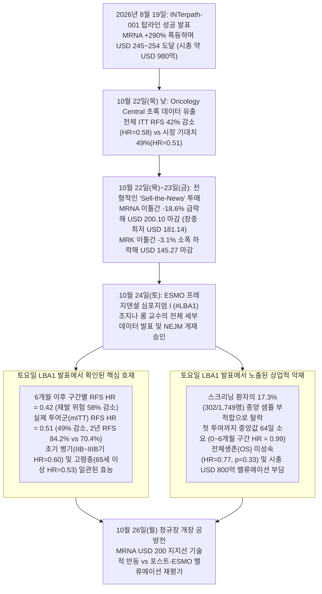
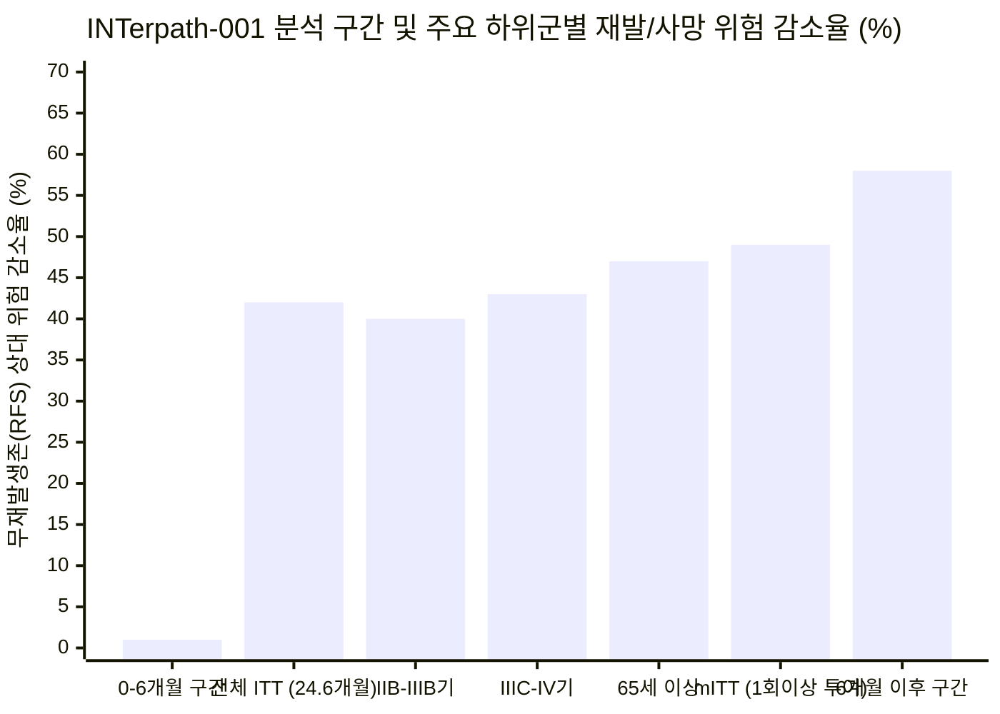

## 핵심 요약(Executive Summary): `INTerpath-001` 임상 3상을 둘러싼 '2단계' 시장 반응의 진실

2026년 10월 24일(토) 스페인 마드리드에서 열린 유럽종양학회(**ESMO 2026**) 프레지덴셜 심포지엄 I(`초록 번호 #LBA1`)에서 책임연구자인 호주 흑색종연구소(MIA) **조지나 롱(Georgina V. Long)** 교수는 **[INTerpath-001(`NCT05933577`)](https://clinicaltrials.gov/study/NCT05933577)**의 전체 세부 결과를 공식 발표했습니다. 이는 **모더나(`NASDAQ: MRNA`)**와 **머크(`NYSE: MRK`)**가 공동 개발한 세계 최초의 개인맞춤형 mRNA 신생항원(Neoantigen) 암백신 **인티스메란 오토진(intismeran autogene, 코드명 `V940` / `mRNA-4157`)**의 대규모 무작위배정 임상 3상입니다. 완전 절제술을 받은 고위험군(IIB~IV기) 피부 흑색종 환자 `1,137명`을 대상으로 중앙값 `24.6개월`간 추적 관찰한 결과, 표준치료제인 **키트루다(`Keytruda`, 펨브롤리주맙)**에 `인티스메란`을 병용 투여한 군은 키트루다 단독(위약 병용) 대조군 대비 **질병 재발 또는 사망 위험(RFS)을 42% 감소**(`위험비[HR] = 0.58`; `95% CI: 0.45–0.75`; 양측 `p < 0.001`)시켰으며, **원격 전이 또는 사망 위험(DMFS)도 38% 감소**(`HR = 0.62`; `95% CI: 0.45–0.85`; `p = 0.002`)시켰습니다.

그렇다면 다가오는 다음 거래일인 **2026년 10월 26일(월, '내일')** 모더나(`MRNA`)와 머크(`MRK`)의 주가는 오를까요, 내릴까요? 이 질문에 정확히 답하려면 가장 먼저 **시간차 착시(Temporal Illusion)**부터 교정해야 합니다:

1. **헤드라인 수치인 '재발 위험 42% 감소'는 이미 목요일(10월 22일)에 사전 유출되어 모더나(`MRNA`) 주가를 `-18.6%` 폭락시켰습니다:** 토요일(10월 24일) ESMO 공식 발표보다 무려 48시간 앞선 **10월 22일(목) 낮**, 의학 전문 매체 *Oncology Central*에 초록의 핵심 수치(`RFS 42% 감소, HR = 0.58`)가 실수로 유출되었고, 이에 ESMO 측이 엠바고를 조기 해제하면서 [머크와 모더나는 목요일 오후 2시 59분(미 동부시간)에 공식 보도자료를 긴급 배포](https://www.merck.com/news/merck-and-moderna-will-present-results-from-landmark-phase-3-interpath-001-trial-for-intismeran-autogene-plus-keytruda-pembrolizumab-at-esmo-2026-presidential-symposium/)했습니다. 앞서 8월 19일 탑라인 성공 발표 이후 `MRNA` 주가가 이미 **+290% 폭등**(52주 최저가 `USD 22.28` 대비 **6배 이상** 치솟아 고점 `USD 254.48` 기록)해 있던 상태에서, 임상 2b상(`KEYNOTE-942`)의 `49% 감소(HR = 0.51)`를 기대하던 단기 차익실현 매물이 쏟아졌습니다. 그 결과 [모더나 주가는 목요일 장중 최대 `-26%`(`USD 181.14`)까지 폭락](https://www.forbes.com/sites/maryroeloffs/2026/10/22/moderna-stock-plunges-25-after-possible-cancer-vaccine-data-leak/)한 뒤 **목요일 종가 `USD 202.63`(`-17.57%`, 거래량 `4,930만 주`)**, **금요일(10월 23일) 종가 [`USD 200.10`(`-1.25%`, 시가총액 `USD 798.9억`)](https://www.fool.com/coverage/stock-market-today/2026/10/22/stock-market-today-oct-22-moderna-stock-plummets-18-on-melanoma-vaccine-data-leak-reports/)**로 마감하며 이틀 만에 시가총액 약 `USD 185억(약 25조 원)`이 증발했습니다. 반면 시가총액 `USD 3,650억` 규모의 대형주인 머크(`MRK`)는 목요일 `-1.76%`(`USD 147.24`), 금요일 `-1.34%`(`USD 145.27`)로 소폭 조정에 그쳤습니다.
2. **따라서 내일(10월 26일 월요일) 시장을 움직이는 동인은 '42%'라는 헤드라인이 아니라, 주말(10월 24일 토요일) ESMO 프레지덴셜 심포지엄에서 최초 공개된 '세부 슬라이드(`#LBA1`)'입니다:** 목·금요일에 단기 실망 매물이 이미 한 차례 쓸려나간 상태에서, 월요일 장은 토요일 [조지나 롱 교수의 전체 발표](https://www.cancernetwork.com/view/interpath-001-data-detail-survival-subgroup-and-safety-findings-in-melanoma)에서 드러난 **강력한 통계적 반전(호재)**과 **상업화 병목 수치(악재)**의 정면충돌로 요약됩니다.
   - **토요일 발표가 입증한 생물학적 반전(호재 — 왜 42%는 '제조 지연 착시'였는가):** 환자의 종양 조직을 채취해 차세대 염기서열분석(NGS)을 거치고 최대 34개의 맞춤형 신생항원 mRNA를 합성해 **첫 투여하기까지 걸린 중앙값 기간이 `64일(약 9주)`**이었습니다. 즉, 첫 `0~6개월` 동안(백신 제조 대기 + 초기 면역 프라이밍 기간)에는 사실상 키트루다 단독 효과만 작용해 양 군의 차이가 전혀 없었습니다(`0~6개월 구간별 HR = 0.99`). 그러나 **백신 접종이 본궤도에 오른 6개월 이후(`>6개월` 사전 지정 민감도 분석)에는 재발 또는 사망 위험을 무려 `58%` 감소(`구간별 HR = 0.42`; `95% CI: 0.30–0.58`)**시켰고, 최소 1회 이상 백신을 실제 투여받은 수정 치료의향집단(`mITT`)에서는 재발 위험 감소율이 **`49%`(`HR = 0.51`)**로 임상 2b상 성적과 소수점까지 완벽히 일치했습니다.
   - **토요일 발표에서 새로 노출된 상업적·밸류에이션 마찰 요인(악재):** 반면 목요일 보도자료에는 없었으나 토요일 슬라이드에서 최초 확인된 4가지 부담 요인도 존재합니다: (a) **전체 스크리닝 환자 `1,749명` 중 `17.3%`(`302명`)가 '부적절한 종양 조직 샘플' 때문에 임상에서 아예 탈락**했다는 점, (b) **전체생존기간(`OS`) 데이터가 아직 미성숙(`HR = 0.77`, `p = 0.33`)하여 통계적 유의성 경계를 넘지 못했다는 점**, (c) 소규모 하위군이지만 **미국(US) 원격무전이생존(DMFS) 하위군에서 위험비 점추정치가 `1.77`(`10건 이벤트`)로 1.0을 넘었다는 점**, 그리고 (d) 주가가 `USD 200.10`(시가총액 `~USD 800억`)으로 내려왔음에도 여전히 연간 `USD 100억~130억` 규모의 항암제 매출(머크와 `50:50` 이익 배분)을 선반영하고 있다는 점입니다.

---

## Phase 1: 이슈 분류 및 타임라인 괴리 해부

### 1.1 핵심 분석 질문의 이원화
- **기술적·임상통계적 질문(Descriptive):** 임상 3상 `INTerpath-001`(`LBA1`) 데이터는 임상 2b상(`KEYNOTE-942`)에서 확인된 `인티스메란 오토진`의 항종양 면역 기전을 재확인했는가, 아니면 대규모 3상에서 약효 희석(Efficacy Attenuation)이 발생했는가?
- **자본시장 예측 질문(Predictive):** 10월 22~23일 이틀간 이미 `-18.6%`의 '뉴스에 파는(Sell-the-News)' 급락(`MRNA USD 245.82` → `USD 200.10`; `MRK USD 149.88` → `USD 145.27`)이 발생한 직후, 토요일(10월 24일) ESMO 본발표와 *NEJM* 게재 승인을 소화하는 **10월 26일(월) 당일** 및 **향후 30일간**의 주가 경로는 어떻게 전개될 것인가?

---

## Phase 2: 1차 출처 데이터 검증 — `INTerpath-001`(`#LBA1`)의 전체 성적표

[머크·모더나 공식 공동 보도자료](https://www.merck.com/news/merck-and-moderna-will-present-results-from-landmark-phase-3-interpath-001-trial-for-intismeran-autogene-plus-keytruda-pembrolizumab-at-esmo-2026-presidential-symposium/), [모더나 최고개발책임자(CDO) 데이비드 버먼 박사의 10월 24일 임상 브리핑](https://www.modernatx.com/recapping-the-phase-three-interpath-results), [ESMO 공식 학회 리포트](https://www.esmo.org/insights-by-esmo/all-news/first-positive-phase-iii-trial-data-for-an-individualised-mrna-based-neoantigen-therapy), 그리고 [CancerNetwork가 정리한 조지나 롱 교수의 `LBA1` 발표 전문](https://www.cancernetwork.com/view/interpath-001-data-detail-survival-subgroup-and-safety-findings-in-melanoma)을 교차 검증한 임상 2b상 대 3상 비교표는 다음과 같습니다.

### 2.1 임상 3상 `INTerpath-001` vs. 임상 2b상 `KEYNOTE-942` 정밀 비교 매트릭스

| 임상 및 운영 지표 | 임상 2b상 `KEYNOTE-942` (`N = 157`) | 임상 3상 `INTerpath-001` (`N = 1,137`) | 1차 포렌식 해석 및 시사점 |
| :--- | :--- | :--- | :--- |
| **임상 설계 및 눈가림(Blinding)** | 오픈라벨(Open-label), `2:1` 무작위배정(`107` 대 `50`), 절제된 IIIB~IV기 흑색종 | 이중눈가림(Double-blind), 위약 대조, `2:1` 무작위배정(`757` 대 `380`), 절제된 IIB~IV기 흑색종 | 위약 대조군(`NCT05933577`) 도입으로 오픈라벨 편향을 완벽히 제거하고 조기 병기(IIB/IIC기)까지 적응증을 확장함. |
| **1차 평가변수: 전체 ITT 무재발생존(RFS) 위험비** | `HR = 0.56`(약 2년 시점 44% 감소); `HR = 0.51`(3년 및 5년 시점 49% 감소) | **`HR = 0.58`** (`95% CI: 0.45–0.75`; 양측 `p < 0.001`; 중앙값 `24.6개월` 시점 **42% 감소**) | 재발/사망 이벤트가 병용군 `18.0%`(`136/757`) 대 대조군 `29.2%`(`111/380`)로 압도적 통계적 유의성(`p < 0.001`) 달성. |
| **24개월 시점 RFS 비율 (ITT 기준)** | `~78.6%` 대 `~62.2%` (고위험 IIIB~IV기 대상 18~24개월 시점) | **`82.2%` 대 `70.0%`** (`+12.2%p` 절대 개선폭; 치료필요환자수 `NNT ≈ 8.2명`) | 수술 후 환자 100명당 약 `12.2명`의 추가 재발 또는 사망을 표준치료제 키트루다 단독 대비 막아냄. |
| **수정 ITT (`mITT`) RFS (최소 1회 이상 계획 투여군)** | ITT 수치(`HR = 0.51`)와 유사하게 수렴 | **`HR = 0.51`** (`95% CI: 0.39–0.67`; **49% 감소**); 2년 RFS **`84.2%` 대 `70.4%`** | 첫 백신 투여(`64일` 소요) 이전에 조기 재발·이탈한 환자를 제외하면 **임상 2b상의 49% 감소율을 정확히 재현함.** |
| **구간별(Piecewise) RFS: `0~6개월` (제조 및 초기 면역 유도기)** | 초기 9주 제조 및 접종 기간 중 생존곡선 중첩 관찰 | **`HR = 0.99`** (`95% CI: 0.66–1.49`; 첫 6개월간 **추가 이득 0%**) | 전체 `ITT HR`이 `0.58`로 나온 결정적 이유: 첫 `64일`(맞춤 합성) + `~12주`(T세포 증폭) 동안은 사실상 키트루다 단독 상태임. |
| **구간별(Piecewise) RFS: `6개월 이후` (면역 완성 후 구간)** | 후기 생존곡선 분리가 3년·5년 `HR = 0.51`을 견인 | **`HR = 0.42`** (`95% CI: 0.30–0.58`; 6개월 이후 재발·사망 위험 **58% 감소**) | 9회 접종 스케줄이 신생항원 특이적 T세포 면역을 완성한 6개월 이후부터는 재발 위험이 약 5분의 3 가까이 급감함. |
| **핵심 2차 평가변수: 전체 ITT 원격무전이생존(DMFS)** | `HR = 0.38` (3년 시점 원격 전이 또는 사망 위험 62% 감소) | **`HR = 0.62`** (`95% CI: 0.45–0.85`; 양측 `p = 0.002`; **38% 감소**); 2년 DMFS **`88.5%` 대 `80.2%`** | 계층적 통계 유의성(`p = 0.002`)을 충족했으나, 소규모 2b상의 수치(`HR = 0.38`)보다는 완만하게 나타남. |
| **구간별 및 `mITT` DMFS 위험비** | 헤드라인에서 별도 구분 안 됨 | **`mITT DMFS HR = 0.55`** (45% 감소); **`6개월 이후 구간별 DMFS HR = 0.50`** (50% 감소) | 백신 투여가 완료된 환자군에서는 타 장기(폐·간·뇌 등) 원격 전이 위험을 정확히 절반(`50%`)으로 줄임. |
| **전체생존기간 (`OS`, `24.6개월` 시점)** | 3년 OS `96.0%` 대 `90.2%` (`HR = 0.42`, 탐색적 지표) | **`HR = 0.77`** (`95% CI: 0.45–1.31`; 양측 `p = 0.33`, **데이터 미성숙 / 비유의**) | 수술 후 보조요법 특성상 2년 시점 사망 이벤트가 적어 유의성 경계를 넘지 못함(향후 4~5년 장기 추적 필요). |
| **병기별 하위군 RFS 일관성** | IIIB/IIIC/IV기 환자만 포함 | **IIB~IIIB기: `HR = 0.60`** (`0.41–0.88`) \| **IIIC~IV기: `HR = 0.57`** (`0.41–0.79`) | 상업적으로 가장 중요한 승리: 환자 수가 많은 **초기 IIB~IIIB기에서도 동일한 40% 위험 감소**를 입증해 처방 대상을 대폭 넓힘. |
| **연령별 하위군 RFS 일관성** | 전 연령대 이득 확인 | **65세 미만: `HR = 0.65`** (`0.47–0.91`) \| **65세 이상: `HR = 0.53`** (`0.36–0.77`) | 면역노화(Immunosenescence) 우려에도 불구하고 **65세 이상 고령 환자군에서 오히려 47% 위험 감소(`HR = 0.53`)** 달성. |
| **스크리닝 탈락률 및 제조 물류 리드타임** | 소규모 대학병원 중심 워크플로우 | **스크리닝 `1,749명` 중 `17.3%`(`302명`)가 종양 샘플 부적합으로 탈락**; 제조 성공률 `>99%`; **첫 투여까지 중앙값 `64일`** | 실제 임상 현장의 최대 병목: 절제술을 받은 환자 **6명 중 1명**이 NGS 분석을 위한 종양 조직 품질 기준을 통과하지 못함. |
| **안전성 및 이상반응 (`병용군` 대 `대조군`)** | 3등급 이상 치료관련 이상반응(TRAE) `~25%` 대 `~18%` | 3~5등급 TRAE **`14.2%` 대 `13.4%`**; 전체 3~5등급 AE **`23.6%` 대 `20.3%`**; 발열 **`52.2%` 대 `8.2%`**; 약물 중단 **`14.0%` 대 `8.7%`** | 백신 관련 사망 `0건` 및 키트루다 면역관련 부작용 증폭 없음(`36.0%` 대 `34.7%`). 단, 일시적 발열·주사부위 통증이 절반 이상에서 발생. |

---

## Phase 3: 의미론적 정밀성 및 대입 테스트(Substitution Test)

왜 ESMO 현장의 종양내과 전문의들은 금요일과 토요일에 이 임상을 가리켜 ["임상시험계의 롤스로이스(The Rolls-Royce of clinical trials)"](https://www.sciencemediacentre.org/expert-reaction-to-abstract-of-phase-3-interpath-001-trial-results-of-an-individualised-mrna-vaccine-for-resected-stage-iib-iv-melanoma-due-to-be-presented-at-esmo/)라고 극찬한 반면, 월스트리트는 목요일 하루 만에 모더나의 시가총액 `USD 185억`을 허공에 날려버렸을까요? 의학계와 주식시장이 정의하는 **'기념비적 임상 3상 성공(Landmark Phase 3 Success)'**의 조작적 정의가 완전히 다르기 때문입니다.

- **정의 A (임상의학 및 규제기관 기준):** `1,137명` 규모의 이중눈가림 무작위배정 임상 3상에서 현행 표준치료제(`Keytruda`) 대비 1차 평가변수(`RFS HR = 0.58`, `p < 0.001`)와 핵심 2차 평가변수(`DMFS HR = 0.62`, `p = 0.002`)를 모두 통계적으로 압도하고, 2년 무재발 생존율을 `+12.2%p`(`82.2%` 대 `70.0%`) 끌어올리면서 3~5등급 중증 치료관련 독성 증가는 `+0.8%p`(`14.2%` 대 `13.4%`)로 억제한 결과. **정의 A**를 대입하면 `INTerpath-001`은 의심의 여지 없는 역사적 홈런이며, 미국 FDA와 유럽 EMA의 품목허가는 사실상 확정적입니다.
- **정의 B (월스트리트 시가총액 `USD 980억` 정당화 기준):** [씨티그룹(Citigroup) 제프 미첨(Geoff Meacham) 애널리스트가 지적했듯](https://www.forbes.com/sites/maryroeloffs/2026/10/22/moderna-stock-plunges-25-after-possible-cancer-vaccine-data-leak/), 유출 직전 모더나의 주가(`~USD 246`, 시총 `~USD 980억`)를 정당화하려면 `인티스메란`이 **연간 `USD 130억(약 18조 원)` 이상의 항암제 매출**을 무결점으로 창출할 수 있음을 입증해야 합니다. 즉, 조직 샘플 탈락이 거의 없고, 기성품(Off-the-shelf)처럼 즉각 투여되며, 조기 전체생존(`OS`) 유의성까지 확보하여 폐암(`NSCLC`)·신장암·방광암 등 타 고형암으로의 확장을 100% 보장하는 '완벽한 수치(`HR <= 0.50`)'를 요구한 것입니다. **정의 B**를 대입하면 `17.3%`의 조직 탈락률, `64일`의 제조 지연(`0~6개월 HR = 0.99`), 미성숙한 `OS`(`p = 0.33`)는 고평가된 주가의 차익실현 명분이 되었습니다.

---

## Phase 4: 인과관계 해부 — 주가 급락 및 향후 반등 동인의 4방향 인과 매트릭스

| 인과 경로 (Causal Pathway) | 메커니즘 가설 | 2026년 10월 시장 데이터 및 `LBA1` 검증 결과 | 설명력 비중 |
| :--- | :--- | :--- | :--- |
| **1. 직접 인과 (`임상 수치 부진` → `주가 폭락`)** | `42%` RFS 감소(`HR = 0.58`)와 `38%` DMFS 감소(`HR = 0.62`) 자체가 임상 2b상보다 약효가 떨어진 실망스러운 데이터였다는 가설. | **부분적 오류 / 통계적 착시:** `64일`의 제조 대기 기간을 보정한 실제 투여군(`mITT HR = 0.51`, `49%` 감소) 및 `6개월 이후 구간별 분석`(`HR = 0.42`, `58%` 감소)에서는 2b상과 동일하거나 더 뛰어난 효능을 입증함. | **낮음~중간 (`~20%`)** |
| **2. 역인과 / 기대치 선반영 (`사전 버블 급등` → `Sell-the-News`)** | 8월 18일 이후 `+290%` 폭등(52주 저점 대비 `>600%` 상승) 및 나스닥 100 편입으로 인해 비현실적인 위스퍼 넘버(`HR <= 0.48`)가 선반영되어, 어떤 현실적 3상 수치가 나와도 차익실현 매물이 쏟아질 구조였다는 가설. | **가장 강력한 핵심 원인:** [Forbes](https://www.forbes.com/sites/maryroeloffs/2026/10/22/moderna-stock-plunges-25-after-possible-cancer-vaccine-data-leak/)와 [The Motley Fool](https://www.fool.com/coverage/stock-market-today/2026/10/22/stock-market-today-oct-22-moderna-stock-plummets-18-on-melanoma-vaccine-data-leak-reports/)이 확인했듯, 유출 직전 모더나 시총(`~USD 980억`)은 씨티그룹 현금흐름(DCF) 모델의 7배에 달했음. 유출 당일 평소의 2.5배인 `4,930만 주`가 터지며 모멘텀 자금이 이탈함. | **핵심 동인 (`~55%`)** |
| **3. 제3의 구조적 교란변수 (`머크와 50:50 이익 배분` + `조직 탈락·제조 마찰`)** | 흑색종에서 대성공하더라도 모더나는 머크와 글로벌 이익을 `50:50`으로 나눠야 하며, 스크리닝 환자의 `17.3%`가 조직 샘플 부족으로 탈락하고 맞춤 합성 원가(COGS)가 높다는 구조적 한계. | **토요일 `LBA1` 발표로 확증됨:** `1,749명`을 스크리닝해 `302명`(`17.3%`)이 조직 부적합으로 탈락하고 첫 투여까지 `64일`이 걸린다는 사실은 이 치료제가 고마진 계절성 백신이 아니라 자가 세포치료제(`CAR-T`)에 가까운 물류 구조를 가짐을 보여줌. | **구조적 동인 (`~20%`)** |
| **4. 상호 피드백 루프 (`엠바고 유출` → `매매정지` → `장중 투매 후 반등`)** | 목요일 낮 *Oncology Central*에 맥락 설명(`mITT` 및 `6개월 이후 HR=0.42`) 없이 헤드라인 `42%`만 유출되면서 알고리즘 패닉셀(`-26%`, `USD 181.14`)이 발생했고, 오후 2시 59분 공식 보도자료 배포 후 낙폭을 줄였다는 가설. | **장중 틱 데이터로 입증됨:** 목요일 오후 공식 보도자료에서 `6개월 이후 HR = 0.42`(`58%` 감소)와 `mITT HR = 0.51`(`49%` 감소)이 확인되자 장중 저점 `USD 181.14`에서 `USD 202.63`으로 `+12%` 반등한 뒤 금요일 `USD 200.10`에서 진정됨. | **단기 미시구조 동인 (`~5%`)** |

---

## Phase 5: 정량적·생물통계학적 감사(Quantitative & Biostatistical Audit)

### 5.1 구간별 위험함수(Piecewise Hazard Function) 해부: 왜 `0~6개월`과 `6개월 이후`를 분리해야 하는가?
전통적인 콕스 비례위험모형(Cox Proportional Hazards Model)은 위험비 `HR(t) = h_combo(t) / h_control(t)`가 추적 기간 내내 일정하다고 가정합니다. 그러나 환자 개개인의 절제 종양을 시퀀싱해 제조하는 맞춤형 백신에서는 물리적·면역학적 **활성화 지연 시간(Activation Lag)** `τ ≈ 4~6개월`이 필연적으로 존재합니다:
1. **수술 회복, 병리 블록 이송, NGS 시퀀싱, 34개 신생항원 mRNA 합성 및 품질검수(QC):** 무작위배정부터 첫 투여까지 **중앙값 `64일`(`~2.1개월`)** 소요.
2. **근육주사 프라이밍(`3주 간격 1 mg 투여`):** 미감작(Naive) T세포 클론이 종양 살상 능력을 갖춘 작동 T세포(Effector T cell)로 증식하기까지 **추가로 `6~12주`(`2~4회 투여`)** 소요.

따라서 누적 생존확률 `S(t)`를 두 구간(`t ≤ 6개월` 및 `t > 6개월`)으로 나누어 수식화하면 다음과 같습니다:

$$
S_{\text{combo}}(t) = \exp\left( -\int_{0}^{6} \text{HR}_{0\text{–}6} \cdot h_0(u)\,du - \int_{6}^{t} \text{HR}_{>6} \cdot h_0(u)\,du \right) = \left[S_0(6)\right]^{0.99} \cdot \left[\frac{S_0(t)}{S_0(6)}\right]^{0.42}
$$

첫 6개월간의 위험비가 `HR_0–6 = 0.99` (`95% CI: 0.66–1.49`)이므로, **공격적인 IIIC~IV기 환자들에서 첫 6개월 이내에 발생한 모든 조기 재발 이벤트는 백신이 생물학적으로 작동하기도 전에 발생한 노이즈**로서 전체 24.6개월 통합 `ITT` 위험비를 `0.58`로 희석시켰습니다. 반면 백신 면역이 완성된 `t > 6개월` 이후의 실질 치료 위험비는 **무재발생존(RFS) `0.42`(`58%` 위험 감소)**, **원격무전이생존(DMFS) `0.50`(`50%` 위험 감소)**에 달합니다.

### 5.2 상업적 시장 규모(TAM) 및 밸류에이션 감사 (`MRNA` 주가 `USD 200.10` / 시총 `USD 798.9억`)
`인티스메란 오토진`이 절제된 IIB~IV기 흑색종 보조요법으로 FDA와 EMA 승인을 받을 확률을 `95% 이상`으로 부여하더라도, 과연 현재 모더나의 **시가총액 `USD 798.9억`(`주당 USD 200.10`)**이 정당화될 수 있는지 분모(환자 수)와 단위 경제학을 검증해 보겠습니다.

| 상업적 평가 항목 | 수술 후 IIB~IV기 흑색종 단독 (`INTerpath-001`) | 다중 암종 확장 강세 시나리오 (`비소세포폐암`, 신장암, 방광암 등) | 포렌식 현실 검증 (Reality Check) |
| :--- | :--- | :--- | :--- |
| **미국 + 유럽5개국 + 영국 + 일본 연간 적격 환자 수** | 연간 약 `32,000 ~ 38,000명` | 5개 이상 고형암 수술 후 보조요법 합산 연간 약 `180,000 ~ 250,000명` | 옥스퍼드대 레너드 리 교수 추산 영국 내 대상자는 연 `3,000~4,000명` 수준; 미국·유럽·일본 합산 시 연 `3만여 명`. |
| **차감: 종양 샘플 부적합 탈락률 (`INTerpath-001` 기준 `-17.3%`)** | 연간 약 `26,500 ~ 31,400명` 시퀀싱 가능 | 연간 약 `140,000 ~ 195,000명` 시퀀싱 가능 (폐·신장 소량 생검 조직은 탈락률 더 높음) | 3상 대형 대학병원에서도 `1,749명` 중 `302명`(`17.3%`)이 조직 부족으로 탈락함; 일반 병원에서는 `20~25%` 탈락 가능. |
| **실제 시장 침투율 (보조요법 내 최대 점유율)** | `55% ~ 65%` (연간 약 `15,000 ~ 20,000명` 실제 처방) | `30% ~ 45%` (연간 약 `45,000 ~ 85,000명` 실제 처방) | `64일`의 제조 대기 기간 및 `52.2%`의 발열 반응으로 인해 고령·허약 환자 일부 이탈. |
| **환자 1인당 9회 투여 코스 순약가 (미국/비미국 가중평균)** | 환자당 `USD 140,000 ~ USD 180,000` | 환자당 `USD 120,000 ~ USD 160,000` (적응증 확대 시 유럽/영국 약가 인하 압력) | 기존 키트루다 약가(`~USD 180,000/년`)에 추가되므로 병용요법 총비용은 환자당 `USD 320,000` 상회. |
| **글로벌 최대 연간 총매출 (`100%` 합산 기준)** | **`USD 21억 ~ USD 36억`** | **`USD 54억 ~ USD 136억`** | 흑색종 적응증 하나만으로는 최대 매출 `USD 25억~35억` 규모의 의약품이며 단독으로 `USD 130억`을 낼 수 없음. |
| **모더나 귀속 `50%` 지분 매출/이익 (머크와 50:50 계약)** | **모더나 몫 연간 `USD 10.5억 ~ USD 18.0억`** | **모더나 몫 연간 `USD 27억 ~ USD 68억`** | 2016/2022년 머크와의 공동개발 계약에 따라 **모더나와 머크는 글로벌 비용과 이익을 정확히 `50:50`으로 분할함.** |

> [!IMPORTANT]
> **모더나(`MRNA`) 주가 변동성을 설명하는 밸류에이션의 역설:** 모더나는 글로벌 이익의 **50%만 가져가므로** 흑색종 단독에서 모더나에 귀속되는 피크 매출 지분은 연간 **`USD 10.5억~18억`** 수준입니다. 이는 기업가치 기준 **`USD 80억~150억`(주당 약 `USD 20~38`)**만을 정당화합니다. 즉, 현재 `USD 200.10`(시총 `USD 798.9억`) 중 나머지 **`USD 650억`(주당 `USD 160` 이상)**은 2027년 이후 발표될 **비소세포폐암 임상 3상(`INTerpath-002` / `NCT06077760`)** 및 신장암·방광암 임상의 연쇄 성공을 미리 당겨서 반영한 거대한 콜옵션 프리미엄입니다.

---

## Phase 6: 부정적 시각(The Negative View) — 왜 현재 주가에서는 모더나(`MRNA`)보다 머크(`MRK`)가 비대칭적으로 유리한가?

1. **`17.3%`의 종양 샘플 탈락률과 `64일` 제조 리드타임의 상업적 한계:**
   - `INTerpath-001`에서 스크리닝된 `1,749명` 중 **`302명`(`17.3%`)이 수술로 절제한 종양 샘플 부적합 판정**을 받아 투여조차 받지 못했습니다. 또한 무작위배정된 환자 중에서도 `30.2%`가 9회 투여를 끝까지 마치지 못했습니다(`10.8%` 조기 재발 중단, `14.0%` 치료관련 이상반응으로 약물 중단).
2. **전체생존(`OS`) 미성숙(`p = 0.33`) 및 미국(US) 하위군 DMFS 노이즈(`HR = 1.77`):**
   - 계층적 통계 검정(`RFS` → `DMFS` → `OS`)에서 `OS`(`HR = 0.77; 95% CI: 0.45–1.31; p = 0.33`)가 유의성 문턱을 넘지 못했기 때문에 초기 FDA 승인 라벨에는 OS 개선 문구가 빠질 가능성이 높습니다. 또한 토요일 공개된 하위군 분석에서 미국(US) DMFS 위험비가 `1.77`(`95% CI: 0.38–8.35`, `10건 이벤트`)로 나온 점은 표본 수가 극히 적은 통계적 노이즈임에도 불구하고 공매도 세력과 보험사(PBM)의 약가 인하 협상 지렛대로 쓰일 수 있습니다.
3. **머크(`MRK`)의 비대칭적 특허절벽 방어 효과:**
   - **머크(`NYSE: MRK`, 주가 `USD 145.27`, 시총 `~USD 3,650억`)** 입장에서 `인티스메란`은 단순한 신약 하나가 아니라, 연간 `USD 300억` 이상을 벌어들이는 **키트루다(`Keytruda`)의 2028년 특허절벽(LOE) 및 바이오시밀러 침투를 막아내는 강력한 생물학적 해자(Moat)**입니다. 병용요법이 표준치료로 자리 잡으면 경쟁사들이 저렴한 PD-1 바이오시밀러로 키트루다를 대체하기가 훨씬 어려워지며, 머크는 키트루다 매출 `100%`에 더해 `인티스메란` 이익의 `50%`까지 챙기게 됩니다.

---

## Phase 7: 회색 사고(Grey Thinking) 및 최종 포렌식 판정 — 내일(10월 26일 월요일) 주가는 오를까, 내릴까?

### 7.1 조건부 시나리오 분석 ("If-Clauses")
- **만약 투자자가 '재발 위험 42% 감소 발표에 시장이 내일(월요일) 처음 반응할 것'이라고 가정한다면:** 이미 **72시간 늦은 판단**입니다. `42%`(`HR = 0.58`) 수치는 목요일(10월 22일) 낮에 유출되어 목·금 이틀 동안 모더나 주가를 이미 **`-18.6%` 폭락(`USD 245.82` → `USD 200.10`, 장중 최저 `USD 181.14`)**시켰습니다.
- **만약 내일(10월 26일 월요일) 장을 토요일 ESMO 프레지덴셜 심포지엄(`LBA1`)에서 새로 공개된 세부 지표(`mITT HR = 0.51`, `6개월 이후 구간별 HR = 0.42`, 초기 병기 `IIB~IIIB기 HR = 0.60`) 기준으로 평가한다면:** 목요일 패닉셀을 불렀던 '임상 3상 약효 저하설'이 통계적으로 완전하게 논파되었으므로, 단기 과매도 구간인 **`USD 200` 심리적 지지선에서 숏커버링과 저가 매수세가 유입되며 단기 기술적 반등(`MRNA +3% ~ +8%`, `MRK +1% ~ +2.5%`)이 나올 가능성이 높습니다.**
- **만약 1~3일간의 단기 기술적 반등 이후 향후 1~3개월간의 중기 주가 궤적을 본다면:** 가장 큰 이벤트였던 ESMO 발표가 소멸한 가운데 `17.3%`의 조직 탈락률, 미성숙한 `OS`(`p = 0.33`), 그리고 여전히 씨티그룹 적정가(`USD 80`)를 크게 웃도는 `USD 800억` 시가총액 부담이 작용하여, 단기 반등 후에는 **2027년 폐암(`INTerpath-002`) 데이터를 기다리며 `USD 165~185` 구간으로 완만한 밸류에이션 소화(Post-Conference Drift) 과정을 겪을 위험**이 큽니다.

### 7.2 2026년 10월 26일(월, '내일') 주가 방향성 확률 가중 시나리오 매트릭스

| 10월 26일(월) 장세 시나리오 | 인식론적 확률 | `모더나 (MRNA)` 예상 등락폭 (금요일 종가 `USD 200.10` 기준) | `머크 (MRK)` 예상 등락폭 (금요일 종가 `USD 145.27` 기준) | 핵심 시장 미시구조 및 펀더멘털 촉매 |
| :--- | :--- | :--- | :--- | :--- |
| **시나리오 1 (기본 시나리오): 과매도 해소 및 기술적 안도 반등 ('구간별 HR 0.42 및 mITT 0.51 재평가')** | **`~55%`** | **상승 `+3.0% ~ +7.5%`** (`USD 206 ~ USD 215`) | **상승 `+1.0% ~ +2.5%`** (`USD 146.70 ~ USD 148.90`) | 목·금요일에 이미 `-18.6%`(`4,930만 주`) 급락으로 실망 매물이 털린 상태에서, 토요일 발표된 **`6개월 이후 구간별 HR = 0.42`(58% 감소)**, **`mITT HR = 0.51`(49% 감소)**, 중증 독성 무증가(`14.2%` 대 `13.4%`), *NEJM* 게재 승인을 근거로 월가 애널리스트들의 옹호 리포트와 `USD 200` 지지선 숏커버링 유입. |
| **시나리오 2 (약세 시나리오): 포스트-ESMO 밸류에이션 추가 압축 ('조직 탈락률 17.3% 및 OS 미성숙 부각')** | **`~30%`** | **하락 `-3.0% ~ -8.0%`** (`USD 184 ~ USD 194`, 목요일 저점 `USD 181` 재시험) | **보합 ~ 소폭 하락 `-0.5% ~ -1.5%`** (`USD 143.00 ~ USD 144.50`) | 장기 기관투자자들이 토요일 새로 드러난 **`17.3%` 종양 조직 부적합 탈락률(`302/1,749명`)**, **`64일` 제조 지연**, **미성숙한 `OS`(`p = 0.33`)**, 그리고 연초 대비 여전히 5배 이상 오른 밸류에이션 부담(씨티 목표가 `USD 80`)을 이유로 이벤트 소멸 후 비중 축소 지속. |
| **시나리오 3 (강세 숏스퀴즈 시나리오): 조기 병기(IIB~IIIB기) 라벨 확장 호평 및 목표주가 상향** | **`~15%`** | **급반등 `+8.0% ~ +14.0%`** (`USD 216 ~ USD 228`) | **상승 `+2.5% ~ +4.0%`** (`USD 148.90 ~ USD 151.00`) | 주요 투자은행(IB)들이 **IIB~IIIB기 초기 병기(`HR = 0.60`)**와 **65세 이상 고령군(`HR = 0.53`)**의 일관된 효능에 주목하여 광범위한 FDA 라벨 승인을 전망하며 월요일 개장 전 목표주가를 일제히 상향 조정. |

### 최종 결론 (Bottom-Line Actionable Verdict)
1. **내일(2026년 10월 26일 월요일) 단기 방향성:** **모더나(`MRNA`)와 머크(`MRK`) 모두 상승 마감할 확률이 약 `70%`(기본 시나리오 `55%` + 강세 시나리오 `15%` 대 약세 시나리오 `30%`)로 우세**합니다(`MRNA +3% ~ +8%` 기술적 반등, `MRK +1% ~ +2.5%` 상승). 그 이유는 `42%` 헤드라인 수치에 대한 '뉴스에 파는(Sell-the-News)' 폭락(`-18.6%`)이 **이미 지난 목요일과 금요일에 선반영되어 끝났고**, 토요일 ESMO 본발표(`LBA1`)를 통해 **6개월 이후 구간별 위험 감소율이 `58%`(`HR = 0.42`), 실제 투여군(`mITT`) 감소율이 `49%`(`HR = 0.51`)**로 임상 2b상의 압도적 약효가 그대로 재현되었음이 입증되었기 때문입니다.
2. **중기(1~6개월) 포트폴리오 관점:** 단기 기술적 반등 이후 중기 보유 관점에서는 **머크(`MRK`, `USD 145.27`)가 모더나(`MRNA`, `USD 200.10`)보다 위험 대비 기대수익비가 훨씬 우월**합니다. 머크는 낮은 밸류에이션에서 키트루다 특허방어 효과와 `인티스메란` 이익의 `50%`를 동시에 누리는 반면, 시가총액 `USD 800억`의 모더나는 흑색종 단독 현금흐름(모더나 몫 피크 매출 `USD 10.5억~18억`)을 훨씬 초과하는 가치를 이미 주가에 반영하고 있어 `17.3%` 조직 탈락률 해법과 2027년 폐암 3상(`INTerpath-002`) 결과에 따른 높은 변동성에 노출되어 있습니다.

---

## 1차 출처 및 검증 링크 (Primary Sources)
1. **머크·모더나 임상 3상 `INTerpath-001` 공식 공동 보도자료 (2026. 10. 22):** [Merck and Moderna Will Present Results From Landmark Phase 3 INTerpath-001 Trial for Intismeran Autogene Plus KEYTRUDA at ESMO 2026 Presidential Symposium](https://www.merck.com/news/merck-and-moderna-will-present-results-from-landmark-phase-3-interpath-001-trial-for-intismeran-autogene-plus-keytruda-pembrolizumab-at-esmo-2026-presidential-symposium/)
2. **모더나 최고개발책임자(CDO) 데이비드 버먼 임상 브리핑 (2026. 10. 24):** [David Berman, M.D., Ph.D. — IR Insights: Recapping the Phase 3 INTerpath-001 Results](https://www.modernatx.com/recapping-the-phase-three-interpath-results)
3. **ESMO 2026 프레지덴셜 심포지엄 I (`#LBA1`) 세부 하위군·안전성·제조 데이터 전문 (2026. 10. 24):** [CancerNetwork — INTerpath-001 Data Detail Survival, Subgroup, and Safety Findings in Melanoma (Prof. Georgina V. Long)](https://www.cancernetwork.com/view/interpath-001-data-detail-survival-subgroup-and-safety-findings-in-melanoma)
4. **유럽종양학회(ESMO) 공식 보도자료 (2026. 10):** [First Positive Phase III Trial Data for an Individualised mRNA-Based Neoantigen Therapy](https://www.esmo.org/insights-by-esmo/all-news/first-positive-phase-iii-trial-data-for-an-individualised-mrna-based-neoantigen-therapy)
5. **영국 사이언스 미디어 센터(SMC) 독립 종양학자 검증 코멘트 (2026. 10. 23):** [Expert Reaction to Abstract of Phase 3 INTerpath-001 Trial Results at ESMO](https://www.sciencemediacentre.org/expert-reaction-to-abstract-of-phase-3-interpath-001-trial-results-of-an-individualised-mrna-vaccine-for-resected-stage-iib-iv-melanoma-due-to-be-presented-at-esmo/)
6. **10월 22~23일 데이터 유출 투매 및 씨티그룹 밸류에이션 분석:** [Forbes — Moderna Stock Plunges 25% After Possible Cancer Vaccine Data Leak](https://www.forbes.com/sites/maryroeloffs/2026/10/22/moderna-stock-plunges-25-after-possible-cancer-vaccine-data-leak/) 및 [The Motley Fool — Stock Market Today, Oct. 22–23: Moderna Stock Plummets 18% on Melanoma Vaccine Data Leak Reports](https://www.fool.com/coverage/stock-market-today/2026/10/22/stock-market-today-oct-22-moderna-stock-plummets-18-on-melanoma-vaccine-data-leak-reports/)
7. **ClinicalTrials.gov 공식 임상 등록부:** [INTerpath-001 / V940-001 흑색종 임상 3상 (`NCT05933577`)](https://clinicaltrials.gov/study/NCT05933577) 및 [INTerpath-002 / V940-002 비소세포폐암 임상 3상 (`NCT06077760`)](https://clinicaltrials.gov/study/NCT06077760)
