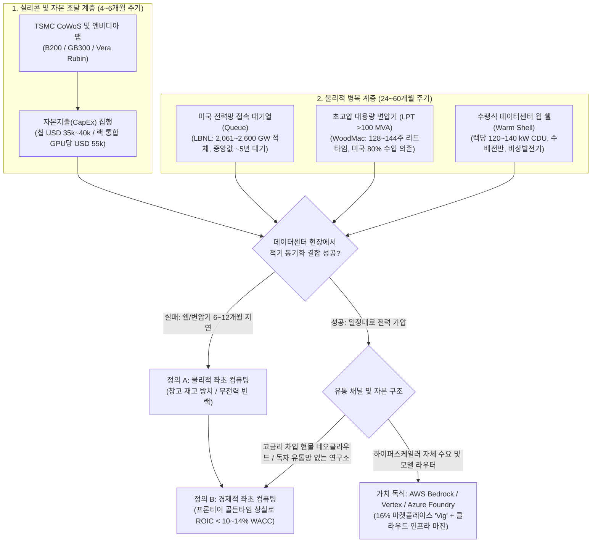
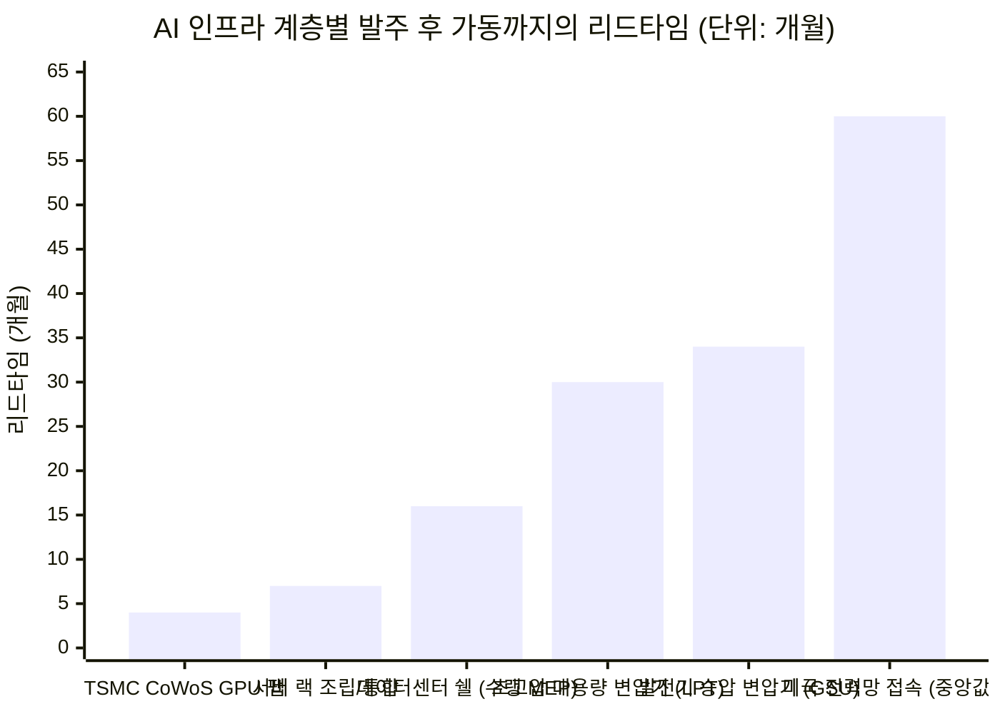

## 핵심 요약(Executive Summary): 공급망의 물리적 진실과 '자기 포지션 홍보(Talking One's Own Book)'의 분리

2026년 10월 말, **일론 머스크(`@elonmusk`)**와 벤처 투자자 **차마스 팔리하피티야(`@chamath`)**가 주고받은 X(구 트위터) 게시글이 글로벌 인프라 펀드, 반도체 애널리스트, 프론티어 AI 연구소들 사이에서 거센 논쟁을 촉발했습니다. AI 연구자 유첸 진(`@Yuchenj_UW`)의 글에 답하며 머스크는 짧고 묵직한 경고를 던졌습니다.

> "미완성 데이터센터 내부에 묶여버린 '좌초된 연산 자원(stranded compute)'을 엄청나게 목격하게 될 것입니다."
> *(I think we’re going to see a lot of stranded compute in partially complete data centers)*
> — **일론 머스크 (`@elonmusk`)**, 2026년 10월

머스크의 글을 인용한 차마스 팔리하피티야는 이를 **2027년 AI 인프라 구조조정(Shakeout)에 관한 5가지 핵심 테제**로 확장했습니다.

> "전력이 확보된 토지 자산(energized land assets) 포트폴리오를 보유한 사람으로서 제가 목격하고 있는 현상은 다음과 같습니다:
>
> 1. 네오클라우드(Neocloud)들은 체계가 잡혀 있지 않고 자본력이 취약합니다. 물론 그중 일부는 다른 곳들보다 확실히 낫긴 합니다.
>
> 2. 하이퍼스케일러(Hyperscaler)들은 비밀유지계약(NDA) 하나 체결하는 데 3개월이 걸리고 18개월짜리 에스크로(Escrow) 기간을 요구하는 경직되고 관료주의적인 조직입니다. 우리는 속도와 단순성을 무기로 이러한 조건들과 경쟁하며 포트폴리오를 구축했습니다. 우리 같은 조직이 미래 자산을 더 많이 확보할수록 하류(downstream)에 있는 하이퍼스케일러들의 문제는 더 커집니다(3번 참조).
>
> 3. 기존 파이프라인의 지연이 발생하고 있으며, 이는 2027년에 사람들을 허를 찌를 것입니다. 하이퍼스케일러들은 (당연히) 제3자보다 자사 내부의 연산 수요에 집중하는 방식으로 반응할 것입니다. 만약 그 제3자가 AI 모델 기업이라면, 하이퍼스케일러는 그들에게 자사의 모델 라우터(model router)를 경유하라고 요구할 것이며 거기서 상당한 수준의 수수료(vig)를 떼어갈 것입니다. 앤트로픽(Ant)의 S-1(IPO 증권신고서) 루머로 회자되는 '너희에게 줄 컴퓨팅 자원이 없다'는 통보가 사실이라면, 이는 이미 이런 현상이 벌어지고 있음을 보여주는 거대한 징후(tell)입니다.
>
> 요컨대 2027년에는 현재 예측되는 것보다 훨씬 더 많은 '부분적으로 좌초된 연산 자원(partially stranded compute)'과 창고 재고로 쌓여 있는 연산 자원이 발생할 것으로 보입니다. 이미 돈을 주고 구매했지만 총자본비용(WACC)에도 못 미치는 수익을 내거나 먼지만 뒤집어쓰고 있는 자산들입니다. 우리는 이 현상이 모델 기업, 하이퍼스케일러, 네오클라우드 모두에게 해당될 것으로 봅니다—단 **하나의 예외(어디인지 짐작하실 겁니다)**만 빼고 말입니다.
>
> 이러한 시장 왜곡(dislocation)은 두 부류의 조직에게 혜택을 줄 것입니다: 산업 규모를 빠르게 구축할 수 있는 비(非)관료주의적 대형 스케일러, 그리고 그들에게 자원을 공급하는 민첩하고 자본력이 탄탄한 플레이어들입니다.
>
> 2027년은 잘못된 베팅들을 일소하는 격동의 해가 될 것이며, 소수에게는 통폐합(consolidation)의 해가 될 것입니다."
> — **차마스 팔리하피티야 (`@chamath`)**, 2026년 10월

노련한 투자자가 *"전력이 확보된 토지 자산 포트폴리오를 보유한 사람으로서"*라는 문장으로 글을 시작하여, 승자는 *"비관료주의적 대형 스케일러[일론 머스크의 xAI]와 그들에게 자원을 공급하는 민첩한 플레이어[차마스 자신의 토지 포트폴리오]"*가 될 것이라는 결론으로 마무리하면서 **6가지 서로 다른 경험적 주장**을 하나의 패키지로 묶어낼 때, 이를 단순히 **"찬성(Agree) 또는 반대(Disagree)"**라는 이분법으로 답하는 것은 치명적인 인식론적 함정에 빠지는 것입니다. 이는 **검증 가능한 전력망·공급망의 물리적 진실**과 **자신의 투자 포지션을 정당화하려는 상업적 홍보(Talking One's Own Book)**를 하나로 섞어버리기 때문입니다.

브라운과 킬리(Browne & Keeley)의 **'사금 채취(Panning for Gold)'** 비판적 사고 프레임워크를 적용하여 미국 에너지부 및 국립연구소의 1차 통계([LBNL 2024 미국 데이터센터 에너지 사용 보고서](https://www.osti.gov/servlets/purl/2483291), [LBNL Queued Up 전력망 대기열 보고서](https://www.osti.gov/biblio/2336270), [FERC 명령 제2023호](https://www.federalregister.gov/documents/2023/09/06/2023-16628/improvements-to-generator-interconnection-procedures-and-agreements), [DOE 변압기 공급망 최종 규칙](https://www.federalregister.gov/documents/2024/04/22/2024-07830/energy-conservation-program-energy-conservation-standards-for-distribution-transformers)) 및 기업 공시 자료([CoreWeave](https://en.wikipedia.org/wiki/CoreWeave) S-1/10-K, [Anthropic](https://en.wikipedia.org/wiki/Anthropic) 프리 IPO S-1 공시, [EPA 청정대기법 고정식 가스터빈 규칙](https://www.federalregister.gov/documents/2024/11/25/2024-27262/review-of-new-source-performance-standards-for-stationary-combustion-turbines-and-stationary-gas))를 교차 검증한 6대 세부 명제별 포렌식 판정표는 다음과 같습니다.

| 머스크 / 팔리하피티야 테제의 6대 핵심 세부 주장 | 포렌식 판정 | 인식론적 타당도 | 1차 실증 데이터 및 구조적 근거 |
| :--- | :--- | :--- | :--- |
| **1. "2027년 미완성 데이터센터와 무전력 창고 재고에서 대량의 '좌초된 컴퓨팅(Stranded Compute)'이 발생할 것이다"** *(일론 머스크 & 차마스 #4)* | **강력 동의 (STRONGLY AGREE)** | **~85% 타당** | TSMC CoWoS 패키징 리드타임(`4~6개월`)은 초고압 대용량 변압기(`LPT >100 MVA`) 리드타임(`128~144주` / `2.5~3.5년`) 및 미국 송전망 접속 대기 기간 중앙값(`~5년`, [LBNL](https://www.osti.gov/biblio/2336270))보다 훨씬 빠릅니다. 사티아 나델라 MS CEO 역시 *"플러그를 꽂을 웜 쉘(warm shell)이 없어 창고에 쌓여 있는 칩이 많다"*고 공식 인정했습니다. |
| **2. "하이퍼스케일러들은 자체 수요를 우선시해 베어메탈 공급을 제한하고, 모델 기업(`Anthropic`)을 모델 라우터(`Bedrock`/`Vertex`)로 몰아넣어 상당한 통행세(Vig)를 뜯어낼 것이다"** *(차마스 #3)* | **강력 동의 (STRONGLY AGREE)** | **~90% 타당** *(가장 예리한 통찰)* | [Anthropic](https://en.wikipedia.org/wiki/Anthropic)의 S-1 공시 자료에 따르면 연 매출의 `47%`(`~USD 2.16B`)가 [AWS Bedrock](https://aws.amazon.com/bedrock/claude/)과 [Google Vertex AI](https://cloud.google.com/vertex-ai/generative-ai/docs/partner-models/claude)를 통해 발생했으며, 클라우드 인프라 비용 외에 별도로 **약 16%의 유통 수수료('Vig', ~USD 351M)**를 징수당하는 동시에 최첨단 클러스터 배정을 제한받았습니다. |
| **3. "창고에 묶이거나 지연된 연산 자원은 2027년에 총자본비용(`ROIC < WACC`)을 밑도는 수익을 내며 경제적으로 좌초될 것이다"** *(차마스 #4)* | **강력 동의 (STRONGLY AGREE)** | **~85% 타당** | `12% WACC`로 조달한 `USD 50,000/GPU` 클러스터(`36개월` 프론티어 경제 수명 기준)가 전력 인입 지연으로 `9개월`만 늦게 가동되어도 연간 상각 부담이 **45.4%** 폭증하며, 엔비디아의 1년 주기 아키텍처 전환(`Hopper` → `Blackwell` → `Vera Rubin`)과 맞물려 `ROIC`가 `WACC` 아래로 추락합니다. |
| **4. "네오클라우드들은 체계가 없고 자본력이 취약하다(일부 우량 기업 제외)"** *(차마스 #1)* | **부분 동의 (PARTIALLY AGREE)** | **~80% 타당 (Tier-2/3)** / **~55% 타당 (Tier-1)** | Tier-2/3 현물(Spot) 기반 네오클라우드들은 고금리 사모대출에 의존하는 취약한 특수목적법인(SPV)입니다. 업계 1위인 [CoreWeave](https://en.wikipedia.org/wiki/CoreWeave)조차 **단일 고객(Microsoft) 매출 비중 62%**와 `SOFR + 500~900 bps`(`10%~14%`)의 대규모 부채(`DDTL`)라는 구조적 취약점을 안고 있으나, 투자등급 테이크오어페이(Take-or-Pay) 계약으로 방어하고 있습니다. |
| **5. "하이퍼스케일러는 관료주의 때문에 NDA에 3개월, 에스크로에 18개월을 허비하며, 민첩한 토지 포트폴리오가 이들을 이기고 하류에서 하이퍼스케일러를 굶주리게 할 것이다"** *(차마스 #2)* | **강력 반대 (STRONGLY DISAGREE)** | **~15% 타당** *(전형적인 포지션 홍보)* | 하이퍼스케일러가 `18개월` 에스크로를 요구하는 이유는 관료주의 때문이 아니라, 브로커들이 파는 '전력 확보 토지'의 `70%` 이상이 변압기(`LPT`)도 없고 계통영향평가도 통과하지 못한 **투기적 허수 대기열**([FERC 명령 2023호](https://www.federalregister.gov/documents/2023/09/06/2023-16628/improvements-to-generator-interconnection-procedures-and-agreements) 이후 연간 `750 GW` 이상 철회됨)이기 때문입니다. 하이퍼스케일러는 중개업자를 건너뛰고 원전 직계약([Constellation 835 MW](https://www.constellationenergy.com/newsroom/2024/Constellation-to-Launch-Crane-Clean-Energy-Center-Restoring-Jobs-and-Carbon-Free-Power-to-The-Grid.html))을 맺으며 2025년 초 `2 GW` 규모의 외부 임대를 일방 해지한 **수요 독점자(Monopsony)**입니다. |
| **6. "단 하나의 예외(`xAI`)와 그들에게 토지를 공급하는 민첩한 플레이어만 빼고 모두가 좌초된 컴퓨팅의 희생양이 될 것이다"** *(차마스 #4~5)* | **반대 (DISAGREE)** | **~25% 타당** *(규제 구멍의 착시)* | [xAI의 콜로서스(Colossus)](https://en.wikipedia.org/wiki/Colossus_(supercomputer))(`122일` 만에 `10만~20만` GPU 구축)가 전력망 지연을 우회한 비결은 `365일 미만` 비도로용 임시 엔진 면제 조항을 이용해 멤피스에 **35기의 이동식 메탄 가스터빈(~420 MW)**을 무허가로 가동한 덕분이었습니다. 이는 [EPA 고정식 터빈 규제 강화](https://www.federalregister.gov/documents/2024/11/25/2024-27262/review-of-new-source-performance-standards-for-stationary-combustion-turbines-and-stationary-gas), 셸비 카운티의 `15기(247.2 MW)` 상한 캡, 그리고 `2.5배` 비싼 발전 단가(`USD 110~150/MWh`)라는 한계에 부딪혔으며, 노후화된 칩을 재수익화할 엔터프라이즈 클라우드 유통망도 없습니다. |

---

## Phase 1 & 2: 쟁점 분류, 1차 출처 발굴 및 이해상충(Conflict-of-Interest) 매트릭스

### 1.1 핵심 질문의 인식론적 분류
이념적 편향이나 인물 중심의 후광 효과를 배제하기 위해, 우리는 두 사람의 주장을 **기술적·실증적 질문(Descriptive Question)**과 **처방적·투자 전략적 질문(Prescriptive Question)**으로 분리합니다.
* **실증적 질문 1 (물리적 공급망):** *반도체 패키징(TSMC CoWoS GPU 생산)과 전력망 가압(초고압 변압기, 변전소, 수랭식 데이터센터 쉘) 사이의 구조적 리드타임 불일치가 2027년에 인도된 AI 클러스터의 상당수를 무전력 창고 재고나 저수익 자산으로 전락시킬 것인가?*
* **실증적 질문 2 (클라우드 가치사슬 경제학):** *하이퍼스케일러들은 전력 병목 국면에서 프론티어 모델 기업(Anthropic 등)에 대한 베어메탈 GPU 공급을 제한하고, 엔터프라이즈 추론 트래픽을 고마진 자사 모델 라우터로 강제 유도할 구조적 유인과 계약적 지위를 가지고 있는가?*
* **처방적 질문 (자본 배분 전략):** *이러한 2027년의 인프라 불균형이 하이퍼스케일러(`MSFT`, `AMZN`, `GOOGL`, `META`)보다 '전력 확보 토지' 중개업자와 단독 수직계열화 모델 빌더(`xAI`)에게 더 유리한 비대칭적 수익을 안겨줄 것인가?*

### 1.2 '자기 포지션 홍보(Talking One's Own Book)' 이해상충 감사
비판적 사고의 원천 검증(Browne & Keeley 제8장)에서 현장 목격자의 증언을 평가할 때는 **관찰자로서의 정보 우위**와 **자산 보유자로서의 재무적 이해상충**을 엄격히 분리해야 합니다. 두 발언자 모두 자신이 주장하는 결론에 수십억 달러 규모의 직접적인 대차대조표 이해관계를 걸고 있습니다.

| 발언자 및 투자 기구 | X(구 트위터) 상의 공개 서사 | 숨겨진 상업적 이해관계 및 1차 공시·규제 현실 |
| :--- | :--- | :--- |
| **차마스 팔리하피티야** *(Social Capital 창립자; 애리조나 등 미국 내 '전력 확보 토지' 포트폴리오 보유자; xAI 투자자)* | 하이퍼스케일러의 `3개월` NDA와 `18개월` 에스크로 요구를 "구제 불능의 관료주의"로 규정하며, 자신과 같은 민첩한 토지 투자자들이 핵심 전력 자산을 선점해 2027년 하이퍼스케일러를 압박할 것이라 주장. | **포지션 매도 마케팅:** 토지 디벨로퍼는 초기 단계의 전력망 접속 대기열(Queue)을 가진 부지를 매입한 뒤 데이터센터 사업자나 하이퍼스케일러에게 막대한 프리미엄(`MW당 USD 1M~3M+`)을 얹어 되파는 구조입니다. 하이퍼스케일러가 요구하는 `18개월` 에스크로는 한전/전력청이 실제 변전소 가압과 변압기 인도를 법적으로 보증할 때까지 토지 브로커에게 대금 지급을 유보하는 **구매자 보호 장치**입니다. |
| **일론 머스크** *(xAI / Colossus 1 & 2 창립자; Tesla CEO)* | 경쟁사들이 "미완성 데이터센터 내부에 묶인 수많은 좌초된 연산 자원"으로 고통받을 것이라 경고하며, 차마스는 xAI를 좌초된 컴퓨팅이 없는 "단 하나의 예외(ONE)"로 지목. | **기업가치(Valuation) 방어:** xAI는 멤피스 [Colossus](https://en.wikipedia.org/wiki/Colossus_(supercomputer)) 클러스터의 구축 속도를 핵심 근거로 `USD 50B~100B+` 기업가치로 대규모 자금을 조달 중입니다. 경쟁사 클러스터를 '좌초 자산'으로 규정하는 것은 xAI의 `122일` 구축 신화를 부각하지만, 정작 그 속도가 연방 청정대기법상 기가와트(GW) 단위로 확장이 불가능한 **임시 트레일러형 메탄 가스터빈(`~420 MW`) 편법 가동**에 의존했다는 사실은 생략되어 있습니다. |

---

## Phase 3: 의미론적 정밀성과 대입 테스트(The Substitution Test)

이 게시글이 강한 설득력을 발휘하는 이유는 **"좌초된 연산 자원(Stranded Compute)"**과 **"전력이 확보된 토지(Energized Land)"**라는 두 가지 다의적 핵심 용어를 교묘하게 교차 사용하기 때문입니다. 엄격한 조작적 정의(Definition A)와 느슨한 마케팅적 정의(Definition B)를 구분하여 **대입 테스트(Substitution Test)**를 수행하면 논리적 균열이 명확히 드러납니다.

### 3.1 대입 테스트 1: "좌초된 연산 자원(Stranded Compute)"
* **정의 A — 물리적 / 전력망 좌초 컴퓨팅 (일론 머스크의 정의):**
  * *조작적 정의:* 제조 및 구매가 완료되어 구매자의 창고나 데이터센터 건물에 인도되었으나, 초고압 송전선(`138 kV~500 kV`) 인입, 대용량 전력 변압기(`LPT`), 중전압 수배전반(Switchgear), 또는 수랭식 냉각수 분배 장치(`CDU`)가 완비되지 않아 **전원을 켤 수 없는 상태의 AI 가속기(`H200`, `B200`, `GB200/GB300`, `Vera Rubin`)**.
  * *실증적 현실:* **실제로 발생 중 (`2025~2027년` 인도 물량의 약 `10%~20%`가 `3~9개월`의 가압 지연 겪음).** 사티아 나델라 마이크로소프트 CEO는 *BG2 팟캐스트*에서 정의 A를 정확히 확인해 주었습니다: *"지금 우리가 겪는 가장 큰 문제는 컴퓨팅 공급 과잉이 아니라 전력입니다... 플러그를 꽂지 못해 창고 재고로 쌓여 있는 칩이 산더미처럼 있을 수 있습니다. 실제로 그것이 오늘날 저의 문제입니다. 칩 공급의 문제가 아니라 플러그를 꽂을 수 있는 '웜 쉘(warm shells)'이 없다는 사실이 문제입니다."*
* **정의 B — 경제적 / 자본비용(WACC) 좌초 컴퓨팅 (차마스의 정의):**
  * *조작적 정의:* 창고에 대기 중이거나 데이터센터에 실제로 전원이 연결되어 가동 중이더라도, 하드웨어의 경제적 수명 동안 창출하는 순영업현금흐름이 **소유주의 가중평균자본비용(`ROIC < WACC`)에 미달하는 AI 가속기**.
  * *실증적 현실:* **차입 비중이 높은 네오클라우드 및 유통망 없는 모델 연구소 전반에 광범위하게 확산 (`2027년 말` 기준 비(非)하이퍼스케일러 부채 조달 GPU의 `40%~60%` 위험).** 설령 전원이 켜져 `80%` 가동률로 돌아가더라도, `11%~14%` 고금리 사모부채로 조달한 클러스터가 초기 가압 지연으로 `6개월`을 허비하는 사이 엔비디아의 차세대 아키텍처가 토큰당 추론 단가를 `50%` 낮춰버리면, 해당 클러스터는 **경제적으로 좌초(Economically Stranded)**됩니다.

### 3.2 대입 테스트 2: "전력이 확보된 토지(Energized Land)"
* **정의 A — 즉시 가압 가능한 턴키 변전소 부지 (엄격한 공학적 정의):**
  * *조작적 정의:* 전력청과의 **계통연계 건설서비스 계약(`ICSA`)** 체결 완료, 송전망 보강 공사 완료, 콘크리트 패드 위에 `100+ MVA`급 초고압 강압 변압기 실물 설치 완료를 통해 오늘 당장 확정 전력(Firm Power)을 끌어다 쓸 수 있는 부지.
* **정의 B — 계통연계 대기열(Queue) 신청서만 접수된 인허가 토지 (느슨한 브로커 정의):**
  * *조작적 정의:* 고압 송전선 인근의 산업용 부지로서 전력청에 부하 검토 신청서를 접수했거나, 향후 `36~60개월`이 소요되는 송전망 증설 및 변압기 조달을 조건부로 한 예비 전력공급 의향서(Will-Serve Letter)만 보유한 토지.
* **대입 테스트가 폭로하는 2번 주장의 모순:**
  토지 투자자들이 *"하이퍼스케일러가 18개월 에스크로를 요구하는 바람에 우리가 속도와 단순성으로 경쟁해 전력 확보 토지 포트폴리오를 선점했다"*고 말할 때, 그들은 **정의 B(서류상의 대기열 토지)**를 **정의 A(실제 가압 토지)**로 둔갑시키고 있습니다. 만약 어떤 토지가 진짜로 **정의 A**(변압기가 설치되어 당장 전기가 들어오는 땅)를 충족한다면, 매도자가 18개월 에스크로를 기다릴 필요가 전혀 없습니다. 지구상의 모든 하이퍼스케일러가 당일 현금을 송금할 것이기 때문입니다! 하이퍼스케일러가 `18개월` 에스크로를 고집하는 이유는 매도자들이 **정의 B**(검증되지 않은 대기열 번호표)를 들고 와서 **정의 A**의 가격을 요구하기 때문입니다.

---

## Phase 4: 인과관계 해체 및 4대 경쟁 가설(4-Way Causal Audit)

왜 2027년 데이터센터 파이프라인이 지연되고 있으며, 왜 하이퍼스케일러의 부지 거래에는 `3개월` NDA와 `18개월` 에스크로가 따라붙는가? 브라운과 킬리의 제9장 방법론에 따라 차마스의 단일 원인론(*"하이퍼스케일러의 관료주의가 지연을 부르고 민첩한 토지 중개업자에게 승리를 안긴다"*)을 4대 경쟁 인과 가설로 검증합니다.

| 인과 메커니즘 유형 | 검증 대상 가설 | 작동 기제 및 1차 실증 근거 | 설명력 가중치 |
| :--- | :--- | :--- | :--- |
| **1. 직접 인과 (Direct Causation)** *(차마스의 가설: `X → Y`)* | 하이퍼스케일러 내부 관료주의(`3개월 NDA`, `18개월 에스크로`)가 부지 확보를 지연시켜, 민첩한 토지 디벨로퍼들이 우량 미래 전력 자산을 독차지하고 2027년 하이퍼스케일러를 궁지에 몰아넣는다. | **취약 (`~15%`).** 빅테크 법무·환경 실사팀이 패밀리 오피스보다 느린 것은 사실이나, 하이퍼스케일러는 연간 `USD 250B+`의 설비투자와 신용도를 바탕으로 소규모 토지 브로커를 건너뛰고 규제 전력회사 및 원전 사업자([Constellation](https://www.constellationenergy.com/newsroom/2024/Constellation-to-Launch-Crane-Clean-Energy-Center-Restoring-Jobs-and-Carbon-Free-Power-to-The-Grid.html), NextEra, Southern Company)와 `500~1,000 MW` 단위 직계약을 체결합니다. | **낮음 (`15%`)** |
| **2. 역인과 (Reverse Causation)** *(`Y → X`)* | 토지 브로커들의 무분별한 투기적 알박기와 '유령 대기열(Phantom Queue)' 남발이 오히려 하이퍼스케일러와 전력청으로 하여금 `18개월` 에스크로와 엄격한 보증금 제도를 도입하게 **강제**했다. | **강력 (`~35%`).** LBNL의 [Queued Up 보고서](https://www.osti.gov/biblio/2336270)와 [FERC 명령 제2023호](https://www.federalregister.gov/documents/2023/09/06/2023-16628/improvements-to-generator-interconnection-procedures-and-agreements)에 따르면, 투기꾼들이 부지 확보나 변압기 발주도 없이 신청서를 남발해 미국 송전 대기열이 `~2,600 GW`(미국 전체 발전 설비용량의 2배 이상)까지 폭증했습니다. 하이퍼스케일러는 전력청 클러스터 심사를 통과해 실제 전력 공급이 확증될 때만 대금을 지급하기 위해 `18개월` 에스크로를 설계한 것입니다. | **높음 (`35%`)** |
| **3. 제3의 교란 변수 (Confounder `Z`)** | 글로벌 중전기기 하드웨어 병목(`LPT` 초고압 변압기, `GOES` 방향성 전기강판, 고압 차단기) 및 열밀도 전환(`랙당 130 kW` 수랭식 설계 변경)이 하이퍼스케일러와 네오클라우드 **모두**를 2027년에 지연시킨다. | **지배적 (`~40%`).** NDA를 하루 만에 쓰고 에스크로를 없앤다고 해서 `345 kV` 변압기가 하늘에서 떨어지지 않습니다. [미국 에너지부(DOE)](https://www.federalregister.gov/documents/2024/04/22/2024-07830/energy-conservation-program-energy-conservation-standards-for-distribution-transformers)와 Wood Mackenzie 조사에 따르면 대용량 변압기(`LPT`) 리드타임은 `128~144주`(`2.5~3년`)에 달하고 미국은 수요의 `80%`를 수입에 의존하며, 공랭식 `H100`(`40 kW/랙`)에서 수랭식 `GB200/Rubin`(`120~140 kW/랙`)으로의 설계 변경이 건설 현장의 구조적 지연을 유발했습니다. | **지배적 (`40%`)** |
| **4. 상호 피드백 루프 (Mutual Feedback Loop)** *(`X ↔ Y`)* | 일정 지연을 헤지하려는 하이퍼스케일러와 디벨로퍼들이 여러 지역 전력청에 중복으로 전력 신청을 넣고, 이것이 전력청의 클러스터 심사 마비를 불러와 2027~2028년 가압 일정을 더욱 늦춘다. | **보통 (`~10%`).** 마이크로소프트나 메타의 `500 MW` 입찰에 참여한 5개 디벨로퍼가 각자 PJM이나 ERCOT에 `500 MW`씩 계통 검토를 신청하면 실제 수요는 `0.5 GW`인데 서류상 `2.5 GW`의 허수 부하가 잡혀 전력망 심사가 마비되는 악순환이 발생합니다. | **보통 (`10%`)** |

---

## Phase 5: 계량적 실증 감사, 변압기 공급망 물리학 및 자본비용(WACC) 좌초 방정식

정성적 입담을 넘어 2026~2027년 AI 인프라의 생사를 가르는 3가지 계량적 기둥을 수리적으로 검증합니다.
1. **리드타임의 단층선(4개월 실리콘 vs. 30개월 변압기 vs. 60개월 전력망).**
2. **GPU 자본비용 및 WACC 경제적 좌초 미분방정식.**
3. **앤트로픽(Anthropic) S-1에 드러난 하이퍼스케일러 모델 라우터 'Vig'(`16%` 통행세) 마진 압축 공식.**

### 5.1 리드타임의 단층선: 4개월 실리콘 vs. 30개월 변압기 vs. 60개월 전력망 대기열
미국 에너지부(DOE)와 로렌스 버클리 국립연구소(LBNL)가 발표한 [**2024 미국 데이터센터 에너지 사용 보고서**(`OSTI 2483291`)](https://www.osti.gov/servlets/purl/2483291)에 따르면, 미국 데이터센터 전력 소비량은 2023년 `176 TWh`(미국 총 전력의 `4.4%`)에서 **2028년 `325~580 TWh`(미국 총 전력의 `6.7%~12.0%`)**로 폭증할 전망입니다. 이는 불과 4년 만에 24시간 가동되는 원전 `20~50기(20~50 GW)` 분량의 기저부하를 새로 꽂아야 한다는 뜻입니다.

왜 이것이 2027년의 **물리적 좌초(Physical Stranding)**를 필연적으로 야기하는가? 규소(모래)를 AI 토큰으로 바꾸는 4개의 물리적 계층이 완전히 다른 산업 시계 위에서 돌아가기 때문입니다.

* **계층 1 — GPU 실리콘 및 CoWoS 패키징 (`4~6개월`):** TSMC 웨이퍼 공정과 CoWoS-L 패키징은 분기당 수만 개의 랙을 쏟아내며, 엔비디아는 `12개월` 주기로 아키텍처를 교체합니다(`Hopper H100/H200` → `Blackwell B200/GB200` → `Blackwell Ultra GB300` → `Vera Rubin`).
* **계층 2 — 수랭식 데이터센터 쉘 건설 (`14~18개월`):** `30~40 kW` 공랭식 랙에서 [엔비디아 블랙웰 NVL72](https://nvidianews.nvidia.com/news/nvidia-blackwell-platform-arrives-to-power-a-new-era-of-computing) 및 루빈 아키텍처(`랙당 120~140+ kW`)로 넘어가면서 칩 직접 수랭(DLC) 배관, 냉각수 분배 장치(`CDU`), 바닥 하중 보강이 필수가 되었습니다. 2025년 건설 도중 설계를 변경한 현장들의 완공 일정이 일제히 2027년으로 밀렸습니다.
* **계층 3 — 초고압 대용량 변압기 (`LPT >100 MVA`: `30~36개월` / `128~144주`):** `100 MW`급 이상의 AI 캠퍼스는 송전 전압(`345 kV` 또는 `138 kV`)을 배전 전압(`34.5 kV / 13.8 kV`)으로 낮추는 맞춤형 변전소 변압기 여러 대가 필수입니다. Wood Mackenzie 공급망 감사 및 [DOE 변압기 최종 규칙](https://www.federalregister.gov/documents/2024/04/22/2024-07830/energy-conservation-program-energy-conservation-standards-for-distribution-transformers)에 따르면, 2020년 이전 `6~12개월`이던 LPT 리드타임은 변전소용 **`128주`(`~30개월`)**, 발전기 승압용(`GSU`) **`144주`(`~34개월`)**로 치솟았으며, 미국은 LPT 공급의 **약 80%를 수입에 의존**하고 핵심 소재인 **방향성 전기강판(`GOES`)**의 구조적 공급 부족에 직면해 있습니다.
* **계층 4 — 송전망 계통연계 승인 및 증설 (`중앙값 ~60개월` / `5년`):** LBNL의 [**Queued Up 보고서**(`OSTI 2336270`)](https://www.osti.gov/biblio/2336270)가 입증하듯, 미국 주요 계통운영자(`PJM`, `ERCOT`, `MISO`, `CAISO`)에서 최초 접속 신청부터 상업운전(`COD`)까지 걸리는 기간의 중앙값은 **5년(`60개월`)**에 달합니다.

### 5.2 GPU 자본 좌초 방정식: 왜 9개월의 전력 지연이 네오클라우드의 ROIC를 파괴하는가?
차마스는 2027년에 연산 자원이 *"이미 돈을 주고 구매했지만 총자본비용(WACC)에도 못 미치는 수익을 내거나 먼지만 뒤집어쓰고 있을 것"*이라고 지적했습니다. 이를 현금흐름할인법(DCF)과 감가상각 수리 모델로 엄밀하게 증명할 수 있습니다.

데이터센터 사업자나 네오클라우드가 시점 `t = 0`에 GPU 1기당 총설비투자액 `C_0`(GPU 모듈 `USD 35,000~40,000` + InfiniBand/RoCEv2 광트랜시버, 스토리지, 수랭식 랙 통합 비용 `USD 15,000~20,000`를 합쳐 `C_0 ≈ USD 50,000~55,000`)를 투입해 클러스터를 매입했다고 합시다. 이 클러스터의 프론티어 경제적 수명을 `T_econ`년(엔비디아의 후속 2개 세대 아키텍처가 토큰당 에너지 비용을 `60%~75%` 절감하기 전까지의 기간인 `~3.0년`), 조달 자본의 가중평균자본비용을 `r_WACC`라 놓겠습니다.

만약 변압기나 웜 쉘 미완성으로 인해 클러스터가 `Δt_delay`년 동안 전원이 꺼진 창고에 방치된다면, 두 가지 재무적 페널티가 동시에 복리로 작용합니다.
1. **무수익 기간의 자본비용 복리 누적:** 가동이 멈춘 기간 동안 `(1 + r_WACC)^(Δt_delay)`만큼의 금융비용이 원금에 가산됩니다.
2. **프론티어 상각 기간의 압축:** 고단가를 받을 수 있는 유효 경제 수명이 `T_econ`에서 `(T_econ - Δt_delay)`로 쪼그라듭니다.

따라서 적기 가동 대비 **유효 연간 자본 상각 부담 배율(`Ω_cap`)**은 다음과 같이 유도됩니다:

$$\Omega_{\text{cap}}(\Delta t_{\text{delay}}) = (1 + r_{\text{WACC}})^{\Delta t_{\text{delay}}} \cdot \left( \frac{T_{\text{econ}}}{T_{\text{econ}} - \Delta t_{\text{delay}}} \right)$$

더 치명적인 것은 차세대 칩이 출시됨에 따라 현물 및 재계약 GPU 시간당 임대 단가 `p(t) = p_0 exp(-λt)`가 연간 감쇠율 `λ`로 지수함수적 하락을 겪는다는 점입니다. 가압 지연 기간 `[0, Δt_delay]` 동안 사업자는 임대료가 가장 비싼 '출시 초기 프론티어 프리미엄 구간'을 통째로 날리게 됩니다. 지연된 GPU 클러스터의 **순현재가치(`NPV`)** 방정식은 다음과 같습니다:

$$\text{NPV}(\Delta t_{\text{delay}}) = \int_{\Delta t_{\text{delay}}}^{T_{\text{life}}} \left[ u \cdot H \cdot p_0 e^{-\lambda t} - H \cdot P_{\text{kW}} \cdot c_{\text{elec}} - m_{\text{opex}} \right] e^{-r_{\text{WACC}} t} \, dt - C_0$$

여기서 각 변수는 다음과 같습니다:
* `u ∈ [0, 1]`: 유료 과금 클러스터 가동률 (장기 계약 하이퍼스케일러 `~0.85`, 노드 장애 및 고객 이탈을 겪는 현물 네오클라우드 `~0.55~0.70`),
* `H = 8,760 시간/년`,
* `P_kW ≈ 1.2~1.5 kW`: PUE가 반영된 블랙웰/루빈 GPU 1기당 총 전력 소비량,
* `c_elec`: 전력 단가 (계통 전력 `USD 0.055/kWh` vs. 현장 이동식 가스터빈 `USD 0.130/kWh`),
* `r_WACC`: 자본비용 (AAA/AA 등급 하이퍼스케일러 `~7.5%~8.5%` vs. `SOFR + 600~850 bps` 사모대출로 조달한 네오클라우드 `~11.5%~14.0%`).

전력 가압 지연 기간을 `0개월`, `6개월`, `9개월`, `12개월`로 나누어 위 방정식을 계산하면 **왜 2027년 지연 사태에서 네오클라우드는 파산 위기에 몰리고 하이퍼스케일러는 살아남는지**가 명확히 드러납니다:

| 인프라 사업자 계층 | 자본비용 (`WACC`) | 적기 가동 시 상각 부담 (`지연 0개월`) | `6개월 지연` 상각 부담 배율 (`Ω_cap`) | `9개월 지연` 상각 부담 배율 (`Ω_cap`) | `12개월 지연` 상각 부담 배율 (`Ω_cap`) | `9개월 지연` 시 세후 `ROIC` 대 `WACC` 비교 |
| :--- | :--- | :--- | :--- | :--- | :--- | :--- |
| **Tier-1 하이퍼스케일러** *(`MSFT`, `GOOGL`, `AMZN` — 자체 현금흐름 조달)* | `8.0%` | `1.00x` (`기준점`) | `1.249x` (`연 +24.9%`) | `1.413x` (`연 +41.3%`) | `1.620x` (`연 +62.0%`) | **ROIC ~6.2% < 8.0% WACC** *(고마진 클라우드/SaaS 번들링 교차보조로 손실 흡수)* |
| **Tier-1 장기계약 네오클라우드** *(`CoreWeave` — 투자등급 테이크오어페이 담보 DDTL)* | `11.5%` | `1.00x` (`기준점`) | `1.269x` (`연 +26.9%`) | `1.447x` (`연 +44.7%`) | `1.673x` (`연 +67.3%`) | **계약 유지 시 방어 가능;** *단, 인도 지연으로 고객사의 계약 해지권(Milestone Termination) 발동 시 치명타!* |
| **Tier-2/3 현물(Spot) 네오클라우드** *(무등급 SPV, 앵커 테넌트 부재, `SOFR + 800 bps`)* | `13.5%` | `1.00x` (`기준점`) | `1.281x` (`연 +28.1%`) | `1.466x` (`연 +46.6%`) | `1.703x` (`연 +70.3%`) | **ROIC ~1.8% << 13.5% WACC** *(심각한 경제적 좌초; 2027년 채무불이행 및 헐값 인수합병 대상)* |

> [!IMPORTANT]
> **인도 기한(Delivery-Milestone) 해지 조항이라는 시한폭탄:** 표의 두 번째 행([CoreWeave](https://en.wikipedia.org/wiki/CoreWeave) 등 계약형 네오클라우드)을 주의 깊게 보십시오. 코어위브는 마이크로소프트(2024년 매출의 `62%` 차지)와 같은 우량 고객과 `3~5년` 테이크오어페이(Take-or-Pay) 계약을 맺고 있지만, 모든 하이퍼스케일러 임대 계약서에는 엄격한 **상업운전개시일(`COD`) 인도 기한 조항**이 들어 있습니다. 만약 2027년에 변압기나 수랭식 쉘 공사 지연으로 유예 기간을 넘기면, 하이퍼스케일러는 **위약금 없이 해당 클러스터 계약을 해지하거나 축소할 법적 권리**를 갖게 됩니다. 실제로 2025년 1분기 TD Cowen 보고서가 폭로했듯, 마이크로소프트는 수요 예측 조정 과정에서 약 `2 GW` 규모의 데이터센터 임대 및 의향서(LOI)에서 발을 빼고 추가 옵션을 포기한 바 있습니다.

### 5.3 하이퍼스케일러 모델 라우터 'Vig'(`16%` 통행세)와 앤트로픽(Anthropic) S-1 공시 해부
차마스의 3번 항목은 이 게시글 전체에서 가장 날카롭고 정확한 전략적 통찰입니다:

> *"하이퍼스케일러들은 (당연히) 제3자보다 자사 내부의 연산 수요에 집중하는 방식으로 반응할 것입니다. 만약 그 제3자가 AI 모델 기업이라면, 하이퍼스케일러는 그들에게 자사의 모델 라우터(model router)를 경유하라고 요구할 것이며 거기서 상당한 수준의 수수료(vig)를 떼어갈 것입니다. 앤트로픽(Ant)의 S-1 루머로 회자되는 '너희에게 줄 컴퓨팅 자원이 없다'는 통보가 사실이라면, 이는 이미 이런 현상이 벌어지고 있음을 보여주는 거대한 징후입니다."*

**[Anthropic](https://en.wikipedia.org/wiki/Anthropic)의 프리 IPO S-1 증권신고서 준비 과정**에서 드러난 재무 수치들은 이 두 가지 메커니즘을 완벽하게 입증합니다:
1. **`16%` 모델 라우터 통행세('Vig', 연간 `~USD 351M` 징수):** 앤트로픽은 연간 총매출의 **`47%`(`약 USD 2.16 billion`)**가 하이퍼스케일러의 클라우드 마켓플레이스 및 관리형 모델 라우터—구체적으로 **[AWS Bedrock](https://aws.amazon.com/bedrock/claude/)**과 **[Google Cloud Vertex AI](https://cloud.google.com/vertex-ai/generative-ai/docs/partner-models/claude)**—를 통해 발생했다고 공시했습니다. 대기업 고객들이 기존 클라우드 약정액(`EDP`)으로 손쉽게 결제하도록 라우팅해 주는 대가로, AWS와 구글은 **매출 1달러당 약 16센트(`~16%` 테이크레이트, 약 `USD 351 million`)**를 유통 수수료로 떼어갑니다.
2. **이중 마진 추출(Double-Margin Extraction)과 베어메탈 배급제:** 이 `16%`의 매출 최상단 통행세('Vig')는 앤트로픽이 클로드(Claude)를 학습·서빙하기 위해 AWS와 구글에 지불하는 막대한 클라우드 인프라 사용료(반년 치 연산 비용만 `~USD 9 billion`에 육박하며 아마존 `Trainium` 및 구글 `TPU`에 수백억 달러 장기 약정 체결) **위에 추가로** 부과되는 것입니다.

하이퍼스케일러 모델 라우터를 경유할 때 **프론티어 모델 기업의 순매출총이익률(`GM_lab`)**은 다음과 같은 수식으로 압축됩니다:

$$\text{GM}_{\text{lab}} = \frac{(1 - \tau_{\text{vig}}) \cdot R_{\text{router}} - C_{\text{inference}} \cdot (1 + m_{\text{cloud}})}{R_{\text{router}}} = 1 - \tau_{\text{vig}} - \left(\frac{C_{\text{inference}}}{R_{\text{router}}}\right)(1 + m_{\text{cloud}})$$

여기서 `τ_vig ≈ 0.16`은 모델 라우터 수수료율(`Bedrock` / `Vertex AI` / [Azure AI Foundry](https://azure.microsoft.com/en-us/products/ai-foundry))이고, `m_cloud`는 베어메탈 원가 `C_inference`에 붙는 클라우드 인프라 마진율입니다. 2027년 전력 병목으로 인해 가압된 메가와트(MW) 총량이 제한될 때, 하이퍼스케일러는 한계 `1 MW`의 블랙웰/루빈 전력을 어디에 배정할지 명확한 산수를 하게 됩니다:
* **선택지 1 (저마진 도매 베어메탈 임대):** 제3자 모델 연구소에 생(raw) GPU 클러스터를 빌려주어 연구소가 직접 API 구독료를 받게 함 (하이퍼스케일러의 라우터 통행세 `0%`).
* **선택지 2 (고마진 자사 서비스 및 관리형 라우터 톨게이트):** 귀중한 가압 전력을 자사 고마진 AI 서비스(`Google Search AI / Gemini`, `Microsoft 365 Copilot`, `Amazon Rufus/Nova`)에 우선 배정하거나, 제3자 모델 기업이 반드시 자사 관리형 라우터(`Bedrock` / `Vertex` / `Foundry`) 내부에서 엔터프라이즈 고객을 응대하도록 유도하여 **인프라 마진 `m_cloud`와 `16%` 매출 통행세 `τ_vig`를 동시에 수취**함!

실제로 앤트로픽의 S-1 위험 요인(Risk Factors) 항목은 클라우드 파트너들이 **동시에 지분 투자자이자, 핵심 인프라 공급자이며, 직접적인 경쟁자**이기 때문에 내부 용량이 부족할 때 최첨단 연산 클러스터 배정을 제한하거나 거절한 사례가 있음을 명시하고 있습니다.

---

## Phase 6: '부정적 시각(The Negative View)'과 생략된 정보 심문 (차마스와 머스크가 틀린 지점)

완전한 포렌식 조사는 저자들이 **의도적으로 생략한 정보(Omitted Information)**—특히 그들의 금전적 이해관계가 가리고 있는 구조적 역풍—를 파헤쳐야 합니다.

### 6.1 생략 1: 왜 '전력 확보 토지' 중개업 모델은 FERC 명령 제2023호의 함정에 빠지는가?
2번 항목에서 차마스는 하이퍼스케일러가 *"NDA에 3개월, 에스크로에 18개월"*을 쓰기 때문에 자신과 같은 민첩한 토지 포트폴리오에 밀리고 있으며, *"우리 같은 조직이 미래 자산을 더 많이 확보할수록 하류에 있는 하이퍼스케일러들의 문제는 더 커진다"*고 주장합니다.

그러나 이 서사는 유틸리티급 전력 인프라 개발의 실제 권력 관계를 세 가지 측면에서 정반대로 왜곡하고 있습니다:
1. **변압기와 클러스터 심사 통과가 없는 토지는 그저 '맨땅'일 뿐이다:** **[FERC 명령 제2023호(Order No. 2023)](https://www.federalregister.gov/documents/2023/09/06/2023-16628/improvements-to-generator-interconnection-procedures-and-agreements)** 시행으로 미국 전력망 운영자들은 과거 토지 투기꾼들이 소액으로 대기열 번호표를 선점하던 '선착순(first-come, first-served)' 직렬 심사를 폐지하고, 대규모 환불 불가 보증금과 위약금을 요구하는 **'준비된 자 우선(first-ready, first-served)' 클러스터 심사**로 전환했습니다. 그 결과 2025년 한 해에만 미국 전력망 대기열에서 **`750 GW` 이상의 투기적 프로젝트가 무더기로 철회(withdrawn)**되었습니다([LBNL Queued Up](https://www.osti.gov/biblio/2336270)).
2. **변압기 제조사(OEM)는 토지 브로커가 아니라 하이퍼스케일러에게 물량을 배정한다:** 히타치 에너지(Hitachi Energy), 지멘스 에너지(Siemens Energy), GE 버노바(GE Vernova)가 리드타임 `128주`짜리 대용량 변압기(`LPT`) 공장 라인을 배정할 때, 이들은 소규모 토지 펀드에 단품으로 팔지 않습니다. 대신 3~4년 치 공장 물량을 통째로 예약하는 규제 전력회사 및 Tier-1 하이퍼스케일러(`MSFT`, `GOOGL`, `AMZN`, `META`)와 수십억 달러 규모의 **장기 프레임워크 계약(Master Frame Agreements)**을 맺습니다. 변압기 시리얼 번호가 없는 '전력 확보 토지'는 2027년에 데이터센터를 켤 수 없습니다.
3. **하이퍼스케일러는 토지 브로커를 우회해 원전 및 기가와트급 발전소와 직거래한다:** 하이퍼스케일러들은 파편화된 `50~100 MW` 부지를 가진 토지 중개업자에게 웃돈을 주는 대신, 발전 사업자와의 기가와트급 직계약으로 선회했습니다:
   * **마이크로소프트 + Constellation Energy (`835 MW`):** 스리마일섬 1호기 원전을 재가동하는 20년 장기 전력구매계약([Crane Clean Energy Center](https://www.constellationenergy.com/newsroom/2024/Constellation-to-Launch-Crane-Clean-Energy-Center-Restoring-Jobs-and-Carbon-Free-Power-to-The-Grid.html)).
   * **아마존 + Talen Energy (`960 MW`):** 서스쿼해나(Susquehanna) 원전 부지 직결 데이터센터 캠퍼스 (단, 이 사례조차 [2024년 11월 FERC가 수정 계통연계계약(ISA)을 기각](https://www.federalregister.gov/documents/2024/11/08/2024-25978/talen-energy-marketing-llc-suspect-station-nuclear-power-plant-co-located-load)하면서 토지 매입 속도가 아니라 연방 전력망 규제가 메가와트 인도를 좌우함을 증명했습니다).
   * **구글 (`500 MW` Kairos 소형모듈원전 + `USD 20B` Intersect Power 재생에너지/ESS 직결 캠퍼스)** 및 **메타 (루이지애나 리칠랜드 패리시 `2 GW+` 캠퍼스 + `1~4 GW` 원전 RFP)**.

2025년 1분기 마이크로소프트가 `2 GW` 규모의 제3자 데이터센터 임대 및 투자의향서(LOI)를 취소한 사건이 보여주듯, **하이퍼스케일러는 시장의 수요 독점자(Monopsony)**입니다. 이들이 자체 기가와트 캠퍼스로 물량을 통합하면, 좌초되는 것은 하이퍼스케일러가 아니라 중간에서 땅을 사 모은 투기적 토지 브로커들입니다.

### 6.2 생략 2: 왜 '단 하나의 예외(`xAI` 이동식 가스터빈 모델)'는 지속 가능하지 않은가?
차마스는 모든 모델 기업, 하이퍼스케일러, 네오클라우드가 좌초된 컴퓨팅으로 고통받을 것이나 *"단 하나(어디인지 짐작하실 겁니다)"*만은 예외라고 주장합니다. 이는 일론 머스크의 **xAI**를 가리킵니다.

물론 xAI가 테네시주 멤피스에서 **[Colossus 1](https://en.wikipedia.org/wiki/Colossus_(supercomputer))**(`10만 기`의 수랭식 H100 GPU를 `122일` 만에 구축 후 `20만 기`로 확장)을 세운 엔지니어링 실행력은 경이로운 수준입니다. 하지만 xAI가 물리적·경제적 컴퓨팅 좌초로부터 면역이라는 주장은 세 가지 냉혹한 현실을 외면하고 있습니다:
1. **EPA가 닫아버린 '비도로용 임시 엔진(Nonroad Engine)' 규제 구멍:** 멤피스 지역 전력회사(`MLGW`)와 테네시강 유역 개발공사(`TVA`)는 변전소 증설 전까지 초기 전력으로 `~150 MW`만 공급할 수 있었습니다. 전력망 대기를 우회하기 위해 xAI는 부지 내에 **35기의 트레일러 탑재형 이동식 메탄 가스터빈(`Solar Turbines SMT-130 / Titan 130`, 총 `~420 MW`)**을 반입한 뒤, 청정대기법(Clean Air Act)상 `<365일` 임시 '비도로용 엔진' 면제 조항을 내세워 대기오염 배출 허가(Title V) 없이 가동했습니다. 그러나 남부환경법센터(`SELC`)와 지역 사회가 질소산화물(`NOx`) 및 포름알데히드 배출에 대해 소송을 제기하자, 셸비 카운티 보건국은 영구 허가 대수를 **15기(`247.2 MW`)**로 제한했고, [미국 환경보호청(EPA)은 고정식 가스터빈 규칙(`NSPS Subpart KKKK`)을 개정](https://www.federalregister.gov/documents/2024/11/25/2024-27262/review-of-new-source-performance-standards-for-stationary-combustion-turbines-and-stationary-gas)하여 데이터센터에 전력을 공급하는 트레일러형 터빈은 임시 면제 대상이 아니며 엄격한 고정식 발전소 허가를 받아야 한다고 못 박았습니다.
2. **계통 전력 대비 `2.5배` 비싼 발전 운영비(`OpEx`) 페널티:** 단순 사이클(Simple-cycle) 이동식 항공파생형 가스터빈은 열효율이 낮고(`~33%~38%` vs. 유틸리티급 복합화력 `CCGT` `~60%`) 장비 임차료와 유지보수비가 비싸, 균등화 발전비용(`LCOE`)이 **`USD 110~150/MWh`(`USD 0.11~0.15/kWh`)**에 달합니다. 이는 산업용 계통 전력(`USD 45~65/MWh`)의 **약 2.5배**입니다. `500 MW` 클러스터를 연중무휴 가동할 때 이동식 터빈은 매년 **`USD 250M~370M(약 3,500억~5,000억 원)`**의 추가 전력 비용을 발생시킵니다.
3. **노후 실리콘을 재수익화할 엔터프라이즈 클라우드 유통망의 부재(경제적 좌초):** GPU 클러스터가 도입 3~4년 차에 접어들어 더 이상 최첨단 프론티어 모델 사전학습(Pre-training)용으로 쓰이지 못할 때 무슨 일이 벌어질까요? **AWS, Azure, Google Cloud**는 프론티어 학습에서 물러난 `20만 기`의 구형 `H100/B200`을 기존 수백만 엔터프라이즈 고객의 일반 클라우드 워크로드(포춘 500대 기업 배치 추론, DB/분석 가속, 검색/광고 추천)로 즉시 전환 배치하여 자본비용(`8% WACC`) 이상의 현금흐름을 끝까지 뽑아냅니다. 반면 **xAI는 엔터프라이즈 클라우드 마켓플레이스가 없습니다.** 즉, 멤피스의 `20만 기` 호퍼(Hopper) GPU가 그록(Grok) 차세대 학습에서 루빈(Rubin)으로 대체되는 순간, xAI는 구형 칩을 자본비용 이상으로 수익화할 기업용 유통 채널이 하이퍼스케일러보다 훨씬 취약합니다!

### 6.3 생략 3: 역사적 무덤 감사 (1999~2002년 다크 파이버 및 코로케이션 붕괴와의 평행이론)
우리는 이와 똑같은 영화를 **1999~2002년 광통신(Dark Fiber) 및 코로케이션 데이터센터 버블 붕괴**(`Level 3 Communications`, `Global Crossing`, `360networks`, `Exodus Communications`)에서 이미 보았습니다:
* **1999년 강세론자들이 맞았던 점:** 인터넷 트래픽은 실제로 그 후 10년 동안 `100배` 이상 폭발적으로 증가했습니다. 수요 예측 자체는 틀리지 않았습니다.
* **그런데도 왜 인프라 중개업자들은 2001~2002년에 줄도산했는가:**
  1. **기술적 효율 도약(`DWDM` vs. `MoE / 양자화 / Rubin`):** 파장분할다중화(`DWDM`) 기술이 광케이블 한 가닥의 전송 용량을 하루아침에 `16~64배` 늘려버렸듯, 알고리즘 효율화(`FP4/FP8` 양자화, 희소 전문가 혼합 `MoE`)와 엔비디아의 차세대 아키텍처 도약은 메가와트(MW)당 토큰 생산량을 세대마다 `3~5배`씩 증가시킵니다.
  2. **부채 만기와 고객 집중도의 불일치:** 당시 최대 데이터센터 코로케이션 기업이던 `Exodus Communications`는 닷컴 기업들을 수용하기 위해 고금리 회사채로 수십억 달러를 빌려 데이터센터 쉘을 지었으나, 최종 기업 고객 접점은 거대 통신사와 엔터프라이즈 IT 기업들이 쥐고 있었습니다. 자금 시장이 경색되자 차입 중개업자들은 파산했고, 자본력이 막강한 빅테크와 대형 통신사들이 파산 법원에서 그들의 데이터센터를 **원가의 10~15% 헐값**에 사들였습니다.

---

## Phase 7: 회색 사고(Grey Thinking 'If-조건절') 및 최종 포렌식 판정

무비판적인 낙관론과 일방적인 냉소주의를 모두 배제하고, 시장 참여자별 조건부 전략(**If-Clauses**)과 확률 가중치가 부여된 2027~2028년 시나리오를 제시합니다.

### 7.1 조건부 전략 합성 (If-Clauses)
1. **네오클라우드(`CoreWeave`, `Nebius`, `Crusoe`, `Lambda` 및 사모 GPU SPV)를 평가할 때:**
   * **만약(If)** 해당 사업자의 부채가 이미 전력 가압과 웜 쉘 완공이 끝난 상태에서 법적 구속력이 있는 **투자등급(`BBB+` 이상) 고객과의 해지 불가 테이크오어페이(Take-or-Pay) 계약**을 통해 `36개월` 이내에 전액 상각된다면, 신용 리스크는 통제 가능합니다.
   * **만약(If)** 해당 사업자가 현물(Spot) 임대 수요나 신용등급이 없는 스타트업 고객에 의존하거나, `SOFR + 600~900 bps`(`11%~14% WACC`) 이자를 내면서 아직 대용량 변압기(`LPT`)를 기다리는 `2027년` 그린필드 파이프라인에 베팅하고 있다면, 심각한 경제적 좌초(`ROIC < WACC`)와 채무조정을 겪게 될 것입니다.
2. **프론티어 모델 연구소(`Anthropic`, `OpenAI`, `Cohere`, `Mistral`)의 입장에서:**
   * **만약(If)** 베어메탈 학습 클러스터와 엔터프라이즈 유통(`Bedrock`, `Vertex AI`, `Azure Foundry`) 양면에서 하이퍼스케일러에 의존한다면, 2027년 전력 병목 국면에서 하이퍼스케일러가 자사 워크로드에 전력을 우선 배정하면서 엔터프라이즈 매출에 **`15%~20%` 모델 라우터 통행세**(앤트로픽 S-1 기준 `16%`)를 부과하는 이중 마진 압착에 직면할 것입니다.
3. **'전력 확보 토지' 투자자 및 데이터센터 디벨로퍼의 입장에서:**
   * **만약(If)** 보유 부지가 전력청과의 계통연계 건설서비스 계약(`ICSA`)을 체결했고, [FERC 명령 제2023호](https://www.federalregister.gov/documents/2023/09/06/2023-16628/improvements-to-generator-interconnection-procedures-and-agreements) 클러스터 심사를 통과했으며, 실물 대용량 변압기(`LPT`) 제조 일련번호를 확보했다면, 해당 자산은 2028년까지 강력한 희소성 프리미엄을 누릴 것입니다.
   * **만약(If)** 보유한 '전력 확보 토지'가 단지 하이퍼스케일러의 `18개월` 에스크로를 피해 사들인 초기 단계의 전력망 대기열 신청 부지에 불과하다면, 당신은 병목 자산을 쥔 것이 아니라 하이퍼스케일러의 캠퍼스 통폐합 시 가장 먼저 버려질 유동성 없는 부동산을 쥐고 있는 것입니다.

### 7.2 최종 포렌식 판정: 우리의 실제 결론 (What We Actually Think)

| 2027~2028년 AI 인프라 전개 시나리오 | 인식론적 확률 | 핵심 작동 기제 및 시장 결과 | 최종 승자 및 패자 |
| :--- | :--- | :--- | :--- |
| **시나리오 A: 양극화 구조조정 및 하이퍼스케일러 라우터 통행세 독식** *(기본 시나리오)* | **~55%** | `128주` LPT 변압기 지연과 전력망 적체로 2027년 계획 용량의 `15%~20%`가 6~12개월 순연됨. 하이퍼스케일러는 낮은 자본비용(`~8% WACC`)으로 지연을 흡수하고 외부 베어메탈을 제한하며 모델 연구소를 `Bedrock`/`Vertex`/`Foundry`(`16%` 통행세)로 유도함. Tier-2/3 네오클라우드는 원가의 `40~60%`에 통폐합됨. | **승자:** `MSFT`, `AMZN`, `GOOGL`, 턴키 변전소 보유 디벨로퍼, `Hitachi/Siemens/GE Vernova`. **패자:** Tier-2/3 현물 네오클라우드, '서류상 MW' 토지 브로커, 독자 유통망 없는 모델 연구소. |
| **시나리오 B: 심각한 신용 경색 및 물리적 좌초 쇼크** *(하방 시나리오)* | **~30%** | 기업들의 AI ROI 회수가 지연되는 가운데 `Blackwell Ultra / Vera Rubin`(`140+ kW/랙`) 출시로 구형 공랭식 `H100/H200` 쉘의 가치가 급락하고, `SOFR + 700 bps` GPU 부채 만기 장벽이 2027년에 도달함. 하이퍼스케일러가 인도 지연 조항을 발동해 `3~5 GW` 규모의 외부 임대를 해지함. | **승자:** 원가의 `20~35%`에 부실 GPU 클러스터/쉘을 인수하는 부실채권(Distressed Credit) 펀드 및 현금 부자 하이퍼스케일러. **패자:** 고차입 네오클라우드 지분 투자자, 사모대출 대주단, 투기적 토지 펀드. |
| **시나리오 C: 추론(Test-Time Compute) 폭발을 통한 연착륙 흡수** *(상방 시나리오)* | **~15%** | 에이전트 워크플로우와 테스트 타임 추론 확장이 `Rubin`의 전력당 성능 디플레이션보다 빠르게 토큰 수요를 폭증시켜, 구형 `H100/H200` 임대료가 `USD 1.80/hr` 이상으로 유지되고 2027년 지연 물량이 디폴트 없이 리파이낸싱에 성공함. | **승자:** 기존 네오클라우드(`CoreWeave`, `Nebius`), GPU 제조사(`Nvidia`), 턴키 전력 디벨로퍼. **패자:** 인프라 하락론자. |

**최종 결론 (Bottom-Line Verdict):**
**문제 진단에는 `~85%` 동의(Agree)하나, 자기 포지션을 홍보하는 해법에는 `~75%` 반대(Disagree)합니다.**
일론 머스크와 차마스 팔리하피티야가 진단한 핵심 병목—`4개월` 주기의 실리콘 생산과 `30~60개월` 주기의 초고압 변압기 및 전력망 대기열 사이의 정면충돌이 2027년에 수백억 달러 규모의 물리적 지연 및 경제적 저수익(`ROIC < WACC`) 연산 자원을 양산할 것이라는 점—은 **100% 정확한 사실**입니다. 특히 하이퍼스케일러가 자체 수요를 우선시해 외부 베어메탈 공급을 조이고 [Anthropic](https://en.wikipedia.org/wiki/Anthropic) 같은 모델 기업을 [AWS Bedrock](https://aws.amazon.com/bedrock/claude/) 및 [Google Vertex AI](https://cloud.google.com/vertex-ai/generative-ai/docs/partner-models/claude) 같은 모델 라우터로 몰아넣어 **`16%`의 통행세(Vig)**를 징수한다는 차마스의 분석은 시장의 핵심 급소를 정확히 찔렀습니다.

반면, 하이퍼스케일러가 `18개월` 에스크로를 요구하는 바람에 중간 토지 브로커들에게 패배할 것이라거나, [xAI](https://en.wikipedia.org/wiki/Colossus_(supercomputer))만이 좌초된 컴퓨팅에서 유일하게 자유롭다는 주장은 전형적인 **자기 포지션 홍보(Book-Talking)**입니다. 하이퍼스케일러가 `18개월` 에스크로를 요구하는 것은 브로커들의 '서류상 메가와트'에 속지 않기 위해서이며, 결국 2027년 통폐합 장세의 진정한 포식자는 `8%` 자본비용, `800~1,000 MW` 원전 직계약 능력, 그리고 노후화되는 모든 GPU가 마지막까지 현금을 창출해야 하는 **엔터프라이즈 클라우드 라우터 톨게이트**를 쥔 하이퍼스케일러들입니다.

---

## 1차 출처 및 검증 레퍼런스 (Primary Sources)

1. **미국 에너지부(`DOE`) 및 로렌스 버클리 국립연구소(`LBNL`, 2024년 12월):** *2024 United States Data Center Energy Usage Report* (2023년 `176 TWh`에서 2028년 `325~580 TWh` / 미국 총 전력의 `6.7%~12.0%`로 증가 전망) — [DOE 공식 발표문](https://www.energy.gov/articles/doe-releases-new-report-evaluating-increase-electricity-demand-data-centers) | [OSTI 기술 보고서 원문 (`2483291`)](https://www.osti.gov/servlets/purl/2483291)
2. **로렌스 버클리 국립연구소(`LBNL`, 2024):** *Queued Up: Characteristics of Power Plants Seeking Transmission Interconnection* (`~2,600 GW` 송전망 대기열 정점 및 중앙값 `~5년` 대기 시간 실증) — [OSTI 레코드 (`2336270`)](https://www.osti.gov/biblio/2336270) | [OSTI 전력망 연구 (`2479959`)](https://www.osti.gov/biblio/2479959)
3. **미국 연방에너지규제위원회(`FERC`, 2023년 9월):** *Order No. 2023 Final Rule: Improvements to Generator Interconnection Procedures and Agreements* (준비된 자 우선 클러스터 심사 및 투기 방지 보증금 의무화) — [연방관보 (`2023-16628`)](https://www.federalregister.gov/documents/2023/09/06/2023-16628/improvements-to-generator-interconnection-procedures-and-agreements)
4. **미국 에너지부(`DOE`, 2024년 4월):** *Energy Conservation Standards for Distribution Transformers; Final Rule* (방향성 전기강판 `GOES` 공급망 병목 및 변압기 리드타임 분석) — [연방관보 (`2024-07830`)](https://www.federalregister.gov/documents/2024/04/22/2024-07830/energy-conservation-program-energy-conservation-standards-for-distribution-transformers)
5. **미국 연방에너지규제위원회(`FERC`, 2024년 11월):** *Talen Energy Marketing, LLC & Susquehanna Nuclear Co-Located Load Proceeding* (원전 부지 직결 데이터센터 부하의 전력망 신뢰도 및 비용 분담 심사) — [연방관보 (`2024-25978`)](https://www.federalregister.gov/documents/2024/11/08/2024-25978/talen-energy-marketing-llc-suspect-station-nuclear-power-plant-co-located-load)
6. **미국 환경보호청(`EPA`, 2024년 11월):** *Review of New Source Performance Standards for Stationary Combustion Turbines (`40 CFR Part 60 Subpart KKKK`)* (데이터센터 가스터빈 발전 설비에 대한 청정대기법 배출 규제 프레임워크) — [연방관보 (`2024-27262`)](https://www.federalregister.gov/documents/2024/11/25/2024-27262/review-of-new-source-performance-standards-for-stationary-combustion-turbines-and-stationary-gas)
7. **북미전력신뢰도협의회(`NERC`):** *Long-Term Reliability Assessment (`LTRA`)* — [NERC 신뢰도 평가 포털](https://www.nerc.com/pa/RAPA/ra/Pages/default.aspx)
8. **Constellation Energy & Microsoft (`2024년 9월`):** *Constellation to Launch Crane Clean Energy Center (스리마일섬 1호기 재가동을 통한 835 MW 20년 원전 PPA)* — [Constellation 공식 보도자료](https://www.constellationenergy.com/newsroom/2024/Constellation-to-Launch-Crane-Clean-Energy-Center-Restoring-Jobs-and-Carbon-Free-Power-to-The-Grid.html)
9. **하이퍼스케일러 모델 라우터 및 AI 인프라 공시 레퍼런스:** [AWS Bedrock Claude](https://aws.amazon.com/bedrock/claude/) | [Google Cloud Vertex AI Claude](https://cloud.google.com/vertex-ai/generative-ai/docs/partner-models/claude) | [Microsoft Azure AI Foundry](https://azure.microsoft.com/en-us/products/ai-foundry) | [Nvidia Blackwell 아키텍처 발표문](https://nvidianews.nvidia.com/news/nvidia-blackwell-platform-arrives-to-power-a-new-era-of-computing) | [CoreWeave 기업 및 S-1 개요](https://en.wikipedia.org/wiki/CoreWeave) | [Anthropic 기업 및 컴퓨팅 약정 개요](https://en.wikipedia.org/wiki/Anthropic) | [xAI Colossus 슈퍼컴퓨터 및 멤피스 가스터빈 개요](https://en.wikipedia.org/wiki/Colossus_(supercomputer))
