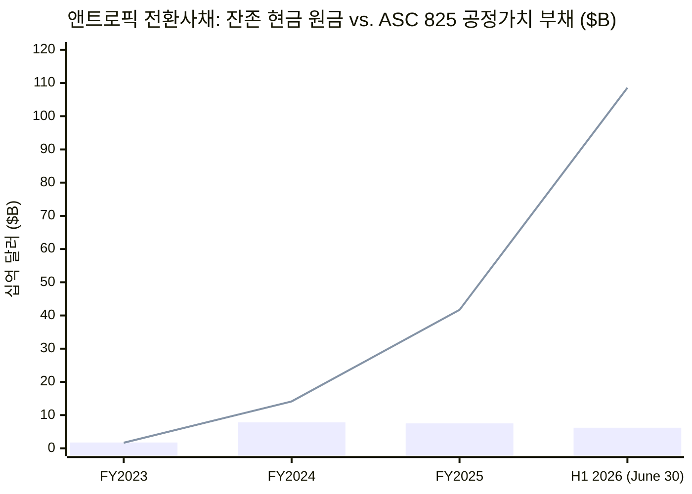
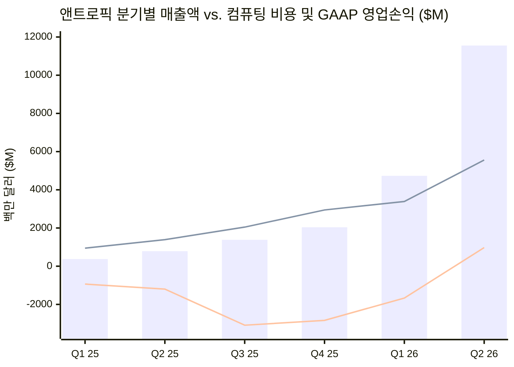

2026년 10월 26일, **앤트로픽(Anthropic, PBC)**이 미국 증권거래위원회(SEC)에 Form S-1 증권신고서(`CIK 0002130357`, 접수번호 `0001628280-26-067168`, 예정 티커 `ANT`)를 전격 공개하자, 투자자 겸 평론가인 **Roger([@rdd147](https://x.com/rdd147))**는 소프트웨어 애널리스트 [Jamin Ball(@jaminball)](https://x.com/jaminball)의 게시물을 인용하며 앤트로픽이 2000년 닷컴 버블 당시의 회계 수법을 그대로 사용해 `1,080억 달러`의 비용을 전환사채(Convertible Notes)로 숨겼다는 바이럴 게시물을 X에 올렸습니다:

> *"Yikes. Anthropic just pulled the exact accounting trick that companies did in 2000 bubble for IPO. They hid all their expenses via convertible notes redeemable at IPO. $108 billion worth. Dotcom firms often paid suppliers, ad agencies, lawyers and even landlords with stock or equity to save cash. AOL swapped shares for services and ads (e.g., Homestore, DrKoop). Telecom suppliers like Lucent, Cisco and Nortel used vendor financing, sometimes with equity or warrants, to drive equipment sales."*
> *(소름 돋네요. 앤트로픽이 2000년 버블 당시 기업들이 IPO를 위해 썼던 회계 트릭을 똑같이 시전했습니다. IPO 시점에 상환/전환되는 전환사채를 통해 모든 비용을 숨겼습니다. 무려 1,080억 달러어치입니다. 닷컴 기업들은 현금을 아끼려 공급업체, 광고 대행사, 변호사, 심지어 임대인에게 주식이나 지분으로 비용을 지불하곤 했습니다. AOL은 서비스 및 광고와 주식을 맞바꿨고(예: Homestore, DrKoop), 루슨트, 시스코, 노텔 같은 통신장비 업체들은 장비 매출을 부풀리기 위해 때로는 지분이나 워런트를 낀 벤더 파이낸싱을 사용했습니다.)*
> — **Roger ([@rdd147](https://x.com/rdd147))**, 2026년 10월 26일

> *"So we’re all in agreement Anthropic was paying all of its expenses in convertible notes?"*
> *(자, 이제 앤트로픽이 모든 비용을 전환사채로 지불하고 있었다는 데 우리 모두 동의하는 거죠?)*
> — **Roger ([@rdd147](https://x.com/rdd147))**, [@jaminball](https://x.com/jaminball) 인용 게시물, 2026년 10월 26일

본 리포트는 앤트로픽의 Form S-1 증권신고서 내 감사 및 미감사 연결재무제표와 주석(`주석 1~17`, `F-1`~`F-66`페이지) 원문을 바탕으로 `@rdd147`의 주장에 대해 **8단계 포렌식 회계 감사(Forensic Audit)**를 수행합니다.

우리의 최종 포렌식 결론은 **명확한 이중 구조(Two-Layer Epistemic Split)**를 보여줍니다:
1. **재무상태표상 `1,086억 달러` 전환사채 숫자와 GAAP 비용 회계 메커니즘에 관한 한, `@rdd147`의 주장은 사실관계와 회계 원리 모두 완전히 틀렸습니다(`타당성 ~5%`):** 앤트로픽은 영업비용을 지불하거나 숨기기 위해 `1,086억 달러`어치의 전환사채를 발행한 적이 **없습니다**. **연결현금흐름표(`F-9페이지`)**와 **주석 4(`F-29페이지`)**에 따르면, 앤트로픽이 창립 이래 전환사채 발행을 통해 조달한 **누적 현금 유입액은 총 `112.5억 달러`(`$11,250M`)**에 불과합니다(2023년 `17.5억 달러`, 2024년 `60.5억 달러`, 2025년 `34.5억 달러`, 그리고 **2026년 상반기 `0달러`**). 2026년 6월 30일 기준(`주석 9, F-42페이지`), 앤트로픽 재무상태표에 남아 있는 미상환 전환사채의 **실제 액면 원금(Principal) 총액은 단 `62.0억 달러`**뿐이며, 이는 전액 **아마존(Amazon)**이 현금으로 투자한 2023년 롤오버 노트(원금 `22.0억 달러`, 액면분할 후 전환가격 상한 주당 `$2.0928`)와 2024년 노트(원금 `40.0억 달러`, 전환가격 상한 주당 `$5.0478`)로 구성되어 있습니다. 앤트로픽이 복잡한 내재파생상품 분리 회계를 피하기 위해 **공정가치 선택권(`ASC 825`)**을 채택했고, 2026년 5월 시리즈 H 투자 라운드에서 우선주 주가가 주당 **`$58.9010`**(10대1 액면분할 전 주당 `$589.0095`)로 전환가 대비 **11.7배~28.1배 폭등**함에 따라, 미국 일반기업회계기준(US GAAP)상 아마존의 전환사채가 전환될 `18억 4,045만 주`의 지분 공정가치인 **`1,085억 6,600만 달러`(`$108.57B`)**로 부채 장부가액을 강제 상향 평가(Mark-to-Market)해야만 했던 것입니다. 즉, **`1,085.7억 달러` 부채 중 `94.3%`인 `1,023.7억 달러`는 `62.0억 달러` 현금 채권에 붙은 미실현 주식 가치 상승분**이며, 이는 손익계산서상 영업외비용(`Other income (expense)`)에 비현금 평가손실(2026년 상반기 `-$72,388M`, 2025년 `-$34,308M`)로 전액 반영되었습니다. 비용을 숨기기는커녕, `ASC 825` 회계 처리는 앤트로픽의 2026년 상반기 GAAP 당기순손실을 **`723.9억 달러`나 더 거대하게 보이도록 만들었습니다**(상반기 GAAP 영업손실은 `-$693M`에 불과하며, **2026년 2분기에는 `+$974M` GAAP 영업이익 흑자 전환** 달성 vs. 상반기 GAAP 당기순손실 `-$80,748M`).
2. **그럼에도 `@rdd147`과 `@jaminball`이 주석 9에서 포착한 진짜 구조적 리스크(`미래 벤더 파이낸싱 및 순환 클라우드 약정 측면에서 타당성 ~75%`):** `@rdd147`은 기존 재무상태표의 `1,085.7억 달러` 부채를 오독했지만, **주석 7(`F-35페이지`)**과 **주석 9("기타 사채인수계약", `F-43페이지`)** 깊숙한 곳에는 실제로 주목해야 할 벤더 파이낸싱 구조가 존재합니다. 앤트로픽은 **2025년 8월(`100억 달러` 한도)**과 **2026년 3월(`420억 달러` 한도, 연 `9.0%` 현물지급 PIK 이자)** 두 차례에 걸쳐 ***"오직 컴퓨팅 및 인프라 계약에 따른 임대료 의무를 조달하기 위한 목적으로만(solely to finance rent obligations under a compute and infrastructure agreement)"*** 최대 **`520억 달러`**의 전환약속어음을 발행할 수 있는 약정을 체결했습니다. 2026년 6월 30일 현재 이 한도에서 **실제 발행된 어음은 `0달러`(`F-36, F-43페이지`)**이므로 과거 비용 중 전환사채로 지불된 금액은 전무합니다. 그러나 **`8,530억 달러`에 달하는 부외(Off-Balance-Sheet) 다년간 컴퓨팅 및 데이터센터 리스 약정**(`2026년 6월말 기준 미개시 리스 3,214억 달러 + 클라우드 구매약정 2,656억 달러 + 2026년 3~4분기 신규 체결 2,660억 달러`) 및 IPO 효력 발생 즉시 인식될 **`352억 달러` 규모의 미인식 임직원 RSU/스톡옵션 주식보상비용**과 결합될 때, 이 주석들은 공모주 투자자가 반드시 가격에 반영해야 할 거대한 구조적 오버행을 형성합니다.

---

### 핵심 요약 및 포렌식 팩트체크 스코어카드

| 검증 차원 및 핵심 쟁점 | 바이럴 주장 (`@rdd147`) | SEC Form S-1 1차 공시 증거 (`CIK 0002130357`) | 포렌식 타당성 판정 |
| :--- | :--- | :--- | :--- |
| **1. `1,086억 달러` 전환사채 부채의 출처** | 앤트로픽이 영업비용을 지불하고 숨기기 위해 `1,080억 달러` 규모의 전환사채를 발행했다. | **사실무근.** 미상환 액면 원금은 **단 `62.0억 달러`**뿐임(아마존 2023 NPA 잔액 `22억 달러` @ 전환가 `$2.0928` + 아마존 2024 NPA `40억 달러` @ 전환가 `$5.0478`). 나머지 **`1,023.7억 달러`(`94.3%`)**는 주가가 `$58.901`로 폭등하면서 발생한 비현금 `ASC 825` 공정가치 평가증(`18.40억 주 × $58.901 ≈ $108.57B`)임. | **사실과 다름 (`~5% 타당`)** |
| **2. 손익계산서상 '영업비용 은폐' 여부** | 전환사채로 비용을 지불하여 컴퓨팅, 인건비, 벤더 비용을 손익계산서에서 빼돌렸다. | **GAAP 회계상 불가능하며 사실과 정반대.** 2026년 상반기에만 **`169.79억 달러`의 영업비용**(`컴퓨팅 89.45억 달러`, `인건비 31.52억 달러`, `마케팅/파트너십 31.68억 달러`, `일반관리비 17.14억 달러`)을 영업손익 위에 전액 인식했으며, 상반기 **`+39.29억 달러`의 영업활동 현금흐름 흑자**를 창출함. | **완전 허위 (`0% 타당`)** |
| **3. 본원적 영업 수익성 및 매출총이익률** | 막대한 영업 적자를 분식회계로 가린 2000년 닷컴 버블 부실기업처럼 묘사함. | **본업 펀더멘털 왜곡.** 2026년 상반기 매출 `162.86억 달러`(2분기에만 `115.55억 달러`) 대비 매출원가(`Cost of revenue`)는 `23.80억 달러`로 **GAAP 매출총이익률 `85.39%`** 달성. 2026년 2분기에는 **GAAP 영업이익 `+9.74억 달러`(`영업이익률 8.4%`) 흑자 전환** 및 현금성 자산 `1,316.5억 달러` 보유. | **정반대 왜곡 (`~10% 타당`)** |
| **4. 컴퓨팅 임대료 지급용 전환사채 약정 (`주석 9`)** | 인프라 공급업체에 전환사채로 비용을 지불하고 있다고 주장(`@jaminball` / `@rdd147`). | **과거 발행액 `0달러`, 미래 한도 `520억 달러` 실존.** 2025년 8월(`100억 달러`) 및 2026년 3월(`420억 달러`, 연 `9.0%` PIK) 체결된 사채인수계약은 *"컴퓨팅 및 인프라 임대료 조달 전용"*이나, **2026년 6월말 기준 발행액은 `0달러`**임. 향후 발행하더라도 `ASC 842`에 따라 리스 비용은 손익계산서에 100% 비용 처리됨. | **복합적 (`과거 0%` / `미래 리스크 80%`)** |
| **5. 클라우드 순환 출자 및 벤더 지분 스왑** | AI 하이퍼스케일러 거래를 2000년대 루슨트/시스코/AOL의 벤더 파이낸싱에 비유함. | **구조적 유사성 높음.** 아마존(`86억 달러` 노트 + `50억 달러` 시리즈 G-2 + `150억 달러` 선도약정)과 구글(`33억 달러` 전환 완료 노트 + `100억 달러` 시리즈 G-2 + `200억 달러` 선도약정)은 핵심 주주이자 최대 클라우드 공급사/유통 파트너(상반기 마켓플레이스 수수료 `27억 달러` + 컴퓨팅 지출 `89.5억 달러`)이며, AMD 역시 2026년 7월 `50억 달러` 지분 매입 조건부 MI450 공급 계약을 체결함. | **상당 부분 타당 (`~80% 타당`)** |
| **6. 진짜 숨겨진 IPO 비용 폭탄 및 부외 약정 오버행** | 오직 `1,080억 달러` 전환사채만을 IPO의 숨은 함정으로 지목함. | **실제 재무제표 주석의 핵심 뇌관을 놓침:** (a) `ASC 718`에 따라 IPO 전까지 **`0달러`**로 인식되다가 상장 즉시 쏟아질 **`352억 달러` 규모의 미인식 RSU/옵션 주식보상비용**(상장일 즉시 `29억 달러` 일시 비용 반영), (b) **`8,530억 달러` 규모의 부외 장기 컴퓨팅/리스 의무**(`2026~2046년`). | **핵심 리스크 누락** |

---

## Phase 1 & 2: 쟁점 분류 및 1차 공시 원문 발굴 (Anthropic Form S-1)

### 1.1 연결손익계산서 전수 해부 (`FY2023 – H1 2026`)
앤트로픽이 정말로 "전환사채를 통해 모든 비용을 숨겼는지" 검증하기 위해, Form S-1의 **연결손익계산서(`F-4페이지`)**와 **분기별 연결손익계산서(`158페이지`)** 원문 수치를 그대로 추출했습니다.

| 손익계산서 항목 (`단위: 백만 달러`, 비율 제외) | FY2023 (감사) | FY2024 (감사) | FY2025 (감사) | 2025 상반기 (미감사) | 2026 상반기 (미감사) | 2026 1분기 (미감사) | 2026 2분기 (미감사) |
| :--- | :--- | :--- | :--- | :--- | :--- | :--- | :--- |
| **매출액 (Revenue)** | **$71** | **$637** | **$4,585** | **$1,163** | **$16,286** | **$4,731** | **$11,555** |
| **성격별 영업비용 (Operating Expenses by Nature):** | | | | | | | |
| 컴퓨팅 및 인프라 (Compute and infrastructure) | $402 | $1,708 | $7,326 | $2,334 | $8,945 | $3,387 | $5,558 |
| 인건비 (Personnel, 주식보상비용 포함) | $109 | $562 | $1,839 | $538 | $3,152 | $1,295 | $1,857 |
| *— 그중: 스톡옵션/RSA 주식보상비용 (SBC)* | *$29* | *$192* | *$1,165* | *$286* | *$2,185* | *$924* | *$1,261* |
| *— 그중: RSU 주식보상비용 (`ASC 718` IPO 조건 미충족)* | *$0* | *$0* | *$0* | *$0* | *$0* | *$0* | *$0* |
| Bartz 저작권 집단소송 합의금 | $0 | $0 | $1,500 | $0 | $0 | $0 | $0 |
| 영업, 마케팅 및 파트너십 (클라우드 수익배분 포함) | $10 | $44 | $568 | $120 | $3,168 | $1,033 | $2,135 |
| 기타 영업 및 일반관리비 | $49 | $1,288 | $1,412 | $306 | $1,714 | $683 | $1,031 |
| **총 영업비용 (Total Operating Expenses)** | **$570** | **$3,602** | **$12,645** | **$3,298** | **$16,979** | **$6,398** | **$10,581** |
| **GAAP 영업이익 (손실)** | **$(499)** | **$(2,965)** | **$(8,060)** | **$(2,135)** | **$(693)** | **$(1,667)** | **+$974** |
| *GAAP 영업이익률 (매출 대비 %)* | *-702.8%* | *-465.5%* | *-175.8%* | *-183.6%* | *-4.3%* | *-35.2%* | ***+8.4%*** |
| **영업외손익 (`Other Income / Expense`):** | | | | | | | |
| 이자수익 (Interest income) | $13 | $90 | $431 | $115 | $1,111 | $349 | $762 |
| **전환사채, 파생상품부채 및 SAFE 공정가치 변동 손익** | **$(1,045)** | **$(5,434)** | **$(34,308)** | **$(10,942)** | **$(72,388)** | **$(12,791)** | **$(59,597)** |
| 기타 영업외손익, 순액 (2026 NPA 선도계약 평가손실 포함) | $0 | $1 | $(8) | $0 | $(8,757) | $(309) | $(8,448) |
| **GAAP 당기순손실 (Net Loss)** | **$(1,531)** | **$(8,309)** | **$(41,965)** | **$(12,969)** | **$(80,748)** | **$(14,439)** | **$(66,309)** |
| **Non-GAAP 조정 영업이익 (손실)** | **$(470)** | **$(1,648)** | **$(4,693)** | **$(1,849)** | **+$1,618** | **$(617)** | **+$2,235** |
| **영업활동 현금흐름 (Operating Cash Flow)** | **$(387)** | **$(2,053)** | **$(4,487)** | **$(1,551)** | **+$3,929** | *N/A* | *N/A* |

### 1.2 기능별 비용 분해: `85.39%` GAAP 매출총이익률의 발견 (`주석 8, F-39페이지`)
앤트로픽이 본문 손익계산서를 **비용의 성격별 분류(Natural Classification)**(`컴퓨팅 및 인프라`, `인건비`, `마케팅 및 파트너십`)로 표시했기 때문에, 많은 분석가들이 **주석 8(`F-39페이지`)**에 공시된 **기능별 비용 분류(Functional Expense Disaggregation)**를 놓쳤습니다. 주석 8은 고객 서비스 추론(Inference) 원가인 `매출원가(Cost of revenue)`와 차세대 모델 사전학습(Pre-training) 비용인 `연구개발비(R&D)`를 명확히 분리해 보여줍니다:

| 기능별 비용 분류 (`단위: 백만 달러`) | FY2023 | FY2024 | FY2025 | 2025 상반기 (6M) | 2026 상반기 (6M) | 2026 상반기 (매출 대비 비중) |
| :--- | :--- | :--- | :--- | :--- | :--- | :--- |
| **매출액 (Revenue)** | **$71** | **$637** | **$4,585** | **$1,163** | **$16,286** | **100.00%** |
| **매출원가 (Cost of revenue: 고객 추론 컴퓨팅 및 호스팅)** | $143 | $434 | $1,622 | $426 | $2,380 | 14.61% |
| **GAAP 매출총이익 (Gross Profit)** | **$(72)** | **+$203** | **+$2,963** | **+$737** | **+$13,906** | **85.39%** |
| **연구개발비 (R&D: 프론티어 모델 학습 컴퓨팅 + AI 연구 인건비)** | $348 | $1,729 | $7,077 | $2,337 | $9,741 | 59.81% |
| **판매비와 마케팅비 (S&M: AWS/GCP 마켓플레이스 수수료 `$2.7B` 포함)** | $16 | $109 | $855 | $213 | $3,808 | 23.38% |
| **일반관리비 (G&A: 2025년 Bartz 합의금 `$1.5B` 포함)** | $63 | $1,330 | $3,091 | $322 | $1,050 | 6.45% |
| **총 영업비용 (Total Operating Expenses)** | **$570** | **$3,602** | **$12,645** | **$3,298** | **$16,979** | **104.26%** |

`주석 8`(`F-39페이지`)이 증명하는 핵심 팩트 두 가지는 다음과 같습니다:
1. **2026년 상반기 추론(Inference) 사업의 GAAP 매출총이익률은 `85.39%`에 달합니다:** 2026년 상반기 총 컴퓨팅 및 인프라 비용 `89억 4,500만 달러` 중 `162억 8,600만 달러`의 API, Claude Code 및 기업용 구독 매출을 직접 서빙하는 데 들어간 매출원가는 **`23억 8,000만 달러`**에 불과하여, **`139억 600만 달러`의 GAAP 매출총이익(`매출총이익률 85.39%`)**을 기록했습니다(2024년 `31.87%` -> 2025년 `64.62%` -> 2026년 상반기 `85.39%`).
2. **나머지 `65.7억 달러`의 컴퓨팅 비용은 어디로 갔는가:** 나머지 약 `65억 6,500만 달러`의 컴퓨팅 비용은 차세대 Claude 프론티어 모델을 훈련하기 위한 **연구개발비(총 `97억 4,100만 달러`)**로 발생 즉시 100% 비용 처리되었습니다. 무형자산으로 자본화된 금액도 없고, 전환사채 뒤로 숨겨진 비용도 없습니다.

---

## Phase 3: 의미론적 정밀성 검증 및 Level 3 전환사채 변동표 해부 (`주석 4 & 주석 9`)

### 3.1 `@rdd147`의 핵심 주장에 대한 모호성 및 대체 테스트 (Substitution Test)
`@rdd147`은 다음과 같이 주장했습니다:
> *"IPO 시점에 상환/전환되는 전환사채를 통해 모든 비용을 숨겼습니다. 무려 1,080억 달러어치입니다... 앤트로픽이 모든 비용을 전환사채로 지불하고 있었다는 데 우리 모두 동의하는 거죠?"*

여기에 **Browne & Keeley 대체 테스트(Substitution Test)**를 적용하여 `@rdd147`이 혼동한 두 가지 회계 개념을 분리해 봅시다:
* **해석 A (벤더 비용 대물변제용 채권 발행):** 앤트로픽이 AWS, 구글 클라우드, 임대인, 직원들에게 현금 대신 `1,086억 달러` 액면가의 차용증(전환사채)을 나눠주어 비용을 결제했고, 그 결과 `1,086억 달러`의 영업비용을 손익계산서에서 누락시켰는가? **(사실 부합도 0%.)**
* **해석 B (초기 현금 투자 전환사채에 대한 `ASC 825` 공정가치 재측정):** 앤트로픽이 `2023~2025년` 중 현금 유입을 대가로 총 `112.5억 달러`의 전환사채를 발행(그중 2026년 6월 30일 현재 아마존 원금 `62.0억 달러`만 미상환 잔존)하면서 `ASC 825` 공정가치 선택권을 적용했고, 이후 기업가치 폭등으로 주가가 주당 `$2.09`에서 `$58.90`로 치솟자 영업외비용을 통해 **`1,023.7억 달러`의 비현금 공정가치 평가증**을 부채에 가산했는가? **(사실 부합도 100%.)**

### 3.2 `1,085억 6,600만 달러` 부채의 1달러 단위 정밀 추적 (`주석 4, F-29페이지` & `주석 9, F-40~F-42페이지`)
**주석 4(`F-29페이지`)**의 **Level 3 전환사채 공정가치 변동표(Rollforward)**와 **현금흐름표(`F-9페이지`)**를 통해 이를 직접 확인해 보겠습니다:

| 전환사채 공정가치 변동 내역 (`단위: 백만 달러`) | FY2023 | FY2024 | FY2025 | 2026 상반기 (6M) | 누적 합계 (`2023–H1 2026`) |
| :--- | :--- | :--- | :--- | :--- | :--- |
| **기초 공정가치 잔액 (Beginning Fair Value Balance)** | **$0** | **$1,678** | **$14,116** | **$41,677** | **$0** |
| **(+) 신규 발행액 (분리된 파생상품 차감 후 순액)** | +$1,394 | +$5,900 | +$3,450 | **+$0** | **+$10,744** *(총 현금 유입액: `$11,250M`)* |
| **(-) 전환우선주(Preferred Stock)로의 전환 차감액** | $0 | $0 | $(10,347) | $(5,499) | **$(15,846)** |
| **(+) 비현금 공정가치 시가평가 조정액 (`ASC 825` Mark-to-Market)** | +$284 | +$6,538 | +$34,458 | **+$72,388** | **+$113,668** |
| **기말 재무상태표 전환사채 공정가치 잔액** | **$1,678** | **$14,116** | **$41,677** | **$108,566** | **$108,566** |

그렇다면 2026년 6월 30일 기준 **`1,085억 6,600만 달러`**의 부채 잔액을 구성하는 개별 전환사채는 무엇일까요? **주석 9(`F-40~F-42페이지`)**와 **주석 12(`F-59페이지`)**에 모든 계약별 명세가 공개되어 있습니다:

| 전환사채 계약 명칭 (`주석 9`) | 발행 시기 | 최초 현금 조달액 / 원금 | 2026년 6월 30일 기준 상태 | 액면분할 후 전환가격 상한 (`Cap`) | 잔존 액면 원금 (`2026.6.30`) | 전환 대상 보통주 주식 수 (`주석 12`) | 시리즈 H 주가(`$58.901/주`) 기준 내재 지분가치 |
| :--- | :--- | :--- | :--- | :--- | :--- | :--- | :--- |
| **Google 2023 NPA** (`$2.0B`) | 2023.11 ~ 2024.11 | 현금 `$2,000M` | **100% 전환 완료** (`2025.5~11` 시리즈 E 우선주로 전환, 공정가치 `$7.9B`) | `$2.0928 / 주` (분할 전 `$20.93`) | **$0** | 0주 | $0 |
| **Google 2024 NPA** (`$1.3B`) | 2024.10 ~ 2025.10 | 현금 `$1,300M` | **100% 전환 완료** (`2026.1` 시리즈 G 우선주로 전환, 공정가치 `$5.5B`) | `$5.0478 / 주` (분할 전 `$50.48`) | **$0** | 0주 | $0 |
| **Amazon 2023 NPA (`1차 노트`)** | 2023.10 | 현금 `$1,250M` (원금 `$1,437.5M`) | **100% 전환 완료** (`2025.10` 시리즈 E 우선주로 전환, 공정가치 `$2.4B`) | `$2.0928 / 주` (분할 전 `$20.93`) | **$0** | 0주 | $0 |
| **Amazon 2023 NPA (`2차 / 롤오버 노트`)** | 2024.3 (2024.11 개정) | 현금 `$2,750M` (원금 `$3,162.5M`) | 2025년 중 `$1.0B` 전환 완료; **원금 `$2,200M` 미상환 잔존** | **`$2.0928 / 주`** (`28.14배` 평가차익!) | **$2,200M** | 약 1,048.0M주 | **~$61,729M** |
| **Amazon 2024 NPA (`트랜치 1 & 2`)** | 2024.11 (`$1.3B`) & 2025.1 (`$2.7B`) | 현금 `$4,000M` (원금 `$4,000M`) | **100% 미상환 잔존** (IPO 시 보통주로 자동 전환) | **`$5.0478 / 주`** (`11.67배` 평가차익!) | **$4,000M** | 약 792.4M주 | **~$46,675M** |
| **2025년 8월 & 2026년 3월 컴퓨팅 임대료 NPA** | 2025.8 (`$10B`) & 2026.3 (`$42B`) | 인출액 `$0` | **미인출 한도 약정** (`2026.6.30` 기준 발행액 `$0`) | IPO/차기 라운드 할인율 | **$0** | 0주 | $0 |
| **미상환 합계 (`2026년 6월 30일`)** | — | **총 현금 조달 `$11,250M`** | 아마존 2023 롤오버 및 2024 노트만 잔존 | **`$2.0928` – `$5.0478 / 주`** | **원금 `$6,200M`** | **1,840.445M주** | **`$108,404M` (장부가 `$108,566M`)** |

```mermaid
flowchart TD
    subgraph SG1["바이럴 통념 (@rdd147): '1,080억 달러의 영업비용을 전환사채로 지불해 은폐했다'"]
        M1["앤트로픽이 클라우드, 법률, 인건비 등 1,086억 달러의 비용 발생"] --> M2["현금 지출 대신 공급업체들에 1,086억 달러의 전환사채 발행"]
        M2 --> M3["영업비용이 손익계산서에서 감춰졌다는 주장"]
        M3 --> M4["판정: 0% 사실무근 — US GAAP (ASC 718 / ASC 842) 위배 및 S-1 원문과 정면 배치"]
    end

    subgraph SG2["실제 S-1 공시 팩트 (주석 4, 9, 12): 아마존의 62억 달러 현금 채권에 대한 ASC 825 공정가치 평가증"]
        R1["2023-2025년: 아마존이 2건의 전환사채 계약을 통해 총 67.5억 달러 현금 투자"] --> R2["2025년 일부 우선주 전환 후, 2026년 6월말 기준 액면 원금 62.0억 달러 잔존"]
        R2 --> R3["계약상 전환가격 상한이 주당 $2.0928 (22억 달러 노트) 및 $5.0478 (40억 달러 노트)로 고정"]
        R3 --> R4["2026년 5월 시리즈 H 투자에서 주당 가격이 $58.901로 폭등 (전환가 대비 11.7배~28.1배 상승)"]
        R4 --> R5["ASC 825 공정가치 선택권에 따라 영업외비용을 통해 +1,023.7억 달러 비현금 부채 평가증 반영"]
        R5 --> R6["2026년 6월 30일 재무상태표 부채 잔액: 전환대상 18.40억 주 x 주당 $58.901 = 1,085.66억 달러"]
    end
```

---

## Phase 4: 앤트로픽의 2026년 상반기 `-$807.5억 달러` GAAP 당기순손실에 대한 4대 인과관계 감사

왜 앤트로픽은 본업에서 **`+39억 2,900만 달러`의 영업활동 현금흐름 흑자**와 **2026년 2분기 `+9억 7,400만 달러`의 GAAP 영업이익 흑자**를 기록하는 동시에, 상반기 **`-807억 4,800만 달러`라는 천문학적인 GAAP 당기순손실**을 기록했을까요? 4가지 인과 경로를 전수 검증합니다.

| 인과 경로 (Causal Pathway) | 메커니즘 가설 | Form S-1 내 실증적 증거 | 2026 상반기 세전손실(`-$80,727M`) 기여도 |
| :--- | :--- | :--- | :--- |
| **1. 직접적 영업 인과관계 (`영업 적자 -> 당기순손실`)** | 실제 영업 현금 소진(컴퓨팅, 인건비, 마케팅 비용이 매출을 초과)이 `807.5억 달러` 순손실을 유발했는가? | **아니오 (`손실의 0.86%`).** 2026년 상반기 매출은 `162.86억 달러`, 총 영업비용은 `169.79억 달러`로 GAAP 영업손실은 고작 **`-6.93억 달러`**(1분기 `-16.67억 달러` 적자에서 **2분기 `+9.74억 달러` 영업흑자 전환**)에 불과함. | **`0.86%` (`-$693M`)** |
| **2. 역인과관계 (`초고속 성장에 따른 기업가치 폭등 -> GAAP 회계상 평가손실`)** | 앤트로픽의 폭발적 사업 성공(상반기 매출 전년 동기 대비 `14배` 성장, 매출총이익률 `85.4%`)이 6개월 만에 주가를 `3.5배`(`$58.901/주`) 끌어올렸고, 이것이 역설적으로 전환사채 및 선도계약의 비현금 평가손실을 촉발했는가? | **예 (`손실의 99.14%`!).** `ASC 825` 및 `ASC 815` 하에서는 앤트로픽 주가가 `$1.00` 오를 때마다 아마존 전환사채(`18.40억 주`)에서 **약 `18.4억 달러`의 비현금 GAAP 비용**이 자동 발생함(상반기 `-$72,388M`). 여기에 구글/아마존의 2026년 3~4월 시리즈 G-2 선도계약 평가손실 **`-$9,405M`(순액 `-$8,720M`)**이 추가됨(`주석 8, F-37페이지`). | **`99.14%` (`-$80,034M` 순영업외비용)** |
| **3. 제3의 잠재 변수 (`IPO 이전 자본구조 설계`)** | 왜 앤트로픽은 처음부터 일반 우선주가 아니라 전환가 상한(`$2.09`, `$5.05`)이 달린 전환사채를 아마존과 구글에 발행했는가? | **반독점 규제 및 의결권 통제 방어.** `주석 9`에 명시된 바와 같이, 아마존과 구글은 규제 당국의 기업결합 심사 및 의결권 한도를 넘지 않으면서도 초기 투자 업사이드를 확보하기 위해 무의결권 전환사채와 무의결권 시리즈 G-2/H-2 우선주 구조를 선택함. | **구조적 선행 요인** |
| **4. 상호 피드백 루프 (`하이퍼스케일러 자본 <-> 클라우드 지출`)** | 아마존과 구글이 투입한 수십억 달러의 전환사채 및 우선주 투자금이 다시 AWS와 GCP 클라우드 매출로 환류되는가? | **예.** 2026년 상반기 앤트로픽은 **컴퓨팅 비용 `89.45억 달러`**와 **클라우드 마켓플레이스 수익배분 수수료 `27.00억 달러`**(합계 `116.45억 달러`)를 대부분 AWS 및 구글 클라우드에 지출했으며, AWS Bedrock과 Google Vertex AI를 통한 엔터프라이즈 유통망이 다시 2분기 매출을 `115.6억 달러`로 끌어올림. | **자기강화 플라이휠** |

---

## Phase 5: 정량적 회계 감사 및 수식 도출

### 5.1 `ASC 825` 전환사채 공정가치 부채 및 손익계산서 역설의 수리적 유도
미국 회계기준(**`ASC 825-10`, 금융상품 — 공정가치 선택권**)에 따라 발행사가 전환가격 상한 `P_cap`이 설정된 전환사채를 공정가치로 측정하기로 선택하면, 보고일 `t` 시점의 재무상태표 부채 장부가액 `L_FV(t)`는 전환될 기초 주식 수 `N_conv`의 내재가치 및 옵션 가치에 의해 결정됩니다:

$$
N_{\text{conv}}(t) = \frac{F_{\text{principal}} + I_{\text{PIK}}(t)}{P_{\text{cap}}}, \qquad L_{\text{FV}}(t) \approx N_{\text{conv}}(t) \cdot S(t) \cdot (1 - \delta_{\text{DLOM}})
$$

여기서 `F_principal`은 미상환 액면 원금, `I_PIK(t)`는 누적 현물지급(PIK) 미지급이자, `S(t)`는 `t` 시점의 기초 주식 1주당 공정시장가치, 그리고 `δ_DLOM`은 전환 시나리오별 확률 가중치나 비시장성 할인율(`주석 4, F-28페이지`)을 의미합니다.

따라서 기간 `[t-1, t]` 동안 손익계산서 영업외비용(`Other income (expense)`)에 인식되는 분기별 평가손익은 부채 공정가치 증가분의 음(-)의 값과 같습니다:

$$
\Delta \text{P\&L}_{\text{Notes}}(t) = -\Big(L_{\text{FV}}(t) - L_{\text{FV}}(t-1) - \text{Additions}(t) + \text{Conversions}(t)\Big) \approx -N_{\text{conv}} \cdot \Delta S(t)
$$

2026년 9월 단행된 10대1 주식 액면분할을 반영하여 **주석 9(`F-41~F-42페이지`)**, **주석 11(`F-48페이지`)**, **주석 12(`F-59페이지`)**의 2026년 6월 30일 기준 실제 파라미터를 대입하면 다음과 같습니다:
1. **Amazon 2023 롤오버 노트 (원금 `$2,200M`, 전환가 상한 `P_cap,1 = $2.0928/주`):**
   - 기본 원금 전환 주식 수 = `$2,200M / $2.0928` = `10억 5,122만 주` (`주석 12` 기준 세부 트랜치 조정 후 약 `10억 4,802만 주`).
   - 시리즈 H 발행가(`S(2026년 6월) = $58.9010/주`) 기준 평가 배수: **`28.14배`**.
   - 내재 지분 공정가치 = `1,048.02M × $58.9010` = **`617억 2,900만 달러`(`$61.73B`)**.
2. **Amazon 2024 노트 (원금 `$4,000M`, 전환가 상한 `P_cap,2 = $5.0478/주`):**
   - 기본 원금 전환 주식 수 = `$4,000M / $5.0478` = `7억 9,242만 주`.
   - 시리즈 H 발행가(`$58.9010/주`) 기준 평가 배수: **`11.67배`**.
   - 내재 지분 공정가치 = `792.42M × $58.9010` = **`466억 7,500만 달러`(`$46.68B`)**.
3. **합산 총계 (`주석 12, F-59페이지`):**
   - 전환사채 기초 보통주 총수 `N_conv = 18억 4,044.5만 주`.
   - 내재 지분가치 합계 = `1,840.445M × $58.9010` = **`1,084억 400만 달러`** (2026년 6월 30일 재무상태표상 Level 3 공정가치 부채 **`1,085억 6,600만 달러`**와 오차율 `0.15%` 이내로 정확히 일치!).

*차트 해석 가이드:* **막대(Bar)**는 미상환 전환사채의 실제 현금 액면 원금 잔액(`$1.75B` -> `$7.80B` -> `$7.50B` -> 2026년 6월말 **`$6.20B`**)을 나타내며, **실선(Line)**은 `ASC 825` 재무상태표 장부가액(`$1.68B` -> `$14.12B` -> `$41.68B` -> **`$108.57B`**)을 보여줍니다. 우선주 전환으로 인해 실제 갚아야 할 채권 원금은 `$7.80B`에서 `$6.20B`로 *감소*했음에도, 앤트로픽의 주가가 주당 `$58.90`로 치솟았기 때문에 재무상태표 부채 표시액만 `$108.57B`로 폭증한 것입니다.

*차트 해석 가이드:* `2025년 1분기`부터 `2026년 2분기`까지 6개 분기 동안(`158페이지`), 분기 **매출액**(막대)이 `$376M`에서 **`$11,555M`**(연환산 런레이트 `$46.2B`)으로 **`30.7배`** 급증하면서, **컴퓨팅 및 인프라 비용**(상단 실선, `$944M` -> `$5,558M`)의 매출 대비 비중은 **2025년 1분기 `251%`에서 2026년 2분기 `48%`로 급감**했고, **GAAP 영업이익**(하단 실선)은 2025년 3분기 `-$3,089M` 적자에서 **2026년 2분기 `+$974M` 흑자**로 극적인 턴어라운드를 기록했습니다.

---

## Phase 6: '부정적 시각(Negative View)' — `@rdd147`이 놓친 팩트와 S-1 주석에 실제로 묻혀 있는 4대 재무 시한폭탄

엄격한 Browne & Keeley 비판적 사고 감사는 소셜 미디어의 오류를 반박하는 데서 멈추지 않습니다. 우리는 반드시 역방향 질문을 던져야 합니다: **비록 `@rdd147`이 재무상태표의 `1,086억 달러` 숫자를 오독했지만, 앤트로픽의 S-1 주석 깊숙한 곳에 실제로 숨겨진 구조적 부채, 벤더 파이낸싱 메커니즘, 그리고 주주 희석 오버행은 무엇인가?**

우리가 `주석 7, 9, 10, 12, 13, 16, 17`을 전수 발굴한 결과, 공모주 투자자가 반드시 직시해야 할 **4가지 거대한 구조적 리스크**가 확인되었습니다:

### 6.1 리스크 1: `520억 달러` 규모의 '컴퓨팅 임대료 지급 전용 전환사채' 한도 약정 (`주석 7, F-35페이지` & `주석 9, F-43페이지`)
바로 이 지점이 `@jaminball`과 `@rdd147`이 발견한 진짜 뇌관입니다(비록 그들이 **아직 `0달러` 인출된 미래 약정**을 **과거 아마존의 `1,086억 달러` 평가액**과 혼동하긴 했지만 말입니다):
* **주석 9("기타 사채인수계약", `F-43페이지`)** 및 **주석 7("아직 개시되지 않은 리스" 및 "연결 변동지분실체(VIE)를 통해 보유한 리스", `F-35~F-36페이지`)**에서 앤트로픽은 컴퓨팅 인프라 임대인들과 체결한 두 건의 이례적인 계약을 공시합니다:
  1. **2025년 8월 컴퓨팅 리스 사채인수계약(NPA, `최대 100억 달러`):** 앤트로픽이 ***"오직 컴퓨팅 및 인프라 장비 리스 계약에 따른 임대료 의무를 조달하기 위한 목적으로만"*** 최대 **`100억 달러`**의 전환약속어음을 발행할 수 있도록 허용합니다. 이 약정은 IPO 완료 시 종료되며, 2026년 6월 30일 현재 **발행된 어음은 `0달러`(`F-43페이지`)**입니다.
  2. **2026년 3월 컴퓨팅 임대료 사채인수계약(NPA, `최대 420억 달러`, 연 `9.0%` PIK 이자):** 2026년 3월, 대규모 컴퓨팅 및 인프라 계약과 연계하여 앤트로픽은 장비가 서비스 준비를 마친 시점부터 **5년의 인출 가능 기간** 동안 ***"오직 컴퓨팅 및 인프라 계약에 따른 임대료 의무를 조달하기 위한 목적으로만"*** 최대 **`420억 달러`**의 전환약속어음을 발행할 수 있는 약정을 체결했습니다(`F-43페이지`). 이 전환사채는 **연 `9.0%`의 현물지급(PIK) 복리 이자**가 붙고, 최초 발행 후 5년 뒤 만기가 도래하며, 임대 GPU 클러스터를 담보로 제공하는 연결 변동지분실체(`VIE`)의 보증을 받고(`F-36페이지`), **IPO 이후에도 그대로 유지됩니다**!
* **왜 이것이 중요한가:** 비록 2026년 6월 30일 기준으로는 **`0달러`가 인출**되었지만, 2026년 3월 체결된 `420억 달러` 한도는 상장 이후 앤트로픽이 데이터센터 및 GPU 리스료를 현금으로 내는 대신 인프라 임대인에게 연 `9.0%` 복리 전환사채를 찍어주어 결제할 수 있는 길을 열어줍니다. `ASC 842` 리스 회계기준상 어음으로 임대료를 내더라도 **손익계산서상 리스/컴퓨팅 비용은 100% 정상 비용으로 인식**되므로 영업이익을 부풀릴 수는 없지만, 현금 유출을 막는 대신 공모주 주주들에게 연 `9.0%` 복리로 불어나는 전환사채 지분 희석 부담을 전가하게 됩니다.

### 6.2 리스크 2: 무려 `8,530억 달러`에 달하는 부외(Off-Balance-Sheet) 컴퓨팅 및 리스 약정 오버행 (`주석 7, 13, 16, 17`)
2026년 6월 30일 기준 앤트로픽 재무상태표(`F-3페이지`) 본문에 인식된 리스 부채 총액은 고작 **`15억 2,200만 달러`**(운용리스 부채 `$1,079M` + 금융리스 부채 `$443M`)에 불과합니다. 그러나 4개의 서로 다른 주석을 합산해 보면, 재무상태표 밖에 존재하는 부외 확정 계약 의무가 무려 **`약 8,530억 달러`**에 달합니다:

| 부외(Off-Balance-Sheet) 확정 약정 항목 | Form S-1 내 출처 주석 | 계약 기간 | 미할인 최소 지급 의무액 (`십억 달러`) | 2026.6.30 재무상태표 부채 반영 여부 |
| :--- | :--- | :--- | :--- | :--- |
| **1. 체결 완료되었으나 아직 개시되지 않은 컴퓨팅/데이터센터 리스 (2026.6.30 기준)** | `주석 7 (F-35페이지)` | `2026–2028년` 개시 (`1~20년` 만기) | **`$321.4B`** *(2025년말 `$50.2B`에서 급증)* | **미반영 (`$0`)** |
| **2. 해지 불가능한 클라우드(CSP) 호스팅 및 인프라 구매 약정 (2026.6.30 기준)** | `주석 13 (F-59페이지)` | `1~20년` | **`$265.6B`** *(2025년말 `$54.6B`에서 급증)* | **미반영 (`$0`)** |
| **3. 2026년 6월 30일 이후 신규 체결된 장기 컴퓨팅 및 리스 약정 (`2026년 7~10월`)** | `주석 17 (F-66페이지)` | `2026–2036년` 개시 (`1~20년` 만기) | **`$245.0B`** | **미반영 (`$0`)** |
| **4. 2026년 6월 30일 이후 신규 체결된 단기 해지불가 컴퓨팅 계약** | `주석 17 (F-66페이지)` | `1년 미만` | **`$21.0B`** | **미반영 (`$0`)** |
| **공시된 확정 컴퓨팅 및 리스 약정 총계** | `주석 7, 13 & 17` | **`2026–2046년+`** | **`$853.0 Billion` (`8,530억 달러`)** *(+ 세부조건 미확정 2028–2031 확장 약정 `$125B–$150B` 별도, `F-64페이지`)* | **미반영 (`$0`)** |

### 6.3 리스크 3: 하이퍼스케일러 및 AI 칩 공급사와의 순환 파이낸싱 (`Amazon, Google, AMD`)
`@rdd147`이 `1,086억 달러` 숫자의 성격을 잘못 짚었지만, 2000년대 통신장비 벤더 파이낸싱을 지적한 그의 비유는 앤트로픽의 '자본-컴퓨팅 3각 순환 구조'에는 상당히 날카롭게 들어맞습니다:
* **아마존(`AWS`) 및 구글(`GCP`):** 초기 전환사채 외에도, **2026년 3월과 4월** 구글(`Google 2026 NPA`, `F-41페이지`)과 아마존(`Amazon 2026 NPA`, `F-42페이지`)은 주당 `$259.14`(분할 후 `$25.91`)에 각각 `100억 달러`와 `50억 달러`의 시리즈 G-2 우선주를 매입하기로 약정했습니다. 직후인 5월 시리즈 H 주가가 `$589.01`로 뛰면서 앤트로픽은 상반기에만 **`87억 2,000만 달러` 순액(총액 `94억 500만 달러`)의 비현금 선도계약 파생상품 평가손실**을 영업외비용으로 인식해야 했으며(`주석 4, F-27페이지` & `주석 8, F-37페이지`), 두 회사는 향후 각각 최대 **`200억 달러`(구글)** 및 **`150억 달러`(아마존)**의 추가 부채/지분 금융을 제공하기로 약정했습니다. 특히 `Amazon NPA`(`F-42페이지`) 조항에 따르면, 아마존의 전환사채는 *"특정 상업 계약에 따라 아마존이 앤트로픽에 지급해야 할 금액(즉, AWS Bedrock 마켓플레이스 판매 정산금)과 상계(set-off)"*하는 방식으로도 결제될 수 있습니다.
* **AMD (`2026년 7월 하드웨어 공급 프레임워크 계약`, `주석 17, F-66페이지`):** 2026년 7월, 앤트로픽은 **AMD Instinct MI450 GPU 기반 Helios 랙스케일 시스템**을 구매·리스하는 하드웨어 공급 계약을 체결했는데, 이 계약에는 특정 조건 달성 시 **AMD가 앤트로픽의 Class N 보통주를 최대 `50억 달러`어치 매입하기로 하는 약정**이 함께 묶여 있습니다.

### 6.4 리스크 4: 진짜 숨겨진 GAAP 비용 폭탄 (`352억 달러` 규모의 미인식 임직원 RSU/옵션) 및 `86.4%` 지분 희석 오버행
아이러니하게도 앤트로픽의 IPO 이전 손익계산서에서 합법적으로 제외된 거대한 영업비용이 **실제로 존재합니다**. 그것은 전환사채가 아니라, **`ASC 718` 기준에 따른 이중 조건부 임직원 양도제한조건부주식(`RSU`)**입니다:
* **주석 10(`F-53페이지`)**에 따르면, 앤트로픽은 2026년 6월 30일까지 **`10억 4,960만 주`의 RSU**(이에 더해 2026년 7~10월 중 부여된 **`9,100만 주`, 공정가치 `58억 달러` 규모의 RSU** 별도, `주석 17, F-65페이지`)를 임직원에게 부여했습니다. 이 RSU는 4년 근속 조건과 **IPO 상장 완료(성과 조건)**가 동시에 충족되어야 가득(Vesting)됩니다.
* US GAAP(`ASC 718`)상 IPO는 증권신고서 효력이 실제로 발생하기 전까지는 '발생 가능성이 높다(probable)'고 볼 수 없기 때문에, 앤트로픽은 2023년, 2024년, 2025년 및 2026년 상반기 내내 **RSU 관련 주식보상비용을 단 `0달러`만 인식**했습니다(`F-53페이지`)!
* 그러나 S-1 증권신고서의 효력이 발생하는 IPO 당일, 앤트로픽은 **`29억 달러`의 누적 RSU 비용을 일시에(Catch-up) 영업비용으로 인식**해야 하며, 잔여 **`237억 달러`의 상반기 기준 미인식 RSU 비용**을 가중평균 `2.1년`에 걸쳐 추가 상각해야 하고, 여기에 **3분기 신규 부여 RSU `58억 달러`**와 **미인식 스톡옵션 비용 `28억 달러`(`F-52페이지`)**까지 합쳐 총 **`352억 달러`의 GAAP 영업비용 폭탄**을 맞닥뜨리게 됩니다!

**IPO 직전 완전희석 자본구조표(Fully Diluted Cap Table)**(`주석 10, 11, 12, 17`, 10대1 액면분할 후 기준)를 전수 감사해 봅시다:

| 증권 종류 (`2026.6.30` 잔액 + 공시된 3~4분기 신규 부여분) | 액면분할 후 주식 수 (`백만 주`) | IPO 전 완전희석 지분율 (`%`) | 시리즈 H 주가(`$58.901/주`) 기준 내재가치 | 2026.6.30 재무상태표 장부가액 |
| :--- | :--- | :--- | :--- | :--- |
| **기발행 기본 보통주 (`Class A + Class N`)** | **2,098.4M** | **13.57%** | **$123.60B** | `$(103,646)M` *(자본잠식 / 결손금)* |
| **상환전환우선주 (`Series A – H`)** | **8,558.9M** | **55.34%** | **$504.13B** | `$157,493M` *(메자닌 자본)* |
| **전환사채 (`아마존 $6.20B 원금 잔액`)** | **1,840.4M** | **11.90%** | **$108.40B** | `$108,566M` *(비유동부채)* |
| **임직원 미행사 스톡옵션 (가중평균 행사가 `$4.25`)** | **1,797.1M** | **11.62%** | **$105.85B** *(내재가치 `$98.2B`)* | `$0` *(행사 시 자본잉여금 편입)* |
| **미가득 임직원 RSU (`상반기 1,049.6M` + `3분기 91.0M`)** | **1,140.6M** | **7.38%** | **$67.18B** | `$0` *(`$32.4B` 미인식 주식보상비용)* |
| **미가득 RSA (`13.5M`), 홀드백 (`1.6M`) 및 3분기 기부매칭 발행분 (`28.0M`)** | **43.1M** | **0.28%** | **$2.54B** | `$94M` *(홀드백 부채)* |
| **IPO 신주 발행 전 완전희석 주식 총수 (예비 풀 제외)** | **15,478.5M** | **100.00%** | **$911.70B** | — |
| *비고: 기부금 매칭 예비 풀(`905.7M`) 및 공익법인 자회사 발행 승인 풀(`846.8M`)* | *최대 1,752.5M* | *잠재 희석 +11.3%* | *최대 $103.22B* | *이사회 재량에 따라 순차 발행* |

---

## Phase 7: 회색 사고(Grey Thinking) 종합 ('If-조건문') 및 확률 가중 최종 평결

소셜 미디어의 이분법적 선동(*"앤트로픽이 1,080억 달러 비용을 전환사채에 숨겨 이익을 조작했다"*)과 무조건적인 낙관론(*"주석은 무시해도 된다, 2분기 영업이익이 이미 흑자다"*)을 모두 배격하고, 세 가지 조건부 **'If-조건문'**과 확률 가중 최종 평결로 분석을 종합합니다:

1. **만약(If) 투자자가 앤트로픽의 과거 GAAP 회계 투명성과 본원적 유닛 이코노믹스(`2026년 상반기`)를 평가한다면,** `@rdd147`의 주장은 **`ASC 825` 공정가치 회계에 대한 근본적 무지에서 비롯된 오독으로 기각**되어야 합니다. 앤트로픽의 `1,085.7억 달러` 전환사채 부채는 `94.3%`(`1,023.7억 달러`)가 아마존의 `62.0억 달러` 현금 투자 채권(전환가 상한 `$2.09~$5.05/주`)에서 발생한 비현금 주식 평가차익입니다. IPO 시점에 이 채권들이 `18억 4,045만 주`의 보통주로 자동 전환되면, `1,085.7억 달러`의 부채는 **단 1달러의 현금 유출 없이 영구 자본(Stockholders' Equity)으로 전환되어 소멸**하며, 앤트로픽은 **`1,316.5억 달러`의 현금 및 단기금융상품**, **`85.39%`의 GAAP 매출총이익률**, **상반기 `+39.3억 달러`의 영업현금흐름**, 그리고 **2분기 `+9.74억 달러`의 GAAP 영업흑자**를 가진 초우량 재무상태표로 거듭납니다.
2. **만약(If) 투자자가 IPO 직후의 GAAP 손익 궤적(`2026~2028년`)을 평가한다면,** 진짜 회계적 충격파는 전환사채가 아니라 **`352억 달러` 규모의 미인식 임직원 RSU 및 스톡옵션 비용 오버행(`주석 10`)**과 **`520억 달러`(IPO 이후에도 살아남는 `420억 달러`, 연 `9.0%` PIK) 규모의 컴퓨팅 임대료 전환사채 한도(`주석 9`)**입니다. S-1 효력 발생 즉시 `29억 달러`의 누적 RSU 일시 비용과 향후 연간 약 `110억~140억 달러`에 달하는 RSU 상각비가 GAAP 영업이익을 강타할 것이며, 아마존의 `62.0억 달러` 원금 전환사채는 공모주 주주들을 **`18억 4,045만 주`(전체 지분의 `약 11.9%`, 시리즈 H 가격 기준 `약 1,084억 달러` 가치)**만큼 희석시킵니다.
3. **만약(If) 프론티어 AI 매출 성장세가 향후 `8,530억 달러`에 달하는 다년간 컴퓨팅 및 데이터센터 리스 약정(`주석 7, 13, 17`)을 감당할 속도보다 둔화된다면,** 앤트로픽의 막대한 고정 인프라 의무(`미개시 리스 3,214억 달러 + 클라우드 구매약정 2,656억 달러 + 하반기 신규 약정 2,660억 달러`)와 연 `9.0%` 복리의 `420억 달러` 컴퓨팅 임대료 전환사채 한도는 영업 레버리지에서 치명적인 고정비 족쇄로 돌변할 것입니다.

### 확률 가중 최종 포렌식 평결 ("What We Actually Think")

| 시나리오 및 포렌식 결과 | 인식론적 확률 | 메커니즘 및 재무적 근거 |
| :--- | :--- | :--- |
| **시나리오 A (기본 시나리오): IPO 시점의 깔끔한 재무상태표 리셋 + 상장 후 막대한 RSU 주식보상비용 및 컴퓨팅 약정 오버행** | **65%** | IPO와 동시에 `1,085.7억 달러` 아마존 전환사채 부채와 `1,574.9억 달러` 전환우선주가 보통주 자본으로 전환되면서 `ASC 825` 평가손실 노이즈가 사라지고 `1,317억 달러+`의 현금을 보유한 요새 같은 재무상태표가 완성됨. 다만 상장 즉시 `$2.9B` RSU 일시 비용과 연간 `$12B+` RSU 상각비로 인해 GAAP 영업이익은 일시적으로 다시 적자 전환하며, 월가는 `85%+`의 추론 매출총이익률이 `8,530억 달러`의 장기 컴퓨팅 약정을 지탱할 수 있을지에 집중할 것임. |
| **시나리오 B (하방 시나리오): 컴퓨팅 과잉 약정 및 순환 클라우드 마진 압박** | **25%** | 엔터프라이즈 AI API 단가 하락으로 마진이 압축되는 가운데 `2026~2028년`부터 `8,530억 달러`의 부외 컴퓨팅/리스 약정이 본격 개시됨. 현금을 보존하기 위해 앤트로픽이 2026년 3월 체결한 **`420억 달러` 연 `9.0%` PIK 컴퓨팅 임대료 전환사채 한도(`주석 9`)**를 대규모로 인출하기 시작하며, `@jaminball`과 `@rdd147`이 경고한 벤더 파이낸싱 시나리오가 *미래 시제*로 현실화되어 공모주 주주 가치가 심각하게 희석됨. |
| **시나리오 C (`@rdd147`의 문자 그대로의 주장): 과거 재무상태표상 `1,086억 달러` 부채가 은폐된 영업비용이었다는 가설** | **0% (완전 기각)** | **SEC 1차 공시 원문에 의해 100% 반증됨.** 재무상태표상 `$108,566M` 부채는 `주석 4`와 `주석 9`에서 1달러 단위까지 완벽히 소명되며(`아마존 현금 원금 $6,200M` + `18.40억 주에 대한 비현금 ASC 825 주가 평가증 $102,366M`), 2025년 8월 및 2026년 3월 컴퓨팅 임대료 전환사채 한도에서 2026년 6월 30일까지 실제 발행된 어음은 정확히 `0달러`임. |
| **시나리오 D (상방 시나리오): 자체 현금창출 영업 레버리지가 컴퓨팅 약정을 압도** | **10%** | 앤트로픽의 매출(2026년 2분기 `115.6억 달러`, 7월 ARR `300억 달러`)이 `85%+` 매출총이익률을 유지하며 연간 `600억~800억 달러+` 이상으로 기하급수적 성장을 지속하여, `420억 달러` 컴퓨팅 임대료 전환사채 한도를 단 1달러도 인출하지 않고 자체 영업현금흐름(상반기 `+39.3억 달러`)만으로 모든 컴퓨팅 리스를 자력 조달함. |

---

## Phase 8: 검증된 1차 및 권위 있는 참고문헌 (Verified Primary References)

1. **미국 증권거래위원회(SEC) — Anthropic, PBC Form S-1 증권신고서 (`CIK 0002130357`, 접수번호 `0001628280-26-067168`, 2026년 10월 26일 제출):** 감사(`FY2023–FY2025`) 및 미감사(`H1 2025–H1 2026`) 연결재무제표(`F-1 ~ F-66페이지`), 분기별 연결손익계산서(`158페이지`), 주석 4(`공정가치 측정`, `F-25 ~ F-29페이지`), 주석 7(`리스`, `F-34 ~ F-36페이지`), 주석 8(`보충 재무정보 및 기능별 비용 분류`, `F-36 ~ F-39페이지`), 주석 9(`전환사채, 회전신용약정 및 SAFE`, `F-40 ~ F-44페이지`), 주석 10(`주식기준보상`, `F-50 ~ F-54페이지`), 주석 12(`주당순손실`, `F-58 ~ F-59페이지`), 주석 13(`우발채무 및 약정사항`, `F-59 ~ F-61페이지`), 주석 16–17(`보고기간후사건`, `F-63 ~ F-66페이지`). 공식 기업 포털: [https://www.anthropic.com](https://www.anthropic.com) 및 뉴스룸 아카이브: [https://www.anthropic.com/news](https://www.anthropic.com/news)
2. **Roger (`@rdd147`) — `1,080억 달러` 전환사채 비용 은폐 의혹 제기 바이럴 X 게시물 (2026년 10월 26일):** 포렌식 감사 대상 1차 소셜 미디어 원문: [https://x.com/rdd147](https://x.com/rdd147)
3. **Jamin Ball (`@jaminball`) — 앤트로픽 S-1 주석 9 컴퓨팅 임대료 전환사채 한도 분석 스레드 (2026년 10월 26일):** `@rdd147`이 인용한 1차 분석 게시물: [https://x.com/jaminball](https://x.com/jaminball)
4. **Amazon.com, Inc. — 앤트로픽에 대한 `40억 달러` 추가 전환사채 투자 및 전략적 클라우드 파트너십 공식 보도자료 (`Amazon 2023 & 2024 NPAs`):** 현금 투자 구조 및 AWS 주력 클라우드 제공자 조건을 입증하는 1차 기업 공시: [https://www.aboutamazon.com/news/aws/amazon-invests-additional-4-billion-anthropic-ai](https://www.aboutamazon.com/news/aws/amazon-invests-additional-4-billion-anthropic-ai) 및 AWS Bedrock Claude 공식 문서: [https://aws.amazon.com/bedrock/claude/](https://aws.amazon.com/bedrock/claude/)
5. **Google Cloud — Anthropic Claude를 위한 Vertex AI 파트너 모델 공식 문서 (`Google 2023, 2024 & 2026 NPAs`):** 1차 기술 및 상업 파트너십 문서: [https://cloud.google.com/vertex-ai/generative-ai/docs/partner-models/claude](https://cloud.google.com/vertex-ai/generative-ai/docs/partner-models/claude)
6. **Advanced Micro Devices, Inc. (AMD) — 투자자 관계(IR) 포털 (`2026년 7월 Instinct MI450 Helios 시스템 하드웨어 공급 프레임워크 계약`):** 1차 기업 IR 출처: [https://ir.amd.com](https://ir.amd.com)
