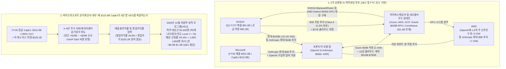
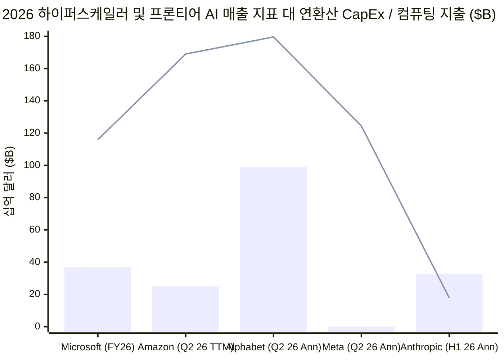
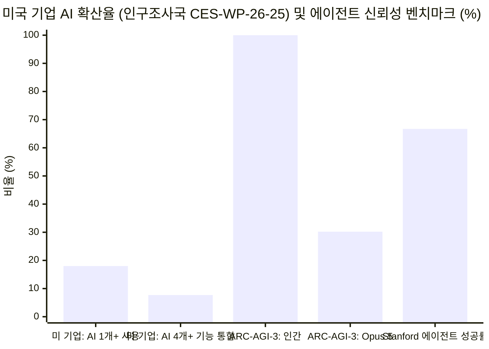

## 핵심 요약(Executive Summary): 6만 명 희망퇴직 분모의 통계적 착시와 순환형 AI 파이낸싱의 정곡 분리하기

2026년 10월 말, 마이크로소프트 최고인사책임자(CPO) **에이미 콜먼(Amy Coleman)**의 사내 메모에 대한 *블룸버그(Bloomberg)* 보도 직후, 금융 시장 분석 계정 **코베이시 레터(The Kobeissi Letter, `@KobeissiLetter`)**와 기업용 AI 컨설턴트 **브래드 그루(Brad Groux, `@BradGroux` — Digital Meld CEO이자 전 마이크로소프트 프리미어 필드 엔지니어)**는 마이크로소프트의 대규모 **자발적 퇴직 프로그램(Voluntary Exit Offer, `VEO`)**이 프론티어 인공지능(AI)의 경제성 붕괴를 입증하는지 여부를 두고 X(구 트위터)에서 거센 논쟁을 촉발했다:

> "속보: 블룸버그에 따르면 마이크로소프트($MSFT)가 AI 도입 속에서 비용 절감 노력의 일환으로 60,000명의 직원에게 희망퇴직(buyouts)을 제안하고 있다.
>
> 미국, 캐나다, 인도, 영국의 특정 팀 소속 부사장(VP)급 이하 인력이 대상이다..."
> — **The Kobeissi Letter** (`@KobeissiLetter`, 2026년 10월)

> "이건 탄광 속의 카나리아다, 여러분. AI의 경제성 계산이 전혀 맞아떨어지지 않는다(The AI math doesn't math). 마이크로소프트는 전체 인력의 거의 4분의 1에게 희망퇴직을 제안하고 있다.
>
> 기업의 AI 도입은 완벽한 시나리오에서도 24개월이 걸리는 여정이다. 이들은 설비투자(CapEx) 지출을 상쇄할 만큼 빠른 도입을 보지 못하고 있으며... 마이크로소프트만의 문제가 아니다. 여기에 (CapEx 대비) 앤트로픽(Anthropic)의 보잘것없는 매출 수치를 더해보면 핵심을 알 수 있을 것이다.
>
> 이번 희망퇴직은 마이크로소프트가 AI로 효율성을 달성했기 때문이 아니라, 그들(AI 업계)이 합쳐서 수조 달러를 들여 세계 역사상 최고의 도구를 만들었음에도 정작 아무도 그 도구를 어떻게 쓰는지 모르기 때문에 벌어지는 일이다.
> digitalmeld.io/blog/who-is-pa..."
> — **Brad Groux** (`@BradGroux`, Digital Meld의 리서치 보고서 [*Who Is Paying for the AI Boom?*](https://digitalmeld.io/blog/who-is-paying-for-the-ai-boom) 링크 첨부, 2026년 10월)

과연 마이크로소프트의 6만 명 대상 희망퇴직 제안은 **"AI의 계산이 틀렸다"**는 것과 마이크로소프트 및 앤트로픽이 인프라 지출 대비 **"보잘것없는 매출"**에 시달리고 있음을 증명하는가? M. 닐 브라운(M. Neil Browne)과 스튜어트 M. 킬리(Stuart M. Keeley)의 **"사금 채취(Panning for Gold)"** 비판적 사고 프레임워크를 적용하여 마이크로소프트의 [2026 회계연도 Form 10-K 및 4분기 실적 발표](https://www.microsoft.com/en-us/Investor/earnings/FY-2026-Q4/press-release-webcast), 앤트로픽의 2026년 Form S-1 증권신고서, [미국 인구조사국의 2026년 4월 AI 확산 연구(`CES-WP-26-25`)](https://www.census.gov/library/working-papers/2026/adrm/CES-WP-26-25.html), 그리고 브래드 그루 본인이 작성한 Digital Meld의 1차 사료 기반 백서([*Who Is Paying for the AI Boom?*](https://digitalmeld.io/blog/who-is-paying-for-the-ai-boom))를 교차 검증한 결과, 매우 뚜렷한 이중 구조가 드러난다. **그루의 바이럴 트윗은 자신이 직접 발표한 백서의 AI 매출 분석과 정면으로 모순되는 등 세 가지 치명적인 통계·회계적 오류를 범하고 있는 반면, 순환형 AI 벤더 파이낸싱, 마이크로소프트의 CapEx-감가상각 마진 압박, 그리고 기업 현장의 24개월 통합 병목 현상을 지적한 그의 본래 백서 연구는 정곡(Bullseye)을 찌르고 있다.**

| 바이럴 주장 및 연구 가설 | 포렌식 판정 | 인식론적 타당성 | 핵심 실증 및 통계 감사 |
| :--- | :--- | :--- | :--- |
| **1. "마이크로소프트가 전체 인력의 거의 4분의 1(`60,000` / `223,000` = `26.9%`)에게 희망퇴직을 제안하고 있다"** | **분모는 사실이나 추론은 오도됨** | **~35% 타당** *(적격 대상군 vs. 실제 신청률 오류)* | `60,000명`은 2026년 12월 초까지 자발적 퇴직을 신청할 수 있도록 허용된 **적격 대상군(`N_eligible`, 미·캐나다·영국·인도 특정 부서 Level 70 이하)**이지, `26.9%` 인력 감축 목표가 **아니다**. 대기업 자발적 퇴직 프로그램의 역사적 평균 신청률(`3%–8%`)을 적용하면 실제 퇴직 인원은 **`1,800명~4,800명`(전체 223,000명 중 `0.8%–2.15%`)** 수준이다. |
| **2. "CapEx를 상쇄할 만큼 빠른 도입이 일어나지 않고 있다... AI 효율성 때문이 아니라 비용 압박 때문인 희망퇴직이다"** | **부분적 동의** | **~65% 타당** *(CapEx의 감가상각 전환에 따른 마진 방어)* | 마이크로소프트의 AI 연간 매출 환산치(ARR)는 [FY26 3분기](https://www.microsoft.com/en-us/investor/earnings/fy-2026-q3/press-release-webcast) **`370억 달러+`(`+123% YoY`)**를 돌파했고 FY26 영업이익은 `20.8%` 증가한 **`1,552억 달러`(영업이익률 `46.8%`)**를 기록했다. 그러나 FY26 CapEx가 약 `80%` 폭증한 **`1,159억 달러`**(미개시 데이터센터 리스 약정 **`3,291억 달러`** 별도)에 달해 잉여현금흐름(FCF)이 **`670억 달러`(`-6.5% YoY`)**로 감소했다. 연간 `1,159억 달러`의 CapEx가 향후 **`연 +190억~290억 달러`의 GAAP 감가상각비(`D&A`)**로 전환됨에 따라, 마이크로소프트는 인적 운영비(`OpEx`)를 실리콘 감가상각비로 맞바꾸고 있다. |
| **3. "(CapEx 대비) 앤트로픽의 보잘것없는 매출 수치를 더해보면 핵심을 알 수 있다"** | **현재 현금흐름 기준 허위, 10년 약정 기준 타당** | **~30% 타당** *(상반기 `162.9억 달러` 매출 및 `650억 달러+` ARR 간과)* | 앤트로픽의 2026년 Form S-1에 따르면, 2026년 상반기(H1) 인식 매출은 전년 동기(`11.6억 달러`) 대비 **`14배` 폭증한 `162.9억 달러`**(2026년 7월 **`650억 달러+` ARR**, 3분기 단일 분기 매출 `168억 달러`)로 상반기 컴퓨팅 지출 **`89.5억 달러`**를 상회(`1.82배`)했으며 **2026년 2분기 GAAP 영업이익 `9.74억 달러` 흑자**를 달성했다. 진짜 리스크는 현재 매출 부진이 아니라 **`5,180억~7,800억 달러`에 달하는 10년 장기 멀티클라우드 고정 구매 약정**이다. |
| **4. Digital Meld 백서 가설: 프론티어 AI 수요는 6각 순환형 벤더 파이낸싱 루프로 부풀려져 있다** | **강력히 동의** | **~95% 타당** *(포렌식 정곡)* | SEC 공시 및 공식 발표로 입증됨: [마이크로소프트+엔비디아가 앤트로픽에 최대 `150억 달러`를 투자하는 동시에 앤트로픽은 애저(Azure)에 `300억 달러` 구매 약정](https://blogs.microsoft.com/blog/2025/11/18/microsoft-nvidia-and-anthropic-announce-strategic-partnerships/); [엔비디아-오픈AI `10 GW` / 최대 `1,000억 달러` LOI](https://nvidianews.nvidia.com/news/openai-and-nvidia-announce-strategic-partnership-to-deploy-10gw-of-nvidia-systems); [AMD-오픈AI `6 GW` 계약 및 AMD 주식 `1.6억 주` 신주인수권 부여](https://newsroom.amd.com/news/amd-and-openai-announce-strategic-partnership-to-d/); [AMD-앤트로픽 `2 GW` / 최대 `50억 달러` 투자](https://ir.amd.com/news-events/press-releases/detail/1292/amd-and-anthropic-announce-strategic-partnership-to-deploy-up-to-2-gigawatts-of-amd-instinct-mi450-series-gpus); 엔비디아의 코어위브(부채 `216억 달러`) 지분 `11.5%` 보유. |
| **5. "기업의 AI 도입은 완벽한 시나리오에서도 24개월이 걸리는 여정이다... 아무도 어떻게 쓰는지 모른다"** | **강력히 동의** | **~85% 타당** *("모델 주변의 작업" 병목 현상)* | [미국 인구조사국(`CES-WP-26-25`, 2026년 4월)](https://www.census.gov/library/working-papers/2026/adrm/CES-WP-26-25.html) 연구로 입증됨: 미국 기업의 **`18%`**(고용 가중 시 `32%`)만이 최소 1개 업무 기능에 AI를 사용 중이며, 도입 기업의 **`57%`는 3개 이하 기능에만 국한**되어 있다. 2주짜리 데모와 달리 ERP/재무/CRM 상용 통합은 `Entra ID` 권한 정리, 데이터 정합성, 결정론적 코드 통제, 들쭉날쭉한 에이전트 신뢰성([ARC-AGI-3](https://arcprize.org/results/anthropic-claude-opus-5) `30.2%`) 때문에 `18–24개월+`이 소요된다. |
| **6. Digital Meld 백서 가설: 전력망 연계 대기(중위 `5년`)와 반도체 공급망 병목이 단기 AGI 확산을 제약한다** | **강력히 동의** | **~90% 타당** | [미 에너지부(DOE, `2024`)](https://www.energy.gov/articles/doe-releases-new-report-evaluating-increase-electricity-demand-data-centers)는 미국 데이터센터 전력 소비가 `176 TWh`에서 2028년 `325–580 TWh`(미국 전체 전력의 `6.7%–12%`)로 급증할 것으로 전망하나, LBNL *Queued Up* 연구는 전력망 연계에 **중위 `5년`(완공률 `14%`)**이 걸림을 입증했고 [보글(Vogtle) 원전 3·4호기(`EIA`)](https://www.eia.gov/todayinenergy/detail.php?id=61963)는 `11년`과 `300억 달러+`가 소요되었다. |

---

## Phase 1 & 2: 쟁점 분류, 1차 사료 발굴, 그리고 "트윗 대 백서(Tweet vs. Whitepaper)"의 분열 매트릭스

### 1.1 핵심 질문의 분류
브라운과 킬리 프레임워크 제2장에 따라, 바이럴 주장과 Digital Meld 리서치 백서를 네 가지 반증 가능한 질문으로 분해한다:
1. **기술적 질문 1 (기업 인사 및 구조조정 메커니즘):** *마이크로소프트가 2026년 10월 6만 명의 적격 직원에게 제안한 자발적 퇴직 프로그램(`VEO`)은 실제로 전체 인력의 27%를 감축하려는 시도인가, 그리고 왜 데이터센터 운영 및 영업 조직은 제외하면서 코파일럿(Copilot)과 코어AI(CoreAI) 조직은 포함시켰는가?*
2. **기술적 질문 2 (하이퍼스케일러 및 프론티어 랩 회계):** *마이크로소프트의 FY26 재무제표(매출 `3,318억 달러`, CapEx `1,159억 달러`, AI ARR `370억 달러+`)와 앤트로픽의 2026년 Form S-1(상반기 매출 `162.9억 달러`, 상반기 컴퓨팅 비용 `89.5억 달러`, 장기 약정 `5,180억 달러+`)은 현재의 매출 부재를 보여주는가, 아니면 장기 영업 레버리지 및 감가상각 마진 압박을 보여주는가?*
3. **기술적 질문 3 (생태계 자금조달 구조):** *엔비디아, AMD, 마이크로소프트, 아마존, 오픈AI, 앤트로픽, 오라클, 코어위브 간의 순환형 벤더 파이낸싱은 프론티어 AI 매출과 잔여이행의무(`RPO`) 수주잔고를 어느 정도까지 증폭시키고 있는가?*
4. **기술적/규범적 질문 4 (기업 확산 속도 및 물리적 제약):** *벤치마크 성능의 급격한 향상에도 불구하고 왜 지속 가능한 기업 AI 운영 전환에는 18~24개월 이상이 소요되며, 기업들은 오늘날 AI 투자를 어떻게 설계해야 하는가?*

### 1.2 "트윗 대 백서(Tweet vs. Whitepaper)" 주장 분열 매트릭스
포렌식 심층 조사의 Phase 2에서는 저자의 소셜 미디어 홍보 문구가 해당 게시물에 링크된 1차 원문 문서와 일치하는지 반드시 대조한다. 브래드 그루의 2026년 10월 X 게시물을 그 자신이 2026년 8월 18일 발표한 Digital Meld 백서([*Who Is Paying for the AI Boom?*](https://digitalmeld.io/blog/who-is-paying-for-the-ai-boom)) 및 SEC 1차 공시와 비교하면 교과서적인 **소셜 미디어 대 백서의 자기모순(Schism)**이 드러난다:

| 분석 차원 | 브래드 그루의 바이럴 X 게시물 (`@BradGroux`, 2026년 10월) | 브래드 그루 본인이 링크한 Digital Meld 백서 ([*Who Is Paying for the AI Boom?*, 2026년 8월 18일](https://digitalmeld.io/blog/who-is-paying-for-the-ai-boom)) 및 SEC 1차 공시 |
| :--- | :--- | :--- |
| **빅테크 및 AI 공급자의 매출 규모** | *"AI 계산이 맞지 않는다... CapEx 지출을 상쇄할 만큼 빠른 도입이 없다... (CapEx 대비) 앤트로픽의 보잘것없는 매출 수치를 더해보면 핵심을 알 수 있다."* | **백서 내 "AI 매출은 성장 중이다. 수익률은 여전히 흐릿하다" 섹션의 직접적 자기 반박:** *"공급자들이 AI에 수천억 달러를 쓰면서 보여줄 매출은 거의 없다고 단순화하고 싶을 수 있다. **그러나 현재 공시 자료들은 그러한 주장을 뒷받침하지 않는다.** 엔비디아는 실제 매출을 올리고 있다. 마이크로소프트와 아마존은 이제 거대한 AI 연간 매출 환산치(ARR)를 보고하고 있다... **이러한 실적이 존재하지 않는 척하는 것은 우리가 비판하는 실수(결론을 먼저 정해놓고 숫자를 맞추는 것)를 그대로 반복하는 셈이다.**"* |
| **마이크로소프트의 AI 및 클라우드 성장률** | 마이크로소프트의 AI 도구가 CapEx를 상쇄할 실질적 매출을 창출하지 못해 전사 인력의 거의 4분의 1에 달하는 긴급 희망퇴직에 내몰린 것처럼 묘사함. | [마이크로소프트 FY26 3분기 실적](https://www.microsoft.com/en-us/investor/earnings/fy-2026-q3/press-release-webcast) 및 [FY26 연간 실적](https://www.microsoft.com/en-us/Investor/earnings/FY-2026-Q4/press-release-webcast)을 명시적으로 인용함: *"마이크로소프트의 AI 사업은 2026 회계연도 3분기에 **연간 매출 환산치(ARR) 370억 달러를 돌파하여 전년 대비 123% 성장**했다. 애저(Azure) 및 기타 클라우드 서비스 매출은 4분기에 **43% 성장**했다."* |
| **앤트로픽의 매출 대 컴퓨팅 지출** | *"(CapEx 대비) 앤트로픽의 보잘것없는 매출 수치(measly revenue numbers)"*라고 일축함. | 앤트로픽의 2026년 SEC Form S-1 증권신고서(`티커: ANT`)에 따르면, 앤트로픽은 **2026년 상반기(6개월)에만 `162.9억 달러`의 인식 매출**(2025년 상반기 `11.6억 달러` 대비 `14배` 급증)을 달성했고 2026년 7월 **`650억 달러+` ARR**을 돌파했으며, 상반기 컴퓨팅 지출(`89.5억 달러`)을 훌쩍 넘어 **2026년 2분기 GAAP 영업이익 `9.74억 달러` 흑자**를 기록했다. |
| **현재 AI 도구의 실용성** | *"AI 업계가 합쳐서 수조 달러를 들여 역사상 최고의 도구를 만들었지만 **아무도 그것을 어떻게 쓰는지 모른다**."* | **백서 초록 및 운영 섹션의 정교한 뉘앙스:** *"인공지능은 **이미 범위가 명확한 비즈니스 워크플로우에서 측정 가능한 가치를 창출하고 있다**... 유용한 AI는 이미 여기에 있다. 핵심 과제는 그 역량을 사람들이 신뢰하고 지원하며 개선할 수 있는 통제된 워크플로우로 전환하는 것이다."* |

> [!IMPORTANT]
> **이 분열이 인식론적으로 중요한 이유:**
> 독자가 그루의 110단어짜리 트윗만 읽으면 전형적인 "AI 무용론 및 빅테크 붕괴론"처럼 들린다. 반면 그가 링크한 4,500단어 분량의 Digital Meld 백서를 정독하면, 2026년에 발표된 보고서 중 순환형 AI 파이낸싱과 기업 현장의 워크플로우 마찰을 1차 공시 사료로 가장 치밀하게 분석한 수작임을 알 수 있다. 우리의 과제는 트윗의 수사적 과장은 걷어내고 백서의 구조적 통찰을 구출해 수리적으로 확장하는 것이다.

### 1.3 1차 재무 스코어카드: 2026년 SEC 공시가 실제로 보고하는 숫자들
Level-1 1차 사료에 기반하여 FY26/2026년 SEC 공시 및 실적 발표에서 추출한 기업별 핵심 재무 원장은 다음과 같다:

| 기업 및 1차 공시 출처 | 최신 보고된 AI / 클라우드 매출 지표 | 설비투자(`CapEx`) 및 인프라 약정 의무 | 현금흐름, 수익성 및 핵심 공시 내역 |
| :--- | :--- | :--- | :--- |
| **Microsoft** ([FY26 10-K 및 Q4 FY26 실적](https://www.microsoft.com/en-us/Investor/earnings/FY-2026-Q4/press-release-webcast), [Q3 FY26 실적](https://www.microsoft.com/en-us/investor/earnings/fy-2026-q3/press-release-webcast)) | FY26 총매출: **`3,318억 달러`** (`+17.8% YoY`). AI 사업 런레이트: **`370억 달러+` ARR** (Q3 FY26 `+123% YoY`). Q4 FY26 애저 및 클라우드 성장률: **`+43% YoY`**. | FY26 유형자산 취득(`CapEx`): **`1,159억 달러`** (`+80% YoY`). 미개시 데이터센터 리스 약정: **`3,291억 달러`** (2026년 6월 30일 기준). | 영업이익: **`1,552억 달러`** (영업이익률 `46.8%`, `+20.8% YoY`). 영업현금흐름: **`1,829억 달러`**. 잉여현금흐름(FCF): **`670억 달러`** (FY25 `716억 달러` 대비 `-6.5% YoY`). 총 임직원 수: **`223,000명`** (FY25 `228,000명` 대비 `-2.2%`). |
| **Anthropic** (*2026 Form S-1 증권신고서*, [MSFT/NVDA 2025년 11월 발표](https://blogs.microsoft.com/blog/2025/11/18/microsoft-nvidia-and-anthropic-announce-strategic-partnerships/)) | 2025년 연간 매출: **`~46억 달러`** (연말 ARR `~90억 달러`). 2026년 상반기(H1) 매출: **`162.9억 달러`** (Q1 `47.3억 달러` + Q2 `115.6억 달러`, H1 2025 `11.6억 달러` 대비 `14배`). 2026년 7월 ARR: **`650억 달러+`** (Q3 2026 매출 `~168억 달러`). | 2025년 컴퓨팅 지출: **`73억 달러`**. 2026년 상반기 컴퓨팅 지출: **`89.5억 달러`** (컴퓨팅 `1달러`당 매출 `1.82달러`). 10년 멀티클라우드 및 칩 구매 약정: **`5,180억~7,800억 달러`** (애저 `300억 달러`, AWS, GCP, 브로드컴, AMD `2 GW` 포함). | 2026년 2분기 GAAP 영업이익: **`+9.74억 달러` 흑자**. 2026년 상반기 GAAP 순손실: **`-807억 달러`** (이 중 **`724억 달러`는 전환사채/SAFE 공정가치 평가손실 등 비현금 회계비용**). 현금 및 단기투자자산: **`1,317억 달러`**. |
| **NVIDIA** ([Q1 FY27 실적, 2026년 5월 20일](https://nvidianews.nvidia.com/news/nvidia-announces-financial-results-for-first-quarter-fiscal-2027); FY26 10-K 및 Q1 FY27 10-Q) | Q1 FY27 총매출: **`816억 달러`** (`+85% YoY`). Q1 FY27 데이터센터 매출: **`752억 달러`** (`+92% YoY`). | 제조/공급 약정: **`952억 달러`**. 다년 클라우드 서비스 약정: **`270억 달러`**. 생태계 지분 투자 약정: **`270억 달러`** (2026년 4월 26일 기준, 1월 `114억 달러`에서 급증). | 막대한 하드웨어 현금 마진(매출총이익률 `>75%`)을 창출하나, 그 자본을 고객사(`OpenAI`, `Anthropic`, `CoreWeave`)에 재투자하는 비중이 급증함. |
| **Amazon** (*Q2 2026 실적, 2026년 7월 30일*) | AWS Q2 2026 매출: **`422억 달러`** (`+37% YoY`). AWS AI 사업 런레이트: **`250억 달러+` ARR** (세 자릿수 YoY 성장). | 최근 12개월(`TTM`) 유형자산 취득(`CapEx`): **`1,690억 달러`** (주로 AI 인프라 투자 주도). | `1,690억 달러` CapEx로 인해 TTM 잉여현금흐름이 **`-76억 달러` 적자**로 전환됨. 앤트로픽 지분 평가이익으로 **`534억 달러`의 영업외 세전이익** 계상. |
| **Alphabet** (*Q2 2026 Form 10-Q, 2026년 7월 23일*) | Q2 2026 구글 클라우드 매출: **`248억 달러`** (`+82% YoY`, AI 인프라·플랫폼 및 TPU 판매 주도). | Q2 2026 단일 분기 `CapEx`: **`449억 달러`** (연환산 `~1,800억 달러` 속도). | 생성형 AI 단독 매출이나 마진을 클라우드 및 TPU 시스템 판매에서 분리 공시하지 않음. |
| **Meta** (*Q2 2026 Form 10-Q, 2026년 7월 30일*) | Q2 2026 총매출: **`608억 달러`** (`+28% YoY`, 거의 전액 광고 매출). | Q2 2026 단일 분기 `CapEx`: **`311억 달러`** (연환산 `~1,244억 달러` 속도). | AI가 광고 타겟팅과 추천을 개선했다고 설명하나 별도의 직접적 AI 소프트웨어 매출 라인은 없음. |
| **Oracle & CoreWeave** (*Oracle FY26 실적, 2026년 6월; CoreWeave FY25 10-K, 2026년 2월*) | 오라클 FY26 잔여이행의무(`RPO`): **`6,380억 달러`**. 코어위브: 2030년까지 **`5 GW+`** 엔비디아 인프라 구축 계획. | 오라클은 FY26에 **부채 `430억 달러` + 주식 `50억 달러`** 조달, FY27에 **`~400억 달러` 추가 조달** 계획(고객 선지급/제공 GPU **`750억 달러`** 별도). 코어위브 총부채: **`216억 달러`**. | 소수의 프론티어 모델 랩 임차인이 클라우드 소비를 줄일 경우 높은 레버리지와 거래상대방 집중 리스크에 노출됨. |

---

## Phase 3: 의미론적 정밀성 및 대체 테스트(Substitution Test)

브라운과 킬리 방법론 제4장에 따라, 바이럴 내러티브를 추동하는 세 가지 모호한 표현—**"6만 명에게 희망퇴직 제안"**, **"CapEx 대비 보잘것없는 매출"**, 그리고 **"AI 매출"**—을 분리하여 **대체 테스트(Substitution Test)**를 수행한다.

### 3.1 대체 테스트 1: "60,000명의 근로자에게 희망퇴직 제안"
`@KobeissiLetter`가 *"마이크로소프트가 60,000명의 근로자에게 희망퇴직을 제안하고 있다"*고 쓰고 `@BradGroux`가 이를 *"전체 인력의 거의 4분의 1에 대한 희망퇴직"*으로 번역할 때, **"60,000명에게 희망퇴직 제안"**이라는 문구는 두 가지 전혀 다른 운영적 의미를 갖는다:
* **정의 A — 목표 인력 감축 규모 (`ΔL = 60,000명`):** 마이크로소프트가 희망퇴직을 통해 60,000개의 일자리(전체 223,000명 중 `26.9%`)를 없애려 한다는 의미.
  * *그루의 논증에 대입할 경우:* 세계 최대 엔터프라이즈 소프트웨어 기업이 인력의 `27%`를 줄인다면 실제로 전례 없는 경영 비상사태("탄광 속의 카나리아")가 맞다. **그러나 정의 A는 사실이 아니다.**
* **정의 B — 자발적 퇴직 신청 적격 대상군 (`N_eligible = 60,000명`):** 마이크로소프트가 4개 국가(**미국, 캐나다, 영국, 인도**)의 참여 사업부(**Windows + Devices, Xbox, Copilot, CoreAI, 재무, 인사**) 소속 **사내 직급 Level 70 이하**(일반 사원부터 파트너/제너럴 매니저/일부 VP 직함 보유자까지 포함하되, 기업부사장[CVP] 및 C-레벨 임원 제외) 직원들에게 2026년 12월 초까지 표준 퇴직 패키지(`2026년 12월 31일` 퇴사)를 *신청할 수 있는 자격*을 부여했다는 의미.
  * *그루의 논증에 대입할 경우:* 비강제적 자발적 퇴직 프로그램(`VEO`)을 60,000명의 적격 대상군에게 열어줄 때 대기업의 역사적 평균 신청률(`τ_takeup`)은 **`3%~8%`**, 즉 실제 퇴사자는 **`1,800명~4,800명`(마이크로소프트 글로벌 인력의 `0.8%~2.15%`)**에 불과하다. 이는 마이크로소프트가 FY26 한 해 동안 줄인 순인력 감소분 `5,000명`(`228,000명`에서 `223,000명`으로 `-2.2%` 감소)과 거의 동일한 일상적 인력 재배치 규모다!

### 3.2 대체 테스트 2: "AI 매출"과 "CapEx" (기간 현금흐름 대 장기 약정 회계)
AI 낙관론자와 비관론자 모두 다섯 가지 서로 다른 회계 지표를 습관적으로 뒤섞는다:
1. **인식된 GAAP 매출 (`R_GAAP`):** 해당 기간에 실제로 제공되고 청구되어 감사받은 매출 (예: 앤트로픽의 2026년 상반기 `162.9억 달러`; 엔비디아의 Q1 FY27 `816억 달러`).
2. **연간 매출 환산치 (`ARR`):** 단일 분기 또는 단일 월의 AI 관련 매출에 4 또는 12를 곱한 수치 (예: 마이크로소프트의 Q3 FY26 AI 런레이트 `370억 달러+`; AWS의 Q2 2026 AI 런레이트 `250억 달러+`; 앤트로픽의 2026년 7월 `650억 달러+` ARR).
3. **잔여이행의무 (`RPO`) 및 다년 구매 약정:** 향후 5~10년에 걸쳐 클라우드 컴퓨팅을 구매하거나 공급하겠다는 다년 계약상 약속 (예: 오라클의 `6,380억 달러` RPO; 앤트로픽의 `5,180억~7,800억 달러` 10년 컴퓨팅 약정; 마이크로소프트의 `3,291억 달러` 미개시 데이터센터 리스).
4. **당기 현금 설비투자 (`CapEx_cash`):** 당해 연도에 유형자산 취득을 위해 실제로 지출한 현금 (예: 마이크로소프트의 FY26 `1,159억 달러`; 아마존의 TTM `1,690억 달러`).
5. **공급자 금융 / 순환형 수요 (`R_circular`):** 매출을 기록하는 바로 그 공급자가 제공한 지분 투자금, 신주인수권(Warrant), 또는 선지급금으로 직간접적으로 자금이 조달된 클라우드 및 칩 구매액.

---

## Phase 4: 인과관계 분리 및 4대 경쟁 가설 감사(4-Way Causal Audit)

왜 마이크로소프트는 2026년 10월 60,000명의 적격 대상군에게 자발적 퇴직 프로그램(`VEO`)을 시행했으며, 왜 **데이터센터 운영, 보안, 마케팅, 엔터프라이즈 영업** 조직은 **제외**하면서 **Copilot, CoreAI, Windows + Devices, Xbox, 재무, 인사** 조직은 **포함**시켰는가?

브라운과 킬리 프레임워크 제9장에 따라 네 가지 경쟁 인과 가설을 검증한다:

| 인과 가설 | 작동 메커니즘 경로 | 1차 실증 증거 및 대상 사업부 단서 | 설명 가중치 |
| :--- | :--- | :--- | :--- |
| **1. 직접적 AI 수요 실패 가설** *(브래드 그루의 트윗 가설: `X → Y`)* | 기업 고객들이 마이크로소프트의 AI 제품을 충분히 빠르게 도입하지 않아 좌초된 CapEx 부담을 이기지 못하고 긴급 인력 감축에 나섰다. | **낮음~중간 (`~20%`).** 기업용 M365 코파일럿 시트 전환이 18~24개월의 운영 통합 지연을 겪고 있는 것은 사실이나, 마이크로소프트의 AI 매출 런레이트는 **`+123% YoY` 급증한 `370억 달러+`**에 달하며 애저는 Q4 FY26에 **`+43% YoY`** 성장했다. 결정적으로 AI 수요가 붕괴 중이라면 연간 `1,159억 달러`의 CapEx를 집행하면서 **데이터센터 운영 및 엔터프라이즈 영업 조직을 희망퇴직에서 제외**할 이유가 없다! | **부차적 (`20%`)** |
| **2. CapEx의 감가상각 전환에 따른 마진 스왑** *(인적 `OpEx`를 실리콘 `D&A`로 대체)* | 막대한 AI 인프라 지출(`1,159억 달러` FY26 CapEx + `3,291억 달러` 리스)이 FY27~FY29에 걸쳐 매년 수백억 달러의 GAAP 감가상각비(`D&A`)로 손익계산서에 유입된다. `46.8%`의 영업이익률을 방어하기 위해 비(非)인프라 인건비 `OpEx`를 선제적으로 줄여야 한다. | **지배적 (`~45%`).** FY26에 마이크로소프트의 영업현금흐름은 `1,829억 달러`로 증가했으나 `1,159억 달러`의 CapEx 청구서로 인해 잉여현금흐름은 `670억 달러`(`-6.5%`)로 감소했다. GAAP 회계상 현금 CapEx는 즉각 비용 처리되지 않고 데이터센터 가동과 함께 4~6년에 걸쳐 **감가상각비(`D&A`)**로 인식된다. 중간 관리자 급여를 줄이면 다가오는 서버 감가상각비를 영업이익 라인에서 1대1로 상쇄할 수 있다. | **지배적 (`45%`)** |
| **3. 제로금리(ZIRP) 이후 중간관리직 계층 축소 및 중복 조직 통폐합** *(제3변인 `Z`)* | Windows, Xbox(액티비전 블리자드 인수 후 통합), 재무, 인사 및 중복된 Copilot/CoreAI 제품 팀의 `Level ≤ 70` 인력을 대상으로 관료주의 계층을 줄이고 대량 해고 예고법(WARN Act) 및 강제 저성과자 퇴출(PIP) 마찰을 회피한다. | **상당함 (`~20%`).** 왜 **Copilot**과 **CoreAI**가 VEO 대상에 포함되었는가? 2023~2025년 사이 마이크로소프트는 Windows, Office, Dynamics, Consumer 전반에 수십 개의 파편화된 "코파일럿" 래퍼 팀을 난립시켰다가, 이후 제이 파리크(Jay Parikh) 산하 **CoreAI** 부문으로 개발자 인프라를 통합하고 오픈AI 외에 **클로드(Claude)**([2025년 11월 발표](https://blogs.microsoft.com/blog/2025/11/18/microsoft-nvidia-and-anthropic-announce-strategic-partnerships/))를 교차 채택했기 때문이다. 자발적 희망퇴직은 중복된 프로덕트 매니저들이 12월 31일까지 잡음 없이 스스로 퇴사하게 만든다. | **상당함 (`20%`)** |
| **4. 사내 AI 코딩 및 백오피스 자동화에 따른 인력 대체** *(역인과 / 상호 피드백)* | 소프트웨어 유지보수, 재무, 인사 영역에서 사내 AI 코딩 도구와 자동화가 레거시 소프트웨어 산출물 단위당 필요 인력을 줄였다. | **중간 (`~15%`).** 마이크로소프트는 FY26에 전체 인력을 `5,000명`(`-2.2%`, `223,000명`으로) 줄이면서도 총매출을 `+17.8%` 늘려 `3,318억 달러`를 달성했다(**1인당 매출 `148.8만 달러`**). 재무, 인사, Windows, Xbox 부문의 희망퇴직 제안은 반복적 유지보수 및 행정 인력의 한계 필요성이 낮아졌음을 반영한다. | **중간 (`15%`)** |

---

## Phase 5: 계량 및 통계적 무결성 감사(Quantitative & Statistical Integrity Audit)

Phase 5(브라운과 킬리 제10장)에서는 바이럴 트윗과 Digital Meld 보고서의 정량적 주장을 공식 수리 유도식과 기저 분모(Baseline Denominator) 검증으로 해부한다.

### 5.1 VEO 신청률(Take-Up Rate) 및 실제 인력 감축 방정식
총 임직원 수 `N_total = 223,000명`인 기업이 `N_eligible = 60,000명`의 적격 대상군(미·캐나다·영국·인도 참여 부서 `Level ≤ 70`)에게 근속연수 기반 표준 퇴직금을 지급하는 비강제적 자발적 퇴직 프로그램(`VEO`)을 제안할 때, 실제 인력 감축 규모 `ΔL_VEO`와 연간 총 인건비 절감액 `ΔOpEx_labor`는 자발적 신청률 `τ_takeup` 및 퇴사 인력의 1인당 총보상비용 `w_loaded`에 의해 결정된다:

$$\Delta L_{\text{VEO}} = \tau_{\text{takeup}} \cdot N_{\text{eligible}}, \qquad \Delta \text{OpEx}_{\text{labor, annual}} = \Delta L_{\text{VEO}} \cdot w_{\text{loaded}} \cdot (1 - \rho_{\text{backfill}})$$

여기서 `ρ_backfill ∈ [0, 0.3]`은 공석 중 저비용 지역이나 핵심 AI 엔지니어링 직무로 추후 충원되는 비율이며, `w_loaded ≈ $280,000–$350,000`는 마이크로소프트의 미국/캐나다/영국/인도 `Level ≤ 70` 집단의 평균 총보상비용(기본급 + 상여금 + 연간 주식보상비용[SBC] + 복리후생비)이다. 세 가지 신청률 구간을 계산하면 다음과 같다:
* **낮은 신청률 (`τ_takeup = 3%`):** `ΔL_VEO = 1,800명` 퇴사 (글로벌 인력의 `0.81%`) → 연간 총 인건비 **`~$4.5억–$6.3억 달러`** 절감.
* **기본 시나리오 신청률 (`τ_takeup = 5%–6%`):** `ΔL_VEO = 3,000–3,600명` 퇴사 (글로벌 인력의 `1.35%–1.61%`) → 연간 총 인건비 **`~$8.4억–$12.6억 달러`** 절감 (FY27 2분기 일회성 퇴직급여 비용 `~$4억–$6.5억 달러` 반영 후).
* **높은 신청률 (`τ_takeup = 10%`):** `ΔL_VEO = 6,000명` 퇴사 (글로벌 인력의 `2.69%`) → 연간 총 인건비 **`~$15억–$21억 달러`** 절감.

어떠한 현실적 시나리오에서도 실제 인력 감축 규모는 **`1%~2.7%`** 수준이지, **`25%`("전체 인력의 거의 4분의 1")가 아니다**.

### 5.2 CapEx-감가상각 마진 압박 방정식(CapEx-to-Depreciation Margin Squeeze)
매출 `3,318억 달러`(`+17.8% YoY`)와 영업이익 `1,552억 달러`(영업이익률 `46.8%`)를 창출하는 초우량 기업이 왜 연간 `10억~20억 달러`의 중간직급 인건비 `OpEx`를 줄이는 데 그토록 집착하는가? 마이크로소프트의 현금 설비투자 `CapEx_t`, 미개시 리스 약정 `L_uncommenced = $329.1B`, 그리고 GAAP 영업이익률 `m_op,t = OpInc_t / R_t` 간의 회계 방정식을 보자:

$$\Delta \text{D\&A}_{t+1} = \frac{\alpha_{\text{server}} \cdot \text{CapEx}_t}{\tau_{\text{GPU}}} + \frac{(1 - \alpha_{\text{server}}) \cdot \text{CapEx}_t}{\tau_{\text{shell}}} + \Delta \text{Lease Amortization}_{t+1}$$

여기서:
* `CapEx_FY26 = 1,159억 달러` (FY25 약 `645억 달러`에서 단 1년 만에 `+514억 달러` 폭증).
* `α_server ≈ 0.60–0.65`는 내용연수 `τ_GPU ≈ 4–6년`으로 감가상각되는 단기 서버, GPU, 네트워크 장비 비중이며, `(1 - α_server) ≈ 0.35–0.40`는 `τ_shell ≈ 15–25년`으로 상각되는 장기 데이터센터 건물/설비 비중이다.

`CapEx_FY26 = 1,159억 달러`를 대입하면, 단일 회계연도의 CapEx 빈티지 하나만으로도 데이터센터 가동 시 **매년 `145억 달러에서 206억 달러`의 신규 GAAP 감가상각비**가 추가된다! 기업 고객의 AI 소프트웨어 매출 인식이 데이터센터 가동보다 12~24개월 지연될 때(마이크로소프트가 FY26 Form 10-K 위험요인에서 명시적으로 경고한 리스크) GAAP 영업이익률 `m_op`의 하락을 막으려면 다음의 마진 중립성 부등식을 만족해야 한다:

$$\Delta R_{\text{AI}, t+1} \cdot m_{\text{gross, AI}} - \Delta \text{OpEx}_{\text{labor}, t+1} \ge \Delta \text{D\&A}_{t+1}$$

단기 고마진 AI 소프트웨어 매출 증가분보다 `ΔD&A_t+1`가 더 빠르게 상승하는 구간에서는 필연적으로 **`ΔOpEx_labor,t+1`를 음수(-)로 만들어야**(조직 계층 축소 및 자발적 희망퇴직) 마진이 유지된다.

### 5.3 앤트로픽 S-1 해부 및 순환형 매출 승수(Circular Revenue Multiplier)
이제 *"앤트로픽의 (CapEx 대비) 보잘것없는 매출 수치"*라는 브래드 그루의 주장을 Digital Meld의 순환형 벤더 파이낸싱 분석과 함께 검증해보자.

먼저 앤트로픽의 2026년 Form S-1 증권신고서에 기재된 실제 수치를 확인하자:
* **2026년 상반기(H1) 인식 매출:** **`162.9억 달러`** (Q1 `47.3억 달러` + Q2 `115.6억 달러`; 2025년 상반기 `11.6억 달러` 대비 `14배`, 2025년 연간 `46억 달러` 대비 3.5배 이상), 2026년 7월 기준 **`650억 달러+` ARR** 돌파.
* **2026년 상반기(H1) 컴퓨팅 및 인프라 비용:** **`89.5억 달러`** (2025년 연간은 `73억 달러`).
* **당기 컴퓨팅 효율성 비율 (`H1 2026`):**

$$\eta_{\text{compute, H1 2026}} = \frac{R_{\text{Anthropic, H1 2026}}}{C_{\text{compute, H1 2026}}} = \frac{\text{USD } 16.29\text{ billion}}{\text{USD } 8.95\text{ billion}} = 1.82\times \quad (\text{2026년 2분기 GAAP 영업이익} = +\text{USD } 974\text{ million})$$

그렇다면 왜 시장 논평가들은 앤트로픽의 재무제표를 두고 "CapEx 대비 매출이 보잘것없다"거나 막대한 적자를 내고 있다고 착각했을까? S-1 공시의 두 가지 회계적 특성 때문이다:
1. **`724억 달러` 비현금 기업가치 평가손실 착시:** 앤트로픽은 2026년 상반기 표면적 GAAP 순손실로 **`-807억 달러`**를 보고했으나, **그 손실의 `89.7%`인 `724억 달러`는 IPO를 앞두고 앤트로픽의 기업가치가 폭등함에 따라 전환사채(Convertible Notes), SAFE, 파생상품 부채를 공정가치로 재평가하면서 발생한 비현금 회계 비용**이었다!
2. **`5,180억~7,800억 달러` 규모의 10년 장기 의무구매 약정(Take-or-Pay Overhang):** 2035년까지 프론티어 클러스터 용량을 확보하기 위해 앤트로픽은 AWS, 구글 클라우드, 마이크로소프트 애저(2025년 11월 발표된 `300억 달러` 약정), 브로드컴, AMD(2026년 7월 발표된 `2 GW` 약정) 등에 걸쳐 총 **`5,180억 달러에서 7,800억 달러`**에 달하는 다년 클라우드 및 칩 구매 약정을 체결했다.

바로 이 지점이 Digital Meld가 규명한 **순환형 AI 파이낸싱 루프(Circular AI Financing Loop)**와 직결된다. 하드웨어 공급자(`NVIDIA` 또는 `AMD`)와 클라우드 하이퍼스케일러(`Microsoft` 또는 `Amazon`)가 프론티어 모델 랩(`Anthropic` 또는 `OpenAI`)에 현금 `I_vendor`를 투자하고, 모델 랩이 계약에 따라 그 자본의 `β_cloud ∈ [0.7, 1.0]` 비율을 해당 하이퍼스케일러의 클라우드 컴퓨팅 구매에 사용하며, 하이퍼스케일러가 다시 그 금액의 `β_GPU ∈ [0.5, 0.7]` 비율로 하드웨어 공급자의 GPU를 구매할 때, 벤더가 투입한 자본 1달러는 생태계 전체에서 다음과 같은 **총 보고 거래량 승수(`M_circular`)**를 창출한다:

$$M_{\text{circular}} = \frac{\Delta \text{Valuation/Investment} + \Delta \text{Cloud RPO/Revenue} + \Delta \text{GPU Revenue}}{I_{\text{vendor}}} = 1 + \beta_{\text{cloud}} + \beta_{\text{cloud}} \cdot \beta_{\text{GPU}} \approx 2.2\times \text{ to } 2.7\times$$

Digital Meld가 인용한 [2025년 11월 18일 마이크로소프트-엔비디아-앤트로픽 전략적 파트너십](https://blogs.microsoft.com/blog/2025/11/18/microsoft-nvidia-and-anthropic-announce-strategic-partnerships/)을 보라. 엔비디아가 최대 `100억 달러`, 마이크로소프트가 최대 `50억 달러`(총 `150억 달러`)를 앤트로픽에 투자하는 동시에, 앤트로픽은 엔비디아 시스템 기반의 **마이크로소프트 애저 컴퓨팅 용량을 `300억 달러`(`1 GW`) 구매**하기로 약정했다. 외부의 독립적인 일반 기업 고객이 API 토큰을 단 1달러도 구매하기 전에, 이 삼각 계약 하나로만 `150억 달러`의 프론티어 랩 자금조달, `300억 달러`의 마이크로소프트 애저 상업 수주잔고(RPO), 그리고 수백억 달러의 엔비디아 데이터센터 수요가 동시에 장부에 기록되는 것이다!

*(차트 주석: 막대[Bar]는 마이크로소프트[`370억 달러`]와 AWS[`250억 달러`]의 공시된 AI 연간 매출 환산치[ARR], 알파벳의 연환산 구글 클라우드 총매출[`992억 달러` = 4 × `248억 달러`, AI 단독 매출 비공개], 메타의 단독 공시 AI 소프트웨어 매출[`0달러`, 분기 `608억 달러` 광고 매출과 미분리], 그리고 앤트로픽의 2026년 상반기 연환산 인식 매출[`326억 달러` = 2 × `162.9억 달러`, 이후 7월 ARR `650억 달러+` 돌파]을 나타낸다. 꺾은선[Line]은 연간/연환산 설비투자 또는 컴퓨팅 비용을 나타낸다: 마이크로소프트 `1,159억 달러`, 아마존 TTM `1,690억 달러`, 알파벳 연환산 `1,796억 달러`[4 × `449억 달러`], 메타 연환산 `1,244억 달러`[4 × `311억 달러`], 앤트로픽 상반기 연환산 컴퓨팅 비용 `179억 달러`[2 × `89.5억 달러`].)*

---

## Phase 6: "부정적 시각(The Negative View)" 및 누락된 정보 심문

왜 브래드 그루는 *"기업의 AI 도입은 완벽한 시나리오에서도 24개월이 걸리는 여정"*이라고 단언하는가—그리고 초고속 CapEx 집행과 느린 기업 현장 운영 사이의 시차로 인한 숨겨진 비용은 누가 떠안는가?

### 6.1 기업 AI 도입의 24개월 운영 병목 (왜 "모델 주변의 작업"이 성패를 결정하는가)
X 게시물과 Digital Meld 백서 모두에서, 중견 산업·엔지니어링 기업들을 대상으로 Microsoft 365, Azure, Entra ID, OpenAI 시스템을 직접 통합해 온 그루는 AI 경제의 핵심 병목을 정확히 짚어낸다. **프론티어 랩은 3개월 주기로 모델을 출시하고, 전력망은 60개월 주기로 발전소를 지으며, 일반 기업은 24개월 주기로 비즈니스 워크플로우를 재설계한다.**

[미국 인구조사국의 2026년 4월 워킹페이퍼(*The Microstructure of AI Diffusion*, `CES-WP-26-25`)](https://www.census.gov/library/working-papers/2026/adrm/CES-WP-26-25.html)가 제시하는 실증적 확산 데이터를 보자:
* 미국 전체 기업 중(2025년 11월~2026년 1월 기준 기간) 최소 1개 이상의 비즈니스 기능에서 AI를 사용한 기업은 **`18.0%`**(고용 가중 시 `32.0%`)에 불과했다.
* AI를 사용하는 `18.0%`의 기업 중에서도 **`57.0%`는 3개 이하의 비즈니스 기능에만 AI를 국한**하고 있었다. 즉, 미국 전체 기업 중 **4개 이상의 비즈니스 기능에 AI를 통합한 기업은 단 `7.7%`**(`18% × 43%`)뿐이다!

왜 2주짜리 챗봇 파일럿에서 실제 운영 환경(Production)의 엔터프라이즈 워크플로우로 넘어가는 데 **24개월**이 걸리는가?
1. **계정 권한(Identity), 접근 통제 및 데이터 정합성 정비 (`1~9개월 차`):** SharePoint, ERP, CRM 전반에 에이전트를 배포하면 과도하게 열려 있던 사내 문서 권한 문제가 즉각 노출된다. 에이전트 검색(RAG)을 켜기 전에 IT 조직은 역할 기반 접근 통제(`Entra ID` RBAC)를 전수 감사하고, 파편화된 벤더/송장 데이터 스키마를 정규화하며, 상충하는 레거시 기록을 정리해야 한다.
2. **결정론적 코드 가드레일 대 들쭉날쭉한 모델 신뢰성 (`6~15개월 차`):** Digital Meld 백서가 입증하듯 프론티어 모델은 여전히 들쭉날쭉(jagged)하고 확률론적이다. 상호작용형 에이전트 추론 벤치마크인 **[ARC-AGI-3](https://arcprize.org/blog/arc-agi-3-launch)**에서 인간은 **`100%`**를 기록한 반면 2026년 7월 24일 기준 최고 성능의 프론티어 모델(**[Claude Opus 5](https://arcprize.org/results/anthropic-claude-opus-5)**)은 **`30.2%`**에 그쳤고, **[2026 스탠퍼드 AI 인덱스](https://hai.stanford.edu/ai-index/2026-ai-index-report/technical-performance)**에서 AI 에이전트는 구조화된 과제의 **`~33%`(`3번 중 1번`)**에서 실패했으며 아날로그 시계를 읽는 정확도도 약 `50%`에 머물렀다. 또한 **[NIST의 생성형 AI 프로파일](https://www.nist.gov/publications/artificial-intelligence-risk-management-framework-generative-artificial-intelligence)**은 작화증(환각)을 생성형 샘플링의 본질적 부산물로 규정한다. 따라서 매입채무(AP)나 프로젝트 관리 시스템에서 합계 금액, 지급 한도, 직무분리(Segregation of Duties)를 확률적 모델에 맡길 수 없으며, 엔지니어들이 모든 확률적 단계 주변에 결정론적(deterministic) 코드 검증 래퍼를 직접 구축해야 한다.
3. **법무, 컴플라이언스, 변화 관리 및 책임 소재 확립 (`12~24개월 차`):** 기업은 에스컬레이션 경로, 예외 처리 임계값, 인간 최종 승인 규칙, 그리고 벤더 종속을 피하기 위한 데이터·프롬프트 이식성(Portability) 출구 전략을 마련해야 한다.

### 6.2 분배적 영향(Who Loses?): CapEx-OpEx 스왑에서 누가 비용을 치르는가?
1. **하이퍼스케일러의 중간 직급 사무·기획 인력 (`Level ≤ 70`):**
   연간 GPU 및 데이터센터 감가상각비가 `100억 달러` 늘어날 때마다 하이퍼스케일러는 비(非)AI 인적 운영비를 압축해야 한다. 중간급 프로그램 매니저, 인사/재무 인력, 그리고 비핵심 제품 조직(`Windows`, `Xbox`, 수평적 `Copilot` 래퍼 팀)이 GAAP 영업이익률 `46.8%`를 유지하기 위한 재무적 완충장치(Shock Absorber) 역할을 떠안는다.
2. **고레버리지 네오클라우드 및 부채 조달 클라우드 사업자 (`CoreWeave`, `Oracle`):**
   마이크로소프트(영업현금흐름 `1,829억 달러`)와 알파벳은 자체 현금흐름으로 CapEx를 조달하며 기업들의 24개월 도입 지연을 버틸 수 있지만, 차입에 의존하는 중개 사업자들은 그렇지 못하다. 코어위브는 **`216억 달러`의 부채**(FY25 10-K 기준)를 안고 있으며, 오라클은 `6,380억 달러`의 RPO 수주잔고를 구축하기 위해 FY26에 **`480억 달러`**의 부채/주식을 조달한 데 이어 FY27에 **`400억 달러`를 추가 조달**할 계획이다. 순환형 파이낸싱 루프에서는 모델 랩의 토큰 수요 전망치가 한 번만 하향 조정되거나 전력망 연계가 12개월만 지연되어도 고레버리지 재무제표부터 연쇄 타격을 입는다.
3. **일반 가정 및 산업용 전력 요금 납부자(Ratepayers):**
   [미 에너지부(DOE, `2024`)](https://www.energy.gov/articles/doe-releases-new-report-evaluating-increase-electricity-demand-data-centers)가 미국 데이터센터 전력 수요를 2023년 `176 TWh`에서 2028년 **`325–580 TWh`(미국 전체 전력의 `6.7%–12%`)**로 전망하고 IEA가 2030년 글로벌 데이터센터 전력 소비를 **`945 TWh`**로 예측하는 상황에서, 향후 데이터센터 가동률이 20년 장기 전력 설비 계획에 미달할 경우 송배전망 증설 및 변압기 투자 비용이 일반 가계와 비AI 기업들의 전기요금으로 전가될 위험이 크다.

---

## Phase 7: 회색 사고("If-Clauses") 및 최종 포렌식 판정(The Forensic Verdict)

이분법적 비관론(*"AI는 매출이 없고 마이크로소프트는 무너지고 있다"*)과 무비판적 AGI 과장 광고(*"자율 에이전트가 다음 분기에 기업 부서 전체를 대체할 것이다"*)를 모두 배격하고, 조건부 **If-절(If-Clauses)**과 확률 가중 시나리오로 결론을 종합한다.

### 7.1 조건부 전략 종합 ("If-Clauses")
1. **마이크로소프트(`$MSFT`) 및 하이퍼스케일러 주식을 평가하는 투자자라면:**
   * **만약(If)** `60,000명` 대상 자발적 퇴직 제안(`VEO`)을 AI 매출 부재로 인한 `27%` 인력 붕괴로 해석한다면, **그렇다면(Then)** 희망퇴직 신청률의 기초 수리(`3%–8%` 신청 시 `1,800–4,800명` 퇴사)와 마이크로소프트의 FY26 10-K(`3,318억 달러` 매출, `1,552억 달러` 영업이익, `370억 달러+` AI 런레이트)를 모두 오독하는 것이다.
   * **만약(If)** 이번 VEO를 **FY27~FY29 감가상각 절벽(Depreciation Wall)의 조기 경보**—연간 `1,159억 달러`의 현금 CapEx와 `3,291억 달러`의 미개시 리스가 일반 기업들의 24개월 워크플로우 통합 주기가 완료될 때까지 지속적인 판관비(`SG&A`) 및 인력 압축을 강제하는 구조—로 평가한다면, **그렇다면(Then)** 향후 36개월간 빅테크 밸류에이션 멀티플을 좌우할 핵심 마진 병목을 정확히 짚어낸 것이다.
2. **기업의 CIO, COO 또는 운영 책임자라면:**
   * **만약(If)** 벤더의 AGI 로드맵만 믿고 제품을 구매하거나, 정리되지 않은 계정 권한과 결정론적 회계/컴플라이언스 단계 위에 확률론적 모델을 그대로 얹는다면, **그렇다면(Then)** 귀사의 프로젝트는 `82%`의 미도입/파일럿 연옥(Pilot Purgatory) 집단에 갇히게 될 것이다.
   * **만약(If)** Digital Meld의 실무 원칙을 따라—오늘날 검증된 범위 내의 문맥 수집, 분류, 초안 작성(`Claude Code`, 문서 분류, 예외 라우팅)에 AI를 활용하되, 권한·합계·최종 승인은 결정론적 코드로 통제하고 모델 이식성(Portability)을 유지한다면—**그렇다면(Then)** 12~24개월의 현실적 일정 내에 지속 가능한 운영 수익(ROI)을 확보할 수 있다.
3. **프론티어 모델 랩(`Anthropic`, `OpenAI`)의 기업가치를 감사하는 분석가라면:**
   * **만약(If)** 현재의 외형 성장률(앤트로픽의 2026년 상반기 매출이 전년 동기 대비 `14배` 폭증한 `162.9억 달러`, 7월 ARR `650억 달러+`, 2분기 GAAP 영업이익 `9.74억 달러` 달성)만 본다면, **그렇다면(Then)** `5,180억~7,800억 달러`의 10년 장기 의무구매(Take-or-Pay) 클라우드 약정에 내재된 거대한 고정 영업 레버리지 리스크를 놓치게 된다.
   * **만약(If)** **독립적인 비(非)VC·비순환 엔터프라이즈 매출** 대 **연간 최소 컴퓨팅 의무 구매액**의 비율을 추적한다면, **그렇다면(Then)** 프론티어 랩의 장기 지급능력을 판별하는 가장 정확한 선행 지표를 확보하게 된다.

### 7.2 최종 포렌식 판정: 우리의 실제 견해 (What We Actually Think)

| 2026–2029 AI CapEx 및 기업 도입 시나리오 | 인식론적 확률 | 핵심 작동 동인 및 재무적 귀결 | 구조적 승자 및 패자 |
| :--- | :--- | :--- | :--- |
| **시나리오 A: OpEx-CapEx 스왑과 24개월 기업 소화 과정** *(기본 시나리오)* | **~55%** | 마이크로소프트의 VEO를 통해 `~3,000–4,500명`(`~1.5%–2.0%`)이 자발적으로 퇴사하여 FY27~FY28 GPU 감가상각비 증가분을 일부 상쇄한다. 컨설팅 및 기업 IT 조직이 워크플로우 주변에 결정론적 가드레일을 구축함에 따라 미국 기업의 AI 도입률이 `18%`(`인구조사국 BTOS`)에서 24~36개월에 걸쳐 `35%–45%`로 완만하게 상승한다. 하이퍼스케일러 CapEx 증가율은 시스템 붕괴 없이 2027~2028년 `+80% YoY`에서 `+10%–15% YoY`로 정상화된다. | **승자:** 현금 창출력이 막강한 하이퍼스케일러(`MSFT`, `GOOGL`), 고ROI 코딩/워크플로우 모델(`Anthropic`), 실무형 시스템 통합사(`Digital Meld`). **패자:** 빅테크 중간 관료 계층(`Level ≤ 70` 일반 PM), 워크플로우 결합 없는 단순 시트형 AI SaaS. |
| **시나리오 B: 순환형 약정의 역풍 및 CapEx 에어포켓** *(약세 시나리오)* | **~30%** | 기업 현장의 24개월 통합 지연이 프론티어 랩의 `5,180억~7,800억 달러` 컴퓨팅 약정 및 클라우드 `6,380억 달러` RPO와 정면충돌한다. VC 토큰 보조금이 둔화되고 S&P 493 기업의 도입에 36~48개월이 소요되면서, 모델 랩들이 기가와트급 클라우드 약정을 재협상하거나 연기하여 GPU 발주량이 `25%–40%` 급감하고 고레버리지 네오클라우드가 심각한 유동성 위기에 직면한다. | **승자:** 재무건전성 우량 가치주, 레버리지 AI 부채(`CoreWeave`, 하이일드 데이터센터 채권) 공매도 투자자. **패자:** 지분/워런트 연계 칩 밸류에이션 멀티플(`NVDA`, `AMD`), 차입 의존 클라우드 사업자(`ORCL`, `CRWV`). |
| **시나리오 C: 에이전트 워크플로우 돌파 및 ROI 기간 단축** *(강세 시나리오)* | **~15%** | 검증 가능한 도구 사용, 자동화된 스키마/권한 정비, 신경-기호(neuro-symbolic) 가드레일의 발전으로 2027년 말까지 기업의 AI 통합 기간이 24개월에서 6~9개월로 단축된다. 독립적인 엔터프라이즈 현금흐름이 급증하여 연간 `5,000억 달러+`의 하이퍼스케일러 CapEx를 완전히 흡수하고 영업이익률이 확대된다. | **승자:** 프론티어 랩(`Anthropic`, `OpenAI`), 하이퍼스케일러 클라우드 사업부, GPU 공급사. **패자:** 레거시 BPO/IT 아웃소싱 업체, 도입이 늦은 전통 산업 경쟁사. |

**최종 결론(Bottom-Line Verdict):**
브래드 그루의 바이럴 X 게시물과 그가 링크한 Digital Meld 백서는 왜 엄밀한 비판적 사고를 위해 **소셜 미디어의 자극적 포장지로부터 1차 사료의 본질을 분리**해야 하는지를 완벽하게 보여준다:
1. **트윗의 세 가지 과장을 기각하라:** 마이크로소프트는 전체 인력의 4분의 1을 해고하는 것이 **아니며**(`60,000명`은 자발적 희망퇴직 신청 가능 대상군으로 실제 감축 규모는 `1.5%–2%` 내외), 앤트로픽의 현재 매출은 결코 "보잘것없는" 수준이 **아니며**(2026년 상반기 인식 매출 `162.9억 달러`, 7월 ARR `650억 달러+`, 2분기 GAAP 영업이익 `+9.74억 달러`), 기업용 AI가 쓸모없는 것도 **아니다**(*"아무도 어떻게 쓰는지 모른다"*는 주장 기각).
2. **백서의 세 가지 핵심 통찰을 수용하라:** 첫째, 마이크로소프트의 자발적 퇴직 프로그램은 **CapEx-감가상각 마진 압박(CapEx-to-Depreciation Squeeze)**의 직접적인 회계적 귀결이다. AI 인프라에 연간 `1,159억 달러`를 지출하고 미래 리스에 `3,291억 달러`를 약정한 빅테크는 필연적으로 인적 운영비(`OpEx`)를 실리콘 감가상각비(`D&A`)로 대체해야만 한다. 둘째, **6각 순환형 AI 파이낸싱 루프**(`NVIDIA ↔ OpenAI/Anthropic ↔ Microsoft/Amazon/Oracle/CoreWeave ↔ AMD`)는 투자 자본을 클라우드 수주잔고(`RPO`)와 하드웨어 매출로 재활용하여 최종 수요 둔화 시 상호 연동된 하방 리스크를 키운다. 셋째, **기업은 모델 가중치의 속도(`3개월`)가 아니라 운영의 속도(`24개월`)로 움직인다.** 계정 권한, 데이터 정합성, 결정론적 코드 검증, 그리고 인간의 법적 책임 체계가 확률적 모델 주변에 구축되기 전까지는, 고객사 손익계산서에 AI 혁신 이익이 찍히는 속도보다 하이퍼스케일러 손익계산서에 감가상각비가 찍히는 속도가 훨씬 빠를 수밖에 없다.

---

## 1차 사료 및 검증 레퍼런스 (Primary Sources & Verification References)

1. **Digital Meld — Brad Groux (`2026년 8월 18일`):** *"Who Is Paying for the AI Boom? Circular deals, physical limits, and why AI regulation needs independent authors"* — [Digital Meld 공식 리서치 원문](https://digitalmeld.io/blog/who-is-paying-for-the-ai-boom)
2. **Microsoft Corporation (`2026년 7월 29일` 및 `2026년 4월 29일`):** *FY26 4분기 및 연간 실적 발표 (매출 `3,318억 달러`, 영업이익 `1,552억 달러`, CapEx `1,159억 달러`, 임직원 `223,000명`)* 및 *FY26 3분기 실적 발표 (AI 연간 매출 환산치 `370억 달러+`)* — [Microsoft FY26 Q4 실적 보도자료](https://www.microsoft.com/en-us/Investor/earnings/FY-2026-Q4/press-release-webcast) | [Microsoft FY26 Q3 실적 보도자료](https://www.microsoft.com/en-us/investor/earnings/fy-2026-q3/press-release-webcast)
3. **Microsoft, NVIDIA & Anthropic (`2025년 11월 18일`):** *"Microsoft, NVIDIA and Anthropic Announce Strategic Partnerships (`300억 달러` 애저 컴퓨팅 약정 / 최대 `150억 달러` 공동 투자)"* — [Microsoft 공식 블로그 발표](https://blogs.microsoft.com/blog/2025/11/18/microsoft-nvidia-and-anthropic-announce-strategic-partnerships/)
4. **NVIDIA Corporation (`2026년 5월 20일` 및 `2025년 9월 22일`):** *2027 회계연도 1분기 재무 실적 (총매출 `816억 달러`, 데이터센터 매출 `752억 달러`)* 및 *OpenAI 전략적 파트너십 (`10 GW` / 최대 `1,000억 달러` LOI)* — [NVIDIA Q1 FY27 실적 발표](https://nvidianews.nvidia.com/news/nvidia-announces-financial-results-for-first-quarter-fiscal-2027) | [NVIDIA-OpenAI 10 GW 파트너십 발표](https://nvidianews.nvidia.com/news/openai-and-nvidia-announce-strategic-partnership-to-deploy-10gw-of-nvidia-systems)
5. **Advanced Micro Devices (`AMD` — `2026년 7월 22일` 및 `2025년 10월 6일`):** *AMD-Anthropic 전략적 파트너십 (최대 `2 GW` Instinct MI450 GPU / 최대 `50억 달러` 투자)* 및 *AMD-OpenAI 전략적 파트너십 (`6 GW` / `1.6억 주` 신주인수권)* — [AMD-Anthropic 공식 보도자료](https://ir.amd.com/news-events/press-releases/detail/1292/amd-and-anthropic-announce-strategic-partnership-to-deploy-up-to-2-gigawatts-of-amd-instinct-mi450-series-gpus) | [AMD-OpenAI 공식 보도자료](https://newsroom.amd.com/news/amd-and-openai-announce-strategic-partnership-to-d/)
6. **U.S. Census Bureau (`2026년 4월`):** *Bonney K, Breaux CL, Dinlersoz E, Foster LS, Haltiwanger JC, Pande AA — "The Microstructure of AI Diffusion: Evidence from Firms, Business Functions, and Worker Tasks" (`CES-WP-26-25`)* — [미국 인구조사국 워킹페이퍼 `CES-WP-26-25`](https://www.census.gov/library/working-papers/2026/adrm/CES-WP-26-25.html) | [미국 인구조사국 BTOS 포털](https://www.census.gov/hfp/btos/)
7. **U.S. Department of Energy (`2024년 12월 20일`) & U.S. Energy Information Administration (`2024년 5월 1일`):** *미국 데이터센터 에너지 사용 보고서 (`176 TWh`에서 `325–580 TWh`로 증가)* 및 *보글(Vogtle) 원전 4호기 상업 운전 분석* — [DOE 데이터센터 에너지 보도자료](https://www.energy.gov/articles/doe-releases-new-report-evaluating-increase-electricity-demand-data-centers) | [EIA 보글 원전 분석](https://www.eia.gov/todayinenergy/detail.php?id=61963)
8. **ARC Prize (`2026년 7월 24일`), METR (`2026년 5월 8일`), Stanford HAI (`2026`), & NIST (`2024/2026`):** *ARC-AGI-3 벤치마크 및 Claude Opus 5 평가 결과 (`30.2%`)*, *METR 과제 수행 시간 지평*, *2026 AI 인덱스 기술 성능*, 및 *NIST 생성형 AI 리스크 관리 프로파일* — [ARC-AGI-3 런칭](https://arcprize.org/blog/arc-agi-3-launch) | [Claude Opus 5 ARC-AGI 결과](https://arcprize.org/results/anthropic-claude-opus-5) | [METR Time Horizons](https://metr.org/time-horizons/) | [Stanford 2026 AI Index](https://hai.stanford.edu/ai-index/2026-ai-index-report/technical-performance) | [NIST 생성형 AI 프로파일](https://www.nist.gov/publications/artificial-intelligence-risk-management-framework-generative-artificial-intelligence)
9. **NBER 기초 생산성 및 AI 거시경제 연구 (`Brynjolfsson, Rock & Syverson 2021`; `Acemoglu 2024`):** *생산성 J-커브 (`w25892`)* 및 *AI의 단순 거시경제학 (`w32487`)* — [NBER 워킹페이퍼 `w25892`](https://www.nber.org/papers/w25892) | [NBER 워킹페이퍼 `w32487`](https://www.nber.org/papers/w32487)
