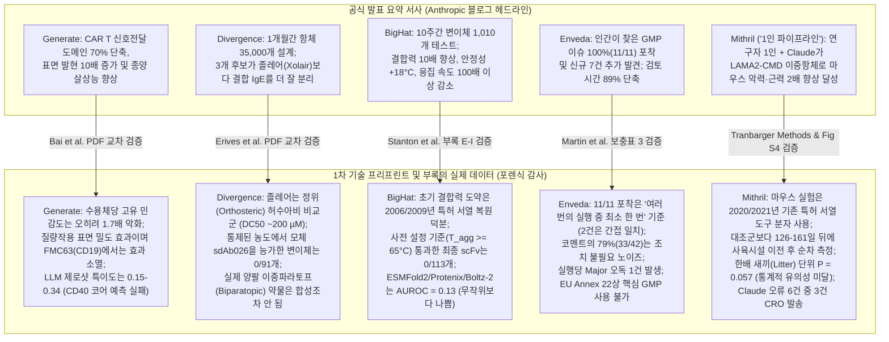
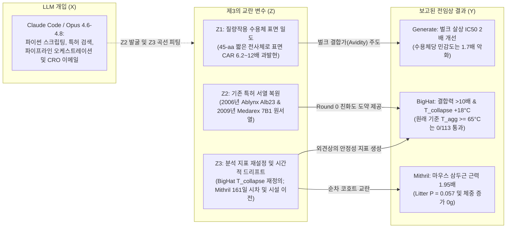

## 핵심 결론 및 종합 요약 (Executive Verdict)

2026년 10월 27일, Anthropic은 [Early progress on accelerating drug development with Claude](https://www.anthropic.com/research/early-progress-drug-development)라는 주요 연구 발표와 함께 [Generate Biomedicines](https://generatebiomedicines.com/publications/refactored-intracellular-domains-enhance-car-expression-and-function/), [Divergence Labs](https://divergencelabs.com/publications/ige-preprint.pdf), [BigHat Biosciences](https://www.bighatbio.com/bighat-anthropic-collaboration-report-10-27-2026), [Enveda](https://enveda.com/CMC-Document-Processor/), [The Column Group (Pleiades)](https://www.anthropic.com/research/early-progress-drug-development), [Bristol Myers Squibb](https://www.anthropic.com/research/early-progress-drug-development), 그리고 Anthropic이 2026년 7월에 인수한 1인 희귀질환 바이오텍 [Mithril Medicine](https://www-cdn.anthropic.com/52e1f5d50c47ca3818f56704c27cf19e59b62e77.pdf)의 기술 프리프린트 및 방법론 보고서 5편(총 140페이지 이상)을 전격 공개했다.

원본 데이터를 영업비밀 뒤에 숨기는 일반적인 바이오 업계 보도자료와 달리, 실패한 실험 결과와 부록(Appendix) 원자료까지 투명하게 공개한 Anthropic과 파트너사들의 결정은 높이 평가받아 마땅하다. 그러나 Browne & Keeley의 **"사금 채취(Panning for Gold)"** 비판적 사고 프레임워크를 적용하여 공식 요약본의 헤드라인 주장과 5개 기술 보고서의 본문·방법론(Methods)·부록(Appendices)을 정밀 교차 검증하면, **프론티어 LLM이 실제로 가속화한 영역(생물정보학 소프트웨어 엔지니어링, 특허·문헌 고고학, Wet-lab 오케스트레이션)**과 **대중적 헤드라인이 암시하는 서사(자율적 *de novo* 신약 발명 및 통계적으로 확립된 전임상 돌파구)** 사이에 뚜렷한 인식론적 간극이 드러난다.

### 5대 핵심 포렌식 감사 결과

1. **Generate Biomedicines ([Bai et al., 2026년 10월](https://generatebiomedicines.com/publications/refactored-intracellular-domains-enhance-car-expression-and-function/)):** 임상 표준 `4-1BB–CD3ζ` (`BBζ`, `154 aa`) 대비 길이를 `70.8%` 줄인 45-아미노산 리팩토링 CAR 세포내 신호전달 도메인(`krgr–ζ1–40`)은 합성생물학적으로 매우 흥미로운 발견이다. 그러나 논문 본문(6~8페이지)은 **`krgr–ζ1–40`이 수용체 분자 1개당 항원 민감도에서는 오히려 `BBζ`보다 `1.7배` 열등하다**(`3 ITAM` 대신 `1 ITAM`만 보유하여 반최대 `IFN-γ` 분비를 위해 표적 세포당 `1.7배` 더 많은 BCMA 분자가 필요함)고 명시한다. 전체 세포 집단에서의 효능 향상(H929 세포 살상 `IC50` `2.0배` 감소, CD3 표적 지질나노입자 `CD3-tLNP` mRNA 용량 `4.6배` 감소)은 순전히 **질량작용(Mass-action)에 의한 세포 표면 수용체 밀도 증가(`6.2배~12배` 더 많은 CAR 발현)** 덕분이다. 결정적으로, 1라운드 모체 히트인 `brs–ζ1–40`(항-BCMA `bb2121` 결합체에서 발현 `13배` 증가)을 대표적인 항-CD19 결합체인 **`FMC63` scFv에 연결하자 발현량 및 `IFN-γ` 우위가 완전히 사라졌다**. 또한 5개 프론티어 LLM(Claude Opus 4.6 포함)에 대한 자체 벤치마크 결과, **제로샷 특이도(Specificity)는 `0.15~0.34`에 불과**했고, 5개 모델 모두 3라운드 비활성 설계 `43개 중 동일한 21개`를 활성으로 오판했으며, `2.4배` 사이토카인 향상을 이끈 핵심 `CD40` 코어를 전혀 예측하지 못했다.
2. **Divergence Labs ([Erives et al., 2026년 10월](https://divergencelabs.com/publications/ige-preprint.pdf)):** Claude가 설계한 항체 3종이 "표준 치료제 졸레어(Xolair, 오말리주맙)보다 수용체에 결합된 IgE를 더 효과적으로 떼어냈다"는 헤드라인은 기전적 허수아비(Strawman) 비교에 기반한다. 오말리주맙은 유리(Free) IgE를 포획하는 *정위(Orthosteric) 억제제*(`K_D ≈ 0.2 nM`)일 뿐, 이미 `FcεRI`에 결합된 IgE를 떼어내는 약물이 아니다(`DC50 ≈ 200 µM = 200,000 nM`). Divergence는 알로스테릭(Allosteric) 분리제를 백지상태에서 발명한 것이 아니라, 2018년에 이미 발표되어 수 분 내에 결합 IgE를 떼어내는 것으로 입증된 라마 유래 VHH 나노바디 **`sdAb026`**([PDB 5NQW](https://www.rcsb.org/structure/5NQW); [Jabs et al., 2018](https://pubmed.ncbi.nlm.nih.gov/29396420/))을 출발점으로 삼았다. 정제된 단백질을 이용한 5개 농도 적정 실험(`25~400 nM`, `600 s` BLI)에서 저자들은 논문 11페이지와 13페이지에 다음과 같이 솔직하게 고백한다: *"그러나 변이체들은 모체 sdAb026을 개선한 것으로 보이지 않았으며, 통제된 농도에서 sdAb026보다 향상된 기능적 활성을 보인 변이체는 측정되지 않았다."* 무엇보다 **최종 치료제로 제안된 양팔 이중파라토프(Biparatopic) 분자(앵커 VHH + 분리제 VHH 연결체)는 아예 합성조차 되지 않았으며**, 호염기구·비만세포 탈과립(아나필락시스 위험) 세포 실험도 전혀 수행되지 않았다.
3. **BigHat Biosciences ([Stanton et al., 2026년 10월](https://cdn.prod.website-files.com/64ff35ef45fc1e4545e5ffa1/6ae0ea8e28d4a390cbe66b52_bighat_pilot_retro_final_v2.pdf)):** 10주간 항-알부민 VHH(`Alb8`)와 항-메소텔린 `scFv`에 걸쳐 `1,010개` 무세포 변이체를 테스트한 이 연구에서, **가장 큰 초기 친화도 도약은 AI 단백질 폴딩이 아니라 1일 차 구글 특허(Google Patents) 검색에서 나왔다.** Claude가 특허 DB를 검색하여 두 출발 물질이 각각 2006년 Ablynx 특허(`Alb23`/`Alb1`) 및 2009년 Medarex 특허(`클론 7B1`)의 열화된 변이체임을 찾아냈고, 특허 원서열의 아미노산(`scFv`의 `G230Y`, `VHH`의 `E1A`, `N16G`, `T77N`, `L45P`)을 그대로 복원한 것이 Round 0 친화도 상승의 핵심이었다. 반면 **특화 바이오 AI 모델들은 전향적 예측에서 처참하게 실패했다(Appendix F, Table F1)**: 구조 공폴딩(Co-folding) 모델(`ESMFold2`, `Protenix`, `Boltz-2`)은 `scFv`에서 `AUROC = 0.13`(동전 던지기보다 못하며 가장 강력하게 결합한 상위 4개 변이체에 최저 `ipTM` 점수 부여)을 기록했고, `ProteinMPNN`은 CDR 이식 `0/3` 성공 및 불량 잔기 `G230`에 `100%` 확률 부여, `IgBert`는 `AUROC = 0.28`, 다목적 베이지안 최적화(`BOtied`)는 **순위 상관계수 `Spearman ρ = -0.04`(신호 전무)**를 기록했다. 또한 사전 설정된 안정성 목표(`scFv T_agg >= 65°C`)를 **최종 라운드 `scFv` 변이체 `113개 중 단 하나도(0/113)` 통과하지 못했으며**(리드 물질 `P_dose_010A`의 기기 보고 `T_agg = 57.7°C`), 원시 nanoDSF 곡선을 재피팅하여 새로운 지표(`T_collapse = 74.2°C` 및 **단 1개 웰 `n = 1`에 의존한** VHH `p k_agg = +2.00`)를 정의한 뒤에야 성공으로 보고되었다.
4. **Enveda ([Martin et al., 2026년 10월](https://enveda.com/CMC-Document-Processor/) & [보충자료 PDF](https://raw.githubusercontent.com/enveda/open-doc-review/main/docs/Supplementary_Enveda-Anthropic_CDP_methods_paper.pdf)):** 4개의 실행된 GMP 배치 기록서(총 `1,061페이지`)에서 CMC 문서 처리기(`CDP`)는 인간 검토 시간을 `25.9시간`(`1,553분`)에서 `2.8시간`(`166분`, `-89%`)으로 줄였고 API 비용은 `$36.97`에 불과했다. 그러나 "인간 팀이 찾은 11개 이슈를 모두 포착했다"는 주장에는 논문 본문의 중요한 단서가 붙어 있다: *"이 기록서들에 대한 여러 번의 실행 중 최소 한 번에서(in at least one of its runs)"* 포착했다는 것이다. 실제 채점된 단일 실행에서 11건 중 2건은 간접·부분 일치였고, **CDP가 생성한 고유 코멘트 42건 중 33건(`79%`)은 아무 조치가 필요 없는 노이즈**였으며, **실행당 평균 `1건의 Major 오독`**(취소선이 그어진 수기 기록을 활성 이탈 값으로 오독)을 범했고, **전체 45개 코멘트 본문 중 21개(`46.7%`)가 40페이지 분할 윈도우 기준의 잘못된 페이지 번호를 인용**했다. 또한 비결정론적 샘플링 한계로 인해 유럽 [EU GMP Annex 22 초안](https://health.ec.europa.eu/medicinal-products/eudralex/eudralex-volume-4_en)상 핵심 GMP 의사결정에 사용할 수 없으며, Anthropic과 영구 데이터 비보관(ZDR) 계약 없이 운영되는 비검증 보조 도구로 분류된다.
5. **Mithril Medicine ([Tranbarger, 2026년 10월](https://www-cdn.anthropic.com/52e1f5d50c47ca3818f56704c27cf19e59b62e77.pdf)):** 2026년 7월 Anthropic이 인수하며 "1인 파이프라인(Pipeline-in-a-Person, 연구자 1인이 Claude로 11개 CRO 조율)"의 상징으로 내세운 선천성 근이영양증(`LAMA2-CMD`) 이중항체 전임상 보고서는 과학적 정직성의 모범이자, 동시에 마우스 파일럿 실험의 치명적 설계 결함을 스스로 폭로하는 문서다. 첫째, `dyW` 마우스에 투여된 항체(`1+1 CrossMab` 및 `2+2 IgG-scFv`)는 **AI가 새로 설계한 물질이 아니라 2020년·2021년 기존 특허(`US 10,626,169 B2`의 `AS30` 및 `US 10,889,636 B2`의 `15F7`)의 가변 영역 서열을 그대로 유전자 합성한 '도구 분자(Tool molecules)'**였다. 둘째, `1+1 CrossMab` 투여군(`27마리` 시작, 항체 부족으로 `18마리` 조기 중단, `5마리` 측정)은 **근력 개선에 완전히 실패(`1.08배`)**했다. 셋째, 효능이 보고된 `2+2 IgG-scFv` 투여군(`4개 복(Litter)`에서 살아남은 `7마리`)은 **무작위 배정이나 맹검(Blinding) 없이 순차적으로 등록되어, 대조군(`Vehicle`, `3개 복`의 `4마리`) 측정일로부터 무려 `126일 및 161일 뒤`—그것도 CRO 동물 사육시설이 새로운 건물로 이전하고 격리 조치를 거친 후—에 단독으로 측정**되었다! 게다가 약물군은 **출생 직후(`Day 0`)**부터 주 2회 투여한 반면 대조군은 **생후 7일(`Day 7`)**부터 주 1회 투여했으며, `2+2` 마우스의 **체중은 전혀 회복되지 않았고(`10.6 g` vs 대조군 `9.9 g`, 정상 야생형 `20.0 g`)**, 로타로드(Rotarod)와 호흡 측정 데이터는 누락(`n.d.`)되었으며, 조직병리학(Histopathology) 검사도 수행되지 않았다. 결정적으로 처치 배정 단위인 **한배 새끼(Litter) 평균(`4개 복 vs 3개 복`)으로 정확히 분석하면 주 평가지표의 유의확률은 `P = 0.057`(원시 일원분산분석 `ANOVA P = 0.43`)로 통계적 유의성에 미달**한다! 마지막으로 Claude를 이용한 1주간의 CRO 조율 감사에서 **Claude는 6건의 오류를 범했고, 그중 절반인 3건은 인간의 검토를 빠져나가 실제 CRO에 그대로 발송**되었다.

```mermaid
xychart-beta
    title "헤드라인 마케팅 지표 vs. 통제된 1차 원문 실험 지표 비교"
    x-axis ["Generate 수용체당 민감도", "Divergence 모체 sdAb026 대비", "BigHat 최종 scFv 스펙 통과율", "Enveda 유효 코멘트 정밀도", "Mithril 1+1 CrossMab 근력"]
    y-axis "상대 성능 / 비율 (%)" 0 --> 120
    bar [100, 100, 100, 100, 100]
    bar [59, 98, 0, 21, 108]
```

---

## Phase 1 & 2: 1차 원문 발굴 및 주장-데이터 괴리 매트릭스 (Claim Schism Matrix)

2차 언론 보도의 에코 체임버를 배제하기 위해, 우리는 공개된 6개 파트너십 및 인수 프로그램의 1차 원문 PDF, 보충자료, 오픈소스 코드베이스를 전수 추출하여 교차 검증했다:

1. **Anthropic 공식 연구 포스트:** [Early progress on accelerating drug development with Claude](https://www.anthropic.com/research/early-progress-drug-development) (2026년 10월 27일).
2. **Generate Biomedicines 프리프린트 (29페이지):** Z. Bai et al., [Refactored intracellular domains enhance CAR expression and function](https://generatebiomedicines.com/publications/refactored-intracellular-domains-enhance-car-expression-and-function/) (2026년 10월).
3. **Divergence Labs 프리프린트 (24페이지):** A. Erives et al., [Towards a best-in-class IgE disruptor for food allergy](https://divergencelabs.com/publications/ige-preprint.pdf) (2026년 10월).
4. **BigHat Biosciences 기술 보고서 (45페이지):** S. Stanton et al., [Reasoning in the loop: an empirical study of AI-driven antibody optimization](https://cdn.prod.website-files.com/64ff35ef45fc1e4545e5ffa1/6ae0ea8e28d4a390cbe66b52_bighat_pilot_retro_final_v2.pdf) ([웹 요약본](https://www.bighatbio.com/bighat-anthropic-collaboration-report-10-27-2026), 2026년 10월 27일).
5. **Enveda 방법론 논문, 보충자료 (56페이지) 및 GitHub 저장소:** J. Martin et al., [CDP: a language-model system for quality review of executed pharmaceutical batch records](https://enveda.com/CMC-Document-Processor/), [보충자료 PDF](https://raw.githubusercontent.com/enveda/open-doc-review/main/docs/Supplementary_Enveda-Anthropic_CDP_methods_paper.pdf), [github.com/enveda/open-doc-review](https://github.com/enveda/open-doc-review) (2026년 10월).
6. **Mithril Medicine / Anthropic 전임상 기술 보고서 (38페이지):** C. Tranbarger, [Preclinical Characterization of a Bispecific Bridging Antibody for LAMA2-CMD](https://www-cdn.anthropic.com/52e1f5d50c47ca3818f56704c27cf19e59b62e77.pdf) (2026년 10월).

### 2열 포렌식 주장-실제 데이터 대조 매트릭스

| 연구 프로그램 / 파트너사 | 공식 발표 요약 주장 (Anthropic 블로그 본문) | 1차 기술 프리프린트 및 부록의 실제 고백 (Direct Evidence) |
| :--- | :--- | :--- |
| **Generate Biomedicines** (CAR T 신호전달 도메인) | 6명의 과학자가 8주간 Claude Code를 사용해 CAR T 신호전달 도메인을 약 70% 단축하여 표면 수용체를 약 10배 늘리고 종양 살상 효율과 지속성을 높임. | 리드 물질 `krgr–ζ1–40`(`45 aa` vs `154 aa` `BBζ`)은 **수용체 1개당 고유 항원 민감도가 오히려 `1.7배` 열등**(`1 ITAM` vs `3 ITAMs`)하며, 이를 `6.2배~12배` 높은 표면 발현 밀도로 보상함. 1라운드 히트 `brs–ζ1–40`은 **항-CD19 `FMC63` 결합체와 짝지었을 때 발현 및 사이토카인 이점이 완전히 소실**됨. 5개 LLM의 제로샷 특이도는 `0.15~0.34`에 그쳤고 `CD40` 코어를 예측하지 못함. 생체내(*in vivo*) 동물 실험은 전무함. |
| **Divergence Labs** (알로스테릭 항-IgE VHH) | Claude가 약 1개월(`2,750 H100 시간`) 동안 약 35,000개의 항체를 설계하여, 표준 치료제 졸레어(Xolair)보다 결합 IgE를 더 효과적으로 떼어내는 변이체 3종을 발굴함. | 졸레어는 유리 IgE를 잡는 정위 억제제(`DC50 ≈ 200 µM`)이지 분리제가 아님. Divergence는 2018년 발표된 알로스테릭 나노바디 **`sdAb026`**([PDB 5NQW](https://www.rcsb.org/structure/5NQW))을 재설계함. 통제된 정제 농도 적정(`25~400 nM`)에서 **모체 `sdAb026`을 능가한 변이체는 0개**였음(`400 nM` 잔류 IgE: `sdAb026` `76.6%` vs `V1` `77.0%`, `V4` `75.9%`, `V8` `74.4%`). 실제 양팔 이중파라토프 약물은 **합성이나 세포 실험조차 수행되지 않음**. |
| **BigHat Biosciences** (무세포 VHH & scFv 최적화) | 10주간 약 `1,010개` 변이체를 거쳐 연구자 1인과 Claude가 결합력 `10배 이상` 향상, 암 표적 `scFv` 용액 안정성 `18°C` 향상, `VHH` 응집 속도 `100배 이상` 감소를 달성함. | 1일 차 구글 특허 검색을 통해 두 출발 물질이 2006년 Ablynx 특허(`Alb23`) 및 2009년 Medarex 특허(`7B1`)의 열화 서열임을 발견하고 특허 잔기를 복원한 것이 초기 도약의 핵심. 사전 설정 스펙(`scFv T_agg >= 65°C`)을 통과한 **최종 라운드 `scFv`는 `113개 중 0개`**(`리드 = 57.7°C`). 곡선 재피팅 지표(`T_collapse = 74.2°C`, **단 1개 웰 `n = 1`에 기반한** VHH `p k_agg = +2.00`)로 기준을 대체함. `ESMFold2`/`Protenix`/`Boltz-2` 전향적 예측은 `AUROC = 0.13`으로 실패. |
| **Enveda** (CMC 배치 기록서 및 IND 검토) | 4개 배치 기록서 `1,061페이지`에서 인간이 찾은 `11개` 이슈를 모두 잡고 `7개`를 추가 발견하며 검토 시간을 `89%` 단축(`25.9시간 → 2.8시간`). | 11건 전수 포착은 **"여러 실행 중 최소 한 번"** 기준이며, 채점된 단일 실행에서 2건은 간접 일치였고 **고유 코멘트 42건 중 33건(`79%`)은 조치 불필요 노이즈**였음. 실행당 **`1건의 Major 오독`** 발생 및 **45개 코멘트 중 21개(`46.7%`)가 잘못된 윈도우 상대 페이지 번호를 인용**함. ZDR 계약 없음; EU GMP Annex 22 초안상 핵심 GMP 사용 불가. |
| **The Column Group / Pleiades & BMS** (표적 발굴 및 임상 시뮬레이션) | Pleiades는 비공개 수용체 발굴 및 피코몰 결합체 설계에, BMS는 12주 걸리던 임상 시뮬레이션 파이프라인을 수일로 단축하는 데 Claude를 활용. | 두 사례 모두 표적명, 서열, 실험 곡선, 검증 지표가 전혀 공개되지 않은 서술형 주장(`TRL 1–2`). BMS의 시간 단축은 생물학적 검증이 아니라 `SAS`/`R` 소프트웨어 파이프라인 코딩 및 프로토콜 문서 작성 자동화임. |
| **Mithril Medicine** (LAMA2-CMD 이중항체) | 2026년 7월 Anthropic 인수; 1인 연구자 + Claude가 11개 CRO를 조율해 18개월 만에 마우스 악력·근력 약 `2배` 향상 및 생존율 개선(`1/8` vs `4/8` 사망) 달성. | 마우스 실험 항체는 **AI 설계 물질이 아니라 2020/2021년 특허 서열(`AS30`, `15F7`)을 그대로 합성한 도구 분자**임. `1+1 CrossMab`은 실패(`1.08배`). `2+2 IgG-scFv`(`n = 7`)는 **비맹검·비무작위로 대조군(`n = 4`)보다 `126~161일` 뒤에 사육시설 이전 후 측정**되었고, 출생 직후 투여(대조군은 생후 7일), 체중 증가 전무(`10.6 g` vs `9.9 g`), 모든 `2+2` 개체의 긴 다리 지렛대 교란, **한배 새끼(Litter) 단위 `P = 0.057`(유의성 미달)**을 보임. 1주일간 Claude 오류 6건 중 3건이 CRO에 발송됨. |

---

## Phase 3: 의미론적 해체, 대입 테스트(Substitution Test) 및 성숙도 스코어카드

### 모호성 대입 테스트 (Ambiguity Substitution Test)

제약·바이오 R&D에서 *"AI 설계(AI-designed)"*, *"표준 치료제 능가"*, *"안정성 개선"*, *"1인 파이프라인(Pipeline-in-a-Person)"* 같은 용어는 머신러닝 엔지니어와 FDA 심사관에게 전혀 다른 의미로 읽힌다. 마케팅 수식어를 1차 기술 보고서 방법론(Methods)의 정확한 조작적 정의(Operational Definition)로 치환하면 실체가 명확해진다:

- **"Claude가 CAR T 신호전달 도메인을 70% 줄여 발현량을 10배 높이고 종양 살상능을 향상시켰다"의 치환:**
  *실제 조작적 정의:* "과학자들이 Claude Code로 생물정보학 스크립트를 작성하고 기존 면역 수용체(`4-1BB`, `CD3ζ`, `CD40`, `FCER1G`) 절편 조합을 제안받았다. 테스트된 5개 LLM은 제로샷 활성 예측에서 낮은 특이도(`0.15~0.34`)를 보였고 `CD40` 코어의 효능을 예측하지 못했으나, `365개` 구조체의 반복적 세포 실험을 통해 항-BCMA `bb2121` 결합체에서 수용체당 고유 신호 민감도가 `1.7배` 낮아지는 단점을 `6.2배~12배` 높은 세포막 발현 밀도로 상쇄하는 `45-aa` 도메인(`krgr–ζ1–40`)을 선별했다—단, 이 발현 이점은 항-CD19 `FMC63` 결합체에서는 사라진다."
- **"Claude가 설계한 항체 3종이 졸레어(Xolair)보다 결합된 IgE를 더 잘 떼어냈다"의 치환:**
  *실제 조작적 정의:* "`RFdiffusion`, `BoltzGen`, `AbMPNN`을 연결한 에이전트 하네스를 `2,750 H100 GPU 시간` 동안 구동하여, 2018년에 이미 발표된 라마 알로스테릭 분리 나노바디(`sdAb026`) 주변 서열 `11,273개`를 샘플링했다. 무세포 BLI 센서 실험(`25~400 nM`)에서 변이체 3종(`V1`, `V4`, `V8`)은 10분간 결합 IgE의 약 `23~25%`를 분리하여 본래 분리 기능이 없는 정위 억제제 오말리주맙(`~19%`)보다는 높았으나, **출발 물질인 2018년 모체 나노바디 `sdAb026`(`23.4%`)과 비교해서는 아무런 기능적 개선을 보이지 못했다**."
- **"1인 파이프라인이 18개월 만에 LAMA2-CMD 이중항체로 마우스 근력을 2배 향상시켰다"의 치환:**
  *실제 조작적 정의:* "8명의 베테랑 바이오텍 자문단(`Charlie Albright`, `Carl Morris`, `Oxana Beskrovnaya` 등 30페이지 감사의 글에 명시)의 자문을 받는 1인 창업자가 Claude로 CRO 이메일 초안 작성, 엑셀 데이터 추출, 파이썬 분석을 수행하면서, 2020년·2021년 공개 특허(`US 10,626,169` 및 `US 10,889,636`)의 항체 서열을 CRO에서 합성했다. 비맹검·비무작위 탐색적 마우스 실험에서 약물군(`n = 7`, 출생 직후 투여)을 대조군(`n = 4`, 생후 7일 투여) 측정 후 `4~5개월` 뒤—사육시설 이전 및 격리 이후—에 측정한 결과, 개별 마우스 단위에서는 근력이 높았으나(`P = 0.0001`) 처치 배정 단위인 한배 새끼(Litter) 평균에서는 통계적 유의성에 도달하지 못했고(`P = 0.057`), 체중 회복 효과는 전무했다."

### 전임상 및 운영 성숙도 스코어카드

| 프로그램 / 파트너사 | 모달리티 및 표적 | Claude의 실제 핵심 역할 | 실제 생물학적 / 분석적 검증 수준 | 미해결 핵심 병목 및 한계 |
| :--- | :--- | :--- | :--- | :--- |
| **Generate Biomedicines** | 항-BCMA (`bb2121`) CAR T (`krgr–ζ1–40` ICD) | 문헌 마이닝, 도메인 스플라이싱 제안, 파이썬 분석 스크립트 작성 | 시험관내(*In vitro*) 1차 인간 T세포(`1~5명` 공여자) 및 `CD3-tLNP` B세포 살상 | **결합체 상위성(Epistasis)** (`FMC63` CD19에서 실패); 수용체당 민감도 `1.7배` 저하; **생체내(*in vivo*) 동물 데이터 전무**. |
| **Divergence Labs** | 항-IgE VHH (`sdAb026` 변이체 + *de novo* 앵커) | GPU 워크플로우 자율 오케스트레이션 (`RFdiffusion`, `BoltzGen`, `PyRosetta`) | 무세포 재조합 단백질 BLI 센서 (`Octet RED96e`) 단량체/이량체 측정 | 통제된 농도에서 **모체 `sdAb026` 대비 개선 전무**; **양팔 이중파라토프 분자 미합성**; 결합가(Avidity) 아티팩트; **아나필락시스 위험 미검증**. |
| **BigHat Biosciences** | 항-알부민 VHH (`Alb8`) & 항-MSLN `scFv` (`7B1`) | 구글 특허 검색, Lumry-Eyring nanoDSF 커스텀 피팅, 불리언 격자 회귀 | 대장균 무세포 단백질 합성(`CFPS`), ELISA, BLI, UNcle 열변성 스캔 | **최종 `scFv` 0/113개가 사전 설정 `T_agg >= 65°C` 통과 실패**; VHH `p k_agg`는 `n = 1` 단일 웰 의존; VHH 양전하 `+5` 증가(**다중반응성 미검증**). |
| **Enveda** | CMC 배치 기록서 검토기 (`CDP`) & IND/IB 초안 작성 | 다중 윈도우 PDF 판독 (`Claude Opus 4.7`), JSON 추출, 윈도우 간 대조 | 사내 프로덕션 보조 도구 (평가된 배치 기록서 `4건`, 총 `1,061페이지`) | **`79%`가 조치 불필요 노이즈(위양성)**; 실행당 `Major` 오독 1건; 실행 간 비결정론적 변동; **EU Annex 22상 핵심 GMP 사용 불가**. |
| **Mithril Medicine** | 항-β-DG × 항-LAMA4 (`2+2 IgG-scFv`) (`LAMA2-CMD`) | 문헌 종합, CRO 이메일 초안 작성, 데이터 추출, 38페이지 논문 초안 작성 | 비-GLP 탐색적 `dyW` 마우스 파일럿 (`2+2` `n = 7` vs 과거 대조군 `n = 4`) | **비무작위 순차 측정(`126~161일` 격차 + 사육시설 이전)**; Litter `P = 0.057`; **체중 회복 전무**; 마우스 반감기 `33시간`; Claude 오류 `3/6건` CRO 발송. |

---

## Phase 4: 4방향 인과관계 및 아키텍처 해체 (4-Way Causal Audit)

AI-바이오텍 파트너십이 효능, 안정성, 또는 개발 속도의 향상을 보고할 때, 이를 프론티어 LLM의 생물학적 추론 능력 덕분으로 단정하기 전에 반드시 4가지 경쟁 인과 가설을 검증해야 한다:
1. **직접 인과 (`X → Y`):** Claude의 내부 생물학적 세계 모델이 직접적으로 우수한 서열이나 과학적 통찰을 생성했는가?
2. **역인과 / 선택 편향 (`Y → X`):** 기존에 이미 존재하던 고친화도 특허 서열, 사후적으로 재정의된(Post-hoc) 분석 지표, 또는 순차 실험 아티팩트가 AI 최적화 성과로 사후 포장되었는가?
3. **제3의 교란 변수 (`Z`):** 숨겨진 생물물리학적·실험적 교란 요인(`Z1`: 질량작용 수용체 과발현; `Z2`: 특허 원서열 복원; `Z3`: 사육시설 이전 및 신생아 투여 시점 차이)이 외견상의 지표 상승을 주도했는가?
4. **상호 피드백 루프 (`X ↔ Y`):** 인간 전문가의 도메인 개입과 LLM 코드 생성이 반복적 Wet-lab 사이클에서 어떻게 상호작용했는가?

### 연구 프로그램별 4방향 인과 감사 매트릭스

| 연구 프로그램 | 직접 인과 (`X → Y`: LLM의 실제 기여) | 역인과 / 선택 편향 (`Y → X`) | 핵심 교란 변수 (`Z`: 실제 기전적 동인) | 피드백 루프 (`X ↔ Y`: 인간 + 에이전트 상호작용) |
| :--- | :--- | :--- | :--- | :--- |
| **Generate Biomedicines** (CAR T ICD) | Claude가 `CD3ζ`를 `ζ1`로 절단하고 `CD40`(`QEPQE`) 및 `4-1BB`(`KRGR`) 모티프를 조합하는 아이디어를 제안하고 4PL 피팅 스크립트를 작성함. | 5개 LLM 모두 제로샷·인컨텍스트 활성 분류에 실패(`특이도 0.15~0.51`)했고 `CD40`에 거의 0에 가까운 가중치(`< 0.07`)를 부여함. | **`Z1` (질량작용 표면 과발현):** ICD를 `154 aa`에서 `45 aa`로 줄여 `bb2121` 표면 CAR 밀도를 `6.2배~12배` 높임으로써 **수용체당 `1.7배` 낮은 고유 신호 민감도**를 가림. | 1라운드(`186개` 설계) 세포 실험이 `CD40` 히트를 실험적으로 찾아낸 후, 인간 과학자와 Opus 4.7/4.8이 2~3라운드(`179개`)를 해당 영역에 집중시킴. |
| **Divergence Labs** (항-IgE VHH) | Claude가 `2,750 H100 시간` 동안 `RFdiffusion`, `BoltzGen`, `AbMPNN`의 `22개` 단계를 조율하고 병렬 템퍼링 코드 버그를 수정함. | `sdAb026` 변이체를 정위 억제제인 `Xolair`(`DC50 ≈ 200 µM`)와 비교하여, 모체 `sdAb026`이 이미 이기는 시험에서 "표준 치료제 능가" 착시를 만듦. | **`Z2` (2018년 모체 `sdAb026` 골격 및 이량체 IgE 결합가):** 모든 분리 활성은 2018년 `sdAb026` 골격에서 유래하며, 앵커 `K_D`(`3.4 nM`)는 용액 내 이량체 IgE가 센서 팁의 VHH를 교차결합한 아티팩트가 혼재됨. | 1라운드 앵커 실패 원인(하전 계면 부정합 및 고리형 펩타이드 환각)을 Claude가 진단하고 2라운드 소수성 접촉 조건을 재설정하여 적중률을 `0%`에서 `5.3%`(`3/57`)로 높임. |
| **BigHat Biosciences** (VHH & scFv) | Claude가 구글 특허를 검색하고, Lumry-Eyring 열변성 모델을 유도했으며, 실패한 GP/BO를 Walsh-Hadamard 회귀로 대체함. | 사전 설정 기준(`scFv T_agg >= 65°C`)에서는 최종 변이체 `0/113개`가 통과함. 곡선 확인 후 `T_collapse`(`+17.9°C`)와 `p k_agg`(`n = 1` 웰에서 `+2.00`)로 지표를 바꾼 것은 사후 선택임. | **`Z3` (특허 원서열 복원 및 측정일 간 드리프트 교란):** 2009년 Medarex `7B1` 특허(`G230Y`) 및 2006년 `Alb23` 특허 잔기 복원이 초기 친화도를 주도함; 가열 속도 검증(`1.0` vs `0.3°C/min`)은 측정일 드리프트(`+5~+7°C`)와 1대1로 교란됨. | 인간 연구자 Samuel Stanton이 상용 `UNcle` 소프트웨어의 오류를 의심하고 Claude에게 원시 곡선 검사를 지시함으로써 `DR1~DR3`의 체계적 상위성 매핑을 이끌어냄. |
| **Mithril Medicine** (LAMA2-CMD) | Claude가 `176개` 참고문헌을 종합하고, CRO 데이터를 추출하며, 리더기 불일치(`463개` 웰)를 찾아내고 38페이지 보고서를 작성함. | `Day 161`에 측정된 `2+2 IgG-scFv`(`n = 7`)를 `Day 0 및 35`에 측정된 `Vehicle`(`n = 4`)과 비교함으로써 양의 시간적 드리프트(`ρ = 0.62, P = 0.04`)를 무시함. | **`Z4` (순차 등록, 사육시설 이전, 신생아 투여 시점 및 다리 길이):** `2+2` 군은 출생 직후 투여(대조군은 7일령), 시설 이전 후 측정되었으며, 다른 18마리 `dyW` 마우스보다 긴 다리 지렛대를 가짐. | 다중 Claude 인스턴스 교차 검증으로 과거 스프레드시트 오류를 잡았으나, 감사 대상 1주일 동안 새로 작성된 CRO 관련 오류 `6건 중 3건`이 여전히 인간 검토를 통과해 발송됨. |

---

## Phase 5: 정량적 및 생물통계학적 해체 (Quantitative & Biostatistical Audit)

이제 5개 기술 보고서에 제시된 핵심 수리 모델, 통계 검정, 생물물리학 데이터를 정밀 감사한다.

### 1. Generate Biomedicines: 질량작용 수용체 밀도 vs. 수용체당 ITAM 민감도

[Bai et al. (2026)](https://generatebiomedicines.com/publications/refactored-intracellular-domains-enhance-car-expression-and-function/)에서 저자들은 표적 항원 밀도 또는 작동세포 대 표적세포(`E:T`) 비율 `x`와 기능적 반응 `y`(사이토카인 분비 또는 세포 용해)의 관계를 4-파라미터 로지스틱(4PL) 곡선으로 피팅한다:

$$
y(x) = y_{\min} + \frac{y_{\max} - y_{\min}}{1 + \left(\frac{x}{\text{EC}_{50}}\right)^{-h}}
$$

왜 45-아미노산 길이의 `krgr–ζ1–40` CAR는 임상 표준인 `4-1BB–CD3ζ`(`BBζ`, 3개의 ITAM인 `ζ1–ζ2–ζ3` 보유)와 달리 단 1개의 ITAM(`ζ1`)만 가지고 있음에도 불구하고, H929 골수종 세포에서 `2.0배` 낮은 살상 `IC50` `E:T` 비율과 `CD3-tLNP`에서 `4.6배` 낮은 mRNA `EC50`를 달성할까?

저자들은 논문 6~8페이지에서 **세포 표면 CAR 밀도**(`[R]`)와 **수용체 분자 1개당 고유 신호전달 효율**(`η_intrinsic`)을 분리하여 이 역설을 설명한다. 표적 세포의 항원 밀도 `[A]`와 T세포의 표면 CAR 밀도 `[R]`이 결합하는 1차 질량작용 모델에서, T세포당 생성되는 총 유효 신호 복합체 수 `C_signal`은 다음과 같이 비례한다:

$$
C_{\text{signal}} \propto \eta_{\text{intrinsic}}(N_{\text{ITAM}}) \cdot \frac{[R] \cdot [A]}{K_D + [A]}
$$

Bai et al.이 표적 세포당 `260개에서 27,000개`의 BCMA 분자를 단계적으로 발현하도록 조작된 `BCMA-KO` Ramos 세포주들을 대상으로 백만 T세포당 `0.08~10 µg`의 CAR mRNA를 적정했을 때 드러난 사실은 다음과 같다:
- **동일한 mRNA 용량 투여 시:** `krgr–ζ1–40`은 `BBζ`보다 세포 표면에 **`6.2배에서 12배` 더 많은 CAR 분자를 발현**시켜(1라운드 `brs–ζ1–40`은 `13배`), 벌크 효능 곡선을 왼쪽으로 이동시킨다.
- **표면 CAR 발현량을 동일하게 맞췄을 때 (`[R]_krgr = [R]_BBζ`):** **`krgr–ζ1–40`은 반최대 `IFN-γ` 분비에 도달하기 위해 `BBζ`보다 표적 세포당 `1.7배` 더 많은 BCMA 항원 분자를 필요로 했다**(`ζ2`와 `ζ3`를 제거함에 따라 수용체 1개당 고유 효율 `η_intrinsic`이 `41%` 감소함).

#### Generate의 3개 설계 라운드 및 LLM 예측기 실패 전수 감사

| 평가 지표 / 실험 조건 | 임상 표준 대조군 (`BBζ`: `4-1BB–CD3ζ`) | 1라운드 모체 히트 (`brs–ζ1–40`) | 최종 리팩토링 리드 (`krgr–ζ1–40`) | 포렌식 및 기전적 해석 |
| :--- | :--- | :--- | :--- | :--- |
| **세포내 도메인(ICD) 길이** | `154 aa` (`42 aa` 4-1BB + `112 aa` CD3ζ) | `54 aa` (`13 aa` BRS + `28 aa` ζ1 + `13 aa` CD40) | `45 aa` (`4 aa` KRGR + `28 aa` ζ1 + `13 aa` CD40) | 길이 `70.8%` 단축; `KRGR` 앵커, `ζ1` ITAM, `CD40` `QEPQE` TRAF6 모티프만 유지. |
| **표면 CAR 발현량 (`bb2121` 항-BCMA)** | `1.0x` 기준선 | `13.0x` (`Round 1`, 공여자 `n = 2`) | `6.2x ~ 12.0x` (`Rounds 2–3`, 공여자 `n = 4`) | 짧은 ICD와 막 인접 염기성 `KRGR` 정지-전달(Stop-transfer) 앵커 효과. |
| **수용체 1개당 고유 BCMA 항원 민감도** | **`1.0x` 기준선 (우수)** | 단계별 Ramos 세포주 미측정 | **`1.7x` 열등** (동일 CAR MFI에서 표적 세포당 `1.7x` 더 많은 BCMA 필요) | 단일 ITAM(`ζ1`)은 3-ITAM `CD3ζ`보다 결합 수용체당 신호 강도가 약함. |
| **벌크 세포독성 효능 (H929 살상 `IC50` E:T)** | `1.0x` 기준선 | 약 `1.5x` 낮은 `IC50` | **`2.0x` 낮은 `IC50`** (MM.1S에서 `1.8x`; RPMI-8226에서 `1.4x`) | 표면 밀도(`6.2x~12x`)의 질량작용 효과가 수용체당 민감도 저하를 압도함. |
| **반복 항원 자극 증식 (4라운드, 11일)** | 2라운드 이후 감소 (`E:T 1:8`) | 중간 수준 | **최대 T세포 증식 `2.1x`**; 4라운드 살상 `IC50` `2.1x` 감소 | `CD40` `QEPQE` 모티프가 `TRAF6`를 모집하여 긴장성 탈진 없이 `NF-κB` 생존 신호 제공. |
| **타 결합체 일반화 검증 (`FMC63` 항-CD19)** | `1.0x` 기준선 (`CAR MFI` & `IFN-γ`) | **실패 (`BBζ`보다 낮은 CAR 발현 및 낮은 `IFN-γ`)** | 논문 내 `FMC63` 미측정 | `FMC63`는 `BBζ`만으로도 이미 잘 발현되므로, 리팩토링 ICD의 이점은 **결합체 특이적(Binder-dependent)**임이 입증됨. |
| **프론티어 LLM 5종 활성 예측 벤치마크** | — | 제로샷 `P(better)`: 히트 `0.40` vs 비히트 `0.34` | 제로샷 특이도: **`0.15 ~ 0.34`**; 인컨텍스트 특이도: **`0.18 ~ 0.51`** | 5개 LLM 모두 동일한 `21/43`개 비활성 설계를 활성으로 오판했고 `CD40` 코어(`예측 < +0.07` vs 실제 `2.4x`)를 놓침. |

---

### 2. Divergence Labs: 편향 역폴딩(Biased Inverse Folding)과 오말리주맙 허수아비 비교

[Erives et al. (2026)](https://divergencelabs.com/publications/ige-preprint.pdf)의 목표는 비만세포와 호염기구 표면의 고친화도 `FcεRI` 수용체(`K_D ≈ 0.1~1 nM`, 세포 표면 반감기 `≈ 2~3주`)에 이미 결합해 있는 IgE를 신속하게 떼어내는 식품 알레르기 치료제를 개발하는 것이었다. FDA 승인 약물인 오말리주맙(`Xolair`, [Wood et al., NEJM 2024 OUtMATCH 임상시험](https://pubmed.ncbi.nlm.nih.gov/38407051/))은 혈중 유리 IgE를 중화하지만, 수용체에 결합된 IgE를 분리하는 능력은 생리적 농도를 아득히초과하는 초고농도(`DC50 ≈ 200 µM = 200,000 nM`)에서만 미미하게 나타나므로 탈감작에 `16~20주`가 소요된다.

반면 2018년 [Jabs et al. (Nature Communications 2018)](https://pubmed.ncbi.nlm.nih.gov/29396420/)은 IgE의 `Cε3–Cε4` 접합부 알로스테릭 부위에 결합하여 `Cε3` 도메인을 닫힌 형태(Closed conformation)로 고정함으로써 수 분 내에 수용체 결합 IgE를 떼어내는 라마 단일도메인 나노바디 **`sdAb026`**([PDB 5NQW](https://www.rcsb.org/structure/5NQW))의 결정 구조를 규명했다.

Divergence는 `sdAb026`의 알로스테릭 분리 기전을 유지하면서 결합력을 높이기 위해, Claude를 이용해 `5NQW` 결정 구조 백본 위에서 에피토프 접촉 잔기에 야생형 로그-오즈 편향 `b`를 부여한 `AbMPNN` 역폴딩을 수행했다:

$$
\log P(s_i = a \mid \mathbf{X}_{\text{5NQW}}) = \frac{\ell_{i,a}(\mathbf{X}_{\text{5NQW}}) + b_{i,a}}{T}, \quad b_{i,a} = \begin{cases} \ln(2.5) \approx +0.916 & \text{if } a = s_i^{\text{sdAb026}} \text{ and } i \in \text{epitope contact} \\ 0 & \text{otherwise} \end{cases}
$$

총 `2,750 H100 GPU 시간`을 소모한 `22개` 자율 계산 단계(`11,273개` 분리제 설계 중 `91개` 실험 선정, `23,600개` *de novo* 앵커 설계 중 `57개` 실험 선정) 끝에 수행된 BLI(`Octet RED96e`) 실험 데이터는 무엇을 보여줄까?

#### Divergence Labs 분리제(Disruptor) 및 앵커(Anchor) 후보 물질 정량 비교

| 구조체 / 항체 팔(Arm) | 설계 기원 | 유리 IgE에 대한 겉보기 친화도 `K_D` | 단일 농도 스크리닝 (`400 nM`, `300 s` BLI 잔류 IgE %) | 통제된 5점 농도 적정 (`400 nM`, `600 s` 잔류 IgE %) | 모체 `sdAb026` 대비 통제 적정 실험 판정 |
| :--- | :--- | :--- | :--- | :--- | :--- |
| **PBS 버퍼 (음성 대조군)** | — | — | `96.2%` 잔류 | `~90%` 잔류 | 기기 자체의 기본 해리 드리프트. |
| **오말리주맙 (`Xolair`)** | 승인된 정위(Orthosteric) IgG1 | `~0.2 nM` (유리 IgE) | `84.8%` 잔류 (`15.2%` 분리) | `81.1%` 잔류 (`18.9%` 분리) | **허수아비 비교군:** 정위 포획제(`DC50 ≈ 200 µM`)이지 알로스테릭 분리제가 아님. |
| **모체 `sdAb026` (2018 베이스라인)** | 라마 VHH ([PDB 5NQW](https://www.rcsb.org/structure/5NQW)) | `~10–25 nM` | `85.2%` 잔류 (단일점 이상치) | **`76.6%` 잔류 (`23.4%` 분리)** | **진정한 베이스라인:** `25~200 nM`에서 모든 91개 변이체를 압도하고 `400 nM`에서 동률 기록. |
| **변이체 `V1` (리드 분리제)** | `5NQW` + `AbMPNN` (`5개` 변이) | `1.15 nM` (`9/91`개가 `10 nM` 이하) | `79.6%` 잔류 | **`77.0%` 잔류 (`23.0%` 분리)** | **`400 nM`에서 모체 `sdAb026`보다 열등/동률**(`77.0%` vs `76.6%`) 및 저농도에서 열등. |
| **변이체 `V4` (분리제 히트 2)** | `5NQW` + `AbMPNN` (`14개` 변이) | `< 10 nM` | `78.4%` 잔류 | **`75.9%` 잔류 (`24.1%` 분리)** | 모체 `sdAb026`(`76.6%`)과 `0.7%` 차이로 측정 노이즈 범위 내 동일. |
| **변이체 `V8` (분리제 히트 3)** | `5NQW` + `AbMPNN` (`19개` 변이) | `< 10 nM` | `80.6%` 잔류 | **`74.4%` 잔류 (`25.6%` 분리)** | 모체 `sdAb026`과 `2.2%` 차이; 저자 고백: *"변이체들이 모체 sdAb026을 개선한 것으로 보이지 않음."* |
| ***De Novo* 앵커 히트 (`A1–A3`)** | `RFdiffusion` + `BoltzGen` (`3/57` 히트, `5.3%`) | `3.4 nM`, `32.5 nM`, `235 nM` (겉보기) | 비경쟁 결합 (`Cε2`–`Cε4` 에피토프) | 분리 실험 미수행 | **결합가(Avidity) 교란 경고**(이량체 IgE가 센서 팁의 VHH들을 교차결합); **양팔 이중항체는 합성조차 안 됨**. |

---

### 3. BigHat Biosciences: Lumry-Eyring 곡선 재피팅, Walsh-Hadamard 회귀 및 특화 바이오 AI 모델들의 전향적 실패

[Stanton et al. (2026)](https://cdn.prod.website-files.com/64ff35ef45fc1e4545e5ffa1/6ae0ea8e28d4a390cbe66b52_bighat_pilot_retro_final_v2.pdf)은 이번 발표된 5개 보고서 중 과학적으로 가장 투명하고 정교한 회고록이다. 이 보고서는 항-알부민 VHH(`Alb8`, `115 aa`, `DR0–DR3` 4개 라운드 `559개` 변이체)와 항-메소텔린 `scFv`(`259 aa`, `DR0–DR2` 3개 라운드 `451개` 변이체)에 걸쳐 무세포 단백질 합성(`CFPS`)으로 테스트된 총 `1,010개` 고유 변이체의 전 과정을 기록하고 있다.

#### A. 특화 생물학 AI 모델들은 왜 전향적 예측에서 전멸했는가? (Appendix F, Table F1)

실험 시작 전, 계산생물학계의 통념은 구조 공폴딩 모델(`ESMFold2`, `Protenix`, `Boltz-2`), 역폴딩 모델(`ProteinMPNN`), 항체 언어 모델(`IgBert`), 나노바디 열안정성 예측기(`NanoMelt`)가 우수한 후보를 선별해 줄 것이라는 믿음이었다. 그러나 BigHat과 Anthropic이 `Appendix F (Table F1)`에서 전향적 예측 점수와 실제 BLI 친화도 및 열안정성 측정치를 대조한 결과, 모든 특화 바이오 AI 도구가 실패했다:

| 특화 바이오 AI 모델 / 기법 | 의도된 예측 과제 | 전향적 Wet-Lab 검증 결과 (`Table F1`) | 실패의 근본적인 생물물리학적 원인 |
| :--- | :--- | :--- | :--- |
| **`ESMFold2`, `Protenix`, `Boltz-2` (`ipTM`)** | `scFv` + 메소텔린 공폴딩을 통한 결합 친화도 순위화 | 무작위 디코이 대비 **`AUROC = 0.13`** (동전 던지기보다 나쁨; **가장 강하게 결합한 상위 4개 `scFv`가 최저 `ipTM` 점수를 받음**) | 공폴딩 모델들이 실제 핵심 방향족 접촉 잔기인 `Y230`(CDR-H3)에 입체 충돌 페널티를 환각한 반면 비결합 디코이 구조를 선호함. |
| **`ProteinMPNN`** | `scFv` CDR 이식(`3개` 설계) 역폴딩 및 `G230` 점수화 | **CDR 이식 `0/3` 결합 실패**; 열화된 모체의 불량 글리신 잔기 **`G230`에 `P = 1.00`(100% 확신) 부여** | 이완되지 않은 고정 백본에 조건화되어 열화된 `G230` 국소 최적점에 갇힘; 실제로는 `G230Y`로 되돌리자 친화도가 `6배` 상승(`4.95 nM → 0.80 nM`). |
| **`IgBert` (항체 언어 모델)** | 서열 "자연스러움(Naturalness)" 필터링 (`Δlog p`) | `scFv` 결합력 예측 **`AUROC = 0.28`** (친화도와 역상관) | 생식세포계열(Germline) 빈도 기반 모델이 고친화도 종양 항원 결합에 필수적인 체세포 과돌연변이(SHM)에 페널티를 부여함. |
| **`NanoMelt`** | VHH 겉보기 용융 온도(`T_m`) 예측 | **실패 (`Spearman ρ ≈ 0`)** | 정제된 단량체 나노바디로 학습되어 무세포 추출물의 비가역적 응집 속도론이 지배하는 `T_m^app`를 전혀 설명하지 못함. |
| **`BOtied` (가우시안 프로세스 + 다목적 BO)** | `DR2` `scFv` 불리언 격자(`120개` 웰) 내 조합 순위화 | **`-log10(K_D)`에서 `Spearman ρ = -0.04`** 및 **`T_m1`에서 `ρ = -0.08`** (순위 신호 전무) | GP 대리 커널이 소표본 노이즈 환경에서 불연속적인 고차 상위성 상호작용(`G230Y × S94A`)을 포착하지 못하고 붕괴함. |

딥러닝 바이오 모델 대신 실제로 효과를 발휘한 것은 다음 두 가지였다:
1. **1일 차 구글 특허 고고학(Patent Archaeology):** Claude가 특허 DB를 검색하여 출발 `scFv`(`K_D = 4.95 nM`)가 2009년 Medarex 특허의 `클론 7B1`(`K_D = 1.9 nM`)과 CDR-H3의 단 3개 위치(`A224`, `V229`, `G230`)만 다르며, `Alb8` 역시 2006년 Ablynx 특허(`Alb23`/`Alb1`)의 열화 서열임을 발견했다. 단순히 특허 서열로 복원(`scFv`의 `G230Y`; `VHH`의 `E1A`, `N16G`, `T77N`, `L45P`)한 것이 Round 0 친화도 도약(`scFv`: `4.95 nM → 0.80 nM`; `VHH`: `23.6 nM → 2.41 nM`)을 만들었다.
2. **완전 불리언 격자(Boolean Lattice) 실험 설계 및 Walsh-Hadamard 회귀:** 블랙박스 베이지안 최적화를 버리고, Claude는 `VHH`(`DR1`)에서 `2⁵ = 32` 완전 요인 설계(Full factorial lattice)를 구성하여 이진 변이 벡터 `x ∈ {0, 1}ᵏ`에 대한 Walsh-Hadamard 기저 선형 회귀 모델을 피팅했다:

$$
y(\mathbf{x}) = \beta_0 + \sum_{i=1}^k \beta_i x_i + \sum_{i < j} \beta_{ij} x_i x_j + \sum_{i < j < \ell} \beta_{ij\ell} x_i x_j x_\ell + \varepsilon
$$

이 명시적 대수 모델은 표본 외 `-log10(K_D)`에서 `R² = 0.77`(`RMSE = 0.24 log10`), `p k_agg`에서 `R² = 0.61`을 달성하며 블랙박스 GP가 놓친 `E1A`/`N16G`와 `L45P`/`Y101D` 간의 길항적 상위성(Antagonistic epistasis)을 정확히 분리해 냈다.

#### B. 안정성 골포스트 이동: Lumry-Eyring 곡선 재피팅과 `n = 1` 단일 웰 문제 (Appendices E, G, H, I)

10주 스프린트 시작 전, BigHat은 명확한 정량적 목표 제품 스펙(`Table 1`)을 설정했다:
- **항-알부민 VHH:** `K_D <= 2.5 nM`, `T_m >= 75°C`, `T_agg >= 70°C`, 발현량 `>= 0.2 mg/mL`.
- **항-메소텔린 scFv:** `K_D <= 0.5 nM`, `T_m >= 72°C`, **`T_agg >= 65°C`**, 순도 `>= 75%`.

최종 설계 라운드(`VHH`는 `DR3`, `scFv`는 `DR2`)에서 **사전 설정된 `scFv T_agg >= 65°C` 기준을 실제로 통과한 변이체는 몇 개였을까?**
- **0개(`113개 중 0개`).** 최종 리드 `scFv` 변이체인 `P_dose_010A`(`7개` 변이)의 상용 UNcle 기기 **`보고 T_agg = 57.7°C`**(모체 `58.9°C`와 사실상 동일하며 목표 기준 `65.0°C`보다 `7.3°C` 미달)였고, **`보고 T_m1 = 62.6°C`**(모체 `64.5°C`, 목표 기준 `72.0°C`보다 `9.4°C` 미달)였다.

분자가 개선되었음을 입증하기 위해, Stanton과 Claude는 `UNcle` 기기의 원시 nanoDSF 무게중심 형광 파장(`BCM`, `λ_BCM(T)`)과 정적 광산란(`266 nm` `SLS`, `S_266(T)`) 곡선을 추출하여 커스텀 2-상태 **Lumry-Eyring 비가역적 응집 모델**(`Appendix E`)을 유도했다:

$$
N \underset{k_u(T)}{\overset{k_f(T)}{\rightleftharpoons}} U \overset{k_{\text{agg}}(T)}{\longrightarrow} A_{\text{aggregated}}
$$

여기서 응집 전 평형 언폴딩 분율은 Gibbs-Helmholtz / van 't Hoff 관계식을 따르며:

$$
\phi_U(T) = \frac{K_{\text{eq}}(T)}{1 + K_{\text{eq}}(T)}, \quad K_{\text{eq}}(T) = \exp\left[\frac{\Delta H_m}{R}\left(\frac{1}{T_m} - \frac{1}{T}\right)\right]
$$

온도 스캔 속도 `v = dT/dt` (`°C/min`)에서 온도에 따른 정적 광산란 증가율은 다음과 같이 모델링된다:

$$
\frac{dS_{266}}{dT} = \frac{A_{\text{scale}}}{v} \cdot k_{\text{agg}}(T_{\text{ref}}) \exp\left[\frac{E_a}{R}\left(\frac{1}{T_{\text{ref}}} - \frac{1}{T}\right)\right] \cdot \left[\phi_U(T)\right]^n
$$

저자들은 이 커스텀 피팅을 통해 기존의 `보고 T_agg`와 `보고 T_m`을 두 가지 새로운 사후(Post-hoc) 지표로 대체했다:
1. **`scFv` 협동적 언폴딩 붕괴 온도 (`T_collapse`):** `P_dose_010A`의 겹쳐진 `V_L`, 계면, `V_H` 전이를 단일 협동 전이로 재해석하여 **`T_collapse = 74.2°C` vs 모체 `56.3°C`(`+17.9°C`)**를 산출했다. 그러나 속도론적 지배를 입증하기 위해 수행한 사전 등록 검증 실험(`Appendix H`, 가열 속도를 `1.0°C/min`에서 `0.3°C/min`으로 변경)은 **사전 등록된 예측 3가지(`H.2`–`H.4`)가 기각**되었을 뿐 아니라, **`1.0°C/min` 플레이트와 `0.3°C/min` 플레이트를 서로 다른 날에 구동하여 가열 속도가 측정일 간 기기 드리프트(`+5~+7°C`)와 1대1로 완전히 교란(Confounded)**되었다!
2. **VHH 자연 상태 응집 속도 (`55°C`에서의 `p k_agg = -log10(k_agg)`):** `VHH`에서 발표된 "응집 속도 `100배 이상` 감소"(`~245배`, 모체 `p k_agg = -0.39 ± 0.24`에서 리드 `P08795187` `p k_agg = +2.00`)는 놀랍게도 **단 1개의 웰(`n = 1`)에서 나온 수치**다! 왜냐하면 6-반복 확인 플레이트(`DR3`)에서 **`P08795187`의 6개 반복 웰 중 5개가 `95°C` 측정 상한선 근처(`T_onset > 77°C`)로 밀리면서 파라미터 솔버가 사후 필터에 걸려 `Unidentified`(`NaN`)를 반환**했고, 단 1개의 웰(`n = 1`)만 숫자를 남겼기 때문이다(`Table 3` 및 `Section 3.1.4`)! 게다가 이러한 콜로이드 반발력을 얻기 위해 **순 양전하 `+5`**(`D72K`, `N99K`, `Y101K`, `S32H`, `E1A`)를 도입하여 VHH를 음전하(`-2`)에서 강한 양이온(`+3`)으로 바꾸었는데, 이는 포유류 세포막에 대한 비특이적 점착(Polyreactivity)과 생체내 급속 소실을 유발하는 대표적 위험 요인임에도 **다중반응성(`PSR`/`BVP`) 실험은 전혀 수행되지 않았다**(`Appendix I.1`).

---

### 4. Enveda: 다중 실행 재현율(Multi-Run Recall) vs. 단일 실행 정밀도(Single-Run Precision)

[Martin et al. (2026)](https://enveda.com/CMC-Document-Processor/)에서 Enveda는 `Claude Opus 4.7`(윈도우당 최대 `32,000` 출력 토큰, 적응형 추론 강도 `high`) 기반의 CMC 문서 처리기(`CDP`)를 총 `1,061페이지` 분량의 상업용 GMP 실행 배치 기록서 4건(`164`, `208`, `317`, `372페이지`)에 대해 평가했다. 문서는 최대 `40페이지` 및 `8 MB` 이하의 비중첩 윈도우 `W_k`로 분할된다:

$$
N_{\text{windows}} = \sum_{k=1}^{K} \mathbb{I}\left(\text{pages}(W_k) \le 40 \;\wedge\; \text{bytes}_{\text{wire}}(W_k) \le 8\text{ MB}\right)
$$

논문 본문과 `Supplementary Table 3`의 실제 혼동 행렬(Confusion Matrix) 및 운영 통계를 감사해 보자:

| 감사 지표 / 평가 차원 | 기존 인간 품질 검토 (베이스라인) | CDP 단일 평가 패스 (`Claude Opus 4.7`) | 포렌식 감사 및 GMP 규제적 함의 |
| :--- | :--- | :--- | :--- |
| **총 검토 페이지 수 (배치 기록서 4건)** | `1,061페이지` | `1,061페이지` (`40페이지` 이하 `28개` 윈도우) | 모든 페이지가 캐시된 마스터 배치 기록서(`MBR`) 및 규격서와 함께 1회 전송됨. |
| **총 생성 코멘트 수 (Raw)** | `96건` | `45건` (중복 `3건` 제외 시 고유 `42건`) | 코드 수준의 윈도우 간 중복 제거 기능이 없음(`Supp Table 3, #12`). |
| **조치 필요 유효 발견 (Confirmed True Positives)** | `11건` 확정 이슈 (원시 코멘트 `17건`) | **직접 일치 `9건` + 간접 "의도된" 일치 `2건` + 추가 발견 `7건` (총 `18건`)** | 헤드라인의 "11건 모두 포착"은 **"여러 실행 중 최소 한 번"** 기준이며, 채점된 단일 실행에서는 2건이 비맹검 내부 검토자가 판정한 부분·간접 일치였음. |
| **조치 불필요 / 위양성(False-Positive) 코멘트** | `79 / 96` (`82.3%` 조치 불필요) | **고유 `33 / 42` (`78.6%` 조치 불필요)** | **`79%` 노이즈 비율:** 33건의 무조치 코멘트 중 27건은 반올림 합계 및 수기 범위에 대한 CDP 자체 프롬프트 규칙 때문에 발생함(`Supp Table 3, #13`). |
| **사실관계 환각 / 오독 (Misreads)** | 미채점 | **실행당 `Major` 오독 `1건` (`1/42 = 2.4%`)** | 취소선이 그어져 정정된 수기 공정 중 검사(IPC) 값을 활성 이탈 값으로 오독함(3회 실행 `140건` 중 `3건`). |
| **윈도우 상대 페이지 인용 오류** | `0%` | **45개 코멘트 본문 중 `21개` (`46.7%`)** | 코멘트 본문의 절반 가까이가 전체 PDF 페이지가 아닌 *40페이지 조각 내부의 상대 페이지 번호*를 잘못 인용함(`Supp Table 3, #14`). |
| **검토 소요 시간 및 직접 API 비용** | `1,553분` (`25.9시간`) 맨눈 검토 | **`166분` (`2.8시간`, `-89.3%`)**; **API 비용 `$36.97`** (`$0.035/페이지`) | 사전 CMO 품질 검토 및 사후 스폰서 품질부서(Quality Unit)의 필수 최종 승인 검토 시간은 제외됨(`Supp Note 1.4`). |
| **실행 간 결정론(Determinism) 및 GMP 지위** | 결정론적 인간 기록 | **비결정론적 (시드/샘플링 고정 불가)** | *"동일한 3회 실행 모두에서 나타난 발견은 소수에 불과했고 반복 발견도 등급이 자주 바뀜"*(`Supp Table 3, #10`). **EU Annex 22 초안**상 핵심 GMP 사용 불가; Anthropic과 **ZDR 계약 없음**. |

---

### 5. Mithril Medicine: 가짜 반복(`n = 7` 마우스) vs. 진정한 군집 배정 단위(`4` 한배 새끼)

[Tranbarger (2026)](https://www-cdn.anthropic.com/52e1f5d50c47ca3818f56704c27cf19e59b62e77.pdf)에서 Mithril은 라미닌-α2가 결핍된 `dyW`(`B6.129S1(Cg)-Lama2tm1Eeng/J`) 마우스에서 근육 세포막의 **β-디스트로글리칸(`β-DG`)**과 보상성 라미닌-411의 **라미닌-α4(`LAMA4` `LG4-5` 도메인)**를 물리적으로 연결하는 이중특이성 항체가 기저막 고정(Anchorage)을 회복시킬 수 있는지 평가했다.

#### A. 왜 마우스 실험은 진정한 처치 배정 단위(Litter)에서 통계적으로 유의하지 않은가?

출생 직후(생후 0~1일) 신생아 마우스에 투여하는 발달 실험에서는 개별 새끼가 아니라 **한배 새끼 전체(Litter `L`)** 단위로 처치가 배정된다(`Methods, 28페이지`: *"각 복(Litter)은 하나의 처치만 받았으며, 야생형과 대조군 dyW 마우스만 복을 공유했고, 2+2 투여군과 함께 등록된 대조군 복은 전혀 없었다"*). 전임상 생물통계학의 표준 원칙([Lazic & Essioux, 2013, Mithril 보고서 자체 참고문헌 150번](https://pubmed.ncbi.nlm.nih.gov/23388095/))에 따르면, 처치가 개별 마우스(`m`)가 아니라 **복(`L`)** 단위로 배정될 때 같은 어미에게서 태어나 같은 케이지에서 자란 새끼들은 모성 돌봄, 수유 경쟁, 미생물 환경, 측정 세션 날짜를 공유한다. 이를 독립된 표본으로 취급하여 개별 마우스 단위로 t-검정을 수행하는 것은 전형적인 **가짜 반복(Pseudoreplication)** 오류로, 자유도를 `N_litters - 2`에서 `N_mice - 2`로 인위적으로 부풀린다:

$$
\text{Var}(\bar{Y}_{\text{group}}) = \frac{\sigma^2_{\text{total}}}{N_{\text{mice}}} \cdot \left[1 + (\bar{m}_{\text{litter}} - 1)\rho_{\text{ICC}}\right]
$$

여기서 `ρ_ICC`는 복 내 상관계수(Intra-litter correlation coefficient)다. `2+2 IgG-scFv` 투여군은 `4개 복`(생존 마우스 `7마리`), `Vehicle` 대조군은 `3개 복`(생존 마우스 `4마리`)이었으므로, 4개의 치료군 복 평균이 모두 3개의 대조군 복 평균보다 높을 때 양측 Wilcoxon 순위합 검정이 가질 수 있는 수학적 최소 `p`-값은 정확히 다음과 같다:

$$
P_{\min} = \frac{2}{\binom{4 + 3}{4}} = \frac{2}{\frac{7!}{4!\,3!}} = \frac{2}{35} = 0.0571 > 0.05
$$

실제로 저자 Tranbarger는 `Limitations (21페이지)`와 `Figure 11 캡션 (18페이지)`에서 이를 명시적으로 인정한다:
> *"따라서 통계적 뒷받침은 마우스와 복(Litter) 중 어느 것을 분석 단위로 삼는지에 달려 있으며(Fig. 11, Methods), 복 평균은 7개 복으로 얻을 수 있는 최소값인 P = 0.057을 주었다... 6개의 치료군(Supplementary Table S6)과 최소 11개의 평가지표가 검토되었으므로 우연에 의한 발견(Chance finding)일 가능성이 있다."*

#### B. Mithril의 `dyW` 마우스 파일럿 전체 군 데이터 전수 감사 (`Supplementary Tables S6 & S7`)

`Supplementary Tables S6 및 S7`과 `Supplementary Figure S4`에 수록된 전체 실험군 데이터를 가감 없이 살펴보자:

| 실험군 (`dyW` 마우스, 별도 표기 제외) | 투여 용법 및 시작 연령 | 시작 → 최종 측정 마우스 수 (`n` 복 수; 수/암) | 달력 측정일 (첫 Vehicle 측정일 = Day 0 기준) | 신경 유발 삼두근 최대 근력 (`mN`, 평균 ± SD) | 6주 차 앞다리 악력 (`g`, 평균 ± SD) | 6주 차 부검 체중 (`g`, 평균 ± SD) | 로타로드 (`min`) 및 호흡 분당 환기량 (`mL/min`) |
| :--- | :--- | :--- | :--- | :--- | :--- | :--- | :--- |
| **야생형 (`C57BL/6J` 정상 한배 새끼)** | Vehicle 복강 주 1회 (**생후 7일**부터) | `12 → 12` (`7` 복; `6M / 6F`) | `Days 0, 35, 42, 61` (사육시설 이전 전) | `82.6 ± 31.8 mN` | `36.18 ± 15.84 g` (Day 0→61 사이 **`2.65배` 드리프트!**) | `20.0 ± 2.0 g` | `5.72 ± 2.46 min`; `82.5 ± 18.7 mL/min` |
| **Vehicle 대조군 (`dyW` 음성 대조군)** | Vehicle 복강 주 1회 (**생후 7일**부터) | `8 → 4` (`3` 복; `1M / 3F`; `3` 사망, `1` 조기 채취) | **`Days 0 (2), 35 (2)`** (`2+2`보다 **`126~161일` 먼저 측정!**) | `24.3 ± 4.1 mN` (`1.00x` 기준선) | `6.69 ± 0.94 g` (`1.00x` 기준선) | `9.9 ± 2.4 g` | `0.14 ± 0.13 min`; `45.1 ± 18.0 mL/min` |
| **`1+1 CrossMab` (`50 mg/kg` 주 1회, 출생 시)** | 마우스 도구 항체 주 1회 (**출생 Day 0**부터) | `11 → 5` (`4` 복; `1M / 4F`) | `Days -16 (2), 28 (2), 61` | `21.6 ± 4.3 mN` (대조군의 `0.89x` — **실패**) | `6.21 ± 2.17 g` (`0.93x` 대조군) | `7.8 ± 1.8 g` (대조군보다 낮음) | `0.07 ± 0.03 min`; `39.0 ± 12.9 mL/min` |
| **`1+1 CrossMab` (`50 mg/kg` 주 1회, 7일령)** | 마우스 도구 항체 주 1회 (**생후 7일**부터) | `10 → 6` (`6` 복; `2M / 4F`) | `Days -8, 0, 35 (2), 75, 84` | `27.4 ± 8.3 mN` (대조군의 `1.13x` — **실패**) | `5.49 ± 2.78 g` (`0.82x` 대조군) | `9.5 ± 1.8 g` | `0.09 ± 0.05 min`; `56.3 ± 22.1 mL/min` |
| **`1+1 CrossMab` (`25 mg/kg` 주 1회, 출생 시)** | 마우스 도구 항체 주 1회 (**출생 시**부터) | `5 → 1` (`1` 복; `1M / 0F`; `4/5` 사망) | `Day 6` | `25.6 mN` (`n = 1` 생존 개체) | `6.30 g` | `9.9 g` | `0.05 min`; `48.3 mL/min` |
| **`1+1 CrossMab` (`72 mg/kg` 주 2회)** | 마우스 도구 항체 주 2회 (**출생 시**부터) | **`27 → 5`** (`3` 복; `1M / 4F`; **항체 고갈로 `18마리` 투여 중단!**) | `Day 53 (5)` (사육시설 이전 전) | `26.3 ± 10.3 mN` (대조군의 `1.08x` — **실패**) | `11.82 ± 2.67 g` (`1.77x` 대조군) | `10.2 ± 2.8 g` | `0.10 ± 0.05 min`; `46.4 ± 24.7 mL/min` |
| **`AAV9 Mini-Agrin` (양성 대조군)** | `1.5 × 10¹⁴ vg/kg` 복강 1회 (**출생 시**) | `5 → 4` (`2` 복; `0M / 4F`) | `Day 119 (4)` (시설 이전 기간 중) | `31.9 ± 4.5 mN` (`1.31x` 대조군) | `21.83 ± 9.73 g` (`3.26x` 대조군) | `10.5 ± 1.0 g` | `0.18 ± 0.15 min`; `n.d.` |
| **`2+2 IgG-scFv` (`100 mg/kg` 주 2회)** | 인간화 도구 항체(no YTE) 주 2회 (**출생 시**부터) | `9 → 7` (`4` 복; `4M / 3F`; `1` 사망, `1` 실종) | **`Day 161 (7)`** (가장 마지막, **시설 이전 후 측정!**) | **`47.3 ± 7.8 mN`** (`1.95x`; **Litter `P = 0.057`**, 원시 ANOVA `P = 0.43`) | `14.26 ± 3.55 g` (`2.13x` 대조군; **Litter `P = 0.057`**) | **`10.6 ± 0.7 g`** (대조군 `9.9 g` 대비 **체중 회복 전무**) | **`n.d.` (미측정)**; **`n.d.` (미측정)** |

`Supplementary Tables S6–S7`과 `Supplementary Figure S4`가 드러내는 5가지 치명적 교란 요인을 주목하라:
1. **161일의 순차 측정 시차 및 사육시설 이전 (`Supplementary Fig. S4A`):** `2+2` 투여군과 동시에 측정된 대조군(`Vehicle`) 마우스는 단 한 마리도 없다. 대조군 4마리는 `Day 0`(`n = 2`)과 `Day 35`(`n = 2`)에 측정되었다. 이후 `Day 61`부터 `Day 153` 사이에 CRO의 동물 사육시설이 새로운 건물로 이전하면서 마우스 콜로니가 격리되었고, `2+2` 투여군 7마리는 대조군 측정 후 약 5개월 뒤인 **`Day 161`**에 단독 세션으로 측정되었다!
2. **대조군 측정치 자체의 거대한 시간적 드리프트 (`Supplementary Fig. S4C–D`):** 체중이 동일한 정상 야생형 마우스조차 불과 `61일` 간격(`Day 0` vs `Day 61`)의 두 세션 사이에서 **앞다리 악력이 `2.65배`(`95% CI: 2.07 ~ 3.39`) 급증**했다! `2+2` 군을 제외한 나머지 `dyW` 마우스 `11개` 세션에서도 측정 달력 날짜가 뒤로 갈수록 유발 근력이 유의하게 상승하는 양의 상관관계(`Spearman ρ = 0.62, P = 0.04`)가 나타났다.
3. **물리적 지렛대 길이(Leg Length) 교란 (`Supplementary Fig. S4E`):** 삼두근 근력은 팔꿈치 각도나 지렛대 길이를 기록하지 않고 외부 레버 바에서 `mN` 단위로 측정되었으며 관절 토크(`τ = F × L_lever`)로 환산되지 않았다(`Methods, 28페이지`). 그런데 **`2+2` 투여군 마우스 7마리 전원이 다른 측정된 모든 `dyW` 마우스 18마리보다 기록된 다리 길이가 더 길었으며**, 심지어 체중이 두 배인 야생형 마우스 평균보다도 길었다!
4. **전장(Full-Length) 라미닌-411 이형삼량체 결합 실패 (`Supplementary Table S3`, 36페이지):** `2+2` 항체는 고밀도로 코팅된 `43.9 kDa` 재조합 `LAMA4 LG4-5` 단편(`228 nM`)에는 세포를 부착시켰으나, 실제 근육 기저막 형태인 **전장 라미닌-411 이형삼량체(Heterotrimer)**(`30 µg/mL`, `46–52 nM`)를 코팅한 플레이트에서는 **세포 부착이 `3.8%`(항체 없는 배경값 `2.2%`)로 완전히 평평하게(Flat) 실패**했다!
5. **급속한 혈중 소실 및 근육 내 농도 미측정 (`Supplementary Table S4`, 36페이지):** 야생형 마우스에서 `2+2` 이중항체는 모체 항-β-DG IgG보다 청소율(Clearance)이 `25 mg/kg`에서 **`3.87배`**, `50 mg/kg`에서 **`5.92배` 더 빨랐으며**, **유효 혈장 반감기가 불과 `28.0~33.3시간`**(항-β-DG IgG는 `202시간`)에 그쳤고 용량을 2배로 늘려도 `AUCinf`는 `1.31배`만 증가했다. 게다가 정작 효능을 주장한 **`2+2` 투여군 마우스의 근육 내 항체 농도는 전혀 측정되지 않았으며**, 면역이 정상인 마우스에 인간화 단백질을 반복 투여했음에도 항-약물 항체(`ADA`)조차 측정하지 않았다!

---

## Phase 6: "부정적 시각(The Negative View)" 및 누락된 위험 요인 심문

Browne & Keeley 프레임워크의 제11장(생략된 정보와 부정적 시각)에 따라, 5개 프로그램에서 누락된 임상적 안전성 위험, 생물물리학적 부채, 그리고 인간-AI 협업의 실패 모드를 검증한다.

### 1. 임상적 치명성: `FcεRI` 교차결합에 의한 아나필락시스 유발 위험 (Divergence Labs)

왜 지난 20년간 수많은 제약사들이 수용체에 결합된 IgE를 떼어내거나 두 개의 에피토프를 동시에 잡는 이중파라토프 항-IgE 항체 개발에서 좌절했을까? **수용체에 결합된 IgE에 달라붙거나 두 개의 IgE 분자를 가교(Bridging)하는 모든 분자는 비만세포와 호염기구 표면의 인접한 `FcεRI` 수용체들을 교차결합(Cross-linking)시켜 치명적인 전신 아나필락시스(Anaphylaxis)를 유발할 위험**이 있기 때문이다!
- 이는 이론적 우려가 아니다. Genentech의 고친화도 항-IgE 항체 `HAE1`은 임상 2상에서 중증 과민반응·아나필락시스로 개발이 중단되었으며, 기하학적 배치가 엄격히 통제되지 않은 이중특이성 구조체들도 부분적 호염기구 활성화를 일으켰다.
- Divergence Labs는 `sdAb026` 분리제 VHH와 *de novo* 앵커 VHH(`A1`, `A2`, `A3`)를 유연한 링커로 연결한 **양팔 이중파라토프 항체**를 제안한다. 그러나:
  1. **그들은 이 양팔 이중파라토프 단백질을 단 한 번도 합성하거나 테스트하지 않았다.**
  2. **논문 11페이지의 자체 BLI 데이터는 용액 내 이량체 IgE가 센서 팁에 고정된 앵커 VHH들을 서로 교차결합시켰음을 인정한다**(*"confounded by avidity"*). 만약 두 개의 팔을 가진 이중파라토프 VHH가 알로스테릭 분리가 일어나기 전에 비만세포 표면의 인접한 두 `FcεRI:IgE` 복합체를 가로질러 결합(*trans*-crosslinking)한다면 즉각적인 히스타민 대량 방출을 촉발할 수 있다.
  3. **인간 호염기구 활성화 시험(`BAT`)이나 비만세포 탈과립 시험이 단 한 건도 수행되지 않았다.**

### 2. 개발성(Developability) 및 면역원성 부채 (BigHat & Generate)

- **BigHat VHH 리드 물질의 `+5` 양이온 전하 이동 (`Appendix I.1`):** 희석된 대장균 무세포 추출물(`~0.1 mg/mL`)에서 `55–95°C` 열 응집을 억제하기 위해, BigHat의 리드 VHH(`P08795187`)는 표면에 5개의 양전하 변이(`D72K`, `N99K`, `Y101K`, `S32H`, `E1A`)를 도입하여 순 전하를 `-2`에서 `+3`으로 `+5`만큼 이동시켰다. 항체 공학에서 나노바디의 과도한 양이온화(Over-cationization)는 음전하를 띤 포유류 세포막 및 세포외 기질 헤파란 황산염 프로테오글리칸과의 비특이적 정전기적 접착을 유발하여 혈중 반감기를 급격히 단축시키고 오프타겟 조직 축적을 일으키는 것으로 잘 알려져 있다. BigHat은 `Appendix I.1`에서 다중반응성(`PSR`/`BVP` ELISA), 고농도 점도(`150 mg/mL`), 포유류 CHO 세포 발현을 아직 검증하지 못했음을 솔직하게 인정한다.
- **Generate의 합성 접합부 면역원성 위험:** `krgr–ζ1–40`은 인간 단백질 절편(`4-1BB`, `CD3ζ`, `CD40`)을 이어 붙였으나, 자연계에 존재하지 않는 두 개의 새로운 키메라 융합 접합부(`KRGR–RVKFSRS` 및 `ζ1–CD40` 경계면)를 생성한다. 특히 면역이 온전한 환자에게 `CD3-tLNP`를 반복 투여하여 생체내(*in vivo*) CAR T를 생성하는 시나리오에서는, MHC Class I이 이 합성 접합부 펩타이드를 제시할 경우 숙주 CD8+ T세포에 의해 CAR T 세포가 제거될 위험이 있다.

### 3. "1인 파이프라인"의 감독 함정: Claude 오류 6건 중 3건이 CRO로 발송됨 (Mithril Medicine)

5개 보고서 전체에서 운영적으로 가장 중요한 경고는 **Mithril Medicine 보고서 20페이지(`Section: Working with Claude`)**에 등장한다. 1인 연구자(`Cody Tranbarger`)가 7일간의 스프린트 동안 여러 Claude 인스턴스를 활용해 `5개` CRO에서 진행 중인 `113개` 항체 구조체 작업을 얼마나 완벽하게 통제할 수 있는지 평가하기 위해(Claude가 `16개` CRO 이메일 초안에 총 `4,938단어` 작성, 인간이 편집 후 `10개` 이메일로 `3,409단어` 발송), Mithril은 모든 메시지와 계산 기록을 감사했다.

결과는 어떠했는가?
- **Claude는 감사 대상 1주일 동안 총 6건의 문서화된 오류를 범했다.**
- **인간의 검토는 그중 절반인 3건만 잡아냈고, 나머지 3건(`50%` 누출률)은 인간의 편집을 그대로 통과해 실제 CRO로 발송되었다:**
  1. *발송 전 인간이 잡아낸 오류 (`3건`):* 1일 차 분석 이관 계획 초안의 **5가지 오류** 수정; 데이터 패키지 검토 중 정제(Polishing) 대상 구조체 목록이 두 답변 사이에 `41개`에서 `7개`로 임의 축소된 오류; 이메일 초안에서 플레이트 수를 잘못 기재한 오류.
  2. *인간 편집을 통과해 실제 CRO로 발송된 오류 (`3건`):*
     - **불충분한 튜브 용량 발주:** Claude가 계산을 잘못하여 분석 CRO에 보낸 실제 이메일에서 필요한 양보다 적은 튜브 용량(Volume)을 주문함.
     - **생산 데이터 검토에서의 사실관계 오류 2건:** 생산 CRO 데이터 검토 과정에서 Claude가 범한 2건의 사실관계 오류가 **인간 창업자와 검토용 Claude 인스턴스 모두에게 발각되지 않은 채 4일 이상 방치**됨!

이는 1명의 연구자가 AI 에이전트 군단을 거느리고 11개 외부 실험 기관을 품질 저하 없이 완벽히 통제할 수 있다는 기술 낙관론적 환상을 실증적으로 반박한다. AI가 주당 약 `5,000단어`의 고밀도 기술 지시서를 쏟아낼 때, **인간 검토자의 피로와 자동화 안주(Automation complacency)로 인해 운영 오류의 50%(`3/6`)가 물리적 CRO 실험 현장으로 직행**하게 된다.

---

## Phase 7: 회색 사고("If-Clauses") 및 최종 포렌식 판정

맹목적인 AI 신약 개발 찬양론과 무조건적인 회의론이라는 이분법을 거부하고, 우리는 조건부 **If-절(If-Clauses)**과 확률 가중 시나리오를 통해 최종 결론을 도출한다.

### 맥락적 조건부 종합 ("If-Clauses")

- **만약(If) 당신의 병목이 생물정보학 소프트웨어 엔지니어링, 레거시 파이프라인 연결, 데이터 테이블 감사, 또는 특허·문헌 고고학이라면,** 프론티어 LLM(`Claude Opus 4.6–4.8` / `Claude Code`)은 **즉각적인 `3배~10배`의 생산성 도약**을 제공한다. BigHat의 1일 차 구글 특허 발굴, Generate의 서열 스플라이싱 스크립팅, Mithril의 CRO 플레이트 리더기 `463개` 웰 불일치 적발, Enveda의 `$36.97` 배치 기록서 1차 트리아지는 LLM이 코드와 텍스트 영역에서 탁월한 **과학적 전력 승수(Force multiplier)**임을 증명한다.
- **만약(If) 당신의 병목이 제로샷 서열-기능 예측, 다변수 개발성(`T_agg`, 다중반응성) 동시 충족, 또는 새로운 알로스테릭 작용 기전의 *de novo* 발명이라면,** **현재의 프론티어 LLM과 오픈소스 생체분자 공폴딩 모델(`ESMFold2`, `Protenix`, `Boltz-2`, `ProteinMPNN`)은 일상적으로 실패(`AUROC 0.13–0.51`)**하며, 정교하게 설계된 요인 실험(BigHat의 `2⁵ = 32` Walsh-Hadamard 격자 등)을 대체할 수 없다.
- **만약(If) 당신이 GxP / CMC 규제 품질 검토에 LLM을 도입한다면,** **비결정론적 출력 변동, `79%`에 달하는 무조치 노이즈 비율, `47%`의 윈도우 상대 페이지 오인용률, 그리고 EU GMP Annex 22의 규제 제한**으로 인해 LLM은 반드시 **사전 검토 보조 체크리스트**로만 제한되어야 하며 독립적인 품질부서(Quality Unit) 검증을 대체할 수 없다.
- **만약(If) 당신이 생체내(*in vivo*) 전임상 신약 개발에서 "1인 파이프라인(Pipeline-in-a-Person)" 모델을 시도한다면,** **무작위 배정·맹검·동시 대조군(Concurrent vehicle control)과 전담 생물통계·QA 인력 없이 11개 CRO에 실험을 외주화하는 것은 심각한 실험 교란**(Mithril의 사육시설 이전을 사이에 둔 `161일` 시차 및 Claude 작성 CRO 오류의 `50%` 누출률)을 초래할 위험이 크다.

### 확률 가중 시나리오 (2026–2029년 전망)

| 시나리오 | 인식론적 확률 | 기전적 및 구조적 동인 | 핵심 반증 가능 이정표 (2027–2029) |
| :--- | :--- | :--- | :--- |
| **시나리오 A: 기본 시나리오(Base Case) — "고속 Wet-Lab 코파일럿 정착, 임상 실패율은 불변"** | **`65%`** | Claude Code가 바이오텍 전반에서 생물정보학 코딩, CRO/CMC 문서 트리아지, 조합 라이브러리 설계의 표준 인프라로 자리 잡아 전임상 *사이클 타임*을 `25~40%` 단축함. 그러나 임상 성공률(`임상 1상 → 승인`)은 LLM이 예측할 수 없는 생체내 독성, 면역원성, 체내 분포, 질환 생물학에 의해 계속 지배됨. | 2028년 말까지 바이오텍의 `>80%`가 LLM 코딩/CMC 에이전트를 사용하지만, Mithril의 LAMA2-CMD 프로그램은 FDA IND 승인을 위해 완전 무작위 동시 대조군 마우스 재실험과 신규 리드 최적화를 요구받음. |
| **시나리오 B: 하락 시나리오(Bear Case) — "분석 골포스트 인플레이션 및 자동화 안주 역풍"** | **`25%`** | 비례하는 인간 QA 검증 없이 에이전트 오케스트레이션에 과도하게 의존하여 값비싼 CRO 실행 오류(`3/6` 누출률), 재현 불가능한 비맹검 순차 동물 실험, 미검증 LLM 요약본 및 비-ZDR 클라우드 GMP 처리에 대한 FDA/EMA의 규제 제동이 발생함. | 헤드라인을 장식한 "AI 가속" 전임상 후보 물질 중 하나 이상이 미측정된 다중반응성(`+5` VHH 전하), 아나필락시스 유발성(IgE 교차결합), 또는 결합체 상위성으로 인해 GLP 독성 시험이나 동시 대조군 재현 실험에서 탈락함. |
| **시나리오 C: 상승 시나리오(Bull Case) — "폐루프 요인 실험 + LLM 추론의 시너지 돌파"** | **`10%`** | 프론티어 LLM의 추론 능력과 고반복 요인 설계(Factorial) 자동화 Wet-lab(BigHat의 Walsh-Hadamard 격자 및 Generate의 다중 라운드 스크리닝의 장점 결합)이 결합하여 인간이 탐색하지 못하던 상위성 지형을 체계적으로 매핑하고 역사적 기간의 절반 만에 검증된 임상 후보를 도출함. | Generate의 `krgr–ζ1–40` CAR가 복수의 scFv 결합체 및 인간화 마우스 모델에서 지속적인 생체내 종양 제거를 입증하고, Mithril의 인간화 `2+2` 후보가 맹검·무작위·동시 복(Litter) 매칭 `dyW` 마우스 실험에서 `~2배` 근력 회복을 재현(`P < 0.01`)함. |

### 최종 결론: 우리의 실제 판단 (What We Actually Think)

Anthropic의 2026년 10월 신약 개발 보고서는 **급진적 과학 투명성(Radical scientific transparency)**의 이정표다. 마케팅 요약본과 함께 140페이지가 넘는 원문 프리프린트와 부록을 그대로 공개함으로써, 저자들은 과학계가 그들의 주장을 엄밀히 검증할 수 있는 모든 도구를 직접 제공했다.

우리의 포렌식 감사 결론은 명확하다: **Claude는 세계 최고 수준의 생물정보학 소프트웨어 엔지니어이자 문헌 기록 보관자이며 생물통계 데이터 분석가이지만, 분자생물학의 신탁(Oracle)은 아니다.** 5개 기술 보고서 전체에서 Claude에게 제로샷 단백질 활성 예측(Generate: `특이도 0.15–0.34`), 블랙박스 바이오 AI 모델을 통한 변이체 순위화(BigHat: `ESMFold2/Protenix/Boltz-2 AUROC = 0.13`), 통제된 적정 실험에서 실제 모체 분자 능가(Divergence: 모체 `sdAb026`을 이긴 변이체 `0/91개`), 결정론적 GMP 배치 기록서 검토(Enveda: `79%` 무조치 노이즈 및 실행당 `Major` 오독 1건), 또는 무작위 동시 대조군 동물 실험 설계 대체(Mithril: 사육시설 이전을 끼고 벌어진 `161일`의 순차 측정 시차, Litter `P = 0.057`)를 요구했을 때마다 생물학적 현실은 헤드라인의 서사를 겸손하게 만들었다. 이번 발표에서 채취한 진짜 사금(Gold)은 자율적 AI 신약 발명이 아니라, **LLM의 압도적인 코딩·문헌 종합 속도를 엄격한 요인 설계 Wet-lab 실험(`Walsh-Hadamard` 격자, 생물물리학 곡선 모델링, 다중 라운드 경험적 스크리닝)과 결합할 때 인간 과학자가 잘못된 가정을 그 어느 때보다 빠르게 교정할 수 있다**는 실증적 교훈이다.

---

## 1차 원문 및 검증 가능한 참고문헌 (Primary Sources)

1. **Anthropic Research:** [Early progress on accelerating drug development with Claude](https://www.anthropic.com/research/early-progress-drug-development) (2026년 10월 27일).
2. **Generate Biomedicines 프리프린트:** Z. Bai et al., [Refactored intracellular domains enhance CAR expression and function](https://generatebiomedicines.com/publications/refactored-intracellular-domains-enhance-car-expression-and-function/) (2026년 10월).
3. **Divergence Labs 프리프린트:** A. Erives et al., [Towards a best-in-class IgE disruptor for food allergy](https://divergencelabs.com/publications/ige-preprint.pdf) (2026년 10월).
4. **BigHat Biosciences & Anthropic 보고서:** S. Stanton et al., [Reasoning in the loop: an empirical study of AI-driven antibody optimization](https://cdn.prod.website-files.com/64ff35ef45fc1e4545e5ffa1/6ae0ea8e28d4a390cbe66b52_bighat_pilot_retro_final_v2.pdf) & [파트너십 개요](https://www.bighatbio.com/bighat-anthropic-collaboration-report-10-27-2026) (2026년 10월 27일).
5. **Enveda & Anthropic CMC 보고서:** J. Martin et al., [CDP: a language-model system for quality review of executed pharmaceutical batch records](https://enveda.com/CMC-Document-Processor/), [보충자료 PDF](https://raw.githubusercontent.com/enveda/open-doc-review/main/docs/Supplementary_Enveda-Anthropic_CDP_methods_paper.pdf), [Open-Doc-Review GitHub 저장소](https://github.com/enveda/open-doc-review) (2026년 10월).
6. **Mithril Medicine & Anthropic 전임상 보고서:** C. Tranbarger, [Preclinical Characterization of a Bispecific Bridging Antibody for LAMA2-CMD](https://www-cdn.anthropic.com/52e1f5d50c47ca3818f56704c27cf19e59b62e77.pdf) (2026년 10월).
7. **알로스테릭 항-IgE 모체 나노바디 (`sdAb026`):** F. Jabs et al., [Trapping IgE in a closed conformation by mimicking CD23 binding prevents and disrupts FcεRI interaction](https://pubmed.ncbi.nlm.nih.gov/29396420/), *Nature Communications* (2018); RCSB Protein Data Bank [PDB 5NQW](https://www.rcsb.org/structure/5NQW).
8. **오말리주맙 (`Xolair`) 식품 알레르기 임상 벤치마크 (OUtMATCH):** R. A. Wood et al., [Omalizumab for the Treatment of Multiple Food Allergies](https://pubmed.ncbi.nlm.nih.gov/38407051/), *New England Journal of Medicine* (2024).
9. **LAMA2-CMD 링커 단백질 및 Mini-Agrin 벤치마크:** J. R. Reinhard et al., [Linker proteins restore basement membrane and correct LAMA2-related muscular dystrophy in mice](https://pubmed.ncbi.nlm.nih.gov/28659438/), *Science Translational Medicine* (2017); J. Moll et al., [An agrin minigene rescues dystrophic symptoms in a mouse model for congenital muscular dystrophy](https://pubmed.ncbi.nlm.nih.gov/11565003/), *Nature* (2001).
10. **동물 모델의 복(Litter) 간 변동 및 가짜 반복(Pseudoreplication):** S. E. Lazic & L. Essioux, [Improving basic and translational science by accounting for litter-to-litter variation in animal models](https://pubmed.ncbi.nlm.nih.gov/23388095/), *BMC Neuroscience* (2013).
11. **GMP 및 의약품 제조 내 AI 규제 가이드라인:** 유럽 집행위원회 [EudraLex Volume 4 — GMP 가이드라인 (Annex 11 & 인공지능에 관한 Annex 22 초안)](https://health.ec.europa.eu/medicinal-products/eudralex/eudralex-volume-4_en) 및 미국 FDA [Considerations for the Use of Artificial Intelligence to Support Regulatory Decision-Making for Drug and Biological Products](https://www.fda.gov/media/184829/download) (2025).
