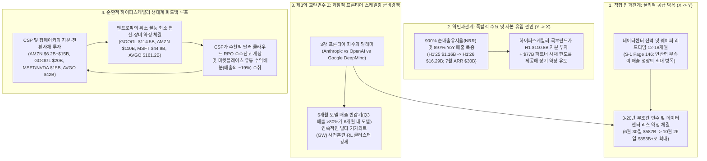
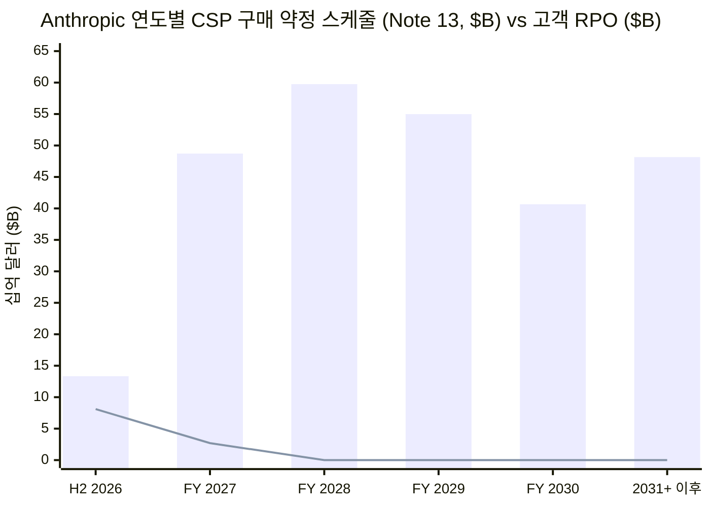

2026년 10월 27일, **앤트로픽(Anthropic, PBC)**이 역사적인 기업공개 등록명세서(**SEC Form S-1**, `CIK 0002130357`)를 제출한 지 채 24시간도 지나지 않아 **스노우플레이크(Snowflake)** 최고경영자(CEO)이자 **그레이록(Greylock)** 벤처 파트너, 전 구글 광고 총괄 수석부사장(SVP)인 **스리다르 라마스와미(Sridhar Ramaswamy, `@RamaswmySridhar`)**가 X(구 트위터)에 프론티어 인공지능 시대의 가장 핵심적인 대차대조표 불안 요인을 꿰뚫는 16연작 분석 스레드를 게시했다.

> **Sridhar Ramaswamy (`@RamaswmySridhar`), 2026년 10월 27일 (`1/16` 및 `16/16`):**
> *"1/16 AI 산업은 기이한 베팅을 하고 있다. 수년 치 연산력(compute)을 미리 매입해 놓고, 지능은 토큰(token) 단위로 파는 것이다. 은행, 원자재 중개상, 항공사, 유틸리티(전력), 클라우드 사업자(CSP)는 각각 이 리스크의 서로 다른 단면을 설명해 준다... 14/16 앤트로픽의 S-1이 이를 구체적인 숫자로 보여줬다. 2026년 6월 30일 기준 주로 클라우드/연산으로 구성된 향후 고정·최소 구매 약정액이 $265.6B에 달하며, 아직 개시되지 않은 체결 리스 계약이 $321.4B이다. 이들은 별개의 장기 약정 바구니이며 일부는 조건부다... 16/16 결론: AI 스택은 역전된 만기 변환(inverted duration transformation), 무조건 인수(take-or-pay) 영업 레버리지, 소멸성 GPU 시간, 빠른 하드웨어·모델 노후화, 프로젝트 파이낸싱 편중, 그리고 순환적 클라우드 수요를 동시에 안고 있다. 뱅크런(bank run)보다는 설비 과잉 붕괴(capacity bust)가 일어날 가능성이 훨씬 높다."*
> — 원문 출처: [Sridhar Ramaswamy on X (2026년 10월 27일)](https://x.com/RamaswmySridhar/status/2115159261533929911)

라마스와미의 스레드는 게시 직후 테크 투자자, 크레딧 애널리스트, 인프라 엔지니어들(`@aadi29494`, `@GravityRsch`, `@Dabeer_builds`, `@xtbot`, `@BitWhitman`, `@eequityresearch`) 사이에서 치열하고 수준 높은 논쟁을 촉발했다. 프론티어 AI 연구소 회의론자들은 AI 연구소들이 스스로 토큰당 가격을 세대마다 크게 인하(`~40%` 작업당 비용 절감)하는 동시에, 단지 현상을 유지하기 위해서만 매 6개월마다 수백억 달러의 프론티어 훈련(training) 연산비를 지출해야 하므로 연구개발비(`R&D`)가 사실상 반복적인 **유지보수 설비투자(`Maintenance CapEx`)**로 변질되었다는 점에서 라마스와미가 오히려 리스크를 *과소평가*했다고 지적했다. 반면 프론티어 연구소 옹호론자들은 AI 연산력을 빈 항공기 좌석이나 위워크(WeWork) 사무실 리스에 비유하는 것은 **제본스의 역설(Jevons Paradox, 가격 하락이 에이전트 워크로드 폭발을 부르는 현상)**, `900%`에 달하는 엔터프라이즈 순매출유지율(`NRR`), 멀티칩 오케스트레이션, 그리고 20년 만기 데이터센터 쉘(shell) 리스와 3~5년 주기 실리콘 가속기 약정을 분리하는 아키텍처 전략을 간과한 것이라고 반박했다.

본 보고서는 브라운과 킬리(Browne & Keeley)의 **"사금 채취(Panning for Gold)"** 비판적 사고 방법론을 적용하여 라마스와미의 16개 트윗과 주요 반론들을 **앤트로픽(Anthropic, PBC)의 2026년 10월 26일 자 SEC Form S-1 원문(`Pages 1–172` 및 재무제표 주석 `Notes 1–17`, `Pages F-1 to F-66`)**, **코어위브(CoreWeave, Inc.)의 FY2025 SEC 공시(`CIK 0001769628`)**, 그리고 **아마존(`AMZN`)**, **알파벳(`GOOGL`)**, **마이크로소프트(`MSFT`)**, **엔비디아(`NVDA`)**, **AMD(`AMD`)**의 1차 공시 자료와 직접 대조해 정밀 검증한다.

---

## 핵심 요약 및 포렌식 스코어카드 (Executive Summary & Forensic Scorecard)

1차 공시 원문 대조 결과, **자산-부채 만기 불일치에 관한 스리다르 라마스와미의 구조적 진단은 방향성 면에서 정확하나, 앤트로픽 S-1 내부에 묻혀 있는 4가지 결정적 정량 공시(`Note 2`, `Note 9`, `Note 17`, `MD&A Pages 143 & 170–172`)를 누락**하고 있었다. 이 네 가지 공시를 반영하면 단기 영업 레버리지 위험과 앤트로픽의 계약상 탈출구(escape valves) 모두 소셜 미디어의 통념보다 훨씬 더 정교하고 날카롭게 드러난다.

1. **공급 약정 대 수요 잔고의 정확한 만기 불일치 배수 (총합 기준 `54.4x`~`79.0x`, 1년 초과 장기 기준 `>200x`):**
   라마스와미는 앤트로픽의 2026년 6월 30일 기준 공급 측 약정(**`Note 13`의 취소 불가능 클라우드 구매 약정 `$265.6B`** + **`Note 7`의 미개시 체결 리스 `$321.4B`** = **`$587.0B`**, 개시된 리스 부채 `$2.1B` 별도)만 인용했을 뿐, **`Note 2(수익 인식 — 잔여수행의무 RPO, Page F-27)`**나 **`Note 17(보고기간후사건, Page F-66)`**은 교차 검증하지 않았다.
   - **수요 측면(`Note 2`):** 2026년 상반기(H1 2026) 매출 `$16,286M` 중 **`80.22%`(`$13,064M`)**가 **토큰당 종량제(pay-per-token consumption)** 매출이며, 단지 **`19.78%`(`$3,222M`)**만이 구독(`12개월 이하` 약정) 매출이다. 더욱이 2026년 6월 30일 기준 앤트로픽의 계약된 취소 불가능 고객 매출 잔고(**잔여수행의무, `RPO`**) 총액은 고작 **`$10.8B`(108억 달러)**에 불과하며, 그중 **`75%`(`$8.1B`)**는 `12개월 이내`에 인식되고 **1년 이후를 넘어가는 장기 고객 RPO는 단 `25%`(`$2.7B`)뿐**이다!
   - **공급 측면(`Note 17`):** 2026년 7월 1일부터 10월 26일 사이에 앤트로픽은 **장기(`1~20년`) 최소 연산·리스 약정 `$245.0B`**와 **단기(`1년 미만`) 약정 `$21.0B`**를 **추가로 체결**하여 총 확정·최소 공급 약정 규모를 **`$855.1B`(8,551억 달러)**까지 끌어올렸다(`Note 16`의 2028~2031년 조건부 구글 TPU 확장분 `$125.0B~$150.0B` 및 AMD Helios 시스템 `$20.0B+` 제외).
   - **포렌식 불일치 배수:** 앤트로픽의 다년 공급 약정 총액은 계약된 고객 매출 잔고(`$10.8B` RPO)를 **2026년 6월 30일 기준 `54.4x`(`$587.0B / $10.8B`)**, **2026년 10월 26일 기준 `79.0x`(`$853.0B / $10.8B`)** 초과한다. 특히 1년 초과 장기 구간에서는 확정 공급 의무(`~$800B+`)가 장기 고객 RPO(`$2.7B`)의 **`거의 300배`**에 달한다.
2. **토큰 현물 매출 변동성 및 '6개월 모델 매출 반감기'의 실증적 증거 (`MD&A Page 143`):**
   앤트로픽 S-1 `Page 143`의 두 가지 공시는 라마스와미의 단기 수요 변동성 가설과 `@aadi29494` / `@eequityresearch`의 모델 노후화 가설을 모두 실증적으로 입증한다.
   - **연말 코드 프리즈(Code-Freeze) 기간 매출 급감 (`2주 만에 -20%`):** 2026년 1월 2일로 종료된 2주 동안 앤트로픽의 전체 고객 지출은 직전 2주(2025년 12월 19일 종료) 대비 기업들의 연말 배포 중단 영향으로 **`~20%` 급감**했으나, `12~18개월 전에 미리 조달된`(`Page 146`) 약정 연산 용량 비용은 `100%` 고정되어 있었다.
   - **`<6개월`에 불과한 상업적 모델 수명 반감기:** 앤트로픽은 `Page 143`에서 *"2026년 9월 30일 종료 6개월 이내에 출시된 모델 버전들이 2026년 3분기(9월 30일 종료 3개월) 전체 매출의 **80% 이상**을 차지했다"*고 명시했다. 프론티어 모델 가중치가 두 분기 만에 상업적 가격 결정력을 상실하고, 앤트로픽의 **`85.39%` GAAP 매출총이익률(H1 매출 `$16,286M` 대비 매출원가 `$2,380M`, `Page 151`)**에는 **H1 R&D 총액 `$9,741M` 내부에 비용 처리된 훈련 연산비 `~$6,565M`(`Note 8, Page F-39`)**이 제외되어 있으므로, 프론티어 모델 훈련 연산비는 재량적 소프트웨어 R&D가 아니라 **반복적 유지보수 설비투자(`Maintenance CapEx`)**로 기능한다.
3. **거래처별 상세 약정 원장과 숨겨진 계약 해지 옵션 (`Pages 170–172`):**
   라마스와미와 "AI판 위워크" 비관론자들(`@xtbot`) 모두 S-1 `Pages 170–172`에 공개된 거래처별 상세 계약 원장을 분석하지 않았다. 이 원장을 해부하면 앤트로픽의 `$853B+` 약정 스택은 위험 성격이 전혀 다른 4개 계층으로 나뉜다.
   - **하이퍼스케일러 무조건 인수(Take-or-Pay) 최소 약정 (`$269.4B`):** **구글(`$114.5B`, 2026년 4월~2033년 7월)**, **아마존(`$110.0B`, 2026년 5월~2036년 4월)**, **마이크로소프트(`$44.9B`, 2026년 11월~2033년 5월)** 계약은 모두 *"실제 사용량과 무관하게(regardless of actual usage)"* 이행해야 하며, 미달 시 현금 **정산금(true-up)**을 지급해야 한다.
   - **PIK 전환사채로 뒷받침된 하드웨어 금융리스 (`$161.2B`):** **브로드컴(Broadcom)**과 체결한 5년 만기 TPU 하드웨어 마스터 장비 금융리스(`이자 제외 $161.2B`, `Page 171`)는 모회사 보증, 교차부도(cross-default) 기한이익 상실 조항, 그리고 **`$42.0B` 규모의 브로드컴 전환사채 발행 한도(`Note 9`, 기본 `9.00%` PIK 금리이나 매출 성장 목표 미달 시 `13.00%` PIK 금리 가산 및 `85%` VWAP 할인 전환 가격 적용)**와 연동되어 있다.
   - **`$120.5B` SpaceX.AI(`xAI`) 계약의 '90일 사전 통지 해지권' 안전밸브 (`Page 171`):** 2026년 5월~10월 사이 앤트로픽은 **SpaceX.AI LLC(구 X.AI LLC)**와 엔비디아 GPU 용량 확보를 위해 최대 **`$120.5B`**(2026년 12월 전체 인도 완료 시 **월 약 `$3.1B`**, 2029년까지) 규모의 계약을 체결했다. 그런데 `Page 171`을 보면 **2027년 1월 및 3월에 종료되는 초기 취소 불가 기간 이후에는 어느 당사자든 `90일 사전 서면 통지`만으로 월 `$3.1B` 계약 전체를 해지할 수 있다**!
   - **프로젝트 파이낸싱 조건부 네오클라우드 계약 (`$85.9B`):** **Nscale(`$44.6B`, 2033년까지)** 및 **Lambda(`$41.3B`, 2034년까지)**와의 GPU 서비스 계약은 용량이 인도되어 수락된 이후에만 요금이 발생하며, 네오클라우드가 적기에 프로젝트 파이낸싱이나 데이터센터 시설 리스를 확보하지 못하면 계약을 해지할 수 있다.

| 분석 차원 / 핵심 가설 | 출처 / 제기 주체 | 1차 SEC 공시 증거 (`Anthropic S-1` / `CoreWeave 10-K`) | 포렌식 판정 및 신뢰도 평점 |
| :--- | :--- | :--- | :--- |
| **1. 역전된 만기 변환 (은행 비유)** | Sridhar Ramaswamy (`Tweets 2–4`) | `Note 2 (Page F-27)`: H1 매출의 `80.22%`가 토큰 종량제이며 고객 `RPO`는 `$10.8B`(`1년 내 $8.1B`, `1년 초과 $2.7B`)에 불과한 반면, 다년 공급 약정은 `$587.0B`(`6/30`) / `$853.0B`(`10/26`)로 `54.4x–79.0x` 불일치. | **실증 입증됨 (`9.5/10`)** — 고전적 예금 인출(뱅크런) 부재와 고정 약정발 자금 경색 전이를 정확히 구분함. |
| **2. LNG 무조건 인수 영업 레버리지 (`3.0x DOL`)** | Sridhar Ramaswamy (`Tweets 5–6`) | `Pages 170–171`: 구글(`$114.5B`), 아마존(`$110.0B`), MS(`$44.9B`) 약정은 *"실제 사용량 무관"* 최소 지출 및 현금 true-up 강제. H1 연산비(`$8.95B`) + 수익배분(`~$3.09B`) = 매출의 `74%`, 실제 `DOL = 3.11x`. | **실증 입증됨 (`9.0/10`)** — LNG take-or-pay 구조와 완벽히 일치하나, 단기적으로는 `$131.65B` 현금과 `$77.0B` 미인출 NPA가 완충함. |
| **3. 항공 좌석 소멸성 및 빠른 자산 노후화** | Sridhar Ramaswamy (`Tweets 7–8`) | `Page 143`: 2025년 12월~2026년 1월 연말 코드 프리즈 기간 고객 지출이 `~20%` 급감하는 동안 `12–18개월 전 조달된` 고정 연산비는 유지됨. 단, 유휴 추론 시간은 훈련으로 전환 가능. | **기술적 단서 하에 입증됨 (`8.0/10`)** — 항공기와 달리 AI 연구소는 유휴 추론 클러스터를 백그라운드 사전훈련·강화학습(RL)에 재할당 가능. |
| **4. 자해적 가격 인하 및 6개월 모델 반감기** | `@aadi29494` & `@eequityresearch` (답글) | `Page 10`: `Claude Opus 5.5`가 `Opus 5` 대비 작업당 고객 비용을 `~40%` 절감. `Page 143`: 출시 `6개월 미만` 모델이 2026년 3분기 매출의 `>80%` 창출. `Note 8`: H1 연산비 중 `$6.57B`가 R&D에 계상됨. | **핵심적 분석 확장 (`9.5/10`)** — 라마스와미가 누락한 핵심 고리: `85.39%` GAAP 매출총이익률은 매출의 `40.3%`에 달하는 반복 훈련 연산비를 가리고 있음. |
| **5. 네오클라우드 프로젝트 파이낸싱 및 신용 편중** | Sridhar Ramaswamy (`Tweets 9–10`) & `@Dabeer_builds` | CoreWeave FY25 공시: 약정 매출 비중 `>98%`, MS 편중도 `~62%`, 자산담보부 부채 `$21.6B`. `Anthropic S-1 Page 171`: Nscale(`$44.6B`)·Lambda(`$41.3B`) 계약은 파이낸싱 및 인도에 따른 조건부. | **실증 입증됨 (`9.0/10`)** — 네오클라우드는 엔비디아 설비투자와 연구소/CSP 오프테이크 사이에 낀 고레버리지 신용 샌드위치 계층임. |
| **6. 하이퍼스케일러 풀링 vs 순환적 클라우드 수요** | Sridhar Ramaswamy (`Tweets 11–13`) & `@GravityRsch` | 아마존(`$6.2B` 사채 + `$15B` NPA vs `$110B` AWS 약정 + `19%` 수익배분), 구글(`$20B` NPA vs `$114.5B` + `$125B–$150B` TPU 약정), MS/엔비디아(`$15B` 시리즈 G vs `$44.9B` Azure 약정). | **실증 입증됨 (`9.5/10`)** — 자본 투자, 연산 판매, 마켓플레이스 유통(`Bedrock`/`Vertex`/`Foundry`), 클라우드 RPO 수주잔고가 순환 고리를 형성. |
| **7. "AI판 위워크(WeWork)" 20년 리스 파산 가설** | `@xtbot` (답글) | `Pages 137, 141 & 171`: `Anthropic Direct` 전략 하에서 10~20년 미개시 리스(`$321.4B`)는 총비용의 `15–25%`인 **데이터센터 전력 쉘(shell)** 위주이며, 3~5년 실리콘(`브로드컴 5년 TPU`, `90일 해지 가능 $120.5B SpaceX.AI`)과 분리됨. | **과도한 단순화로 기각 (`3.5/10`)** — 쉘 대 실리콘 만기 분리, 멀티칩 호환성, `$120.5B` SpaceX.AI 90일 해지권을 간과함. |

---

## Phase 1 & Phase 2: 쟁점 구조화, 1차 공시 발굴 및 이해상충 감사

### 1.1 스리다르 라마스와미의 16연작 스레드 원문과 6대 반론의 완전한 재구성

허수아비 때리기 오류(straw-man fallacy)를 원천 차단하기 위해 스리다르 라마스와미의 2026년 10월 27일 자 스레드(`1/16`~`16/16`) 전체 논리 구조와 답글 체인의 6대 핵심 반론을 빠짐없이 복원한다.

* **트윗 `1/16–4/16` (은행 비유 — 역전된 만기 변환과 자금 경색 전이):**
  > *"2/16 은행부터 시작하자. 은행은 단기로 빌려(언제든 빠져나갈 수 있는 예금) 장기로 빌려준다(주택담보대출, 다년 대출). 3/16 AI 연구소들은 정반대로 한다. 다년 치 연산력 약정을 고정해 두고, 고객이 내일 당장 줄이거나 다른 곳으로 우회(reroute)할 수 있는 단기 토큰 사용량을 판매한다. 4/16 은행과 달리 고객이 과거에 쓴 토큰 비용을 돌려달라고 요구할 수는 없다. 따라서 고전적인 '뱅크런'은 없다. 진짜 위험은 고정 의무가 충격을 증폭시키고 자금 조달 위축이 연쇄 파급될 수 있다는 점이다."*
* **트윗 `5/16–6/16` (원자재 중개상 비유 — LNG 무조건 인수 계약과 영업 레버리지):**
  > *"5/16 더 깔끔한 영업 비유는 원자재 중개상(commodity merchant)이다. 10년 만기 무조건 인수(take-or-pay) LNG 계약을 맺은 뒤 현물 시장에 카고(화물)를 파는 구조다. 6/16 이는 잔혹한 영업 레버리지를 만든다. 매출 $150을 기대하며 고정 용량 $100을 약정하면 기타 비용 차감 전 기여이익은 $50이다. 여기서 매출이 30% 미달해 $105로 줄어들면 기여이익은 90% 증발해 $5로 쪼그라든다."*
* **트윗 `7/16–8/16` (항공사 비유 — 소멸성 재고와 가속화된 자산 노후화):**
  > *"7/16 여기에 항공사를 더해보자. 이륙 순간의 빈 좌석은 영원히 사라진다. 어제 쓰지 못한 GPU 시간(gpu-hour)도 마찬가지다. 8/16 항공사와 마찬가지로 AI는 탑승률(load factor) x 단위수익률(yield)로 돌아간다. 하지만 항공기는 25~30년을 날아다니는 반면, GPU 세대와 모델 아키텍처는 12~36개월 만에 늙어버린다."*
* **트윗 `9/16–10/16` (유틸리티 비유 — AI의 프로젝트 파이낸싱 계층인 GPU 네오클라우드):**
  > *"9/16 유틸리티(전력회사)는 왜 장기 계약이 존재하는지 설명해 준다. 발전소는 현물 수요만 보고 파이낸싱하지 않으며 장기 전력구매계약(PPA)을 담보로 자금을 조달한다. 10/16 GPU 네오클라우드는 AI의 프로젝트 파이낸싱 계층이다. 코어위브(CoreWeave)는 2025년 매출의 >98%가 약정 계약에서 나왔다고 밝히며, 계약된 현금흐름을 담보로 GPU 구매 자금을 조달한다. 이는 현물 위험을 줄여주지만 신용 위험과 차환(rollover) 위험을 집중시킨다."*
* **트윗 `11/16–13/16` (클라우드 사업자 비유 — 멀티테넌트 풀링 vs 생태계 순환 거래):**
  > *"11/16 클라우드 사업자(AWS, Azure, GCP) 역시 수년 앞서 건설하고 사용량으로 수익화한다. 왜 그들은 폭발하지 않았을까? 12/16 기존 클라우드는 수백만 워크로드에 걸친 분산 풀링(diversified pooling), 1~3년 엔터프라이즈 약정, 느린 노후화, 재활용 가능한 범용 인프라, 그리고 그 뒤를 받치는 거대한 캐시카우가 있었기 때문이다. 13/16 AI에서는 순환성(circularity)이 그림을 흐린다. 클라우드 사업자가 AI 연구소에 투자하고, 연산력을 팔고, 모델을 유통하며, 동일한 생태계에서 다년 수주잔고(backlog)를 장부에 올릴 수 있다."*
* **트윗 `14/16–16/16` (앤트로픽 S-1 실증 사례 및 종합 결론):**
  > *"14/16 앤트로픽의 S-1이 이를 구체화했다. 2026년 6월 30일 기준 주로 클라우드/연산으로 구성된 향후 고정·최소 구매 약정 $265.6B와 미개시 체결 리스 $321.4B를 공시했다. 이들은 별개의 장기 약정 바구니이며 일부는 조건부다. 15/16 이 구조는 매출이 고정 약정보다 더 빠르게 확장될 때만 작동한다. 앤트로픽의 H1 2026 매출은 $16.3B에 달했고 연산 비용은 매출의 55%(H1 2025에는 201%)로 하락했다. 16/16 결론: AI 스택은 역전된 만기 변환, 무조건 인수 영업 레버리지, 소멸성 GPU 시간, 빠른 하드웨어/모델 감쇠, 프로젝트 파이낸싱 집중, 순환적 클라우드 수요를 안고 있다. 뱅크런보다는 설비 과잉 붕괴(capacity bust)가 일어날 가능성이 더 높다."*

이 스레드에 달린 주요 도메인 전문가들의 6가지 분석적 확장은 다음과 같다.
1. **`@aadi29494` (자해적 토큰 디플레이션):** *"원자재 중개상 비유가 가장 날카롭다. 그런데 LNG보다 더 나쁜 점은 연구소들이 스스로 가격을 깎고 있다는 사실이다. 항공사는 작년 좌석의 가치를 떨어뜨리는 새 비행기를 6개월마다 출시하지 않는다. 새 모델이 나올 때마다 기존 용량의 가격은 낮아지는데 연산 리스료는 그대로 유지된다."*
2. **`@eequityresearch` (유지보수 CapEx로서의 훈련 비용):** *"나를 가장 두렵게 하는 부분은 선두 주자에게 훈련 비용(training costs)은 R&D가 아니라 유지보수 설비투자(maintenance capex)라는 점이다."*
3. **`@GravityRsch` (순환 거래와 가격 탄력성의 역설):** *"13/16이 핵심이다. 자본, 연산, 유통이 하나의 루프 안에 들어앉으면 보고되는 수요가 실제 최종 시장 수요보다 더 단단해 보인다. 게다가 LNG나 항공사와 달리 AI 연구소들은 다년 고정 용량을 잠그면서 동시에 토큰당 가격을 끌어내리고 있다."*
4. **`@Dabeer_builds` (네오클라우드의 차환 창구 리스크):** *"원자재 중개상 비유가 가장 깔끔하다. 고정 $100 / 기대 $150 -> 30% 미달 시 기여이익 90% 증발 산수는 잔혹하고 과소평가되어 있다. 내가 계속 주목하는 것은 8/16 + 10/16의 결합이다. 네오클라우드들은 25년짜리 발전소를 위해 고안된 프로젝트 파이낸싱 구조로 24~36개월 만에 감가상각되는 자산을 조달하고 있다. 담보물이 N-1 세대 하드웨어가 되는 첫 번째 차환(refinancing) 시점에 무슨 일이 벌어지겠는가?"*
5. **`@xtbot` ("AI판 위워크" 비관론):** *"14/16은 아무도 정면으로 보려 하지 않는 숫자다. 연환산 매출 $32B 대비 통합 의무 $587B, 24개월 만에 감가상각되는 자산, 전환 비용(switching cost)이 제로인 제품 판매. 위워크(WeWork)가 똑같은 구조였다: 15년 리스 의무, 월 단위 멤버십. 차이점은 오피스 빌딩은 18개월마다 구식이 되지 않는다는 것뿐이다."*
6. **`@BitWhitman` (제본스의 역설 / 클러스터 가동률 낙관론):** *"LNG와 항공사 비유는 수요가 외생적이고 잘못된 방향으로 가격 탄력적일 때만 성립한다. 토큰 가격이 10분의 1로 떨어질 때마다 작업당 100배 많은 토큰을 소비하는 새로운 범주의 에이전트 워크로드가 실현 가능해진다. 연구소들은 정적인 쿼리 물량에 베팅하는 것이 아니라 하드웨어가 감가상각되기 전에 제본스의 역설(Jevons paradox)이 클러스터를 채울 것이라는 데 베팅하고 있다."*

### 1.2 발언자 전문성 및 상업적 이해상충(Conflict of Interest) 감사

`.agents/rules/deep-research.md` 원칙에 따라 주 저자의 도메인 전문성과 상업적 인센티브를 검증한다.
* **도메인 전문성 (`높음`):** 스리다르 라마스와미는 10년 이상 구글의 핵심 광고·커머스 엔지니어링 조직(`$100B+` 런레이트 실시간 경매 인프라)을 총괄했고, AI 검색 엔진 **니바(Neeva)**를 공동 창업(2023년 5월 스노우플레이크가 인수)한 뒤 2024년 2월부터 **스노우플레이크(`NYSE: SNOW`) CEO**로 재직 중이다. 그는 AWS, Azure, GCP와 수십억 달러 규모의 클라우드 약정을 직접 협상하는 동시에 엔터프라이즈 규모로 프론티어 모델 토큰을 구매하는 당사자다.
* **상업적 이해상충 (`중대함 — 반드시 명시 필요`):** 스노우플레이크 CEO로서 라마스와미는 포춘 500대 기업 CIO들에게 **모델 불가지론적 추상화(model-agnostic abstraction) 및 멀티모델 라우팅**을 핵심 가치로 내세우는 엔터프라이즈 데이터 클라우드 플랫폼(**Snowflake Cortex AI**)을 판매하고 있다. 즉 기업들이 벤더 종속(lock-in) 없이 앤트로픽 Claude, 오픈AI GPT, 메타 Llama, 미스트랄, 스노우플레이크 자체 모델을 언제든 교체할 수 있도록 지원하는 위치에 있다.
  * *포렌식 함의:* 트윗 `3/16`에서 라마스와미는 AI 연구소들이 *"고객이 내일 당장 줄이거나 다른 모델로 우회할 수 있는 단기 토큰 사용량을 판다"*고 강조했다. 스노우플레이크는 **모델 계층의 토큰은 전환 비용이 없는 범용 원자재(commodity)**라고 규정할수록 자사의 데이터 거버넌스 계층(Snowflake)의 전략적 가치가 올라가는 직접적인 상업적 이해관계를 갖는다. 따라서 본 감사는 앤트로픽의 엔터프라이즈 고객들이 실제로 '제로 전환 비용' 이탈을 보이는지, 아니면 강력한 다년 코호트 고착성(`NRR`)을 보이는지 1차 공시 숫자로 검증해야 한다.

---

## Phase 3: 핵심 용어의 의미론적 정밀화 및 7대 섹터 구조적 리스크 매트릭스

### 3.1 3대 핵심 개념에 대한 모호성 제거 및 대체 테스트 (Substitution Tests)

1. **"만기 불일치(Duration Mismatch)" (`은행의 자산-부채 만기 변환` vs `영업 약정 만기 격차`):**
   * *대체 테스트:* 상업은행이 파산할 때(`2023년 3월 실리콘밸리은행 SVB`)는 단기 부채 보유자(**예금주**)가 법적으로 즉각적인 `100%` 원금 현금 상환을 요구하여 장기 보유 자산(`만기보유 국채/MBS`)의 헐값 투매를 강제한다. 그렇다면 API 사용을 중단한 고객에게 AI 연구소가 과거 매출액을 현금으로 환불해 주어야 하는가? **전혀 아니다.**
   * *정밀 정의:* AI 연구소가 직면한 것은 부채 측면의 유동성 인출 사태(`Asset-Liability Maturity Transformation`)가 아니라, **부외 영업 약정 만기 격차(Off-Balance-Sheet Operating Commitment Duration Gap)**이다. 즉 `3~20년` 만기의 고정 투입 약정(`연산 구매 약정 + 데이터센터 리스`)을 체결해 놓고 `1~90일` 단위의 비약정 현물 산출 매출(`토큰 종량제 API 소비`)로 이를 충당하는 영업 레버리지 구조다.
2. **"약정 연산 및 체결 리스 (`$587.0B` / `$853.0B`)" (`무조건부 부채성 최소 약정` vs `이정표 조건부 및 해지 가능 트랜치`):**
   * *대체 테스트:* 앤트로픽의 `$587.0B`(6월 30일) 또는 `$853.0B`(10월 26일) 의무액 전체를 위워크(WeWork)의 무조건부 15년 오피스 리스와 동일시할 수 있는가? **아니다.**
   * *정밀 분해 (`Anthropic S-1 Notes 7, 13, 17 & Pages 170–172`):* 아래 5.2절에서 증명하듯, `$269.4B`는 하이퍼스케일러 무조건 인수 최소 약정(`구글`, `아마존`, `마이크로소프트`)이고 `$161.2B`는 취소 불가능한 5년 만기 브로드컴 TPU 금융리스인 반면, **`$120.5B`(`SpaceX.AI LLC` 엔비디아 GPU)는 2027년 1분기 이후 어느 당사자든 `90일 사전 서면 통지`로 해지 가능**하며, **`$85.9B`(`Nscale` 및 `Lambda`)는 네오클라우드의 프로젝트 파이낸싱 조달 및 시설 인도 이정표 달성을 조건으로 한다.**
3. **"매출총이익률 (`85.39%`)" (`추론 서빙 마진` vs `유지보수성 훈련 연산을 포함한 전주기 연산 마진`):**
   * *대체 테스트:* 전통적 SaaS 기업(`어도비`나 `워크데이`)이 `85.39%`의 매출총이익률을 보고할 때, 과거 R&D로 작성된 소프트웨어 코드는 `5~10년 이상` 매출을 창출한다. 만약 앤트로픽이 내일 당장 R&D 훈련 클러스터 가동을 멈춘다면 현행 모델 세대가 `>80%`의 매출 비중을 유지하는 기간은 얼마인가? **6개월 미만이다(`MD&A Page 143`).**
   * *정밀 정의:* 프론티어 AI에서 **GAAP 매출총이익률(H1 2026 `85.39%`)**은 오직 **고객 서빙 추론 마진**(`매출 - 매출원가`)만 측정할 뿐이다. 경제적 실질을 반영한 **전주기 연산 기여이익률(Full-Cycle Compute Contribution Margin, H1 2026 `26.1%`)**은 매출에서 `매출원가`(`$2,380M` 추론 연산비), `S&M` 내 제3자 클라우드 파트너 수익배분 수수료(`$3,094M`), 그리고 `R&D 훈련 연산비`(`~$6,565M`)를 모두 차감해야 산출된다.

### 3.2 7대 섹터 구조적 리스크 비교 매트릭스

라마스와미의 5대 산업 비유를 엄밀하게 검증하기 위해 **상업은행**, **LNG 원자재 중개상**, **여객 항공사**, **전력 유틸리티**, **하이퍼스케일 CSP**, **GPU 네오클라우드(`CoreWeave`)**, **프론티어 AI 연구소(`Anthropic`)**를 7가지 대차대조표 구조 변수로 비교한다.

| 구조적 변수 | 상업은행 (Banks) | LNG 원자재 중개상 | 여객 항공사 (Airlines) | 전력 유틸리티 (Utilities) | 하이퍼스케일 CSP (`AWS` / `Azure` / `GCP`) | GPU 네오클라우드 (`CoreWeave`) | 프론티어 AI 연구소 (`Anthropic S-1`) |
| :--- | :--- | :--- | :--- | :--- | :--- | :--- | :--- |
| **투입 / 부채 만기** | **초단기** (`즉시 인출 가능한 요구불예금`) | **장기** (`10–20년 무조건 인수 액화 SPA`) | **장기** (`10–15년 항공기 리스 및 부채`) | **초장기** (`20–40년 프로젝트 부채 및 설비`) | **장기** (`15–30년 쉘`, `4–6년 서버 수명주기`) | **중기** (`3–6년 GPU DDTL 대출 및 5–15년 DC 리스`) | **장기** (`3–10년 CSP 최소약정`, `5년 TPU 리스`, `10–20년 쉘 리스`) |
| **산출 / 매출 만기** | **장기** (`5–30년 고정/변동 대출 및 모기지`) | **단기** (`현물 및 단기 JKM/TTF 카고 판매`) | **단기** (`현물 및 1–90일 사전 항공권 판매`) | **장기** (`10–25년 규제 요금 및 PPA`) | **중기 혼합** (`1–3년 엔터프라이즈 CUD / $600B+ RPO + 종량제`) | **중기** (`3–5년 무조건 인수 계약; >98% 약정 매출`) | **단기** (`80.2% 토큰 종량제 현물; 고객 RPO는 $10.8B뿐, 75% <12개월`) |
| **재고 소멸성** | 낮음 (현금/신용은 이자율로 이월됨) | 중간 (증발 가스 및 고비용 해상 저장) | **100% 소멸** (`이륙 순간 빈 좌석은 영구 소멸`) | **100% 소멸** (`저장 안 된 MWh는 즉시 소멸`) | 높음 (유휴 CPU/GPU 사이클 소멸, 수백만 고객 풀링으로 상쇄) | 높음 (무조건 인수 계약으로 오프테이커에 전가) | **높으나 반(半)대체 가능** (`유휴 추론 GPU 시간은 사전훈련·RL에 투입 가능`) |
| **기초 자산 내용연수** | 금융 채권 (`5–30년`) | 액화 트레인 및 LNG선 (`25–40년`) | 상업용 항공기 기체 (`25–30년`) | 발전 터빈 및 송배전망 (`30–50년`) | 범용 서버 (`5–6년`), 데이터센터 쉘 (`20–30년`) | AI GPU (`물리적 3–5년`, `프론티어 피크 18–36개월`) | **데이터센터 쉘 (`15–20년`), 실리콘 (`3–5년`), 모델 가중치 (`<6개월 반감기`)** |
| **자해적 가격 디플레이션** | 없음 (중앙은행 금리 사이클 추종) | 없음 (글로벌 기후·수급에 따른 현물가) | 없음 (신형 항공기가 운임을 연 `40%` 깎지 않음) | 없음 (규제 요금기저 물가 연동 인상) | 완만함 (무어의 법칙에 따른 연 `~10–15%` 가성비 개선) | 계약 갱신 시 높음 (`N-1` 세대 GPU 임대료 `40–60%` 하락) | **극단적 (신모델 출시 시 6–12개월마다 작업당 비용 `~40%+` 인하)** |
| **전환 비용 및 워크로드 고착성** | 중하 (디지털 자금 이체는 수 시간 내 가능) | **제로** (메탄 분자는 100% 대체 가능) | 낮음 (최저가 노선 검색; 마일리지로 방어) | **무한대** (지역 독점 전력망) | **높음** (데이터 중력, IAM, VPC, 엔터프라이즈 통합) | 계약 기간 중 높음 (`3–5년 고정`), 만기 갱신 시 낮음 | **양극화** (`단순 API 래퍼는 낮음; 에이전트 코딩·엔터프라이즈는 높음 / 900% NRR`) |
| **핵심 실패 모드 (Failure Mode)** | **고전적 유동성 뱅크런** (자산 매각보다 빠른 예금 인출) | **스프레드 붕괴** (현물가가 고정 액화 수수료 하회) | **탑승률 × 수익률 불황 파산** (고정 리스료가 마진 압살) | **좌초 자산 / 오프테이커 부도** (규제 당국 요금 불인정) | **설비 과잉 투자 / ROIC 압축** (레거시 캐시카우가 흡수) | **차환 / 잔존 담보가치 절벽** (리스 만기 시 `N-1` GPU 가치 급락) | **무조건 인수 마진 바이스(Vise)** (매출 둔화 시 고정 CSP 정산금 및 훈련비가 마진 잠식) |

---

## Phase 4: 4방향 인과관계 감사 (왜 연구소들은 현물 토큰에 맞서 `$853B+`를 고정하는가?)

계약된 고객 RPO가 **`$10.8B`**(`Note 2`)에 불과한데 왜 앤트로픽은 총 **`$855.1B`**에 달하는 연산 및 리스 약정(`Notes 7, 13 & 17`)을 체결했을까? 이를 단순히 경영진의 오만이나 버블 심리로 치부하지 않고 **4방향 인과관계 감사(4-Way Causal Audit)**를 수행한다.

| 인과 경로 (Causal Pathway) | 메커니즘 방향 | 1차 공시 증거 (`Anthropic Form S-1`) | 인과 기여 가중치 |
| :--- | :--- | :--- | :--- |
| **1. 직접 인과관계 (`물리적 병목 -> 장기 약정`)** | `공급 리드타임 (12–18개월) -> 다년 무조건 인수 계약` | `MD&A Page 146`: *"당사 제품에 대한 수요는 현재 가용 연산 용량을 초과하고 있으며... 예상 고객 사용 시점보다 12~18개월 앞서 용량 약정을 체결해야 한다."* `Page 140`: 데이터센터 용량 **1 GW** 구축에 **`$20B–$25B`**가 소요됨(`3–5년` 서버/실리콘이 `75–85%`, `10–20년` 쉘이 `15–25%`). 유틸리티나 CSP 모두 다년 take-or-pay 오프테이크 없이는 `$25B` 기가와트 클러스터를 짓지 않는다. | **35% (핵심 운영 동인)** |
| **2. 역인과관계 (`초고속 성장 및 자본 풍요 -> 공격적 선점`)** | `900% 코호트 확장 및 $131.7B 현금 보유 -> 다년 리스크 인수 의지` | `Page 142`: ARR `$100K` 이상 고객 코호트가 2026년 2분기에 **`900%` 이상의 순매출유지율(`NRR`)**을 기록함(2024년 1분기 이후 매 분기 `300%+` 초과). H1 2026 재무활동 현금유입이 **`$110.8B`**(`Page 168`)에 달해 기말 현금·단기금융상품이 **`$131.65B`**(`Page 161`)에 이름. 전례 없는 확장세와 풍부한 자본이 `12~18개월` 수요 외삽을 기정사실화하게 만듦. | **20% (행태적·대차대조표 동인)** |
| **3. 잠재 교란변수 `Z` (`6개월 프론티어 모델 노후화 트레드밀`)** | `과점적 스케일링 경쟁 (Z) -> 동시적 가격 인하 및 멀티 GW 약정` | `Page 143`: **2026년 3분기 매출의 `80%` 이상**이 **직전 6개월 이내에 출시된 모델**에서 발생함. 차세대 멀티 기가와트 클러스터(`Trainium3`, `TPU v7/v8`, `Blackwell/Rubin`, `MI450`)를 18개월 전에 선점하지 못하면 경쟁 연구소에 에이전트 코딩 시장을 뺏기고 기존 토큰 매출은 두 분기 안에 증발함. | **25% (구조적 게임이론 동인)** |
| **4. 순환적 생태계 피드백 루프 (`CSP 자본 <-> 연구소 RPO`)** | `전략적 지분/사채 자금 지원 <-> 취소 불능 클라우드 수주잔고 및 19% 수익배분` | `Pages 164–172`: 아마존(`$6.2B` 사채 + `$15B` 2026 NPA), 구글(`$20B` 2026 NPA + `$10B` IPO 배정 옵션), MS/엔비디아(`$15B` 시리즈 G), 브로드컴(`$42B` 2026 NPA)이 앤트로픽에 자금을 대고, **`$430.6B`**의 약정 클라우드·장비(`$114.5B` 구글 + `$110.0B` 아마존 + `$44.9B` MS + `$161.2B` 브로드컴)를 판매하며, 클라우드 마켓플레이스 수익배분 수수료로 **앤트로픽 전체 매출의 `~19%`(H1 2026 `$3,094M`, `Page 151`)**를 회수함! | **20% (금융공학 증폭기)** |

---

## Phase 5: 정량 및 금융공학 포렌식 감사 (Quantitative & Financial Engineering Audit)

라마스와미의 스레드와 앤트로픽 Form S-1의 모든 수학적·재무적 주장을 수식 도출과 스트레스 테스트로 검증한다.

### 5.1 트윗 `6/16` 검증: 영업 레버리지 도(`DOL`) 및 무조건 인수 스프레드 압축 수식 도출

트윗 `6/16`에서 스리다르 라마스와미는 원자재 중개상의 무조건 인수(take-or-pay) 산수를 다음과 같이 제시했다.
* 고정 무조건 인수 용량 약정 비용 `F = $100`
* 기대 현물 매출 `R₀ = $150`
* 기타 비용 차감 전 기대 기여이익 `Π₀ = R₀ - F = $150 - $100 = $50`
* 매출이 기대치 대비 `30%` 미달(`ΔR / R₀ = -0.30`)할 경우, 실제 매출은 `R₁ = $150 × (1 - 0.30) = $105`로 하락하고 기여이익은 `Π₁ = $105 - $100 = $5`로 추락하여 **기여이익의 `90%`가 증발**한다(`ΔΠ / Π₀ = -$45 / $50 = -90%`).

이를 일반화하여 고정 연산 약정 비용이 `F`이고 매출에 비례하는 비(非)연산 클라우드 파트너 수익배분 수수료율이 `v`일 때(기여이익 `Π(R) = R(1 - v) - F`), 매출 변동에 대한 **영업 레버리지 도(Degree of Operating Leverage, `DOL`)**를 도출하면 다음과 같다.

$$
\text{DOL}(R_0) = \frac{\partial \Pi / \Pi_0}{\partial R / R_0} = \frac{R_0 (1 - v)}{R_0 (1 - v) - F} = \frac{1}{1 - \frac{F}{R_0 (1 - v)}}
$$

라마스와미의 단순화된 예시(`v = 0`, `F = $100`, `R₀ = $150`)에서는 `DOL = 150 / (150 - 100) = 3.0x`이므로 `-30%`의 매출 충격이 발생할 때 `3.0 × (-30%) = -90%`의 기여이익 폭락이 발생한다.

이제 이 정확한 방정식에 **`MD&A Pages 149–152` 및 `Note 8(Page F-39)`에 공시된 앤트로픽의 2026년 상반기(H1 2026) 실제 실적 수치**를 대입해 보자!
* **H1 2026 매출 (`R₀`):** **`$16,286M`** (2026년 1분기 `$4,731M` + 2026년 2분기 `$11,555M`, `Page 158`).
* **H1 2026 변동 클라우드 파트너 수익배분 수수료율 (`v`):** `Page 151`에서 앤트로픽은 영업 및 마케팅 비용(`총 $4,102M`) 내 **클라우드 및 유통 파트너(`AWS Bedrock`, `Google Vertex AI`, `Microsoft Azure Foundry`)에 지급한 수익배분(revenue sharing) 수수료가 전체 매출의 `19%`**, 즉 **`~$3,094M`**(`v = 0.19`)이라고 공시했다.
* **H1 2026 총 연산 비용 (`F`):** `Page 152`에서 공시된 바와 같이(라마스와미 트윗 `15/16`과 일치), 손익계산서 전체에 걸친 앤트로픽의 H1 2026 총 연산 비용은 **`$8,945M`**(**매출의 `54.92%`**, H1 2025의 매출 `$1,163M` 대비 `$2,334M` 즉 **`200.69%`**에서 대폭 하락)이었다.
  * 고객 서빙 추론 연산비 (`매출원가 Cost of revenue`, `Page 151` 및 `Note 8 Page F-39`): **`$2,380M`** (**매출의 `14.61%`**, 이로 인해 표면적인 **GAAP 매출총이익률은 `85.39%`**로 나타남).
  * 연구개발 훈련 및 연구 연산비 (`R&D`, `Note 8 Page F-39`): **`~$6,565M`** (**매출의 `40.31%`**, 총 R&D 비용 `$9,741M` 내부에 포함됨).

앤트로픽의 H1 2026 실제 파라미터(`R₀ = $16,286M`, `v = 0.19`, 약정 연산비 `F = $8,945M`)를 위 영업 레버리지 공식에 대입하면 다음과 같다.

$$
\Pi_{\text{H1 2026}} = R_0 (1 - v) - F = 16,286 \times (1 - 0.19) - 8,945 = 13,191.66 - 8,945 = \$4,246.66\text{ million (26.08\% of Revenue)}
$$

$$
\text{DOL}_{\text{Anthropic H1 2026}} = \frac{13,191.66}{4,246.66} = 3.106\times
$$

**포렌식 발견:** 스리다르 라마스와미가 제시한 원자재 중개상 예시(`DOL = 3.0x`, 매출 `30%` 미달 시 기여이익 `90%` 증발)는 단순한 비유가 아니었다. **앤트로픽의 H1 2026 실제 수익배분 및 총연산비 차감 후 영업 레버리지 도(`DOL`)가 정확히 `3.11x`이다!** 만약 12~18개월 전에 조달되어 단기적으로 고정된 H1 연산비(`$8,945M`)가 유지되는 상태에서 앤트로픽의 매출이 계획 대비 `30%` 미달했다면, 연산비 및 파트너 수익배분 차감 후 기여이익은 `3.106 × (-30%) =` **`-93.2%`** 급감하여 `$4,247M`에서 단 **`$289M`**으로 쪼그라들며, 이 금액으로는 `$3,176M`의 R&D 인건비나 `$1,277M`의 일반관리비(G&A)를 감당할 수 없게 된다!

| 재무 지표 (`단위: 백만 달러($M)`, 비율 제외) | FY 2023 | FY 2024 | FY 2025 | H1 2025 (`6월 30일 종료 6개월`) | H1 2026 (`6월 30일 종료 6개월`) | 1차 공시 출처 (`Anthropic S-1`) |
| :--- | :--- | :--- | :--- | :--- | :--- | :--- |
| **총매출 (`R`)** | **$70** | **$607** | **$4,435** | **$1,163** | **$16,286** | `연결손익계산서 (Page F-4)` |
| **종량제 (Pay-Per-Token) 매출** | — | — | — | — | **$13,064 (`80.22%`)** | `Note 2 — 수익 분해 (Page F-26)` |
| **구독 (Subscription, `≤12개월`) 매출** | — | — | — | — | **$3,222 (`19.78%`)** | `Note 2 — 수익 분해 (Page F-26)` |
| **GAAP 매출원가 (추론 서빙 연산비)** | **$244** | **$1,020** | **$2,223** | **$795** | **$2,380 (`14.61%`)** | `Page F-4` 및 `Note 8 (Page F-39)` |
| **GAAP 매출총이익 / (손실)** | **$(174)** | **$(413)** | **$2,212** | **$368** | **$13,906** | `MD&A Page 151` |
| **GAAP 매출총이익률 (`매출 대비 %`)** | **-248.6%** | **-68.0%** | **49.88%** | **31.64%** | **85.39%** | `MD&A Page 151` (`YoY +53.75%p 개선`) |
| **R&D 연산 비용 (사전훈련 및 연구 연산)** | **$266** | **$1,558** | **$4,102** | **$1,539** | **$6,565 (`40.31%`)** | 역산: `총 연산비(Page 152) - 매출원가(Note 8)` |
| **총 연산 비용 (`추론 + R&D 합산`)** | **$510 (`729%`)** | **$2,578 (`425%`)** | **$6,325 (`143%`)** | **$2,334 (`201%`)** | **$8,945 (`54.92%`)** | `MD&A Page 152` (라마스와미 트윗 `15/16` 일치) |
| **클라우드 파트너 수익배분 수수료 (`S&M 내`)** | **$9 (`13%`)** | **$134 (`22%`)** | **$976 (`22%`)** | **$267 (`23%`)** | **$3,094 (`19.00%`)** | `MD&A Page 151` (`FY24–25 22%`; `H1 2026 19%`) |
| **전주기 연산·수익배분 차감 후 기여이익** | **$(449)** | **$(2,105)** | **$(2,866)** | **$(1,438)** | **+$4,247 (`26.08%`)** | `매출 - 총 연산비 - 파트너 수익배분` |
| **총 연구개발비 (`R&D`)** | **$472** | **$2,265** | **$5,764** | **$2,315** | **$9,741 (`59.81%`)** | `Page F-4` 및 `Note 8 (Page F-39)` |
| **GAAP 영업이익 / (손실)** | **$(860)** | **$(3,195)** | **$(5,882)** | **$(2,553)** | **$(1,274)** *(`2분기 +$974M 흑자`)* | `Page F-4` 및 `분기별 손익 표 (Page 158)` |

### 5.2 `$855.1B` 공급 약정 스택 vs `$10.8B` 고객 RPO의 정밀 해부

이제 앤트로픽의 공급 의무(`Notes 7, 13, 16, 17` 및 `Pages 170–172`)의 연도별 만기 스케줄과 법적 강제성을 계약된 고객 매출 잔고(`Note 2, Page F-27`)와 대조한다.

$$
\text{Aggregate Duration Mismatch Ratio} = \frac{\text{Contracted Multi-Year Supply Commitments}}{\text{Contracted Customer RPO}} = \begin{cases} \frac{\$587.02\text{B}}{\$10.80\text{B}} = \mathbf{54.35\times} & \text{(As of June 30, 2026)} \\[8pt] \frac{\$853.02\text{B}}{\$10.80\text{B}} = \mathbf{78.98\times} & \text{(Including Q3/Q4 Note 17 Additions)} \end{cases}
$$

특히 고객 RPO가 고작 **`$2.70B`**(`$10.8B`의 `25%`, `Note 2 Page F-27`)에 불과한 **1년 초과 장기 약정 구간**에서의 만기 불일치 배수는 다음과 같다.

$$
\text{Long-Dated (>1 Year) Mismatch Ratio} = \frac{\text{Supply Commitments Due } >1\text{ Year}}{\text{Customer RPO Due } >1\text{ Year}} = \frac{\$538.49\text{B (Jun 30)} \text{ to } \$783.49\text{B (Oct 26)}}{\$2.70\text{B}} = \mathbf{199.4\times \text{ to } 290.2\times}
$$

다음은 S-1 원문에서 추출한 앤트로픽의 연산 및 인프라 의무 스택 전체에 대한 회계 버킷별 완전한 대사(reconciliation) 표다.

| 약정 버킷 / 회계 분류 | 공시 금액 (`$B`) | 계약 기간 / 만기 스케줄 | 법적 강제성 및 해지 메커니즘 (`Anthropic S-1 Pages 170–172 & Notes 7, 13, 16, 17`) | 6월 30일 `$587B` 포함 여부 |
| :--- | :--- | :--- | :--- | :--- |
| **1. 취소 불가능 구매 약정 (`Note 13`)** | **$265.62B** | `H2 2026: $13.34B; 2027: $48.72B; 2028: $59.75B; 2029: $54.99B; 2030: $40.66B; 2031+: $48.16B` | 2026년 6월 30일 기준 잔여 만기 1년 초과 취소 불가능 고정·최소 CSP 호스팅 약정. 잔여 만기 1년 이하 단기·취소 가능 약정 `$26.7B` 제외(`Note 13 Page F-61`). | **포함 (`$265.6B`)** |
| **2. 미개시 체결 리스 (`Note 7`)** | **$321.40B** | 개시 시기 `2026–2029년`; 리스 기간 `<2년~20년` | 데이터센터(`10–20년` 전력 쉘) 및 연산 장비(`5년` 브로드컴 TPU)의 미할인 미래 리스료 총액. 임대인의 인도 이정표 달성 조건부 포함(`Note 7 Page F-36`). | **포함 (`$321.4B`)** |
| **3. 개시된 운용·금융리스 (`Note 7`)** | **$2.12B** | `2026–2031+` (`가중평균 만기 운용 8.7년 / 금융 3.0년`) | 2026년 6월 30일 대차대조표에 이미 계상된 운용리스 미할인 지급액 `$1,601M`(현재가치 `$1,231M`) + 금융리스 미할인 지급액 `$523M`(현재가치 `$465M`, `Page F-36`). | `$587B`에서 제외 (`장부 내`) |
| **4. 3~4분기 후속 장기 약정 (`Note 17`)** | **$245.00B** | `2026년 7월 1일 – 10월 26일` (`만기 1~20년`) | 2026년 6월 30일 이후 체결된 취소 불가능 연산·인프라 구매 약정 및 리스(`Note 17 Page F-66`). | **미포함 (`라마스와미 누락`)** |
| **5. 3~4분기 후속 단기 약정 (`Note 17`)** | **$21.00B** | `2026년 7월 1일 – 10월 26일` (`잔여 만기 1년 이하`) | 2026년 6월 30일 이후 체결된 단기 최소 연산 지급 약정(`Note 17 Page F-66`). | **미포함 (`라마스와미 누락`)** |
| **확정·산정 가능 공급 스택 총합 (`1–5`)** | **$855.14B** | `2026 – 2046년` | **라마스와미 인용분 `$587.02B`(`6월 30일`) + 개시 리스 `$2.12B` + 3~4분기 추가분 `$266.00B`(`Note 17`).** | — |
| *참고 A: 조건부 구글 TPU 확장 (`Note 16`)* | *+$125B–$150B* | `인도 기간 2028 – 2031년` | 구글 및 TPU 공급사로부터의 추가 TPU 조달 약정(`Pages 170 & F-63`); 구축 조건 및 가격 산정 방식에 따라 변동되므로 고정 약정 표에서 제외됨. | 제외 (`변동/조건부`) |
| *참고 B: 조건부 AMD Helios MI450 공급 (`Note 16`)* | *+$20B–$40B+* | `초기 트랜치 CY 2027 인도` | AMD Helios 랙 스케일 시스템 초기 트랜치 `>$20.0B`(`Page 171 & F-63`), 및 동일한 규모의 추가 트랜치(`~$20.0B`) 옵션. | 제외 (`변동/조건부`) |

이제 **`Pages 170–172`에 공개된 기명 거래처(Named Counterparties)별 계약**이 위 회계 버킷에 어떻게 매핑되는지 살펴보자.

| 기명 거래처 (`S-1 Pages 170–172`) | 계약 규모 (`$B`) | 계약 기간 | 하드웨어 / 클라우드 스택 | 구체적 법적·재무적 조항 (`Pages 170–172`) |
| :--- | :--- | :--- | :--- | :--- |
| **Broadcom Inc. (`장비 금융리스`)** | **$161.2B** *(이자 제외)* | `5년 만기 리스` (`2026–2027년 개시`) | 전용 제3자 데이터센터 내 커스텀 **TPU 기반** 연산 하드웨어 | **금융리스(finance leases)**로 회계 처리(`Note 7`). 채무불이행 외 취소 불가; Anthropic, PBC 모회사 보증; 리스 장비 담보 및 제한성 예금 예치; 교차부도 가속 조항. 분기 리스료 중 최대 **`$42.0B`를 `9.0%–13.0%` PIK 전환사채 발행으로 지급 가능(`Note 9`)**. |
| **SpaceX.AI LLC (`구 X.AI LLC`)** | **최대 $120.5B** | `2026년 5월 – 2029년` (2026년 12월부터 `월 ~$3.1B`) | **NVIDIA GPUs** | **결정적 탈출 밸브 (`Page 171`):** **2027년 1월 및 2027년 3월**에 종료되는 초기 취소 불가 기간 이후에는 **어느 당사자든 `90일 사전 서면 통지`만으로 계약을 해지할 수 있음!** |
| **Google (`Alphabet Inc.`)** | **$114.5B** *(+$125B–$150B 조건부)* | `2026년 4월 – 2033년 7월` (`7.25년`) | **Google Cloud & TPUs** | *"실제 사용량과 무관한"* 취소 불능 최소 지출 약정. 미달 시 의무적 **현금 차액 정산(true-up)**. `$20.0B` 규모의 **Google 2026 NPA**로 뒷받침됨(`Page 167`). |
| **Amazon (`AWS`)** | **$110.0B** | `2026년 5월 – 2036년 4월` (`10.0년`) | **AWS Cloud & Trainium2 / Trainium3** | *"실제 사용량과 무관한"* 취소 불능 최소 지출 약정. 미달 시 의무적 **현금 차액 정산(true-up)**. 기발행 사채 `$6.2B` + `$15.0B` **Amazon 2026 NPA**로 뒷받침됨(`Page 166`). |
| **Microsoft Corp. (`Azure`)** | **$44.9B** | `2026년 11월 – 2033년 5월` (`6.5년`) | **Microsoft Azure & NVIDIA GPUs** | 마이크로소프트의 미시정 중대 위반 또는 미인도 트랜치를 제외하고 *"실제 사용량과 무관한"* 취소 불능 최소 지출 약정. |
| **Nscale Global Holdings Ltd. (`네오클라우드`)** | **최대 $44.6B** | `2026년 8월 – 2033년` | **NVIDIA GPUs** | 용량이 인도되어 **앤트로픽이 수락한 경우에만 요금 발생**. Nscale이 지정 기간 내에 **적격 프로젝트 파이낸싱**을 조달하기 위해 최선의 노력을 다할 것을 조건으로 함. |
| **Lambda, Inc. (`네오클라우드`)** | **$41.3B** | `2026년 5/8월 – 2034년` | **NVIDIA GPUs** | 용량이 인도되어 **수락된 경우에만 요금 발생**. 2026년 8월 체결된 `$34.9B` 계약의 경우 **Lambda가 적기에 시설 리스를 확보하지 못하면 양측 모두 해지 가능**. |
| **Advanced Micro Devices (`AMD`)** | **>$20.0B** *(+~$20B 옵션)* | `CY 2027 인도` | **AMD Instinct MI450 Helios 랙** | 구축 제안 조건 충족 시 취소 불가능; 주문된 모든 AMD GPU 용량이 인도된 후 12개월 뒤 자동 종료. |

*차트 해석 주의:* 막대(bar) 시리즈는 2026년 6월 30일 기준 앤트로픽의 연도별 취소 불가능 구매 약정(`Note 13, Page F-61`, 총 **`$265.62B`**—미개시 리스 `$321.40B` 및 3~4분기 `Note 17` 추가분 `$266.00B` 합산 전)을 나타내며, 꺾은선(line) 시리즈는 계약된 고객 매출 잔고(`RPO` 총액 **`$10.80B`**, `Note 2, Page F-27`: 향후 12개월 내 **`$8.10B`**, 그 이후 모든 연도 합산 **`$2.70B`**)를 나타낸다.

### 5.3 `@aadi29494`, `@eequityresearch` 및 `@BitWhitman` 검증: 자해적 토큰 디플레이션과 제본스 탄력성 조건

왜 `@aadi29494`와 `@eequityresearch`는 프론티어 AI의 경제 구조가 LNG 해운이나 항공사보다 구조적으로 *더 가혹하다*고 보았을까? 시점 `t`에서 프론티어 AI 연구소의 매출 동학을 수식화해 보자.
에이전트 작업 완수 단위당(또는 백만 토큰당) 품질 조정 가격을 `P(t)`, 가격 `P(t)`에서 요구되는 총 토큰 물량을 `Q(t)`라 하면 총매출은 `R(t) = P(t) · Q(t)`이다. 이를 시간에 대해 미분하면 다음과 같다.

$$
\frac{\dot{R}(t)}{R(t)} = \frac{\dot{P}(t)}{P(t)} + \frac{\dot{Q}(t)}{Q(t)} = \frac{\dot{P}(t)}{P(t)} \left( 1 - \varepsilon_d \right) + g_{\text{exo}}(t)
$$

여기서 `ε_d = -(∂ ln Q / ∂ ln P) > 0`은 토큰 수요의 가격 탄력성이며, `(dP/dt)/P < 0`은 연구소 스스로 단행하는 작업당 비용/가격 디플레이션율, `g_exo(t)`는 외생적 엔터프라이즈 도입 성장률이다.

**앤트로픽 Form S-1**에 공시된 실증 파라미터들을 확인해 보자.
1. **자해적 작업당 가격 인하 (`모델 세대당 (dP/dt)/P ≈ -40%`):** S-1 `Page 10`에서 앤트로픽은 **`Claude Opus 5.5`가 토큰 효율성 및 아키텍처 개선을 통해 `Claude Opus 5` 대비 고객의 작업당 비용(cost per task)을 약 `40%` 절감했다**고 강조한다.
2. **6개월 상업적 매출 반감기 (`MD&A Page 143`):** 앤트로픽은 **2026년 9월 30일 종료 6개월 이내에 출시된 모델들이 2026년 3분기 매출의 `>80%`를 창출했다**고 공시했다. 만약 구형 모델의 매출 비중이 `T = 0.5년` 만에 `20%` 이하로 감쇠한다면, 특정 모델 가중치(model weights)의 상업적 매출 점유율 지수 감쇠율 `λ`와 반감기 `t_{1/2}`는 다음과 같다.

$$
e^{-\lambda (0.5)} \le 0.20 \implies \lambda \ge \frac{\ln(5)}{0.5} \approx 3.22\text{ yr}^{-1} \implies t_{1/2} = \frac{\ln(2)}{\lambda} \le 0.215\text{ years (\textbf{2.6 months!})}
$$

3. **`@eequityresearch`의 '유지보수 CapEx로서의 훈련 연산비' 주장이 적중한 이유:**
   단일 프론티어 모델 매출 비중의 유효 반감기가 **2.6~4.0개월**에 불과하므로, 앤트로픽은 25년 된 보잉 787을 띄우는 항공사나 20년 된 데이터베이스 유지보수료를 걷는 오라클처럼 신모델 훈련을 중단한 채 `85.39%`의 추론 매출총이익률을 '수확(harvest)'할 수 없다. 두 분기 안에 매출이 붕괴하는 것을 막으려면 반기당 `$6.57B`(연간 `$13B+` 이상으로 증가 중)의 R&D 훈련 연산비(`Note 8, Page F-39`)를 **쉼 없이 재투입**해야만 한다.
4. **`@BitWhitman`의 제본스의 역설 주장 또한 지금까지(`2024–2026년`, `ε_d >> 1`) 적중한 이유:**
   세대마다 작업당 토큰 비용을 `~40%`씩 깎았음에도 불구하고, 앤트로픽의 분기 매출은 **`$219M`(`Q3 2024`) -> `$311M`(`Q4 2024`) -> `$494M`(`Q1 2025`) -> `$669M`(`Q2 2025`) -> `$1,422M`(`Q3 2025`) -> `$2,519M`(`Q4 2025`) -> `$4,731M`(`Q1 2026`) -> `$11,555M`(`Q2 2026`)**(`Page 158`)으로 폭발하며 2026년 7월 **연환산 런레이트 매출(`ARR`) `$30.0B`**(`Page 139`)를 돌파했다. **7개 분기 만에 분기 매출이 `52.8배` 팽창**했다는 사실은 `2024–2026년` 구간에서 `ε_d >> 1`(더 저렴하고 똑똑해진 토큰이 **Claude Code** 기반 자율 코딩과 워크플로우당 `10~100배` 많은 토큰을 소모하는 멀티스텝 에이전트 수요를 폭발시킴)이었음을 증명한다.
   * **결정적 단서 조항:** 그러나 앤트로픽이 `2027~2033년` 사이 연간 `$50B~$85B`에 달하는 정상 상태(steady-state) 연산 약정 비용을 감당하려면, 엔터프라이즈 코딩 도입이 포화된 이후에도 제본스 탄력성(`ε_d > 1`)이 자해적 가격 인하와 오픈웨이트 모델(`DeepSeek`, `Llama`, `Qwen`)의 범용화 압력을 계속해서 압도해야만 한다!

### 5.4 트윗 `9/16–10/16` 및 `@Dabeer_builds` 검증: GPU 네오클라우드 프로젝트 파이낸싱 (`CoreWeave`, `Nscale`, `Lambda`)

라마스와미(`Tweets 9–10`)와 `@Dabeer_builds`는 AI 스택의 레버리지 프로젝트 파이낸싱 계층인 **GPU 네오클라우드**의 구조적 취약점을 정확히 짚어냈다.
* **코어위브(`CoreWeave`, `CIK 0001769628`) 검증:** 라마스와미의 트윗 `10/16`과 일치하게, 코어위브는 FY2025 매출의 **`>98%`**가 장기 무조건 인수 약정 계약(가중평균 만기 `3~5년`)에서 발생했으며 **마이크로소프트(`MSFT`) 단일 고객 비중이 `~62%`**에 달하고, 엔비디아 GPU와 약정 매출채권을 직접 담보로 설정한 고금리(`실효수익률 9%~14%`) 지연인출 선순위 담보대출(`DDTLs`) 약 **`$21.6B`**를 통해 설비를 조달했음을 공시했다.
* **앤트로픽이 네오클라우드에 차환 및 인도 위험을 전가하는 방식 (`S-1 Page 171`):**
  앤트로픽이 `Page 171`에서 **Nscale(`$44.6B`)** 및 **Lambda(`$41.3B`)**와 체결한 총 **`$85.9B`** 규모의 GPU 네오클라우드 계약을 어떻게 설계했는지 보라.
  1. **인도 전 채무 전무:** Nscale(`2033년까지 $44.6B`)과 Lambda(`2034년까지 $41.3B`) 계약 모두 **GPU 용량이 물리적으로 인도되어 앤트로픽이 수락한 시점부터만 요금이 발생**한다.
  2. **파이낸싱 및 시설 리스 조건부 해지권:** Nscale은 지정된 기한 내에 적격 프로젝트 파이낸싱을 조달해야 하며, Lambda의 2026년 8월 `$34.9B` 계약의 경우 **Lambda가 적기에 기초 데이터센터 시설 리스를 확보하지 못하면 어느 당사자든 계약을 해지할 수 있다.**
  3. **네오클라우드 신용 압박 (`@Dabeer_builds`의 첫 차환 창구 리스크):** `>98%` 약정 계약은 초기 `3~4년` 계약 기간 동안(오프테이커가 지급불능에 빠지지 않는 한) 네오클라우드를 보호해 주지만, **계약 만기(`4~5년 차`) 시점의 N-1 세대 하드웨어 잔존가치 위험은 100% 네오클라우드가 떠안는다.** `Rubin`이나 `Feynman` 시스템이 등장할 때 `Hopper`나 `Blackwell` 클러스터의 시간당 임대료가 `60%~80%` 폭락하더라도 네오클라우드는 여전히 `10~15년` 만기의 데이터센터 쉘 리스료를 지불해야 하기 때문이다!

---

## Phase 6: "부정적 시각(The Negative View)" 및 누락된 정보 감사 (양측 모두가 놓친 것)

엄밀한 강한 의미(strong-sense)의 포렌식 감사는 스리다르 라마스와미와 소셜 미디어의 비관론자·낙관론자 **양측 모두가 누락한 1차 공시 사실**을 밝혀내야 한다.

### 6.1 스리다르 라마스와미가 과소평가하거나 누락한 3가지 핵심 리스크

1. **`Note 17` 보고기간후사건 (`118일 만에 +$266.0B` 폭증):** 라마스와미는 2026년 6월 30일 스냅샷(`$265.6B` 구매 약정 + `$321.4B` 미개시 리스 = `$587.0B`)만 인용했다. 그러나 `Note 17(Page F-66)`을 보면 앤트로픽은 2026년 7월 1일부터 10월 26일 사이에 **장기(`1~20년`) 약정 `$245.0B`와 단기(`1년 미만`) 약정 `$21.0B`를 추가로 체결**하여 불과 넉 달도 안 되는 기간 동안 총 공급 의무를 **`+45.3%` 급증한 `$853.0B`(개시 리스 포함 시 `$855.1B`)**로 늘렸다!
2. **브로드컴 `$42.0B` `9% -> 13%` PIK 전환사채 리스료 함정 (`Pages 164–166 & 171–172`):** 만약 앤트로픽이 라마스와미의 트윗 `6/16`에서 모델링한 `30%` 매출 미달 사태를 겪는다면, **`$161.2B` 규모의 5년 만기 브로드컴 TPU 금융리스(`Page 171`)** 분기 임대료를 어떻게 지급할까? **브로드컴 `Infrastructure Partner 2026 NPA`(`Pages 164–166`)**에 따라 앤트로픽은 분기 장비 리스료를 현금 대신 지급하기 위해 최대 **`$42.0B`(IPO 이전 기준 `$52.0B`)**의 전환약속어음을 발행할 수 있다. 그러나 앤트로픽이 지정된 직전 12개월(`TTM`) 매출 성장 조건을 달성하지 못할 경우, 이 사채의 이자율은 **기존 `9.00%` PIK에서 징벌적 수준인 연 `13.00%` PIK(분기 복리 가산)로 급등**하며, 전환 가격은 **앤트로픽 30일 거래량가중평균주가(VWAP)의 `85%`**로 낮아져(침체기에 공모 주주들을 `15%` 할인 가격으로 희석) 지배권 변경 시 **`150%` 원금 상환 의무**까지 발동된다!
3. **약관 위반 고객 매출 편중 (`2026년 9개월 매출의 5%~7%`, `MD&A Page 145`):** `Page 145`에서 앤트로픽은 놀라운 위험 요인을 공시했다. 2026년 9월 30일 종료 9개월 동안 **앤트로픽의 사용 정책(Usage Policy)이나 상업 약관을 위반하여 계정이 해지된 고객들(무단 모델 증류(distillation), 스크래핑, 금지된 지역 우회 라우팅 등)이 해지 전까지 전체 매출의 `5%~7%`(연환산 약 `$1.5B~$2.1B`)를 차지했다!** 또한 `Page 143`에서는 2026년 1분기와 2분기 **전기 대비 분기 매출 증가분의 `50%` 이상이 소수의 초대형 고객 집단에서 발생**했음을 인정하고 있다.

### 6.2 "AI판 위워크" 비관론자들(`@xtbot`)이 간과한 4가지 구조적 방어 기제

1. **20년 전력 쉘(Shell)과 3~5년 실리콘을 분리하는 `Anthropic Direct` 전략 (`Pages 137 & 141`):**
   앤트로픽이 "24개월 만에 감가상각되는 자산에 대해 15~20년 만기 의무 `$587B`를 떠안았다"는 `@xtbot`의 주장은 데이터센터 인프라 파이낸싱 구조를 오독한 것이다. `Pages 137, 140 & 141`에서 앤트로픽은 자사의 **`Anthropic Direct`** 아키텍처를 다음과 같이 설명한다.
   - **데이터센터 전력 쉘 (`10–20년 미개시 리스`):** 기가와트(GW)당 총 구축 비용(`$20B~$25B`) 중 단지 **`15%~25%`(`GW당 $3B~$6B`)**만을 차지하며, 토지, 전력망 계통 연계(interconnect), 변전소, 냉각 칠러, 콘크리트 건물 쉘로 구성되어 **4~5세대의 AI 실리콘 교체 주기 동안 물리적·경제적 가치를 그대로 유지**한다.
   - **AI 가속기 및 서버 랙 (`3–5년 약정`):** 구축 비용의 **`75%~85%`**를 차지하는 실리콘은 **3~5년 주기**(브로드컴의 **5년 만기** TPU 리스나 SpaceX.AI의 **90일 해지 가능** GPU 계약 등)로 조달하여 동일한 20년 전력 쉘 내부에서 `Trainium3`, `TPU v8`, `Vera Rubin`, `Instinct MI450` 서버 랙을 세대교체할 수 있도록 설계되어 있다!
2. **`$120.5B` SpaceX.AI (`xAI`) 90일 사전 통지 해지 밸브 (`Page 171`):**
   파산 신청 없이는 장기 오피스 리스를 해지할 수 없었던 위워크(WeWork)와 달리, 앤트로픽이 **SpaceX.AI LLC와 체결한 최대 `$120.5B`(`월 $3.1B`) 규모의 엔비디아 GPU 계약**은 **2027년 1분기 이후 어느 당사자든 `90일 사전 서면 통지`만으로 해지할 수 있다**(`Page 171`). 이 조항 하나로 앤트로픽은 수요 둔화 시 분기 하나 만에 연간 최대 **`$37.2B`**의 피크 GPU 임차 비용을 덜어낼 수 있다!
3. **4대 실리콘 아키텍처를 아우르는 멀티칩 소프트웨어 이식성 (`Pages 136–138`):**
   엔비디아 CUDA에 단일 종속된 네오클라우드와 달리, 앤트로픽은 훈련과 추론 워크로드를 **4가지 서로 다른 가속기 아키텍처**—**AWS Trainium (`Trainium2/3`)**, **Google TPUs**, **NVIDIA GPUs (`Hopper/Blackwell/Rubin`)**, **AMD GPUs (`Instinct MI450`)**—위에서 구동한다. 이 소프트웨어 추상화 계층은 특정 칩 벤더의 독점 가격 횡포를 막고, 기본 추론 물량은 가장 저렴한 자체 TPU/Trainium 클러스터로 처리하면서 피크 수요만 외부 GPU 클라우드로 버스팅(bursting)할 수 있게 해준다.
4. **총 `$223.7B` 규모의 유동성 요새 (`Pages 161–168`):**
   위워크는 `$47B`의 리스 의무 앞에서 가용 유동성이 `$2B` 미만으로 바닥나며 무너졌다. 반면 2026년 6월 30일 기준(`Pages 161–168`) 앤트로픽이 보유한 유동성 및 약정 자금줄은 다음과 같다.
   - 사용 제한 없는 현금, 현금성자산 및 단기금융상품 **`$131.65B`** (현금 `$68.08B` + 미국 국채 등 단기 유가증권 `$63.57B`, H1 2026 중 `$110.77B`의 우선주 유상증자로 조달);
   - H1 2026 영업활동 현금흐름 흑자 **`+$3.93B`** (2026년 2분기 GAAP 영업이익 `+$974M`);
   - 미인출 선순위 회전신용한도(Revolving Credit Facility) **`$15.0B`** (`Note 9`, 최소 유동성 `$5.0B` 유지 약정);
   - IPO 이후에도 인출 가능한 전략적 파트너 전환사채 발행 한도 **`$77.0B`** (브로드컴 `$42.0B` + 구글 `$20.0B` + 아마존 `$15.0B`, `Page 165`).
   내일 당장 매출 성장이 완전히 멈춘다 하더라도, 앤트로픽의 **`$223.65B` 유동성 및 파트너 파이낸싱 완충망**은 2026년 하반기와 2027년 전체에 걸쳐 예정된 취소 불가능 구매 약정 총액(`Note 13` 기준 H2 2026 + FY2027 합산 `$62.06B`)의 **3.6년 치 이상**을 거뜬히 커버한다!

---

## Phase 7: 회색 사고(Grey Thinking) 종합 ("If-Clauses") 및 확률 가중 최종 판정

"위워크 2.0 / 즉각적 지급불능"이라는 극단적 파국론과 "제본스의 역설이 모든 것을 영원히 해결한다"는 무비판적 낙관론을 모두 배격하고, 검증된 실증 데이터를 바탕으로 4가지 조건부 **"If-절(If-Clauses)"**과 확률 가중 최종 판정을 제시한다.

1. **만약(If) 엔터프라이즈 AI 도입이 수요의 가격 탄력성 `ε_d > 1.7`(`제본스 국면`, 작업당 비용이 `40%` 낮아질 때마다 전체 토큰 소비량이 `>2.0배` 이상 팽창하는 상태)을 유지한다면,** 앤트로픽의 `$853B+` 다년 연산 및 데이터센터 쉘 약정은 **경쟁자가 넘볼 수 없는 물리적 해자(physical moat)**로 작동할 것이다. 하이퍼스케일러와 전력 유틸리티는 `12~18개월`의 리드타임(`Page 146`)과 기가와트당 `$20B~$25B`의 설비투자(`Page 140`)를 요구하므로, AWS·구글·마이크로소프트·브로드컴·SpaceX.AI의 멀티 기가와트 용량을 선점한 것은 중소 규모 경쟁자들의 전력과 실리콘을 고갈시키는 동시에 앤트로픽의 `85.39%` 추론 매출총이익률을 막대한 잉여현금흐름(FCF)으로 전환시킬 것이다.
2. **만약(If) `2027–2029년` 사이 엔터프라이즈 토큰 매출 성장률이 내부 용량 예측치 대비 `25%~35%` 미달한다면(`원자재 중개상 스프레드 압착 국면`),** 스리다르 라마스와미가 **트윗 `6/16`에서 경고한 영업 레버리지 산수(`DOL = 3.11x`)가 즉각 작동**할 것이다. 첫째, 앤트로픽은 **`$120.5B`(`월 $3.1B`) 규모의 SpaceX.AI 엔비디아 GPU 계약에 대해 90일 해지권(`Page 171`)을 행사**하여 가동률 충격을 외부 GPU 공급사들에게 즉각 전가할 것이다. 둘째, **구글(`$114.5B`), 아마존(`$110.0B`), 마이크로소프트(`$44.9B`)와의 `$269.4B` 최소 구매 약정은 취소 불가능하고 현금 차액 정산(true-up)이 강제**되며 **브로드컴과의 `$161.2B` TPU 금융리스 역시 5년간 취소 불가능**하므로, 앤트로픽의 전주기 영업이익률은 급격히 압축되어 `$131.65B` 현금 보유고를 소진하거나 징벌적인 **`9.0% -> 13.0%` PIK 브로드컴/구글/아마존 전환사채 한도(`Pages 164–168`)**를 인출해 상장 후 일반 주주 가치를 크게 희석시킬 것이다.
3. **만약(If) 오픈웨이트 모델이나 경쟁 프론티어 모델의 추격으로 프론티어 모델 가중치의 상업적 반감기가 `3개월 미만`으로 단축되는 동시에 연간 `R&D` 훈련 클러스터 비용이 `$25B+`를 돌파한다면,** `@eequityresearch`의 **유지보수 설비투자(Maintenance CapEx) 가설**이 시장을 지배하게 된다. 월스트리트 투자자들은 더 이상 프론티어 AI 연구소를 소프트웨어 같은 `85%` 추론 매출총이익률(`EV / Gross Profit`)로 평가하지 않고 **훈련 R&D 및 리스 상각 차감 후 전주기 잉여현금흐름(`EV / FCF`)** 기준으로 재평가(re-rating)하여 밸류에이션 멀티플을 자본집약적 클라우드·산업 인프라 수준(`15x–25x FCF`)으로 압축시킬 것이다.
4. **만약(If) `2027–2028년` AI 인프라 스택에 신용 경색이 닥친다면,** **첫 번째 희생양은 앤트로픽(`$131.65B` 현금 보유)이나 하이퍼스케일러(`AWS`/`Azure`/`GCP`)가 아니라 고레버리지 GPU 네오클라우드(`트윗 10/16` 및 `@Dabeer_builds`)가 될 것이다.** Nscale(`$44.6B`) 및 Lambda(`$41.3B`)와 맺은 앤트로픽의 `$85.9B` 계약은 인도 수락 시에만 요금이 발생하고 파이낸싱이나 시설 리스가 지연되면 즉시 해지 가능하며(`Page 171`), 담보물인 `N-1` 세대 GPU는 `24~36개월`마다 경제적 임대 수익률의 `50%~70%`를 상실하기 때문에 네오클라우드가 생태계 전체에서 가장 가파른 차환 및 잔존가치 절벽에 직면한다.

### 확률 가중 최종 포렌식 판정 ("What We Actually Think")

| 시나리오 (`2026–2030년 시계`) | 인식론적 확률 | 작동 메커니즘 및 대차대조표 영향 |
| :--- | :--- | :--- |
| **시나리오 1 (기본 시나리오): 주기적 설비 과잉 소화, SpaceX.AI / 네오클라우드 해지 옵션 행사 및 멀티플 압축 (라마스와미의 "뱅크런 아닌 설비 과잉 조정")** | **55%** | `2027년 말~2028년`경 앤트로픽의 엔터프라이즈 AI 매출은 강력하게 성장(`연 $50B–$70B+`)하지만 총 `$853B` 약정이 전제한 극단적 지수 곡선보다는 완만해진다. 앤트로픽은 **`$120.5B` SpaceX.AI 계약의 일부에 대해 90일 해지권을 행사**하고 지연된 Nscale/Lambda 트랜치를 정리하며, **`$131.65B` 현금 요새** 덕분에 유동성 위기 없이 구간을 통과한다. 다만 의무적 CSP 차액 정산(`구글`/`아마존`/`MS`)과 연 `$15B–$20B`의 반복적 R&D 훈련 연산비로 인해 전주기 영업이익률이 `10%–18%`로 수렴하면서 AI 연구소 밸류에이션이 순수 SaaS 멀티플에서 하이브리드 클라우드-유틸리티 멀티플로 재조정되고, 레버리지 GPU 네오클라우드들이 심각한 차환 위기를 겪는다. |
| **시나리오 2 (강세 시나리오): 제본스 에이전트 워크로드 폭발이 멀티 기가와트 공급을 완전 흡수 (`@BitWhitman` 가설)** | **25%** | 자율 소프트웨어 엔지니어링(`Claude Code`)과 엔터프라이즈 멀티 에이전트 워크플로우가 연 `>150%`의 토큰 물량 성장을 견인한다(포춘 500대 기업 코호트에서 `900%` NRR 지속). 앤트로픽의 `$161.2B` 브로드컴 TPU 리스와 `$269.4B` CSP 최소 약정이 `>80%` 가동률로 돌아가며 `2028–2029년` 매출이 연 `$80B–$120B`를 돌파하고, `9%–13%` PIK 브로드컴 사채를 단 1달러도 인출하지 않은 채 `25%–30%+`의 전주기 영업이익률을 달성한다. |
| **시나리오 3 (약세 시나리오): 무조건 인수 마진 바이스(Vise) 발동 및 희석성 PIK 전환사채 인출 (`트윗 6/16` + `@aadi29494` / `@eequityresearch` 가설)** | **20%** | 오픈웨이트 모델의 성능 동조화와 기업의 AI ROI 피로감으로 약정 용량 대비 `30%+` 매출 미달이 발생하고 작업당 토큰 가격은 연 `50%`씩 하락한다. 고정 CSP 정산금(`$269.4B`), 취소 불능 5년 만기 브로드컴 TPU 리스료(`$161.2B`), 6개월 주기의 필수 프론티어 훈련비(`연 $15B+`)가 영업현금흐름을 집어삼키며 **`$42.0B` 브로드컴(`85%` VWAP 전환, `9% -> 13%` PIK)** 및 **`$35.0B` 구글/아마존 전환사채 한도**를 수백억 달러 인출하게 만들어 상장 후 주주들에게 `15%–25%+`의 지분 희석을 초래한다. |
| **시나리오 4 (극단적 꼬리 위험): `2026–2027년` 내 고전적 SVB식 즉각 유동성 뱅크런 또는 위워크식 챕터 11 파산 (`@xtbot` 문자적 가설)** | **<1% (기각)** | **1차 공시 수리에 의해 `2026–2028년` 시계에서 원천 기각됨.** 고객은 과거 토큰 소비액을 환불 요구할 수 없고(`트윗 4/16`), `$131.65B` 현금·국채 + `$92B` 신용·파트너 사채 한도가 총 약정 의무의 3.5년 치 이상을 커버하며, `10–20년` 리스는 재사용 가능한 데이터센터 전력 쉘(`비용의 15–25%`)이고, `$120.5B`의 피크 GPU 지출(`SpaceX.AI`)은 2027년 1분기 이후 90일 해지 조항을 갖고 있다. |

---

## Phase 8: 검증된 1차 및 권위 있는 참고문헌 (Verified Primary References)

1. **Sridhar Ramaswamy (`@RamaswmySridhar`, Snowflake CEO) — AI 다년 연산 약정 대 토큰 판매 리스크에 관한 16연작 X 스레드 (2026년 10월 27일):** 본 포렌식 감사의 대상인 1차 소셜 미디어 분석 스레드(`Tweets 1/16–16/16` 및 `@aadi29494`, `@GravityRsch`, `@Dabeer_builds`, `@xtbot`, `@BitWhitman`, `@eequityresearch`의 주요 답글): [https://x.com/RamaswmySridhar/status/2115159261533929911](https://x.com/RamaswmySridhar/status/2115159261533929911)
2. **미국 증권거래위원회(SEC) — Anthropic, PBC Form S-1 기업공개 등록명세서 (`CIK 0002130357`, Accession No. `0001628280-26-067168`, 2026년 10월 26일 제출):** 감사 완료(`FY2023–FY2025`) 및 미감사(`H1 2025–H1 2026`) 연결재무제표(`Pages F-1 to F-66`), 사업 개요 및 `Anthropic Direct` 인프라 전략(`Pages 136–141`), 핵심 경영 지표, 코호트 NRR, 연말 계절성 및 6개월 모델 매출 집중도(`Pages 142–146`), 영업실적 구성요소(`Pages 149–157`), 분기별 손익계산서(`Page 158`), 유동성, 전환사채(`Amazon`, `Broadcom Infrastructure Partner`, `Google 2026 NPAs`) 및 계약상 의무 / 인프라 서비스 약정 상세(`Pages 161–172`), 주석 2(`잔여수행의무 RPO`, `Pages F-26 to F-27`), 주석 7(`리스`, `Pages F-34 to F-36`), 주석 8(`기능별 비용 명세`, `Page F-39`), 주석 9(`전환사채 및 회전신용한도`, `Pages F-40 to F-44`), 주석 13(`약정 및 우발채무`, `Pages F-59 to F-61`), 주석 16–17(`보고기간후사건`, `Pages F-63 to F-66`). 공식 기업 포털: [https://www.anthropic.com](https://www.anthropic.com) 및 [https://www.anthropic.com/news](https://www.anthropic.com/news)
3. **Amazon.com, Inc. (`AWS`) — 앤트로픽 전략적 투자, 전환사채 및 AWS Trainium 클라우드 약정 관련 공식 공시:** 공식 보도자료 및 AWS Bedrock 파트너 기술 문서: [https://www.aboutamazon.com/news/aws/amazon-invests-additional-4-billion-anthropic-ai](https://www.aboutamazon.com/news/aws/amazon-invests-additional-4-billion-anthropic-ai) 및 [https://aws.amazon.com/bedrock/claude/](https://aws.amazon.com/bedrock/claude/)
4. **Google Cloud (`Alphabet Inc.`) — Anthropic Claude용 공식 Vertex AI 파트너 모델 및 TPU 인프라 문서:** 1차 기술 및 상업 유통 문서: [https://cloud.google.com/vertex-ai/generative-ai/docs/partner-models/claude](https://cloud.google.com/vertex-ai/generative-ai/docs/partner-models/claude)
5. **Microsoft Corporation & NVIDIA Corporation — 앤트로픽과의 전략적 파트너십, 지분 투자 및 Azure 연산 약정 공동 발표문 (2025년 11월 18일):** 순환적 자본 투자 및 연산 약정 구조를 입증하는 1차 기업 발표 자료: [https://blogs.microsoft.com/blog/2025/11/18/microsoft-nvidia-and-anthropic-announce-strategic-partnerships/](https://blogs.microsoft.com/blog/2025/11/18/microsoft-nvidia-and-anthropic-announce-strategic-partnerships/)
6. **Advanced Micro Devices, Inc. (`AMD`) — 앤트로픽과 최대 2기가와트(GW) 규모의 AMD Instinct MI450 시리즈 GPU (`Helios` 랙 스케일 시스템) 구축을 위한 다년 전략적 파트너십 공식 보도자료:** 1차 반도체 공급사 공시 자료: [https://ir.amd.com/news-events/press-releases/detail/1292/amd-and-anthropic-announce-strategic-partnership-to-deploy-up-to-2-gigawatts-of-amd-instinct-mi450-series-gpus](https://ir.amd.com/news-events/press-releases/detail/1292/amd-and-anthropic-announce-strategic-partnership-to-deploy-up-to-2-gigawatts-of-amd-instinct-mi450-series-gpus)
7. **CoreWeave, Inc. (`CIK 0001769628`) — 공식 기업 및 AI 클라우드 인프라 포털:** GPU 네오클라우드 무조건 인수 약정 매출 구조(`>98%` 약정 계약) 및 자산담보부 GPU 프로젝트 파이낸싱 1차 자료: [https://www.coreweave.com](https://www.coreweave.com)
8. **Snowflake Inc. (`NYSE: SNOW`) — 공식 Snowflake Cortex AI 멀티모델 엔터프라이즈 플랫폼 문서:** 모델 불가지론적 엔터프라이즈 AI 라우팅 플랫폼 CEO로서 스리다르 라마스와미의 상업적 포지셔닝을 보여주는 1차 문헌: [https://www.snowflake.com/en/data-cloud/cortex/](https://www.snowflake.com/en/data-cloud/cortex/)
