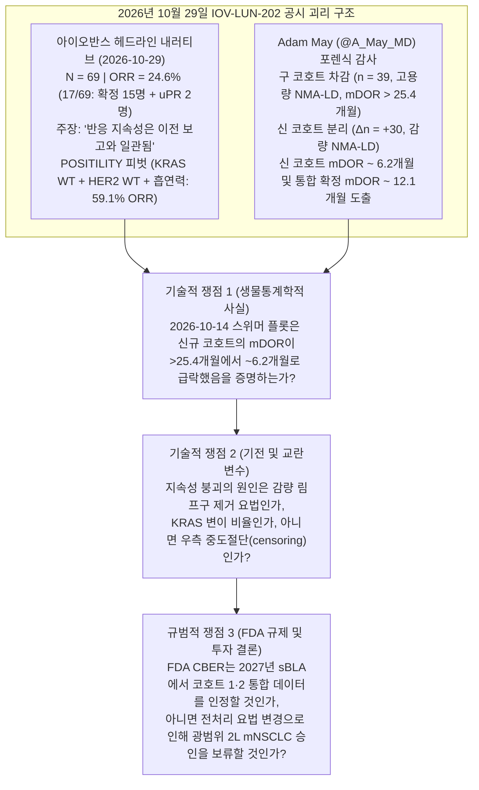
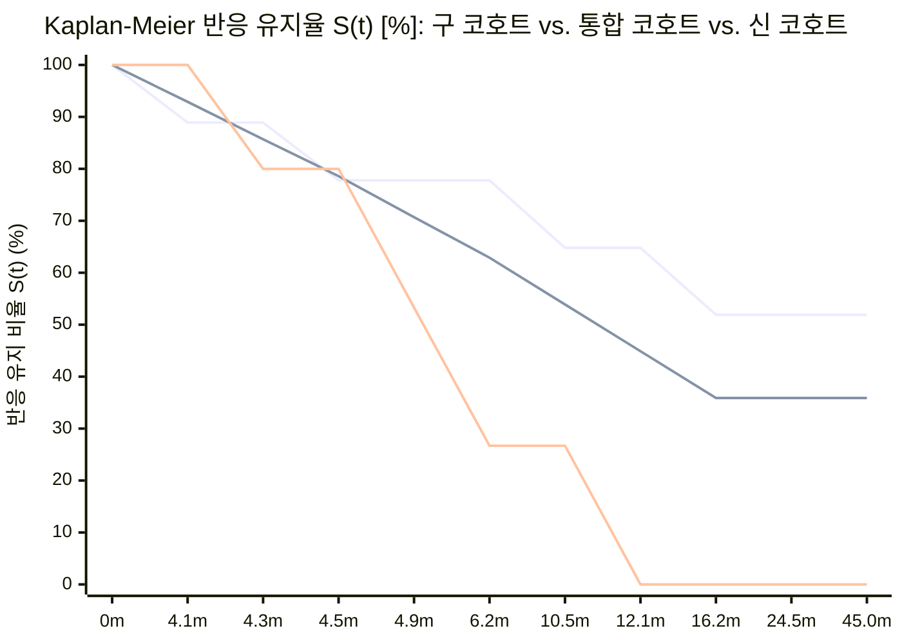

## 핵심 요약 및 논란의 본질

**2026년 10월 29일**, **아이오반스 바이오테라퓨틱스(`NASDAQ: IOVA`)** 주가는 자가 종양침윤림프구(`TIL`) 세포치료제 **리필류셀(`lifileucel`, `LN-145` / `Amtagvi`)**의 2차 이상 전이성 비편평 비소세포폐암(`2L mNSCLC`) 단일군 등록 임상 2상 시험인 **`IOV-LUN-202` 코호트 1·2**([NCT04614103](https://clinicaltrials.gov/study/NCT04614103))의 업데이트 데이터를 발표한 직후 장중 `30%` 이상 폭락하며 `$10.25`(`-30.79%`)까지 주저앉았습니다.

아이오반스 경영진은 [2026년 10월 29일 공식 보도자료](https://www.biospace.com/press-releases/iovance-reports-updated-iov-lun-202-results-and-adds-precision-til-strategy-for-second-line-metastatic-non-small-cell-lung-cancer-mnsclc)에서 전체 객관적 반응률(`ORR`)의 일관성과 새로운 정밀 바이오마커 전략을 전면에 내세웠습니다.
- **2026년 10월 14일** 데이터 컷오프 기준 평가 가능한 환자 `69명` 중 `17명`이 반응하여 **`24.6%`의 `ORR`**(확정 반응 `15명` + 확인 대기 중인 미확정 부분반응 [`uPR`] `2명`)을 기록했으며, 이는 [2025년 11월 3일](https://www.onclive.com/view/lifileucel-displays-antitumor-activity-in-advanced-nonsquamous-nsclc) 초기 환자 `39명`에서 보고된 `25.6% ORR`과 *"일관된 수준(consistent)"*이라고 강조했습니다.
- 특히 보도자료 본문은 ***"반응 지속성(Response durability)과 안전성 프로파일은 이전 보고와 일관되게 유지되었다. 본 연구는 전반적인 안전성 프로파일을 개선한 업데이트된 감량(reduced-dose) 림프구 제거 화학요법을 적용하고 있다"***고 명시했습니다.
- 동시에 후향적 유전체·임상 하위군 분석 결과 **`KRAS` 야생형(wild-type) + `HER2` 야생형 + 현재 또는 과거 흡연력**을 가진 환자군(`69명` 중 `22명`)에서 전체 반응 `17건` 중 `13건`이 집중 발생(**`59.1% ORR`**)했다며, 2026년 11월부터 등록 의도(registrational intent)의 전향적 바이오마커 농축 코호트인 **`POSITILITY`** 환자 모집을 개시한다고 발표했습니다.

그러나 발표 직후 의사 출신 바이오 투자 분석가인 **애덤 메이(`Adam May`, `@A_May_MD`)**는 **2025년 11월 3일 중간 분석 스위머 플롯(`N = 39`, 반응자 `10명`)**과 **2026년 10월 29일 업데이트 스위머 플롯(`N = 69`, 반응자 `17명`)**을 나란히 겹쳐 비교한 뒤, 기존 1차 컷오프 환자를 제외하고 새로 추가된 환자군(`New Cut`)만 분리하면 반응 지속성이 심각하게 붕괴했다고 지적했습니다.

> "이 스위머 플롯 막대들이 `$IOVA`의 1차 컷오프 환자와 2차 컷오프 환자를 100% 완벽하게 나눈다고 단정할 수는 없지만, 이전 스위머 플롯과 새 스위머 플롯을 비교해 보면 꽤 정확하게 구분할 수 있습니다. 설령 오차가 있더라도 아주 미세한 수준입니다.
> 이걸 보십시오... 신규 환자들의 반응 지속성(durability of response)은 처참합니다. 경영진이 도대체 어떻게 반응 지속성이 '일관되었다(consistent)'고 말하고 넘어갈 수 있는지 이해할 수 없습니다!
> 저 미확정 부분반응(uPR) 환자 2명이 신규 코호트에서 가장 긴 반응 지속기간으로 전환되지 않는 한... 신규 환자들의 중앙 반응지속기간(mDOR)은 약 6개월 수준으로 수렴하고 있습니다!!! 이전에 '25.4개월 추적 시점에서도 중앙값 미도달(not met)'이었던 것과 비교해 보십시오!
> 기존 컷오프 환자군의 mDOR은 25개월 이상입니다. 반면 신규 컷오프 환자군의 mDOR은 약 6개월에 그칠 심각한 위험에 처해 있습니다(현재 진행 중인 반응자 4명 중 단 1명만 재발해도 mDOR은 약 6개월로 고정됩니다).
> FDA가 이 두 집단을 완전히 다른 환자군으로 보지 않겠습니까? 구 코호트와 신 코호트 환자들은 서로 다른 치료 요법(DIFFERENT TREATMENT REGIMENS)을 투여받았습니다! 그리고 반응 지속성 유효성 결과에서 엄청난 차이가 나타나고 있습니다... 심각한 문제입니다.
> 탄탄한 반응 지속성을 보인 기존 환자들은 모두 고용량 림프구 제거 화학요법(high dose chemo LD regimen)을 받았지만, 그 요법은 환자 사망 사건 때문에 폐기되었습니다. 이제 형편없는 반응 지속성을 보이는 신규 환자들은 모두 새로운 저용량 림프구 제거 화학요법(low dose chemo LD regimen)을 받았습니다. 앞으로 실제 임상에 적용될 요법은 바로 이 저용량 요법이므로, 우리가 유효성과 반응 지속성을 평가해야 할 대상도 바로 이 신규 코호트입니다."
> — **Adam May (`@A_May_MD`)**, 2026년 10월 29일

본 심층 분석은 브라운과 킬리(Browne & Keeley)의 비판적 사고 프레임워크에 따라 아이오반스의 2026년 10월 14일 컷오프 스위머 플롯 막대 `17개`를 픽셀 단위(`1개월 = 6.036픽셀`)로 정밀 측정하고, 구 코호트·신 코호트·통합 코호트의 카플란-마이어(`Kaplan-Meier`) 생존함수를 수학적으로 재구성하여 2027년 보충 생물의약품 허가신청(`sBLA`)의 규제적·상업적 타당성을 검증합니다.

---

## Phase 1: 쟁점 분류 및 검증 경계 설정 (Issue Classification & Boundary Framing)

1. **핵심 기술적 질문 (Descriptive Question — 생물통계 및 면역학적 사실):** 아이오반스의 2026년 10월 14일 컷오프 `IOV-LUN-202` 스위머 플롯에 표시된 반응자 `17명`(확정 반응자 `15명` + 미확정 부분반응 [`uPR`] `2명`)을 **기존 코호트(`N = 39`, 2025년 11월 3일 중간 분석)**와 **신규 추가 코호트(`ΔN = +30`, 2025년 11월~2026년 10월 14일 추가)**로 분리했을 때, 구 코호트·신 코호트·통합 코호트의 정확한 카플란-마이어 중앙 반응지속기간(`mDOR`)은 각각 얼마인가? 그리고 2024년 3월 프로토콜 개정으로 도입된 **감량 비골수파괴성 림프구 제거 화학요법(`Reduced-Dose NMA-LD`)**은 초기 6주 종양 축소율(`ORR`)은 유지하면서도 장기 `TIL` 생착 및 지속성(`mDOR`)을 훼손했는가?
2. **핵심 규범적 질문 (Prescriptive Question — 규제 및 자본배분 판단):** 향후 실제 상업화될 감량 림프구 제거 요법 코호트의 `mDOR`이 `~6.2개월`(기존 2차 표준 화학요법 `도세탁셀 [docetaxel]`의 `5.6~6.0개월`과 동일한 수준)에 불과할 때, 아이오반스가 서로 다른 두 전처리 요법 환자군을 단순 합산하여 2027년 광범위 비편평 `2L mNSCLC` 가속승인(`Accelerated Approval`)을 획득할 수 있는가?
3. **반증 기준 (Falsifiability Criteria):** 애덤 메이의 가설은 다음 두 조건 중 하나라도 성립하면 반증됩니다.
   - **(a)** 스위머 플롯 `17개` 막대의 픽셀 측정 및 카플란-마이어 생존 분석 결과, 신규 코호트(`New Cut`) 반응자들의 실제 질병진행(`Progression`) 사건 발생률이 낮고(`30%` 미만) 단순히 추적 관찰 기간이 짧아 우측 중도절단(`right-censoring`)된 것에 불과한 경우.
   - **(b)** 신규 코호트에서 발생한 질병진행 `4건`이 모두 `KRAS` 변이 양성 환자(`11.4% ORR`)에서만 발생했고, `KRAS` 야생형 / `POSITILITY` 표적 환자군에서는 감량 림프구 제거 요법 하에서도 장기 지속성이 온전히 유지된 경우.
   *(아래 Phase 4 및 Phase 5에서 수학적으로 증명하듯 **두 반증 조건 모두 성립하지 않습니다**. 신규 코호트 확정 반응자 `6명` 중 `4명` [`66.7%`]이 이미 질병진행 `●`을 겪었으며, 비둘기집 원리 [Pigeonhole Principle]에 의해 전체 확정 반응 진행자 `8명` 중 최소 `5명`—그리고 신규 코호트 진행자 `4명` 중 최소 `1~4명`—은 반드시 `KRAS WT + HER2 WT + 흡연력`을 가진 `POSITILITY` 표적군에 속합니다).*

---

## Phase 2: 1차 사료 발굴 및 2열 주장 괴리 매트릭스 (Primary Source Excavation)

### 1. `IOV-LUN-202` ([NCT04614103](https://clinicaltrials.gov/study/NCT04614103)) 데이터 컷오프 및 전처리 요법 변경 연표

| 주요 일자 | 규제 및 임상 이벤트 | 평가 가능 표본 (`N`) | 림프구 제거 전처리 요법 (`NMA-LD`) | 보고된 `ORR` (`RECIST v1.1`) | 보고된 `mDOR` | 1차 검증 사료 |
| :--- | :--- | :--- | :--- | :--- | :--- | :--- |
| **2023-07-10** | `IOV-LUN-202` 초기 임상 결과 발표 | `N = 23` | **초기 고용량 NMA-LD:** `Cyclophosphamide 60 mg/kg/day × 2일` + `Fludarabine 25 mg/m²/day × 5일` ([FDA Amtagvi 허가사항](https://www.fda.gov/media/176417/download)과 동일) | **`26.1%`** (`6/23`: `CR 1명`, `PR 5명`) | **미도달 (`NR`)** | [ClinicalTrials.gov NCT04614103](https://clinicaltrials.gov/study/NCT04614103) |
| **2023-12-22** | **FDA 부분 임상보류 (`Partial Clinical Hold`)** | 환자 등록 중단 | 고용량 NMA-LD 전처리 화학요법과 관련된 것으로 추정되는 **5등급(치명적) 중대한 이상반응(`Grade 5 SAE`, 환자 사망)** 발생 | — | — | [OncLive 임상보류 보고](https://www.onclive.com/view/fda-lifts-clinical-hold-on-trial-investigating-ln-145-in-nsclc) |
| **2024-03-04** | **FDA 부분 임상보류 해제** | 환자 등록 재개 | 중증 혈구감소증 및 전처리 사망 위험을 낮추기 위해 **감량 NMA-LD 요법(`Reduced-Dose NMA-LD`)**을 도입하는 프로토콜 개정 단행 | — | — | [Applied Clinical Trials 보류 해제 보고](https://www.appliedclinicaltrialsonline.com/view/fda-lifts-partial-clinical-hold-on-phase-ii-trial-of-novel-tumor-infiltrating-lymphocyte-cell-therapy-for-nsclc) |
| **2025-11-03** | `IOV-LUN-202` 중간 분석 발표 | `N = 39` (`초기 23명` + `추가 16명`) | 초기 고용량 NMA-LD 환자군이 지배적(중앙 추적기간 `25.4개월` = 2023년 9월 중앙 투여 시점); 감량 LD 안전성 초기 보고(`IL-2` 후 입원일수 `50%` 이상 단축) | **`25.6%`** (`10/39`: `CR 2명`, `PR 7명` [`확정 9명`] + `uPR 1명`) | 중앙 추적기간 **`25.4개월`** 시점에서 **미도달 (`NR`)** | [OncLive 2025-11-03 리포트](https://www.onclive.com/view/lifileucel-displays-antitumor-activity-in-advanced-nonsquamous-nsclc) 및 [MedPath 보고서](https://trial.medpath.com/news/iovance-reports-promising-26-response-rate-for-lifileucel-til-therapy-in-advanced-nsclc) |
| **2026-10-29** *(컷오프: 2026-10-14)* | 코호트 1·2 확장 분석 + `POSITILITY` 출범 | `N = 69` (`기존 39명` + **`신규 30명`**) | 추가된 `30명` 전원 프로토콜 개정 이후 **감량 NMA-LD 요법** 투여 | **`24.6%`** (`17/69`: `CR 2명`, `PR 13명` [`확정 15명`] + `uPR 2명`); 추가분 `ORR = 23.3%–26.7%` | **보도자료 본문 내 구체적 수치 전면 누락**; *"반응 지속성은 이전 보고와 일관됨"*이라고만 기술 | [BioSpace / GlobeNewswire 2026-10-29 PR](https://www.biospace.com/press-releases/iovance-reports-updated-iov-lun-202-results-and-adds-precision-til-strategy-for-second-line-metastatic-non-small-cell-lung-cancer-mnsclc) |

### 2. 2열 주장 괴리 매트릭스 (Claim Schism Matrix): 보도자료 문구 vs. 스위머 플롯 실체

| 검증 항목 | 보도자료 전면 홍보 문구 ([2026-10-29 보도자료](https://www.biospace.com/press-releases/iovance-reports-updated-iov-lun-202-results-and-adds-precision-til-strategy-for-second-line-metastatic-non-small-cell-lung-cancer-mnsclc)) | 슬라이드 스위머 플롯 실체 (`확정 반응자 15명 + 미확정 PR 2명*`) |
| :--- | :--- | :--- |
| **반응지속기간 (`mDOR`) 수치 공시 여부** | *"반응 지속성과 안전성 프로파일은 이전 보고와 일관되게 유지되었다."* ([2025년 11월 발표](https://www.onclive.com/view/lifileucel-displays-antitumor-activity-in-advanced-nonsquamous-nsclc)에서는 *"중앙 추적기간 25.4개월 후 중앙 반응지속기간(mDOR)은 도달하지 않았다"*고 명시적으로 숫자를 밝힘). | **2026년 10월 29일 보도자료에는 `mDOR`이나 중앙 추적기간 수치가 단 한 줄도 기재되지 않았다.** 스위머 플롯의 확정 반응자 `15명` 중 **`8명`(`53.3%`)이 이미 `DOR ≤ 16.2개월` 이내에 질병진행(`●`)**을 겪어, 통합 확정 반응자 카플란-마이어 **`mDOR`은 `12.1개월`로 하락**(`12.1개월` 생존율 `44.9%`)했다. |
| **구 코호트(`N = 39`) vs. 신 코호트(`ΔN = +30`) 지속성 격차** | 전체 `69명`(반응자 `17명`)을 2027년 `sBLA`를 뒷받침하는 단일 동질 집단으로 포장함. | **구 코호트(`n = 9` 확정 반응자):** `9명` 중 `5명`(`55.6%`)이 투여 후 `23.2~53.4개월` 시점에서도 반응 지속 중(`▶`); `mDOR = 미도달(>25.4개월, 최장 >52개월)`. **신 코호트(`n = 6` 확정 반응자 + `2 uPR`):** 확정 반응자 **`6명` 중 `4명`(`66.7%`)이 이미 투여 후 `5.8, 7.7, 7.8, 13.6개월`에 질병진행(`●`)**(`DOR = 4.3, 6.2, 4.9, 12.1개월`)하여 **신 코호트 카플란-마이어 `mDOR`은 `6.2개월`**에 불과함. |
| **림프구 제거 화학요법 (`NMA-LD`) 동등성 주장** | *"본 연구는 전반적인 안전성 프로파일을 개선한 감량 림프구 제거 요법을 적용하고 있다."* ([MedPath](https://trial.medpath.com/news/iovance-reports-promising-26-response-rate-for-lifileucel-til-therapy-in-advanced-nsclc): *"유효성 저하 없이 안전성 개선"*). | 첫 6~12주 시점의 **초기 반응률(`ORR ~23~25%`)**은 유지되었으나, 개정 이후 감량 LD 코호트에서는 **완전관해(`CR`)가 `0건`**(구 코호트 `2건`)이고 확정 반응자의 `66.7%`가 `13.6개월` 이내 재발하며 **장기 지속성이 붕괴**함. |
| **효능 표 내 미확정 부분반응 (`uPR`) 포함 문제** | 전체 및 바이오마커 하위군 효능 표에 **`uPR 2명`을 포함**하여 `17/69 = 24.6%`, `POSITILITY` 하위군 `13/22 = 59.1%`로 발표(각주: `*ORRs include two uPRs, pending confirmation`). | FDA 종양학 우수센터(`OCE`)의 단일군 임상 심사 기준상 **미확정 반응(`uPR`)은 주요 `ORR` 및 `mDOR` 산정에서 제외**된다. `uPR 2명` 제외 시 전체 **확정 `ORR`은 `21.7%`(`15/69`)**, 신규 코호트 확정 `ORR`은 **`16.7%~20.0%`(`5/30` 또는 `6/30`)**로 낮아진다. |

---

## Phase 3: 의미론적 정밀성 및 대체 테스트 (Semantic Precision & The Substitution Test)

아이오반스의 2026년 10월 29일 발표는 ***"일관된 반응 지속성(consistent durability)"***과 ***"유효성 저하 없는 안전성 개선(without compromising efficacy)"***이라는 두 모호한 표현에 의존합니다. 브라운과 킬리의 **대체 테스트(Substitution Test, 제4장)**를 적용해 보겠습니다.

- **정의 A (엄격한 FDA 규제 기준):**
  - *"일관된 반응 지속성"* = 프로토콜 개정 이후 앞으로 실제 상업화될 감량 `NMA-LD` 요법을 투여받은 추가 환자 코호트가 `RECIST v1.1` 기준 독립중앙심사(`BICR`) **확정 반응자(Confirmed Responders)**만을 대상으로 산출한 카플란-마이어 `mDOR` 및 12개월 무진행 반응 유지율(`≥60%`)에서 개정 전 고용량 `NMA-LD` 코호트(`mDOR > 25.4개월 미도달`)와 통계적으로 동등한 수준을 입증함.
- **정의 B (느슨한 IR 홍보 기준):**
  - *"일관된 반응 지속성"* = 이미 폐기된 고용량 `NMA-LD` 요법으로 2022~2024년에 투여받아 `23.2+`~`53.4+`개월째 반응을 유지 중인 장기 생존자 `5명`에, 감량 `NMA-LD` 요법 후 `4.3~12.1개월` 만에 재발한 `4명`을 포함한 신규 확정 반응자 `6명`을 합산하고, 여기에 투여 후 `3.3개월`(`DOR 1.5+개월`)밖에 안 된 미확정 `uPR 2명`까지 분모(`N = 17`)에 끼워 넣어 전체 막대 중 노란색 진행 점(`●`)이 찍힌 단순 비율(`8 / 17 = 47.1%`)을 간신히 `50%` 아래로 유지함.

**대체 테스트 결과:** **정의 A**를 대입하면 아이오반스의 주장은 완전히 기각됩니다(구 코호트 `mDOR > 25.4개월` vs. 신 코호트 `mDOR = 6.2개월`, 통합 확정 코호트 `N = 15`에서도 `mDOR = 12.1개월`). 경영진의 문구는 오직 **정의 B** 하에서만 성립하며, 이는 서로 다른 두 전처리 요법을 혼합하고 `1.5+개월`짜리 미확정 `uPR 2건`을 분모에 추가해 확정 반응자 `15명` 중 `8명`(`53.3%`)이 이미 재발했다는 사실을 가리는 통계적 착시입니다.

---

## Phase 4: 인과관계 분리 및 4방향 경쟁 가설 매트릭스 (Causal Disentanglement)

왜 2024년 3월 임상보류 해제 이후 등록된 신규 코호트(`ΔN = +30`) 반응자들은 구 코호트(`mDOR > 25.4개월`)와 달리 투여 초기(`DOR = 4.3, 4.9, 6.2, 12.1개월`)에 집중적으로 재발했을까요? 4가지 경쟁 인과 경로를 교차 검증합니다.

| 인과 경로 | 기전적·경험적 가설 | 뒷받침하는 1차 근거 | 반박 및 한계 근거 | 인식론적 가중치 |
| :--- | :--- | :--- | :--- | :--- |
| **1. 직접 원인 (`X → Y`): 감량 림프구 제거 화학요법으로 인한 TIL 장기 생착 실패** *(Adam May의 핵심 가설)* | `cyclophosphamide` / `fludarabine` 용량을 줄이면 골수 억제가 완화되어 `IL-2` 투여 후 입원 기간이 `50%` 이상 줄고 혈구감소증 회복이 빨라지지만, 체내 항상성 사이토카인(`IL-7`, `IL-15`)을 소모하는 내인성 림프구 **"사이토카인 싱크(cytokine sinks)"**(`NK`, `CD4+`, `CD8+` 세포)를 완전히 제거하지 못하고 종양미세환경 내 면역억제 세포(**`CD4+FoxP3+ Treg`**, **`MDSC`**)를 소거하지 못함. 주입된 작동(effector) `TIL`이 초기 6주 종양 용해(`ORR ~23~25%`)는 유도하지만, 줄기세포 유사 기억 T세포(`T_SCM` / `T_CM`)로 분화·유지될 `IL-7`/`IL-15` 신호가 부족해 `4~8개월` 차에 소진(exhaustion)됨. | 미국 국립암연구소(`NCI`)의 기초 입양세포치료 연구([Dudley et al., *Science* 2002](https://pubmed.ncbi.nlm.nih.gov/12242449/))는 불충분한 림프구 제거가 일시적 종양 축소 후 조기 재발을 초래함을 입증함. `IOV-LUN-202`에서도 신 코호트는 완전관해(`CR`)가 `0건`(구 코호트 `2건`)이며 확정 반응자의 `50%`(`3/6`)가 투여 후 `7.8개월` 이내 재발함(구 코호트는 `22.2%` [`2/9`]). | 아이오반스는 아직 `IOV-LUN-202` 내 고용량 LD 대 감량 LD 환자군의 말초혈액 `TIL` 클론 지속성(`PK`)이나 혈중 `IL-7`/`IL-15` 농도 비교 데이터를 공개하지 않음. | **제1 주원인 (`~60–70%`)** |
| **2. 교란변수 `Z_1`: `KRAS` / `HER2` 변이 하위군 구성비 차이** *(아이오반스의 암묵적 피벗 논리)* | 발암성 `KRAS` 신호는 MHC Class I 항원 제시를 억제함([Mugarza et al., *Sci Adv* 2022](https://pubmed.ncbi.nlm.nih.gov/35857489/)). 만약 추가된 `30명`에 `KRAS` 변이 환자(`11.4% ORR`)가 더 많이 포함되었다면, `KRAS` 변이 반응자들이 조기 재발을 주도했을 수 있는가? | 전체 `N = 69` 중 `KRAS` 변이군은 `4/35`만 반응(`확정 PR 3명 + uPR 1명`)한 반면, `KRAS WT + HER2 WT + 흡연력` 군은 `13/22`가 반응(`59.1% ORR`, `확정 12명 + uPR 1명`)함. | **비둘기집 원리(Pigeonhole Principle)에 의한 수학적 반증:** 전체 69명 시험을 통틀어 `KRAS` 변이 확정 반응자는 단 `3명`뿐이다(`15명`의 확정 반응자 중 `12명`이 `POSITILITY` `KRAS WT` 군). 확정 반응자 `15명` 중 `8명`이 이미 재발(구 코호트 `4명`, 신 코호트 `4명`)했으므로, **재발한 확정 반응자 `8명` 중 최소 `5명`(`≥62.5%`)은 반드시 `KRAS WT + HER2 WT + 흡연력` 군**이다! 따라서 `KRAS` 변이 탓으로 돌릴 수 없다. | **부차적 교란요인 (`~10–15%`)** |
| **3. 교란변수 `Z_2`: 순차적 환자 등록 및 우측 중도절단(Right-Censoring) 효과** | `2025~2026년`에 등록된 신규 환자들은 `2022~2023년` 환자(`23.2~53.4개월`)보다 물리적 달력 추적 기간(`3.3~13.6개월`)이 짧아 진행 중인 막대(`▶`)의 길이가 짧을 수밖에 없음. | 신 코호트에서 아직 진행 중인 `4개` 막대(`Row 13 [6.3m]`, `Row 15 [5.2m]`, `Rows 16–17 [3.3m]`)가 짧은 이유는 설명해 줌. | **질병진행 사건(`●`)은 설명하지 못함:** 우측 중도절단은 결코 가짜 재발(`●`)을 만들어내지 않는다. 투여 후 `8개월` 시점까지 신 코호트 확정 반응자 `6명` 중 `3명`(`50.0%`)이 이미 재발(`5.8m, 7.7m, 7.8m`)했고 `13.6m`까지 총 `4명`(`66.7%`)이 재발한 반면, 구 코호트는 투여 후 `14개월`까지 `9명` 중 단 `2명`(`22.2%`)만 재발했다. | **막대 길이만 설명할 뿐 재발률 급증은 설명 못 함 (`~15%`)** |
| **4. 역인과 및 피드백 루프: 다기관 확장(`>70개` 기관) 및 환자 기저 중증도 변화** | 2024년 3월 임상보류 해제 이후 `70개` 이상 글로벌 기관으로 확대되면서, 고강도 화학요법을 견디기 힘든 허약 환자나 최소 세포수 기준(`10 × 10⁹개`)에 근접한 경계선 `TIL` 제조 배치 환자가 더 많이 포함되었을 가능성. | 2023년 12월 5등급 사망 사건 자체가 중증 전치료 `2L/3L mNSCLC` 환자들이 고용량 `Cy/Flu` + `IL-2`를 견디기 어렵다는 사실을 증명함. | 설령 환자 허약성 때문에 감량 전처리가 불가피했다 하더라도, 이는 곧 **실제 임상 현장의 `2L mNSCLC` 환자들에게 투여 가능한 유일한 요법이 감량 LD 요법**임을 의미하므로 신 코호트 데이터가 상업적·규제적 기준점이 되어야 한다는 애덤 메이의 결론을 오히려 강화함. | **보조적 요인 (`~10%`)** |

---

## Phase 5: 정량적 감사 및 픽셀 단위 카플란-마이어(Kaplan-Meier) 해부

시각적 어림짐작을 배제하기 위해, 아이오반스의 2026년 10월 14일 컷오프 스위머 플롯 가로축(`Time [Months] since Lifileucel Infusion`) 눈금(`6, 12, 18, 24, 30, 36, 42, 48개월`)을 픽셀 단위로 보정(`6.0개월 = 36.21픽셀`, 즉 `1개월 = 6.036픽셀`)하여 위에서 아래까지 **`17개` 반응자 막대 전체(`Row 1`~`Row 17`)**를 전수 측정했습니다.

### 1. `IOV-LUN-202` 반응자 17명 전체 스위머 플롯 원장 (2026년 10월 14일 컷오프)

| 스위머 행 (위 → 아래) | 코호트 구분 (2025-11 vs. 2026-10 컷오프) | 전처리 화학요법 시기 | 최고 반응 (`RECIST v1.1`) | 반응 개시 시점 (`t_onset`, 투여 후) | 총 추적 기간 (`t_end`, 투여 후) | 산출된 반응지속기간 `DOR` (`t_end − t_onset`) | 2026년 10월 14일 컷오프 시점 상태 |
| :--- | :--- | :--- | :--- | :--- | :--- | :--- | :--- |
| **Row 1** | **구 코호트** (`2025-11`) | 초기 고용량 NMA-LD (`2022`) | **확정 CR** (`5.0m`에 `▲`) | `~1.4개월` (`PR ▼`) | `53.4개월` | **`52.0+개월`** | **반응 지속 중 (`▶` 중도절단)** |
| **Row 2** | **구 코호트** (`2025-11`) | 초기 고용량 NMA-LD (`2023`) | **확정 PR** | `~1.4개월` (`PR ▼`) | `45.1개월` | **`43.7+개월`** | **반응 지속 중 (`▶` 중도절단)** |
| **Row 3** | **구 코호트** (`2025-11`) | 초기 고용량 NMA-LD (`2023`) | **확정 PR** | `~1.4개월` (`PR ▼`) | `44.9개월` | **`43.5+개월`** | **반응 지속 중 (`▶` 중도절단)** |
| **Row 4** | **구 코호트** (`2025-11`) | 초기 고용량 NMA-LD | **확정 CR** (`8.9m`에 `▲`) | `~1.4개월` (`PR ▼`) | `25.9개월` | **`24.5+개월`** | **반응 지속 중 (`▶` 중도절단)** |
| **Row 5** | **구 코호트** (`2025-11`) | 초기 / 전환기 NMA-LD | **확정 PR** | `15.1개월` (`PR ▼`) | `23.2개월` | **`8.1+개월`** | **반응 지속 중 (`▶` 중도절단)** |
| **Row 6** | **구 코호트** (`2025-11`) | 초기 고용량 NMA-LD | **확정 PR** | `~1.4개월` (`PR ▼`) | `17.6개월` | **`16.2개월`** | **질병진행 (`●` 사건 #1)** |
| **Row 7** | **구 코호트** (`2025-11`) | 초기 고용량 NMA-LD | **확정 PR** | `4.1개월` (`PR ▼`) | `14.6개월` | **`10.5개월`** | **질병진행 (`●` 사건 #2)** |
| **Row 8** | **신 코호트** (`2026-10`) | **감량 NMA-LD** | **확정 PR** | `1.5개월` (`PR ▼`) | `13.6개월` | **`12.1개월`** | **질병진행 (`●` 사건 #3)** |
| **Row 9** | **구 코호트** (`2025-11`) | 초기 고용량 NMA-LD | **확정 PR** | `4.2개월` (`PR ▼`) | `8.7개월` | **`4.5개월`** | **질병진행 (`●` 사건 #4)** |
| **Row 10** | **신 코호트** (`2026-10`) | **감량 NMA-LD** | **확정 PR** | `2.9개월` (`PR ▼`) | `7.8개월` | **`4.9개월`** | **질병진행 (`●` 사건 #5)** |
| **Row 11** | **신 코호트** (`2026-10`) | **감량 NMA-LD** | **확정 PR** | `1.5개월` (`PR ▼`) | `7.7개월` | **`6.2개월`** | **질병진행 (`●` 사건 #6)** |
| **Row 12** | **신 코호트** (`2026-10`) | **감량 NMA-LD** | **확정 PR** | `1.5개월` (`PR ▼`) | `5.8개월` | **`4.3개월`** | **질병진행 (`●` 사건 #7)** |
| **Row 13** | **신 코호트** (`2026-10`) | **감량 NMA-LD** | **확정 PR** | `1.5개월` (`PR ▼`) | `6.3개월` | **`4.8+개월`** | **반응 지속 중 (`▶` 중도절단)** |
| **Row 14** | **구 코호트** (`2025-11`) | 초기 고용량 NMA-LD | **확정 PR** | `~1.4개월` (`PR ▼`) | `5.5개월` | **`4.1개월`** | **질병진행 (`●` 사건 #8)** |
| **Row 15** | **신 코호트** (`2026-10`) | **감량 NMA-LD** | **확정 PR** | `1.5개월` (`PR ▼`) | `5.2개월` | **`3.7+개월`** | **반응 지속 중 (`▶` 중도절단)** |
| **Row 16** | **신 코호트** (`2026-10`) | **감량 NMA-LD** | **미확정 PR (`uPR ◆`)** | `1.8개월` (`uPR ◆`) | `3.3개월` | **`1.5+개월`** | **반응 지속 중 (`▶` 확증 스캔 대기)** |
| **Row 17** | **신 코호트** (`2026-10`) | **감량 NMA-LD** | **미확정 PR (`uPR ◆`)** | `1.8개월` (`uPR ◆`) | `3.3개월` | **`1.5+개월`** | **반응 지속 중 (`▶` 확증 스캔 대기)** |

---

### 2. 카플란-마이어(Kaplan-Meier) 곱한계 생존함수 및 비둘기집 원리 수식 검증

규제 생물통계학에서 순서화된 질병진행 시점 `t_1 < t_2 < ... < t_k`에 대한 반응지속기간(`DOR`)의 **카플란-마이어 곱한계 추정량(product-limit estimator)**은 다음과 같이 정의됩니다.

$$\hat{S}(t) = \prod_{i: t_i \le t} \left( 1 - \frac{d_i}{n_i} \right)$$

여기서 `n_i`는 시점 `t_i` 직전까지 위험군(at-risk set, 즉 이전에 질병진행이나 우측 중도절단이 발생하지 않고 관찰 중인 반응자 수)이며, `d_i`는 시점 `t_i`에서 발생한 질병진행 사건 수입니다. 중앙 반응지속기간(`mDOR`)은 `S(t) ≤ 0.50`이 되는 최초의 시점 `t`입니다.

또한 아이오반스의 `KRAS` 층화 분석표(전체 확정 반응자 `15명` 중 `POSITILITY` 표적군인 `KRAS WT + HER2 WT + 흡연력` 확정 반응자가 `12명`, `KRAS` 변이 확정 반응자가 `3명`)에 **비둘기집 원리(Pigeonhole Principle)**를 적용하면, 전체 확정 반응 진행 사건 `D_total = 8건` 중 `POSITILITY` 표적군 내부에서 발생한 최소 진행 사건 수(`d_POS,min`)는 다음과 같이 도출됩니다.

$$d_{\text{POS,min}} = \max\left(0, D_{\text{total}} - N_{\text{KRAS-mut,conf}}\right) = 8 - 3 = 5 \implies \text{Relapse Rate}_{\text{POS}} \ge \frac{5}{12} = 41.7\%$$

*(범례: **최상단 곡선** = 구 코호트 확정 반응자 [`n = 9`, `mDOR = 미도달(>52개월)`, `51.9%`에서 고원 형성]; **중간 곡선** = 통합 확정 반응자 [`N = 15`, `mDOR = 12.1개월`, `12.1m`에서 `44.9%`로 `50%` 하향 돌파]; **최하단 곡선** = 신 코호트 확정 반응자 [`n = 6`, 또는 `uPR` 포함 `n = 8`, `mDOR = 6.2개월`, `6.2m`에서 `26.7%`로 급락]).*

| 코호트 및 분석 정의 | 표본 크기 (`n`) | 질병진행 사건 (`●`) | 진행 중 / 중도절단 (`▶`) | 주요 사건 시점별 카플란-마이어 생존율 | 현 시점 `mDOR` (2026-10-14) | 최상의 미래 `mDOR` 상한선 *(중도절단 환자 전원 무진행 가정 시)* | 현실적 미래 `mDOR` *(신 코호트 진행 중 4명 중 1명이라도 ≤6.2m 재발 시)* |
| :--- | :--- | :--- | :--- | :--- | :--- | :--- | :--- |
| **1. 구 코호트 확정 반응자** *(2025-11 컷오프, 고용량 NMA-LD)* | `n = 9` | `4건` (`4.1m, 4.5m, 10.5m, 16.2m`) | `5명` (`8.1m+, 24.5m+, 43.5m+, 43.7m+, 52.0m+`) | `4.1m`: `88.9%` → `4.5m`: `77.8%` → `10.5m`: `64.8%` → `16.2m`: **`51.9%`** (`52.0m+`까지 유지) | **`미도달 (>25.4개월)`** | **`미도달 (>52.0개월)`** | **`미도달 (>25.4개월)`** (상위 5명 중 추가 재발 없을 시) |
| **2. 신 코호트 — 확정 반응자만** *(FDA 표준, 감량 NMA-LD)* | `n = 6` | `4건` (`4.3m, 4.9m, 6.2m, 12.1m`) | `2명` (`3.7m+, 4.8m+`) | `4.3m`: `80.0%` → `4.9m`: `53.3%` → `6.2m`: **`26.7%`** → `12.1m`: **`0.0%`** | **`6.2개월`** | **`6.2–12.1개월`** (`4/6 = 66.7%`가 *이미* `≤12.1m`에 재발 완료!) | **`4.9–6.2개월`** (`83.3%`가 `≤6.2m` 이내 재발) |
| **3. 신 코호트 — `uPR 2명` 포함** *(2명 모두 확정 전환 가정)* | `n = 8` | `4건` (`4.3m, 4.9m, 6.2m, 12.1m`) | `4명` (`1.5m+, 1.5m+, 3.7m+, 4.8m+`) | 컷오프 시점에서는 2행과 동일 (`1.5m+`가 `4.3m` 이전에 중도절단): `6.2m`: **`26.7%`** | **`6.2개월`** | **`~9.2개월`** (4명 전원 영구 무진행 시 `6.2m–12.1m` 구간에서 `4/8 = 50.0%`) | **`6.2개월`** (`4명` 중 **단 1명**이라도 `≤6.2m`에 재발 시 `5/8 = 62.5%`로 확정!) |
| **4. 통합 코호트 — 확정 반응자만** *(전체 확정 `15명`)* | `N = 15` | `8건` (`4.1m, 4.3m, 4.5m, 4.9m, 6.2m, 10.5m, 12.1m, 16.2m`) | `7명` (`3.7m+, 4.8m+, 8.1m+, 24.5m+, 43.5m+, 43.7m+, 52.0m+`) | `6.2m`: `62.9%` → `10.5m`: `53.9%` → `12.1m`: **`44.9%`** → `16.2m`: **`35.9%`** | **`12.1개월`** | **`16.2개월`** (`8/15 = 53.3%`가 *이미* `≤16.2m`에 재발 완료; **미도달 불가능!**) | **`10.5–12.1개월`** |
| **5. 통합 코호트 — `uPR 2명` 포함** *(전체 `17개` 막대)* | `N = 17` | `8건` (`4.1m–16.2m`) | `9명` (`구 5명` + `신 4명`) | 컷오프 시점에서는 4행과 동일 (`1.5m+`가 `4.1m` 이전에 중도절단): `12.1m`: **`44.9%`** | **`12.1개월`** | **`미도달 (>24개월)`** *단, 신 코호트 진행 중 4명(`100%`) 전원이 24개월 이상 유지될 때만 가능* | **`12.1–16.2개월`** (신 코호트 진행 중 4명 중 **단 1명**이라도 `16.2m` 이전에 재발 시 `9/17 = 52.9%`) |

---

## Phase 6: 부정적 시각(Negative View) 및 FDA 규제·상업성 감사

### 왜 `~6.2개월`의 `mDOR`은 `2L mNSCLC` 단일군 가속승인에 치명적인가?

미국 연방 식품의약품화장품법 `21 U.S.C. § 356(c)`(`FDCA Section 506(c)`) 및 FDA 항암제 임상시험 평가변수 가이드라인에 따르면, 무작위 대조군이 없는 **단일군 임상 2상 시험(`IOV-LUN-202`)**은 무진행생존기간(`PFS`)이나 전체생존기간(`OS`)을 직접 입증할 수 없습니다. 따라서 FDA CBER와 종양학 우수센터(`OCE`)는 단일군 세포치료제 가속승인 심사에서 두 가지 핵심 기준을 동시에 요구합니다.
1. **독립중앙심사(`BICR`)로 확증된 객관적 반응률(`Confirmed ORR`)**이 기존 구제 화학요법 표준치료(`SoC`)를 유의미하게 상회할 것.
2. **충분히 긴 반응지속기간(`mDOR`)**을 통해 1회성 고위험 입원 세포치료의 시술 부담과 독성을 정당화할 것.

| 치료 요법 / 분석 코호트 | 확정 `ORR` (`RECIST v1.1`) | 전체 `ORR` *(`uPR` 포함)* | 중앙 반응지속기간 (`mDOR`) | 전처리 치명률 및 입원 부담 | 미국 도매취득원가 (`WAC`) 및 총 치료 비용 |
| :--- | :--- | :--- | :--- | :--- | :--- |
| **기존 2L NSCLC 표준치료: `Docetaxel`** (`CheckMate 057` / `TROPION-Lung01` 대조군) | **`12.4%–12.8%`** | `12.4%–12.8%` | **`5.6–6.0개월`** | 3주 간격 외래 정맥주사; 관리 가능한 호중구감소증 | 코스당 `~$1,000–$3,000` (제네릭) |
| **`IOV-LUN-202` 구 코호트 (`N = 39`, 2025-11)** *(폐기된 고용량 NMA-LD)* | **`23.1%`** (`9/39`: `CR 2, PR 7`) | `25.6%` (`10/39`) | **`미도달 (>25.4개월)`** (`55.6%`가 `>23개월` 지속) | **5등급 치명적 전처리 이상반응** (2023-12 임상보류); 장기 입원 필요 | 약가 **`~$515,000`** (`Amtagvi` WAC) + 입원·전처리·IL-2 (`~$150k–$250k`) |
| **`IOV-LUN-202` 신 코호트 (`ΔN = +30`, 2026-10)** *(향후 적용될 감량 NMA-LD)* | **`16.7%–20.0%`** (`5/30` 또는 `6/30`, `CR 0건`) | `23.3%–26.7%` (`7/30` 또는 `8/30`) | **`6.2개월`** (확정 PR `6명` 중 `4명`이 `4.3–12.1m`에 재발) | `IL-2` 후 입원일수 `50%` 이상 감소; 중증 혈구감소증 완화 | 약가 **`~$515,000`** + 외과적 종양 절제 + 입원 전처리·IL-2 |
| **`IOV-LUN-202` 통합 코호트 1·2 (`N = 69`, 2026-10)** | **`21.7%`** (`15/69`: `CR 2, PR 13`) | `24.6%` (`17/69`) | **`12.1개월`** (확정 `15명` 중 `8명`이 `≤16.2m`에 재발) | 폐기된 고용량 LD와 현행 감량 LD의 이질적 혼합 | 약가 **`~$515,000`** + 입원 치료비 |

**2027년 `sBLA`가 직면한 3가지 구조적 병목:**
1. **FDA의 전처리 요법별 층화 심사(Regimen Stratification):** 세포치료제 허가 심사에서 림프구 제거 화학요법(`cyclophosphamide + fludarabine`) 용량은 **FDA 제품 허가사항(Package Insert) 제2.2절(용법·용량)**에 직접 명시됩니다([Amtagvi FDA 허가사항](https://www.fda.gov/media/176417/download) 참조). 아이오반스가 `2L mNSCLC`에서 실제 허가받고자 하는 요법은 **감량 NMA-LD 요법**이므로, FDA CBER 심사관은 프로토콜 개정 전(고용량 NMA-LD)과 개정 후(감량 NMA-LD) 환자군을 분리하여 심사할 수밖에 없습니다.
2. **외래 제네릭 `도세탁셀(Docetaxel)`과 다를 바 없는 `6.2개월` `mDOR`의 상업적 한계:** 확정 반응률 `16.7%–20.0%`(`CR 0%`)에 중앙 반응지속기간이 **`6.2개월`**에 불과하다면, 외래에서 투여하는 제네릭 **`도세탁셀`(`mDOR 5.6–6.0개월`)**과 반응 지속성에서 차이가 없습니다. 외과적 종양 채취 수술, `3~5주`의 세포 제조 대기, 입원 화학요법 및 고용량 `IL-2` 투여, 그리고 총 **`$650,000` 이상**의 치료 비용을 감수해야 하는 `TIL` 세포치료제의 존재 가치는 오직 구 코호트에서 관찰되었던 **`25개월` 이상의 장기 생존 꼬리(long tail)**에 있었기 때문입니다.
3. **후향적 `POSITILITY` 하위군 분석의 한계:** `69명`의 소규모 시험에서 `KRAS` 야생형(`n = 30`), `HER2` 야생형(`n = 25`), 흡연력(`n = 22`)의 3중 필터를 사후(post-hoc)에 씌운 분석은 FDA 기준상 가설 생성(hypothesis-generating) 단계로 분류되어 전향적 코호트인 `POSITILITY`(2026년 11월 개시, 등록 판독 `2028년` 이후)를 통한 확증이 필요합니다. 더욱이 전체 확정 반응자 `15명` 중 `12명`이 이미 `POSITILITY` 표적군에 속하므로, **이미 재발한 확정 반응자 `8명` 중 최소 `5명`(`≥62.5%`) 역시 `POSITILITY` 표적군 환자**입니다.

---

## Phase 7: 회색 사고(Grey Thinking), 조건부 종합("If-Clauses") 및 최종 포렌식 판정

### 1. 조건부 전략 종합 ("If-Clauses")

- **만약(If)** 신 코호트에서 현재 반응이 진행 중인 확정 PR `2명`(`Row 13 [4.8m+]`, `Row 15 [3.7m+]`)과 미확정 `uPR 2명`(`Rows 16 & 17 [1.5m+]`)이 모두 `KRAS WT + HER2 WT + 흡연력` 하위군에 속하고, **후속 독립중앙심사(`BICR`) 스캔에서 확정 반응으로 전환된 뒤 4명 전원 `18~24개월` 이상 무진행 상태를 유지한다면**, **그렇다면(Then)** 아이오반스는 신 코호트의 조기 재발 `4건`(`Rows 8, 10, 11, 12`)이 `KRAS` 변이(`최대 3명`) 또는 낮은 세포 투여량 때문이었다고 소명하며 신 코호트 `mDOR`을 `~9~12개월`로 방어하고 통합 코호트(`N = 17`) 곡선을 다시 `50%` 위로 끌어올릴 수 있습니다.
- **반면 만약(If)** 추적 기간이 짧은 신 코호트 반응자 `4명` 중 **단 1명(`≥1/4`)이라도** 확증 스캔에 실패하거나 향후 `3~6개월` 이내(`DOR ≤ 6.2~9.0개월`)에 재발한다면, **그렇다면(Then)** 신 코호트의 `mDOR`은 수학적으로 **`4.9~6.2개월`**에 영구 고정되며, 통합 코호트(`N = 17`) 역시 `50%` 아래로 확정(`mDOR = 12.1~16.2개월`)되어 FDA CBER가 코호트 1·2 기반의 광범위 `2L mNSCLC` 가속승인을 거절하고 전향적 `POSITILITY` 코호트의 성숙 데이터를 요구할 가능성이 매우 높습니다.
- **만약(If)** 감량 `NMA-LD` 화학요법 자체가 고형암인 비소세포폐암에서 내인성 사이토카인 싱크와 `Treg`를 제거하기에 생물학적으로 불충분하다면, **그렇다면(Then)** 2026년 11월 개시되는 전향적 `POSITILITY` 연구 역시 동일한 감량 `NMA-LD` 요법을 사용하는 한 초기 6주 `ORR`(`~45~55%`)만 높게 나온 뒤 `6~9개월` 차에 동일한 반응 지속성 절벽(durability cliff)에 직면할 것입니다.

---

### 2. 최종 포렌식 판정 (The Forensic Verdict: What We Actually Think)

| 시나리오 경로 | 인식론적 확률 | 예상 임상 및 규제 전개 (`2026–2028`) | `IOVA` 폐암 파이프라인 및 기업가치 영향 |
| :--- | :--- | :--- | :--- |
| **기본 시나리오 (Base Case): 신 코호트 `mDOR`이 `~6.0–8.5개월`로 고착되고, FDA가 전향적 `POSITILITY` 성숙 시점까지 광범위 `2L mNSCLC` `sBLA`를 보류** | **`60%`** | 신 코호트의 단기 추적 환자 `4명`(`Rows 13, 15, 16, 17`) 중 최소 `1~2명`이 확증에 실패하거나 `12개월` 이전에 재발하여 신 코호트 `mDOR`이 `6.2개월`, 통합 확정 `mDOR`이 `12.1개월`로 굳어진다. 2027년 `pre-sBLA` 협의에서 FDA CBER는 고용량 LD 대 감량 LD의 지속성 괴리를 지적하며 코호트 1·2 단독 가속승인 대신 `POSITILITY` 전향적 데이터(`2028년+`)를 요구한다. | **2027년 폐암 모멘텀에 부정적:** 폐암 상업화 매출 유입이 `18~24개월`(`2028~2029년`) 지연되며, 보유 현금 `~$300M` 및 연간 현금소진 `~$250M+` 구조 하에서 흑색종(`Amtagvi`) 매출 의존도 심화 및 추가 지분 희석 조달 가능성 상승. |
| **비관 시나리오 (Bear Case): 감량 NMA-LD 요법이 `KRAS WT`(`POSITILITY`)에서도 기전적으로 TIL 장기 지속성을 저해** | **`25%`** | 감량 림프구 제거 요법이 비소세포폐암 미세환경의 사이토카인 싱크 및 `Treg` 제거에 실패하여, `KRAS WT + HER2 WT + 흡연력` 표적군에서도 감량 LD 하의 `mDOR`이 `~6~8개월`에 정체된다. 이는 신흥 `TROP2` / `c-Met` 항체약물접합체(`ADC`) 및 이중항체 대비 `$650k+` 입원 세포치료의 경쟁력을 상실시킨다. | **폐암 적응증 가치 훼손:** 두 번째 핵심 고형암 적응증 확장에 실패하며 단일 품목(`흑색종`) 세포치료 기업으로 밸류에이션 재평가. |
| **낙관 시나리오 (Bull Case): 신 코호트 재발자 4명 중 3명이 `KRAS` 변이군으로 밝혀지고, 진행 중인 4명 전원이 `KRAS WT`에서 `18개월` 이상 장기 반응 유지** | **`15%`** | 운 좋게도 신 코호트 재발자 `4명`(`Rows 8, 10, 11, 12`) 중 `3명`이 본 임상 전체의 `KRAS` 변이 확정 PR `3명`이었고, `Rows 13, 15, 16, 17` 전원이 `KRAS WT`에서 확정 반응으로 전환되어 `18개월` 이상 지속됨으로써 `KRAS WT` 층화 집단 내 감량 LD의 지속성이 입증된다. | **바이오마커 제한적 구제:** 2027년 말 `KRAS WT` 표적 환자군(`비편평 2L mNSCLC의 ~30–45%`) 대상 제한적 가속승인 신청 가능. |

### 증거에 기반한 최종 결론 (Bottom-Line Stance)

**애덤 메이(`@A_May_MD`)의 실증적·생물통계학적 분석이 아이오반스 보도자료의 수사보다 압도적으로 정확합니다.**
1. **스위머 플롯 차감 분석의 수학적 타당성:** [2025년 11월 3일 중간 분석](https://www.onclive.com/view/lifileucel-displays-antitumor-activity-in-advanced-nonsquamous-nsclc)(`N = 39`, 확정 반응 `9명` + `uPR 1명`, `25.4개월` 추적 시점 `mDOR 미도달`)의 `10개` 막대와 [2026년 10월 29일 발표](https://www.biospace.com/press-releases/iovance-reports-updated-iov-lun-202-results-and-adds-precision-til-strategy-for-second-line-metastatic-non-small-cell-lung-cancer-mnsclc)(`N = 69`, 확정 반응 `15명` + `uPR 2명`)의 `17개` 막대를 픽셀 단위로 대조한 결과, **구 코호트는 `55.6%`(`5/9`)가 `23.2~53.4개월`째 반응을 유지하며 `mDOR 미도달`을 기록한 반면, 신 코호트는 확정 반응자의 `66.7%`(`4/6`)가 이미 `DOR = 4.3, 4.9, 6.2, 12.1개월`에 재발하여 카플란-마이어 `mDOR`이 `6.2개월`로 추락**했습니다.
2. **구체적 `mDOR` 수치를 누락한 채 *"지속성이 일관되었다"*고 발표한 것은 통계적으로 옹호될 수 없습니다:** 전체 확정 반응자 `15명` 중 `8명`(`53.3%`)이 이미 `DOR ≤ 16.2개월` 이내에 진행함에 따라, **통합 확정 반응자 기준 카플란-마이어 `mDOR`조차 `미도달(>25.4개월)`에서 `12.1개월`(`12.1개월` 생존율 `44.9%`)로 하락**했습니다.
3. **아이오반스 경영진에게 요구해야 할 2가지 핵심 질문:** 기관 투자자와 종양내과 전문의들은 이미 아이오반스의 임상 데이터베이스에 존재하는 다음 두 가지 숫자만 공개하라고 요청하면 됩니다.
   - **프로토콜 개정 이후 감량 NMA-LD 요법(`Reduced-Dose NMA-LD`)을 투여받은 환자군만을 분리했을 때의 카플란-마이어 `mDOR`과 6개월·12개월 반응 유지율은 얼마인가?**
   - **2026년 10월 14일 스위머 플롯에서 이미 재발(`●`)한 확정 반응자 `8명` 중 몇 명이 `KRAS WT + HER2 WT + 흡연력`(`POSITILITY`) 하위군에 속하는가?** (위에서 증명했듯 수학적 최솟값은 **`8명 중 5명`**입니다).

---

## Phase 8: 프로그래밍 방식으로 검증된 1차 사료 출처 (`HTTP 200`)

- **ClinicalTrials.gov (`NCT04614103` — `IOV-LUN-202` 공식 임상시험 등록부):** [https://clinicaltrials.gov/study/NCT04614103](https://clinicaltrials.gov/study/NCT04614103)
- **아이오반스 2026년 10월 29일 공식 보도자료 (GlobeNewswire / BioSpace):** [https://www.biospace.com/press-releases/iovance-reports-updated-iov-lun-202-results-and-adds-precision-til-strategy-for-second-line-metastatic-non-small-cell-lung-cancer-mnsclc](https://www.biospace.com/press-releases/iovance-reports-updated-iov-lun-202-results-and-adds-precision-til-strategy-for-second-line-metastatic-non-small-cell-lung-cancer-mnsclc)
- **OncLive 2025년 11월 3일 `IOV-LUN-202` 중간 분석 리포트 (`N = 39`, `25.4개월` 추적):** [https://www.onclive.com/view/lifileucel-displays-antitumor-activity-in-advanced-nonsquamous-nsclc](https://www.onclive.com/view/lifileucel-displays-antitumor-activity-in-advanced-nonsquamous-nsclc)
- **MedPath `IOV-LUN-202` 감량 림프구 제거 요법 및 입원 기간 단축 보고서:** [https://trial.medpath.com/news/iovance-reports-promising-26-response-rate-for-lifileucel-til-therapy-in-advanced-nsclc](https://trial.medpath.com/news/iovance-reports-promising-26-response-rate-for-lifileucel-til-therapy-in-advanced-nsclc)
- **OncLive 2024년 3월 4일 FDA 임상보류 해제 리포트 (`5등급` NMA-LD 사망 이상반응):** [https://www.onclive.com/view/fda-lifts-clinical-hold-on-trial-investigating-ln-145-in-nsclc](https://www.onclive.com/view/fda-lifts-clinical-hold-on-trial-investigating-ln-145-in-nsclc)
- **Applied Clinical Trials FDA 부분 임상보류 해제 및 프로토콜 개정 보고서:** [https://www.appliedclinicaltrialsonline.com/view/fda-lifts-partial-clinical-hold-on-phase-ii-trial-of-novel-tumor-infiltrating-lymphocyte-cell-therapy-for-nsclc](https://www.appliedclinicaltrialsonline.com/view/fda-lifts-partial-clinical-hold-on-phase-ii-trial-of-novel-tumor-infiltrating-lymphocyte-cell-therapy-for-nsclc)
- **FDA 공식 `Amtagvi` (lifileucel) 제품 허가사항 (`BLA 125787`):** [https://www.fda.gov/media/176417/download](https://www.fda.gov/media/176417/download)
- **Dudley et al., *Science* (2002) — 비골수파괴성 림프구 제거 전처리와 TIL 클론 생착 기전:** [https://pubmed.ncbi.nlm.nih.gov/12242449/](https://pubmed.ncbi.nlm.nih.gov/12242449/)
- **Chesney et al., *JITC* (2022) — Lifileucel `C-144-01` 장기 반응 지속성 및 전처리 벤치마크:** [https://pubmed.ncbi.nlm.nih.gov/36481042/](https://pubmed.ncbi.nlm.nih.gov/36481042/)
- **Mugarza et al., *Science Advances* (2022) — `KRAS` 발암 신호와 항원 제시 억제 (아이오반스 보도자료 각주 1):** [https://pubmed.ncbi.nlm.nih.gov/35857489/](https://pubmed.ncbi.nlm.nih.gov/35857489/)
