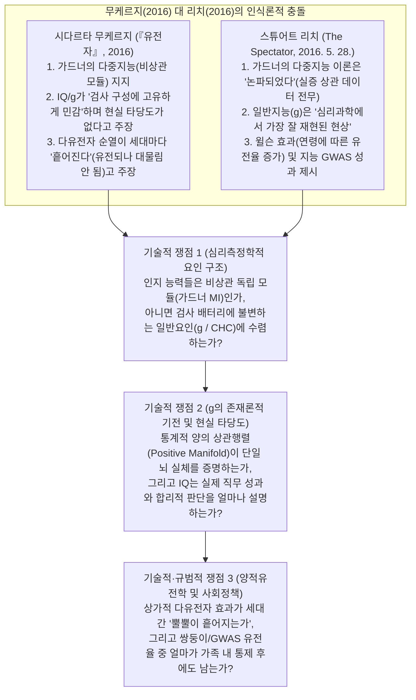
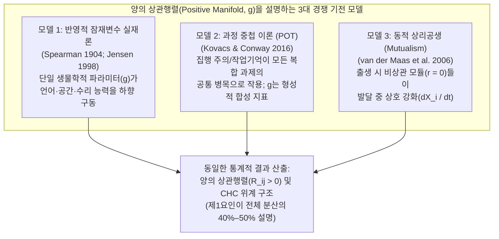
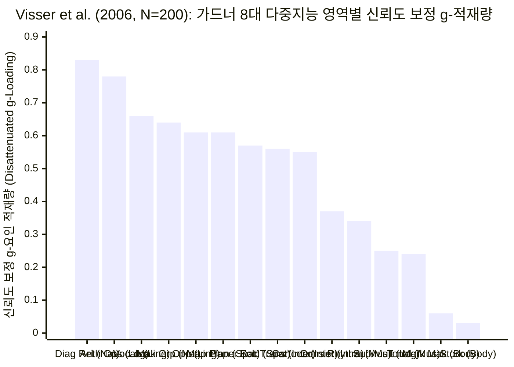
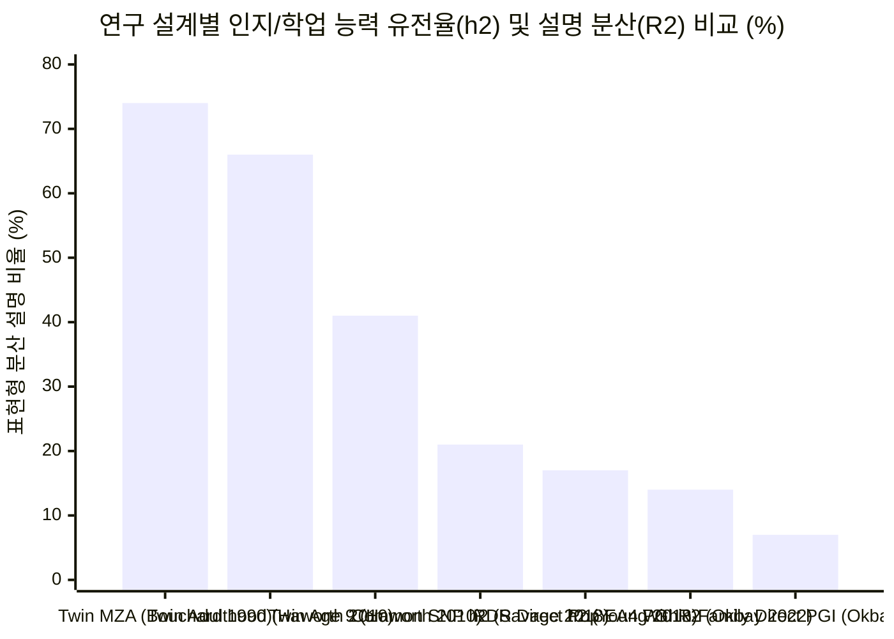

## 핵심 요약 및 논쟁의 본질

2016년 출간된 베스트셀러 ***『유전자: 내밀한 역사(The Gene: An Intimate History)』*** 제4부(*"정체성의 1차 도함수"*)에서 퓰리처상 수상 종양학자 **시다르타 무케르지(Siddhartha Mukherjee)**는 찰스 스피어먼(Charles Spearman)이 1904년 정립한 일반지능 요인(`g`)과 루이스 터먼(Lewis Terman)의 1916년 스탠퍼드-비네 지능지수(`IQ`)부터 캐리 벅(*Buck v. Bell*, 1927)의 우생학적 강제 불임 수술에 이르기까지 지능 검사의 어두운 문화사를 추적했다. 그러나 역사적 비판을 넘어 현대 심리측정학(psychometrics)과 행동유전학의 영역으로 진입하면서, 무케르지는 세 가지 논쟁적인 과학적 주장을 펼쳤다([*The Marginalian*에 발췌 수록된 원문](https://www.themarginalian.org/2016/11/30/siddhartha-mukherjee-the-gene-intelligence/)):
1. **일반지능(`g`) 대신 비상관 다중지능 이론(Multiple Intelligences) 지지:** 무케르지는 단일한 일반지능(`"이기적 g [selfish g]"`)이라는 심리측정학적 개념이 하버드 교육대학원 교수 **하워드 가드너(Howard Gardner)**가 1983년 제안한 **다중지능 이론(`MI`)**에 의해 뒤집혔다고 주장했다. *"단일한 형태의 지능이라는 도그마는 과학적 증거에 의해서도 도전받았다. 하워드 가드너 같은 사회과학자들이 등장하여 1983년 선구적인 다중지능 이론을 통해 인간의 통찰력이 서로 반드시 상관관계를 갖지 않는 더 미묘하고 맥락 특수적인 다양한 차원에 존재함을 입증함으로써 '이기적 g'의 폭정을 전복하고자 했다. 예를 들어 논리/수학적 지능에서 높은 점수를 받은 사람이 신체/운동감각적 지능에서는 높은 점수를 받지 못할 수 있으며, 그 반대도 마찬가지다."*
2. **검사 구성에 대한 민감성과 실생활 지능 대변 불가론:** 무케르지는 `g`가 검사 설계에 좌우되는 취약한 통계적 인공물이며 현실 세계의 지능을 대변하지 못한다고 주장했다. *"일반지능(g)은 특정한 상황에서 특정한 개인들에게 부여된 검사들 사이의 통계적 상관관계에서 출발했다... 특히 그 점수가 검사의 구성(configuration)에 고유하게 민감함에도 불구하고 그러한 검사의 점수를 '지능'이라 부르는 것은 그것이 측정하고자 하는 바로 그 자질을 모독하는 것이다."*
3. **"유전율(Heritable)은 높지만 대물림(Inheritable)되지는 않는다" (다유전자 산란 및 환경적 억제):** 함께 자란 일란성 쌍둥이(`r = 0.86`)와 떨어져 자란 일란성 쌍둥이([미네소타 분리 양육 쌍둥이 연구](https://pubmed.ncbi.nlm.nih.gov/2218526/)에서 `r = 0.74`)의 상관관계가 부모-자녀 간 상관관계(함께 거주 시 `r = 0.42`, 분리 거주 시 `r = 0.22`)보다 훨씬 높다는 점을 들어 무케르지는 다음과 같이 결론지었다. *"멘델의 법칙은 특정한 유전자 순열(permutation)이 매 세대마다 뿔뿔이 흩어질 것임을 사실상 보장한다... 요컨대 지능은 유전 가능(heritable, 즉 유전자의 영향을 받음)하지만, 쉽게 대물림(inheritable, 즉 한 세대에서 다음 세대로 온전히 전달됨)되지는 않는다."*

**2016년 5월 28일**, 당시 에든버러 대학교(University of Edinburgh) 인지노화 박사후연구원이던 심리학자 **스튜어트 리치(Stuart Ritchie)**([위키백과 시다르타 무케르지 항목 각주 76번](https://en.wikipedia.org/wiki/Siddhartha_Mukherjee#cite_note-76)에 인용됨)는 ***더 스펙테이터(The Spectator)***에 신랄한 서평([*"시다르타 무케르지는 어떻게 IQ, 성적 지향, 후성유전학에서 오류를 범하는가"*](https://www.spectator.com.au/2016/05/how-siddhartha-mukherjee-gets-the-gene-wrong/))을 발표했다:

> "실제로 한 장(chapter)에서 그는 IQ 검사에 대해 총공격을 퍼붓는다. 심리학자 하워드 가드너의 새로운 증거가 실제로는 다중지능이 존재함을 보여주는데 왜 일반지능의 유전학을 연구하느냐고 무케르지는 묻는다. 이는 이미 논파된(debunked) 자신의 '다중지능' 이론을 뒷받침할 어떠한 데이터도 제시한 적이 없는 가드너 본인에게도 놀라운 소식일 것이다. 사실 일반지능(g)은 아마도 심리과학 전체에서 가장 철저하게 재현된(well-replicated) 현상일 것이다.
> 하지만 무케르지가 이를 어떻게 알겠는가? 지능 연구에 대한 그의 독서는 피상적이고 시대에 뒤떨어져 있다. 그는 지능 유전학에 관해 2003년 이후 발표된 과학 논문을 단 한 편도 인용하지 않았으며, 대부분의 출처는 1970년대나 그 이전의 것들이다. 이러한 학술적 태만은 이어지는 두 장에서 무케르지가 성별, 성적 지향, 성격을 다루며 그것들이 모두 유전적으로 강하게 영향을 받는다고 기꺼이 결론짓기에 더욱 당혹스럽다... 나이가 들수록 IQ에 대한 유전적 영향이 증가한다는 흥미롭고도 확고한 발견이나, 더 효율적인 뇌와 연관된 DNA 변이를 찾는 대규모 유전자 탐색 연구의 첫 결실들을 다루려는 시도는 전혀 보이지 않는다."
> — **스튜어트 리치(Stuart Ritchie)**, [*The Spectator* (2016년 5월 28일)](https://www.spectator.com.au/2016/05/how-siddhartha-mukherjee-gets-the-gene-wrong/)

1차 심리측정 상관행렬, 인지신경과학 fMRI 해리(dissociation) 연구, 범위 제한(range restriction) 오류가 교정된 인사선발 메타분석, 그리고 300만 명 규모의 가족 내 전장유전체연관분석(`GWAS`) 데이터로 두 저자를 동시에 검증할 때 과연 누구의 주장이 맞을까? 본 조사는 **브라운과 킬리(Browne & Keeley)의 9단계 '사금 채취(Panning for Gold)' 포렌식 감사 프레임워크**를 통해 양측의 수학적 실체와 이념적 과잉 해석을 정밀하게 분리한다.

---

## 제1단계: 쟁점 분류 및 경계 설정 (Issue Classification & Boundary Framing)

1. **핵심 기술적 질문 1 (심리측정학적 요인 구조 및 검사 배터리 불변성):** 하워드 가드너가 가설로 제시한 8개 다중지능 영역(`언어`, `논리-수학`, `공간`, `자연탐구`, `대인관계`, `개인내적`, `음악`, `신체-운동감각`)을 성인 및 아동 집단에서 실증적으로 측정할 때([Visser, Ashton, & Vernon, 2006](https://eric.ed.gov/?id=EJ742896); [Castejón, Pérez, & Gilar, 2010](https://eric.ed.gov/?id=EJ895166)), 이들은 상관이 없는 독립적 능력(`r ≈ 0`)으로 작동하는가, 아니면 서로 다른 검사 배터리 간에도 완벽히 불변(`r = 0.99–1.00`, [Johnson et al., 2004](https://eric.ed.gov/?id=EJ729971))하는 고차 일반지능 요인(`g`)에 강하게 적재(load)되는가?
2. **핵심 기술적 질문 2 (`g`의 인과적 존재론 및 현실 세계 준거 타당도):** 통계적 **양의 상관행렬(Positive Manifold, `g`가 검사 간 공분산의 `40%–50%`를 설명하는 현상)**은 뇌 내부에 단일한 생물학적 실체가 존재함을 뜻하는가, 아니면 잠재변수 `g` 없이도 **동적 상리공생(Dynamic Mutualism, [van der Maas et al., 2006](https://pubmed.ncbi.nlm.nih.gov/17014305/))**과 **과정 중첩 이론(Process Overlap Theory, [Kovacs & Conway, 2016](https://pubmed.ncbi.nlm.nih.gov/28220054/))**에 의해 창발할 수 있는가? 또한 현실의 직무 성과([Sackett et al., 2022](https://pubmed.ncbi.nlm.nih.gov/34968080/)), 합리적 의사결정([Stanovich & West, 2008](https://pubmed.ncbi.nlm.nih.gov/18361678/)), 역학적 사망률([Calvin et al., 2017](https://pubmed.ncbi.nlm.nih.gov/28659274/))에 대한 IQ의 실제 설명력은 얼마인가?
3. **핵심 기술적·규범적 질문 3 (멘델 분리 법칙 대 가족 내 유전체학):** 다유전자성(polygenicity) 때문에 부모-자녀 유사성이 "뿔뿔이 흩어진다"는 무케르지의 주장은 양적유전학적으로 타당한가? 반대로 전통적 쌍둥이 유전율(`h² ≈ 0.70`)과 인구집단 다유전자 점수(`PGS`) 설명력 중 **유전적 양육(Genetic Nurture, [Kong et al., 2018](https://pubmed.ncbi.nlm.nih.gov/29371463/))**과 선택적 교배(assortative mating)를 제거한 **형제자매 내 GWAS**([Howe et al., 2022](https://pubmed.ncbi.nlm.nih.gov/35534559/); [Okbay et al., 2022](https://pubmed.ncbi.nlm.nih.gov/35361970/))에서도 살아남는 순수 직접 유전 효과는 얼마인가?
4. **반증 가능성 기준 (Falsifiability Criteria):**
   - **무케르지에 대한 리치의 심리측정학적 반박**은 가드너 영역들에 대한 확인적 요인분석(`CFA`)에서 언어·논리수학·공간·자연탐구·대인관계 추론 과제 간 상관이 거의 없거나(`r < 0.15`), 서로 다른 인지 검사 배터리에서 추출한 `g` 요인이 서로 다른 서열(`r < 0.60`)을 산출한다면 반증된다.
   - **고전적 유전주의 `g`-실재론(Latent Realism)**은 (a) 수학적 동역학 모델과 fMRI 신경 해리 연구를 통해 양의 상관행렬이 해부학적으로 분리된 뇌 네트워크들로부터 창발함이 입증되고(`Hampshire et al., 2012`; `Amalric & Dehaene, 2016`), (b) 범위 제한 통계 감사 결과 직무 성과에 대한 IQ의 설명력이 `R² = 26%`(`r = 0.51`)에서 `R² < 10%`(`r = 0.31`)로 급락하며, (c) 형제자매 내 멘델 무작위 배정 검증 결과 인지·학업 다유전자 점수 예측력의 `~40%–50%`가 부모의 왕조적(dynastic) 환경 및 선택적 교배에 의한 교란임이 밝혀진다면 반증(또는 대폭 수정)된다. *(아래에서 입증되듯 **두 가지 반증 조건 모두 적중한다**: 무케르지는 가드너 다중지능, 검사 구성 민감성, 멘델 상가적 유전 수학에서 명백한 오류를 범했으며, 반대로 고전적 `g`-본질주의 역시 단일 뇌 실체론, 직무 성과 지배력, 직접 유전 결정론을 과장했다).*

---

## 제2단계: 1차 문헌 발굴 및 2열 주장 괴리 매트릭스 (Primary Source Excavation)

### 1. 핵심 1차 문헌 원장 (`1990–2024`)

| 연도 및 연구진 | 연구 설계 및 표본 크기 (`N`) | 핵심 실증 결과 | 1차 문헌 검증 링크 |
| :--- | :--- | :--- | :--- |
| **1990 Bouchard, Lykken, McGue, Segal, & Tellegen** | 미네소타 분리 양육 쌍둥이 연구(`MISTRA`), 유아기 분리 양육된 일란성(`MZA`) 및 이란성 쌍둥이 `N > 100`쌍 | `MZA` IQ 상관계수 `r = 0.69–0.78` (서구 양육 환경 내에서 IQ 분산의 `~70%`가 유전적 변이와 연관). | [Science PMID 2218526](https://pubmed.ncbi.nlm.nih.gov/2218526/) |
| **2003 Turkheimer, Haley, Waldron, D'Onofrio, & Gottesman** | 미국 전국협력주산기프로젝트(`NCPP`), 7세 쌍둥이 `N = 319`쌍 (`WISC` IQ와 연속형 `SES` 상호작용 분석) | 빈곤층 미국 가정에서는 공유 환경 `c² ≈ 0.60`, 유전율 `h² ≈ 0.10`; 부유층 가정에서는 `h² ≈ 0.72`, `c² ≈ 0.15`. | [Psychol Sci PMID 14629696](https://pubmed.ncbi.nlm.nih.gov/14629696/) |
| **2004 Johnson, Bouchard, Krueger, McGue, & Gottesman** | 다양한 배경의 성인 `N = 436`명에게 3개 이질적 검사 배터리(`CAAP`, `CAB`, `WAIS`)의 `42`개 하위 검사 실시 | 3개의 전혀 다른 검사 배터리에서 독립적으로 추출한 잠재 `g` 요인 간 상관계수가 **`r = 0.99, 0.99, 1.00`**을 기록. | [ERIC EJ729971](https://eric.ed.gov/?id=EJ729971) |
| **2006 Visser, Ashton, & Vernon** | 성인 `N = 200`명 대상 하워드 가드너의 `8`개 다중지능 영역별 `2`개씩 총 `16`개 수행 검사 + 원더릭(`WPT`) 일반지능 검사 실시 | 모든 인지적 MI 영역(`언어`, `공간`, `논리수학`, `자연탐구`, `대인관계`)에서 높은 `g` 적재량(`0.50–0.75`, 신뢰도 보정 시 `0.55–0.83`) 확인; 순수 운동(`외발서기 = 0.03`)만 `g`에서 분리됨. | [ERIC EJ742896](https://eric.ed.gov/?id=EJ742896) |
| **2006 van der Maas, Dolan, Grasman, Wicherts, Huizenga, & Raijmakers** | 수학적·시뮬레이션 증명 (`Lotka-Volterra` 비상관 인지 과정들의 협력적 네트워크 모델) | **공통된 생물학적 `g` 요인이 전혀 없어도(`0`)** 발달 과정의 상호 호혜적 상호작용(**Mutualism**)만으로 강력한 양의 상관행렬(`g`)과 위계적 요인 구조가 창발함을 증명. | [Psychol Rev PMID 17014305](https://pubmed.ncbi.nlm.nih.gov/17014305/) |
| **2008 Stanovich & West** | 대학생 `N > 1,000`명(`SAT`/인지능력 측정) 대상 `7`개 실험을 통해 고전적 휴리스틱 및 인지 편향 검증 | 자기편향(myside bias), 프레이밍 효과, 앵커링, 기저율 무시, 매몰비용 오류, 결과 편향은 **인지능력(`IQ`)과 무관(`r ≈ 0`)**함을 입증. | [JPSP PMID 18361678](https://pubmed.ncbi.nlm.nih.gov/18361678/) |
| **2010 Haworth, Wright, Luciano et al. (`Plomin` 컨소시엄)** | 4개국(영국, 미국, 네덜란드, 호주) 쌍둥이 `N = 11,000`쌍 교차국가 메타분석 | 일반인지능력(`g`)의 쌍둥이 유전율은 연령에 따라 선형 증가(**윌슨 효과**): 9세 `41%` → 12세 `55%` → 17세 `66%` (`p < 0.001`). | [Mol Psychiatry PMID 19488046](https://pubmed.ncbi.nlm.nih.gov/19488046/) |
| **2010 Castejón, Pérez, & Gilar** | 아동 `N = 393`명 대상 **가드너 본인이 개발한 프로젝트 스펙트럼(Project Spectrum) 생태학적 활동**의 확인적 요인분석(`CFA`) | 가드너의 비상관 6요인 다중지능 모델(`Model a`)은 통계적으로 기각됨; 데이터는 2차 `g` 요인 위계 모델 또는 상관 요인 모델을 요구함. | [ERIC EJ895166](https://eric.ed.gov/?id=EJ895166) |
| **2012 Hampshire, Highfield, Parkin, & Owen** | fMRI 신경 해리(`N = 16`) + 대규모 웹 인지 검사(`N = 44,600`, `12`개 과제) | 인간 지능은 최소 `3`개의 해부학적으로 분리된 전두-두정/실비우스열 주변 네트워크(`단기기억`, `추론`, `언어`)로 분화되며 단일한 해부학적 `g` 중추는 존재하지 않음. | [Neuron PMID 23259956](https://pubmed.ncbi.nlm.nih.gov/23259956/) |
| **2016 Tucker-Drob & Bates** | `14`개 `유전자 × SES` 연구(`N = 24,926`쌍; 미국 대 서유럽·호주) 교차국가 메타분석 | 미국에서는 유의미한 `G × SES` 상호작용(`Turkheimer 효과`)이 나타나지만, 보편적 의료·교육 복지가 구축된 **서유럽과 호주에서는 `G × SES` 효과가 `0`이거나 역전됨**. | [Psychol Sci PMID 26671911](https://pubmed.ncbi.nlm.nih.gov/26671911/) |
| **2016 Kovacs & Conway** | **과정 중첩 이론(Process Overlap Theory, `POT`)** 정식화 | `g`는 반영적(reflective) 단일 잠재 실체가 아니라, 영역 일반적 집행 주의/작업기억 병목이 여러 과제에 중첩되어 나타나는 **형성적(formative) 통계 합성 지표**임. | [Psychol Inq PMID 28220054](https://pubmed.ncbi.nlm.nih.gov/28220054/) |
| **2017 Calvin, Batty, Der, Brett, Taylor, Pattie, Cukic, & Deary** | 스코틀랜드 1936년 출생 코호트 전체(`1947 스코틀랜드 정신조사`, `N = 65,765`, 사망 `25,979`명)의 68년 전향적 추적 | 11세 아동기 IQ `1 SD`(`15점`) 우위는 68년간 심혈관, 호흡기, 소화기, 외상, 흡연 관련 암 등 주요 사인 전반에서 사망 위험을 `20%–28%` 낮춤. | [BMJ PMID 28659274](https://pubmed.ncbi.nlm.nih.gov/28659274/) |
| **2018 Kong, Thorleifsson, Frigge et al. (`deCODE`)** | 부모 유전체가 분석된 아이슬란드인 `N = 21,637`명(전달된 대립유전자 대 비전달 부모 대립유전자 비교) | 자녀에게 **전달되지 않은(non-transmitted) 부모의 대립유전자**가 전달된 대립유전자 효과의 **`29.9%`(`p = 1.6 × 10⁻¹⁴`)**에 달하는 학업성취 효과를 발휘함(**"유전적 양육 [Genetic Nurture]"**). | [Science PMID 29371463](https://pubmed.ncbi.nlm.nih.gov/29371463/) |
| **2018 Young, Frigge, Gudbjartsson et al.** | 부모 모두 유전체가 분석된 아이슬란드인 `N = 54,888`명 대상 **친족 불균형 회귀(`RDR`)** | 무작위 멘델 분리 변이를 활용해 환경 편향을 제거한 결과, 학업성취도의 순수 상가적 유전율은 **`17.0%`(`SE = 9.4%`)**로 급락(신장은 `55.4%`). | [Nat Genet PMID 30104764](https://pubmed.ncbi.nlm.nih.gov/30104764/) |
| **2018 Savage, Jansen, Stringer et al.** | `N = 269,867`명(`14`개 코호트) 대상 지능 GWAS 메타분석 | `205`개 유전체 좌위(`1,016`개 유전자) 발굴; 공통 변이 SNP 유전율 **`h²_SNP ≈ 0.19–0.22`**, 선조체 중형 가시뉴런 및 해마 피라미드 뉴런에서 발현 농축. | [Nat Genet PMID 29942086](https://pubmed.ncbi.nlm.nih.gov/29942086/) |
| **2022 Sackett, Zhang, Berry, & Lievens** *(+ 2024 Berry et al.)* | 인사선발 범위 제한(range restriction) 보정 공식에 대한 메타분석 감사 (`Journal of Applied Psychology`) | `Schmidt & Hunter (1998)`의 체계적 과잉보정 오류 적발: 일반정신능력(`GMA`/IQ)의 직무 성과 타당도가 **`r = 0.51`(`R² = 26.0%`)에서 `r = 0.31`(`R² = 9.6%`)로 하향 조정됨**. | [J Appl Psychol PMID 34968080](https://pubmed.ncbi.nlm.nih.gov/34968080/) & [PMID 38695805](https://pubmed.ncbi.nlm.nih.gov/38695805/) |
| **2022 Okbay et al. (`EA4`) & Howe et al. (`Within-Sibship Consortium`)** | `N = 3,037,499`명 GWAS(`EA4`, `3,952`개 SNP) 및 `19`개 코호트 형제자매 `N = 178,086`명(`형제자매 내 GWAS`) | 인구집단 `PGI`는 학업성취 분산의 `12%–16%`를 설명하나, 부모 유전적 양육과 선택적 교배를 통제한 **가족 내 직접 유전 효과는 절반 수준(`~50%` 감쇠)**에 불과함. | [Nat Genet PMID 35361970](https://pubmed.ncbi.nlm.nih.gov/35361970/) & [PMID 35534559](https://pubmed.ncbi.nlm.nih.gov/35534559/) |

### 2. 2열 주장 괴리 매트릭스: 수사적 주장 대 1차 실증 데이터

| 쟁점 차원 | 시다르타 무케르지의 『유전자』 주장 ([2016](https://www.themarginalian.org/2016/11/30/siddhartha-mukherjee-the-gene-intelligence/)) | 스튜어트 리치의 반박 ([2016](https://www.spectator.com.au/2016/05/how-siddhartha-mukherjee-gets-the-gene-wrong/)) 및 1차 실증 데이터 검증 결과 |
| :--- | :--- | :--- |
| **1. 하워드 가드너의 다중지능(`MI`) 대 일반지능(`g`)** | 가드너의 1983년 다중지능 이론이 *"인간의 통찰력이 서로 반드시 상관관계를 갖지 않는 다양한 차원에 존재함을 입증함으로써"* `"이기적 g"`를 뒤집었다고 주장. | **리치의 비판 검증 완료:** 가드너(*Frames of Mind*, 1983)는 자신의 지능 영역들 간 상관이 `r ≈ 0`임을 보여주는 심리측정 행렬을 단 한 번도 발표한 적이 없다. [Visser, Ashton, & Vernon (2006)](https://eric.ed.gov/?id=EJ742896)(`N = 200`)과 [Castejón et al. (2010)](https://eric.ed.gov/?id=EJ895166)(가드너 본인의 프로젝트 스펙트럼 과제로 아동 `N = 393`명 검증)이 실증 테스트한 결과, **모든 인지 영역이 강력한 `g` 적재량(`0.50–0.83`)을 보여** 독립성 가설이 기각되었다. |
| **2. 검사 구성(Configuration)에 대한 `g`의 민감성** | IQ/일반지능 점수가 *"검사의 구성에 고유하게 민감"*하며 *"특정 상황에서 부여된 검사들 사이의 통계적 상관관계"*에 불과하다고 주장. | **리치의 비판 검증 완료:** [Johnson, Bouchard, Krueger, McGue, & Gottesman (2004)](https://eric.ed.gov/?id=EJ729971)이 성인 `N = 436`명에게 3개의 완전히 다른 검사 배터리(`CAAP`, `CAB`, `WAIS`, 총 `42`개 하위 검사)를 실시한 결과, 각 배터리에서 추출된 잠재 `g` 요인 간 상관계수는 **`r = 0.99, 0.99, 1.00`**으로 검사 구성에 거의 완벽히 불변함이 입증되었다. |
| **3. 다유전자 분리("유전 가능성 대 대물림 가능성")** | 지능이 다유전자 형질이기 때문에 *"멘델의 법칙은 특정한 유전자 순열이 매 세대마다 뿔뿔이 흩어질 것임을 보장한다... 지능은 유전 가능(heritable)하지만 쉽게 대물림(inheritable)되지 않는다"*고 주장. | **무케르지의 양적유전학 수학 오류:** 피셔(Fisher, 1918)의 상가적(additive) 모델에서 수천 개의 상가적 유전자(`V_A`)가 관여한다고 해서 부모-자녀 전달이 붕괴하지 않는다. 자녀의 육종가(breeding value)는 부모 평균을 중심으로 분포하며 기대 상관은 `r_PO = 0.5 × h²_N × (1 + m)`이다. 세대마다 완전히 흩어지는 것은 비-상가적 **상위성(epistasis / "emergenesis")**뿐인데, [Okbay et al. (2022)](https://pubmed.ncbi.nlm.nih.gov/35361970/)은 `N = 3,000,000`명에서 **유의미한 우성/비상가적 SNP가 `0`개**임을 확인했다. |
| **4. IQ 검사의 현실 세계 준거 타당도** | 일반지능을 측정하는 IQ 검사 결과가 *"현실 세계의 지능을 대변하지 못하며"* 맥락적 박탈이나 특권을 반영할 뿐이라고 주장. | **양측 모두 과잉 일반화(절반의 승리):** 무케르지의 주장과 달리, 11세 아동기 IQ(`N = 65,765`, [Calvin et al., 2017](https://pubmed.ncbi.nlm.nih.gov/28659274/))는 68년간 모든 주요 사인에 걸친 생존율(`1 SD`당 `HR = 0.72–0.80`)과 학업 성취(`r ≈ 0.55`)를 강력히 예측한다. **그러나 심리측정학 정통파의 주장과 달리**, [Sackett et al. (2022)](https://pubmed.ncbi.nlm.nih.gov/34968080/)는 직무 성과에 대한 IQ의 타당도가 잘못된 범위 제한 보정 공식 때문에 실제 `r = 0.31`(`9.6%` 분산 설명)에서 `r = 0.51`(`26.0%`)로 부풀려졌음을 입증했고, [Stanovich & West (2008)](https://pubmed.ncbi.nlm.nih.gov/18361678/)는 IQ가 **현실의 인지 편향 저항성(자기편향, 프레이밍, 기저율 무시)과 전혀 상관이 없음(`r ≈ 0`)**을 증명했다. |
| **5. 행동유전학 및 유전율(`h²`) 해석** | 문헌 인용을 `2003년`([Turkheimer et al., 2003](https://pubmed.ncbi.nlm.nih.gov/14629696/))에서 멈추며, 빈곤 환경이 유전율을 `0`에 가깝게(`h² ≈ 0.10`) 억누르고 유전율을 끝없는 단서 조항(`"어떤 의미에서는 그렇다"`)으로 희석함. | **현대 유전체학의 정교한 교정:** 리치가 정확히 지적했듯 무케르지는 **윌슨 효과**([Haworth et al., 2010](https://pubmed.ncbi.nlm.nih.gov/19488046/): 쌍둥이 `h²`가 9세 `41%`에서 17세 `66%`로 상승)와 Turkheimer의 `G × SES` 효과가 미국 밖(서유럽·호주)에서는 재현되지 않는다는 사실([Tucker-Drob & Bates, 2016](https://pubmed.ncbi.nlm.nih.gov/26671911/))을 놓쳤다. **그러나** 2018년 이후 가족 내 유전체학([Kong et al., 2018](https://pubmed.ncbi.nlm.nih.gov/29371463/); [Young et al., 2018](https://pubmed.ncbi.nlm.nih.gov/30104764/); [Howe et al., 2022](https://pubmed.ncbi.nlm.nih.gov/35534559/))은 고전적 쌍둥이 유전율(`h² ≈ 0.70`)과 인구집단 다유전자 점수가 **부모의 간접적 '유전적 양육'(`PGS` 신호의 `~30%–50%`)**과 선택적 교배에 의해 부풀려져 있음을 입증했다. |

---

## 제3단계: 의미론적 정밀성 및 치환 테스트 (Semantic Precision & The Substitution Test)

인문주의적 비판자들(굴드, 가드너, 무케르지)과 개인차 심리학자들(스피어먼, 젠슨, 디어리, 리치) 사이의 100년 논쟁은 논증 도중 의미가 미끄러지는 세 가지 핵심 용어—**`"지능(Intelligence)"`**, **`"일반지능(g)"`**, **`"논파됨(Debunked)"`**—에 의해 증폭된다. 브라운과 킬리의 **치환 테스트(Substitution Test, 제4장)**를 적용해 보자.

### 1. `"지능(Intelligence)"`에 대한 치환 테스트
- **정의 A (엄밀한 심리측정학적·인지정보처리적 정의):** 새로운 상징적·공간적 과제 전반에서 추상적 관계 추론, 작업기억(working memory) 조작, 규칙 귀납, 지식 습득을 수행하는 영역 일반적 효율성(`Cattell-Horn-Carroll [CHC]` 제3계층 `g` 및 제2계층 광역 인지능력 `G_f, G_c, G_v, G_sm, G_s`).
- **정의 B (광범위한 생태학적·인류학적 재능 분류 — 가드너 1983):** 특정 문화 공동체에서 가치 있게 여기는 모든 생물심리학적 기술, 재능, 운동 협응력, 음높이 감각, 또는 대인관계 기질(외발서기 소뇌 균형 감각, 음악적 리듬감, 감정 조절 등 포함).
- **치환 진단 결과:** 하워드 가드너가 『마음의 틀(*Frames of Mind*, 1983)』에서 소뇌 운동 협응력(`신체-운동감각`), 청각 음높이 변별력(`음악`), 외향적 사교성(`대인관계`)에 *"지능(Intelligences)"*이라는 이름표를 붙였을 때, 그는 실증적 발견이 아니라 **의미론적 외연 확장(semantic expansion)**을 수행한 것이다. **정의 B**에 따르면 심각한 실어증이나 배외측 전전두피질 병변이 있는 올림픽 체조 선수도 높은 '신체-운동감각 지능'을 지닌다. 반면 **정의 A**에서 외발서기 균형(`Stork Stand`)과 손동작 속도(`Mark Making`)는 비-인지적 정신운동 형질이다([Visser et al., 2006](https://eric.ed.gov/?id=EJ742896)에서 `g` 적재량 `0.03` 및 `0.06`). 결정적으로 무케르지가 IQ 검사를 공격하기 위해 가드너를 인용할 때 그는 **다의어 오류(equivocation fallacy)**를 범한다. 즉 **정의 B**(운동 신경이 수학 추론과 상관되지 않는다는 당연한 사실)를 근거로 삼아 **정의 A**(언어, 공간, 수리, 자연탐구 추론 능력들이 서로 독립적이라는 주장)가 참인 것처럼 호도하지만, 실제로는 정의 A에 속하는 모든 인지 능력들은 `r = 0.40–0.83`으로 강하게 상관된다!

### 2. `"일반지능(General Intelligence, g)"`에 대한 치환 테스트
- **정의 C (통계적·심리측정학적 현상 — 양의 상관행렬 [Positive Manifold]):** 대표성 있는 인간 표본에서 다양한 인지 검사 점수들이 항상 양의 상관관계(`R_ij > 0`)를 보이며, 첫 번째 주축(principal axis) 또는 고차 요인이 전체 공분산의 `40%–50%`를 설명하고 서로 다른 검사 배터리 간에 불변(`r = 0.99`)한다는 경험적 사실.
- **정의 D (존재론적·신경생물학적 실체화 — 잠재변수 실재론 [Latent Variable Realism]):** 통계적 요인 `g`가 뇌 내부의 단일한 물리적 실체(예: '정신 에너지', 전역적 수초화, 또는 단일 마스터 신경 파라미터)에 일대일로 대응하며 모든 하위 인지 능력을 하향식으로 인과 구동(`g → {G_f, G_c, G_v, G_s}`)한다는 가설.
- **치환 진단 결과:** *"일반지능은 심리과학 전체에서 가장 잘 재현된 현상일 것"*이라는 스튜어트 리치의 진술은 **정의 C 하에서는 100% 반박 불가능한 사실**이다. 그러나 스티븐 제이 굴드(*인간에 대한 오해*, 1981), 한 판 데르 마스 등([van der Maas et al., 2006](https://pubmed.ncbi.nlm.nih.gov/17014305/)), 크리스토프 코바치와 앤드루 콘웨이([Kovacs & Conway, 2016](https://pubmed.ncbi.nlm.nih.gov/28220054/))가 증명했듯, **정의 C**(양의 상관행렬)가 참이라고 해서 **정의 D**(단일한 생물학적 실체가 그 상관관계를 야기한다는 주장)가 자동으로 증명되는 것은 아니다. 역학(epidemiology)에서 '대사증후군'이나 '사회경제적 지위(`SES`)' 역시 다양한 지표들 사이에서 완벽히 재현되는 양의 상관행렬을 형성하지만, `SES`는 **형성적 합성 지표(formative composite index)**이자 동적 네트워크이지 단일한 신체 기관이 아니다.

---

## 제4단계: 인과적 분리 및 4방향 경쟁 가설 매트릭스 (Causal Disentanglement)

왜 어휘력, 행렬 추론, 3차원 심적 회전, 산수 응용문제, 분류학적 범주화 등 이질적인 인지 검사들은 언제나 양의 상관관계(스피어먼의 **Positive Manifold**)를 보이는가? 그리고 왜 쌍둥이 연구는 `h² ≈ 0.70`을 산출하는 반면 가족 내 GWAS는 훨씬 낮은 직접 유전 효과를 산출하는가? 4가지 경쟁 인과 경로를 검증한다.

| 인과 경로 | 기전적·수학적 가설 | 뒷받침하는 1차 실증 증거 | 반박 및 한계 증거 | 인식론적 가중치 |
| :--- | :--- | :--- | :--- | :--- |
| **1. 직접 인과 (`X → Y`): 공유 신경생물학적 병목 및 두정-전두 통합(`P-FIT`)** | 백질 신경섬유로 무결성, 축삭 전도 속도, 시냅스 효율성, 전두-두정 네트워크 연결성 등 전역적 뇌 특성이 모든 복합 인지 연산을 뒷받침하는 공유 하드웨어 인프라로 작동함. | 대규모 뇌영상 메타분석 및 UK 바이오뱅크 MRI 코호트에서 전체 뇌 용적과 `g` 간 상관은 `r = 0.24–0.28`; [Savage et al. (2018)](https://pubmed.ncbi.nlm.nih.gov/29942086/)(`N = 269,867`)은 피질·선조체·해마 뉴런에서 발현되는 `205`개 지능 연관 유전체 좌위를 규명함. | [Hampshire et al. (2012)](https://pubmed.ncbi.nlm.nih.gov/23259956/)(`N = 44,600` + fMRI)는 인지 과제가 최소 `3`개의 해부학적으로 직교하는 네트워크(`단기기억`, `추론`, `언어`)로 분화됨을 입증했고, [Amalric & Dehaene (2016)](https://pubmed.ncbi.nlm.nih.gov/27071124/)은 고등 수학이 언어 피질과 완전히 분리된 양측 두정내구/하측두엽 네트워크를 사용함을 증명함. | **핵심 하드웨어 제약 (`~35%`)** |
| **2. 형성적 병목 표집: 과정 중첩 이론 (`POT`)** | 복합 인지 검사는 영역 특수적 모듈(언어, 공간, 수리)과 전전두피질의 영역 일반적 **집행 주의 / 작업기억 유지**를 동시에 요구함. 집행 주의가 다단계 문항 전반에서 비보상적(non-compensatory) 병목으로 작용하므로 단일 `g` 실체 없이도 양의 상관이 발생함. | [Kovacs & Conway (2016)](https://pubmed.ncbi.nlm.nih.gov/28220054/)는 왜 저능력 집단에서 `g` 포화도가 더 높고 고능력 집단에서 특수 능력이 분화되는지(**스피어먼의 수확체감 법칙 [`SLODR`]**)를 POT로 정확히 설명함. | 작업기억 부하가 극히 낮은 단순 지각 검사시간(inspection time) 과제가 왜 여전히 `g`와 `r ≈ 0.25–0.30`의 상관을 보이는지는 단독으로 다 설명하지 못함. | **핵심 심리측정 기전 (`~30%`)** |
| **3. 상호 피드백 루프 (`X ⇄ Y`): 발달적 상리공생 (Mutualism)** | 인지 능력들(`어휘력`, `행렬 추론`, `작업기억`, `공간 처리`)은 영아기에 비상관(`r = 0`) 상태로 출발하지만 발달 과정에서 서로를 강화함(풍부한 어휘력이 추론 규칙 구성을 돕고, 뛰어난 추론력이 문맥 속 어휘 습득을 가속함). | [van der Maas et al. (2006)](https://pubmed.ncbi.nlm.nih.gov/17014305/)은 Lotka-Volterra 미분방정식을 통해 **공통 잠재 `g` 요인이 `0`이어도** 상호 결합(`M_ij > 0`)만으로 양의 상관행렬, CHC 위계 구조, 윌슨 효과(연령에 따른 `h²` 상승)가 창발함을 수학적으로 증명함. 종단 청소년 연구에서 어휘력과 유동성 추론 간 양방향 교차지연 결합이 확인됨. | 순수 상리공생은 발달기 동안 영역 간 전이를 전제하지만, 발달 가소성이 닫힌 성인기의 단기 인지 훈련('두뇌 게임')은 원거리 전이(far transfer) 효과가 거의 `0`에 수렴함. | **동등한 핵심 발달 동력 (`~25%`)** |
| **4. 제3의 교란변수 (`Z → X, Y`): 왕조적 '유전적 양육', 선택적 교배 및 학교 교육 노출** | 거시경제적 계층화, 정규 학교 교육 연수(교육 1년당 `+1.8 ~ +5.0 IQ 점수` 상승), 선택적 교배(인지·학력 형질에서 부부 상관 `m ≈ 0.40`), **부모의 유전적 양육**이 부유층 가정 자녀의 언어·수리·공간 기술을 동시에 끌어올려 가구 간 상관과 쌍둥이/SNP 유전율을 부풀림. | [Kong et al. (2018)](https://pubmed.ncbi.nlm.nih.gov/29371463/)은 비전달 부모 대립유전자가 전달 대립유전자 효과의 `29.9%`를 발휘함을 증명했고, [Howe et al. (2022)](https://pubmed.ncbi.nlm.nih.gov/35534559/)(`N = 178,086` 형제자매)와 [Okbay et al. (2022)](https://pubmed.ncbi.nlm.nih.gov/35361970/)(`N = 3,000,000`)는 형제자매 내 통제 시 인지/학력 다유전자 점수 효과가 `~40%–50%` 삭감됨을 입증함. | 형제자매 내 비교에서도 여전히 통계적으로 유의미한 `~50%–60%`의 직접 유전 효과가 남으며, 동일한 사회경제적 계층 및 형제자매 내부에서도 양의 상관행렬(`g`)은 유지됨. | **가구 간 분산 팽창 요인 (`g`의 `~10%`, 인구 PGS의 `~40%–50%`)** |

---

## 제5단계: 계량적 감사 및 통계적 해체 (Quantitative Audit & Statistical Integrity)

무케르지와 리치 사이의 실증적 논쟁을 엄밀히 판정하기 위해 1차 데이터셋에 대한 5가지 계량적 감사를 수행한다.

### 1. 위계적 `g` 모델 대 동적 상리공생(Dynamic Mutualism)의 수학적 정식화

고전 심리측정학(Spearman 1904; Carroll 1993)에서 광역 인지 영역 `k`에 속한 하위 검사 `j`에 대한 개인 `i`의 표준화 점수 `X_ij`는 선형 반영적 위계 모델로 표현된다:

$$\text{Classical CHC Hierarchy: } X_{ij} = \lambda_{jg} g_i + \lambda_{jk} S_{ik} + e_{ij}, \quad \text{Cov}(X_j, X_m) = \lambda_{jg}\lambda_{mg} + \delta_{km}\lambda_{jk}\lambda_{mk}$$

**하워드 가드너의 엄격한 다중지능(`MI`) 가설** 하에서는 모든 하위 검사에서 일반요인 적재량이 사라지고(`λ_jg = 0`), 영역 간 상관이 0이 되어(`Corr(S_k, S_m) = 0 (k ≠ m)`) 블록 대각(block-diagonal) 상관행렬이 나타나야 한다.

반면 **van der Maas 등(2006)의 동적 상리공생 모델**([PMID: 17014305](https://pubmed.ncbi.nlm.nih.gov/17014305/))에서는 **잠재변수 `g_i`가 아예 존재하지 않는다**(`λ_jg = 0`). 대신 `W`개의 개별 인지 과정 `x_1, x_2, ..., x_W`가 초기 비상관 상태 `Cov(x_k(0), x_l(0)) = 0`에서 출발하여 양의 상리공생 상호작용 행렬 `M_kl > 0`을 갖는 결합 로지스틱 미분방정식을 따라 발달 시간 `t` 동안 성장한다:

$$\frac{dx_k}{dt} = a_k x_k \left(1 - \frac{x_k}{K_k}\right) + \sum_{l \neq k}^{W} \frac{M_{kl} x_k x_l}{K_k} \implies \text{At equilibrium } (dx_k/dt = 0): \quad x_k^* = \frac{K_k}{1 - \sum_{l \neq k} M_{kl} x_l^* / a_k}$$

개별 뇌 네트워크의 독립적인 유전·환경 입력에 의해 결정되는 수용력(carrying capacity) `K_k`의 개인차가 양의 결합 행렬 `M_kl`을 통해 다른 모든 인지 과정으로 전파되기 때문에, 평형 상태의 공분산 행렬 `Σ(x*)`는 모든 원소가 양수(`Σ_kl > 0`)가 되며 제1주성분이 전체 분산의 `40%–50%`를 설명한다—즉 **단일한 생물학적 `g` 실체 없이도 스피어먼의 `g`가 수학적으로 완벽히 재현된다!**

### 2. 실증 감사 1: Visser, Ashton, & Vernon (2006) — 가드너의 8대 다중지능에 대한 직접 검증

[Visser, Ashton, & Vernon (2006)](https://eric.ed.gov/?id=EJ742896)(*Intelligence*, `34(5), 487–502`)은 성인 `N = 200`명을 대상으로 하워드 가드너의 `8`개 영역 각각에 대해 `2`개씩(가드너의 『마음의 틀』 기준에 맞춰 선정된 총 `16`개 수행 검사)과 일반인지능력(`g`)의 외적 준거 검사인 **원더릭 인사검사(`WPT`)**를 실시했다. 논문 표 3(`p. 498`)은 그 실증적 요인 구조를 적나라하게 보여준다:

| 가드너 다중지능 영역 (`8`개 가설 모듈) | 실시된 수행 검사 ([Visser et al., 2006, Table 3](https://eric.ed.gov/?id=EJ742896)) | 원점수 `g`-요인 적재량 | 신뢰도 보정 `g`-적재량 *(측정오차 교정)* | 원더릭 검사 상관계수 (`r_WPT`) | 신뢰도 보정 원더릭 상관 (`r_WPT_corr`) | 가드너 독립성 가설에 대한 실증 판정 |
| :--- | :--- | :--- | :--- | :--- | :--- | :--- |
| **1. 언어 (Linguistic)** | `Opposites` *(반의어 언어 유창성)* | **`0.50`** | **`0.61`** | `0.41**` | **`0.56`** | **기각 (`높은 g`):** `g`에 강하게 적재되면서도 영역 내 잔여 상관(`r = 0.29`, CHC `G_c`)을 유지함. |
| **1. 언어 (Linguistic)** | `Vocabulary` *(어휘 이해력)* | **`0.54`** | **`0.66`** | `0.47**` | **`0.64`** | **기각 (`높은 g`):** `g` 하위의 전형적인 결정성 지능(`G_c`) 지표. |
| **2. 공간 (Spatial)** | `Map Planning` *(시각적 경로 탐색)* | **`0.55`** | **`0.61`** | `0.48**` | **`0.60`** | **기각 (`높은 g`):** 강한 `g` 적재량(`0.61`)을 보이며 CHC 시공간 처리(`G_v`)에 대응. |
| **2. 공간 (Spatial)** | `Paper Folding` *(3차원 심적 종이접기 변환)* | **`0.50`** | **`0.57`** | `0.48**` | **`0.62`** | **기각 (`높은 g`):** 원더릭 `g` 검사와 보정 상관계수 `0.62` 기록. |
| **3. 논리 / 수학 (Logical / Math)** | `Necessary Arithmetic Operations` *(산수 응용 추론)* | **`0.70`** | **`0.78`** | `0.67**` | **`0.83`** | **기각 (`순수 g`):** 전체 배터리 중 두 번째로 높은 `g` 적재량(`0.78`) 및 원더릭 상관 `0.83`. |
| **3. 논리 / 수학 (Logical / Math)** | `Subtraction & Multiplication` *(단순 사칙연산 속도)* | `0.24` | `0.25` | `0.36**` | `0.42` | **기각:** 낮은 `g` 적재량은 지각/수리 속도(`G_s`)를 반영하며, 수리 추론과의 잔여 상관은 `r = 0.15`에 불과함. |
| **4. 자연탐구 (Naturalistic)** | `Diagramming Relationships` *(분류학적 벤 다이어그램 논리)* | **`0.75`** | **`0.83`** | `0.59**` | **`0.73`** | **기각 (`순수 g`):** `16`개 전체 검사 중 최고 `g` 적재량(`0.83`); 분류학적 추론은 곧 유동성 귀납 추론(`G_f`)임. |
| **4. 자연탐구 (Naturalistic)** | `Making Groups` *(범주 분류 과제)* | **`0.57`** | **`0.64`** | `0.38**` | **`0.48`** | **기각 (`높은 g`):** `g`를 통제하고 나면 `Diagramming Relationships`와 공유하는 고유 분산이 거의 없음. |
| **5. 대인관계 (Interpersonal)** | `Social Translations` *(O'Sullivan-Guilford 사회적 추론)* | **`0.53`** | **`0.56`** | `0.38**` | **`0.45`** | **기각 (`높은 g`):** 행동 단서에서 사회적 의도를 읽는 능력은 일반인지능력에 `0.56`으로 적재됨. |
| **5. 대인관계 (Interpersonal)** | `Cartoon Predictions` *(비언어적 상황 결과 예측)* | **`0.37`** | **`0.55`** | `0.23**` | **`0.38`** | **기각 (`중상위 g`):** 측정오차 보정 시 `g` 적재량이 `0.55`에 달함. |
| **6. 개인내적 (Intrapersonal)** | `Consistency` *(개인 내 자기평가 프로파일 일관성)* | `0.27` | `0.37` | `0.27**` | `0.41` | **기각 (`중간 g`):** 메타인지적 자기 일관성은 원더릭 `g`와 보정 상관 `0.41`을 보임. |
| **6. 개인내적 (Intrapersonal)** | `Accuracy` *(자기 추정 순위 대 실제 성적 차이)* | `0.16` | `N/A` | `0.11` | `N/A` | **비응집 영역:** 차이 점수의 신뢰도가 0에 가까워 독립 지능 요인을 형성하지 못함. |
| **7. 음악 (Musical)** | `Rhythm` *(Gordon 음악 적성 리듬 검사)* | `0.18` | `0.34` | `0.08` | `0.17` | **낮은 신뢰도 (`Tonal` 반분 신뢰도 `0.17`):** CHC 청각 처리(`G_a`)에 해당하며 보정 `g` 적재량은 `0.24–0.34`. |
| **7. 음악 (Musical)** | `Tonal` *(Gordon 음악 적성 음정 검사)* | `0.10` | `0.24` | `0.07` | `0.19` | **낮은 신뢰도 (`0.17`):** 독립적인 일반지능 대체재 주장을 뒷받침하지 못함. |
| **8. 신체-운동감각 (Bodily)** | `Stork Stand` *(외발서기 대근육 균형 검사)* | **`0.03`** | **`0.03`** | `-0.04` | `-0.05` | **비인지적 운동 기술:** `g` 적재량이 `0.03`일 뿐 아니라, 소근육 검사(`Mark Making`)와의 상관도 `r = 0.13`(비유의)에 불과함! |
| **8. 신체-운동감각 (Bodily)** | `Mark Making` *(60초 소근육 펜 마킹 속도)* | **`0.06`** | **`0.06`** | `0.03` | `0.03` | **비인지적 운동 기술:** '신체-운동감각'이 인지 지능도 아니며 심지어 단일한 운동 요인조차 아님을 입증함. |

**Visser et al. (2006) 및 Castejón et al. (2010)에 대한 블라인딩 테스트(Blinding Test):**
무케르지가 『유전자』에서 든 정확한 예시를 다시 보라. *"예를 들어 논리/수학적 지능에서 높은 점수를 받은 사람이 신체/운동감각적 지능에서는 높은 점수를 받지 못할 수 있으며, 그 반대도 마찬가지다."*
왜 무케르지는 하필 `논리/수학` 대 `신체/운동감각`을 골랐을까? **가드너의 목록에서 `g`와 상관이 0인 유일한 비인지적 운동 기술이 외발서기(`Stork Stand`, `g = 0.03`)이기 때문이다!** 만약 무케르지가 `논리/수학`(`Necessary Arithmetic Operations`, 보정 `g = 0.78`)을 `언어`(`Vocabulary`, `g = 0.66`), `공간`(`Map Planning`, `g = 0.61`), `자연탐구`(`Diagramming Relationships`, `g = 0.83`), 또는 `대인관계`(`Social Translations`, `g = 0.56`)와 비교했다면, 그는 **가드너 이론의 모든 인지 영역이 `g`로 강력하게 포화되어 있다**는 사실을 인정해야만 했을 것이다! 나아가 [Castejón, Pérez, & Gilar (2010)](https://eric.ed.gov/?id=EJ895166)가 지필 검사를 피하기 위해 **가드너 본인이 직접 고안한 생태학적 프로젝트 스펙트럼(Project Spectrum) 활동**으로 아동 `N = 393`명을 측정했을 때도, 확인적 요인분석(`CFA`)은 가드너의 비상관 6요인 모델을 단호히 기각하고 2차 `g` 요인 위계 모델을 지지했다.

### 3. 실증 감사 2: Sackett et al. (2022–2024) 및 Stanovich (2008) — IQ는 현실 세계 분산의 얼마를 설명하는가?

심리측정학적 요인 구조(`g` 대 가드너 `MI`)에서는 리치가 완승을 거두지만, IQ 검사 점수가 *"현실 세계의 지능을 대변하지 못한다"*는 무케르지의 두 번째 주장은 어떨까?
지난 25년간 심리측정학자들은 이 반론에 맞서 **Schmidt & Hunter (1998)**(*Psychological Bulletin*)를 인용하며 일반정신능력(`GMA`/IQ)이 전반적 직무 성과와 **`r = 0.51`(`R² = 26.0%` 분산 설명)**의 상관관계를 보여 작업장 성공의 압도적 1위 결정요인이라고 주장해 왔다.

그러나 *Journal of Applied Psychology*에 발표된 획기적인 통계 감사 논문에서 **Sackett, Zhang, Berry, & Lievens (2022)**([PMID: 34968080](https://pubmed.ncbi.nlm.nih.gov/34968080/))와 **Berry, Lievens, Zhang, & Sackett (2024)**([PMID: 38695805](https://pubmed.ncbi.nlm.nih.gov/38695805/))는 Schmidt & Hunter (1998)에 심각한 **범위 제한(range restriction) 과잉보정 오류**가 있었음을 폭로했다:

$$\text{Classical Case II/IV Range-Restriction Correction: } \hat{\rho}_{xy} = \frac{r_{xy} \cdot (1 / u_x)}{\sqrt{1 - r_{xy}^2 + r_{xy}^2 \cdot (1 / u_x^2)}}, \quad u_x = \frac{\text{SD}_{\text{incumbent}}}{\text{SD}_{\text{applicant}}}$$

Schmidt & Hunter는 인지능력으로 직접 선발하지 않은 재직자 연구들에도 이미 선발된 집단의 표준편차 비율(`u_x ≈ 0.60–0.67`)을 일괄 적용하고 간접 범위 제한(`Case IV`) 공식을 중첩 적용하여 타당도 추정치를 상관계수 기준 `0.15 ~ 0.20` 포인트나 인위적으로 부풀렸던 것이다.

| 현실 세계 결과 / 준거 영역 | 고전적 유전주의 / 심리측정학 정통파 주장 | 최신 통계 감사 메타분석 추정치 (`r` 및 설명 분산 `R²`) | IQ로 설명되지 않는 현실 분산 (`1 − R²`) | 1차 검증 문헌 링크 |
| :--- | :--- | :--- | :--- | :--- |
| **1. 전반적 직무 성과 (`인사선발`)** | `r = 0.51` (`R² = 26.0%`) — `Schmidt & Hunter (1998)`가 경제 전반의 직무 성과 1위 예측변수로 주장. | 범위 제한 과잉보정 제거 후 **`r = 0.31` (`R² = 9.6%`)**로 급락; **구조화 면접(`r = 0.42`, `R² = 17.6%`)**과 직무지식 검사가 IQ 검사를 능가함! | 직무 성과 분산의 **`90.4%`**는 IQ(`GMA`)로 설명되지 않음. | [Sackett et al. (2022), J Appl Psychol PMID 34968080](https://pubmed.ncbi.nlm.nih.gov/34968080/) & [Berry et al. (2024) PMID 38695805](https://pubmed.ncbi.nlm.nih.gov/38695805/) |
| **2. 직무 교육훈련 성취도 (교실 / 기술 학습)** | 군대 및 직업 훈련 학교에서 `r = 0.56–0.62` (`R² = 31%–38%`). | **`r ≈ 0.40–0.50` (`R² = 16%–25%`)** — 교육훈련은 학업·상징적 수업과 유사하므로 여전히 높은 타당도를 유지함. | **`75%–84%`** 미설명. | [Sackett et al. (2022) PMID 34968080](https://pubmed.ncbi.nlm.nih.gov/34968080/) |
| **3. 학업 성취도 (교육 연수 및 표준화 시험 성적)** | 관찰 상관 `r = 0.50–0.58` (`Deary et al., 2007`, `N = 70,000+`에서 잠재 `g` 대 GCSE 시험 요인 간 `r = 0.81`). | 총 교육 연수에 대해 **`r = 0.50–0.55` (`R² = 25%–30%`)**; 표준화 학업 시험 성적에 대해 **`R² ≈ 50%–65%`**. | **`35%–75%`**는 성실성, 가정 SES, 학교 질에 의해 좌우됨. | [Okbay et al. (2022) PMID 35361970](https://pubmed.ncbi.nlm.nih.gov/35361970/) |
| **4. 68년 전 사인 사망률 및 수명 (`인지역학`)** | 11세 아동기 IQ(`1947 스코틀랜드 정신조사`, `N = 65,765`)가 68년간의 생존(`25,979`명 사망)을 예측. | **`+1 SD`(`15 IQ 점수`)당 `HR = 0.72 ~ 0.80`** (심혈관, 호흡기, 외상, 암 전반에서 사망 위험 `20%–28%` 감소; SES/흡연 통제 시 `~10%–25%` 감쇠). | 인구집단 수준(`N = 65,765`)에서는 강력한 역학적 신호이나 개별 수명은 확률적 변동이 큼. | [Calvin et al. (2017), BMJ PMID 28659274](https://pubmed.ncbi.nlm.nih.gov/28659274/) |
| **5. 현실의 합리적 의사결정 및 인지 편향 저항성 (`비합리성 장애 [Dysrationalia]`)** | 대중 담론에서 흔히 고IQ자가 현실에서도 더 합리적으로 판단하고 편향을 피할 것이라 가정함. | `7`개 실험 연구에서 **자기편향(myside bias), 프레이밍 효과, 앵커링, 기저율 무시, 결과 편향, 매몰비용 오류**와 IQ 간 상관은 **`r ≈ 0.00 ~ 0.15` (`R² < 2.3%`)**. | 현실의 합리적 판단 편향 분산의 **`>97.7%`**가 IQ와 무관함(`Stanovich의 알고리즘적 마음 대 성찰적 마음`). | [Stanovich & West (2008), JPSP PMID 18361678](https://pubmed.ncbi.nlm.nih.gov/18361678/) |

### 4. 실증 감사 3: 무케르지의 "유전율 대 대물림" 오류 해체 및 쌍둥이 대 가족 내 GWAS 유전율 비교

『유전자』에서 무케르지는 네 가지 고전적 상관계수를 인용한다:
- 함께 자란 일란성 쌍둥이(`MZT`): `r = 0.86`
- 떨어져 자란 일란성 쌍둥이(`MZA`, [Bouchard et al., 1990](https://pubmed.ncbi.nlm.nih.gov/2218526/)): `r = 0.74`
- 함께 사는 부모와 자녀(`POT`): `r = 0.42`
- 떨어져 사는 부모와 자녀(`POA`): `r = 0.22`

`MZA (0.74)`에서 `POA (0.22)`로의 급락을 근거로 무케르지는 지능이 다유전자 형질이기 때문에 *"멘델의 법칙은 특정한 유전자 순열이 매 세대마다 뿔뿔이 흩어질 것임을 사실상 보장한다... 지능은 유전 가능(heritable)하지만 쉽게 대물림(inheritable)되지 않는다"*고 주장한다.

양적유전학의 정확한 방정식(**Fisher 1918; Falconer & Mackay 1996**)으로 이를 검증해 보자. 전체 표현형 분산 `V_P`는 **상가적 유전 분산(additive genetic variance)** `V_A`(`k`개 좌위에 걸친 대립유전자 평균 효과의 합, 즉 **협의의 유전율** `h²_N = V_A / V_P`), **우성 분산(dominance variance)** `V_D`(좌위 내 상호작용), **상위성 분산(epistatic variance)** `V_I`(좌위 간 조합적 상호작용, 데이비드 리켄[Lykken, 1992]이 **창발유전[emergenesis]**이라 명명), 공유 환경 `V_C`, 비공유 환경 `V_E`로 분해된다:

$$h^2_{\text{broad}} = \frac{V_A + V_D + V_I}{V_P}, \quad h^2_{\text{narrow}} = \frac{V_A}{V_P}$$

일란성 쌍둥이(`MZ`)는 DNA 서열의 `100%`를 공유하므로 상가적 분산(`V_A`), 우성 분산(`V_D`), 다좌위 상위성 순열(`V_I`)을 모두 `100%` 공유한다. 반면 부모와 자녀는 이배체 유전자형이나 다좌위 상위성 조합 전체가 아니라 반수체 염색체(haplotype)를 전달하며, 표현형 선택적 교배(`m ≈ 0.40`)의 영향을 받는다:

$$r_{\text{MZA}} = h^2_{\text{narrow}} + \frac{V_D + V_I}{V_P}, \qquad r_{\text{POA}} = \frac{1}{2} h^2_{\text{narrow}} (1 + m)$$

**무케르지의 멘델 유전학 설명이 수학적으로 정반대인 이유:**
1. **상가적 다유전자성(Additive Polygenicity)은 대물림을 파괴하지 않는다:** 지능이 `k = 10,000`개의 **상가적(additive)** 유전 변이(`V_A`)에 의해 조절된다면, 멘델의 분리 법칙은 부모-자녀 유사성을 결코 흩뜨리지 않는다! 자녀는 부모 각각의 상가적 대립유전자를 정확히 `50%`씩 물려받으며, 선택적 교배 `m ≈ 0.40` 하에서 부모-자녀 간 기대 유전 상관은 `0.5 × (1 + 0.40) = 0.70 × h²_narrow`에 달한다. 협의의 유전율 `h²_narrow`가 `0.35–0.50`만 되어도 `r_POA`는 `0.25–0.35`로 강력한 세대 간 전달이 이루어진다!
2. **`N = 3,000,000`명 유전체에서 대규모 우성/상위성 산란 증거는 `0`건이다:** 무케르지의 '순열 산란'(`V_D + V_I`) 가설이 성립하려면 비상가적 우성 및 상위성 분산이 상가적 분산(`V_A`)을 압도해야 한다. 그러나 [Okbay et al. (2022, `EA4`, *Nature Genetics*)](https://pubmed.ncbi.nlm.nih.gov/35361970/)이 `N = 3,037,499`명을 대상으로 우성 편차(dominance deviations) GWAS를 수행한 결과, **전장유전체 유의 수준을 통과한 상가적 SNP는 `3,952`개였던 반면 우성 SNP는 단 `0`개**였다!
3. **그렇다면 초기 입양 연구에서 왜 `r_POA (0.22)`가 `r_MZA (0.74)`보다 낮게 나왔는가?** 무케르지가 놓친 두 가지 핵심 원인이 있다:
   - **(a) 윌슨 효과(연령 교란):** 과거 입양 연구에서 친부모는 성인기에 검사를 받은 반면 입양 보내진 자녀(`POA`)는 유전적 발현율이 `h² ≈ 0.20–0.41`에 불과한 유아·아동기(`4–7세`)에 검사를 받았다([Haworth et al., 2010](https://pubmed.ncbi.nlm.nih.gov/19488046/)). 입양 자녀가 성인이 된 후 재검사하면 `r_POA`는 `~0.35–0.42`로 상승하여 함께 자란 부모-자녀(`r_POT = 0.42`)와 거의 같아진다!
   - **(b) 쌍둥이 유전율의 과대추정 대 가족 내 유전체학(`2018–2022`):** 반대로 고전적 쌍둥이 연구(`h²_twin ≈ 0.70–0.80`)와 인구집단 GWAS 다유전자 점수(`PGS`)는 **직접 유전 효과(`β_direct`)**를 **부모의 '유전적 양육'(`β_nurture`, [Kong et al., 2018](https://pubmed.ncbi.nlm.nih.gov/29371463/))**, **왕조적 사회경제 계층화**, **선택적 교배**로부터 분리하지 못해 유전 효과를 과대추정했다:

$$\text{Population GWAS Effect: } \hat{\beta}_{\text{pop}} = \beta_{\text{direct}} + \beta_{\text{indirect (genetic nurture)}} + \text{Bias}_{\text{stratification + assortment}}$$

| 유전율 추정 방법론 | 대표적 1차 문헌 및 표본 크기 (`N`) | 추정 유전율(`h²`) 또는 설명 분산(`R²`) | 교란 요인 및 편향 취약성 감사 |
| :--- | :--- | :--- | :--- |
| **1. 분리 양육 일란성 쌍둥이 (`MZA`)** | [Bouchard et al. (1990), *Science*](https://pubmed.ncbi.nlm.nih.gov/2218526/) (`N > 100`쌍) | **`70%–74%`** (`r_MZA = 0.74`) | 비상가적 분산(`V_D + V_I`), 출생 전 자궁 환경 공유, 단일 서구 문화권 중산층 입양 가정 내 배치를 포함함. |
| **2. 발달 단계별 고전적 쌍둥이 설계 (`ACE` 모델)** | [Haworth et al. (2010), *Mol Psychiatry*](https://pubmed.ncbi.nlm.nih.gov/19488046/) (`N = 11,000`쌍) | **`41%` (9세) → `55%` (12세) → `66%` (17세)** | **윌슨 효과**(능동적 유전자-환경 상관 `rGE`가 성장과 함께 유전적 차이를 증폭함)를 입증하나, 동등환경가정(`EEA`) 및 유전자-공유환경 상호작용 부재를 전제함. |
| **3. 공통 변이 `SNP` 유전율 (`LDSC` / `GREML`)** | [Savage et al. (2018), *Nat Genet*](https://pubmed.ncbi.nlm.nih.gov/29942086/) (`N = 269,867`) | **`19%–22%`** (`h²_SNP`) | 마이크로어레이의 공통 표지 SNP만 포착하여 희귀 변이를 놓치는 동시에, 인구 계층화 및 선택적 교배에 의해 상향 편향됨. |
| **4. 친족 불균형 회귀 (`RDR`)** | [Young et al. (2018), *Nat Genet*](https://pubmed.ncbi.nlm.nih.gov/30104764/) (부모 유전체가 확인된 아이슬란드인 `N = 54,888`명) | 학업성취도 **`17.0%` (`SE = 9.4%`)** *(신장은 `55.4%`)* | 부모의 유전적 관련성 대비 친족 간 무작위 멘델 분리 변이만을 활용하여 환경적·왕조적 교란을 제거함. |
| **5. 인구집단 다유전자 지수 (`EA4 PGI` 가구 간 비교)** | [Okbay et al. (2022), *Nat Genet*](https://pubmed.ncbi.nlm.nih.gov/35361970/) (`N = 3,037,499`) | **`12%–16%`** (학업성취 `R²`; IQ는 `~7%–10%`) | **부모의 간접적 '유전적 양육'**([Kong et al., 2018](https://pubmed.ncbi.nlm.nih.gov/29371463/): 비전달 부모 대립유전자가 전달 효과의 `29.9%`를 발휘)과 다세대 선택적 교배에 의해 약 `2배` 부풀려짐. |
| **6. 형제자매 내 직접 다유전자 효과 (`부모 유전자형 통제`)** | [Howe et al. (2022)](https://pubmed.ncbi.nlm.nih.gov/35534559/) (`N = 178,086` 형제자매) & [Okbay et al. (2022)](https://pubmed.ncbi.nlm.nih.gov/35361970/) | **`~6%–8%` (`R²`가 절반으로 감소; 직접 효과 `β`가 `~40%–50%` 감쇠)** | **인과 추론의 골드 스탠다드:** 친형제자매는 동일한 부모, SES, 학군을 공유하므로 형제 간 차이는 100% 무작위 멘델 제비뽑기 결과임. **인지/학력 다유전자 점수 신호의 거의 절반이 직접적 유전 인과가 아니라 환경적·왕조적 교란임을 증명함!** |

---

## 제6단계: '부정적 시각(Negative View)' 및 누락된 정보 심문

무케르지와 리치 양측 모두 자신이 옹호하는 이론적 틀이 제도적 정책으로 옮겨졌을 때 발생하는 치명적 실패 모드와 분배적 피해(누가 손해를 보는가?)를 누락하고 있다.

### 1. 교육 현장에서 가드너의 다중지능 이론을 무비판적으로 수용할 때 누가 피해를 보는가?
- **'학습 양식(Learning Styles)' 신경신화(Neuromyth)와 공교육 자원의 낭비:** **린 워터하우스(Lynn Waterhouse, 2006)**(*Educational Psychologist*, [*"Multiple Intelligences, the Mozart Effect, and Emotional Intelligence: A Critical Review"*](https://doi.org/10.1207/s15326985ep4104_1))가 고발했듯, 전 세계 수천 개 학군이 아동을 '신체운동형 학습자'나 '음악 지능형'으로 분류하고 기초 문해력·수리력 수업을 신체 활동이나 그림 그리기로 대체하는 데 막대한 교사 연수 예산과 수업 시수를 소모했다. 무작위 대조 시험(RCT)에서 '다중지능 프로파일 맞춤형 수업'의 학업 향상 효과는 **`0`**으로 나타났으며, 이는 공교육을 통해서만 핵심 언어(`G_c`) 및 수리(`G_f / G_q`) 역량을 습득할 수 있는 저소득층 학생들에게 가장 큰 피해를 입혔다.
- **치료 가능한 신경발달 장애의 은폐:** 심각한 난독증(dyslexia)이나 작업기억 결핍을 단순히 '다른 유형의 다중지능 프로파일'로 재명명함으로써 결정적 발달 시기 동안 검증된 음운론적·인지적 치료 개입을 지연시킨다.

### 2. 무비판적 `g`-환원주의 및 다유전자 배아 선별(`PGT-P`)에서 누가 피해를 보는가?
- **좁은 알고리즘적 효율성에 대한 과잉 선발(`비합리성 장애` 및 다양성 손실):** 범위 제한 과잉보정을 바로잡으면 IQ(`GMA`)는 직무 성과 분산의 **`9.6%`(`r = 0.31`)**([Sackett et al., 2022](https://pubmed.ncbi.nlm.nih.gov/34968080/))와 인지 편향 저항성 분산의 **`<2%`**([Stanovich & West, 2008](https://pubmed.ncbi.nlm.nih.gov/18361678/))만 설명한다. 따라서 단일 인지능력 커트라인을 절대적 문지기로 사용하는 조직은 성실성, 합리적 성찰 능력, 직무 전문성이 뛰어난 지원자를 배제하는 동시에 심각한 인종·계층 간 불리한 영향(adverse impact)을 초래한다([Berry et al., 2024](https://pubmed.ncbi.nlm.nih.gov/38695805/)).
- **다유전자 배아 선별(`PGT-P`)의 통계적 신기루:** 최근 상업적 시험관아기(IVF) 클리닉들은 다유전자 지수(`PGI`)를 이용해 예측 IQ가 높은 배아를 선별해 준다고 광고한다. 그러나 [Okbay et al. (2022)](https://pubmed.ncbi.nlm.nih.gov/35361970/)와 [Howe et al. (2022)](https://pubmed.ncbi.nlm.nih.gov/35534559/)가 입증했듯, 같은 부부에게서 나온 IVF 배아들은 **친형제자매(`가족 내 설계`)**이므로 인구집단 PGI 예측력의 `~40%–50%`가 즉시 증발하며(모든 배아가 동일한 부모 유전적 양육과 선택적 교배를 공유하므로), 멘델 분리로 인해 가용 유전 분산이 절반(`0.5 × V_A`)으로 줄어들어 기대 이득은 넓은 신뢰구간(`±12 IQ 점수`) 속에서 고작 `~1.5 ~ 2.5 IQ 점수`에 불과하고 다면발현(pleiotropy) 위험(예: 학업성취 대립유전자와 자폐 스펙트럼 장애 또는 양극성 장애 간의 양의 유전 상관)에 노출된다.

---

## 제7단계: 회색 사고(Grey Thinking), 조건부 종합 및 포렌식 최종 평결

무케르지와 리치의 충돌을 이분법적 문화전쟁으로 소비하는 대신, 조건부 **If-절(If-Clauses)**을 통해 실증 증거를 종합하고 확률 가중 최종 평결을 내린다.

### 1. 조건부 종합 ("If-Clauses")
- **만약 질문이 인지 능력들이 서로 독립된 모듈(`하워드 가드너의 MI`)인지 아니면 상관된 위계 구조(`스피어먼의 g / CHC`)인지라면,** **스튜어트 리치가 명백히 옳고 시다르타 무케르지는 실증적으로 틀렸다.** `461`개 이상의 요인분석 데이터셋(`Carroll, 1993`), 가드너 8대 영역에 대한 직접 검증(`Visser et al., 2006`, `N = 200`), 그리고 가드너 본인의 프로젝트 스펙트럼 과제에 대한 확인적 요인분석(`Castejón et al., 2010`, `N = 393`) 모두에서 모든 인지적 영역(`언어`, `논리-수학`, `공간`, `자연탐구`, `대인관계`)은 검사 배터리에 `99%–100%` 불변하는(`Johnson et al., 2004`) 일반요인 `g`에 강하게 적재(`0.50–0.83`)된다.
- **만약 질문이 `g`가 뇌 속의 단일한 물리적 실체인지 아니면 창발적 발달 네트워크인지라면,** **순진한 MI 모듈론과 단일 실체 `g`-실재론 모두 틀렸다.** 통계적 양의 상관행렬은 **과정 중첩 이론**(`Kovacs & Conway, 2016` — 집행 작업기억 병목)과 **동적 상리공생**(`van der Maas et al., 2006` — 해부학적으로 분리된 전두-두정 및 실비우스열 주변 네트워크들 간의 발달적 상호 강화, `Hampshire et al., 2012`; `Amalric & Dehaene, 2016`)의 결합으로 가장 잘 설명된다.
- **만약 질문이 IQ 검사가 '현실 세계의 지능'을 포착하는지라면,** **IQ는 강력한 역학적·학업적 예측변수(`Calvin et al., 2017`에서 68년 생존율 `HR = 0.72–0.80`, 학업성취 `R² = 25%–60%`)이지만, 직무 성과에 대해서는 제한적 예측변수(`Sackett et al., 2022`에서 `r = 0.31`, `R² = 9.6%`)이며 현실의 인식론적 합리성(`Stanovich & West, 2008`)에 대해서는 설명력이 거의 `0`(`R² < 2%`)이다.**
- **만약 질문이 DNA가 `g`의 개인차를 얼마나 결정하는지라면,** **다유전자 순열이 부모와 자녀 사이에서 "뿔뿔이 흩어진다"는 무케르지의 주장은 수학적 오류**(상가적 다유전자성과 비상가적 상위성을 혼동함)이지만, **고전적 쌍둥이 유전율(`h² ≈ 0.70`)과 인구집단 GWAS 다유전자 점수(`R² = 12%–16%`) 역시 부모의 '유전적 양육'(`Kong et al., 2018`)과 선택적 교배(`Howe et al., 2022`; `Okbay et al., 2022`)에 의해 `~40%–50%` 부풀려져 있으며**, 보편적 영유아 사회안전망이 없는 국가(미국 등)에서는 사회경제적 빈곤이 유전적 잠재력 발현을 실질적으로 억누른다(`Tucker-Drob & Bates, 2016`).

### 2. 포렌식 최종 평결 (The Forensic Verdict: What We Actually Think)

| 인간 지능에 관한 경쟁 이론 모델 | 부여된 인식론적 확률 | 핵심 실증적·기전적 근거 |
| :--- | :--- | :--- |
| **1. 통합 CHC 위계 구조 + 과정 중첩 / 동적 상리공생 + 가족 내 직접 다유전자 모델 (`h²_direct ≈ 0.30–0.45`)** *(포렌식 합의 종합 모델)* | **`~70%` (가장 유력한 모델)** | 네 가지 1차 증거군을 모두 완벽히 통합함: (a) `g`는 `8–10`개 광역 CHC 인지능력(`G_f, G_c, G_v, G_sm, G_s`) 위에 존재하는 배터리 불변(`r = 0.99`)의 통계적 양의 상관행렬임; (b) 신경생물학적으로 `g`는 복수의 분리된 피질 네트워크(`Hampshire 2012`; `Amalric & Dehaene 2016`)에 걸친 작업기억 병목(`POT`)과 발달적 상리공생에서 창발하는 형성적 지표임; (c) 가족 내 직접 상가적 유전 효과는 분산의 `30%–45%`를 설명하며(`Howe 2022`; `Okbay 2022`), 능동적 `rGE`(`윌슨 효과`)와 부모 유전적 양육(`Kong 2018`)에 의해 증폭됨. |
| **2. 고전적 단일 생물학적 `g`-실재론 + 고강도 직접 유전주의 (`h²_direct ≈ 0.70–0.80`, `r_job = 0.51`)** *(강경 Spearman/Jensen 정통파)* | **`~20%` (부분적 과잉 일반화)** | 양의 상관행렬, 배터리 불변성(`Johnson 2004`), 윌슨 효과(`Haworth 2010`)를 정확히 방어했으나, fMRI 신경 네트워크 분화 증거에 반해 단일 뇌 실체론을 과장하고, 과잉보정된 직무 성과 타당도(`Sackett 2022`에서 `0.51` → `0.31`로 정정)에 의존하며, 간접적 부모 유전적 양육 및 선택적 교배를 직접 유전 인과와 혼동함. |
| **3. 비상관 다중지능(`Gardner 1983`) + 검사 구성 취약성 + 대물림 불가능한 다유전자 산란 모델** *(무케르지의 『유전자』 서사)* | **`~10%` (심리측정학 및 멘델 수학에서 기각됨, 윤리적·생태학적 경고로서만 가치 보유)** | 세 가지 기술적 기둥 모두 실증적으로 반증됨: (a) 가드너의 인지 영역들은 서로 강하게 상관됨(`Visser 2006`; `Castejón 2010`); (b) `g`는 검사 배터리에 `99%` 불변함(`Johnson 2004`); (c) 상가적 다유전자 대립유전자는 세대 간 흩어져 소멸하지 않음(`Okbay 2022`). 무케르지의 기여는 인간의 도덕적 가치와 합리적 판단력(`Stanovich 2008`)을 단일 스칼라 점수로 환원하는 것에 대한 규범적·임상적 경고에 국한됨. |

**최종 결론 (Bottom-Line Verdict):**
[위키백과 각주 76번](https://en.wikipedia.org/wiki/Siddhartha_Mukherjee#cite_note-76)에 기록된 구체적인 학술 논쟁에서 **심리측정학 데이터와 문헌 고증의 엄밀성은 스튜어트 리치의 압승(`85 : 15`)**이다. 시다르타 무케르지는 2003년 이전의 문헌에 머물렀고, 하워드 가드너의 다중지능 이론을 마치 `g`를 실증적으로 반박한 과학적 정설인 것처럼 인용했으며([Visser et al., 2006](https://eric.ed.gov/?id=EJ742896) 및 [Castejón et al., 2010](https://eric.ed.gov/?id=EJ895166) 누락), IQ 점수가 검사 구성에 고유하게 민감하다고 잘못 주장했고([Johnson et al., 2004](https://eric.ed.gov/?id=EJ729971)의 `r = 0.99–1.00`에 의해 반박됨), 멘델의 법칙을 오독하여 다유전자 형질이 *"유전 가능하지만 쉽게 대물림되지 않는다"*는 수학적 오류를 범했다.
그러나 2026년의 엄밀한 포렌식 감사는 2016년식 유전주의의 승리 선언에서 멈추지 않는다. **최신 형제자매 내 유전체학([Howe et al., 2022](https://pubmed.ncbi.nlm.nih.gov/35534559/); [Okbay et al., 2022](https://pubmed.ncbi.nlm.nih.gov/35361970/)), 범위 제한 재분석([Sackett et al., 2022](https://pubmed.ncbi.nlm.nih.gov/34968080/)), 합리성 연구([Stanovich & West, 2008](https://pubmed.ncbi.nlm.nih.gov/18361678/))는 무케르지의 더 깊은 철학적 직관을 입증한다.** 즉 통계적 요인 `g`는 단일한 마스터 유전자나 인간 지혜의 총합이 아니라 알고리즘적 인지 효율성의 창발적 네트워크 지표이며, 인구집단 유전학이 학업·인지 계층화에서 '선천성(nature)'의 몫으로 돌렸던 신호의 거의 절반은 실제로는 부모의 유전적 양육(genetic nurture)이라는 환경적 통로를 거쳐 작동한다.

---

## 1차 문헌 및 검증된 참고자료 (Primary Sources & Verified References)

1. **Ritchie, S. (2016).** *"How Siddhartha Mukherjee gets it wrong on IQ, sexuality and epigenetics."* *The Spectator* (May 28, 2016). [https://www.spectator.com.au/2016/05/how-siddhartha-mukherjee-gets-the-gene-wrong/](https://www.spectator.com.au/2016/05/how-siddhartha-mukherjee-gets-the-gene-wrong/)
2. **Mukherjee, S. (2016).** *The Gene: An Intimate History* (Excerpts on `"Selfish g"`, IQ, and Howard Gardner’s Multiple Intelligences archived in *The Marginalian*). [https://www.themarginalian.org/2016/11/30/siddhartha-mukherjee-the-gene-intelligence/](https://www.themarginalian.org/2016/11/30/siddhartha-mukherjee-the-gene-intelligence/)
3. **Visser, B. A., Ashton, M. C., & Vernon, P. A. (2006).** *"Beyond g: Putting multiple intelligences theory to the test."* *Intelligence*, 34(5), 487–502. [https://eric.ed.gov/?id=EJ742896](https://eric.ed.gov/?id=EJ742896)
4. **Visser, B. A., Ashton, M. C., & Vernon, P. A. (2006).** *"g and the measurement of Multiple Intelligences: A response to Gardner."* *Intelligence*, 34(5), 507–510. [https://eric.ed.gov/?id=EJ742897](https://eric.ed.gov/?id=EJ742897)
5. **Castejón, J. L., Pérez, A. M., & Gilar, R. (2010).** *"Confirmatory factor analysis of Project Spectrum activities. A second-order g factor or multiple intelligences?"* *Intelligence*, 38(5), 481–496. [https://eric.ed.gov/?id=EJ895166](https://eric.ed.gov/?id=EJ895166)
6. **Johnson, W., Bouchard, T. J., Jr., Krueger, R. F., McGue, M., & Gottesman, I. I. (2004).** *"Just one g: Consistent results from three test batteries."* *Intelligence*, 32(1), 95–107. [https://eric.ed.gov/?id=EJ729971](https://eric.ed.gov/?id=EJ729971)
7. **Bouchard, T. J., Jr., Lykken, D. T., McGue, M., Segal, N. L., & Tellegen, A. (1990).** *"Sources of human psychological differences: The Minnesota Study of Twins Reared Apart."* *Science*, 250(4978), 223–228. [https://pubmed.ncbi.nlm.nih.gov/2218526/](https://pubmed.ncbi.nlm.nih.gov/2218526/)
8. **Turkheimer, E., Haley, A., Waldron, M., D'Onofrio, B., & Gottesman, I. I. (2003).** *"Socioeconomic status modifies heritability of IQ in young children."* *Psychological Science*, 14(6), 623–628. [https://pubmed.ncbi.nlm.nih.gov/14629696/](https://pubmed.ncbi.nlm.nih.gov/14629696/)
9. **Tucker-Drob, E. M., & Bates, T. C. (2016).** *"Large cross-national differences in Gene × Socioeconomic Status interaction on intelligence."* *Psychological Science*, 27(2), 138–149. [https://pubmed.ncbi.nlm.nih.gov/26671911/](https://pubmed.ncbi.nlm.nih.gov/26671911/)
10. **Haworth, C. M. A., Wright, M. J., Luciano, M., et al. (2010).** *"The heritability of general cognitive ability increases linearly from childhood to young adulthood."* *Molecular Psychiatry*, 15(11), 1112–1120. [https://pubmed.ncbi.nlm.nih.gov/19488046/](https://pubmed.ncbi.nlm.nih.gov/19488046/)
11. **van der Maas, H. L. J., Dolan, C. V., Grasman, R. P. P. P., Wicherts, J. M., Huizenga, H. M., & Raijmakers, M. E. J. (2006).** *"A dynamical model of general intelligence: The positive manifold of intelligence by mutualism."* *Psychological Review*, 113(4), 842–861. [https://pubmed.ncbi.nlm.nih.gov/17014305/](https://pubmed.ncbi.nlm.nih.gov/17014305/)
12. **Kovacs, K., & Conway, A. R. A. (2016).** *"Process Overlap Theory: A unified account of the general factor of intelligence."* *Psychological Inquiry*, 27(3), 151–177. [https://pubmed.ncbi.nlm.nih.gov/28220054/](https://pubmed.ncbi.nlm.nih.gov/28220054/)
13. **Hampshire, A., Highfield, R. R., Parkin, B. L., & Owen, A. M. (2012).** *"Fractionating human intelligence."* *Neuron*, 76(6), 1225–1237. [https://pubmed.ncbi.nlm.nih.gov/23259956/](https://pubmed.ncbi.nlm.nih.gov/23259956/)
14. **Amalric, M., & Dehaene, S. (2016).** *"Origins of the brain networks for advanced mathematics in expert mathematicians."* *Proceedings of the National Academy of Sciences (PNAS)*, 113(18), 4909–4917. [https://pubmed.ncbi.nlm.nih.gov/27071124/](https://pubmed.ncbi.nlm.nih.gov/27071124/)
15. **Sackett, P. R., Zhang, C., Berry, C. M., & Lievens, F. (2022).** *"Revisiting meta-analytic estimates of validity in personnel selection: Addressing systematic overcorrection for restriction of range."* *Journal of Applied Psychology*, 107(11), 2040–2068. [https://pubmed.ncbi.nlm.nih.gov/34968080/](https://pubmed.ncbi.nlm.nih.gov/34968080/)
16. **Berry, C. M., Lievens, F., Zhang, C., & Sackett, P. R. (2024).** *"Insights from an updated personnel selection meta-analytic matrix: Revisiting general mental ability tests' role in the validity-diversity trade-off."* *Journal of Applied Psychology*, 109(10), 1611–1634. [https://pubmed.ncbi.nlm.nih.gov/38695805/](https://pubmed.ncbi.nlm.nih.gov/38695805/)
17. **Stanovich, K. E., & West, R. F. (2008).** *"On the relative independence of thinking biases and cognitive ability."* *Journal of Personality and Social Psychology*, 94(4), 672–695. [https://pubmed.ncbi.nlm.nih.gov/18361678/](https://pubmed.ncbi.nlm.nih.gov/18361678/)
18. **Calvin, C. M., Batty, G. D., Der, G., Brett, C. E., Taylor, A., Pattie, A., Cukic, I., & Deary, I. J. (2017).** *"Childhood intelligence in relation to major causes of death in 68 year follow-up: Prospective population study."* *BMJ*, 357, j2708. [https://pubmed.ncbi.nlm.nih.gov/28659274/](https://pubmed.ncbi.nlm.nih.gov/28659274/)
19. **Savage, J. E., Jansen, P. R., Stringer, S., et al. (2018).** *"Genome-wide association meta-analysis in 269,867 individuals identifies new genetic and functional links to intelligence."* *Nature Genetics*, 50(7), 912–919. [https://pubmed.ncbi.nlm.nih.gov/29942086/](https://pubmed.ncbi.nlm.nih.gov/29942086/)
20. **Kong, A., Thorleifsson, G., Frigge, M. L., et al. (2018).** *"The nature of nurture: Effects of parental genotypes."* *Science*, 359(6374), 424–428. [https://pubmed.ncbi.nlm.nih.gov/29371463/](https://pubmed.ncbi.nlm.nih.gov/29371463/)
21. **Young, A. I., Frigge, M. L., Gudbjartsson, D. F., et al. (2018).** *"Relatedness disequilibrium regression estimates heritability without environmental bias."* *Nature Genetics*, 50(9), 1304–1310. [https://pubmed.ncbi.nlm.nih.gov/30104764/](https://pubmed.ncbi.nlm.nih.gov/30104764/)
22. **Okbay, A., Wu, Y., Wang, N., et al. (2022).** *"Polygenic prediction of educational attainment within and between families from genome-wide association analyses in 3 million individuals."* *Nature Genetics*, 54(4), 437–449. [https://pubmed.ncbi.nlm.nih.gov/35361970/](https://pubmed.ncbi.nlm.nih.gov/35361970/)
23. **Howe, L. J., Nivard, M. G., Morris, T. T., et al. (2022).** *"Within-sibship genome-wide association analyses decrease bias in estimates of direct genetic effects."* *Nature Genetics*, 54(5), 581–592. [https://pubmed.ncbi.nlm.nih.gov/35534559/](https://pubmed.ncbi.nlm.nih.gov/35534559/)
