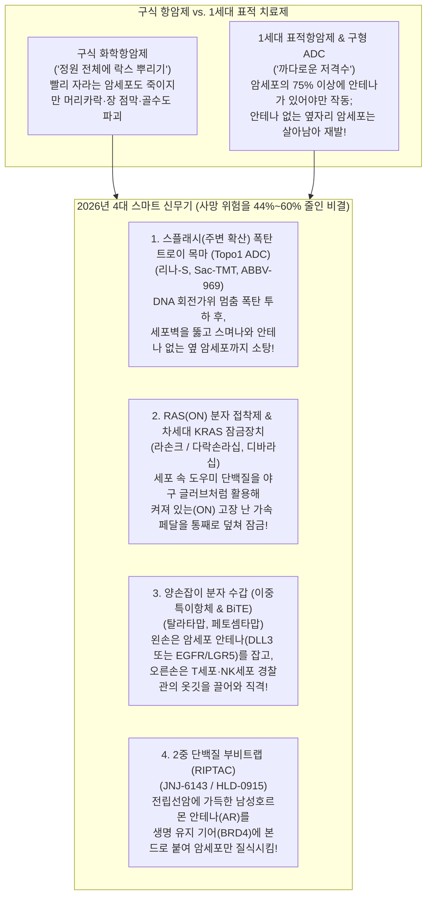
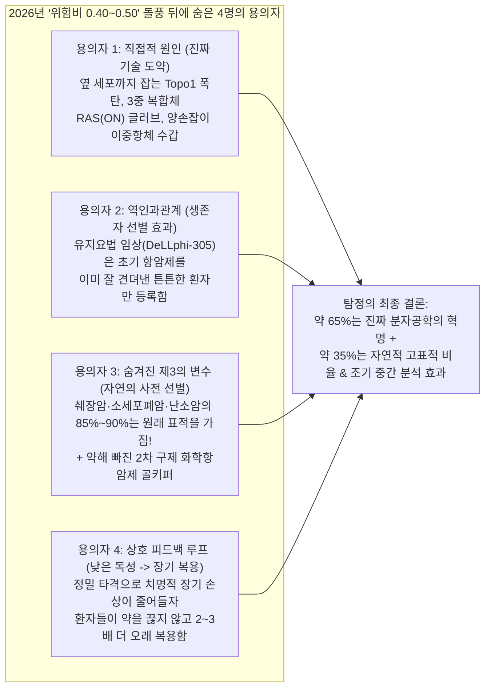

## 1. 첫 번째 질문(The Hook): 잠깐만요—항암제 점수가 어떻게 1년 만에 갑자기 두 배로 뛰었나요?

학교 육상부가 30년 동안 1,500미터 달리기 신기록을 깨려고 애써 왔다고 상상해 보세요. 매년 봄마다 가장 빠른 선수가 기록을 겨우 **2초**씩 앞당기면 다들 예의상 박수를 쳤지만 우승 트로피는 꿈도 꾸지 못했습니다. 그런데 2026년 가을, **일곱 명의 선수**가 네 가지 신기한 새 운동화를 신고 트랙에 나타나더니, 같은 달에 일곱 명 모두 기존 기록을 무려 **45초**나 단축해 버렸습니다!

만약 실제로 운동장에서 이런 광경을 본다면 박수만 치고 끝내지 않을 겁니다. 당장 돋보기를 들고 두 가지 질문을 던지겠죠.
1. **"도대체 저 새 운동화 바닥에 무슨 장치가 들어 있는 거지?"**
2. **"잠깐—우리가 안 보는 사이에 누군가 트랙 길이를 줄여 놓은 건 아닐까?"**

이와 똑같은 미스터리가 2026년 가을 실제 암 치료제(항암제) 세계에서 벌어졌습니다. 지난 수십 년 동안 과학자들이 췌장암, 난소암, 폐암, 두경부암처럼 고치기 힘든 진행성 암을 대상으로 신약을 시험할 때, 의사들과 월스트리트 투자자들은 아주 느리고 답답한 걸음걸이에 익숙해져 있었습니다. 보통 '성공했다'고 박수받는 신약조차 옛날 방식의 화학항암제보다 환자의 생명을 고작 **2~3개월** 더 연장해 주고, 매달 사망할 위험을 **15%~30%** 정도 낮춰주는 데 그쳤기 때문입니다(의사들은 이를 **위험비, 즉 HR 0.70~0.85**라고 부릅니다).

그런데 2026년 8월부터 10월 사이—유럽 최대 암 학회인 **ESMO 2026**과 10월 말 **젠맙(Genmab)**의 대형 임상 3상 발표가 이어지면서—전 세계 암 전문의들이 눈을 의심할 만한 성적표가 쏟아져 나왔습니다. 바이오테크 애널리스트 오하드 해머(`@ohadhammer`)는 2026년 10월 화제가 된 분석 글에서 이 현상을 이렇게 요약했습니다.

> "2026년은 지금까지 항암 신약 개발 역사상 최고의 해였습니다. 최근 수년간 가장 강력한 임상 결과들이 쏟아졌고, ESMO 학회와 최근 발표들은 항암 분야가 거대한 혁신 주기에 진입했음을 보여줍니다. 이 변화는 주로 토포이소머라제-1(Topo1) 항체-약물 접합체(ADC), RAS 억제제, 그리고 T세포 관여 치료제(T-cell engagers)가 이끌고 있습니다. 이번에 특히 놀라운 점은 성공한 임상 3상의 개수뿐만 아니라, 까다로운 바이오마커(표지자)로 환자를 골라내지 않은 '전체 환자군(broad populations)'에서 나타난 압도적인 효과 크기입니다. 역사적으로 투자자들은 전체 생존기간(OS) 2~3개월 연장과 위험비(HR) 0.7 수준에 익숙했지만, 2026년 한 해에만 위험비 0.4~0.5를 기록한 임상 결과가 여러 개 쏟아졌습니다!"

사망 위험을 **50%~60%**나 깎아내고(`HR = 0.40~0.50`), 가장 치명적인 암으로 꼽히는 전이성 췌장암에서 생존 기간을 **6.7개월에서 13.2개월로 두 배 가까이 늘렸다**는 것은 엄청난 도약입니다. 오늘 우리는 탐정 모자를 쓰고 두 가지를 해볼 겁니다. 먼저 생물학을 전혀 모르는 초등학교 5학년(10~11세)도 분자 톱니바퀴 하나하나를 완벽히 이해할 수 있도록 맨바닥부터 원리를 조립해 볼 것입니다. 그다음 미국 식품의약국(FDA), 세계 최고 의학 학술지(*NEJM*), 그리고 미국 임상시험 등록소(ClinicalTrials.gov)의 공식 원본 데이터를 직접 대조하며 **7가지 혁신 신약**의 진짜 실력과 통계적 착시를 가려낼 것입니다. *(만약 수술, 방사선, 기본 화학항암제의 작동 원리가 먼저 궁금하다면 오늘 함께 발행된 자매편 가이드인 [요즘 암 치료법은 실제로 어떻게 작동할까?](/ko/blog/2026-11-02-how-current-cancer-treatments-actually-work-fifth-grader-guide)를 먼저 읽어보세요!)*

---

## 2. 0단계부터 시작하기: 항암 시험 점수는 어떻게 매기며, 4가지 새 스마트 무기는 어떻게 작동할까?

2026년의 7가지 신약을 살펴보기 전에, 두 가지 기본 규칙부터 확실히 알아야 합니다. 첫째는 **의사들이 항암제 시합에서 점수를 매기는 방법**이고, 둘째는 **왜 4가지 새로운 '스마트 무기'가 옛날 항암제보다 훨씬 강력한지**입니다.

### 파트 A: 생명이 걸린 시합에서 점수는 어떻게 매길까?

제약회사가 새 항암제를 발명했다고 해서 정부 심판관인 **미국 식품의약국(FDA)**이 환자 10명에게만 약을 먹여보고 *"와, 효과가 좋아 보이네요!"*라며 허가를 내주지는 않습니다. 회사는 반드시 **500명에서 700명 이상의 환자**가 참여하는 최종 챔피언십 테스트인 **무작위 배정 임상 3상 시험(Randomized Phase 3 Clinical Trial)**을 치러야 합니다. 컴퓨터 동전 던지기로 환자를 정확히 반으로 나누어 절반에게는 **기존 최고 치료제(대조군)**를 주고, 나머지 절반에게는 **새 치료제(시험군)**를 줍니다.

의사들은 전광판에 딱 세 가지 핵심 점수를 기록합니다.

1. **정확히 한가운데 서 있는 50번째 사람의 시계 ("전체 생존기간 중앙값", `mOS`):**
   * **쉬운 개념 설명:** 같은 암을 앓는 환자 100명이 첫날 동시에 약을 먹기 시작합니다. 의사들은 스톱워치를 누르고 줄의 **정확히 한가운데 있는 50번째 환자**가 세상을 떠날 때까지 기다립니다. 만약 50번째 환자가 세상을 떠나는 순간 시계가 `13.2개월`을 가리키고 있다면, 그 약의 점수는 `13.2개월`입니다.
   * **초등학교 5학년 비유:** 왜 익숙한 '평균(Average)' 대신 **한가운데 서 있는 50번째 사람(중앙값, Median)**을 쓸까요? 반 친구 10명의 일주일 용돈을 조사한다고 해봅시다. 9명은 `5,000원`을 받는데 재벌집 아이 1명이 `100만 원`을 받습니다. 이 반의 용돈 '평균'을 내면 `10만 4,500원`이 나옵니다—보통 아이들의 실제 용돈을 완전히 왜곡하는 거짓말이 되죠! 하지만 줄 한가운데 있는 **5번째 아이의 용돈(중앙값)**을 보면 정확히 `5,000원`이라는 진실을 알려줍니다. 암 임상시험에서도 운 좋게 10년 이상 사는 환자 한두 명이 평균을 크게 부풀릴 수 있기 때문에, 의사들은 언제나 **50번째 중간 사람 시계**를 씁니다.
   * **어른들의 전문 용어:** 의사들은 이 50번째 사람의 생존 시계를 **전체 생존기간 중앙값(Median Overall Survival, `mOS`)**이라고 부릅니다. (만약 스톱워치로 50번째 사람의 *암 덩어리가 CT 사진에서 다시 커지기 전까지 버틴 시간*을 재면, 이를 **무진행 생존기간 중앙값, `mPFS`**라고 부릅니다.)

2. **매일매일의 위험 비교 점수 ("위험비" 또는 `HR`):**
   * **쉬운 개념 설명:** 50번째 사람만 비교하면 달리기 경주의 딱 한 순간만 보는 셈입니다. 경주 시작부터 끝까지 전체 구간의 위험도를 비교하려면 어떻게 해야 할까요? 의사들은 **새 약을 먹은 그룹에서 매달 환자가 사망하는 속도**를 **기존 약을 먹은 그룹에서 매달 환자가 사망하는 속도**로 나눕니다.
   * **초등학교 5학년 비유:** 가파르고 진흙탕인 **옛날 산길**로 아이들 100명이 자전거를 타고 내려가는데 **매시간 10명씩 넘어져 다친다**고 해봅시다. 바로 옆에 안전 펜스를 설치한 **새 포장도로**로 다른 아이들 100명이 내려가는데, 여기서는 **매시간 4명만 넘어집니다**. 새 도로의 사고 수(`4`)를 옛날 길의 사고 수(`10`)로 나누면 `4 ÷ 10 = 0.40`이 됩니다. 만약 점수가 `1.00`이라면 두 길의 위험도가 똑같다는 뜻(`10 ÷ 10 = 1.00`, 무승부)입니다. 점수가 **`0.40`**이라는 뜻은 새 도로를 타면 위험이 옛날 길의 **40% 수준**으로 줄어든다는 것—즉 **사고 위험을 60%나 깎아냈다**(`1.00 - 0.40 = 0.60`, 즉 `60%` 감소)는 뜻입니다!
   * **어른들의 전문 용어:** 의사들과 통계학자들은 이 위험 나눗셈 점수를 **위험비(Hazard Ratio, `HR`)**라고 부릅니다. 지난 30년 동안 항암제 시험에서 위험비 **`0.75`**(사망 위험 25% 감소)만 나와도 대성공이라며 축포를 터뜨렸습니다. 그런데 2026년에는 무려 4개의 대형 임상 3상 시험이 위험비 **`0.40`~`0.50`**을 기록하며 사망 위험을 **50%~60%**나 줄여버렸습니다!

3. **"특별 입장권이 있어야만 약이 듣나요?" 질문 ("바이오마커 선별" vs. "비선별 전체 환자군"):**
   * **쉬운 개념 설명:** 우리 몸의 세포 표면에는 수백만 개의 미세한 단백질 '안테나'가 솟아 있습니다(세포 하나 크기는 약 `15 마이크로미터`로 머리카락 굵기 `75,000 나노미터`의 5분의 1 수준이고, 단백질 안테나 하나는 약 `10 나노미터`로 **머리카락보다 7,500배나 더 가늡니다**!). 2010년대에 나온 1세대 정밀 항암제들은 환자의 암세포 표면에 특정 안테나가 엄청나게 많이(예: 암세포의 75% 이상) 박혀 있을 때만 효과가 있었습니다. 그래서 의사들은 암 조직을 떼어내 실험실에서 염색해 보고, 안테나가 부족한 60%~80%의 환자들에게는 *"죄송하지만 이 약을 쓸 수 없습니다"*라고 돌려보내야 했습니다.
   * **초등학교 5학년 비유:** 바닥이 최고급 이탈리아 대리석으로 된 집에서만 과자 부스러기를 빨아들이는 까다로운 청소기와 같았습니다. 평범한 나무 마루나 장판이 깔린 집에서는 아예 작동하지 않았던 거죠.
   * **어른들의 전문 용어:** 그 특별한 안테나나 유전자 오타를 **바이오마커(Biomarker, 생체표지자)**라고 부릅니다. 안테나가 많은 환자만 골라 받는 시험을 **바이오마커 선별(Biomarker-Selected) 시험**이라고 합니다. 2026년에 의학계가 깜짝 놀란 이유는, 새로운 약들이 안테나 개수를 미리 따지지 않고 모든 환자를 다 받아주는 **바이오마커 비선별(Unselected / All-Comer) 시험**에서도 옛날 항암제를 압도했기 때문입니다!

---

### 파트 B: 2026년의 4가지 '스마트 신무기'는 어떻게 작동할까?

어떻게 2026년의 신약들은 위험비를 `0.75`에서 `0.40~0.50`으로 끌어내리고 안테나가 적은 환자들에게까지 효과를 냈을까요? 생명공학자들이 **네 가지 정밀 분자 기계**를 완전히 새로 업그레이드했기 때문입니다.

우리의 **개념 설명 → 5학년 비유 → 어른들의 전문 용어** 3단계 규칙에 따라 네 가지 기계를 하나씩 열어봅시다.

#### 기계 1: 옆방까지 스며드는 스플래시 트로이 목마 (`Topo1 ADC` — *리나-S*, *Sac-TMT*, *ABBV-969*)
* **실제 세포 속에서 일어나는 일:** 암세포가 한 개에서 두 개로 분열하려면 세포 안에 감겨 있는 길이 2미터짜리 DNA 설계도 밧줄을 풀어서 복사해야 합니다. 단단히 꼬인 밧줄의 두 가닥을 억지로 벌리면 어떻게 될까요? 나머지 부분이 꽈배기처럼 팽팽하게 엉켜버립니다! 그래서 모든 세포는 DNA 한 가닥을 살짝 잘라 꼬임을 풀어준 뒤 다시 딱 붙여주는 '회전 가위 효소'를 가지고 있습니다. 2026년의 신형 배달 트럭은 Y자 모양의 항체 사냥개를 이용해 암세포 안테나(난소암의 `FRα`나 자궁내막암의 `TROP2`)에 착륙합니다. 암세포 안으로 들어간 트럭은 특수 폭탄을 터뜨려 **회전 가위가 DNA를 자른 순간 그 틈에 끼어들어 가위를 본드로 붙여버립니다**. 결국 복사 중이던 암세포의 DNA가 두 동강 나며 파괴됩니다!
* **2026년의 비밀 업그레이드 (왜 안테나 검사가 필요 없을까?):** 구형 항체 트럭(예: 난소암 치료제 `엘라히어 / 미르베툭시맙`)이 실어 나르던 폭탄은 덩치가 크고 물에 잘 녹는 성질이라 첫 번째 암세포 안에 갇혀버렸습니다. 그래서 종양 세포 중 40%에 `FRα` 안테나가 없으면, 안테나 없는 대머리 암세포들은 멀쩡히 살아남아 다시 자라났습니다. 반면 2026년의 신형 트럭들은 기름 막을 스르륵 통과하는 날렵한 폭탄(`엑사테칸` 또는 `벨로테칸` 계열)을 싣고 갑니다. 첫 번째 암세포가 터지면 **독성 분자가 기름방울처럼 세포벽을 뚫고 나와 바로 옆에 숨어 있던 안테나 없는 암세포들까지 연쇄적으로 소탕해 버립니다!**
* **초등학교 5학년 비유:** 장미 정원에 잡초들이 숨어 있는데 절반만 빨간 깃발을 꽂고 있습니다. 옛날 드론은 깃발 달린 잡초 위에만 돌멩이를 떨어뜨려 바로 옆의 깃발 없는 잡초는 그대로 남겼습니다. 2026년형 신형 드론은 깃발 달린 잡초에 내려앉은 뒤 옆으로 살짝 퍼지는 제초 안개를 뿜어내어, 바로 옆에 깃발을 숨기고 있던 잡초들까지 한꺼번에 말려 죽입니다!
* **어른들의 전문 용어:** DNA 꼬임을 푸는 회전 가위 효소를 **토포이소머라제 1(Topoisomerase 1, `Topo1`)**, 이를 실어 나르는 유도 미사일 트럭을 **Topo1 항체-약물 접합체(`Topo1 ADC`)**, 그리고 옆자리 안테나 없는 암세포까지 함께 잡는 스플래시 효과를 **방관자 효과(Bystander Effect)**라고 부릅니다.

#### 기계 2: 폭주하는 가속 페달 밑에 강철 군화 끼워 넣기 (`RAS(ON)` 억제제 & 차세대 `KRAS` 억제제 — *라손크*와 *디바라십*)
* **실제 세포 속에서 일어나는 일:** 우리 세포 안에는 **"자라나라, 분열하라!"**라고 명령하는 마스터 스위치가 있습니다. 이 스위치는 작은 에너지 건전지(`GTP`)를 물고 있을 때 **켜짐(ON)** 상태가 되고, 건전지가 다 닳으면(`GDP`) **꺼짐(OFF)** 상태가 됩니다. 그런데 **췌장암의 90% 이상**과 **폐암의 약 30%**에서는 유전자 오타 때문에 이 스위치가 **하루 24시간 내내 켜짐(ON) 상태로 고장 나 있습니다**. 과학자들은 40년 동안 이 단백질을 '약을 만들 수 없는 악마의 표적(undruggable)'이라고 불렀습니다. 표면이 기름칠한 볼링공처럼 매끈해서 약이 붙잡을 열쇠 구멍이 아예 없었기 때문입니다! 2021년 무렵 등장한 1세대 알약(`소토라십`, `아다그라십`)은 폐암에 흔한 특정 오타(`G12C`)의 작은 틈을 겨우 찾아냈지만, **스위치가 잠깐 꺼졌을 때(`RAS-OFF`)만** 잡을 수 있었습니다. 게다가 췌장암에 많은 다른 오타들(`G12D`, `G12V`, `G12R`)은 거의 꺼지지조차 않았습니다.
* **2026년의 비밀 업그레이드:**
  1. 폐암의 `G12C` 스위치를 잡기 위해 로슈/제넨텍(Roche/Genentech)은 **디바라십(Divarasib)**을 만들었습니다. 1세대 약(`소토라십`)보다 그 틈새에 **5배에서 50배나 더 빠르고 단단하게** 맞물리는 초강력 렌치입니다.
  2. 더 놀라운 발명은 레볼루션 메디슨스(Revolution Medicines)가 췌장암을 위해 만든 **라손크(Rasonque, 성분명 `다락손라십 / daraxonrasib`)**입니다. 작은 알약 혼자서 미끄러운 **켜짐(ON)** 볼링공을 잡으려 하지 않고, 알약이 세포 안으로 들어가자마자 모든 세포 속에 원래 둥둥 떠다니는 통통한 도우미 단백질(`사이클로필린 A, Cyclophilin A`)을 먼저 붙잡습니다. 그러면 알약과 도우미 단백질이 합체해 거대한 **'3중 복합체 야구 글러브(Tri-Complex)'**로 변신합니다! 이 커다란 글러브가 **켜져서 돌아가고 있는 `RAS(ON)` 스위치**를 모든 주요 돌연변이(`G12D`, `G12V`, `G12R`, `G12C`, `G13D`) 가리지 않고 통째로 덮쳐서 멈춰 세웁니다!
* **초등학교 5학년 비유:** 버터를 바른 채 쌩쌩 돌아가는 볼링공을 맨손가락 두 개로 집어 멈추려는 것(`1세대 알약`)은 거의 불가능하지만, 방 안에 놓여 있던 커다란 끈적이 포수 미트를 끼고 공 전체를 껴안아 버리면(`라손크`) 단번에 멈출 수 있습니다.
* **어른들의 전문 용어:** 이 성장 스위치는 **RAS**(특히 **KRAS**)라고 부르며, `디바라십`은 **차세대 고선택적 KRAS G12C 억제제**, `라손크`는 **다중 선택적 3중 복합체 RAS(ON) 억제제**라고 부릅니다.

#### 기계 3: 양손이 다른 분자 수갑 (`이중특이항체 & T세포 관여 치료제` — *탈라타맙*과 *페토셈타맙*)
* **실제 세포 속에서 일어나는 일:** 원래 우리 몸의 항체는 알파벳 **Y** 모양인데, 왼손과 오른손이 쌍둥이처럼 똑같이 생겨서 한 가지 표적만 잡습니다. 생명공학자들은 서로 다른 두 항체를 반으로 쪼갠 뒤 지퍼처럼 합쳐서 **왼손은 표적 A**를 잡고 **오른손은 표적 B**를 잡는 개조 항체를 만들었습니다!
  * **탈라타맙(Tarlatamab, 상품명 `임델트라 / Imdelltra`, 암젠)**은 아주 빠르게 퍼지는 **소세포폐암(`SCLC`)**을 잡기 위해 만들어졌습니다. 정상 세포는 `DLL3`라는 단백질을 벽장 안에만 넣어두는데, 소세포폐암 세포의 `85%`는 실수로 이 `DLL3`를 현관문 밖에 내걸고 있습니다. `탈라타맙`의 왼손은 폐암 세포의 `DLL3`를 꽉 잡고, 오른손은 우리 혈액 속 경찰관인 **T세포**의 옷깃(`CD3`)을 잡아채서 암세포 코앞에 수갑으로 묶어버립니다. 그러면 깨어난 T세포가 그 자리에서 암세포에 구멍을 뚫어 폭파시킵니다!
  * **페토셈타맙(Petosemtamab, 별칭 "Peto", 젠맙/메루스)**은 **두경부암(`HNSCC`, 입·목·후두에 생기는 암)**을 공격합니다. 왼손은 종양의 주 성장 안테나(`EGFR`)를 잡고, 오른손은 항암제를 견뎌내고 암을 다시 자라게 하는 '여왕벌' **암 줄기세포**의 표지판(`LGR5`)을 잡습니다. 두 안테나를 한꺼번에 잡은 `페토셈타맙`은 암세포가 자기 안테나를 세포 안쪽 쓰레기 분쇄기(`리소좀`)로 삼켜서 스스로 갈아버리게 만듭니다! 동시에 Y자 항체의 아래쪽 꼬리에서 설탕 조각을 살짝 깎아내어(`low-fucose`), 면역계의 **자연살해세포(`NK세포`)**와 **대식세포(팩맨 세포)**를 불러모아 암세포를 통째로 잡아먹게 합니다.
* **초등학교 5학년 비유:** `탈라타맙`은 한 손으로 복도 사물함에 낙서하는 악당을 잡고 다른 손으로 복도를 지나가는 보안관의 벨트에 수갑을 채워버리는 복도 당번입니다. `페토셈타맙`은 도주 차량의 핸들과 브레이크를 한 줄로 묶어버리면서 동시에 견인차를 부르는 정비사입니다.
* **어른들의 전문 용어:** `탈라타맙`은 **이중특이성 T세포 관여항체(`BiTE`)**, `페토셈타맙`은 **면역세포 호출 기능(ADCC/ADCP)이 강화된 EGFR × LGR5 이중특이항체(Bispecific Antibody)**라고 부릅니다.

#### 기계 4: 두 단백질을 본드로 붙이는 부비트랩 (`RIPTAC` — *JNJ-6143*)
* **실제 세포 속에서 일어나는 일:** 말기 **전립선암(`mCRPC`)** 세포 안에는 남성호르몬을 받아들이는 **안드로겐 수용체(`AR`)** 단백질이 수백만 개씩 빽빽하게 들어차 있습니다. 존슨앤드존슨(J&J, 할다 테라퓨틱스 개발)은 양쪽에 서로 다른 자석이 달린 아령 모양의 먹는 알약 **JNJ-6143(`HLD-0915`)**을 만들었습니다. 아령의 한쪽 끝은 전립선암의 `AR` 단백질에 달라붙고, 반대쪽 끝은 모든 세포가 숨을 쉬고 설계도를 읽는 데 꼭 필요한 필수 생존 기어(`BRD4`)에 달라붙습니다. `AR`이 거의 없는 건강한 심장이나 콩팥 세포 안에서는 이 아령이 아무 일도 일으키지 않고 지나갑니다. 하지만 `AR`이 산더미처럼 쌓여 있는 전립선암 세포 안에서는 수백만 개의 아령이 `AR` 덩어리를 필수 생존 기어(`BRD4`)에 찰칵 묶어버려, 암세포의 생명 유지 장치를 멈추고 스스로 죽게 만듭니다!
* **초등학교 5학년 비유:** 한쪽 고리를 무거운 금괴에 걸어야만 잠기는 특수 수갑을 상상해 보세요. 금괴가 없는 평범한 아이 방(정상 세포)에서는 수갑이 절대 잠기지 않습니다. 하지만 훔친 금괴가 천장까지 쌓여 있는 은행 강도의 아지트(전립선암 세포) 안에서는 강도가 자기 금괴에 수갑이 채워져 꼼짝도 못 하게 됩니다!
* **어른들의 전문 용어:** 과학자들은 이 양면 접착 함정 알약을 **RIPTAC(`Regulated Induced Proximity Targeting Chimera`, 유도 근접 표적 키메라)**이라고 부릅니다.

---

## 3. 비밀 해독 반지(Secret Decoder Ring): 무서운 2026년 항암 용어 한눈에 번역하기

이제 실제 2026년 임상시험 전광판을 들여다보기 전에, 뉴스나 투자 발표 자료에 나오는 어려운 약어들을 단번에 꿰뚫어 볼 수 있도록 **비밀 해독 반지**를 끼워 봅시다.

| 어른들의 전문 용어 / 약어 | 진짜 뜻 (쉬운 한국어 설명) | 초등학교 5학년 눈높이 비유 |
| :--- | :--- | :--- |
| **위험비 (`HR`, Hazard Ratio)** | 새 약을 먹는 환자가 사망(또는 악화)하는 속도를 옛날 약으로 나눈 값. `HR = 0.43`은 위험이 예전의 43%로 줄었다는 뜻—즉 **사망 위험 57% 감소**! | 옛날 자갈길에서 시간당 자전거 10대가 넘어질 때 새 포장도로에서 4.3대만 넘어지면 위험비는 `0.43`입니다. |
| **전체 생존기간 중앙값 (`mOS`)** | 환자 100명이 치료를 시작했을 때 **정확히 한가운데인 50번째 환자**가 세상을 떠날 때까지 걸린 개월 수. | 100명이 동시에 엎드려 버티기(플랭크) 시합을 할 때 정확히 50번째 아이가 무릎을 꿇는 순간의 스톱워치 시간. |
| **객관적 반응률 (`ORR`)** | 환자 100명 중 CT 촬영에서 암 덩어리의 지름이 눈에 띄게(보통 30% 이상) 줄어든 환자의 비율. | 햇볕이 쨍쨍한 운동장에 세워둔 눈사람 100개 중 점심시간까지 크기가 3분의 1 이상 녹아 줄어든 눈사람의 개수. |
| **Topo1 ADC (`리나-S`, `Sac-TMT`, `ABBV-969`)** | DNA 꼬임을 푸는 가위(`Topoisomerase 1`)를 멈추는 폭탄을 싣고 가서 터뜨린 뒤, 옆자리 암세포까지 스며들게 하는(`방관자 효과`) 항체 배달 트럭. | 깃발 꽂힌 잡초에 착륙해 옆으로 퍼지는 제초 안개를 뿜어 바로 옆 깃발 없는 잡초까지 함께 없애는 드론. |
| **RAS(ON) 억제제 (`라손크 / 다락손라십`)** | 세포 안 도우미 단백질(`사이클로필린 A`)과 합체해 **켜져 있는(ON) 고장 난 `RAS` 성장 스위치**를 통째로 덮쳐 끄는 먹는 알약. | 기름칠한 채 돌아가는 볼링공을 맨손가락으로 집는 대신 커다란 끈적이 포수 미트를 끼고 공 전체를 껴안아 멈추기. |
| **이중특이항체 / BiTE (`탈라타맙`, `페토셈타맙`)** | 양손 모양이 서로 다른 Y자 단백질—T세포 경찰관을 암세포에 수갑 채우거나(`탈라타맙`), 암세포의 두 안테나(`EGFR` + `LGR5`)를 묶어 분쇄함(`페토셈타맙`). | 서로 다른 두 물건을 미시 세계에서 찰칵 붙여버리는 양면 자석 클립. |
| **RIPTAC (`JNJ-6143`)** | 암세포에 흔한 단백질(`AR`)을 필수 생존 단백질(`BRD4`)에 본드로 붙여 암세포만 질식시키는 양면 알약. | 도둑의 발목을 자기가 훔치러 온 무거운 금고에 수갑으로 채우는 함정(금고가 없는 정상 세포 방에서는 작동 안 함). |
| **PROC / HNSCC / SCLC / NSCLC / mCRPC** | 2026년 돌풍이 일어난 5대 난치암: **PROC** = 백금 저항성 난소암; **HNSCC** = 두경부암; **SCLC / NSCLC** = 소세포 / 비소세포 폐암; **mCRPC** = 전이성 거세저항성 전립선암. | 반란군 암세포들이 몸속 어느 동네에서 어떤 변장복을 입고 활동하는지 알려주는 주소. |

---

## 4. 화려한 발표 vs. 탐정의 팩트 체크: 2026년 7대 항암 돌파구 전수 조사

이제 실제 1차 원본 증거(Primary Sources)를 확인해 봅시다. 아래 그림은 **젠맙(Genmab)**이 2026년 10월 말 공식 발표한 두 건의 임상 3상 핵심 결과 슬라이드인 **`RAINFOL-02`(난소암 `리나-S`, 2026년 10월 23일 발표)**와 **`LiGeR-HN1`(두경부암 `페토셈타맙`, 2026년 10월 28일 발표)**입니다.

*1차 원본 자료(Primary Source Artifact): 젠맙(Genmab)의 2026년 10월 공식 임상 3상 탑라인 발표 슬라이드 발췌본. `RAINFOL-02` (`NCT06619236`, `N = 584`, `PFS HR = 0.29`, `OS HR = 0.43`, `p < 0.0001`) 및 `LiGeR-HN1` (`NCT06525220`, `N ≈ 700`, `OS HR = 0.50`, `ORR 교차비 = 3.17`, `p < 0.0001`) 수치가 명시되어 있다.*

이제 2026년에 발표된 **일곱 가지 핵심 임상 결과**를 모두 한자리에 모아 FDA 승인 문서, *뉴잉글랜드 저널 오브 메디슨(NEJM)* 논문, ESMO 2026 초록, ClinicalTrials.gov 등록 원부와 대조하고, **체육관에 모인 환자 100명**에게 실제로 무슨 일이 일어나는지 번역해 보겠습니다.

```mermaid
xychart-beta
    title "2026년 생존기간의 도약: 전체 생존기간 중앙값 비교 (단위: 개월, 기존 표준치료 vs. 2026년 신약)"
    x-axis ["췌장암 (Rasonque)", "자궁내막암 (Sac-TMT)", "소세포폐암 (Tarlatamab)", "폐암 KRAS (Divarasib)"]
    y-axis "전체 생존기간 중앙값 (개월)" 0 --> 24
    bar [6.7, 12.1, 12.7, 12.0]
    bar [13.2, 19.0, 21.1, 17.7]
```

*(참고: 위 차트에서 각 항목의 첫 번째 막대는 **기존 대조군 치료제**의 생존 개월 수[`6.7`, `12.1`, `12.7`, `12.0`]이고, 두 번째 막대는 **2026년 스마트 신약**의 생존 개월 수[`13.2`, `19.0`, `21.1`, `17.7`]입니다. 나머지 두 개의 임상 3상 우승 약물인 `리나-S`와 `페토셈타맙`은 각각 사망 위험을 `57%`[`HR 0.43`]와 `50%`[`HR 0.50`] 줄였으며, 2026년 10월 말 발표 시점까지 환자의 절반 이상이 아직 생존해 있어 50번째 환자의 시계가 지금도 계속 올라가고 있습니다!)*

### 2026년 7대 항암 돌파구 전수 검증 스코어보드 (1차 출처 대조 완료)

| 신약 & 개발사 (무기 종류) | 대상 암종 & 임상시험 (`NCT 번호` & 환자 수) | 2026년 공식 성적 (`HR` & 생존기간 중앙값) | 같은 치료 단계의 과거 기준점(Benchmark) | 탐정의 팩트 체크: 체육관의 환자 100명에게 생기는 일 & 숨겨진 작은 글씨(Fine Print) |
| :--- | :--- | :--- | :--- | :--- |
| **1. 라손크 (`Rasonque`, 다락손라십)** Revolution Medicines (`$RVMD`) *다중 선택적 RAS(ON) 억제제* | **2차 치료 전이성 췌장암 (PDAC)** 임상 3상 `RASolute 302` ([`NCT06625320`](https://clinicaltrials.gov/study/NCT06625320)) | **`OS HR = 0.40`** 생존기간 중앙값 거의 2배 증가: **`13.2개월` vs. 화학항암제 `6.7개월`** ([FDA 승인, 2026년 8월 26일](https://www.fda.gov/drugs/resources-information-approved-drugs/fda-approves-daraxonrasib-metastatic-pancreatic-adenocarcinoma); [PubMed `42802048`](https://pubmed.ncbi.nlm.nih.gov/42802048/)). | 기존 2차 화학항암제는 전체 생존기간이 고작 `6~7개월`에 불과했으며, 췌장암에서 성공한 표적 RAS 치료제는 역사상 0개였음. | **체육관 테스트:** 매달 사망 위험을 **60%** 낮추고 50번째 환자에게 **6.5개월**(거의 두 학기!)의 추가 생명을 선물함. **작은 글씨:** 췌장암 환자의 **90% 이상이 원래 `RAS` 돌연변이를 가지고 있으므로**, '전체 환자군'이라는 말은 사실 자연이 미리 표적을 골라놓았다는 뜻! 피부 발진(`86%~88%`)과 구내염(`40%~55%`) 빈도가 높음. |
| **2. 리나-S (`Rina-S`, 리나타바트 세수테칸)** Genmab / ProfoundBio *FRα 표적 Topo1 ADC* | **2차 이상 백금 저항성 난소암 (PROC)** 임상 3상 `RAINFOL-02` ([`NCT06619236`](https://clinicaltrials.gov/study/NCT06619236), `N = 584` 전체 환자군) | **`OS HR = 0.43`** (`95% CI, 0.31–0.59; p < 0.0001`) **`PFS HR = 0.29`** (악화·사망 위험 `71%` 감소) ([젠맙 발표, 2026년 10월 23일](https://www.us.genmab.com/company/news/press-releases/genmab-announces-rinatabart-sesutecan-rina-s-demonstrates-statistically-significant-improvement-in-progression-free-survival-and-overall-survival-in-patients-with-platinum-resistant-ovarian-cancer-2026-10)). | **아바스틴(`베바시주맙`) + 항암제** (`AURELIA` 임상)는 `OS HR = 0.85`(`+3.3개월`, 통계적 유의성 실패); 구형 ADC **엘라히어(`미르베툭시맙`)** (`MIRASOL`)는 `FRα` 안테나가 아주 많은 상위 `35%~40%` 환자에서만 `OS HR = 0.67` 기록. | **체육관 테스트:** `Topo1` 폭탄의 스플래시 효과 덕분에 `FRα` 안테나 수치가 낮은 환자나 이전에 `엘라히어`를 썼던 환자까지 포함한 **전체 환자(`N = 584`)에서 사망 위험을 57% 감소**시킴! **작은 글씨:** 소셜미디어에서 말하는 "+10~12개월 생존 연장"은 **애널리스트의 추정치**이지 아직 실제로 측정된 중앙값이 아님(조기 중간 분석 단계!). |
| **3. 페토셈타맙 (`Petosemtamab`, "Peto")** Genmab / Merus *EGFR × LGR5 이중특이항체* | **1차 치료 PD-L1 양성 재발·전이성 두경부암 (HNSCC)** 임상 3상 `LiGeR-HN1` ([`NCT06525220`](https://clinicaltrials.gov/study/NCT06525220), `N ≈ 700`) | **`OS HR = 0.50`** (`95% CI, 0.37–0.67; p < 0.0001`) `키트루다` 단독 대비 **`ORR 교차비 = 3.17`** (`95% CI, 2.06–4.89`) ([OncLive / 젠맙, 2026년 10월 28일](https://www.onclive.com/view/petosemtamab-plus-pembrolizumab-hits-phase-3-os-orr-primary-end-points-in-pd-l1-positive-r-m-hnscc)). | **키트루다(`펨브롤리주맙`) + 화학항암제** (`KEYNOTE-048`)는 독한 화학항암제를 섞고도 `OS HR = 0.77` (`+3.3개월`, `13.0 vs. 10.7개월`) 기록. | **체육관 테스트:** **독한 화학항암제를 단 한 방울도 쓰지 않고** 사망 위험을 **절반(`50%`)**으로 줄였으며, HPV 바이러스 유무와 상관없이 종양 축소 확률(교차비)을 3배 이상 높임! **작은 글씨:** 첫 번째 **중간 분석(Interim Analysis)** 결과이므로 "+12개월 연장"은 아직 추정치이며, 종양이 **PD-L1 양성**(두경부암의 약 `85%`)인 환자만 등록됨. |
| **4. Sac-TMT (`사시투주맙 티루모테칸` / `MK-2870`)** Merck / Kelun-Biotech *TROP2 표적 Topo1 ADC* | **2차 이상 진행성·재발성 자궁내막암** 임상 3상 `TroFuse-005` ([`NCT06132958`](https://clinicaltrials.gov/study/NCT06132958)) | **`OS HR = 0.68`** (사망 위험 `32%` 감소) 생존기간 중앙값: **`19.0개월` vs. `12.1개월`** (`+6.9개월`); **`PFS HR = 0.59`** ([머크 발표, 2026년 10월](https://www.merck.com/news/sacituzumab-tirumotecan-sac-tmt-reduced-the-risk-of-death-by-32-and-the-risk-of-disease-progression-or-death-by-41-compared-to-chemotherapy-in-certain-patients-with-advanced-or-recurrent-endometrial/)). | **키트루다 + 렌비마** (`KEYNOTE-775`)도 화학항암제 대비 약 `6.9개월`(`18.3 vs. 11.4개월`, `HR = 0.62`)을 늘렸으나, 요즘은 환자들이 1차 치료에서 이미 `키트루다`를 다 써버림! | **체육관 테스트:** **백금 화학항암제와 1차 면역항암제(`키트루다`)를 모두 이겨내고 재발한** 훨씬 까다로운 환자들에게 **약 7개월**의 추가 생명을 안겨줌! **작은 글씨:** `HR = 0.68`은 매우 훌륭한 성적(`32%` 위험 감소)이지만 `0.40` 수준은 아니며, 모든 2026년 임상이 50% 이상 위험을 깎는 것은 아님을 보여줌. |
| **5. 탈라타맙 (`Tarlatamab`, 상품명 `임델트라`)** Amgen / AstraZeneca *DLL3 × CD3 이중특이성 T세포 관여항체 (BiTE)* | **확장병기 소세포폐암 (ES-SCLC) 1차 유지요법** 임상 3상 `DeLLphi-305` ([`NCT06211036`](https://clinicaltrials.gov/study/NCT06211036)) | **`OS HR = 0.42`** (사망 위험 `58%` 감소, `p < 0.001`) 생존기간 중앙값: **`21.1개월` vs. `12.7개월`** (`임핀지` 단독 대비 **`+8.4개월`** 연장!) ([ESMO 2026](https://www.esmo.org/insights-by-esmo/all-news/novel-first-line-treatment-significantly-improves-outcomes-in-small-cell-lung-cancer); [NEJM PubMed `42929702`](https://pubmed.ncbi.nlm.nih.gov/42929702/)). | 같은 1차 유지요법에서 **젭젤카(`러비넥테딘`) + 티센트릭** (`IMforte` 임상)은 `OS HR = 0.73` (`+2.6개월`, `13.2 vs. 10.6개월`) 기록. | **체육관 테스트:** 세상에서 가장 빨리 자라는 폐암 중 하나인 소세포폐암에서, 기존 유지요법(`임핀지`)에 `탈라타맙`을 더해 50번째 환자에게 **8.4개월 이상**의 추가 생명을 제공함! **작은 글씨:** 첫 4주기 항암+면역 치료 동안 암이 나빠지지 않은 환자들만 유지요법에 들어오며, 첫 투여 시 면역 발열 폭풍(`CRS`) 모니터링이 필요함. |
| **6. 디바라십 (`Divarasib`, `GDC-6036`)** Roche / Genentech *차세대 고선택적 KRAS G12C 억제제* | **2차 이상 KRAS G12C 변이 비소세포폐암 (NSCLC)** 임상 3상 `Krascendo-1` ([`NCT06497556`](https://clinicaltrials.gov/study/NCT06497556)) | **`OS HR = 0.56`** (`95% CI, 0.41–0.78; p = 0.0005`) 생존기간 중앙값: **`17.7개월` vs. `12.0개월`** (`+5.7개월`); **`ORR = 58.4%` vs. `32.3%`** ([제넨텍 발표, 2026년 10월 25일](https://www.gene.com/media/press-releases/15141/2026-10-25/genentechs-divarasib-demonstrated-best-i); [NEJM PubMed `42929675`](https://pubmed.ncbi.nlm.nih.gov/42929675/)). | 1세대 알약 **루마크라스(`소토라십`)**는 임상 3상(`CodeBreaK 200`)에서 일반 도세탁셀 화학항암제 대비 생존기간 연장에 실패함(`10.6 vs. 11.3개월`, `HR = 1.01`). | **체육관 테스트:** 약한 옛날 화학항암제와 싸운 게 아니라, **이미 허가받은 1세대 표적 알약(`소토라십`/`아다그라십`)과 1대1 정면 승부**를 벌여 사망 위험을 **44%(`+5.7개월`)**나 낮추고 중증 부작용까지 줄임! **작은 글씨:** 다른 시험들과 달리 이 시험은 **바이오마커 선별 그룹**(`KRAS G12C` 변이가 있는 폐암 환자 약 `12%~14%`)만을 대상으로 함. |
| **7. JNJ-6143 (`HLD-0915`) & ABBV-969** J&J (`RIPTAC`) & AbbVie (`PSMA/STEAP1 이중 Topo1 ADC`) | **말기 전이성 거세저항성 전립선암 (mCRPC)** 임상 1상 `HLD-0915-ONC-101` ([`NCT06800313`](https://clinicaltrials.gov/study/NCT06800313)) & 임상 1상 ([`NCT06318273`](https://clinicaltrials.gov/study/NCT06318273)) | **JNJ-6143:** **`69%` 초기 / `75%` 확정 `ORR`** (`50 mg` 용량군 평가 가능 환자 `16명 중 12명`) ([J&J 발표, 2026년 10월](https://www.jnj.com/media-center/press-releases/johnson-johnson-reports-75-tumor-response-rate-in-advanced-prostate-cancer-with-jnj-6143-a-first-in-class-riptac-molecule)). **ABBV-969:** **`45%` 확정 `ORR`** (`PSA50 감소율 = 67%`). | 방사성 의약품 **플루빅토(`177Lu-PSMA-617`)**는 임상 3상(`VISION`)에서 전체 반응률 약 `30%`(엄격한 연조직 측정 가능 환자군에서는 `46%`) 기록. | **체육관 테스트:** 온갖 치료에 다 실패한 말기 전립선암 환자 `16명 중 12명(75%)`에서 하루 한 알 먹는 `RIPTAC` 알약으로 암이 줄어든 것은 놀라운 초기 신호임. **작은 글씨 (핵심 통계 주의보!):** 이 두 약은 600명짜리 임상 3상이 아니라 **아주 작은 임상 1상 소그룹(`JNJ-6143` 50 mg군은 분모가 단 `16명`!)** 데이터임! 임상 1상의 높은 타율은 수백 명 규모의 임상 3상으로 가면 보통 `15%~25%` 정도 내려앉음. |

---

## 5. 네 명의 용의자(The Four Suspects): 2026년 생존기간 폭발의 진짜 원인은 무엇일까?

탐정은 점수가 평소보다 두 배나 뛰는 현상—과거 위험비 `~0.75`에서 `0.40~0.50`으로의 급락—을 볼 때 첫 번째 설명만 듣고 고개를 끄덕이지 않습니다. 우리의 **4방향 경쟁 원인 검증(4-Way Rival Cause Check)** 법칙에 따라, 이 대폭발 중 몇 퍼센트가 진짜 분자공학의 승리이고 몇 퍼센트가 임상시험 설계의 착시인지 **네 명의 용의자**를 심문해 봅시다.

### 4명의 용의자 정밀 심문 표

| 용의자 (인과 가설) | 이 용의자가 `HR 0.40~0.50` 성적을 설명하는 방식 | 탐정의 판결 (유죄인가, 무죄인가?) |
| :--- | :--- | :--- |
| **용의자 1: 직접적 원인 (Direct Cause)** *("새로운 분자 기계들이 실제로 암세포를 죽이는 위력이 두 배 강해졌다.")* | `Topo1` 폭탄(`리나-S`, `Sac-TMT`)이 세포막을 뚫고 퍼져(`방관자 효과`) 불균일한 주변 암세포까지 소탕하고, `라손크`가 켜져 있는 `RAS(ON)`을 직접 잠그며, `디바라십`이 `KRAS G12C`를 10배 단단히 죄고, `탈라타맙`과 `페토셈타맙`이 면역 경찰관을 직접 끌고 옴. | **주범으로 확정 (전체 효과의 약 65%).** 가장 확실한 증거는 `Krascendo-1`(`디바라십`), `DeLLphi-305`(`탈라타맙`), `LiGeR-HN1`(`페토셈타맙`)입니다. 이 세 시험은 약한 옛날 화학항암제가 아니라 **현재 쓰이는 강력한 표적 알약(`소토라십`/`아다그라십`)이나 현역 면역항암제(`임핀지`, `키트루다`)를 1대1로 꺾었습니다!** |
| **용의자 2: 역인과관계 / 생존자 편향 (Reverse Causation)** *("약 때문에 오래 산 걸까, 아니면 원래 오래 살 튼튼한 환자들만 시험에 들어온 걸까?")* | 무작위 임상 3상에서는 컴퓨터가 동전을 던져 두 그룹을 나누므로 두 그룹 사이의 출발선은 공정합니다. 다만 `DeLLphi-305`(`탈라타맙`) 같은 **유지요법 시험**은 첫 4번의 초기 항암+면역 주사를 맞고도 암이 커지지 않은 환자들만 골라서 등록합니다. | **전체 개월 수 크기에는 일부 영향, 위험비(`HR`)에는 무관.** 가장 위중한 환자들이 시험 등록 전에 먼저 탈락했기 때문에 `DeLLphi-305`의 두 그룹 모두 생존 기간 숫자 자체(`21.1 vs. 12.7개월`)가 길게 나옵니다. 하지만 동전 던지기 이후 두 그룹 사이에 벌어진 **`8.4개월`의 격차(`HR = 0.42`)**는 100% 약의 진짜 실력입니다! |
| **용의자 3: 숨겨진 제3의 변수 (Confounders)** *("'비선별 전체 환자' 시험이라더니 사실은 자연이 미리 표적을 골라놨거나, 상대 골키퍼가 너무 약한 것 아닐까?")* | **변수 A (자연의 사전 선별):** `라손크`(췌장암), `탈라타맙`(소세포폐암), `리나-S`(난소암), `Sac-TMT`(자궁내막암)가 "바이오마커 선별 없이 성공했다"고 하면 표적이 없어도 약이 듣는 것처럼 들립니다. 하지만 사실 **그 암들은 원래 환자의 80%~90% 이상이 `KRAS`, `DLL3`, `FRα`, `TROP2` 표적을 자연적으로 달고 있습니다!** **변수 B (지친 골키퍼):** 2차 난소암(`RAINFOL-02`)과 췌장암(`RASolute 302`)에서 비교 상대인 단일 구제 화학항암제는 반응률이 `10%~12%`밖에 안 되는 약한 상대입니다. | **공동 주범으로 확인 (헤드라인 착시의 약 35%).** '바이오마커 비선별'이란 표적이 필요 없다는 뜻이 아니라, 과학자들이 **거의 모든 환자가 표적을 조금씩이라도 가지고 있는 암**을 영리하게 고른 뒤 `방관자 효과`나 `T세포 수갑`으로 나머지 세포까지 쓸어버렸다는 뜻입니다! 또한 조기 중간 분석(`RAINFOL-02`, `LiGeR-HN1`)은 3년 뒤 최종 결과보다 위험비가 조금 더 화려하게 나오는 경향이 있습니다. |
| **용의자 4: 상호 피드백 루프 (Mutual Feedback Loop)** *("부작용이 덜하니까 약을 더 오래 먹고, 더 오래 먹으니까 암이 더 줄어들고, 몸이 안 상하니까 계속 약을 먹는다!")* | 구식 화학항암제나 독한 병용요법(예: `키트루다 + 렌비마`)은 부작용이 너무 심해 많은 환자가 3~4개월 만에 치료를 포기합니다. 반면 영구적인 신경·눈·장기 손상을 줄인 정밀 신약(`디바라십`, `페토셈타맙`, `리나-S`)은 환자가 10~18개월 이상 꾸준히 복용할 수 있습니다. | **강력한 증폭기로 확인.** 실제로 `Krascendo-1`에서 `디바라십`은 1세대 약보다 3~4등급 중증 독성과 복용 중단율이 오히려 더 낮으면서도 표적을 더 오래 눌러, '낮은 중도 포기율 → 장기 복용 → 생존 기간 연장'의 선순환을 만들었습니다. |

---

## 6. 숨겨진 함정(The Catch): 뉴스 헤드라인이 말해주지 않는 4가지 불편한 진실

제약회사의 발표 슬라이드에 *"기존에 알려진 안전성 프로파일과 일치함; 관리 가능한(manageable) 부작용"*이라는 문장이 적혀 있을 때, 훌륭한 5학년 탐정은 즉시 돋보기를 들고 이렇게 질문합니다. **"누구한테 관리 가능하다는 거지—차트를 적는 의사 선생님, 아니면 매일 그 약을 삼키는 환자?"**

2026년 축포 뒤에 숨어 있는 **네 가지 현실적인 대가(Catch)**를 살펴봅시다.

1. **"관리 가능하다"는 말 속에는 87%의 피부 발진, 입안 헐음, 골수 수치 하락, 면역 고열이 숨어 있습니다:**
   * `RASolute 302` 임상에서 승인된 **라손크(`다락손라십`)**의 FDA 허가 문서와 안전성 표를 열어보면, 건강한 피부 세포와 입안 점막 세포도 매일 새 세포로 갈아입기 위해 정상 `RAS` 스위치를 쓰기 때문에 `RAS(ON)`을 잠그면 **환자의 `86%~88%`에서 피부 발진**이 생기고 **`40%~55%`에서 입안이 헐고 아픈 구내염(`stomatitis`)**이 발생합니다! 전체 환자의 절반 이상(**`56.8%`**)이 부작용 때문에 약을 잠시 쉬거나 용량을 줄여야 했고, 환자들은 약을 계속 먹기 위해 예방용 항생제(`독시사이클린`), 스테로이드 연고, 특수 가글액을 매일 함께 써야 합니다.
   * **리나-S(`RAINFOL-02`)**의 경우, 구형 난소암 ADC(`엘라히어`)의 무서운 시야 흐림·각막 손상(`안구 독성`)이나 `엔허투`의 폐가 딱딱해지는 부작용(`간질성 폐질환, ILD`)이 나타나지 않았다는 점은 엄청난 발전입니다. 하지만 대가는 무엇일까요? `Topo1` 폭탄이 피를 만드는 뼈속 공장(골수)을 건드려 **적혈구가 줄어드는 빈혈(`anemia`)과 백혈구가 줄어드는 호중구감소증(`neutropenia`)**이 흔하게 나타나며, 수혈이나 백혈구 촉진 주사(`G-CSF`)가 필요합니다. 애브비의 `ABBV-969` 임상 1상에서도 **환자의 `63%`가 3등급 이상의 중증 부작용**(주로 심한 빈혈)을 겪었습니다.
   * **탈라타맙(`임델트라`)**은 T세포 경찰관을 폐암 세포에 강제로 묶어 폭발시키기 때문에, 첫 주사를 맞을 때 환자의 약 절반에서 면역계가 과열되는 **사이토카인 방출 증후군(`CRS`, 심한 고열·오한·혈압 저하)**이나 미각 상실(입맛이 이상해짐)이 나타나 초기 투여 시 병원 입원·관찰이 필요합니다.

2. **가장 화려한 두 주인공(`리나-S`와 `페토셈타맙`)은 아직 '전반전 스톱워치' 기록입니다:**
   * `RAINFOL-02`(`리나-S`, `HR = 0.43`)와 `LiGeR-HN1`(`페토셈타맙`, `HR = 0.50`)은 초반 성적이 워낙 압도적이어서 2026년 10월 **전체 환자의 절반(50%)이 사망하기도 전에** 조기 승리 선언을 했습니다. 즉 소셜미디어에서 떠도는 *"생존기간 중앙값이 아마 10~12개월 늘어날 것"*이라는 말은 **아직 실제로 관측된 숫자가 아니라**, 앞으로도 생존 그래프가 꺾이지 않을 것이라고 가정한 수학적 추측입니다! 과거 항암제 역사를 보면 12~18개월 뒤 암세포가 새로운 탈출구를 찾으면서 최종 위험비가 `0.55~0.65` 부근으로 조금 완만해지는 경우가 많습니다.

3. **늘어난 수개월의 시간은 무엇보다 소중하지만, 아직 '완치(Cure)'와는 다릅니다:**
   * 물리적 눈높이를 정직하게 유지해 봅시다. 전이성 췌장암의 생존기간 중앙값을 **`6.7개월에서 13.2개월`**(`라손크`)로 두 배 늘리고, 소세포폐암 유지요법 생존기간을 **`12.7개월에서 21.1개월`**(`탈라타맙`)로 늘린 것은 환자와 가족에게 또 한 번의 크리스마스, 졸업식, 그리고 여름방학을 선물하는 역사적인 승리입니다.
   * 하지만 **줄 한가운데 서 있는 50번째 환자**에게도 1~2년이 지나면 암세포가 결국 새로운 변이를 일으켜 다시 자라기 시작합니다. 소아 백혈병 치료제가 아이들의 85%~90%를 평생 완치시키는 것처럼 이 고형암 신약들이 말기 암 환자의 대부분을 영구히 완치시키는 단계까지는 아직 도달하지 못했습니다.

4. **집 한 채 값에 맞먹는 약값과 병원 격차 (누가 소외되는가?):**
   * 최신 이중항체, ADC, 표적 알약들은 미국 출시 기준으로 보통 **한 달에 `$18,000~$35,000`(약 2,500만~4,800만 원)**, **1년이면 `$200,000~$400,000` 이상(약 2억 7,000만~5억 5,000만 원)**에 달합니다—매년 새 아파트를 한 채씩 사야 하는 금액입니다!
   * 게다가 `탈라타맙`처럼 초기 면역 고열(`CRS`) 때문에 대학병원급 집중 모니터링이 필요한 약들은 대도시 대형 암센터에서는 쉽게 쓸 수 있지만, 지방의 작은 병원에서는 전문 인력이 부족해 환자들이 혜택을 받기 어렵습니다.

| 신약 계열 (2026년 대표 약물) | 구형 약물 대비 해결한 핵심 문제 | 현실 세계의 대가 (숨겨진 부작용 & 병목 현상) |
| :--- | :--- | :--- |
| **Topo1 ADC** (`리나-S`, `Sac-TMT`, `ABBV-969`) | 옆 세포로 스며드는 스플래시 효과(`방관자 효과`)로 안테나가 적은 주변 암세포까지 제거; `리나-S`는 구형 `엘라히어`의 안구 독성과 `엔허투`의 폐 섬유화 독성을 피함. | 골수 기능 저하(**빈혈 및 호중구감소증**)가 다수 환자에서 발생; 3주마다 정맥주사 투여 필요; 시간이 지나면 암세포가 독소를 밖으로 퍼내는 펌프(`약물 유출 펌프`)를 만들어 내성 획득. |
| **다중 선택적 RAS(ON) & 차세대 KRAS 알약** (`라손크 / 다락손라십`, `디바라십`) | 40년간 불가능이라던 췌장암(`90%+`)의 켜진 `RAS(ON)` 스위치를 최초로 잠그고, 폐암에서 1세대 `G12C` 알약을 1대1 정면 승부로 압도함. | `라손크`는 피부와 입안 점막의 정상 `RAS`도 건드려 **발진(`86%~88%`), 구내염(`40%~55%`), 용량 감량·중단(`56.8%`)** 유발; 결국 2차 우회 돌연변이 발생 가능. |
| **이중특이항체 & BiTE** (`탈라타맙`, `페토셈타맙`) | 화학항암제 없이 T세포를 수갑으로 묶거나(`탈라타맙`) 두경부암의 `EGFR × LGR5` 줄기세포 안테나를 동시에 분쇄함(`페토셈타맙`). | `탈라타맙`은 초기 면역 발열 폭풍(**CRS**)과 미각 이상을 유발해 입원 관찰이 필요함; `페토셈타맙`은 정맥주사 반응 및 피부 부작용 관리 필요. |
| **경구용 RIPTAC** (`JNJ-6143 / HLD-0915`) | 전립선암 자신의 호르몬 수용체(`AR`)를 이용해 생존 단백질(`BRD4`)을 묶는 하루 한 알 알약으로 말기 환자 `75%`(`12/16`)에서 종양 축소. | **아주 작은 임상 1상 표본 크기(`50 mg` 용량군 `N = 16`)**—600명 규모의 임상 3상에서도 이 반응률과 지속 기간이 유지되는지 아직 증명해야 함! |

---

## 7. 최종 성적표(The Final Report Card): 우리의 최종 결론

모든 1차 원본 출처, 임상시험 등록 원부, 통계 분모를 샅샅이 대조한 끝에 내리는 **2026년 항암 대폭발**에 대한 우리의 최종 탐정 판결은 무엇일까요?

### 우리의 경험적 결론 (Empirical Stance)
**2026년의 항암 신약 물결은 약 10년 전 면역관문억제제(`키트루다`, `옵디보`)가 등장한 이후 고형암 치료 분야에서 나타난 가장 진실하고 다각적인 생존기간 도약입니다.** 2020~2021년 바이오 거품 시기에는 제약회사들이 환자 10~20명짜리 임상 1상 그래프만 부풀려 홍보했다가 임상 3상에서 줄줄이 실패했습니다. 하지만 이번에 분석한 7개 중 6개(`라손크`, `리나-S`, `페토셈타맙`, `Sac-TMT`, `탈라타맙`, `디바라십`)는 **이미 수백 명 규모의 무작위 배정 임상 3상에서 반박할 수 없는 통계적 유의성(`p < 0.001`~`p < 0.0001`)으로 승리**했습니다. 조기 중간 분석 효과(`리나-S`, `페토셈타맙`)와 작은 임상 1상 표본(`JNJ-6143`)을 보수적으로 감안하더라도, 췌장암·난소암·자궁내막암·두경부암·폐암 전반에서 생존기간 중앙값을 **6개월에서 8.4개월 이상** 한꺼번에 끌어올린 것은 의학사의 이정표입니다.

### 앞으로 일어날 일을 예측하는 "만약(If) ... 그렇다면(Then) ..." 가이드

* **만약(IF) 어떤 신약이 높은 자연 표적 비율(`80%~90%`)에 스플래시 확산 효과(`방관자 효과`)나 면역세포 수갑 기술을 결합해 승리한다면(`리나-S`, `Sac-TMT`, `탈라타맙`, `라손크`), 그렇다면(THEN)** 의사들은 앞으로 느리고 비싼 사전 조직검사(바이오마커 검사)를 생략하고 이 스마트 무기들을 **전체 환자를 위한 새로운 표준 치료**로 즉시 처방하게 될 것입니다.
* **만약(IF) `리나-S`(`RAINFOL-02`)와 `페토셈타맙`(`LiGeR-HN1`)이 2027년 주요 암 학회에서 완전히 성숙한 최종 생존 곡선을 발표한다면, 그렇다면(THEN)** 최종 위험비는 조기 중간 분석 수치(`0.43`과 `0.50`)에서 약간 완만해진 **`0.50~0.58` 수준**으로 수렴하겠지만, 여전히 **8~10개월 이상의 실제 생존기간 연장**을 확정 지으며 FDA 정식 승인을 획득할 것입니다.
* **만약(IF) 의사들이 이 4대 스마트 무기(`Topo1 ADC`, `RAS(ON)` 알약, `이중특이항체`, `RIPTAC`)를 2차 구제요법에서 진단 직후 쓰는 **1차 치료 병용요법**으로 앞당긴다면, 그렇다면(THEN)** 향후 5년(2027~2031년) 안에 난소암, 두경부암, 자궁내막암, 폐암에서 구식 전신 화학항암제가 주전 자리에서 밀려날 것입니다—단, 일선 병원들이 피부 발진, 구내염, 골수 수치 저하를 미리 막는 예방 프로토콜을 철저히 갖춘다는 조건 아래서만 가능합니다.

### 확률 가중 시나리오 전망표 (2027–2030)

| 시나리오 | 인식론적 확률 | 실제 의료 현장에서 일어날 일 (2027–2030) | 주목해야 할 핵심 근거 및 신호 |
| :--- | :--- | :--- | :--- |
| **기본 시나리오 (Base Case): 표준 치료제의 전면 교체** | **65% (가장 유력)** | `리나-S`(난소암), `페토셈타맙 + 키트루다`(1차 두경부암), `탈라타맙 + 임핀지`(1차 소세포폐암 유지요법), `Sac-TMT`(2차 자궁내막암), `디바라십`(2차 KRAS G12C 폐암)이 모두 `라손크`의 뒤를 이어 2027년까지 FDA 표준 치료제로 승인되며, 성숙한 `OS HR`은 `0.45~0.60` 구간에 안착하고 실제 생존기간을 `6~10개월` 연장함. | 2027년 ASCO/ESMO 학회에서 발표될 `RAINFOL-02` 및 `LiGeR-HN1`의 전체 카플란-마이어 생존 곡선과 실제 중앙값(`mOS`); 2027년 상반기 FDA 허가 신청 접수. |
| **낙관 시나리오 (Upside Case): 1차 치료 '탈(脫)화학항암' 및 완치율 도약** | **20% (최상의 깜짝 결과)** | `RAS(ON)` 알약(`라손크`), `Topo1 ADC`(`리나-S`, `Sac-TMT`), `이중특이항체`(`페토셈타맙`, `탈라타맙`)를 **수술 전후 조기 암이나 1차 치료**에 투입해 암이 내성을 갖기 전에 뿌리 뽑음으로써 췌장암·난소암·소세포폐암의 5년 완치율을 `15%~25%` 끌어올리고, 전립선암 `JNJ-6143`(`RIPTAC`)이 대규모 임상에서도 `60%` 이상의 반응률을 재현함. | 췌장암 1차 치료 병용 임상(`라손크`), 젠맙의 나머지 5개 `리나-S` 임상 3상, 그리고 `JNJ-6143`(`NCT06800313`) 확장 코호트 결과 발표. |
| **비관 시나리오 (Downside Case): 후기 생존 곡선 수렴 및 독성 장벽** | **15% (주의해야 할 위험)** | `RAINFOL-02`와 `LiGeR-HN1`의 추적 관찰이 24개월을 넘기면서 후기 재발로 인해 생존기간 중앙값 격차가 `4~5개월`로 좁혀지고, 대학병원이 아닌 일반 지역 병원에서 `라손크`의 발진·구내염 및 `Topo1 ADC`의 빈혈·호중구감소증으로 중도 포기 환자가 속출하며, 전립선암 임상 1상(`JNJ-6143`, `ABBV-969`) 반응률이 임상 2/3상에서 `35%` 미만으로 하락함. | 실제 지역 병원 처방 환경에서의 치료 중단율(`15%~20%` 초과 여부) 및 24~36개월 시점 카플란-마이어 생존 곡선 꼬리 부분의 수렴 여부. |

---

## 1차 원본 출처 및 검증된 참고문헌 (Primary Sources)

1. **미국 식품의약국 (FDA):** [전이성 췌장선암 치료제 다락손라십(Rasonque) FDA 승인 공고 (RASolute 302 임상 3상, 2026년 8월 26일)](https://www.fda.gov/drugs/resources-information-approved-drugs/fda-approves-daraxonrasib-metastatic-pancreatic-adenocarcinoma) | ClinicalTrials.gov: [`NCT06625320`](https://clinicaltrials.gov/study/NCT06625320) | PubMed: [`42802048`](https://pubmed.ncbi.nlm.nih.gov/42802048/)
2. **젠맙 (Genmab A/S, RAINFOL-02 임상 3상 탑라인 발표):** [백금 저항성 난소암에서 Rina-S(리나타바트 세수테칸)의 PFS 및 OS 유의미한 개선 발표 (2026년 10월 23일)](https://www.us.genmab.com/company/news/press-releases/genmab-announces-rinatabart-sesutecan-rina-s-demonstrates-statistically-significant-improvement-in-progression-free-survival-and-overall-survival-in-patients-with-platinum-resistant-ovarian-cancer-2026-10) | ClinicalTrials.gov: [`NCT06619236`](https://clinicaltrials.gov/study/NCT06619236)
3. **젠맙 / OncLive (LiGeR-HN1 임상 3상 탑라인 발표):** [PD-L1 양성 재발·전이성 두경부암 1차 치료에서 페토셈타맙+펨브롤리주맙 병용요법 임상 3상 OS 및 ORR 1차 평가변수 달성 (2026년 10월 28일)](https://www.onclive.com/view/petosemtamab-plus-pembrolizumab-hits-phase-3-os-orr-primary-end-points-in-pd-l1-positive-r-m-hnscc) | ClinicalTrials.gov: [`NCT06525220`](https://clinicaltrials.gov/study/NCT06525220)
4. **머크 (Merck & Co., TroFuse-005 임상 3상 발표):** [진행성·재발성 자궁내막암에서 사시투주맙 티루모테칸(sac-TMT)이 화학항암제 대비 사망 위험 32%, 질병 진행 또는 사망 위험 41% 감소 (ESMO 2026)](https://www.merck.com/news/sacituzumab-tirumotecan-sac-tmt-reduced-the-risk-of-death-by-32-and-the-risk-of-disease-progression-or-death-by-41-compared-to-chemotherapy-in-certain-patients-with-advanced-or-recurrent-endometrial/) | ClinicalTrials.gov: [`NCT06132958`](https://clinicaltrials.gov/study/NCT06132958)
5. **유럽종양학회 (ESMO) & *뉴잉글랜드 저널 오브 메디슨 (NEJM)* (DeLLphi-305 임상 3상):** [확장병기 소세포폐암 1차 유지요법에서 탈라타맙+더발루맙 병용요법 생존기간 대폭 개선 (ESMO 2026 Presidential Symposium)](https://www.esmo.org/insights-by-esmo/all-news/novel-first-line-treatment-significantly-improves-outcomes-in-small-cell-lung-cancer) | *NEJM* PubMed: [`42929702`](https://pubmed.ncbi.nlm.nih.gov/42929702/) | ClinicalTrials.gov: [`NCT06211036`](https://clinicaltrials.gov/study/NCT06211036)
6. **제넨텍 / 로슈, ESMO & *NEJM* (Krascendo-1 임상 3상):** [비소세포폐암에서 기존 승인된 KRAS G12C 억제제를 넘어선 디바라십 임상 3상 결과 (2026년 10월 25일)](https://www.gene.com/media/press-releases/15141/2026-10-25/genentechs-divarasib-demonstrated-best-i) | [ESMO Insights](https://www.esmo.org/insights-by-esmo/all-news/divarasib-outperforms-approved-kras-g12c-inhibitors-in-nsclc) | *NEJM* PubMed: [`42929675`](https://pubmed.ncbi.nlm.nih.gov/42929675/) | ClinicalTrials.gov: [`NCT06497556`](https://clinicaltrials.gov/study/NCT06497556)
7. **존슨앤드존슨 & 애브비 (ESMO 2026 전립선암 임상 1상 발표):** [존슨앤드존슨, 계열 최초 RIPTAC 분자 JNJ-6143으로 진행성 전립선암에서 75% 종양 반응률 보고](https://www.jnj.com/media-center/press-releases/johnson-johnson-reports-75-tumor-response-rate-in-advanced-prostate-cancer-with-jnj-6143-a-first-in-class-riptac-molecule) | ClinicalTrials.gov: [`NCT06800313`](https://clinicaltrials.gov/study/NCT06800313) (`JNJ-6143 / HLD-0915`) & [`NCT06318273`](https://clinicaltrials.gov/study/NCT06318273) (`ABBV-969`)
