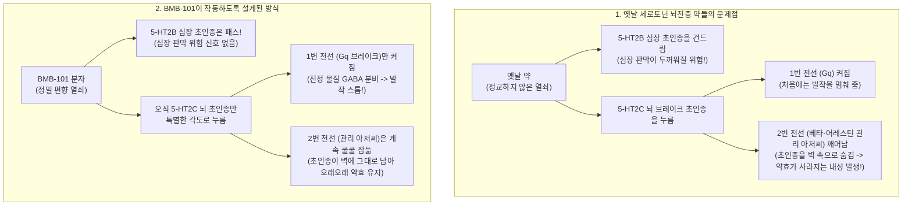
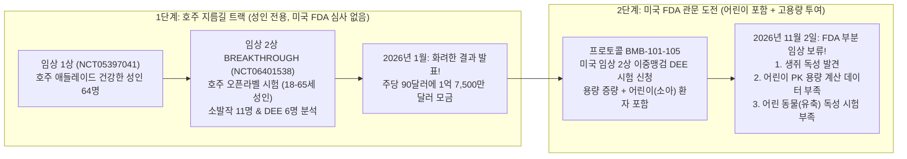
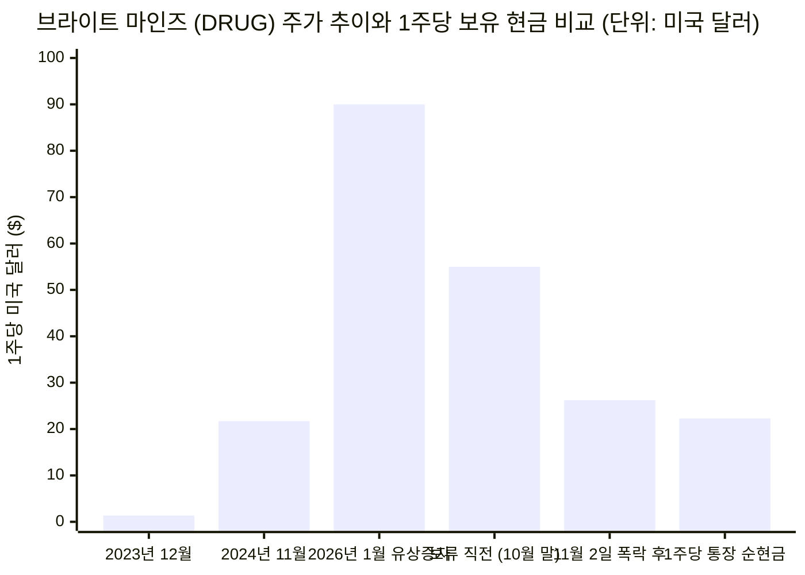

## 1. 시작하며: 잠깐만요—실험실 생쥐 때문에 하루 만에 3,900억 원이 증발했다고요?

여러분이 친구들과 용돈을 모아 **5억 4,200만 달러(약 7,500억 원)** 가치의 회사를 만들었다고 상상해 보세요. 새 노란색 통학버스 **1,800대**를 한꺼번에 살 수 있는 어마어마한 돈입니다! 이 회사는 어떤 약을 먹어도 낫지 않는 무서운 뇌전증(간질) 발작을 멈춰 주는 마시는 물약, **BMB-101**을 개발하고 있었습니다.

그런데 **2026년 11월 2일** 아침, 미국 정부의 의약품 안전 심판관들(미국 식품의약국, **FDA**)에게서 이메일 한 통이 날아왔습니다. 이메일에는 이렇게 적혀 있었습니다.
*"잠깐 멈추세요! 미국에서 이 약을 어린이들에게 먹이기 전에 실험실 생쥐들에게서 독성(안전 문제)이 발견되었습니다. 게다가 자라나는 어린아이들의 몸이 이 약을 안전하게 견딜 수 있다는 데이터도 아직 부족합니다!"*

몇 시간 뒤, 유명한 바이오 전문 기자 애덤 포이어스타인(Adam Feuerstein)이 소셜 미디어에 딱 한 줄로 이 충격적인 소식을 전했습니다.

> "$DRUG FDA partial clinical hold due to mouse toxicity."
> ("DRUG, 생쥐 독성 문제로 미국 FDA 부분 임상 보류 조치.")

공교롭게도 이 회사의 미국 주식 시장 별명(티커)은 영어로 '약'이라는 뜻의 **DRUG**입니다. 이 소식이 전해지자마자 주식 시장은 아수라장이 되었습니다. **브라이트 마인즈 바이오사이언스(Bright Minds Biosciences)**의 주가는 단 하루 만에 **52.35%**나 폭락하며 **54.98달러**에서 **26.20달러**로 반 토막이 났고, 회사 가치 중 약 **2억 8,400만 달러(약 3,900억 원)**가 허공으로 사라졌습니다 ([SEC Form 6-K, 2026년 11월 2일](https://www.sec.gov/Archives/edgar/data/1827401/000206075526000063/ex991-20261102drug.htm)).

그런데 여기서 진짜 미스터리가 시작됩니다.
이미 호주에서는 **사람 90명**이 이 약을 직접 마셨는데도 심각한 부작용이 한 건도 없었습니다. 그런데 왜 미국 심판관들은 **실험실 생쥐** 때문에 새로운 미국 시험에 급브레이크를 걸었을까요? 왜 회사는 *"생쥐가 아픈 건 우리 약 때문이 아니라 우연이다!"*라고 억울해할까요? 그리고 회사 은행 통장에 현금만 **2억 2,200만 달러(약 3,078억 캐나다 달러)**가 고스란히 들어 있는데, 어떻게 회사 전체 가격이 **2억 5,800만 달러**까지 떨어질 수 있을까요 ([SEC 2026년 3분기 재무제표](https://www.sec.gov/Archives/edgar/data/1827401/000106299326004442/exhibit99-1.htm))?

탐정 돋보기를 챙기세요! 발작이 일어나는 우리 뇌 속부터 출발해, 어른 투자자들도 잘 읽지 않는 정부 공식 서류 19페이지의 숨겨진 비밀까지 차근차근 파헤쳐 보겠습니다.

---

## 2. 기초부터 출발하기: 머릿속의 번개 폭풍, 세 개의 초인종, 그리고 잔소리꾼 관리 아저씨

미국 심판관들과 제약회사 중 누구 말이 맞는지 판단하려면, 먼저 **BMB-101**이 우리 뇌 속에서 무슨 일을 하는 약인지부터 알아야 합니다.

### 뇌전증 발작이란 무엇일까요? (자전거의 가속 페달과 브레이크 페달)

우리 머리뼈 안에는 약 **860억 개의 신경 세포(뉴런)**로 이루어진 슈퍼컴퓨터가 들어 있습니다. 여러분이 책을 읽거나, 축구를 하거나, 상상을 할 때마다 이 세포들은 아주 작은 전기 불꽃과 화학 쪽지를 주고받습니다.

내리막길을 달리는 자전거처럼, 우리 뇌에도 속도를 조절하는 두 가지 페달이 있습니다.
1. **"출발!" 가속 페달 (흥분성 신호):** 뇌세포들에게 더 빨리 전기 불꽃을 쏘라고 명령합니다.
2. **"멈춰!" 브레이크 페달 (억제성 신호):** 뇌세포들을 진정시키는 차분한 화학 물질(**GABA**, 가바)을 뿌려서 전기 불꽃이 너무 과열되지 않게 막아 줍니다.

**뇌전증 발작(Seizure)**은 이 "브레이크 페달"이 고장 나서 수백만 개의 뇌세포가 한꺼번에 미친 듯이 전기 불꽃을 터뜨리는 현상입니다. 마치 머릿속에서 갑자기 거대한 번개 폭풍이 치는 것과 같죠!

브라이트 마인즈는 특히 치료하기가 아주 까다로운 두 가지 뇌 폭풍을 막으려고 합니다.
* **소발작 / 결신 발작 (Absence Seizures — '일시정지 버튼' 폭풍):** 바닥에 쓰러져 몸을 떠는 대신, 뇌의 중앙 중계소와 바깥 껍질이 전기 루프에 갇혀 버립니다. *"일초, 이초, 삼초"* 하고 세는 **3초에서 20초** 동안 아이나 어른이 마치 유튜브 영상의 '일시정지' 버튼을 누른 것처럼 허공을 멍하니 바라보며 멈춰 버립니다. 하루에 **20번에서 50번**이나 이런 일이 벌어지는데, 정작 본인은 선생님이 방금 무슨 말씀을 하셨는지 놓쳤다는 사실조차 모를 때가 많습니다.
* **발달성 및 뇌전증성 뇌병증 (DEEs — '어린 시절의 허리케인' 폭풍):** 이름이 정말 길고 어렵죠? 쉽게 말해 **드라베 증후군(Dravet syndrome)**이나 **레녹스-가스토 증후군(Lennox-Gastaut syndrome)**처럼 아기나 유치원생 때 시작되는 아주 심한 난치성 뇌전증입니다. 이 병을 앓는 아이들은 매주 수십 번씩 몸에 힘이 풀려 쓰러지거나 심한 전신 경련을 겪고, 끊이지 않는 전기 폭풍 때문에 자라나는 뇌의 발달까지 늦어집니다. 현재 세상에 **20가지가 넘는 뇌전증 약**이 나와 있지만, 전체 환자의 약 **30%**—그리고 DEE 어린이의 거의 전부—는 **매일 3~5가지 약을 한꺼번에 먹어도 발작이 멈추지 않는 '약물 저항성(난치성) 뇌전증'**을 겪고 있습니다 ([SEC 2026년 3분기 MD&A, p. 2–5](https://www.sec.gov/Archives/edgar/data/1827401/000106299326004442/exhibit99-2.htm)).

### 세로토닌 초인종 삼총사 (`5-HT2A`, `5-HT2B`, `5-HT2C`)

고장 난 뇌의 브레이크 페달을 어떻게 고칠 수 있을까요? 과학자들은 뇌의 '브레이크 담당 세포' 표면에 특별한 초인종이 달려 있다는 사실을 발견했습니다. 우리 몸속의 자연 화학 물질인 **세로토닌(Serotonin, 과학자 별명: 5-HT)**이 이 초인종을 누르면, 브레이크 세포가 진정 물질(GABA)을 뿜어내어 발작 폭풍을 잠재웁니다!

그런데 문제가 하나 있습니다. 우리 몸에는 세로토닌 초인종(**수용체, Receptor**)이 무려 **14종류**나 있고, 초인종을 대신 눌러 주는 약을 **작용제(Agonist)**라고 부릅니다. 그중에서도 **5-HT2A**, **5-HT2B**, **5-HT2C**라는 세 개의 초인종은 모양이 쌍둥이처럼 똑같이 생겼습니다. 복도에 나란히 붙어 있는 세 개의 스위치 중 맞는 것을 누르면 발작이 멈추지만, 옆에 있는 스위치를 잘못 건드리면 큰일이 납니다!

1. **`5-HT2C` 초인종 (착한 발작 브레이크 & "배불러!" 스위치):** 뇌의 브레이크 세포와 식욕 조절 센터에 붙어 있습니다. 이 초인종을 누르면 발작이 잠잠해지고, 동시에 *"이제 배불러, 그만 먹자!"*라는 신호를 보냅니다. (그래서 브라이트 마인즈는 아기 **15,000명 중 1명**꼴로 태어나 24시간 내내 참을 수 없는 배고픔을 느끼는 희귀 유전병 **프래더-윌리 증후군(PWS)** 치료제로도 이 약을 시험하고 있습니다!)
2. **`5-HT2A` 초인종 (환각 스위치):** 뇌의 시각 및 생각 부위에 있습니다. 이 초인종을 세게 누르면 깨어 있는데도 이상한 환영을 보게 됩니다(환각제가 누르는 스위치가 바로 이것입니다).
3. **`5-HT2B` 초인종 (심장 판막 위험 스위치):** 피가 거꾸로 흐르지 않게 막아 주는 **심장 판막(Heart Valve)**에 붙어 있습니다! 만약 약이 실수로 매일 `5-HT2B` 초인종까지 눌러 버리면, 심장 판막 세포가 두껍고 딱딱하게 굳어져서 심장이 새는 무서운 병(**심장 판막증**)이 생깁니다 ([SEC 2026년 3분기 MD&A, p. 3–5](https://www.sec.gov/Archives/edgar/data/1827401/000106299326004442/exhibit99-2.htm)).

실제로 현재 어린이 뇌전증 치료제로 쓰이는 **펜플루라민(상품명: 핀테플라, Fintepla)**이라는 옛날 약은 착한 `5-HT2C` 초인종도 누르지만, 위험한 `5-HT2B` 심장 초인종까지 건드립니다. 그래서 미국에서는 이 약을 먹는 모든 어린이가 약을 먹기 전, 먹는 동안 **6개월마다**, 그리고 약을 끊은 뒤에도 의무적으로 **심장 초음파 검사**를 받아야만 합니다!

### 왜 BMB-101은 '잔소리꾼 관리 아저씨'를 피해 가도록 설계되었을까요?

브라이트 마인즈는 **BMB-101**을 만들 때 두 가지 멋진 기술을 넣었습니다.
첫째, 올림픽 수영장에 설탕 한 꼬집을 넣은 것만큼 아주 적은 양(`16.2 나노몰`)으로도 오직 **`5-HT2C` 브레이크 초인종만 정확히 누르고**, `5-HT2A` 환각 초인종(`100배 이상` 약함)이나 `5-HT2B` 심장 초인종은 건드리지 않게 깎았습니다.

둘째, **'잔소리꾼 관리 아저씨' 문제**를 해결했습니다!
* 보통 약이 `5-HT2C` 초인종을 누르면, 세포 안에서 **두 가닥의 전선**에 불이 들어옵니다.
* **1번 전선 (`Gq 단백질`):** 실제로 발작 브레이크를 작동시키는 고마운 전선입니다.
* **2번 전선 (`베타-어레스틴, Beta-arrestin`):** 학교의 까칠한 관리 아저씨 같은 전선입니다. 누군가 초인종을 계속 누르면 관리 아저씨가 나타나 *"시끄러워서 못 살겠네!"*라며 **초인종을 뜯어서 벽 안쪽으로 숨겨 버립니다.** 그러면 아무리 약을 먹어도 초인종을 누를 수 없게 되죠! 뇌전증 약이 처음 두세 달은 잘 듣다가 나중에 약효가 사라지는 이유(**약물 내성 / 수용체 탈감작**)가 바로 이 관리 아저씨 때문입니다.
* **BMB-101**은 초인종을 아주 특별한 각도로 살짝 눌러서 **1번 전선(`Gq`)만 켜고 2번 전선(`베타-어레스틴` 관리 아저씨)은 깨우지 않도록** 설계되었습니다. 과학자들은 이 기술을 **Gq-단백질 편향 작용제(Gq-biased agonist)**라고 부릅니다 ([SEC Form 6-K, 2026년 1월 6일](https://www.sec.gov/Archives/edgar/data/1827401/000206075526000005/ex991-drugnr.htm)).

---

## 3. 비밀 해독기: 어려운 어른들의 바이오 용어 사전

2026년 11월 2일 발표문을 읽다 보면 외계어 같은 영어 약자들이 쏟아집니다. 초등학교 5학년 탐정들을 위한 **비밀 해독기 표**를 먼저 확인해 볼까요?

| 어른들의 어려운 단어 / 약자 | 진짜 뜻 (쉬운 한국어 설명) | 초등학교 5학년 일상 속 비유 |
| :--- | :--- | :--- |
| **DEEs (발달성 및 뇌전증성 뇌병증)** | 아기나 어린이 때 시작되어 잦은 발작과 함께 뇌 발달까지 늦추는 아주 심한 난치성 뇌전증(드라베 증후군, 레녹스-가스토 증후군 등). | 컴퓨터에 윈도우 프로그램을 설치하는 도중에 번개가 계속 쳐서 프로그램 설치가 자꾸 멈추는 상황. |
| **5-HT2C Gq-편향 작용제 (Biased Agonist)** | 뇌의 `5-HT2C` 브레이크 스위치만 골라 누르되, 초인종을 숨기는 관리 아저씨(`베타-어레스틴`)는 깨우지 않고 착한 `Gq` 전선만 켜는 약. | 까칠한 관리 아저씨가 눈치채지 못하게 살짝 눌러서 집 안의 벨소리만 울리게 하는 마법의 손가락 기술. |
| **IND (임상시험계획 승인신청)** | 아직 허가받지 않은 새 약을 미국에서 사람에게 시험하기 전에 미국 식품의약국(FDA)에 제출해 허락을 받는 두꺼운 안전성 시험 서류 묶음. | 과학 동아리가 운동장에서 모형 로켓을 쏘기 전에 교장 선생님께 안전 검사표와 함께 내야 하는 허락 신청서. |
| **부분 임상 보류 (Partial Clinical Hold)** | FDA가 안전 문제를 확인하기 위해 *특정한 한 가지 계획된 시험*(또는 어린이 모집이나 고용량 투여 같은 일부 과정)만 일시 정지시키고, 다른 시험은 계속하게 두는 명령. | 교장 선생님이 *"호주에 있는 중학생 팀은 계속 로켓을 쏴도 되지만, 미국 초등학생 팀은 낙하산 안전성이 증명될 때까지 발사 금지!"*라고 하신 것. |
| **약동학 (Pharmacokinetics, PK)** | 약을 먹었을 때 피 속으로 얼마나 빨리 흡수되고, 뇌로 전달된 뒤, 간과 콩팥을 통해 얼마나 빨리 몸 밖으로 빠져나가는지 계산하는 수학. | 우유 한 컵에 초코 시럽 한 숟가락을 넣고 저었을 때 얼마나 빨리 섞이고 다 마시는 데 몇 분 걸리는지 재는 것. |
| **유축 독성 데이터 (Juvenile Toxicity Data)** | 어린아이들에게 약을 먹이기 전에, *아직 뼈와 뇌가 자라고 있는 어린 동물(아기 생쥐나 어린 강아지 등)*에게 먼저 약을 먹여 안전성을 확인하는 시험. | 6살 동생에게 새 인라인스케이트 헬멧을 씌우기 전에, 어린이 크기의 작은 충돌 인형으로 먼저 안전 테스트를 해 보는 것. |
| **오픈라벨(Open-Label) vs. 이중맹검 위약대조 시험** | *오픈라벨*은 환자와 의사 모두 진짜 약을 먹는다는 걸 아는 시험이고, *이중맹검 위약대조*는 절반에게 가짜 약(`위약`)을 주면서 누구도 자기가 진짜를 먹었는지 모르게 하는 엄격한 시험. | *오픈라벨*은 콜라 상표를 보면서 마시는 시음회이고, *이중맹검*은 안대를 끼고 상표 없는 컵으로 마셔 보는 진짜 블라인드 테스트. |

---

## 4. 화려한 발표 vs. 탐정의 팩트 체크: 공식 서류가 폭로하는 4가지 반전

왜 2026년 11월 2일에 주식 시장이 그토록 큰 충격에 빠졌는지 이해하려면, 브라이트 마인즈가 어떻게 스타 회사가 되었는지 돌아보고 정부 공식 기록을 대조해 봐야 합니다.

### 1막: 3조 6천억 원짜리 이웃집 대박과 2026년 1월의 축제

2023년 말만 해도 브라이트 마인즈는 주가가 고작 **1.36달러(약 1,900원)**에 불과한 아주 작은 회사였습니다 ([SEC 2026년 3분기 MD&A, p. 8](https://www.sec.gov/Archives/edgar/data/1827401/000106299326004442/exhibit99-2.htm)). 그러던 **2024년 10월**, 유럽의 대형 제약사 **룬드벡(Lundbeck)**이 똑같은 `5-HT2C` 뇌 초인종을 누르는 경쟁 약물(**벡시카세린, bexicaserin**)을 가진 **롱보드 파마슈티컬스(Longboard Pharmaceuticals)**를 무려 **26억 달러(약 3조 6,000억 원)**에 사들였습니다! 이 소식에 투자자들은 *"잠깐, 브라이트 마인즈도 똑같은 원리의 BMB-101을 갖고 있잖아!"*라며 몰려들었고, 주가는 순식간에 **2,000% 이상** 치솟았습니다.

그리고 **2026년 1월 6일**, 브라이트 마인즈는 임상 2상 **BREAKTHROUGH** 시험(`NCT06401538`)의 화려한 결과를 발표했습니다.
* 3초 이상 지속되는 소발작(결신 발작)이 중앙값 기준 **73.1% 감소**(`p = 0.012`)했고, 기억력과 감정 조절에 중요한 **렘(REM)수면 시간이 90%나 증가**(전체 잠자는 시간은 그대로인데 꿈꾸는 렘수면만 `56.2분`에서 `106.7분`으로 증가)했습니다!
* 난치성 뇌전증(DEE) 환자들의 대발작(운동 발작)도 중앙값 기준 **63.3% 감소**했습니다!
* **초대형 현금 모금:** 발표 바로 다음 날인 **2026년 1월 7일**, 브라이트 마인즈는 환호하는 투자자들에게 **1주당 90.00달러**에 신주 **1,945,000주**를 발행해 단숨에 **1억 7,505만 달러(약 2,432억 캐나다 달러)**의 현금을 통장에 넣었습니다 ([SEC Form 6-K, 2026년 1월 8일](https://www.sec.gov/Archives/edgar/data/1827401/000206075526000009/ex991-final.htm)).

### 2막: 탐정 돋보기로 찾아낸 공식 문서 속 4가지 반전

하지만 미국 국립보건원 임상시험 등록소([NCT05397041](https://clinicaltrials.gov/study/NCT05397041), [NCT06401538](https://clinicaltrials.gov/study/NCT06401538), [NCT07266324](https://clinicaltrials.gov/study/NCT07266324))와 SEC 공시 서류 구석구석을 직접 열어 보면, 뉴스 헤드라인에는 나오지 않던 **4가지 결정적 반전**이 드러납니다.

1. **반전 #1 — 지금까지 사람에게 한 3번의 임상시험은 전부 '호주'에서 진행되었고, 미국 FDA 감독하에 한 적이 없었습니다!**
   미국 정부 임상시험 데이터베이스(`ClinicalTrials.gov`)에서 브라이트 마인즈의 임상 1상(`NCT05397041`, 애들레이드), 임상 2상 BREAKTHROUGH(`NCT06401538`, 멜버른·시드니·브리즈번), 프래더-윌리 증후군 임상 2상 NOVA(`NCT07266324`, 시드니·멜버른)를 조회해 보면, 세 시험 모두 **`isFdaRegulatedDrug: False` (미국 FDA 규제 대상 아님)**으로 등록되어 있습니다! 호주는 병원 윤리위원회 허가만 받으면 미국 FDA보다 훨씬 빠르게 초기 인체 시험을 시작할 수 있기 때문입니다.
2. **반전 #2 — "DEE 발작 63.3% 감소"라는 숫자는 가짜 약(위약) 비교군도 없이 딱 '성인 6명'에게서 나온 결과였습니다!**
   2026년 1월에 발표된 BREAKTHROUGH 시험(`NCT06401538`)에는 총 **24명의 성인**(`평균 나이 30세`, `18~65세`)이 참여했는데, 그중 **6명(25%)이 중도 탈락**했습니다. 특히 DEE 그룹은 **9명**이 시작해 어지럼증·기력 저하·어깨 골절 등으로 3명이 중간에 그만두면서, 최종 효과 분석에 들어간 환자는 **단 6명**(`레녹스-가스토 4명`, `드라베 1명`, `레트 증후군 1명`)뿐이었습니다 ([SEC Form 6-K, 2026년 1월 6일](https://www.sec.gov/Archives/edgar/data/1827401/000206075526000005/ex991-drugnr.htm)). 6명이면 **초등학교 급식실 식탁 한 개에 앉는 인원**입니다! 게다가 가짜 약과 비교하는 블라인드 테스트가 아니라 모두가 진짜 약인 줄 알고 일기장에 발작 횟수를 적는 **오픈라벨** 시험이었고, **어린이(`18세 미만`)는 단 한 명도 포함되지 않았습니다.**
3. **반전 #3 — SEC 보고서 19페이지의 숨은 고백: 사실 브라이트 마인즈가 미국 FDA의 '부분 임상 보류' 경고를 받은 건 이번이 두 번째입니다!**
   많은 사람들이 2026년 11월 2일의 임상 보류를 날벼락으로 생각했지만, 회사의 2026년 3분기 경영진 보고서 **19페이지**([SEC Form 6-K, 2026년 8월 17일, Exhibit 99.2](https://www.sec.gov/Archives/edgar/data/1827401/000106299326004442/exhibit99-2.htm))와 연례보고서([SEC Form 20-F](https://www.sec.gov/Archives/edgar/data/1827401/000106299324021301/form20f.htm))에는 이런 문장이 조용히 적혀 있었습니다.
   > *"브라이트 마인즈 바이오사이언스는 이전에 미국 식품의약국(FDA)에 임상시험계획(IND)을 제출했으나 전체 심사가 끝나기 전에 자진 철회한 바 있습니다. 당시 철회 통지서에서 FDA는 제안된 투여 용량 방식(dosing regime)과 관련된 부분 임상 보류 결함(partial clinical hold deficiencies)을 언급했습니다."*
4. **반전 #4 — 2026년 11월 2일, 왜 미국 FDA는 `Protocol BMB-101-105`에 다시 브레이크를 걸었을까요?**
   미국 시장에서 DEE 치료제로 정식 허가를 받으려면 호주의 소규모 성인 시험만으로는 안 됩니다. 반드시 미국 FDA의 허락(IND)을 받아 **어린이 환자들**을 포함한 **무작위 배정·이중맹검·위약대조 시험**을 통과해야 합니다. 그래서 브라이트 마인즈가 환자가 견딜 수 있는 최대 용량까지 약을 올리는 미국 임상 2상 계획서(`Protocol BMB-101-105`)를 FDA에 냈더니, FDA가 **세 가지 빨간불**을 켠 것입니다!
   * **빨간불 A:** **실험실 생쥐에서 확인된 독성** (회사의 Form 20-F 전임상 표를 보면 `28일` 및 `90일` 생쥐·강아지 독성 시험은 이전에 끝났고, **6개월 장기 생쥐 독성 시험**이 진행 중이었습니다).
   * **빨간불 B:** 어린이 환자 등록을 뒷받침하기에 **부족한 약동학(PK) 데이터**.
   * **빨간불 C:** 어린이 환자 등록을 뒷받침하기에 **부족한 유축 독성(어린 동물 안전성) 데이터** ([SEC Form 6-K, 2026년 11월 2일](https://www.sec.gov/Archives/edgar/data/1827401/000206075526000063/ex991-20261102drug.htm)).

회사의 해명과 실제 미국 규정(팩트)을 나란히 비교해 볼까요?

| 보도자료에서 회사가 강조한 해명 | 정부 공식 기록과 FDA 규정이 말해 주는 진짜 팩트 |
| :--- | :--- |
| **"생쥐 독성은 다른 동물에서는 안 나타났고, 외부 전문가들도 약 때문이 아니라 우연(incidental)이라고 본다."** | 바로 다음 문장에서 회사 변호사들은 이렇게 덧붙였습니다. *"이것은 회사의 생각일 뿐이며 FDA의 공식 판단이 아니고 FDA의 우려를 해결한 것도 아닙니다."* 미국 법(`21 CFR 312.42`)상 임상 보류를 풀어줄 수 있는 사람은 회사가 고용한 자문위원이 아니라 오직 FDA 심사관뿐입니다. |
| **"지금까지 약 90명의 사람이 BMB-101을 복용했고 심각한 약물 부작용이 없었다."** | 그 `90명`(`임상 1상 64명` + `임상 2상 24명`)은 모두 **성인(`18~65세`)**이었고 복용 기간도 짧았습니다(임상 2상 본 시험 기준 최대 3개월). 성인이 3개월 동안 잘 견뎠다는 사실이 평생 약을 먹어야 하는 어린아이들의 성장 안전성을 대신 증명해 주지는 못합니다. |
| **"이번 부분 임상 보류는 회사의 다른 진행 중인 임상시험에는 영향을 주지 않는다."** | 현재 진행 중인 다른 시험들(`NCT06401538` 연장 시험 및 프래더-윌리 증후군 `NCT07266324` NOVA 시험)은 **호주에서 성인을 대상으로** 진행 중이기 때문입니다! 하지만 가장 중요한 시장인 **미국 내 DEE 임상 2상 시험은 보류가 풀릴 때까지 환자 단 한 명도 모집할 수 없습니다.** |
| **뉴스 헤드라인은 '생쥐 독성 논쟁'에만 집중됨.** | 설령 브라이트 마인즈가 생쥐 독성이 우연이었다고 FDA를 설득하더라도, FDA는 **어린이 약동학(PK) 및 어린 동물 독성(Juvenile Toxicity) 데이터 부족**을 함께 지적했습니다 ([FDA ICH S11 소아 전임상 가이드라인](https://www.fda.gov/regulatory-information/search-fda-guidance-documents/s11-nonclinical-safety-testing-support-development-pediatric-pharmaceuticals)). 어린 동물 독성 시험을 새로 실시해 보고서를 내려면 보통 **6개월에서 12개월**이 걸립니다. |

---

## 5. 네 명의 용의자: FDA는 왜 진짜로 비상 브레이크를 당겼을까요?

과학이나 경제 사건을 조사할 때 진짜 탐정은 한 가지 설명만 믿지 않습니다. 이번 부분 임상 보류를 일으킨 **네 가지 가능성(경쟁 가설)**을 용의자 선상에 올려놓고 검증해 봅시다.

| 용의자 (원인 가설) | 어떤 이야기인가요? | 찬성 증거 vs. 반대 증거 | 탐정의 판정 |
| :--- | :--- | :--- | :--- |
| **용의자 1: 약물이 실제로 생쥐를 아프게 했다 (`직접 원인: BMB-101 -> 생쥐 독성`)** | BMB-101을 높은 용량으로 오랫동안(6개월 장기 시험 등) 먹였더니 실제로 생쥐의 장기나 신경에 해로운 작용이 나타났다. | **찬성:** `Protocol BMB-101-105`는 *최대 내약 용량까지 용량을 올리는 시험*이라 높은 동물 안전 마진이 필요했습니다. 과거 같은 계열 약물(로카세린)도 설치류 장기 시험에서 종양 문제가 있었습니다. **반대:** 강아지 시험과 성인 인체 시험(`~90명`)에서는 지금까지 큰 문제가 없었습니다. | **매우 중요 (확인 필수):** 30일 안에 도착할 FDA의 정식 서한에서 생쥐의 *어떤 장기*에 *얼마나 높은 용량*에서 문제가 생겼는지 밝혀지기 전까지는 절대 무시할 수 없습니다. |
| **용의자 2: 생쥐 우리 속 우연한 질병 (`우연한 잡음 -> 과잉 경보`)** | 6개월 동안 실험실에 사는 생쥐들이 약과 상관없이 자연적인 감염이나 노화 질병에 걸렸는데, FDA가 일단 보수적으로 제동을 걸었다. | **찬성:** 회사 측은 자체 보고서와 복수의 독립 독성학 전문가들이 생쥐 소견을 '우연한 현상(비약물성)'으로 판단했다고 밝혔습니다. **반대:** FDA 심사관들은 수천 건의 생쥐 실험 대조군 데이터를 갖고 있어서, 약을 먹지 않은 생쥐보다 고용량 생쥐에서 뚜렷하게 많이 나타날 때만 임상 보류를 내리는 경향이 있습니다. | **생쥐 문제만 보면 가능성 있음—하지만 절반짜리 설명:** 이 가설이 맞더라도 어린이 PK 및 어린 동물 독성 데이터가 빠진 이유는 설명하지 못합니다! |
| **용의자 3: '호주 성인 시험 -> 미국 어린이 시험' 점프 (`숨겨진 제3의 요인 Z`)** | 호주에서 성인 24명만 시험해 놓고 곧바로 미국 FDA에 **어린이 포함 고용량 시험**을 신청하면서 FDA의 엄격한 소아 안전 기준(`ICH S11`)에 걸렸다. | **찬성:** DEE 어린이들은 뇌가 발달 중이고 다른 뇌전증 약을 평균 `5개`나 함께 먹습니다. FDA는 명확히 *어린이 모집을 뒷받침할 PK 및 유축 독성 데이터 부족*을 지적했으며, 회사는 과거에도 용량 문제로 미국 IND를 철회한 전력이 있습니다 ([SEC 2026년 3분기 MD&A, p. 19](https://www.sec.gov/Archives/edgar/data/1827401/000106299326004442/exhibit99-2.htm)). | **핵심 구조적 원인:** 호주 성인 시험에서 미국 소아 시험으로 한꺼번에 건너뛰려다 전임상 숙제(어린 동물 독성 및 PK)가 덜 끝난 것이 가장 확실한 핵심 병목입니다. |
| **용의자 4: 최대 용량 욕심이 부른 안전 쿠션 축소 (`상호 피드백 루프`)** | 어린이에게 *"최대 내약 용량까지 올리겠다"*고 신청하는 바람에, 생쥐에서 문제가 생긴 용량과 사람이 먹을 용량 사이의 '안전 쿠션(여유 폭)'이 너무 좁아졌다! | **찬성:** FDA는 동물에서 안전한 최대 용량을 사람이 먹을 최대 용량으로 나누어 '안전 배수'를 계산합니다. 생쥐에서 중간 용량에 이상이 보였는데 사람 용량까지 높게 잡으면 양쪽에서 안전 쿠션이 찌그러집니다! | **확실한 증폭 요인:** 임상 시험의 최대 용량을 낮추거나, 어린 동물 시험이 끝날 때까지 일단 **성인(`18세 이상`)만 먼저 미국 시험에 등록**하도록 계획서를 고치는 것이 가장 현실적인 해결책입니다. |

---

## 6. 숨겨진 대가: 누가 피해를 보고, 왜 회사 주가는 '통장 잔고' 근처까지 떨어졌을까요?

임상 시험이 멈추고 주가가 반 토막 나면 실제로 누가 아픔을 겪을까요? 그리고 지금 월스트리트에서 벌어지고 있는 신기한 '돼지저금통 산수'를 함께 계산해 봅시다.

### 1. 시험이 멈추면 누가 가장 큰 손해를 볼까요?
* **난치성 뇌전증(DEE) 어린이와 가족들:** 드라베 증후군과 레녹스-가스토 증후군을 앓는 아이들과 부모님들은 매주 수십 번의 발작과 싸우고 있습니다. 심장 판막 걱정 없는 새로운 치료제를 기다리던 미국 환자 가족들에게 **6개월~1년 이상의 지연**은 너무나 긴 시간입니다.
* **2026년 1월에 1주당 90달러를 주고 주식을 산 투자자들:** 1월에 호주 임상 2상 성공 소식을 듣고 90달러에 주식을 산 사람들은, 11월 2일 주가가 **26.20달러**로 추락하면서 **70.9%의 손실**(1주당 `-63.80달러`)을 입었습니다.
* **경쟁자와의 달리기 시합:** 브라이트 마인즈가 미국 FDA의 숙제를 다시 하는 동안, 26억 달러에 팔린 경쟁 약물 **벡시카세린(룬드벡)**은 이미 글로벌 임상 3상을 향해 앞서 달리고 있습니다.

### 2. 3,000억 원짜리 돼지저금통의 역설 (과학 기술의 가격표가 거의 0원이 된 기현상)

이제 브라이트 마인즈의 공식 재무제표([SEC 2026년 3분기 재무제표](https://www.sec.gov/Archives/edgar/data/1827401/000106299326004442/exhibit99-1.htm))를 꺼내서 초등학교 5학년 산수를 해 볼까요?
* **전체 주식 수:** **9,864,061주** ([SEC 2026년 3분기 MD&A, p. 10](https://www.sec.gov/Archives/edgar/data/1827401/000106299326004442/exhibit99-2.htm)).
* **주가 26.20달러 기준 회사 전체 가격(시가총액):** `9,864,061주 × 26.20달러` = **약 2억 5,840만 달러**.
* **회사 은행 통장에 실제로 들어 있는 현금(`2026년 6월 30일 기준`):** **3억 783만 캐나다 달러**(미국 달러로 직접 보유 중인 **2억 1,556만 미국 달러**를 포함해 총 **약 2억 2,200만 미국 달러**의 현금!). 반면 갚아야 할 빚(부채)은 고작 **254만 캐나다 달러(약 180만 미국 달러)**뿐입니다.
* **주식 1주당 통장에 들어 있는 순현금:** 순현금 `2억 2,000만 달러`를 주식 수 `986만 주`로 나누면, 주식 1주당 **약 22.30달러의 진짜 현금**이 들어 있습니다!

회사 전체 주가 총액(`2억 5,840만 달러`)에서 통장 속 순현금(`2억 2,000만 달러`)을 뺀 나머지 금액(`약 3,840만 달러`)을 어른들은 **기업가치(Enterprise Value, EV)**라고 부릅니다. 즉, 통장 잔고를 빼고 이 회사의 신약 기술 전체에 매겨진 진짜 가격표입니다.

이 그래프를 레모네이드 가게에 비유해 볼까요?
* 어제까지만 해도 사람들은 금고에 현금 **22.30달러**가 들어 있는 가게 주식을 **54.98달러**에 샀습니다. 즉, '특제 레모네이드 비법(`BMB-101`과 신약 파이프라인)'의 가치를 **32.68달러(약 3억 2,200만 달러)**로 인정해 준 것입니다.
* 그런데 오늘 주가가 **26.20달러**로 떨어지면서, 사람들은 금고 속 현금 **22.30달러**를 빼면 신약 비법 전체에 고작 **3.90달러(약 3,800만 달러)**의 값어치만 매기고 있습니다! 통장에 앞으로 몇 년 동안 추가 동물 실험을 하고도 남을 막대한 현금(`2억 2,200만 달러`)이 그대로 들어 있는데도, 겁에 질린 투자자들이 마치 신약이 영원히 폐기된 것처럼 주식을 던진 것입니다.

---

## 7. 최종 성적표: 탐정이 예측하는 앞으로의 3가지 시나리오

30일 안에 도착할 미국 FDA의 정식 서한(Partial Clinical Hold Letter)에 따라 앞으로 어떤 일이 벌어질지 **"만약(If) ... 그렇다면(Then) ..."** 조건문으로 정리해 봅시다.

1. **만약 FDA가 `Protocol BMB-101-105`를 둘로 나누는 타협안을 허락한다면—즉, 어린 동물 독성 시험(`ICH S11`)과 어린이 PK 계산이 끝날 때까지 어린이(`18세 미만`) 모집만 미루고, 성인(`18세 이상`) DEE 환자들을 대상으로 한 미국 임상 2상은 안전한 중간 용량으로 먼저 시작하게 해 준다면—** 이번 보류는 단기 과속방지턱(성인 시험 `4~9개월` 지연)에 그칠 것이며, 신약 가치를 3,800만 달러로 깎아내린 오늘의 폭락은 과민 반응으로 판명될 것입니다.
2. **만약 FDA 정식 서한에서 생쥐 독성이 사람 치료 용량과 비슷한 낮은 농도에서 발생했다고 지적하며, 새로운 장기 동물 독성 원인이 규명될 때까지 어른과 아이 모두 미국 내 임상시험을 전면 불허한다면—** 미국 DEE 임상시험은 **12~20개월** 이상 뒤로 밀릴 것이고, 회사는 호주에서 진행 중인 **소발작(결신 발작)** 및 **프래더-윌리 증후군(NOVA)** 시험 데이터에 의존해야 합니다.
3. **만약 진행 중인 9개월 강아지 독성 시험이나 어린 동물 추가 시험에서도 생쥐와 비슷한 장기 손상이 발견된다면—** 매일 평생 먹어야 하는 뇌전증 약으로서 `BMB-101`의 가치는 크게 흔들릴 것이며, 브라이트 마인즈는 통장 속 2억 2,000만 달러의 현금을 후속 후보물질인 **BMB-105**나 우울증·통증 신약(**BMB-201**, **BMB-202**)으로 돌려야 할 것입니다.

### 확률 가중치로 본 최종 탐정 판정표

| 시나리오 이름 | 예상 확률 | 구체적으로 어떤 일이 벌어지나요? | 미국 DEE 임상 지연 기간 | 환자와 회사에 미치는 영향 |
| :--- | :--- | :--- | :--- | :--- |
| **시나리오 A: '성인 먼저 시작, 어린이는 추가 동물시험 후 합류' 타협 (기본 시나리오)** | **55%** | 30일 내 도착할 FDA 서한에서 어린이를 등록하려면 유축 독성 시험(`ICH S11`)과 소아 PK 모델링, 최대 용량 제한이 필요하다고 못 박지만, 프로토콜을 수정해 **성인(`18세 이상`) DEE 환자부터 먼저 미국 임상 2상을 시작**하도록 허용함. | 성인 미국 시험 **4~9개월** 지연 / 소아 확대 **9~14개월** 소요 | 통장 속 2억 2,200만 달러 중 일부(`1,000만~1,500만 달러`)로 추가 동물 시험을 진행하며 소발작 및 프래더-윌리 증후군(`NOVA`) 임상을 계속 추진함. |
| **시나리오 B: '전체 동물 독성 재검증' 장기 지연 (비관 시나리오)** | **30%** | FDA가 "생쥐 독성은 우연"이라는 회사 주장을 기각하고, 생쥐 독성 원인 규명 실험과 유축 독성 시험이 모두 완료될 때까지 미국 내 `Protocol BMB-101-105`의 성인·소아 투여를 모두 막음. | 미국 DEE 시험 **12~20개월** 지연 | 미국 DEE 시장에서 경쟁약 `벡시카세린`(룬드벡)에 2년 가까이 뒤처지게 되며, 회사의 핵심 가치가 **성인 소발작**과 **프래더-윌리 증후군**으로 이동함. |
| **시나리오 C: 서류 보완 및 용량 상한선 조정으로 빠른 해제 (낙관적 깜짝 시나리오)** | **15%** | 독립 병리학 재검토와 기존 동물 데이터 제출만으로 생쥐 독성이 우연한 배경 잡음임이 인정되고, 임상 최대 용량만 살짝 낮추는 프로토콜 수정만으로 새로운 동물 실험 없이 보류가 해제됨. | **2~4개월** 단기 지연 | 가장 빠른 회복 경로로, 2027년 상반기 중 미국 임상 2상이 정상 궤도에 오름. |

### 초등학교 5학년 탐정을 위한 오늘의 핵심 교훈

제약회사가 *"우리 약이 발작을 63~73%나 줄였어요!"*라고 자랑할 때는 반드시 **누구에게 시험했는지**(호주의 성인 24명, 그중 DEE는 단 6명, 어린이는 0명)와 **어디서 시험했는지**(미국 FDA 밖인 호주)를 확인하세요. 반대로 뉴스에서 *"생쥐 독성 때문에 FDA 임상 보류!"*라고 겁을 줄 때도 **문장 끝까지** 읽어야 합니다. FDA는 단순히 아픈 생쥐만 지적한 것이 아니라, 자라나는 어린이들에게 뇌에 작용하는 강한 약을 주기 전에 반드시 챙겨야 할 **어린이 맞춤형 용량 계산(`PK`)**과 **어린 동물 안전성 시험(`유축 독성`)**이라는 기본 숙제를 끝내라고 요구한 것이니까요!

---

## 1차 출처 및 검증 영수증 (Primary Sources)

1. **Bright Minds Biosciences — SEC Form 6-K 및 Exhibit 99.1 (2026년 11월 2일):** [Bright Minds Biosciences Provides Update About Planned Study With BMB-101 in Developmental and Epileptic Encephalopathies](https://www.sec.gov/Archives/edgar/data/1827401/000206075526000063/ex991-20261102drug.htm)
2. **Bright Minds Biosciences — SEC Form 6-K, 2026년 3분기 재무제표 (2026년 6월 30일 마감):** [Condensed Interim Consolidated Financial Statements (Exhibit 99.1)](https://www.sec.gov/Archives/edgar/data/1827401/000106299326004442/exhibit99-1.htm)
3. **Bright Minds Biosciences — SEC Form 6-K, 2026년 3분기 경영진 분석 보고서 (2026년 8월 17일 제출):** [Management's Discussion and Analysis for the Third Quarter Ended June 30, 2026 (Exhibit 99.2, p. 2–20)](https://www.sec.gov/Archives/edgar/data/1827401/000106299326004442/exhibit99-2.htm)
4. **Bright Minds Biosciences — SEC Form 6-K, 임상 2상 BREAKTHROUGH 톱라인 결과 (2026년 1월 6일):** [Positive Topline Results from Phase 2 Clinical Trial of BMB-101 (Exhibit 99.1)](https://www.sec.gov/Archives/edgar/data/1827401/000206075526000005/ex991-drugnr.htm)
5. **Bright Minds Biosciences — SEC Form 6-K, 1억 7,500만 달러 유상증자 발행가 확정 (2026년 1월 8일):** [Pricing of Upsized US$175 Million Public Offering at $90.00/Share (Exhibit 99.1)](https://www.sec.gov/Archives/edgar/data/1827401/000206075526000009/ex991-final.htm)
6. **Bright Minds Biosciences — SEC Form 20-F 연례보고서:** [전임상 ADMEPK 및 28일 / 90일 / 6개월 장기 생쥐·강아지 독성 프로그램 표 (p. 23–27)](https://www.sec.gov/Archives/edgar/data/1827401/000106299324021301/form20f.htm)
7. **ClinicalTrials.gov 공식 임상시험 등록 기록:** [NCT05397041 (호주 임상 1상)](https://clinicaltrials.gov/study/NCT05397041), [NCT06401538 (호주 임상 2상 BREAKTHROUGH)](https://clinicaltrials.gov/study/NCT06401538), [NCT07266324 (호주 프래더-윌리 증후군 임상 2상 NOVA)](https://clinicaltrials.gov/study/NCT07266324)
8. **미국 FDA / ICH 소아 의약품 안전성 가이드라인:** [S11 Nonclinical Safety Testing in Support of Development of Pediatric Pharmaceuticals](https://www.fda.gov/regulatory-information/search-fda-guidance-documents/s11-nonclinical-safety-testing-support-development-pediatric-pharmaceuticals)
