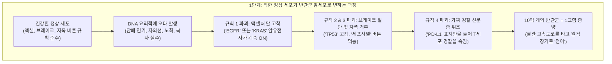
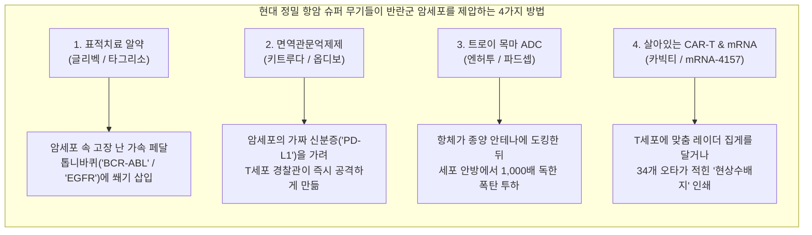

## 1. 호기심 훅(Hook): 잠깐—왜 의사 선생님은 알약 하나로 암을 단번에 못 고칠까?

목감기나 중이염에 걸리면 병원에 가서 달콤한 분홍색 항생제 시럽이나 알약을 열흘만 먹으면 감쪽같이 낫습니다. 왜 그렇게 쉬울까요? 목을 아프게 한 세균(박테리아)은 우리 몸에 몰래 들어온 **외부 침입자**이기 때문입니다. 세균은 우리 몸의 세포와 생김새가 완전히 달라서, 항생제가 세균의 껍데기만 골라 물풍선처럼 터뜨려도 우리 머리카락 한 올조차 다치지 않습니다.

그런데 왜 과학자들은 **암(Cancer)**을 단번에 없애는 똑같은 마법 알약 하나를 못 만들었을까요?

여기에 의학 역사상 가장 풀기 어려운 반전이 숨어 있습니다. **암은 밖에서 들어온 외계 괴물이 아닙니다.** 암세포는 원래 *내 몸을 이루던 착한 세포* 중 하나가 갑자기 규칙 책을 찢어버리고 미친 듯이 자기 복제를 시작한 **'배신자 세포'**입니다. 심장, 폐, 뇌를 이루는 정상 세포와 거의 똑같은 교복을 입고 있다 보니, 암세포를 죽일 만큼 독한 약을 쓰면 정상 세포까지 함께 다치기 십상입니다. 게다가 '암'은 단 하나의 질병이 아니라, 서로 다른 변장을 한 **200가지가 넘는 질병들의 총집합**입니다!

하지만 지난 10여 년 사이 과학자들은 마치 SF 영화에나 나올 법한 생물학 무기들을 실제로 발명해 냈습니다. 독약을 품은 미세한 '트로이 목마', 가짜 신분증을 찢어버리는 면역 각성제, 실험실 닌자 훈련소에서 개조한 살아있는 경찰 세포, 그리고 환자 맞춤형 mRNA '현상수배지'까지 등장했죠. 어떤 치료제는 예전 같으면 6개월 만에 목숨을 잃던 말기 암 환자를 **10년 넘게** 살려내기도 합니다. 반면 어떤 신약은 **1년에 2억 7,000만 원($200,000)**이나 하는데도 수명을 고작 **84일(2.8개월)** 늘려주는 데 그치기도 합니다. 오늘 우리는 탐정이 되어 우리 몸속 세포 도시의 보닛을 열고, 현대 암 치료제의 모든 톱니바퀴와 진짜 성적표를 낱낱이 파헤쳐 보겠습니다.

---

## 2. 0단계부터 시작하기: 30조 개의 세포 도시와 깨져버린 4가지 규칙

항암제 이야기를 하기 전에 먼저 암이 일어나는 운동장, 즉 **우리 몸**이 어떻게 돌아가는지부터 알아야 합니다.

우리 몸은 거대한 진흙 한 덩어리가 아닙니다. 약 **30조 개의 살아있는 미세한 레고 블록**, 즉 **세포(Cell)**들이 모여 만든 초거대 도시입니다(만약 세포 하나가 1 cm짜리 레고 블록이라면, 지구 둘레를 **7,500바퀴**나 감을 수 있는 엄청난 숫자입니다!). 세포 하나의 크기는 약 **10~20 마이크로미터(µm)**로, 여러분 머리카락 한 가닥 두께의 **5분의 1**밖에 안 됩니다.

매일 우리 몸에서는 수백만 개의 세포가 닳아서 없어지고(운동장에서 넘어져 무릎이 까졌을 때처럼) 새 세포로 교체됩니다. 빈자리를 채우기 위해 건강한 세포는 자기 안에 들어있는 30억 글자짜리 요리책(**DNA**)을 복사한 뒤, 정확히 똑같은 두 개의 세포로 쪼개집니다.

30조 개의 세포 도시가 엉망진창이 되지 않도록, 모든 정상 세포는 **4가지 철칙**을 반드시 지킵니다:

1. **가속 페달(액셀) 규칙:** 주변 세포들이 *"야, 여기 무릎이 까졌어! 새 피부 세포 좀 만들어 줘!"*라고 신호를 보낼 때만 분열합니다. (과학자들은 이 성장 신호 유전자를 **원암유전자 / Proto-Oncogene**라고 부릅니다.)
2. **브레이크 페달 규칙:** 상처 부위가 다 채워지면 그 즉시 분열을 멈춥니다. (과학자들은 이 브레이크 유전자를 **종양억제유전자 / Tumor Suppressor Gene**라고 부릅니다.)
3. **자폭 버튼 규칙:** 30억 글자나 되는 책을 복사하다 보면 가끔 오타(돌연변이)가 납니다. 만약 자기 요리책에 고칠 수 없을 만큼 오타가 많이 생긴 걸 발견하면, 건강한 세포는 도시에 피해를 주지 않으려고 스스로 자폭 버튼을 눌러 조용히 사라집니다. (이 예의 바른 세포 자살을 전문 용어로 **세포사멸 / Apoptosis**라고 합니다.)
4. **경찰관 신분증 검사:** 우리 혈관 속에는 24시간 내내 순찰을 도는 미세한 경찰관들이 모든 세포의 신분증을 검사합니다. 이상하게 생겼거나 고장 난 세포가 보이면 그 자리에서 체포해 파괴합니다. (이 정예 경찰 세포를 **T세포 / T-Cell**라고 부릅니다.)

### 폭주족 세포가 어떻게 갱단을 만들까?

암은 담배 연기, 뜨거운 자외선(햇볕 화상), 노화, 혹은 우연한 복사 실수 때문에 **단 하나의 세포**가 DNA 요리책에 결정적인 오타를 입으면서 **4가지 규칙을 동시에 어길 때** 시작됩니다:

* 오타 하나가 **가속 페달**에 강력 접착제를 붙여버려서, 세포가 24시간 내내 멈추지 않고 분열합니다(고장 난 가속 페달을 **암유전자 / Oncogene**라고 부르며, 대표적으로 `KRAS`나 `EGFR`이 있습니다).
* 또 다른 오타가 **브레이크 케이블**을 끊어버리고(모든 인간 암의 절반 이상에서 고장 나 있는 대장 브레이크 유전자가 바로 `TP53`입니다), **자폭 버튼**의 전선까지 뽑아버립니다.
* 곧이어 반란군 세포 1개가 2개, 4개, 8개, 백만 개, 그리고 10억 개로 불어나 욕심쟁이 덩어리인 **종양(Tumor)**을 만듭니다(클립 한 개 무게인 **1그램짜리 종양** 안에 이미 **10억 개의 암세포**가 들어 있습니다!).
* 가장 무서운 일은 그다음에 일어납니다. 반란군 세포 중 일부가 원래 살던 장기의 벽을 뚫고 혈관 고속도로에 올라타서 폐, 간, 뼈, 뇌 같은 먼 곳으로 날아가 새로운 기지를 세웁니다. 과학자들은 이 고속도로 점프를 **전이(Metastasis)**라고 부르며, 이것이 진짜 최종 보스입니다. **전체 암 사망의 최대 90%는 처음 생긴 혹 때문이 아니라, 암세포가 다른 장기로 이사(전이)했기 때문에 발생합니다.**

---

## 3. 비밀 해독 반지(Secret Decoder Ring): 무서운 의학 용어를 초등학생 말로 번역하기

뉴스에서 의사나 과학자들이 암 이야기를 할 때면 외계어 같은 영어 약어와 한자어를 쏟아냅니다. 본격적인 탐정 수사에 들어가기 전에, 어려운 어른들의 단어를 단 1초 만에 번역해 주는 **비밀 해독 반지**부터 끼워 볼까요?

| 어른들의 전문 용어 / 약어 | 진짜 뜻 (쉬운 한국어 설명) | 초등학교 5학년 일상 비유 |
| :--- | :--- | :--- |
| **전이 (Metastasis)** | 암세포가 처음 생긴 장기를 탈출해 혈관이나 림프관을 타고 다른 장기로 이사 가서 새 혹을 만드는 것. | 앞마당 민들레 홀씨가 바람을 타고 날아가 세 블록 떨어진 남의 집 마당에 잡초를 피우는 것. |
| **화학항암제 (Chemotherapy / '항암제')** | 온몸의 혈관을 돌며 DNA를 복사하고 빠르게 분열하는 세포를 가리지 않고 독성으로 공격하는 약. | 빨리 자라는 잡초를 없애려고 마당 전체에 제초제를 뿌렸더니, 빨리 자라는 잔디까지 누렇게 타버리는 것. |
| **표적치료제 (Targeted Therapy / 인산화효소 억제제)** | 암세포 안에서 고장 난 채 눌려 있는 특정 '가속 페달' 톱니바퀴 구멍에만 딱 맞게 끼워져 작동을 멈추게 하는 알약. | 폭주하는 장난감 기차의 고장 난 스위치 틈새에만 플라스틱 쐐기를 꽂아 멈추게 하는 것. |
| **면역관문억제제 (Immune Checkpoint Inhibitor / 항-PD-1)** | 암세포가 T세포 경찰관을 속이려고 들고 있는 '가짜 아군 신분증(PD-L1)'을 가려버려 경찰이 공격하게 만드는 주사. | 은행 강도가 쓰고 있던 투명 망토를 벗겨내어, 방 안에 있던 경찰관들이 즉시 강도를 알아보고 덮치게 하는 것. |
| **항체-약물 접합체 (ADC)** | 암세포 안테나만 냄새 맡아 찾아가는 사냥개(항체)에 초강력 폭탄(항암제)을 목줄로 매달아, 암세포 안방에 들어가서만 터지게 만든 약. | 악당 본부 문을 열고 들어간 뒤에야 배 속에 숨긴 물풍선 폭탄을 터뜨리는 '트로이 목마' 드론. |
| **CAR-T 세포치료제 (키메라 항원 수용체 T세포)** | 환자의 혈액에서 T세포 경찰관을 꺼낸 뒤, 실험실에서 암 추적 레이더 집게를 달아 수억 개로 불려 다시 몸에 넣어주는 치료. | 우리 동네 경비원 아저씨들을 '닌자 특공대 캠프'에 보내 야간 투시경을 씌워준 뒤 수백만 명으로 복제해 투입하는 것. |
| **맞춤형 mRNA 신항원 백신 (Neoantigen Vaccine)** | 수술로 떼어낸 내 암세포의 고유한 DNA 오타 34개를 읽어, 남은 암세포를 끝까지 추적하라고 T세포에게 뿌리는 '현상수배지' 주사. | 범인의 얼굴에 있는 보라색 흉터 사진을 온 동네 경찰관에게 나눠주어 다시는 도시에 숨어들지 못하게 하는 것. |
| **PFS 대 OS (무진행 생존기간 vs 전체 생존기간)** | **PFS**는 CT 사진에서 암 덩어리가 더 안 커지고 멈춰 있는 기간, **OS**는 환자가 실제로 얼마나 오래 살았는지를 뜻함. | **PFS**는 지고 있는 게임을 3분 동안 '일시정지' 시켜놓은 것이고, **OS**는 실제로 게임에서 이겨 저녁때까지 신나게 노는 것. |

---

## 4. 오늘날 의사들이 사용하는 6가지 무기 (그리고 최신 슈퍼 무기들의 작동 원리)

오늘날 암 환자가 병원에 오면 의사 선생님들의 도구함에는 크게 **6가지 무기**가 들어 있습니다. 앞의 3가지는 지난 100년 동안 다듬어진 **고전 중장비**이고, 뒤의 3가지는 최근 10~15년 사이에 폭발적으로 발전한 **현대 정밀 슈퍼 무기**입니다.

### 고전 3총사: 도려내고, 레이저로 쏘고, 융단폭격하기

1. **무기 1: 수술 (반란군 기지를 통째로 도려내기)**
   * **작동 원리:** 만약 반란군 세포들이 아직 혈관 고속도로로 도망치지 않고 한곳에 뭉쳐 있다면(초기 유방암, 대장암, 피부암처럼), 외과 의사가 메스로 그 덩어리를 깨끗이 잘라냅니다.
   * **장점과 한계:** 수술은 인류 역사상 모든 약을 합친 것보다 더 많은 고형암 환자를 완치시켰습니다! 하지만 의사 선생님의 눈이나 최신 MRI 기계도 간 구석에 숨어 있는 1,000개짜리 미세 암세포 무리는 볼 수 없습니다. 이미 민들레 홀씨가 날아갔다면 첫 번째 꽃만 뽑아서는 새 잡초를 막을 수 없죠.

2. **무기 2: 방사선 치료 (보이지 않는 정밀 레이저 포격)**
   * **작동 원리:** 몸 밖에서 보이지 않는 초고에너지 광선(X선이나 무거운 입자인 **양성자**)을 종양에 정확히 쏘아 암세포 안의 DNA 요리책을 산산조각 냅니다.
   * **최신 업그레이드 (양성자 치료):** 일반 X선은 손전등 불빛이 얇은 종이를 뚫고 지나가듯 몸을 관통하면서 종양 앞뒤의 정상 장기까지 그을립니다. 반면 최신 **양성자 치료(Proton Therapy)**는 수심 폭뢰처럼 작동합니다. 양성자 입자가 몸속을 날아가다 정확히 종양이 있는 깊이(밀리미터 단위)에서 에너지의 거의 100%를 한꺼번에 터뜨리고(**브래그 피크 / Bragg Peak**라는 물리 법칙입니다) **그 자리에서 딱 멈추기 때문에**, 종양 바로 뒤에 있는 어린이의 뇌나 심장을 안전하게 지킬 수 있습니다.

3. **무기 3: 화학항암제 (빠르게 자라는 세포를 다 깎아버리는 잔디깎이)**
   * **작동 원리:** 1940년대부터 의사들은 세포가 DNA를 복사하거나 둘로 쪼개질 때 기계장치를 망가뜨리는 화학 독약들을 찾아냈습니다. 암세포는 일반 세포보다 훨씬 자주 분열하니까 독약에 훨씬 많이 죽습니다.
   * **잠깐—항암 치료를 받으면 왜 머리카락이 빠질까요?** 드라마나 영화에서 항암 치료를 받는 환자들이 왜 머리카락이 빠지고, 속이 메스꺼워 토하고, 쉽게 감염되는지 궁금했던 적 있나요? 이제 여러분 스스로 답을 맞힐 수 있습니다! 화학항암제는 누가 '암세포'인지 구별하지 못하고 오직 **'빨리 분열하는 세포'**만 공격합니다. 그런데 우리 몸에서 암세포 말고도 매일 엄청나게 빨리 분열하는 착한 세포가 딱 세 종류 있습니다:
     1. **머리카락 모낭 세포** (매일 머리카락을 자라게 함!) → 공격받으면 머리카락이 빠집니다.
     2. **입안과 위장 점막 세포** (3~5일마다 새 옷으로 갈아입음!) → 공격받으면 입안이 헐고 속이 울렁거립니다.
     3. **골수 혈액 공장 세포** (매초 수백만 개의 피를 찍어냄!) → 공격받으면 백혈구가 줄어들어 피곤하고 세균에 쉽게 감염됩니다.
   * 이런 힘든 부작용에도 불구하고, 여러 화학항암제를 조합한 칵테일 요법은 오늘날에도 **소아 급성 림프모구 백혈병(ALL) 어린이의 85~90% 이상**, 그리고 **고환암이나 호지킨 림프종 환자의 90% 이상을 완전히 완치**시키는 일등 공신입니다.

---

### 현대 정밀 의학 혁명: 암세포만 골라 때리는 4가지 스마트 무기

은행 강도 한 명을 잡으려고 동네 한 블록 전체를 폭파하는 화학항암제의 한계를 넘기 위해, 과학자들은 지난 25년 동안 반란군 세포와 착한 시민 세포를 정확히 구별하는 스마트 무기를 개발했습니다.

#### 무기 4: 표적치료 알약 ("고장 난 가속 페달에 쐐기 박기")
* **원리 먼저:** 과학자들이 암세포의 DNA를 읽어 줄곧 'ON' 상태로 붙어버린 고장 난 단백질 톱니바퀴를 찾아낸 다음, 그 톱니바퀴의 배터리 구멍에 딱 들어맞는 작은 화학 열쇠를 설계해 기계를 멈춰버립니다.
* **초등학생 비유:** 전원 스위치가 본드로 붙어버려 폭주하는 장난감 기차가 있습니다. 기차를 망치로 부수는 대신, 고장 난 스위치 틈새에만 작은 플라스틱 조각을 쏙 끼워 넣어 기차를 멈추는 것입니다.
* **어른들의 용어:** **저분자 표적치료제 (Small-Molecule Targeted Therapy / 티로신 키나아제 억제제, TKI)**.
* **실제 임상시험 영수증:** 역사상 첫 번째 슈퍼스타 표적 알약은 **만성 골수성 백혈병(CML)** 치료제인 **이마티닙(Imatinib, 상품명 글리벡)**이었습니다. 2001년 이 약이 나오기 전에는 CML 환자 100명 중 5년을 넘게 사는 사람이 30명도 안 되었습니다. 하지만 세계 최고 의학 학술지 [*뉴잉글랜드 저널 오브 메디슨(NEJM)*에 발표된 IRIS 임상시험 11년 추적 결과(PMID 28273028)](https://pubmed.ncbi.nlm.nih.gov/28273028/)를 보면, **매일 글리벡 알약을 먹은 환자의 83.3%가 10년 뒤에도 살아있었습니다!** 무서운 혈액암을 고혈압처럼 알약 하나로 다스리는 병으로 바꾼 것입니다. 마찬가지로 폐암에서 `EGFR` 가속 페달 오타를 잠그는 3세대 알약 **오시머티닙(타그리소)**은 [FLAURA 임상시험(PMID 31751012)](https://pubmed.ncbi.nlm.nih.gov/31751012/)에서 환자들의 중앙 생존기간을 **38.6개월(3년 이상)**로 늘렸습니다.

#### 무기 5: 면역관문억제제 ("가짜 경찰 신분증 찢어버리기")
* **원리 먼저:** 우리 몸의 T세포 경찰관들은 실수로 정상 장기를 공격하지 않도록 **PD-1**이라는 '공격 중지 스캐너'를 가지고 다닙니다. 그리고 정상 세포들은 *"나는 아군이야, 쏘지 마!"*라고 적힌 **PD-L1** 안전 배지를 달고 있죠. 그런데 교활한 암세포들이 이 **PD-L1** 가짜 배지를 수천 개나 위조해서 몸 표면에 덕지덕지 붙이고 T세포 경찰관들을 잠재워 버립니다!
* **초등학생 비유:** 은행 강도가 가짜 경찰 배지를 달고 복도를 걸어가자 진짜 경찰관들이 그냥 지나칩니다. 이때 의사 선생님이 가짜 배지를 가려버리는 항체 주사를 놓으면, 경찰관들이 갑자기 *"잠깐! 너 강도잖아!"*라고 외치며 달려드는 것입니다.
* **어른들의 용어:** **면역관문억제제 (Immune Checkpoint Inhibitors — 펨브롤리주맙/키트루다, 니볼루맙/옵디보 + 이필리무맙/여보이)**.
* **실제 임상시험 영수증:** 2010년만 해도 치명적인 피부암인 **흑색종(Melanoma)**이 폐나 뇌로 전이되면 환자의 절반이 **6~9개월** 안에 사망했고 5년 생존율은 한 자릿수에 불과했습니다. 그런데 [*NEJM*에 발표된 CheckMate 067 3상 임상시험의 최종 10년 추적 결과(PMID 39282897)](https://pubmed.ncbi.nlm.nih.gov/39282897/)에서 두 가지 면역관문억제제(니볼루맙+이필리무맙)를 함께 맞은 말기 흑색종 환자들의 중앙 생존기간은 무려 **71.9개월(거의 6년!)**에 달했고, **10년이 지난 뒤에도 43%가 생존**해 있었습니다(절반 이상은 흑색종으로 사망하지 않았습니다!).

#### 무기 6A: 항체-약물 접합체(ADC)와 방사성 리간드 ("트로이 목마와 2mm 방사선 저격수")
* **원리 먼저:** 표적 알약으로도 안 멈추고 T세포도 못 들어가는 종양은 어떻게 할까요? 과학자들은 암세포 표면에 솟아 있는 특정 안테나(유방암의 `HER2`나 방광암의 `Nectin-4` 같은 표지판)만 귀신같이 찾아가 달라붙는 생물학적 사냥개(**항체**)를 만들었습니다. 그런 다음 미세한 화학 목줄(링커)을 이용해 일반 항암제보다 **100배에서 1,000배나 더 독한 폭탄(화학항암제 페이로드)** 4~8개를 사냥개 등에 매달았습니다. 혈관을 떠다닐 때는 폭탄이 잠겨 있다가, 사냥개가 암세포 안테나에 도킹해 세포 안방으로 삼켜지는 순간 목줄이 끊어지며 폭탄이 터집니다! 게다가 터진 독약이 암세포 벽을 뚫고 옆에 있던 안테나 없는 암세포들까지 쓸어버리는 보너스 효과(**주변 세포 살상 효과 / Bystander Effect**)까지 냅니다.
* **어른들의 용어:** **항체-약물 접합체 (Antibody-Drug Conjugates, ADC)**—그리고 폭탄 대신 방사성 원자(`루테튬-177`)를 매단 사촌 형제인 **방사성 리간드 치료제 (Radioligand Therapy, RLT)**입니다. 루테튬-177이 쏘는 방사선 불꽃은 길이가 고작 **1~2 밀리미터**(주머니 속 100원짜리 동전 두께!)밖에 안 돼서, 암세포와 바로 옆 악당만 태우고 1 cm 떨어진 정상 장기는 건드리지 않습니다.
* **실제 임상시험 영수증:**
  * 암세포 표면에 `HER2` 안테나가 아주 조금밖에 없는 유방암("HER2-저발현") 환자들에게 트로이 목마 약물인 **트라스투주맙 데룩스테칸(엔허투 / Enhertu)**을 투여한 [DESTINY-Breast04 임상시험(PMID 35665782)](https://pubmed.ncbi.nlm.nih.gov/35665782/)에서, 종양이 자라지 않는 기간이 **5.1개월에서 9.9개월로 두 배 가까이** 늘었고 전체 생존기간도 **16.8개월에서 23.4개월**로 연장되었습니다.
  * 진행성 방광암(요로상피암)에서는 ADC(**엔포투맙 베도틴 / 파드셉**)와 면역관문억제제(**펨브롤리주맙 / 키트루다**)를 합친 [EV-302 3상 임상시험(PMID 38446675)](https://pubmed.ncbi.nlm.nih.gov/38446675/)이 환자의 전체 생존기간을 **16.1개월에서 31.5개월로 거의 두 배**로 늘리며 40년 동안 왕좌를 지키던 백금 화학항암제를 단숨에 넘어섰습니다!
  * 전이성 전립선암에서는 2 mm 방사선 저격수 **플루빅토(`177Lu-PSMA-617`)**가 [VISION 임상시험(PMID 34161051)](https://pubmed.ncbi.nlm.nih.gov/34161051/)에서 생존기간을 **11.3개월에서 15.3개월**로 늘리고 무진행 생존기간을 두 배 이상(**3.4개월 대 8.7개월**) 늘렸습니다.

#### 무기 6B: 살아있는 세포치료제(CAR-T)와 맞춤형 mRNA 백신 ("닌자 훈련소와 34개 오타 현상수배지")
* **CAR-T 세포치료제 (닌자 특공대 훈련소):** 백혈병, 림프종, 다발성 골수종 같은 혈액암 환자의 피에서 지친 T세포 경찰관들을 걸러내어 실험실로 보냅니다. 과학자들은 독성을 없앤 안전한 바이러스를 이용해 T세포 안에 새로운 유전자를 심어, 혈액암 표지판(`CD19` 또는 `BCMA`)만 보면 꽉 물어버리는 맞춤형 로봇 집게(**키메라 항원 수용체 / CAR**)를 달아줍니다. 이 슈퍼 닌자 세포를 따뜻한 영양 수프 속에서 **수억 개**로 배양한 뒤 환자 혈관에 다시 넣어줍니다.
  * *영수증:* 모든 치료에 실패해 희망이 없던 재발성 소아 B세포 백혈병 어린이들에게 **티사젠렉류셀(킴리아 / Kymriah)**을 단 한 번 주사한 [ELIANA 임상시험(PMID 29385370)](https://pubmed.ncbi.nlm.nih.gov/29385370/)에서 **3개월 만에 어린이의 81%에서 암세포가 완전히 사라지는(완전관해) 기적**이 일어났습니다! 다발성 골수종에서도 **실타셀(카빅티 / Carvykti)**이 [CARTITUDE-4 임상시험(PMID 37272512)](https://pubmed.ncbi.nlm.nih.gov/37272512/)에서 암 진행이나 사망 위험을 표준 치료 대비 **74%나 감소(위험비 0.26)**시켰습니다.
* **맞춤형 mRNA 암 백신 (34개 오타가 찍힌 현상수배지):** 독감 백신처럼 병에 걸리기 전에 맞는 게 아니라, 위험한 종양을 수술로 도려낸 직후에 미세하게 남아 있을지 모를 잔당을 소탕하기 위해 맞습니다. 의사들이 환자에게서 떼어낸 암 조직의 DNA를 해독해 오직 그 환자의 암세포에만 있는 **고유한 단백질 오타(신항원 / Neoantigen)를 최대 34개까지** 골라낸 뒤, 약 6주 만에 환자 1명만을 위한 맞춤형 **mRNA 주사(`mRNA-4157 / V940`)**를 인쇄합니다.
  * *영수증:* [*란셋(The Lancet)*에 발표된 KEYNOTE-942 2b상 임상시험(PMID 38246194)](https://pubmed.ncbi.nlm.nih.gov/38246194/)에서 키트루다 단독 투여군과 비교했을 때 맞춤형 mRNA 백신을 함께 맞은 고위험 흑색종 환자들은 약 2년 동안 암이 재발하거나 사망할 확률이 **40%(50명 중 20명)에서 22%(107명 중 24명)로 뚝 떨어졌고**, 원격 전이 또는 사망 위험이 **65%(위험비 0.347)**나 줄어들었습니다!

| 치료 무기 기둥 | 암세포를 찾아내는 방법 | 대표적인 실제 약물 | 핵심 임상시험 성적표(영수증) | 가장 큰 아킬레스건 ("숨겨진 함정") |
| :--- | :--- | :--- | :--- | :--- |
| **1. 고전 화학항암제** | 몸 안에서 빨리 분열하는 모든 세포를 무차별 공격 | 시스플라틴, 독소루비신, 파클리탁셀 | 소아 백혈병 >85% 완치, 고환암 >90% 완치 | 모낭(탈모), 위장 점막(구토), 골수(면역 저하) 동시 손상 |
| **2. 표적치료 알약** | 고장 난 특정 가속 페달 단백질 구멍에 쐐기 삽입 | 글리벡(Imatinib), 타그리소(Osimertinib) | 만성 골수성 백혈병 10년 생존율 83.3% ([PMID 28273028](https://pubmed.ncbi.nlm.nih.gov/28273028/)) | 고형암은 9~18개월 만에 자물쇠 모양을 바꿔 내성 획득 |
| **3. 면역관문억제제** | 암세포의 가짜 `PD-L1` 배지를 가려 T세포 깨움 | 키트루다(Pembrolizumab), 옵디보+여보이 | 진행성 흑색종 중앙 생존 71.9개월 ([PMID 39282897](https://pubmed.ncbi.nlm.nih.gov/39282897/)) | 전체 암 환자 중 약 12.5~20%만 실제로 반응 ([PMID 31050774](https://pubmed.ncbi.nlm.nih.gov/31050774/)) |
| **4. 항체-약물 접합체(ADC)** | 항체가 종양 안테나에 도킹해 1,000배 독한 폭탄 투하 | 엔허투(T-DXd), 파드셉+키트루다 | 방광암 생존기간 두 배 연장: 31.5 대 16.1개월 ([PMID 38446675](https://pubmed.ncbi.nlm.nih.gov/38446675/)) | 주사량의 ~98%는 종양 밖에서 분해; 간질성 폐질환 위험(12.1%) |
| **5. CAR-T 세포치료제** | 환자 T세포에 실험실에서 암 추적 레이더 집게 장착 | 킴리아(Kymriah), 카빅티(Carvykti) | 소아 백혈병 81% 완전관해 ([PMID 29385370](https://pubmed.ncbi.nlm.nih.gov/29385370/)); 골수종 위험 74% 감소 | 고형암 콘크리트 벽 통과 어려움; 5억 원+ 가격; 사이토카인 폭풍 |
| **6. 맞춤형 mRNA & 방사성 리간드** | 34개 오타 현상수배지(`mRNA-4157`) 및 2mm 방사선 저격(`Pluvicto`) | V940(mRNA-4157), 플루빅토(`177Lu-PSMA-617`) | 18개월 무원격전이 생존율 92% 대 77% ([PMID 38246194](https://pubmed.ncbi.nlm.nih.gov/38246194/)) | 맞춤 제작에 ~6주 소요; 플루빅토는 중앙 생존 4.0개월 연장 |

---

## 5. 화려한 광고 대 탐정의 팩트 체크: 학교 체육관에 모인 100명의 환자에게 실제로 일어나는 일

뉴스 헤드라인이나 제약회사 광고만 보면 새로 나오는 항암제마다 모든 암 환자를 단숨에 구원하는 기적의 명약처럼 보입니다. 하지만 진짜 탐정은 일차 자료(Primary Source) 논문 데이터를 직접 열어봅니다. 가장 중요한 세 가지 통계 미스터리를 함께 수사해 볼까요?

### 미스터리 #1: 면역항암제의 "학교 체육관 100명 테스트"
* **광고 속 이야기:** *"내 몸의 면역세포를 깨워 부작용 없이 암을 녹여 없애는 기적의 면역항암제!"*
* **탐정의 팩트 체크:** 과연 전체 암 환자 중 몇 명이나 그 기적을 경험할까요? 비나이 프라사드(Vinay Prasad)와 앨리슨 해슬람(Alyson Haslam) 박사 연구팀이 미국 FDA의 승인을 받은 모든 면역관문억제제를 대상으로 전체 미국 암 환자 통계를 전수 조사해 [*JAMA Network Open* (PMID 31050774)](https://pubmed.ncbi.nlm.nih.gov/31050774/)에 발표했습니다.
* **손가락으로 직접 세어 보기:** 진행성 암을 앓고 있는 **환자 100명**이 학교 체육관에 걸어 들어왔다고 상상해 보세요:
  * **100명 중 56명**은 자신이 걸린 암 종류에 면역관문억제제 사용 허가조차 나 있지 않아서, 주사를 맞아보지도 못하고 곧장 관람석 의자에 앉아야 합니다.
  * **100명 중 44명**(`43.63%`)만이 주사를 맞아볼 수 있는 자격 티켓을 얻습니다.
  * 그리고 실제로 주사를 맞은 44명 중에서도 종양이 눈에 띄게 줄어드는 사람은 **처음 100명 중 딱 12~13명**(`12.46%`)뿐입니다!
  * 왜 나머지 87명에게는 효과가 없었을까요? **췌장암, 뇌교모세포종, 난소암, 그리고 대부분의 대장암과 전립선암** 같은 가장 치명적인 암들은 과학자들이 부르는 이른바 **'차가운 종양(Cold Tumor)'**이기 때문입니다. 이 종양들은 자기 주변에 두꺼운 흉터 조직 같은 콘크리트 성벽(**기질 / Stroma**)을 쌓고 화학 안개를 뿜어내어, T세포 경찰관들이 아예 건물 안으로 들어오지 못하게 막아버립니다. 건물 안에 경찰관이 단 한 명도 없는데 강도의 가짜 신분증을 찢어봤자 소용이 없는 것이죠!

### 미스터리 #2: "여름방학 한 번 길이(2.8개월)"의 중앙값 함정 대 슈퍼 생존자 꼬리
* **광고 속 이야기:** *"FDA가 승인한 170개의 혁신적 항암 신약—암 정복이 눈앞에 왔다!"*
* **탐정의 팩트 체크:** 연구자들이 2000년부터 2021년까지 **FDA가 승인한 170개 항암제와 455개 적응증 전체**를 전수 조사한 연구([PMID 38244983](https://pubmed.ncbi.nlm.nih.gov/38244983/))와 **유방암 신약 42개 적응증**을 분석한 연구([PMID 39320645](https://pubmed.ncbi.nlm.nih.gov/39320645/))—그리고 티토 포조(Tito Fojo) 박사의 고형암 신약 71개 전수 조사([PMID 25068501](https://pubmed.ncbi.nlm.nih.gov/25068501/))—에서, 새 항암제를 쓴 환자 줄의 한가운데 서 있는 사람(**중앙값 / Median**)은 옛날 치료를 받은 사람보다 실제로 얼마나 더 오래 살았을까요?
* **충격적인 숫자:** 수백 건의 임상시험 전체에서 새로 승인된 항암제가 늘려준 **전체 생존기간(OS)의 중앙값은 고작 2.8개월**—날짜로 치면 **약 84일**, 즉 초등학교 여름방학 한 번 남짓한 시간이었습니다! 반면 유방암 신약들의 한 달 약값 중앙값은 **$16,013(약 2,200만 원)**, 1년이면 **$192,000(약 2억 6,000만 원—매년 중형 SUV 자동차를 서너 대씩 사는 금액!)**에 달했으며, **약값과 환자가 실제로 더 오래 사는 기간 사이에는 통계적 상관관계가 '0(전혀 없음)'**이었습니다.
* **더 무서운 '게임 일시정지' 착시 (대리 결과지표 / Surrogate Endpoint):** FDA는 환자에게 약을 빨리 전달하기 위해 CT 사진에서 혹이 잠시 멈춰 있는 것(**무진행 생존기간 / PFS**)만 보고 먼저 허가를 내주는 **가속승인(Accelerated Approval)** 제도를 운영합니다. 하버드 의대 연구팀이 10년간 가속승인을 받은 항암제들을 추적해 [*JAMA* (PMID 38583175)](https://pubmed.ncbi.nlm.nih.gov/38583175/)에 발표한 결과, 승인 후 5년 이상이 지났는데도 **57%(46개 중 26개)의 적응증이 환자의 수명을 단 하루라도 늘려주거나 삶의 질을 개선한다는 사실을 증명하지 못했습니다**(오직 **43%**인 20개만 전체 생존기간 또는 삶의 질 개선을 입증했습니다)!

### 잠깐—중앙값이 그렇게 작은데도 의사 선생님들이 면역항암제에 열광하는 진짜 이유는?
여기 초등학교 5학년 탐정이 꼭 알아야 할 핵심 수학 비밀이 있습니다. 바로 **'한가운데 서 있는 사람(중앙값)'과 '오른쪽 끝 슈퍼 생존자 꼬리(Long Tail)'의 차이**입니다!
* 만약 100명의 환자가 면역항암제를 맞았는데 65명에게 효과가 없다면, 줄에서 **50번째 서 있는 사람(중앙값)**의 성적표는 몇 달밖에 늘어나지 않습니다.
* **하지만!** 줄 맨 앞에 서 있는 **20명에서 35명의 환자('슈퍼 반응자')**는 면역계가 암의 얼굴을 평생 기억하게 되어, **10년이 지난 뒤에도 암이 완전히 사라진 채 가족들과 저녁 식사를 하고 운동장을 달립니다!**
* 즉, 최신 면역치료와 세포치료는 모든 사람에게 똑같이 조금씩 수명을 나눠주는 약이 아니라, **15~40%의 확률로 '10년 장기 생존 잭팟'이 터지는 티켓**입니다. 지금 전 세계 과학자들의 제1 목표는 이 당첨 확률을 20%에서 80%로 끌어올리는 것입니다.

---

## 6. 네 명의 용의자: 1991년 이후 암 사망자는 왜 480만 명이나 줄어들었을까?

이제 의학계 전체에서 가장 기쁜 소식을 살펴볼 차례입니다. 미국암학회(ACS)가 발표한 최신 [**2026년 암 통계 보고서 (Cancer Statistics, 2026)** (*CA: A Cancer Journal for Clinicians*, PMID 41528114)](https://pubmed.ncbi.nlm.nih.gov/41528114/)에 따르면, 미국의 연령 표준화 암 사망률은 정점을 찍었던 1991년 이후 2023년까지 **34%(3분의 1 이상) 하락**했습니다. 이 하락 덕분에 원래대로라면 암으로 목숨을 잃었을 **480만 명의 생명**을 구했습니다—이는 부산광역시와 대구광역시 인구를 전부 합친 것만큼의 사람을 살려낸 셈입니다! 게다가 역사상 처음으로 **모든 암을 합친 5년 상대 생존율이 70% 고지를 돌파**했습니다.

1990년대 중반과 비교해 오늘날 가장 치명적인 암들의 5년 생존율이 얼마나 뛰어올랐는지 아래 차트로 확인해 보세요([PMID 41528114](https://pubmed.ncbi.nlm.nih.gov/41528114/)):

```mermaid
xychart-beta
    title "주요 암의 5년 생존율 비교 (%): 1990년대 중반 대 현재 (ACS 2026 데이터)"
    x-axis ["전체 암", "다발성 골수종", "국소 진행 폐암", "전이성 흑색종", "간암", "전이성 폐암"]
    y-axis "5년 생존 환자 비율 (%)" 0 --> 80
    bar [63, 32, 20, 16, 7, 2]
    bar [70, 62, 37, 35, 22, 10]
```

*(위 차트의 각 항목에서 첫 번째 막대는 1990년대 중반의 5년 생존율(%)이고, 두 번째 막대는 ACS 2026 보고서에 집계된 최신 2015~2021년 진단 환자의 5년 생존율(%)입니다.)*

제약회사들은 이 "480만 명 구출" 숫자를 보면 자기들이 만든 신약 덕분이라며 100% 공로를 가져가려 합니다. 하지만 명탐정은 절대 첫 번째 용의자의 자백만 믿지 않죠! **4가지 인과관계 용의자(Rival Causes)**를 나란히 세워 누가 진짜 영웅인지 검증해 봅시다:

| 용의자 명단 | 이 용의자가 작동하는 원리 | 실제로 결정적 증거가 확인된 분야 | 이 용의자가 과대평가되는 부분 | 480만 명 생명 구출의 실제 기여도 판정 |
| :--- | :--- | :--- | :--- | :--- |
| **용의자 1: 직접 원인 (혁신적인 표적/면역 신약과 수술 발전)** | 표적 알약, 면역관문억제제, ADC, CAR-T가 예전엔 손쓸 수 없던 암세포를 직접 파괴함. | **혈액암, 피부암, 폐암에서 압도적 성과:** 만성 골수성 백혈병 10년 생존율 <30%→83.3%; 전이성 흑색종 5년 생존율 16%→35%; 다발성 골수종 32%→62% 도약 ([PMID 41528114](https://pubmed.ncbi.nlm.nih.gov/41528114/)). | 췌장암, 뇌종양 등 '차가운 고형암'에서는 여전히 수억 원짜리 신약이 중앙 생존기간을 몇 달 늘리는 데 그침. | **전체 사망 감소의 약 25~30%** (2014년 이후 기여도가 빠르게 상승 중). |
| **용의자 2: 역인과 / 시계 착시 ('리드타임 편향'과 과잉진단)** | 초정밀 스캐너로 작은 혹을 5년 일찍 발견하면, 환자가 똑같은 날 사망하더라도 '생존 스톱워치'가 5년 일찍 켜져서 5년 생존율이 폭등함! | 갑상선이나 전립선에서 평생 아무 해도 안 끼칠 '거북이 혹'까지 다 찾아내면 **5년 생존율(%)** 숫자가 부풀려짐. | 하지만 **실제 사망진단서 숫자(사망률 34% 감소 및 480만 명 생존)**는 스톱워치 눈속임으로 절대 조작할 수 없음! | **5년 생존율(%) 상승의 일부는 설명하지만, 사망률 감소 기여도는 0%.** |
| **용의자 3: 숨겨진 진짜 거인 (금연 운동과 일차 예방)** | 담배 연기와 발암 바이러스(`HPV`, B/C형 간염)를 차단하고 대장 내시경으로 용종을 암이 되기 전에 미리 떼어내면 암 자체가 시작되지 않음! | 미국 성인 흡연율이 **1965년 42%에서 오늘날 약 11%로 폭락**함. 금연 + 대장내시경 + 자궁경부암 백신이 비싼 항암제 한 알 없이 수백만 명의 암을 원천 차단함. | '아예 걸리지 않은 암'은 눈에 보이지 않기 때문에 뉴스나 TV 광고에서 아무도 박수를 쳐주지 않음! | **1991년 이후 480만 명 구출의 약 55~60%를 차지하는 최대 일등 공신.** |
| **용의자 4: 상호 피드백 루프 (조기 발견 스캔 + 수술 후 스마트 보조요법)** | 저선량 CT와 유전자 검사로 종양이 작을 때(`1 cm`) 일찍 잡고, 수술 직후 mRNA 백신이나 면역항암제로 잔당을 소탕해 시너지가 폭발함. | 국소 진행성 폐암의 5년 생존율이 **20%에서 37%로 거의 두 배**가 된 것은 조기 검진과 수술 후 표적/면역 치료가 한 팀으로 작동했기 때문. | 건강보험과 검진 병원에 쉽게 갈 수 있는 환경이 뒷받침되어야만 작동함. | **전체 감소의 약 10~15% (향후 10년을 이끌 가장 강력한 엔진).** |

---

## 7. 숨겨진 함정과 최종 성적표: 왜 아직 모든 암이 정복되지 않았을까—그리고 우리의 최종 결론

과학자들이 유도미사일(ADC)과 닌자 세포(CAR-T), mRNA 현상수배지까지 발명했는데도, 왜 2026년 한 해 동안 미국에서만 여전히 **626,140명**이 암으로 세상을 떠날 것으로 예상될까요([PMID 41528114](https://pubmed.ncbi.nlm.nih.gov/41528114/))? 정직한 탐정 보고서는 반드시 **우리를 가로막고 있는 4가지 거대한 병목(The Catch)**과 그 비용을 누가 치르는지 밝혀내야 합니다.

### 1. 암세포는 초고속으로 '다윈의 진화 게임'을 한다
클립 한 개 무게인 1그램짜리 종양 안에 **10억 개의 암세포**가 들어있다는 걸 기억하나요? 만약 타그리소 같은 훌륭한 표적 알약이 두 달 만에 그중 **99.999%**를 죽였다고 해봅시다. 초등학교 산수(`1,000,000,000 × 0.00001`)로 계산해 보면, 놀랍게도 **10,000개의 반란군 세포가 여전히 살아남아 있습니다!** 암세포는 DNA 복사를 엉성하게 하기 때문에, 살아남은 1만 개의 세포 중에는 우연히 자물쇠 구멍 모양을 살짝 바꾼 새로운 돌연변이를 가진 녀석들이 섞여 있습니다. 경쟁자였던 다른 세포들이 다 사라지자, 이 내성 세포들이 빈터에서 다시 불어나 `9~18개월` 뒤에 종양이 다시 자라납니다. 과학자들은 이를 **획득 내성(Acquired Resistance)**이라고 부르며, 이를 이기려면 처음부터 **서로 다른 2~3가지 무기로 동시에 타격**해야 합니다.

### 2. '차가운 고형암'의 콘크리트 성벽
백혈병이나 골수종 같은 혈액암 세포들은 혈관 파이프 속을 둥둥 떠다니기 때문에 CAR-T 세포나 항체가 쉽게 만나서 잡을 수 있습니다. 하지만 **인간에게 생기는 암의 약 90%는 단단한 덩어리인 고형암**(폐암, 유방암, 대장암, 췌장암, 전립선암, 뇌종양)입니다. 고형암은 높은 압력의 물리적 장벽을 세우고 주변의 포도당과 산소를 싹쓸이해 T세포를 굶주리게 만들며, 산성 물질과 수면 가스를 뿜어냅니다. 췌장암이나 뇌종양의 콘크리트 성벽을 불도저처럼 뚫고 들어가는 차세대 세포치료제를 만드는 것이 현대 생물학 최대의 난제입니다.

### 3. 우리 몸 안에서 일어나는 아군 오인 사격(Friendly Fire)
강력한 신무기에는 그만큼 날카로운 부작용의 대가가 따릅니다:
* **면역관문억제제**는 T세포 경찰관의 브레이크를 풀어버립니다. 그 결과 **환자의 20~50%**에서 흥분한 경찰관들이 아무 잘못 없는 정상 대장, 갑상선, 간, 폐를 공격해 심한 염증을 일으킵니다(**면역 관련 이상반응 / irAEs**).
* **항체-약물 접합체(ADC)**는 설계도 위에서는 완벽한 레이저 유도탄처럼 보이지만, 실제 사람 몸속에서는 **주사된 ADC 분자의 약 98%가 종양에 도달하기 전에** 혈액과 일반 조직에서 목줄이 풀려버립니다. 엔허투의 DESTINY-Breast04 임상시험([PMID 35665782](https://pubmed.ncbi.nlm.nih.gov/35665782/))에서도 **환자의 12.1%에서 약물로 인한 폐 흉터/염증(간질성 폐질환 / 폐렴)이 발생**했고 **0.8%는 이로 인해 사망**했기 때문에, 의사들이 환자의 폐 사진을 매의 눈으로 감시해야 합니다.
* **CAR-T 세포치료제**는 수억 개의 닌자 세포가 동시에 공격을 퍼부을 때 온몸에 면역 경보 물질이 쏟아지는 **사이토카인 방출 증후군(CRS)**을 일으켜, 40도가 넘는 고열과 혈압 급강하, 일시적인 뇌 혼란을 유발할 수 있어 중환자실 치료가 필요합니다.

### 4. 재정적 독성(Financial Toxicity)과 제약회사의 '영토 나누기' 가격 함정
오늘날 항암제 경제에서 가장 큰 대가를 치르는 사람은 누구일까요? 바로 **환자 가족과 건강보험 재정**입니다.
* 환자 맞춤형 CAR-T 주사는 중환자실 입원비를 빼고도 약값만 **$450,000~$500,000+(약 6억~7억 원)**에 달합니다.
* 면역관문억제제는 28일마다 **$7,783에서 $14,872(연간 약 1억 4,000만~2억 6,000만 원)**가 듭니다. 똑같은 원리의 면역관문억제제가 시장에 11종류나 나왔는데 왜 가격은 안 떨어질까요? 하버드 의대 벤저민 롬(Benjamin Rome) 교수팀의 연구([PMID 41202200](https://pubmed.ncbi.nlm.nih.gov/41202200/))가 그 비밀을 밝혔습니다. 제약회사들이 정면 가격 경쟁을 하는 대신, **55개의 서로 다른 세부 암 적응증을 조각조각 나누어 44%의 적응증에서 사실상 독점 지위를 유지**함으로써 주요 약값 차이를 **7% 이내**로 묶어두고 미국 메디케어 파트 B 전체 약제비의 **거의 20%**를 흡수하고 있었던 것입니다!

---

### 최종 탐정 성적표: 우리가 실제로 생각하는 결론 (What We Actually Think)

만약 초등학교 5학년 친구가 *"그래서 우리는 암과의 전쟁에서 이기고 있나요, 지고 있나요?"*라고 묻는다면, 현명한 탐정은 게으르게 "이긴다"거나 "진다"고 한마디로 답하지 않습니다. 성의 어느 방에 서 있느냐에 따라 답이 완전히 달라지기 때문에, 우리는 명확한 **"만약(If) ... 그렇다면(Then) ..." 조건문**으로 답합니다:

* **만약(IF) 암이 혈관 고속도로로 퍼지기 전인 초기(1기 또는 2기)에 발견되고—수술 직후 최신 mRNA 현상수배지(`mRNA-4157`)나 면역/표적 보조요법을 함께 사용한다면:** **그렇다면(THEN)** 우리는 **환자의 80~95% 이상이 평생 완치되는 황금기**로 진입하고 있습니다. 남아 있는 1,000개의 미세 암세포를 소탕하는 것이 1,000억 개짜리 전이성 요새를 무너뜨리는 것보다 만 배나 쉽기 때문입니다.
* **만약(IF) 환자가 진행성 혈액암(백혈병, 림프종, 다발성 골수종)이거나 면역계가 잘 작동하는/단일 가속 페달 고형암(흑색종, HER2 양성·저발현 유방암, 방광암, EGFR/ALK 폐암)을 앓고 있다면:** **그렇다면(THEN)** 현대 CAR-T, 이중항체, ADC, 면역관문억제제 병용요법이 과거의 사형선고를 환자의 35~80%에게 **3년에서 10년 이상의 장기 생존**으로 바꾸어 놓았습니다.
* **만약(IF) 환자가 여러 유전자가 동시에 고장 난 말기 '차가운 고형암'(전이성 췌장암, 뇌교모세포종, 현미부수체 안정형 대장암 등)을 앓고 있는데, 단순히 CT 사진 속 종양 크기만 잠깐 줄였다는 이유로 가속승인된 월 2,200만 원짜리 단일 신약에만 의존한다면:** **그렇다면(THEN)** 현재의 치료법은 다윈의 진화가 우회로를 찾아내기 전까지 고작 **2~4개월의 시간**을 벌어주는 데 그칠 가능성이 높습니다.

향후 10년(2026~2036년) 동안 암 치료의 미래가 어떻게 전개될지에 대한 우리의 확률 가중 시나리오 성적표는 다음과 같습니다:

| 시나리오 이름 | 발생 확률 | 2026~2036년에 펼쳐질 실제 모습 | 주목해야 할 핵심 증거 및 이정표 |
| :--- | :--- | :--- | :--- |
| **1. 기본 시나리오(Base Case): '조기 발견 + 칵테일 포위망'의 착실한 전진** | **60%** | 단 하나의 마법 탄환은 나오지 않습니다. 대신 ADC(`엔허투`, `파드셉`), 면역관문억제제, 맞춤형 mRNA 백신을 **수술 직후 초기(1~3기) 치료**로 앞당기고, 혈액 한 방울로 미세 잔존암(`ctDNA`)을 CT보다 수개월 먼저 잡아내면서 전체 암 5년 생존율이 **70%에서 ~78–80%로 상승**합니다. | `mRNA-4157` 대규모 3상 결과(INTerpath-001/002), 초기 암 ADC 임상 결과, 그리고 병용요법 약가 인하 협상. |
| **2. 낙관 시나리오(Bull Case): '차가운 고형암' 콘크리트 요새 돌파** | **25%** | 차세대 **범-RAS(Pan-RAS) / KRAS 억제제**, 실험실 배양 없이 주사 한 방으로 몸 안에서 CAR-T를 만드는 **체내(in-vivo) CAR-T**(가격을 6억 원에서 1,000만 원대로 낮춤), 그리고 **T세포 유도 이중항체**가 췌장암·대장암·뇌종양의 벽을 뚫어 2036년까지 암 사망률을 절반으로 줄입니다. | 전이성 췌장암(`KRAS G12D`/pan-RAS) 및 대장암 3상 임상에서 전체 생존기간(OS) 24개월 이상 연장 입증. |
| **3. 비관 시나리오(Bear Case): 진화적 내성 교착 상태와 재정적 의료 배급** | **15%** | ADC + 면역항암제 칵테일이 고령 환자의 폐와 간에 너무 심한 독성을 일으키고, 고형암들이 ADC 폭탄 자체에 교차 내성을 진화시키며, 1인당 4억 원이 넘는 병용 약값이 병원과 건보 재정을 고갈시켜 사망률 감소세가 연 1% 미만으로 정체됩니다. | 다중 약물 병용 임상에서의 3~5등급 중증 독성 탈락률 증가 및 기초 암 연구 예산 삭감 ([PMID 41528114](https://pubmed.ncbi.nlm.nih.gov/41528114/)). |

### 오늘 저녁 식탁에서 가족들에게 들려줄 한 줄 요약
암은 밖에서 침입한 괴물이 아니라, 가속 페달이 본드로 붙고 브레이크와 자폭 버튼이 고장 난 채 가짜 경찰 신분증을 들고 있는 **내 몸의 반란군 세포**입니다. 지난 70년 동안 우리의 주력 무기는 빨리 자라는 세포를 모두 베어버리는 화학 잔디깎이(`화학항암제`)였지만, 오늘날 과학자들은 고장 난 가속 페달에만 쐐기를 박고(`표적치료제`), 가짜 경찰 배지를 찢어버리고(`면역관문억제제`), 트로이 목마 안에 폭탄을 숨겨 보내고(`ADC`), 내 경찰 세포를 닌자 캠프에서 개조하고(`CAR-T`), 34개 오타가 찍힌 `mRNA 현상수배지`를 인쇄합니다. 이 눈부신 발명품들이 금연 및 조기 검진과 힘을 합쳐 1991년 이후 이미 **480만 명의 생명**을 구했습니다. 그리고 앞으로 뉴스에서 "기적의 항암 신약"이라는 말을 들을 때마다, 여러분은 명탐정처럼 딱 두 가지 질문을 던지면 됩니다:
1. **"그 약이 CT 사진에서 혹만 잠깐 멈추게 했나요(PFS), 아니면 환자들이 실제로 더 오래, 더 건강하게 살았나요(OS)?"**
2. **"학교 체육관에 모인 100명의 환자 중 몇 명이나 그 약을 맞을 수 있고, 몇 명이 10년 완치 잭팟을 터뜨리나요?"**

---

## 일차 출처(Primary Sources) 및 검증된 임상시험 영수증

1. **미국암학회(ACS) — 2026년 암 통계 보고서 (Siegel et al., *CA: A Cancer Journal for Clinicians*, 2026):** [https://pubmed.ncbi.nlm.nih.gov/41528114/](https://pubmed.ncbi.nlm.nih.gov/41528114/)
2. **CheckMate 067 진행성 흑색종 최종 10년 추적 결과 (Wolchok et al., *New England Journal of Medicine*, 2024/2025):** [https://pubmed.ncbi.nlm.nih.gov/39282897/](https://pubmed.ncbi.nlm.nih.gov/39282897/)
3. **FDA 가속승인 항암제의 임상적 유익성 및 생존 개선 감사 (Liu, Kesselheim & Cliff, *JAMA*, 2024):** [https://pubmed.ncbi.nlm.nih.gov/38583175/](https://pubmed.ncbi.nlm.nih.gov/38583175/)
4. **KEYNOTE-942 맞춤형 신항원 백신 mRNA-4157 + 펨브롤리주맙 2b상 (Weber et al., *The Lancet*, 2024):** [https://pubmed.ncbi.nlm.nih.gov/38246194/](https://pubmed.ncbi.nlm.nih.gov/38246194/)
5. **DESTINY-Breast04 HER2-저발현 유방암에서 트라스투주맙 데룩스테칸 (Modi et al., *NEJM*, 2022):** [https://pubmed.ncbi.nlm.nih.gov/35665782/](https://pubmed.ncbi.nlm.nih.gov/35665782/)
6. **EV-302 진행성 요로상피암에서 엔포투맙 베도틴 + 펨브롤리주맙 (Powles et al., *NEJM*, 2024):** [https://pubmed.ncbi.nlm.nih.gov/38446675/](https://pubmed.ncbi.nlm.nih.gov/38446675/)
7. **CARTITUDE-4 다발성 골수종에서 실타셀 CAR-T 치료 (San-Miguel et al., *NEJM*, 2023):** [https://pubmed.ncbi.nlm.nih.gov/37272512/](https://pubmed.ncbi.nlm.nih.gov/37272512/)
8. **VISION 전립선암에서 루테튬-177-PSMA-617 방사성 리간드 치료 (Sartor et al., *NEJM*, 2021):** [https://pubmed.ncbi.nlm.nih.gov/34161051/](https://pubmed.ncbi.nlm.nih.gov/34161051/)
9. **미국 암 환자의 면역관문억제제 투여 자격 및 반응률 추산 (Haslam & Prasad, *JAMA Network Open*, 2019):** [https://pubmed.ncbi.nlm.nih.gov/31050774/](https://pubmed.ncbi.nlm.nih.gov/31050774/)
10. **IRIS 임상시험 만성 골수성 백혈병 이마티닙 치료 11년 장기 추적 (Hochhaus et al., *NEJM*, 2017):** [https://pubmed.ncbi.nlm.nih.gov/28273028/](https://pubmed.ncbi.nlm.nih.gov/28273028/)
11. **FLAURA EGFR 변이 비소세포폐암 오시머티닙 전체 생존기간 (Ramalingam et al., *NEJM*, 2020):** [https://pubmed.ncbi.nlm.nih.gov/31751012/](https://pubmed.ncbi.nlm.nih.gov/31751012/)
12. **ELIANA 소아 및 젊은 성인 B세포 백혈병 티사젠렉류셀 CAR-T (Maude et al., *NEJM*, 2018):** [https://pubmed.ncbi.nlm.nih.gov/29385370/](https://pubmed.ncbi.nlm.nih.gov/29385370/)
13. **FDA 승인 170개 항암제의 전체 생존기간(OS), 무진행 생존기간(PFS) 및 약가 전수 분석 (Michaeli et al., *JNCI* / *BCRT*, 2024):** [https://pubmed.ncbi.nlm.nih.gov/38244983/](https://pubmed.ncbi.nlm.nih.gov/38244983/) 및 [https://pubmed.ncbi.nlm.nih.gov/39320645/](https://pubmed.ncbi.nlm.nih.gov/39320645/)
14. **면역관문억제제 약가 추이와 비중첩 적응증 분할 전략 분석 (Rome et al., 2025):** [https://pubmed.ncbi.nlm.nih.gov/41202200/](https://pubmed.ncbi.nlm.nih.gov/41202200/)
15. **고가 항암제의 의도치 않은 결과와 한계적 효능 추구 비판 (Fojo, Mailankody & Lo, *JAMA Otolaryngol Head Neck Surg*, 2014):** [https://pubmed.ncbi.nlm.nih.gov/25068501/](https://pubmed.ncbi.nlm.nih.gov/25068501/)
