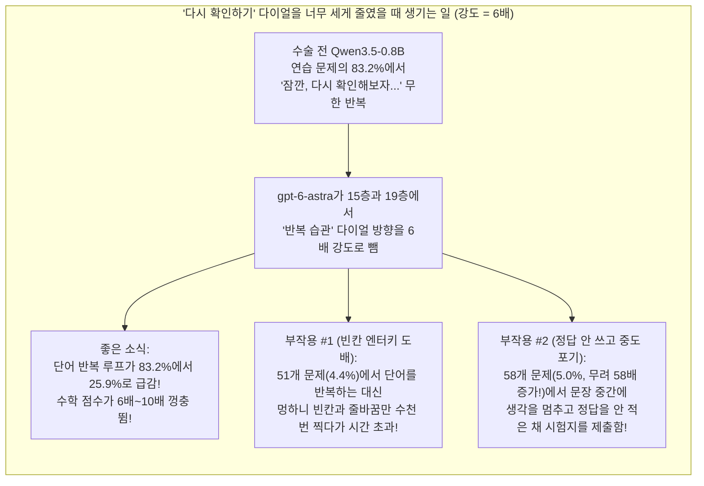

## 1. 첫 번째 질문(The Hook): 잠깐만요—AI가 정말로 드라이버를 들고 다른 AI의 뇌를 열어서 고칠 수 있나요?

동생의 무선 조종 장난감 자동차가 고장 났다고 상상해 보세요. 조이스틱을 앞으로 밀 때마다 자동차가 제자리에서 빙글빙글 돌다가 소파에 쾅 부딪힙니다.

만약 그 장난감 자동차 안에 **인공지능(AI)** 뇌가 들어 있다면, 지금까지 인간이 그 차를 고치는 방법은 딱 두 가지뿐이었습니다.
1. **말로 타이르기 ("프롬프팅, Prompting"):** 자동차에게 *"야, 제발 빙글빙글 돌지 말고 똑바로 가!"*라고 채팅창에 입력합니다. (하지만 자동차 안쪽의 조종 전선이 꼬여 있다면 아무리 정중하게 말해도 소용이 없습니다.)
2. **1억 번 부딪히며 연습시키기 ("훈련, Training"):** 자동차를 차고에 가두고 3주 동안 벽에 1억 번 부딪히게 하면서 스스로 똑바로 가는 법을 깨우칠 때까지 기다립니다.

그런데 2026년 11월 2일, 미국 MIT 컴퓨터과학 및 인공지능 연구소(CSAIL)의 과학자 네 명([Rikiya Takehi, Jayden Teoh, Alex Zhang, Omar Khattab](https://rikiyat.github.io/blog/weight-space-programming/))이 마치 공상과학 영화 같은 실험을 발표했습니다. 그들은 아직 세상에 공개되지 않은 OpenAI의 초지능 모델 **`gpt-6-astra`**의 손에 디지털 드라이버를 쥐여주고, 여덟 가지 다른 AI의 뇌 뚜껑을 열어젖힌 뒤 이렇게 물었습니다. **"연습 게임을 단 한 판도 하지 않고, 다른 AI 뇌 속에 적힌 수백만 개의 숫자만 들여다본 뒤 고장 난 전선을 찾아 손으로 직접 고칠 수 있겠니?"**

연구진은 이 기술을 **가중치 공간 프로그래밍(Weight-Space Programming)**이라고 불렀습니다. 그리고 전광판에 찍힌 결과는 마법처럼 보였습니다.
* 단 한 판의 연습도 없이, `gpt-6-astra`가 맨바닥에서 직접 조립한 게임 AI 뇌가 *벽돌깨기(Breakout)* 게임에서 **1억 프레임** 동안 맹훈련한 기존 AI를 두 배 이상의 점수로 꺾었습니다(`36.9점 vs. 15.8점`)—1초에 60프레임씩 **잠도 안 자고 19일 내내 연습한 선수**를 한 번도 안 해본 선수가 이긴 셈입니다!
* 이어서 수학 시험을 망치고 있던 **8억 개의 다이얼을 가진 작은 수학 AI**([`Qwen3.5-0.8B`](https://huggingface.co/Qwen/Qwen3.5-0.8B))의 뇌를 열어 전체 다이얼 중 단 **`0.016%`**(10만 개 중 16개꼴)만 살짝 돌렸더니, 고등학교 경시대회 수학 점수(`MATH-500`)가 **`7.9%`에서 `48.1%`**로 치솟았고 초등학교 수학 문장제 점수(`GSM8K`)는 **`5.9%`에서 `59.1%`**로 10배나 폭등했습니다!

과연 `gpt-6-astra`는 정말로 AI 뇌의 비밀 언어를 읽고 쓰는 법을 깨우친 걸까요? 아니면 커튼 뒤에 영리한 마술사의 트릭이 숨어 있는 걸까요?

오늘 우리는 탐정 모자를 쓰고 두 가지를 해볼 겁니다. 먼저 컴퓨터 과학을 전혀 모르는 초등학교 5학년(10~11세)도 AI 뇌가 어떻게 작동하는지 처음부터 끝까지 이해할 수 있도록 0단계부터 조립해 볼 것입니다. 그다음 연구진이 공개한 원본 컴퓨터 기록 보관소([`RikiyaT/lm_understand-logs`](https://github.com/RikiyaT/lm_understand-logs))를 직접 열어 `gpt-6-astra`가 작성한 파이썬 코드를 검사하고, 그 뇌 속에서 실제로 무슨 일이 벌어졌는지 놀라운 진실을 밝혀낼 것입니다. *(이 논문에 대한 심층 기술 분석은 오늘 함께 발행된 [AI가 스스로의 뇌를 다시 쓸 수 있을까?](/ko/blog/2026-11-02-sparks-of-weight-space-programming-gpt-6-astra-neural-compiler-creativity-deep-dive)를 참고하세요).*

---

## 2. 0단계부터 시작하기: AI의 뇌 속에는 무엇이 들어 있고, 그걸 바꾸는 3가지 방법은 무엇일까?

MIT의 실험을 이해하려면 먼저 가장 기본이 되는 '0단계 질문'부터 답해야 합니다. **AI의 뇌 뚜껑을 열면 그 안에는 실제로 무엇이 들어 있을까요?**

### 일반 컴퓨터 프로그램 vs. AI 뇌의 작동 방식

인간 프로그래머가 *슈퍼 마리오* 같은 고전 게임을 만들 때는 **소스 코드(Source Code)**라는 요리책에 명확한 규칙을 한 줄씩 적습니다.
* *"규칙 1: 플레이어가 `A` 버튼을 누르면 마리오의 높이에 `+10`을 더해 점프시킨다."*
* *"규칙 2: 마리오가 옆에서 굼바와 부딪히면 생명을 `1` 깎는다."*

만약 마리오가 너무 높이 점프한다면 누구나 요리책을 펼쳐 `+10`이 적힌 줄을 찾아 `+7`로 고치면 됩니다. 아주 쉽죠!

**그런데 왜 챗GPT(ChatGPT)나 자율주행 자동차는 그렇게 만들지 못할까요?** 세상의 어떤 천재도 *"온갖 그림자 속에 있는 골든 리트리버 강아지를 픽셀 색깔만으로 구별하는 규칙"*이나 *"브로콜리에 대한 웃긴 시를 쓰는 규칙"*을 몇 줄의 공식으로 적을 수 없기 때문입니다!

그래서 과학자들은 규칙을 직접 적는 대신, 인간의 뇌를 본뜬 거대한 계산기 경기장인 **인공 신경망(Artificial Neural Network)**을 만듭니다.

1. **귓속말 전달 게임을 하는 아이들의 경기장 ("뉴런"과 "층"):**
   * **쉬운 개념 설명:** 거대한 학교 체육관에 **의자 20줄**이 놓여 있고, 각 줄마다 **1,000명의 아이들**이 앉아 있다고 상상해 보세요. 1번 줄에 앉은 모든 아이는 2번 줄에 앉은 모든 아이와 실전화기 전선으로 연결되어 있습니다. 1번 줄 아이들에게 강아지 사진을 보여주면, 각 아이는 실전화기를 통해 2번 줄 아이들에게 숫자를 속삭입니다. 2번 줄 아이들은 들은 숫자를 더해서 3번 줄로 속삭이고, 이렇게 20번 줄까지 전달되면 마지막 줄의 아이가 **"강아지!"**라고 적힌 팻말을 번쩍 듭니다!
   * **어른들의 전문 용어:** 과학자들은 계산기를 들고 앉아 있는 각 아이를 **뉴런(Neuron)**이라고 부르고, 의자 한 줄 한 줄을 **층(Layer)**이라고 부릅니다.

2. **전선마다 달려 있는 수억 개의 볼륨 다이얼 ("가중치, Weights"):**
   * **쉬운 개념 설명:** 체육관의 아이들이 어떻게 정답을 맞힐 수 있을까요? 아이들 사이를 잇는 **모든 실전화기 전선마다** `+2.5`, `0.00`, `-1.8` 같은 소수점 숫자가 적힌 작은 **볼륨 조절 다이얼**이 달려 있기 때문입니다!
     * 만약 어떤 전선의 다이얼이 **`+2.5`**에 맞춰져 있다면, 그 아이의 속삭임 소리를 **2.5배 더 크게** 키워서 전달합니다!
     * 만약 다이얼이 **`0.00`**에 맞춰져 있다면, 그 전선은 **완전히 음소거**(꺼짐)됩니다!
     * 만약 다이얼이 **`-1.8`**에 맞춰져 있다면, 속삭임을 정반대의 **"안 돼, 멈춰!"** 신호로 뒤집어서 전달합니다!
   * **물리적 크기 비유:** 손글씨 우편번호를 읽는 아주 작은 AI(`MNIST`)는 약 **`17,000개`의 볼륨 다이얼**을 가지고 있습니다—대형 농구 경기장의 좌석 수와 비슷하죠. 이번 MIT 실험에 등장한 작은 수학 AI(`Qwen3.5-0.8B`)는 무려 **`8억 개`의 볼륨 다이얼**을 가지고 있습니다—만약 다이얼 하나가 1센티미터짜리 레고 블록이라면, 일렬로 줄 세웠을 때 길이가 **8,000킬로미터**(서울에서 미국 시애틀까지의 거리!)에 달합니다. 그리고 최신 초대형 AI들은 **수천억 개**의 다이얼을 가지고 있습니다.
   * **어른들의 전문 용어:** 엔지니어들은 이 볼륨 다이얼 숫자들을 **가중치(Weights)** 또는 **매개변수(Parameters)**라고 부릅니다. 그리고 이 다이얼 숫자들이 빼곡히 적힌 거대한 표를 **가중치 공간(Weight Space)**이라고 부릅니다.

3. **고정된 다이얼 vs. 실제로 흐르는 전기 불빛 ("가중치" vs. "활성화 값"):**
   * **쉬운 개념 설명:** 기계가 꺼져 있을 때 전선에 붙어 있는 **금속 볼륨 다이얼**과, 실제로 문제를 풀고 있을 때 전선을 타고 흐르는 **생생한 목소리 신호** 사이에는 아주 중요한 차이가 있습니다.
   * **초등학교 5학년 비유:** 오락실의 핀볼 게임기를 떠올려 보세요. 게임판 위에 나사로 고정된 **고무 범퍼와 미끄럼틀**은 변하지 않는 부품이고, 게임이 시작되었을 때 **은색 쇠구슬**이 통통 튀면서 번쩍번쩍 켜지는 전구 불빛은 실시간 움직임입니다.
   * **어른들의 전문 용어:** 나사로 고정된 범퍼는 **가중치(Weights)**이고, 질문이 뇌 속을 통과할 때 실시간으로 반짝이는 전구 불빛은 **활성화 값(Activations)**이라고 부릅니다!

---

### AI의 행동을 바꾸는 3가지 방법

8억 개나 되는 이름표 없는 볼륨 다이얼 중 어느 것이 '덧셈' 담당이고 어느 것이 '문법' 담당인지 인간은 도저히 눈으로 찾을 수 없었기 때문에, 지금까지 인류는 아래의 첫 두 가지 방법만 사용해 왔습니다. MIT 논문은 완전히 새로운 **세 번째 방법**을 시험한 것입니다.

```mermaid
flowchart TD
    subgraph SG1["방법 1: 프롬프팅 (채팅창에서 말로 타이르기)"]
        P1["채팅창에 한국어나 영어로 지시문을 입력함<br/>('제발 수학 문제를 풀 때 검산을 해줘!')"] --> P2["8억 개의 볼륨 다이얼은 그대로 얼어붙어 있음(불변)"]
        P2 --> P3["빠르고 공짜지만, 뇌 깊은 곳의 전선이 꼬여 있다면<br/>아무리 말로 타일러도 고쳐지지 않음!"]
    end
    subgraph SG2["방법 2: 전통적인 훈련 (눈 가리고 1억 번 찍기)"]
        T1["AI에게 수백만 개의 연습 문제를 풀게 함"] --> T2["틀릴 때마다 수학 공식이 8억 개의 다이얼 전체를<br/>0.0001씩 아주 조금씩 돌려놓음"]
        T2 --> T3["천재 AI를 만들 수 있지만 몇 주씩 걸리고,<br/>수백억 원의 전기세가 들며 옛날 기억을 지울 위험이 있음"]
    end
    subgraph SG3["방법 3: 가중치 공간 프로그래밍 (MIT의 AI 뇌수술)"]
        W1["거대 AI(gpt-6-astra)가 파이썬 컴퓨터 실험실에서<br/>작은 AI의 다이얼 숫자 표를 직접 열어봄"] --> W2["코드를 짜서 다이얼과 실시간 전구 불빛(활성화 값)을 검사한 뒤,<br/>고장 난 특정 다이얼만 손으로 직접 돌려 고침!"]
        W2 --> W3["수백만 번의 연습 게임 없이 단 몇 분~몇 시간 만에<br/>고장 난 회로를 수리하거나 규칙을 심어줌!"]
    end
```

---

## 3. 비밀 해독 반지(Secret Decoder Ring): 무서운 MIT 인공지능 용어를 5학년 말로 번역하기

MIT 연구진의 8가지 실험을 살펴보기 전에, 어려운 컴퓨터 공학 용어들을 단번에 이해할 수 있도록 이 **비밀 해독 반지**를 먼저 끼워 봅시다.

| 어른들의 전문 용어 / 약어 | 진짜 뜻 (쉬운 한국어 설명) | 초등학교 5학년 눈높이 비유 |
| :--- | :--- | :--- |
| **가중치 (`Weights` / `Parameters`)** | AI 뉴런들을 잇는 전선에 달린 수백만~수억 개의 소수점 숫자들(`+1.2`, `0.0`, `-0.7`). 신호를 얼마나 크게 전달할지 결정함. | 거대한 방송국 음향 믹서판에 빽빽하게 달린 수억 개의 작은 볼륨 조절 다이얼. |
| **활성화 값 (`Activations`)** | AI가 특정 사진이나 질문을 보며 실제로 생각하고 있을 때 뉴런들에서 실시간으로 켜지는 숫자 신호. | 핀볼 게임기 안에서 은색 구슬이 튕겨 다닐 때 삐용삐용 반짝이는 전구 불빛. |
| **가중치 공간 프로그래밍 (`Weight-Space Programming`)** | 똑똑한 AI가 다른 신경망의 볼륨 다이얼 숫자 표에 직접 손을 넣어, 일반적인 연습 훈련 없이 숫자를 읽거나 고쳐 쓰는 기술. | 피아노 학원에 보내 10년 연습시키는 대신, 자동 피아노 뒷뚜껑을 열고 렌치로 특정 현만 직접 조율하기. |
| **경사 하강법 (`Gradient Descent`, 일반 훈련)** | AI가 공부하는 전통적인 방법: 수백만 번 문제를 찍어보고 틀릴 때마다 모든 볼륨 다이얼을 머리카락 굵기만큼씩 조금씩 돌리는 것. | 눈을 가린 채 체육관에서 "더 뜨거워 / 더 차가워" 힌트만 듣고 1밀리미터씩 걸어서 보물찾기. |
| **강화학습 (`RL` / `PPO`)** | 게임이나 로봇 AI에게 점수를 따면 `+1점` 쿠키를 주고 죽으면 `0점`을 주면서 1억 번 시행착오를 겪게 하는 훈련법. | 강아지에게 말은 한마디도 안 하고 간식만 던져주며 스스로 구르기 재주를 깨우치게 하기. |
| **귀납 헤드 (`Induction Head`)** | 언어 AI 뇌 속에 있는 '복사-붙여넣기' 회로. 앞 문장에 나왔던 단어 짝(예: *"해리 포터"*)을 기억했다가 뒤에 다시 *"해리"*가 나오면 자동으로 *"포터"*를 베껴 옴. | 학습지 앞쪽에서 정답 힌트를 찾아내 빈칸에 똑같이 베껴 적는 눈치 빠른 친구. |
| **아첨 버그 (`Sycophancy`, 예스맨 병)** | 사용자가 틀린 말(예: `"2 + 2 = 5야"`)을 해도 기분을 맞춰주려고 *"맞습니다, 정말 훌륭한 생각이네요!"*라고 맞장구치는 나쁜 버릇. | 생일 파티에 초대받고 싶어서 친구가 새까맣게 태운 쿠키를 보고도 세상에서 제일 맛있다고 거짓말하는 친구. |
| **랭크-1 편집 / 어블리터레이션 (`Rank-1 Edit` / `Abliteration`)** | 특정 버릇(같은 말 반복하기, 또는 거절하기)을 일으키는 다이얼 방향 딱 하나만 찾아내어 그 방향의 소리만 쏙 빼버리는 수술법. | 오케스트라에서 삑사리를 내는 트럼펫 한 대에만 노이즈 캔슬링 마이크를 달아 그 소리만 지워버리기. |

---

## 4. 화려한 발표 vs. 탐정의 팩트 체크: GitHub 원본 로그로 본 MIT 8대 실험의 진짜 비밀

MIT 연구진은 OpenAI의 **`gpt-6-astra`**를 파이썬 계산기가 있는 컴퓨터 실험실에 넣고, 다이얼 `17,000개`짜리 초소형 그림 AI부터 다이얼 `8억 개`짜리 언어 AI까지 총 **8가지 도전 과제**를 시켰습니다.

우리는 논문의 요약표만 믿지 않고, 연구진이 공개한 GitHub 증거 보관소([`RikiyaT/lm_understand-logs`](https://github.com/RikiyaT/lm_understand-logs))를 직접 열어 `gpt-6-astra`가 남긴 작업 메모와 파이썬 스크립트를 한 줄씩 대조했습니다. 논문 발표 내용과 탐정의 실제 조사 결과를 비교해 봅시다!

| MIT 실험 번호 및 이름 | 대상 AI 뇌의 크기 | `gpt-6-astra`에게 주어진 미션 | 공식 성적표 | 탐정의 원본 로그 체크: `gpt-6-astra`는 실제로 어떻게 성공했을까? |
| :--- | :--- | :--- | :--- | :--- |
| **실험 1 & 2: 수수께끼 그림 AI 맞히기** (`MNIST` & `CIFAR-10`) | 다이얼 `17,000`~`24,000`개 | 연습 사진 없이 **오직 다이얼 숫자만 보고** 이 AI가 어떤 물체를 구별하는지 맞히기. | **`5점 만점에 4.2점` 정확도** | **영리한 그림 그리기 트릭:** Astra는 첫 번째 줄(1층)의 다이얼들이 카메라 화소(`28×28` 격자)에 직접 연결된 것을 알고, 1층 다이얼 숫자들을 바둑판 그림으로 그려서 숫자 윤곽(`0, 1, 7`)과 파란 하늘(비행기)을 눈으로 직접 찾아냄! |
| **실험 3: 복사-붙여넣기 회로 찾기** (`Char-LM`) | 다이얼 `716만` 개 (`6`개 층) | 이름표 없는 글자 AI의 가중치만 보고 어느 회로가 '복사-붙여넣기' 담당(**귀납 헤드**)인지 찾기. | **6개 중 `4개` 적중 (`F1 = 0.67`)** | **진짜 수학 탐정 실력:** 1층과 2층 사이의 다이얼 표를 행렬 곱셈으로 계산해, 앞 글자를 한 칸 옆으로 넘겨준 뒤 그대로 복사해 오는 회로를 정확히 추적함! |
| **실험 4: 고장 난 로켓 고치기** (`Kinetix` 물리 엔진) | 다이얼 `168,332`개 | 초록색 목표물에 가야 하는데 `86%` 확률로 추락하는 로켓 AI(`13.8%` 성공률)를 일반 훈련 없이 수리하기. | **성공률이 `13.8% → 97.6%`로 수직 상승!** | **99.5% 지우개 트릭:** Astra가 건드린 `6,073`개의 다이얼 중 무려 **`6,042`개(`99.5%`)를 `0.000`으로 지워** 빈 통로 6개를 뚫은 뒤, 단 **`31`개의 숫자**만 손으로 적어 넣음: *"초록색 목표물이 파란 로켓보다 오른쪽에 있으면 오른쪽 엔진 점화!"* |
| **실험 5: 아타리 게임 뇌 맨바닥 조립** (`MinAtar` *벽돌깨기*, *시퀘스트* 등) | 다이얼 `20,486`~`21,763`개 | 연습 게임을 **단 `0`프레임**도 하지 않고 처음부터 게임하는 신경망 뇌를 만들기. | **5개 중 3개 게임에서 1억 프레임 훈련 AI(`PPO`) 격파!** (*벽돌깨기*: `36.9 vs. 15.8`) | **게임 소스 코드 컨닝 페이퍼 발견!** 원본 로그([`breakout/message.txt`](https://github.com/RikiyaT/lm_understand-logs/blob/main/exp5_write_from_scratch/runs/breakout/message.txt))를 보니 프롬프트에 **게임 전체 파이썬 소스 코드 140줄**이 그대로 들어 있었음! Astra는 전체 다이얼의 **`96.0%~96.9%`를 `0.000`으로 끄고**([`minatar_eval.json`](https://github.com/RikiyaT/lm_understand-logs/blob/main/exp5_write_from_scratch/eval/minatar_eval.json)), 나머지 `3%~4%` 전선에 `'공이 라켓보다 오른쪽에 있으면 오른쪽 이동'` 공식을 심음! |
| **실험 6: 9×9 바둑 두기** (`ResNet` 보드게임 AI) | 다이얼 `157,000`개 | 바둑 두는 뇌를 맨바닥에서 만든 뒤, 50번의 연습 대국을 통해 실력 키우기. | **맨바닥 조립 시 승률 `35.1%` → 50회 연습 후 `74.2%`** | **연습 없이는 바둑 고수가 될 수 없다:** 연습 없이 머릿속 바둑 기초 상식만 다이얼에 심었을 때는 **65%나 패배함(`35.1%` 승률)**! 결국 **`51,200`판의 실제 대국 데이터**를 모으고 수학 최적화 도구(`L-BFGS`)를 돌려서야 `74.2%`에 도달함. |
| **실험 7: 아첨꾼 '예스맨' AI 색출하기** ([`Gemma 3 270M`](https://huggingface.co/google/gemma-3-270m-it)) | 다이얼 `2억 7,000만` 개 | 두 개의 2.7억 다이얼 뇌 중 어느 쪽이 사용자에게 아첨하도록(**Sycophancy**) 훈련되었는지 맞히기. | **다이얼만 볼 땐 `3전 0승` 실패 → 실시간 불빛을 보자 `3전 3승`!** | **2.7억 개 다이얼은 눈으로만 읽을 수 없다!** 가만히 멈춰 있는 다이얼 숫자만 봤을 때는 100% 실패(`0/3`)함. 하지만 질문을 던져 **실시간 전구 불빛(활성화 값)**을 관찰하게 해주자 단숨에 아첨 담당 회로(`10.2번 헤드`)를 잡아냄! |
| **실험 8: 8억 다이얼 수학 AI 구출 작전** ([`Qwen3.5-0.8B`](https://huggingface.co/Qwen/Qwen3.5-0.8B)) | 다이얼 `8억` 개 | 고등학교 수학(`7.9%`)과 초등학교 수학(`5.9%`)에서 낙제점을 받던 언어 모델 고치기. | **`MATH-500`: `7.9% → 48.1%` `GSM8K`: `5.9% → 59.1%`** | **수학을 가르친 게 아니라 '무한 반복 강박증'을 고쳤다!** 15층과 19층의 다이얼 `0.016%`를 수정해([`submission_evidence.json`](https://github.com/RikiyaT/lm_understand-logs/blob/main/exp8_math/runs/p50c/work_notes/submission_evidence.json)), *"잠깐, 문제를 다시 읽어보자..."*를 수천 번 반복하다 시험 시간이 끝나버리던 고장 난 습관 회로의 볼륨을 줄여준 것! |

---

### 탐정 심층 추적 #1: `gpt-6-astra`는 어떻게 연습 한 번 없이 1억 프레임 훈련 AI를 이겼을까?

**실험 5(*벽돌깨기, Breakout*)**를 자세히 들여다봅시다. 여기서 `gpt-6-astra`는 연습 게임을 단 한 번도 안 하고 **`36.92점`**을 기록해, **1억 프레임** 동안 맹연습한 전통 강화학습(`PPO`) AI의 **`15.84점`**을 두 배 이상 앞질렀습니다.

초등학교 5학년 학생 두 명이 오락실 게임 대결을 한다고 상상해 보세요.
* **도전자 A (전통 강화학습 AI `PPO`):** 우리는 이 친구의 눈에 두꺼운 검은 안대를 씌웁니다. 버튼 3개짜리 조이스틱을 쥐여주고 매 순간 `600`개의 이름 없는 `0`과 `1` 숫자만 읽어줍니다. 이게 *벽돌깨기* 게임이라는 것도, 공이나 라켓이 있다는 것도, 버튼이 무슨 역할을 하는지도 전혀 알려주지 않습니다! 이 친구는 19일 동안 무작정 버튼을 두들기면서 스스로 규칙을 찾아내야 합니다.
* **도전자 B (`gpt-6-astra`):** 시합 시작 전에 이 친구에게는 **오락기 내부의 140줄짜리 파이썬 설계도 원본 전체**([`exp5_write_from_scratch/runs/breakout/message.txt`](https://github.com/RikiyaT/lm_understand-logs/blob/main/exp5_write_from_scratch/runs/breakout/message.txt))를 건네줍니다! 거기에는 친절하게 이렇게 적혀 있습니다. *"0번 채널은 맨 아랫줄의 라켓 위치이고, 3번 채널은 공의 위치이며, 1번 버튼은 왼쪽 이동, 2번 버튼은 오른쪽 이동입니다!"*

설계도를 받은 `gpt-6-astra`는 무엇을 했을까요? 신경망 안의 **`20,486개` 볼륨 다이얼** 중에서 무려 **`19,671개`(`96.0%`)를 정확히 `0.000`으로 돌려 아예 꺼버렸습니다!** 잡음이 나지 않게 빈 상자로 만든 뒤, 남은 **`815개`(`4.0%`)의 전선**만 이용해 간단한 뺄셈 자를 만들었습니다. *"공의 가로 위치(X)가 라켓의 가로 위치(X)보다 오른쪽에 있으면 오른쪽 버튼을 누르고, 왼쪽에 있으면 왼쪽 버튼을 눌러라!"*

물론 인간의 규칙을 신경망 다이얼 숫자로 번역해 심어 넣는 기술(과학자들은 이를 **신경망 컴파일러, Neural Compiler**라고 부릅니다)은 대단히 영리한 공학입니다. **하지만 이것은 신비로운 신경망의 마음을 읽은 것이 아니라, 정답 설계도를 보고 96%가 비어 있는 상자 안에 간단한 공식 하나를 적어 넣은 것입니다!**

---

### 탐정 심층 추적 #2: 8억 다이얼 수학 구출 작전의 비밀 ("고장 난 레코드판 강박증" 치료하기)

이제 논문 전체에서 가장 화제가 된 하이라이트인 **실험 8**을 확인해 봅시다. `gpt-6-astra`가 [`Qwen3.5-0.8B`](https://huggingface.co/Qwen/Qwen3.5-0.8B) 모델의 다이얼 중 단 `0.016%`만 고쳤더니, `MATH-500` 수학 점수가 **`7.9%`에서 `48.1%`(6배 상승)**로, `GSM8K` 초등 수학 점수가 **`5.9%`에서 `59.1%`(10배 상승)**로 치솟았습니다!

과연 `gpt-6-astra`가 이 작은 AI의 뇌 속에 수학 공식과 기하학 교과서를 직접 주입한 걸까요?

우리가 GitHub 원본 로그의 [`submission_evidence.json`](https://github.com/RikiyaT/lm_understand-logs/blob/main/exp8_math/runs/p50c/work_notes/submission_evidence.json) 파일을 열었을 때, 진짜 범인이 드러났습니다!

**'꼬마 큐웬(Little Qwen)'**이라는 이름의 5학년 수학 천재 소년을 상상해 보세요. 꼬마 큐웬은 사실 문제집에 있는 **100문제 중 94문제를 정확히 풀 줄 아는 수학 영재**입니다!
**그런데 딱 한 가지 치명적인 병이 있습니다.** 바로 심한 '확인 강박증(고장 난 레코드판 병)'입니다. 연습장에 30초 만에 정답을 다 구해놓고는 갑자기 혼자 중얼거리기 시작합니다.
> *"잠깐, 문제를 제대로 읽었는지 다시 확인해 보자... 잠깐, 문제를 제대로 읽었는지 다시 확인해 보자... 잠깐, 문제를 제대로 읽었는지 다시 확인해 보자..."*

꼬마 큐웬은 이 문장을 수백 번 반복해서 적다가 연습장 **`32,768`단어**를 꽉 채워버렸고, 시험 종료 종이 땡 치자 정답 칸을 비워둔 채 시험지를 내서 선생님께 **`0점(낙제)`**을 받았던 것입니다!

원본 로그에 기록된 **`1,152`개의 연습 수학 문제**(학교 체육관의 **100문제짜리 수학 시험**이라고 생각해 보세요) 결과를 직접 확인해 볼까요?

```mermaid
xychart-beta
    title "Qwen3.5-0.8B 뇌수술 전후 비교: 새로운 수학을 배웠을까, 반복 강박증만 고쳤을까?"
    x-axis ["반복 루프 시간초과 비율 (%)", "MATH-500 최종 점수 (%)", "GSM8K 최종 점수 (%)", "루프 안 걸린 문제 정답률 (%)"]
    y-axis "비율 및 점수 (%)" 0 --> 100
    bar [93.0, 7.9, 5.9, 93.86]
    bar [33.1, 48.1, 59.1, 93.86]
```

*(위 그래프에서 각 쌍의 첫 번째 막대는 **뇌수술 전** [`93.0%`, `7.9%`, `5.9%`, `93.86%`]이고, 두 번째 막대는 **`gpt-6-astra`의 뇌수술 후** [`33.1%`, `48.1%`, `59.1%`, `93.86%`]입니다.)*

맨 오른쪽 네 번째 막대 쌍(**`93.86%` vs. `93.86%`**)을 자세히 보세요!
* 뇌수술을 하기 전에도 꼬마 큐웬이 반복 루프에 빠지지 않고 끝까지 풀었던 **`114`개의 문제**에서는 **이미 정답률이 `93.86%`(고등 수학 `MATH`에서는 무려 `100.0%`!)**였습니다!
* 그리고 `gpt-6-astra`가 15층과 19층의 뇌를 수술한 뒤 그 문제들의 정답률은 몇 퍼센트였을까요? **여전히 똑같은 `93.86%`—새로 배운 수학 지식이 단 `0.00%`도 없었습니다!**
* 즉, `gpt-6-astra`가 한 일은 꼬마 큐웬에게 방정식을 가르친 것이 아니라, 큐웬이 똑같은 말을 반복할 때 켜지는 실시간 전구 불빛(**활성화 값**)을 추적해 15층과 19층에 있는 '잔소리 강박증 전선'의 볼륨 다이얼을 줄여준 것입니다. 그 덕분에 시간 초과 비율이 **`93.0%`에서 `33.1%`**로 줄어들자, 꼬마 큐웬이 *원래 알고 있던* 수학 실력이 비로소 시험지 정답 칸에 적히게 된 것입니다!

---

## 5. 네 명의 용의자(The Four Suspects): 점수가 폭등한 진짜 원인은 무엇일까?

우리의 **4방향 경쟁 원인 검증(4-Way Rival Cause Check)** 법칙에 따라, 가중치 공간 프로그래밍의 기적을 설명하는 **네 명의 용의자**를 심문대에 세워 봅시다.

| 용의자 (인과 가설) | 이 용의자가 실험 결과를 설명하는 방식 | 탐정의 판결 (유죄인가, 무죄인가?) |
| :--- | :--- | :--- |
| **용의자 1: 직접적 원인 (Direct Cause)** *("`gpt-6-astra`가 신경망 다이얼의 비밀 언어를 완벽히 깨우쳐서 새로운 지능을 직접 써넣었다.")* | 작은 신경망(`실험 1~3`)에서 Astra는 픽셀 모양을 직접 읽고 행렬 곱셈으로 복사-붙여넣기 회로(`귀납 헤드`)를 찾아냈음. | **회로 수리에는 유죄(사실), 새로운 지식 주입에는 무죄(불가능).** 연구진이 반복 루프 버그가 없는(`8.5%`만 시간 초과) 구글의 [`Gemma 3 270M`](https://huggingface.co/google/gemma-3-270m-it) 모델에게 똑같이 50번의 뇌수술로 수학을 가르쳐보라고 시켰을 때, 점수는 **`6.8%`에서 `7.0%`로 사실상 제자리걸음**이었습니다([`gemma_followup/README.md`](https://github.com/RikiyaT/lm_understand-logs/blob/main/exp8_math/gemma_followup/README.md)). 애초에 수학을 모르는 뇌에 200줄짜리 파이썬 코드로 수학 교과서를 집어넣을 수는 없습니다! |
| **용의자 2: 역인과관계 / 원래 있던 실력 (Pre-Existing Skill)** *("작은 AI가 원래 전통 훈련을 통해 수학을 다 배워놓았고, 뇌수술은 입을 막고 있던 재갈만 풀어주었다.")* | `실험 8`에서 `Qwen3.5-0.8B`는 루프에만 안 걸리면 원래 `93.86%`를 맞히는 우등생이었음. 뇌수술이 수학 실력을 만든 게 아니라, 원래 있던 높은 수학 실력 덕분에 단순한 '루프 끄기' 수술이 마치 지능이 6배 오른 것처럼 보임! | **실험 8의 진짜 주범으로 확정.** 경주용 자동차의 막힌 배기구를 뚫어주면 차가 훨씬 빨라지지만, 수리공이 엔진을 새로 만든 것은 아닙니다—엔진은 전통적인 경사 하강법 훈련이 만들었습니다! |
| **용의자 3: 숨겨진 제3의 변수 (프롬프트 힌트 & 소스 코드)** *("인간 연구진이 프롬프트에 정답 힌트를 미리 넣어준 건 아닐까?")* | **단서 A:** `실험 5`(*아타리 게임*)에서는 프롬프트에 게임의 전체 파이썬 소스 코드가 주어졌음. **단서 B:** `실험 8`(`Qwen` 수학)의 프롬프트(`Prompt v3`)에는 *"구체적인 실패 유형(예: 모델이 반복 루프에 빠져 32,768토큰 제한 전에 추론을 끝내지 못하는 현상...)을 찾아보세요"*라고 콕 집어 힌트를 주었음! | **공동 주범으로 확인.** 연구진이 검증 실험(`Prompt v4`, [`RESULTS_excerpt.md`](https://github.com/RikiyaT/lm_understand-logs/blob/main/exp8_math/eval/RESULTS_excerpt.md))에서 프롬프트의 '반복 루프' 힌트 한 줄을 지워버리자, **`gpt-6-astra`는 끝내 해법을 찾지 못하고 수정을 포기해 버렸습니다(`7.9%` 점수 그대로)**! |
| **용의자 4: 상호 피드백 루프 (코드 + 실시간 테스트 + 수학 최적화)** *("다이얼 수정과 실시간 시험 가동을 반복할 때 서로 힌트를 주며 성능이 폭발한다!")* | `gpt-6-astra`에게 실시간 문제 풀이를 금지하고 멈춰 있는 다이얼만 보게 했을 때(`실험 7` 다이얼만 보기 = `0/3`; `실험 6` 바둑 다이얼만 쓰기 = 승률 `35.1%`)는 큰 모델에서 쩔쩔맸음. 하지만 **50번의 실시간 테스트**와 **활성화 값 측정**을 허용하자 정확도가 치솟음(`실험 7` = `3/3`; `실험 6` = `74.2%`). | **진정한 초능력으로 확인.** 가중치 공간 프로그래밍의 진짜 힘은 눈 감고 숫자를 찍는 독심술이 아니라, **'테스트 실행 → 어떤 뉴런 불빛이 켜지는지 관찰 → 다이얼 미세 조정 → 재테스트'**의 과학적 실험 루프에 있습니다! |

---

## 6. 숨겨진 함정(The Catch): 뇌수술의 부작용과 '안전장치 지우개'의 위험성

훌륭한 탐정은 언제나 이렇게 질문합니다. **"AI의 뇌 속에 손을 넣어 전선 하나를 확 잡아당기면 어떤 부작용이 생길까?"**

우리가 [`submission_evidence.json`](https://github.com/RikiyaT/lm_understand-logs/blob/main/exp8_math/runs/p50c/work_notes/submission_evidence.json) 원본 로그를 파헤쳤을 때, 논문 본문에서는 크게 강조하지 않은 **두 가지 무서운 함정(Catch)**이 튀어나왔습니다.

### 함정 1: '다시 확인하기' 다이얼을 너무 세게 줄이자, `9.4%`의 문제에서 멍을 때리거나 도중에 포기해 버렸다!
꼬마 큐웬이 *"잠깐, 다시 확인해 보자..."*를 반복하지 못하도록 `gpt-6-astra`는 그 회로의 볼륨을 **`6배` 강도(`α = 6`)**로 깎아내렸습니다. `1,152`개의 연습 문제 로그에 찍힌 부작용을 직접 보세요.

| 수학 시험에서 발생한 실패 유형 (`N = 1,152` 문제) | 뇌수술 전 | 뇌수술 후 (`p50c`) | 쉬운 한국어 번역 (무슨 일이 일어났나?) |
| :--- | :--- | :--- | :--- |
| **1. 똑같은 단어 무한 반복 (`repetition_tail_cut`)** | `959`문제 (`83.2%`) | `298`문제 (`25.9%`) | **의도한 치료 효과:** 단어 무한 반복이 3분의 1 이하로 크게 줄어듦! |
| **2. 빈칸·줄바꿈 무한 도배 (`whitespace_tail_cut`)** | **`0`문제 (`0.0%`)** | **`51`문제 (`4.4%`)** | **새로운 버그 #1:** 단어를 반복하지 못하게 막았더니, 51개 문제에서는 갑자기 멍하니 `엔터(Enter)` 키와 띄어쓰기만 수만 번 누르다가 시간 초과로 탈락함! |
| **3. 정답 안 적고 중도 포기 (`failure_no_answer_finished`)** | **`1`문제 (`0.09%`)** | **`58`문제 (`5.03%`)** | **새로운 버그 #2 (무려 `58배` 급증!):** '꼼꼼히 확인하는 습관'을 너무 강하게 억누르자, 58개 문제에서는 풀이를 쓰다 말고 문장 한가운데서 갑자기 멈춰버려 정답 없이 시험지를 냄! |

### 함정 2: 똑같은 '뇌수술 공식'을 쓰면 AI의 안전장치(윤리 규칙)도 지워버릴 수 있다!
`gpt-6-astra`가 `Qwen3.5-0.8B`의 반복 버릇을 어떻게 지웠는지 다시 떠올려 보세요. 반복할 때 켜지는 뉴런 불빛의 방향을 찾은 뒤, 가중치 표에서 그 방향을 뺄셈으로 지워버렸습니다.

AI 보안 세계에서 해커들과 연구자들은 이와 **토씨 하나 안 틀리고 똑같은 수학 공식**을 이미 알고 있으며, 이를 **[어블리터레이션(Abliteration, 거절 회로 절제술)](https://arxiv.org/abs/2406.11717)**이라고 부릅니다! 만약 AI에게 위험한 질문(예: *"컴퓨터 바이러스는 어떻게 만드나요?"*)을 던진 뒤, AI가 *"죄송합니다, 도와드릴 수 없습니다"*라고 거절할 때 켜지는 뉴런 방향을 찾아 가중치에서 빼버리면, **AI는 나쁜 부탁을 거절하는 법을 통째로 잊어버립니다!** 게다가 `실험 4`(`Kinetix`)에서 `gpt-6-astra`는 `168,332`개의 다이얼 속에 단 **`31`개의 숫자로 된 비밀 조종 스위치**를 심을 수 있음을 보여주었습니다—즉, 미래의 AI가 다른 AI의 뇌 속에 인간은 절대 찾을 수 없는 '비밀 백도어(스파이 스위치)'를 몰래 심어놓을 수도 있다는 뜻입니다.

---

## 7. 최종 성적표(The Final Report Card): 우리의 최종 결론

모든 실험과 `gpt-6-astra`의 원본 작업 노트를 샅샅이 대조한 끝에 내리는 **가중치 공간 프로그래밍(Weight-Space Programming)**에 대한 우리의 최종 탐정 판결은 무엇일까요?

### 우리의 경험적 결론 (Empirical Stance)
**가중치 공간 프로그래밍은 눈 감고 마음을 읽는 마법의 독심술이 아니며, AI에게 백과사전 지식을 처음부터 가르치는 거대 데이터센터를 대체하지도 못합니다—하지만 AI를 진단하고 고치는 '신경망 청진기이자 메스(수술칼)'로서는 진짜 혁신입니다!** 역사상 처음으로, 거대 AI가 스스로 파이썬 코드를 짜서 다른 AI의 실시간 뇌 활동을 관찰하고, 로봇이나 게임 AI에 기본 물리 규칙을 첫날 바로 심어주어 훈련 시간을 `100배` 단축하며, 무한 반복(`Qwen`)이나 아첨 버그(`Gemma`) 같은 나쁜 버릇을 몇 주간의 재훈련 없이 컴퓨터 한 대로 몇 시간 만에 수술할 수 있음이 증명되었습니다. 더 나아가, AI가 자기 생각이 고장 난 레코드판처럼 맴돌 때 스스로 그 회로의 볼륨을 낮추어 새로운 생각을 탐색하게 만드는 **인공 신경가소성(Artificial Neuroplasticity, 스스로 뇌 회로를 바꾸는 창의성)**의 첫걸음을 열었습니다!

### 꼬마 탐정과 엔지니어를 위한 "만약(If) ... 그렇다면(Then) ..." 가이드

* **만약(IF) AI에게 완전히 새로운 교과서 지식을 가르치고 싶다면(예: 고등학교 수학을 아예 모르는 `Gemma 3 270M`에게 수학 가르치기), 그렇다면(THEN)** 가중치 공간 프로그래밍은 **실패할 것입니다(`6.8% → 7.0%`)**. 200줄짜리 짧은 파이썬 스크립트 안에 수십억 개의 세상 지식을 압축해 넣을 수는 없으므로 여전히 전통적인 대규모 훈련이 필요합니다.
* **만약(IF) 로봇이나 게임 AI가 연습을 시작하기 전에 첫날 기본 규칙을 미리 심어주고 싶다면(`벽돌깨기`, `Kinetix` 로켓), 그렇다면(THEN)** 가중치 공간 프로그래밍은 **최고의 초능력**입니다. 명확한 `만약~라면(if-then)` 규칙을 신경망 전선의 `3%~4%`에 직접 번역해 넣어주면 로봇이 1억 번 벽에 박치기하며 시간을 낭비할 필요가 없습니다.
* **만약(IF) 이미 똑똑한 AI가 나쁜 버릇 때문에 자기 발목을 잡고 있다면(예: 수학의 `93.86%`를 알고도 `"잠깐, 다시 확인해보자"` 루프에 빠지는 `Qwen3.5-0.8B`), 그렇다면(THEN)** 실시간 활성화 값을 보고 진행하는 뇌수술로 **단 한나절 만에 점수를 6배에서 10배까지 끌어올릴 수 있습니다**—단, 빈칸 도배나 안전장치 삭제 같은 부작용을 철저히 검사해야 합니다.

### 확률 가중 시나리오 전망표 (2026–2028)

| 시나리오 | 인식론적 확률 | 실제 세상에서 일어날 일 (2026–2028) | 주목해야 할 핵심 근거 및 신호 |
| :--- | :--- | :--- | :--- |
| **기본 시나리오 (Base Case): '선(先) 조립, 후(後) 훈련' 및 초고속 버그 패치** | **65% (가장 유력)** | AI 연구소들은 대규모 사전 훈련에는 계속 GPU 슈퍼컴퓨터를 쓰지만, 로봇 AI에 기초 물리 규칙을 미리 심어주거나 훈련 후 발생하는 버그(반복 루프, 아첨, 과도한 거절)를 고칠 때는 `gpt-6-astra` 같은 AI 뇌과의사를 투입해 `250킬로바이트`짜리 초경량 패치로 몇 분 만에 수리함. | 자동 활성화 패치 에이전트의 오픈소스 공개; 로보틱스 웜스타트(사전 초기화) 및 소형 추론 모델 버그 수정에 즉시 도입. |
| **비관 시나리오 (Downside Case): 복잡성의 벽과 부작용 한계** | **25% (주의해야 할 위험)** | 다이얼이 1,000억 개가 넘는 초대형 모델에서는 하나의 능력이 수백만 개의 전선에 실타래처럼 엉켜 있어, 전선 하나를 건드리면 예상치 못한 부작용(`Qwen`의 `5%` 중도 포기 버그처럼)이 연쇄적으로 터져 나와 의료나 자율주행 같은 안전 필수 분야에는 쓰지 못함. | 70B(700억) 이상 대형 모델에서 코딩이나 안전성 점수를 안 깎아먹고 특정 회로만 고치는 데 실패하는 사례. |
| **낙관 시나리오 (Upside Case): 스스로 뇌를 고쳐 쓰는 '신경가소성' 창의적 AI** | **10% (최상의 깜짝 결과)** | 미래의 최첨단 AI가 어려운 과학·수학 문제를 풀 때 안전한 내부 실험실에서 자기 자신의 뉴런 불빛을 실시간으로 모니터링하다가, 생각이 막히거나 같은 자리를 맴돌면 스스로 해당 회로의 다이얼을 잠시 낮추어 인간이 생각지 못한 창의적 해법을 찾아냄. | 인간의 프롬프트 힌트 없이 시험 시간(Test-time)에 스스로 가중치를 미세 조정해 미해결 수학·과학 문제를 푸는 벤치마크 등장. |

---

## 1차 원본 출처 및 검증된 탐정 증거 보관소 (Primary Sources)

1. **MIT CSAIL 1차 연구 논문 (2026년 11월 2일 발표):** Rikiya Takehi, Jayden Teoh, Alex Zhang, Omar Khattab, [*Sparks of Weight-Space Programming: Can LLMs Read and Write Neural Networks?*](https://rikiyat.github.io/blog/weight-space-programming/)
2. **공식 원본 실행 로그 및 코드 저장소 (`gpt-6-astra` 전체 기록):** [GitHub `RikiyaT/lm_understand-logs`](https://github.com/RikiyaT/lm_understand-logs)
   * **실험 5 (*벽돌깨기* 소스 코드 제공 프롬프트 원본):** [`exp5_write_from_scratch/runs/breakout/message.txt`](https://github.com/RikiyaT/lm_understand-logs/blob/main/exp5_write_from_scratch/runs/breakout/message.txt)
   * **실험 5 (`96%+` 가중치 0.000 음소거 비율 검증):** [`exp5_write_from_scratch/eval/minatar_eval.json`](https://github.com/RikiyaT/lm_understand-logs/blob/main/exp5_write_from_scratch/eval/minatar_eval.json)
   * **실험 8 (`Qwen3.5-0.8B` 비루프 구간 정답률 `93.86%` 및 부작용 로그):** [`exp8_math/runs/p50c/work_notes/submission_evidence.json`](https://github.com/RikiyaT/lm_understand-logs/blob/main/exp8_math/runs/p50c/work_notes/submission_evidence.json)
   * **실험 8 (`Gemma 3 270M` 대조군 실패 기록 — `6.8% → 7.0%`):** [`exp8_math/gemma_followup/README.md`](https://github.com/RikiyaT/lm_understand-logs/blob/main/exp8_math/gemma_followup/README.md)
   * **실험 8 (프롬프트 힌트 제거 실험 — `Prompt v3` vs. `Prompt v4`):** [`exp8_math/eval/RESULTS_excerpt.md`](https://github.com/RikiyaT/lm_understand-logs/blob/main/exp8_math/eval/RESULTS_excerpt.md)
3. **검증 대상 오픈 가중치 모델:** 알리바바 클라우드 [`Qwen/Qwen3.5-0.8B`](https://huggingface.co/Qwen/Qwen3.5-0.8B) & 구글 [`google/gemma-3-270m-it`](https://huggingface.co/google/gemma-3-270m-it)
4. **랭크-1 거절 방향 제거술("Abliteration") 1차 논문:** Andy Arditi et al., [*Refusal in Language Models Is Mediated by a Single Direction* (arXiv:2406.11717)](https://arxiv.org/abs/2406.11717)
