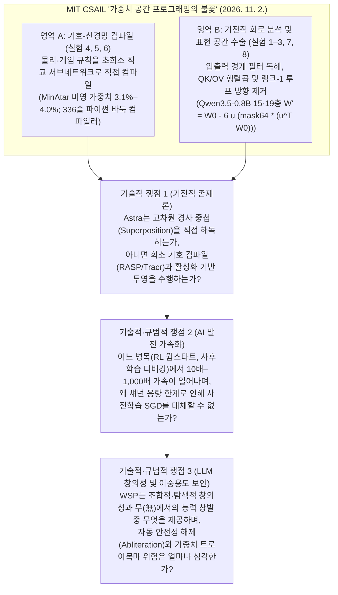
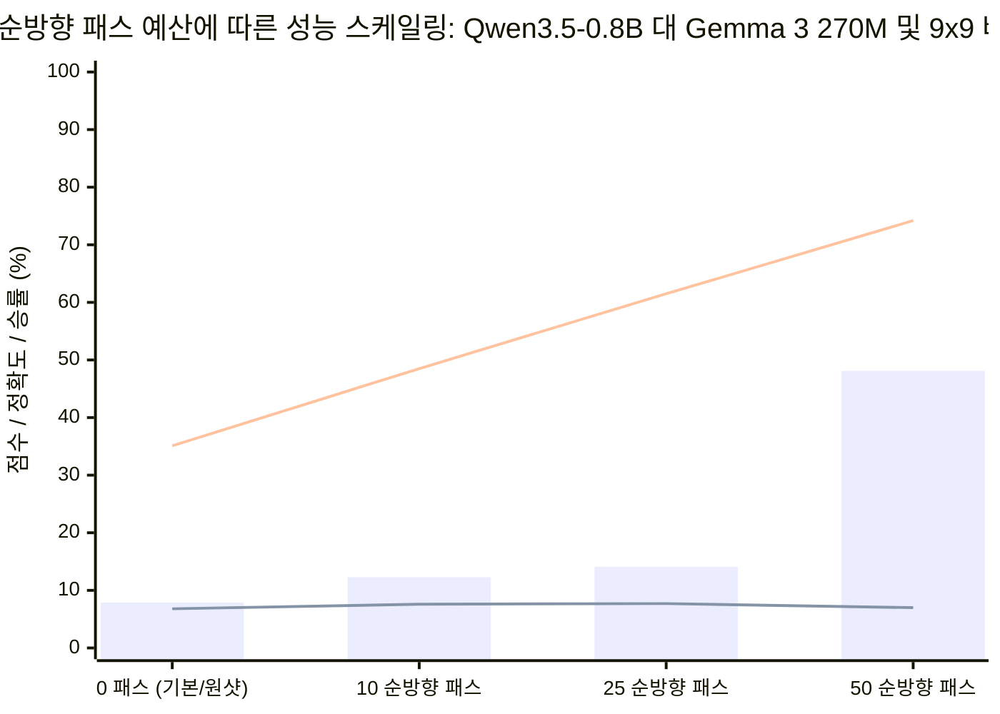

## 핵심 요약 및 패러다임 충돌의 본질

**2026년 11월 2일**, MIT 컴퓨터과학·인공지능연구소(`CSAIL`)의 **리키야 타케히(Rikiya Takehi)**, **제이든 테오(Jayden Teoh)**, **알렉스 장(Alex Zhang)**, **오마르 카탑(Omar Khattab)** 연구진은 총 1,125턴에 달하는 원본 프롬프트·샌드박스 실행 기록·평가 스크립트 아카이브([`RikiyaT/lm_understand-logs`](https://github.com/RikiyaT/lm_understand-logs))와 함께 논쟁적인 연구 보고서 [***가중치 공간 프로그래밍의 불꽃: LLM은 신경망 가중치를 네이티브하게 읽고 쓸 수 있다(Sparks of Weight-Space Programming: LLMs can natively read & write neural network weights)***](https://rikiyat.github.io/blog/weight-space-programming/)를 공개했다. 지난 10여 년간 현대 딥러닝("Software 2.0")은 확고한 분업 체제 위에 서 있었다. 인간 엔지니어와 대규모 언어모델(`LLM`)은 프롬프트([DSPy](https://arxiv.org/abs/2310.03714), [GEPA](https://arxiv.org/abs/2507.19457)), 평가 하니스([Meta-Harness](https://arxiv.org/abs/2603.28052)), 학습 루프 코드([autoresearch](https://github.com/karpathy/autoresearch)) 같은 **이산적 기호(symbolic) 산출물**을 최적화하고, 연속적인 신경망 가중치 텐서는 확률적 경사하강법(`SGD`), [Adam](https://arxiv.org/abs/1412.6980), [Muon](https://kellerjordan.github.io/posts/muon/) 같은 미분 기반 옵티마이저의 전유물로 남겨두는 것이었다.

연구진은 이 경계를 정면으로 허물었다. OpenAI의 프런티어 모델 **`gpt-6-astra`**(`codex exec`를 통해 모든 내장 도구를 끄고 추론 강도 `high`, `xhigh`, `max`로 실행)를 활용해, 연구진은 역전파(backpropagation)나 경사 옵티마이저, 학습 루프 없이 범용 LLM이 자연어 명세에 맞춰 직접 신경망 가중치를 읽고, 결함을 진단·수정하며, 밑바닥부터 새 가중치를 작성하는 **가중치 공간 프로그래밍(Weight-Space Programming, `WSP`)** 패러다임을 제시했다.

1. **제로샷 가중치 독해 (실험 1–3 및 7):** `17,253`개의 원시 MLP 정책 가중치를 아무런 도구 없이 텍스트로 입력받은 `gpt-6-astra`는 후보 게임 목록조차 주어지지 않은 열린 질문에서 4개 강화학습 게임을 모두 정확히 맞혔다(`Breakout` 99%, `Pong` 96%, `Pac-Man` 96%, `Freeway`/`Frogger` 97% 확신도). 또한 3개 확산모델(`DDPM`)의 가중치 `23,824`개를 읽고 생성 도형(`원`, `사각형`, `삼각형`)을 모두 식별했다. 나아가 입력 문자 임베딩과 출력층을 제거한 문자 단위 언어모델의 중간 트랜스포머 블록 4개(`708만` 개 float32 가중치)만 주어진 상태에서, CPU 파이썬 샌드박스를 활용해 6번의 시도 모두 학습 코퍼스(`Python`, `Romaji`, `English`)와 복사 헤드(induction head)를 정확히 찾아냈다. 그러나 **`Gemma 3 270M`**을 미세조정(fine-tuning)한 정직한 모델과 아첨꾼(sycophantic) 모델을 가중치만으로 구분하는 실험 7에서는 **4차례 시도 모두 완전히 실패(`P = 0.50` 동전 던지기 수준)**했으며, 모델에 직접 작성한 텍스트를 통과시켜 어텐션 가중치만 확인하는 **어텐션 도구(Attention Tool)**를 허용한 뒤에야 3쌍 모두에서 아첨꾼 모델을 찾아냈다(어텐션 헤드 `10.2`가 사용자 유도 답안에 `85.7%` 대 `0.75%`의 가중치를 할당함을 규명).
2. **밑바닥부터 원샷 및 반복적 가중치 작성 (실험 5 및 6):** 3개 [MinAtar](https://arxiv.org/abs/1903.03176) 게임(`Breakout`, `Seaquest`, `Asterix`)의 파이썬 환경 소스 코드와 모든 가중치가 `0`으로 초기화된 `20,486`개 파라미터 MLP(`600 → 32 → 32 → 6`)를 받은 Astra는 단 한 번의 응답(도구·롤아웃 없음)으로 가중치 슬라이스 할당문을 작성해 3개 게임 모두에서 `1억(100M)` 스텝 학습된 `PPO`를 압도했고, `Breakout`에서는 `5억(500M)` 스텝 `PPO`보다 **`20.4배` 높은 점수(`517.4` 대 `25.3`)**를 기록했다. 이를 **`1,480,274`개 파라미터** 규모의 9×9 바둑 신경망(`243 → 512 × 6 → 82`, ReLU)으로 확장한 실험 6에서는 활로(liberty) 계산과 연(chain) 전파 알고리즘을 가중치 행렬로 컴파일하는 `336`줄짜리 파이썬 코드를 작성하여, 순방향 패스(`forward pass`) 예산 `0`회에서도 소형 `PPO` 대비 `54.1%–54.9%` 승률을 거두었고, `50`회 순방향 패스가 허용되자 `2,050만` 대국을 자가대국으로 학습한 동급 크기(`512 × 6`) `PPO`를 상대로 **`70.0%–78.5%` 승률**을 거두었다.
3. **물리 제어 및 언어모델 표적 가중치 수술 (실험 4 및 8):** `10억` 스텝 동안 `PPO`로 학습하고도 경사로에서 멈춰버리는 [Kinetix](https://arxiv.org/abs/2410.23208) 자동차 제어 신경망(`171,664`개 가중치, 성공률 `0%`)을 받은 Astra는 가중치의 `3.54%`(`6,073`개)를 원샷으로 수정해 **`1,024`개 테스트 에피소드 전승(`100%` 성공률)**을 달성했다. 마지막으로 **`Qwen3.5-0.8B`**(사고 모드 활성화)의 수학 추론 성능을 경사하강법 없이 개선하라는 실험 8에서, Astra는 CPU 파이썬 샌드박스와 `50`회의 배치 순방향 패스를 사용해 전체 `8억` 개 가중치 중 단 **`131,072`개(`0.016%`, 15층과 19층 MLP `down_proj`의 출력 열 각 `64`개)**만 수정함으로써 **`MATH-500` 점수를 `7.9%`에서 `48.1%`(`6.1배`)로**, **`GSM8K`를 `13.8%`에서 `67.1%`(`4.9배`)로**, 그리고 수학 외 지시 이행 벤치마크인 **`IFEval`을 `21.0%`에서 `62.3%`(`3.0배`)로** 끌어올렸다. 하지만 루프(반복) 현상이 거의 없는 **`Gemma 3 270M IT`**(토큰 한도 절단 비율 `8.5%` 대 Qwen `93.0%`)에 동일한 프로토콜을 적용했을 때는 **성능을 전혀 개선하지 못했다(`MATH-500` `6.8% → 7.0%`)**.

[`RikiyaT/lm_understand-logs`](https://github.com/RikiyaT/lm_understand-logs)에 공개된 원본 프롬프트, 폐기된 실행 기록, 파이썬 스크립트를 정밀 해부할 때 이 실험들 내부에서는 실제로 어떤 일이 벌어지고 있는가? 가중치 공간 프로그래밍은 과연 **AI 발전 속도를 비약적으로 가속**하고, LLM에 **새로운 차원의 창의성**을 부여할 것인가, 아니면 **치명적인 이중용도(dual-use) 보안 취약점**을 열어젖힐 것인가? 본 보고서는 **브라운과 킬리(Browne & Keeley)의 9단계 '사금 채취(Panning for Gold)' 포렌식 감사 프레임워크**를 통해 실증적 돌파구와 수사적 과장을 엄밀히 분리한다.

---

## 제1단계: 쟁점 분류 및 경계 설정 (Issue Classification & Boundary Framing)

*"가중치를 네이티브하게 읽고 쓴다"*는 단일 표현 아래 서로 다른 기전이 혼동되는 것을 막기 위해, 검증 가능한 세 가지 핵심 질문을 설정한다.

1. **핵심 기술적 질문 1 (기전적 존재론 — 중첩 해독 대 기호 컴파일 및 활성화 제거):** `gpt-6-astra`가 가중치를 읽거나 쓸 때, 경사하강법이 형성한 고밀도·다의적(polysemantic) 분산 표현을 직접 이해하는가? 아니면 구조적으로 제약된 두 가지 영역, 즉 **(a) 기호-신경망 컴파일(Symbolic-to-Neural Compilation)**(명시적인 환경 소스 코드를 초희소·단일주제 임계값 회로로 번역하는 작업으로 [RASP/Tracr](https://arxiv.org/abs/2301.05062)와 동형)과 **(b) 순방향 활성화 기반 표현 공학(Forward-Pass Representation Engineering)**(교사 강제 및 생성 활성화 프로브를 통해 랭크-1 방향 벡터를 추출·제거하는 작업으로 [Arditi et al., 2024](https://arxiv.org/abs/2406.11717)와 동형)에서 작동하는가?
2. **핵심 기술적·규범적 질문 2 (AI 발전 가속화):** AI 연구개발 파이프라인의 어느 단계(강화학습 정책 초기화, 사후학습 행동 결함 교정, 이종 아키텍처 간 회로 이식, 기전적 감사)에서 가중치 공간 프로그래밍이 `10배–1,000배`의 가속을 달성하며, 어떤 정보이론적 장벽이 사전학습(pre-training) 경사하강법 대체를 가로막는가?
3. **핵심 기술적·규범적 질문 3 (LLM 창의성 및 이중용도 보안):** 엄밀한 조작적 정의 아래 가중치 공간 프로그래밍은 LLM에 진정한 **창의성**(조합적 회로 합성 및 저엔트로피 추론 루프 탈출 대 기저 능력의 무(無)에서 유(有) 창조)을 부여하는가? 또한 프런티어 에이전트가 모델 체크포인트를 자율 편집할 때 발생하는 보안 위협은 무엇인가?
4. **반증 가능성 기준 (Falsifiability Criteria):**
   - **"순수 정적 가중치 독해(Pure Native Weight Comprehension)" 가설**은 (a) 미세조정된 언어모델(`Gemma 3 270M`, 실험 7)에서 입출력 공간 앵커를 고정했을 때 순수 가중치 기반 분류가 수십 번의 대수적 분석에도 불구하고 `50%` 확률 추측으로 붕괴하고, (b) 실험 8에서 순방향 활성화 프로브를 제거(`0`회 또는 `5`회 패스)하거나 프롬프트의 명시적 반복 루프 힌트를 제거(`Prompt v4`, `10`회 패스)했을 때 Astra가 **단 하나의 가중치 수정도 제출하지 못한다면(`0.0%` 향상)** 반증된다.
   - **"가중치 편집을 통한 기저 능력 창조" 가설**은 (a) `Qwen3.5-0.8B` 연습 문제를 *원래 사고를 끝마친 궤적*과 *토큰 한도에서 절단된 궤적*으로 층화 분석했을 때 정상 종료 궤적의 정확도 향상폭이 `0.00%`이고, (b) 루프가 없는 모델(`Gemma 3 270M IT`)에 `50`회 순방향 패스 편집 프로토콜을 적용했을 때 `MATH-500` 점수가 표본 오차 범위(`+0.2%p`)를 벗어나지 못한다면 반증된다. *(아래 [`RikiyaT/lm_understand-logs`](https://github.com/RikiyaT/lm_understand-logs) 감사에서 확인되듯 **이 모든 반증 조건은 저자들의 원본 로그 데이터에 의해 그대로 입증된다**).*

---

## 제2단계: 1차 문헌 발굴 및 2열 주장 괴리 매트릭스 (Primary Source Excavation)

### 1. 8대 실험 전체 1차 증거 원장

[`RikiyaT/lm_understand-logs`](https://github.com/RikiyaT/lm_understand-logs) 저장소의 원본 JSON 기록, 실험별 README, 턴 로그를 전수 조사하여 재구성한 8개 실험의 정확한 조건, 허용 도구, 연산 비용 및 파일 경로는 다음과 같다.

| 실험 | 과제 및 대상 모델 | 파라미터 규모 | 추론 강도 및 샌드박스 허용 도구 | 순방향 패스 예산 | 소요 턴 / 실제 경과 시간 | 주요 보고 결과 | 원본 로그 검증 파일 |
| :--- | :--- | :--- | :--- | :--- | :--- | :--- | :--- |
| **실험 1** | MLP 정책 가중치로 학습된 RL 게임 맞추기 (`500 → 32 → 32 → 5`, `tanh`) | `17,253`개 (프롬프트 내 소수점 3자리 반올림) | `high`; **도구 없음** (`audit.tool_free: true`, 입력 약 `73,700` 토큰) | `0`회 | `1`턴 (실행당 `71–107초`) | 열린 질문에서 **`4 / 4` 정답** (`Breakout` 99%, `Pong` 96%, `Pac-Man` 96%, `Freeway`/`Frogger` 97%). | [`exp1_which_game/README.md`](https://github.com/RikiyaT/lm_understand-logs/blob/main/exp1_which_game/README.md) |
| **실험 2** | `12×12` 확산모델(`DDPM`, `160 → 64 → 64 → 144`, `ReLU`) 생성 도형 맞추기 | `23,824`개 (프롬프트 내 소수점 3자리 반올림) | `high`; **도구 없음** (입력 약 `99,800` 토큰) | `0`회 | `1`턴 (실행당 `71–124초`) | 도형 종류 **`3 / 3` 정답** (`원` 84%, `사각형` 77%, `삼각형` 88%), 단 실제 채워진 도형 대신 **속이 빈 윤곽선으로 오판**. | [`exp2_diffusion/README.md`](https://github.com/RikiyaT/lm_understand-logs/blob/main/exp2_diffusion/README.md) |
| **실험 3** | 중간 트랜스포머 4개 블록만으로 학습 코퍼스(`Python`, `Romaji`, `English`) 및 복사 헤드 찾기 | `7,084,032`개 (전체 `716만` 중 입출력층 제거) | `xhigh`; **Python CPU 샌드박스** (`numpy`, `scipy`, `torch`; 최대 `100`회) | `0`회 (입력에 대한 레이어 실행 금지) | 코드 실행 `6–11`회 (`7–12`턴) | 3지선다 **`6 / 6` 정답** (확신도 `0.48–0.62`); `induct > 0.20` 기준 복사 헤드 `5`개 전원 지목. | [`exp3_language/README.md`](https://github.com/RikiyaT/lm_understand-logs/blob/main/exp3_language/README.md) |
| **실험 4** | 경사로에서 멈춘 [Kinetix](https://arxiv.org/abs/2410.23208) `l/h2_car_ramp` PPO 액터 수리 (`679 → 128 × 6 → 16`) | 액터 가중치 `171,664`개 (`6,073`개 수정 = `3.54%`) | `high`; **도구 없음**, 프롬프트에 1개 에피소드 궤적 제공, `51`개 DSL 수정문 | `0`회 (원샷 텍스트 편집) | `1`턴 (추론 토큰 `9,146`개) | `10억` PPO 스텝 후 `0 / 256` 성공이던 네트워크가 수정 후 **`1,024 / 1,024` 에피소드(`100%`) 성공**. | [`exp4_fix_car/README.md`](https://github.com/RikiyaT/lm_understand-logs/blob/main/exp4_fix_car/README.md) |
| **실험 5** | [MinAtar](https://arxiv.org/abs/1903.03176) 3개 게임(`Breakout`, `Seaquest`, `Asterix`) 정책을 밑바닥부터 작성 (`600 → 32 → 32 → 6`) | `20,486`개 (전부 `0`에서 시작; **`637–815`개만 비영(nonzero) 작성 = `3.1%–4.0%`**) | `xhigh`; **도구 없음**, **프롬프트에 게임 `.py` 원본 소스 코드 전체 제공** | `0`회 (원샷 `edits` DSL) | `1`턴 (`501–583초`, 출력 `20.5k–29.0k` 토큰) | 3개 게임 모두 `1억` 스텝 PPO 능가; `Breakout`에서 `5억` 스텝 PPO 대비 **`517.4` 대 `25.3`(`20.4배`)** 기록. | [`exp5_write_from_scratch/README.md`](https://github.com/RikiyaT/lm_understand-logs/blob/main/exp5_write_from_scratch/README.md) |
| **실험 6** | 9×9 바둑 정책 신경망(`243 → 512 × 6 → 82`, `ReLU`) 밑바닥부터 작성 | `1,480,274`개 (전부 `0`에서 시작; `14`개 텐서) | `xhigh`; **Python CPU 샌드박스** (실행당 `900초`, `96 GB` RAM) | `0, 10, 25, 50`회 (패스당 `128`대국 또는 `256`국면 평가) | `2`턴(`b=0`, `22분`) ~ `90`턴(`b=50`, `3시간 52분`) | 제로샷(`336`줄 스크립트)으로 소형 PPO 상대 **`54.1%–54.9%`** 승; `50`회 패스 시 동급(`2,050만` 판 학습) PPO 상대 **`70.0%–78.5%`** 승. | [`exp6_go_from_scratch/README.md`](https://github.com/RikiyaT/lm_understand-logs/blob/main/exp6_go_from_scratch/README.md) |
| **실험 7** | 미세조정된 [`Gemma 3 270M`](https://huggingface.co/google/gemma-3-270m-it) 3쌍 중 아첨꾼(sycophant) 모델 식별 | `2.7억` 개 (`18`개 층, 폭 `640`, 임베딩 고정) | `xhigh`; **Python CPU 샌드박스** (가중치만 `60`회; 어텐션 도구 `20`회) | `0`회 (시도 1–4) 대 어텐션 호출 `4–5`회 (호출당 `≤16`문장) | 쌍당 `4–30`회(가중치) 대 `14–20`회(어텐션) | **가중치만 사용 시: `0 / 3` (`P = 0.50`, 4라운드 전패)**. **어텐션 도구 허용 시: `3 / 3` 정답** (확신도 `90%, 97%, 55%`; 헤드 `10.2`). | [`exp7_sycophancy/README.md`](https://github.com/RikiyaT/lm_understand-logs/blob/main/exp7_sycophancy/README.md) |
| **실험 8a** | [`Qwen3.5-0.8B`](https://huggingface.co/Qwen/Qwen3.5-0.8B)(사고 모드) 가중치 편집으로 수학 성능 개선 | 약 `8억` 개 (`24`개 층, 폭 `1,024`; **`131,072`개 수정 = `0.016%`**) | `max`; **Python CPU 샌드박스** (`300`회 한도) + 연습 문제 `15,458`개 | `10, 25, 50`회 (패스당 `32k` 토큰 생성 `≤512`개 또는 교사강제 `≤1,024`개) | `74–158`턴 (`8.5–20.3시간` 소요) | `50`회 패스(`p50c`): **`MATH-500` `7.9% → 48.1%`**, **`GSM8K` `13.8% → 67.1%`**, **`IFEval` `21.0% → 62.3%`**, 토큰 절단율 `93.0% → 33.1%`. | [`exp8_math/README.md`](https://github.com/RikiyaT/lm_understand-logs/blob/main/exp8_math/README.md) |
| **실험 8b** | 루프가 거의 없는 [`Gemma 3 270M IT`](https://huggingface.co/google/gemma-3-270m-it)(절단율 `8.5%`) 수학 성능 개선 시도 | `2.7억` 개 (`18`개 층, 폭 `640`) | `max`; **Python CPU 샌드박스** + 연습 문제 (`DEV`/`HOLDOUT` 분할) | `5, 10, 25, 50`회 (패스당 생성 `≤2,048`개 또는 교사강제 `≤1,024`개) | `20–117`턴 (`0.9–3.9시간` 소요) | **개선 실패 (Null Result):** 관대한 채점 기준 `MATH-500` **`6.8% → 7.0% / 7.6% / 7.7% / 7.0%`** (엄격한 `boxed{...}` 기준 50패스 **`2.8% → 2.6%`**). | [`exp8_math/gemma_followup/README.md`](https://github.com/RikiyaT/lm_understand-logs/blob/main/exp8_math/gemma_followup/README.md) |

---

### 2. 2열 주장 괴리 매트릭스: 공개 블로그 서사 대 원본 저장소·프롬프트의 진실

포렌식 감사 지침 제2단계에 따라, [*Sparks of Weight-Space Programming*](https://rikiyat.github.io/blog/weight-space-programming/) 본문의 전면 서사와 원본 프롬프트(`prompt.txt`), 비공개 결과 발췌본([`RESULTS_excerpt.md`](https://github.com/RikiyaT/lm_understand-logs/blob/main/exp8_math/eval/RESULTS_excerpt.md)), 통계 검증 파일([`submission_evidence.json`](https://github.com/RikiyaT/lm_understand-logs/blob/main/exp8_math/runs/p50c/work_notes/submission_evidence.json))의 실제 기록을 대조한다.

| 검증 차원 | 공개 블로그 전면 서사 (`rikiyat.github.io`) | 원본 저장소·프롬프트·로그에 묻힌 실제 사실 (`RikiyaT/lm_understand-logs`) |
| :--- | :--- | :--- |
| **1. 실험 8에서 Astra가 Qwen3.5-0.8B의 추론 루프를 "발견"한 경위** | *"경사 없이 Qwen3.5-0.8B의 수학 실력을 높여달라는 요청을 받은 Astra는 가중치 내부에서 Qwen 모델 카드가 경고하는 추론 루프 원인을 스스로 찾아내고, 가중치의 0.016%를 네이티브하게 편집해 이를 고쳤다."* | **프롬프트(`Prompt v3`)가 반복 루프 결함을 명시적으로 코칭했으며, 이 힌트를 빼자 Astra는 단 하나의 편집도 제출하지 못했다.** [`exp8_math/runs/p50c/turns/t001/prompt.txt`](https://github.com/RikiyaT/lm_understand-logs/blob/main/exp8_math/runs/p50c/turns/t001/prompt.txt)를 보면 *"예컨대 모델이 스스로 같은 말을 반복하느라 끝내지 못해 실패하곤 한다면, 그 반복을 유발하는 요인을 찾아 고치는 것이 범위에 포함된다... 토큰 한도에서 잘리는 경우(종종 사고 과정에서 자신을 반복하면서)를 확인하라"*고 정답 방향을 직접 알려주었다. 더구나 [`RESULTS_excerpt.md`](https://github.com/RikiyaT/lm_understand-logs/blob/main/exp8_math/eval/RESULTS_excerpt.md)를 보면 **이 실패 예시를 제거한 `Prompt v4`(`10`회 패스)에서 Astra는 아무런 수정도 제출하지 않았고(`MATH-500` `7.9%`)**, `0`회 패스(`Prompt v2`)와 `5`회 패스(`Prompt v3`)에서도 **수정을 전혀 하지 못했다(`7.9%`)**. |
| **2. 가중치 편집이 실제로 Qwen3.5-0.8B의 수학 계산·추론 능력을 높였는가? (실험 8)** | 대표 차트 제목: *"IMPROVE: Qwen3.5-0.8B의 수학 실력 향상 — MATH-500 7.9%에서 48.1%로 상승."* | **기본 모델이 루프에 빠지지 않고 사고를 끝마친 문제들에서는 정확도 향상폭이 정확히 `0.00%`였다.** [`submission_evidence.json`](https://github.com/RikiyaT/lm_understand-logs/blob/main/exp8_math/runs/p50c/work_notes/submission_evidence.json)의 층화 분석(`transition_strata_descriptive`)을 보면, 총 `1,152`개 연습 문제 중 원본 모델이 `32,768` 토큰 한도 전에 사고를 마친 `114`개 문제에서 **수정 전 정확도는 `93.86%`(`GSM8K` `89.23%`, `MATH` `100.0%`)였고 수정 후 정확도 역시 정확히 `93.86%`(`gain: 0.0`, 구제 `3`건, 손실 `3`건)**였다. 모든 순 구제(`574`건)는 토큰 한도에서 잘렸던 `1,038`개 문제(`1.45% → 56.74%`)에서만 발생했다. 반면 편집 부작용으로 **공백 문자 폭주(`whitespace_tail_cut`)가 `0`건에서 `51`건으로 급증**했고, **답 없이 종료하는 오류(`failure_no_answer_finished`)가 `1`건에서 `58`건(`58배`)으로 폭증**했다. |
| **3. 실험 4에서 경사로에 멈춘 Kinetix 자동차 정책을 "수리"한 실제 방식** | *"환경 맥락과 PPO 네트워크 궤적으로부터 Astra는 네트워크가 국소 최솟값에 수렴했음을 파악하고, 최소한의 가중치 편집(3.5%)을 통해 차를 먼저 후진시킨 뒤 전속력으로 전진하도록 정책을 변경했다."* | **학습된 내부 표현을 교정한 것이 아니라, 층별로 뉴런 `6`개씩의 기존 가중치 `6,042`개를 `0`으로 밀어버린 뒤 `31`개 숫자로 하드코딩된 스위치 우회 회로를 덧씌웠다.** [`exp4_fix_car/README.md`](https://github.com/RikiyaT/lm_understand-logs/blob/main/exp4_fix_car/README.md)가 인정하듯 *"변경된 6,073개 항목의 대부분은 Astra가 접수한 소수 유닛의 행과 열을 배선 전에 0으로 초기화한 것(`actor0.W[:, 122:128] = 0`)이다."* Astra는 포화 `tanh` 가중치(`80`, `-100`, `200`)를 이용해 `IF 녹색바퀴_x > 0.95 AND 차체_x < 3.8 THEN 후진 로짓 += 200 ELSE 좌측전진 로짓 += 200`이라는 고전적 뱅뱅(bang-bang) 제어기를 심어 기존 네트워크 출력을 강제로 덮어썼다. |
| **4. 실험 3의 복사 헤드(Induction Head) 정답 기준치 하향 조정** | *"Astra는 3개 네트워크 모두에서 학습 언어를 맞혔을 뿐 아니라, 모든 복사 헤드(induction head)를 빠짐없이 찾아냈고 다른 헤드는 단 하나도 잘못 지목하지 않았다."* | **연구진의 원래 채점 스크립트(`eval/scores.json`) 기준치(`0.30`)에서는 Astra가 지목한 `5`개 헤드 중 `3`개가 오답(위양성)이었다.** [`exp3_language/README.md`](https://github.com/RikiyaT/lm_understand-logs/blob/main/exp3_language/README.md)(231행)는 다음과 같이 실토한다. *"참고: `eval/scores.json`의 `true_copy_heads` 필드는 더 엄격한 기준치(0.3)를 적용한 채점 스크립트로 작성되어 Python 3.5와 English 3.1만 참으로 분류하고 Romaji 헤드는 없음으로 분류했다. 블로그 포스트와 위 표는 기준치 0.2를 사용했으며, 이 기준 아래에서는 Astra가 지목한 모든 헤드가 복사 헤드가 된다."* (Python `2.1`은 `0.245`, Python `3.1`은 `0.269`, Romaji `3.3`은 `0.220`). |
| **5. 실험 5 MinAtar "밑바닥부터 가중치 작성"의 소스 코드 의존성 및 파서 재실행** | *"데이터, 손실 함수, 경사, 도구 없이 오직 네트워크 가중치와 환경 설명만으로 Astra는 텍스트로 직접 새 가중치를 생성해 1억 스텝 PPO를 압도했다."* | **프롬프트에 각 게임 엔진의 실제 파이썬 소스 코드(`minatar/environments/<game>.py`, 140줄) 전체가 그대로 제공**되었으며, Astra는 가중치의 **`96.0%–96.9%`를 `0.000`으로 비워둔 채** 소스 코드의 대각선 반사 공식을 희소 슬라이스로 옮겨 적었다. 또한 초기 `Seaquest`와 `Asterix` 응답에서 대괄호 공백(`[ [ ... ] ]`) 문법 오류로 `6`개 및 `4`개 구문이 누락되자 연구진이 파서를 사후 수정해 재채점했다. |
| **6. 초기 프롬프트 시행착오 실행 기록 누락 (선택 편향)** | 8개 실험을 프런티어 LLM의 네이티브 가중치 역량에 대한 일관된 실증으로 제시. | 최상위 [`README.md`](https://github.com/RikiyaT/lm_understand-logs/blob/main/README.md)는 ***"포스트에 보고된 실행만 이곳에 포함된다. 초기 프롬프트 버전들의 시험 실행(trial runs)은 제외되었다"***고 명시한다. 실험 6의 `1`회 패스 및 `Prompt v2`, 실험 8의 `Prompt v1, v2, v4, v5`(Qwen) 및 엄격 채점 `g05–g50`(Gemma) 실행은 본문에서 제외되었다. |

---

## 제3단계: 의미론적 정밀성, 대입 검증(Substitution Test) 및 성숙도 위계

### 1. 브라운과 킬리의 의미 대입 검증 (Substitution Test)

논문의 핵심 테제인 *"LLM은 신경망 가중치를 네이티브하게 읽고 쓸 수 있다"*와 독자의 핵심 질문인 *"이 기술이 AI 발전을 가속할 것인가?"*, *"LLM에 창의성을 부여할 것인가?"*는 세 가지 다의적 핵심 용어에 달려 있다. 엄격한 정의와 느슨한 조작적 정의를 대입해 보면 패러다임의 실제 작동 경계가 명확히 드러난다.

1. **다의적 용어 1: "가중치를 네이티브하게 읽고 쓰기 (Natively Reading and Writing Weights)"**
   - *정의 A (엄격한 정의 / 고밀도 중첩 가중치의 직접 토큰 독해 및 생성):* 학습된 다의적(polysemantic) 신경망의 부동소수점 가중치 텐서를 코드 실행이나 순방향 패스 없이 LLM 컨텍스트 창에 직접 넣고, 내부 분산 개념을 해독하거나 편집하는 것.
   - *정의 B (조작적 정의 / 에이전트 샌드박스 컴파일 및 활성화 기반 수술):* LLM 에이전트가 파이썬 샌드박스(`numpy`, `scipy`, `torch`)에서 [Elhage et al. (2021)](https://transformer-circuits.pub/2021/framework/index.html)의 `QK`/`OV` 행렬곱 스크립트를 돌리거나, 기호적 휴리스틱을 `0`으로 초기화된 희소 텐서(`96%` 이상 `0`)에 절차적으로 컴파일하거나, `50`회의 배치 순방향/교사강제 활성화 패스를 실행해 경험적 활성화 차이 벡터(`u`)를 추출한 뒤 랭크-1 투영(`W' = W₀ - α u (uᵀ W₀)`)을 수행하는 것.
   - **대입 검증 판정:** *정의 A* 기준에서 이 능력은 입출력 좌표가 `10×10` 공간 픽셀이나 명시적 속도 변수에 1대1로 대응하는 **초소형 경계층(`1.7만–2.4만` 가중치, 실험 1, 2, 4, 5)에서만 성립**하며, **`2.7억` 파라미터 언어모델의 은닉층(실험 7 시도 1–4, 정답률 `0/3`, `P = 0.50`)이나 `0`패스 `Qwen3.5-0.8B`(실험 8 `Prompt v2`, 수정 `0`건)에서는 완벽히 붕괴**한다. 의미 있는 규모의 모든 성과(실험 3, 6, 7-어텐션, 8a)는 오직 *정의 B* 아래에서만 성립한다.

2. **다의적 용어 2: "AI 발전 속도 가속화 (Speeding Up AI Progress)"**
   - *정의 A (사전학습 대체):* 대규모 원시 데이터셋에서 파운데이션 모델을 밑바닥부터 학습할 때 확률적 경사하강법(`SGD`/Adam/Muon)을 대체하는 것.
   - *정의 B (사전 지식 주입, 사후학습 표적 수술 및 해석가능성 자동화):* 기호적 물리·규칙 지식을 가중치로 직접 컴파일하여 강화학습(`RL`)의 초기 탐색 사막을 건너뛰고, 사후학습 단계의 저랭크(low-rank) 행동 병리(추론 루프, 아첨, 과도한 거절)를 재학습 없이 `10–50`회 순방향 패스만으로 도려내며, 기전적 회로 분석을 자동화하는 것.
   - **대입 검증 판정:** *정의 A*에서는 **완전히 실패**하지만(`Gemma 3 270M` `MATH-500` `6.8% → 7.0%`), *정의 B*에서는 무작위 강화학습 및 수작업 해석가능성 대비 **`10배–1,000배`의 실질적 속도 혁신**을 제공한다.

3. **다의적 용어 3: "LLM에 창의성 부여 (Providing Creativity to LLMs)"**
   - *정의 A (조합적·교차모달 알고리즘 창의성 및 엔트로피 함정 탈출):* 기호적 도메인 규칙(9×9 바둑 활로 전파나 경사로 탄도학)을 행렬 대수로 번역해 새로운 기능성 신경 회로를 합성하거나, 내부 MLP/어텐션 라우팅 가중치를 직접 편집해 반복적 모드 붕괴(mode collapse) 끌개에서 탈출하는 능력.
   - *정의 B (무(無)에서의 인식론적 창발 및 초인적 외계 전략 발견):* 대상 모델과 편집자 LLM의 사전 지식 어디에도 없는 새로운 수학적 추론 능력을 만들어내거나, 순수 수작업 가중치 설계만으로 알파고의 '제37수'처럼 직관을 뛰어넘는 초인적 전략을 발견하는 능력.
   - **대입 검증 판정:** 가중치 공간 프로그래밍은 탁월한 *정의 A* 창의성을 보여주지만, 수작업 컴파일 회로는 편집자 LLM의 명시적 기호 휴리스틱에 갇혀 있으므로 *정의 B* 창의성은 **제공하지 못한다**.

---

### 2. 가중치 공간 프로그래밍 4단계 성숙도 스코어카드

신경망 가중치 조작의 기술적 준비도를 4단계 성숙도 위계로 분류하면 다음과 같다.

| 성숙도 단계 | 정의 및 조작적 기준 | 현재 해당 단계에 도달한 실험 영역 | 핵심 실증적 병목 |
| :--- | :--- | :--- | :--- |
| **레벨 1: 초소형 입출력 경계 독해 및 희소 규칙 컴파일** | 입출력 차원이 인간이 해석 가능한 공간 격자(`10×10`)나 물리 상태 변수(`x, v_x`)에 1대1 대응하는 `<20만` 가중치의 컨텍스트 내 직접 독해·작성. | **실험 1**(`1.7만` 게임 독해), **실험 2**(`2.4만` DDPM 윤곽선 독해), **실험 4**(`17.2만` Kinetix 6유닛 우회로), **실험 5**(`2만` MinAtar 희소 규칙 컴파일). | 컨텍스트 토큰 팽창(`2만` 가중치에 `7.4만–10만` 토큰 소요); 다층 비선형 합성 추적 불가(실험 2에서 채워진 도형을 속 빈 윤곽선으로 오판). |
| **레벨 2: 샌드박스 대수적 회로 탐색 및 절차적 컴파일** | `100만–1,000만` 파라미터 네트워크를 대상으로 파이썬 선형대수 스크립트(`SVD`, `QK`/`OV` 곱) 또는 절차적 가중치 생성기(`336`줄 바둑 컴파일러) 작성. | **실험 3**(`716만` 문자 언어모델 중간 블록; 코퍼스 확신도 `0.48–0.62`), **실험 6**(`148만` 9×9 바둑 절차적 컴파일 + `50`패스 진화적 튜닝). | 깔끔한 아키텍처 모듈성(`ReLU` 플러드필 채널 또는 전형적 4층 복사 회로) 필수; 특징들이 고밀도 중첩 상태일 때 실패. |
| **레벨 3: 활성화 프로브 기반 저랭크 사후학습 가중치 수술** | 파이썬 커널과 `10–50`회 배치 순방향/교사강제 활성화 패스를 결합해 `2억–10억+` 모델의 저랭크 행동 병리를 국소화하고 제거. | **실험 7(어텐션 도구 포함)**(`Gemma 3 270M` 헤드 `10.2` 아첨 회로 규명), **실험 8a(`p50c`)**(`Qwen3.5-0.8B` 15·19층 `131,072`개 가중치에서 랭크-1 루프 방향 제거). | **결여된 분산 능력을 새로 추가할 수 없음**(실험 8b `Gemma 3 270M` `6.8% → 7.0%`); 과도한 제거 시 부수적 퇴행 발생(무응답 종료 `58배` 폭증). |
| **레벨 4: 파운데이션 모델 사전학습 및 고차원 분산 능력 합성** | 경사 최적화 없이 `10억–1,000억+` 파라미터 전반에 걸쳐 고밀도 다의적 추론, 세계 지식, 다단계 산술 회로를 합성하거나 업그레이드. | **없음 (`0`개 실험 달성).** `Gemma 3 270M` 순수 가중치 독해(실험 7 시도 1–4)와 `Gemma 3 270M` 수학 능력 부여(실험 8b) 모두 완전 실패. | 자연어 추론의 정보이론적 대역폭 한계 대 수조 토큰 경사 압축의 정보량 격차; 비선형 다의적 중첩(Superposition). |

---

## 제4단계: 인과관계 분리 및 경쟁 가설 검증 (Causal Disentanglement & Rival Causes)

*"Astra가 작성한 네트워크가 1억 스텝 학습된 PPO를 이겼다"*거나 *"Astra의 가중치 편집이 MATH-500 점수를 7.9%에서 48.1%로 끌어올렸다"*는 인과적 주장에 대해 **4방향 인과 감사(4-Way Causal Audit)**를 수행한다.

| 인과 가설 | 기전적 경로 | [`RikiyaT/lm_understand-logs`](https://github.com/RikiyaT/lm_understand-logs) 내 실증 검증 | 포렌식 판정 |
| :--- | :--- | :--- | :--- |
| **1. 직접 인과 (`X → Y`): 네이티브 가중치 공간 추론이 임의의 신경망을 직접 최적화한다** | `gpt-6-astra`가 가중치 기하학을 직접 읽고 최적의 연속 파라미터 다양체를 연역하여 더 우수한 가중치를 작성한다. | **실험 7 시도 1–4**(`Gemma 3 270M` 가중치 단독 아첨 판별), **실험 8 `Prompt v2/v3` `0–5`패스**, **실험 8b(`Gemma 3 270M` 수학)**에서 직접 검증. | **고밀도 언어모델에서는 반증됨; 입출력 경계 공간 필터(실험 1–2)와 선형 `QK`/`OV` 복사 회로곱(실험 3)에서만 제한적 성립.** 순방향 활성화 없이는 `Gemma 3 270M` 아첨 판별에서 `0/3`(`P = 0.50`)에 그쳤고 `Qwen3.5-0.8B`에서도 수정 `0`건을 기록했다. |
| **2. 역인과 (`Y → X`): 알려진 기전적 해석가능성 사전 지식과 프롬프트 코칭이 실험 설계를 주도했다** | 이미 문헌에 확립된 기전적 해석가능성 현상([Elhage et al. 2021](https://transformer-circuits.pub/2021/framework/index.html) 복사 헤드; [Arditi et al. 2024](https://arxiv.org/abs/2406.11717) 단일 방향 제거; [Pipis et al. 2025](https://arxiv.org/abs/2512.12895) 추론 루프; [Qwen3.5 모델 카드](https://huggingface.co/Qwen/Qwen3.5-0.8B/blob/main/README.md#L856) 루프 경고)에 맞춰 과제와 프롬프트가 역설계되었다. | [`RESULTS_excerpt.md`](https://github.com/RikiyaT/lm_understand-logs/blob/main/exp8_math/eval/RESULTS_excerpt.md)에서 `32,768` 토큰 반복 루프를 명시한 **`Prompt v3`**와 실패 예시를 뺀 **`Prompt v4`**를 비교하고, `exp3_python_prompt.txt`의 복사 헤드 정의를 확인. | **강력히 입증됨.** `Prompt v4`(10패스)에서 반복 루프 예시를 제거하자 Astra는 **수정을 아예 포기(`MATH-500` `7.9%`)**했다. 실험 3 프롬프트 역시 `'copy'(이전 등장 문자 직후에 어텐션을 주는 유도 헤드)` 정의와 행렬곱 사용을 직접 제시했다. |
| **3. 제3의 잠복 교란변수 (`Z → X, Y`): 환경 원본 소스 코드 접근권 및 비대칭적 사전 정보** | 강화학습 게임(실험 4, 5, 6)에서 Astra에게는 `PPO`에 주어지지 않는 막대한 정보 교란변수 `Z`, 즉 **게임 물리 엔진의 파이썬 원본 소스 코드(`minatar/environments/<game>.py`)**와 채널별 의미 라벨(`channel 0 = 패들, channel 3 = 공, channel 4 = 궤적`)이 제공되었다. | [`exp5_breakout_prompt.txt`](https://github.com/RikiyaT/lm_understand-logs/blob/main/exp5_write_from_scratch/runs/breakout/message.txt)(`ball_dir` 반사 수식이 담긴 140줄 `Env` 클래스 전문)와 `PPO`의 입력(라벨 없는 600개 이진 숫자와 희소한 `+1` 벽돌 보상)을 대조. | **실험 4, 5 및 실험 6(`b=0`) 성과의 핵심 동인.** `PPO`는 시행착오 롤아웃만으로 2차원 기하학과 공의 운동학을 밑바닥부터 깨우쳐야 했으나, Astra는 **파이썬 소스 코드를 2층 `tanh` 룩업 테이블(`815 / 20,486` 비영 가중치)로 컴파일**했다. |
| **4. 상호 피드백 루프 (`X ↔ Y`): 가설 설정–파이썬 편집–순방향 롤아웃 검증의 반복 진화 루프** | 기호적 가중치 가설(`X`)과 배치 순방향 활성화/롤아웃 평가(`Y`)가 `10 → 25 → 50` 패스에 걸쳐 상호 증폭된다(가중치 공간에서의 0차 반성적 진화). | **실험 6(바둑)**의 `0 → 10 → 25 → 50` 패스 승률(`35.1% → 74.2%`, 동급 PPO 상대) 및 **실험 8a(`Qwen3.5-0.8B`)** 정확도(`7.9% → 12.3% → 14.1% → 48.1%`) 궤적 추적. | **대규모 실험(실험 6 및 8a) 성공의 실질적 동인.** 정적 가중치 독해 단독(`0`패스)이나 무작위 섭동(`p50c` 노름 매칭 무작위 대조군 `+1.56% ± 3.52%`)은 작동하지 않으며, **기전적 코드 분석과 순방향 경험적 피드백의 결합**이 핵심이다. |

*(차트 계열 설명: 막대그래프는 `Qwen3.5-0.8B`의 `MATH-500` 정확도(`7.9% → 48.1%`), 하단 수평선은 `Gemma 3 270M IT`의 `MATH-500` 관대한 채점 정확도(`6.8% → 7.0%`), 우상향 실선은 동급 크기(`512 × 6`) `PPO` 베이스라인(시드 3개 평균)을 상대로 한 `9×9 바둑` 승률(`0`패스 평균 `35.1%` [`42.6%, 26.3%, 36.3%`]에서 `50`패스 평균 `74.2%` [`74.2%, 70.0%, 78.5%`])을 나타낸다).*

---

## 제5단계: 정량적 감사, 통계적 해체 및 수학적 유도 (Quantitative Audit)

### 1. 실험 8(`p50c`)에 대한 블라인딩 테스트: "루프 억제"를 증명하고 "수학 실력 향상"으로 결론짓기

브라운과 킬리의 **블라인딩 테스트(Blinding Test, *"저자의 결론을 가린 채 원시 통계만 보고 데이터로부터 직접 정당화되는 유일한 결론이 무엇인지 물으라"*)**를 실험 8(`Qwen3.5-0.8B`)에 적용해 보자.

[`submission_evidence.json`](https://github.com/RikiyaT/lm_understand-logs/blob/main/exp8_math/runs/p50c/work_notes/submission_evidence.json)(370–514행)에는 Astra가 최종 채택한 `50`패스 편집(`frozen_top64_alpha6`)의 정확한 수식과 `1,152`개 홀드아웃 연습 문제(`GSM8K` `576`개, `MATH` `576`개)에 대한 층화 분석 결과가 기록되어 있다.

먼저 Astra가 도출한 가중치 업데이트 수식을 보자. 생산적인 추론 문맥과 반복 루프에 빠진 문맥 4쌍에 대해 교사 강제(teacher-forced) 순방향 패스를 실행한 Astra는 잔차 스트림(residual stream) 출력 `16`과 `20`에서 반복 루프 상태를 분리하는 단위 방향 벡터 `u ∈ ℝ¹⁰²⁴`(`‖u‖₂ = 1`)를 추출했다. 이어서 **15층**과 **19층**의 `mlp.down_proj.weight` 행렬(`W₀^(l) ∈ ℝ^(1024×3584)`)에서 `u`와의 내적 크기가 가장 큰 상위 `64`개 열(이진 마스크 `m₆₄^(l) ∈ {0, 1}³⁵⁸⁴`, `∑_j m₆₄,ⱼ^(l) = 64`)을 선택한 뒤, 강도 계수 `α = 6`을 곱해 랭크-1 방향 성분을 빼버렸다:

$$W_{\text{edited}}^{(l)} = W_0^{(l)} - 6 \, u \left( m_{64}^{(l)} \odot \left( u^\top W_0^{(l)} \right) \right), \quad l \in \{15, 19\}$$

각 행렬 `W₀^(l)`의 크기가 `1,024 × 3,584`이므로, 2개 층에서 각 `64`개 열을 수정하면 정확히 다음 개수의 파라미터가 변경된다:

$$N_{\text{edited}} = 2 \times 1,024 \times 64 = 131,072 \text{ parameters } (0.016\% \text{ of } 0.8\text{B})$$

이제 전체 정답률 `P(Correct)`를 모델이 `32,768` 토큰 이내에 사고를 정상 종료하는 사건(`Finish`)과 토큰 한도에서 절단되는 사건(`Cut`)으로 전체확률의 법칙에 따라 분해해 보자:

$$P(\text{Correct}) = P(\text{Finish}) \cdot P(\text{Correct} \mid \text{Finish}) + \left(1 - P(\text{Finish})\right) \cdot P(\text{Correct} \mid \text{Cut})$$

[`submission_evidence.json`](https://github.com/RikiyaT/lm_understand-logs/blob/main/exp8_math/runs/p50c/work_notes/submission_evidence.json)의 실제 수치를 대입하면 충격적인 통계적 실체가 드러난다:

| 지표 / 층화 집단 (`N = 1,152` 쌍대 비교 연습 문제) | 수정 전 `Qwen3.5-0.8B` (`Original`) | 수정 후 `Qwen3.5-0.8B` (`p50c`, `50`패스) | 절대 변화량 (Δ) | 기전적 해석 |
| :--- | :--- | :--- | :--- | :--- |
| **전체 통합 연습 문제 정확도** | `10.59%` (`122 / 1,152`) | **`60.42%`** (`696 / 1,152`) | **`+49.83%p`** (`SE = 1.50%p`) | 전체 `1,152`문항 중 `579`건 구제(오답→정답), `5`건 손실(정답→오답). |
| **층화 집단 1: 원래 정상 종료된 문항 (`n = 114`개, `9.90%`)** | **`93.86%`** (`107 / 114`) | **`93.86%`** (`107 / 114`) | **`0.00%p`** (`SE = 2.16%p`, 구제 `3`, 손실 `3`) | 기본 모델이 루프 없이 사고를 끝마친 문항에서는 **수학 추론 정확도 변화가 정확히 `0.00%`**! |
| — *정상 종료 문항 중 GSM8K (`n = 65`)* | `89.23%` (`58 / 65`) | `89.23%` (`58 / 65`) | **`0.00%p`** | 소수점 아래까지 완벽히 동일한 정확도. |
| — *정상 종료 문항 중 MATH (`n = 49`)* | `100.00%` (`49 / 49`) | `100.00%` (`49 / 49`) | **`0.00%p`** | 기본 모델은 루프에 안 빠지면 이미 `49 / 49`(`100%`) 정답률을 보유하고 있었음. |
| **층화 집단 2: 원래 `32,768` 토큰에서 절단된 문항 (`n = 1,038`개, `90.10%`)** | `1.45%` (`15 / 1,038`) | **`56.74%`** (`589 / 1,038`) | **`+55.30%p`** (`SE = 1.56%p`, 구제 `576`, 손실 `2`) | 순 정확도 향상(`574`건)의 **`100%`가 절단되던 루프 문항 구제에서 발생**! |
| **`32,768` 토큰 한도 절단 비율 (`cut`)** | `90.10%` (`1,038 / 1,152`) | `18.40%` (`212 / 1,152`) | `-71.70%p` | 평가셋 `MATH-500`에서도 절단율이 `93.0%`에서 `33.1%`로 감소. |
| **누락된 부작용 1: 공백 문자 폭주 절단 (`whitespace_tail_cut`)** | **`0`건** (`0.00%`) | **`51`건** (전체의 `4.43%`; 잔여 절단의 `24.1%`) | **`+51`건 증가** | 과도한 방향 차감(`α = 6`)이 수천 개의 공백 토큰만 뱉다 죽는 새로운 퇴행 모드를 유발! |
| **누락된 부작용 2: 답 없이 사고 종료 (`failure_no_answer_finished`)** | **`1`건** (`0.09%`) | **`58`건** (`5.03%`) | **`+57`건 증가 (`58배` 폭증)** | 반복·지속 방향을 강제로 억제하자 `5.0%`의 문항에서 최종 답을 적지 않고 조기 종료. |
| **노름 매칭 무작위 대조군 (`causal_controls`)** | 기준선 | `+1.56%p` (`SE = 3.52%p`) | 통계적으로 `0`과 구분 불가 | 무작위 가중치 노이즈가 아니라 특정 루프 방향 벡터 `u`의 제거가 효과의 원인임을 입증. |

**블라인딩 테스트 최종 판정:** Astra는 `Qwen3.5-0.8B`의 "수학적 추론 능력을 향상"시킨 것이 아니다(사고를 정상 종료한 문항에서의 정확도는 `93.86% → 93.86%`로 단 `0.01%p`도 오르지 않았으며, 루프 없이 `91.5%`의 답변을 끝마치지만 실제 산술·대수 실수를 저지르는 `Gemma 3 270M IT`에서는 `50`패스 편집 후에도 `MATH-500`이 `6.8% → 7.0%`로 제자리에 머물렀다). 대신 Astra는 **자동화된 활성화 기반 표현 공간 수술([Arditi et al., 2024](https://arxiv.org/abs/2406.11717))을 통해 병리적 반복 끌개([Pipis et al., 2025](https://arxiv.org/abs/2512.12895))를 절제**함으로써, `Qwen3.5-0.8B`가 사전학습 단계에서 이미 보유하고 있던 잠재 역량(`MATH-500` `48.1%`, `GSM8K` `67.1%`, `IFEval` `62.3%`, `GPQA Diamond` `22.7% → 36.6%`, `AMC23` `0.5% → 23.4%`)의 족쇄를 풀어준 것이다!

---

### 2. 정보이론적 대역폭 방정식: 왜 가중치 공간 프로그래밍은 사전학습 경사하강법을 대체할 수 없는가?

왜 Astra는 `517.4`점짜리 `Breakout` 정책을 원샷으로 작성하고 `Qwen3.5-0.8B`의 루프 족쇄는 풀 수 있었으면서, `Gemma 3 270M IT`에 수학 실력을 심어주는 데는 완전히 실패(`6.8% → 7.0%`)했을까?

이 경계는 **알고리즘 정보이론(콜모고로프 복잡도 및 섀넌 채널 용량)**으로 정확히 정식화할 수 있다. `N_params`개의 파라미터를 가진 신경망이 과제 수행 능력을 갖춘 파라미터 상태 `θ*`에 도달하기 위해 초기 상태 `θ₀`로부터 주입받아야 하는 조건부 콜모고로프 복잡도(정보량, 비트 단위)를 `K(θ* | θ₀)`라 하자.

1. **경사하강법 채널 (`ΔI_SGD`):** `D`개 토큰으로 구성된 대규모 데이터셋 `D` 위에서 `T` 스텝 동안 확률적 경사하강법을 수행할 때, 가중치에 축적되는 경험적 상호정보량은 수십억 번의 경사 벡터 평가로부터 유입된다:
   $$\Delta I_{\text{SGD}} = \sum_{t=1}^{T} I\left(\theta_t ; \nabla_\theta \mathcal{L}(\mathcal{B}_t) \;\middle|\; \theta_{t-1}\right) \propto N_{\text{params}} \cdot b_{\text{eff}} \sim 10^9 \text{ to } 10^{12} \text{ bits}$$
   이 막대한 대역폭을 통해 전 레이어에 걸친 고랭크(high-rank) 다의적 세계 지식과 수천 개의 분산 산술·대수 미시 회로가 압축된다.
2. **가중치 공간 프로그래밍 채널 (`ΔI_WSP`):** 반면 가중치 공간 프로그래밍에서 `M`번의 대화 턴(각 턴당 엔트로피 `H_tok` 비트/토큰의 파이썬/DSL 코드 `L_code` 토큰 생성)과 `P`번의 순방향 패스 요약으로부터 가중치 텐서 `θ`에 주입될 수 있는 총 정보량은 편집 스크립트 `P_edit`와 추출된 저차원 활성화 부분공간 `U_r ∈ ℝ^(d×r)`의 정보량으로 상한이 묶인다:
   $$\Delta I_{\text{WSP}} \le |\mathcal{P}_{\text{edit}}| \cdot H_{\text{tok}} + P \cdot I_{\text{pass}} \ll N_{\text{params}}$$
   - **`K(θ* | θ₀)`가 저차원이거나 알고리즘적으로 압축 가능한 경우 (`영역 A 및 저랭크 영역 B`):**
     - **MinAtar Breakout (실험 5):** 최적 정책이 결정론적 45도 대각선 반사 공식(`92`줄의 슬라이스 할당문으로 `815`개 가중치 설정; `K(θ*) ≈ 10³ bits`)으로 완벽히 압축된다.
     - **9×9 바둑 (실험 6):** 활로 계산과 6단계 연(chain) 전파 전술 휴리스틱이 **`336`줄짜리 파이썬 프로그램**(`K(θ*) ≈ 2 × 10⁴ bits`)으로 압축되어 `1,480,274`개 가중치를 절차적으로 채운다.
     - **`Qwen3.5-0.8B` (실험 8a):** 고복잡도 수학 추론 회로(`θ_math ⊂ θ₀`)는 이미 사전학습으로 가중치 안에 내장되어 있고, 단지 15층과 19층의 **랭크-1 반복 루프 방향** `u ∈ ℝ¹⁰²⁴` 하나가 출력을 가로막고 있었다. 2개 층의 열 인덱스 `64`개씩과 `1,024`차원 벡터 하나를 지정하는 데 필요한 정보량은 `K(Δθ) ≈ 64 × 2 × log₂(3584) + 1024 × 16 ≈ 1.8 × 10⁴ bits`에 불과하므로 `50`회 순방향 패스와 `80`회 파이썬 턴의 대역폭 안에서 완벽히 해결된다!
   - **`K(θ* | θ₀)`가 고랭크 분산 표현인 경우 (`Gemma 3 270M`, 실험 8b):**
     - `Gemma 3 270M IT`가 `MATH-500`에서 `6.8%`에 그치는 이유는 단일 방해 벡터 때문이 아니라, `2.7억` 개 가중치 전반에 경시대회 수학을 풀기 위한 다단계 대수·산술 회로 자체가 부재하기 때문이다(`K(θ* | θ₀) ~ 10⁸ bits`). 17층 뉴런 `920`번 하나를 2배로 키우거나(`g25b`, `7.7%`) MLP 열 `4`개를 `1.5`배로 키우는 편집(`g10b`, `7.6%`)은 `<10² bits`의 정보만 주입할 뿐이므로 **백만 배(`10⁶`)의 정보량 불일치** 앞에서 무력해진다!

---

### 3. MinAtar 및 바둑 베이스라인 통계 감사 (평균 대 중앙값 대 최고 시드 보고 편향)

실험 5의 본문 표는 `Breakout`, `Seaquest`, `Asterix`에서 `PPO, 100M steps`와 `PPO, 500M steps`에 대해 단일 수치만 제시한다. 그러나 [`exp5_write_from_scratch/eval/minatar_eval.json`](https://github.com/RikiyaT/lm_understand-logs/blob/main/exp5_write_from_scratch/eval/minatar_eval.json) 원본 데이터를 전수 해부하면, 본문 표는 `PPO`의 **최고 시드(Best Seed / Maximum)**만 표기하여 시드 간 극심한 분산과 국소 최솟값 고착 현상을 가리고 있음이 드러난다.

| 게임 및 지표 | `PPO` (`1억` 스텝) — 본문 표기 (최고 시드) | `PPO` (`1억` 스텝) — 전체 시드 실제 평균 (Mean) | `PPO` (`1억` 스텝) — 실제 중앙값(Median) 및 범위 (`min–max`) | `PPO` (`5억` 스텝) — 본문 표기 (3개 시드 중 최고) | `PPO` (`5억` 스텝) — 3개 시드 실제 평균 및 범위 | `gpt-6-astra` 원샷 (`0`패스, 무도구) | Astra 가중치 희소성 (비영 가중치 / 전체) |
| :--- | :--- | :--- | :--- | :--- | :--- | :--- | :--- |
| **Breakout** (`1억` 10시드, `5억` 3시드) | `15.8` (`s2`) | **`8.21`** | 중앙값 **`6.62`** (`5.61–15.78`) | `25.3` (`s0`) | 평균 **`19.12`** (`12.19–25.34`) | **`517.41 ± 7.42`** (`최대 800.0`) | **`815 / 20,486` (`3.98%`)** |
| **Seaquest** (`1억` 3시드, `5억` 3시드) | `5.6` (`s2`) | **`4.82`** | 중앙값 **`4.42`** (`4.41–5.62`) | **`88.9`** (`s2`) | 평균 **`33.59`** (`4.38–88.88`) | **`53.11 ± 1.36`** (`최대 158.0`) | **`803 / 20,486` (`3.92%`)** |
| **Asterix** (`1억` 10시드, `5억` 3시드) | `25.8` (`s6`) | **`18.19`** | 중앙값 **`17.07`** (`13.21–25.82`) | **`55.2`** (`s1`) | 평균 **`48.93`** (`44.71–55.20`) | **`53.18 ± 1.02`** (`최대 177.0`) | **`637 / 20,486` (`3.11%`)** |

이 통계 감사에서 두 가지 핵심 통찰이 도출된다.
1. **최고 시드(`Best-of-K`) 표기가 가린 표준 강화학습의 불안정성:** `Seaquest`(`5억` 스텝)에서 3개 `PPO` 시드 중 2개(`s0 = 7.49`, `s1 = 4.38`)는 `1억` 스텝 때와 동일한 국소 최솟값에 갇혀 실패했고, 단 1개 시드(`s2 = 88.88`)만 산소 보급 주기를 학습했다! 따라서 시드 전체의 **평균(`33.59`)과 중앙값(`7.49`)** 기준으로는 `Seaquest` `5억` 스텝에서도 Astra의 원샷 네트워크(`53.11`)가 `PPO`를 앞섰다.
2. **LLM이 작성한 가중치의 극단적 희소성(`96.0%–96.9%`가 `0`):** 실험 5에서 Astra가 작성한 모든 신경망은 전체 `20,486`개 가중치 중 **`96%` 이상을 정확히 `0.000`으로 비워두었다**. 고밀도 분산 표현을 합성한 것이 아니라, 층당 `32`개 은닉 유닛을 명명된 기호 레지스터(예: `Breakout`에서 `유닛 0..3`은 우하향·좌하향·우상향·좌상향 4가지 공 궤적의 벽면 반사 포함 착지 오차를 계산)로 할당한 것이다.

---

## 제6단계: 심층 파장 분석 — AI 발전 가속화, LLM 창의성, 그리고 '부정적 시각(The Negative View)'

이상의 기전적·수리적 해부를 바탕으로 독자의 핵심 질문인 **① 이 기술이 AI 발전을 어떻게 가속할 것인가? ② LLM에 창의성을 부여할 것인가? ③ 논문에서 생략된 이면의 비용과 이중용도 보안 위협은 무엇인가?**를 종합 분석한다.

```mermaid
flowchart LR
    subgraph SG_SPEED["1. AI 발전 가속화 4대 축 (10배–1,000배)"]
        S1["기호적 사전지식 기반 RL 웜스타트<br/>(PPO/Muon 학습 전 물리·규칙을<br/>초기 가중치로 직접 컴파일)"]
        S2["무경사 사후학습 표적 수술<br/>(50회 순방향 패스만으로 추론 루프·<br/>아첨·거절 오류를 재학습 없이 제거)"]
        S3["이종 아키텍처 간 회로 이식<br/>(모델 폭·구조가 다른 신경망 간<br/>기능성 서브네트워크 직접 접목)"]
        S4["자율 기전적 해석가능성 감사<br/>(수개월 걸리던 QK/OV·활성화 회로<br/>추적을 에이전트 수 시간으로 단축)"]
    end
    subgraph SG_CREAT["2. LLM 창의성에 미치는 영향 (3단계 해부)"]
        C1["조합적·알고리즘적 창의성: 제공함 (YES)<br/>(기호적 규칙과 기하학적 대칭을<br/>연속 행렬 연산 회로로 번역)"]
        C2["동적 엔트로피 함정 탈출: 제공함 (YES)<br/>(랭크-1 가중치 투영으로 반복 추론<br/>루프 및 모드 붕괴에서 자력 탈출)"]
        C3["무(無)에서의 기저 능력 창발: 불가 (NO)<br/>(편집자 LLM의 사전지식에 구속됨;<br/>Gemma 270M에 수학 능력 창조 실패)"]
    end
    subgraph SG_RISK["3. 부정적 시각 (누락된 부작용 및 보안 위협)"]
        R1["자율 가중치 탈옥 ('에이전트 Abliteration')<br/>(오픈웨이트 모델의 RLHF 안전 거절<br/>방향을 수 시간 내 무경사 제거)"]
        R2["잠복성 가중치 트로이목마 (Kinetix 우회로)<br/>(정적 가중치 노름 검사를 회피하는<br/>무데이터·무학습 조건부 백도어 주입)"]
        R3["부수적 출력 퇴행 (Collateral Damage)<br/>(Qwen3.5-0.8B 편집 후 무응답 종료<br/>58배 폭증 및 공백 폭주 51건 발생)"]
    end
    SG_SPEED --> SG_CREAT
    SG_CREAT --> SG_RISK
```

---

### 1. 가중치 공간 프로그래밍은 AI 발전 속도를 어떻게 "가속화"할 것인가? (4대 가속 벡터)

가중치 공간 프로그래밍은 수조 토큰의 세계 지식을 압축해야 하는 사전학습(`SGD`) GPU 클러스터를 대체하지는 못한다(`ΔI_SGD ≫ ΔI_WSP`). 그러나 **사후학습(post-training), 강화학습(RL), 모델 병합, 해석가능성**의 4대 병목 구간에서는 **`10배에서 1,000배`에 달하는 실질적 가속**을 촉발한다.

1. **강화학습의 '초기 탐색 사막(Cold-Start Exploration Desert)' 해소 (기호적 사전지식 웜스타트):**
   - *현재의 병목:* 표준 강화학습(`PPO`, `GRPO`, `REINFORCE`)은 가우시안 무작위 노이즈로 초기화된 가중치에서 출발한다. 보상이 희소하거나 다단계 물리 조작이 필요한 환경(예: 목표물 반대쪽으로 먼저 후진해 도움닫기를 해야 하는 Kinetix `l/h2_car_ramp`)에서는 무작위 탐색이 `10억` 스텝 내내 국소 최솟값에 갇혀 성공률 `0%`에 머문다.
   - *WSP 가속 기전:* LLM이 환경 명세나 물리 방정식을 읽고, 대략적인 기호 제어기를 정책 가중치의 `5%–10%` 부분망에 **단 한 번의 응답(`10분 이내`)으로 컴파일하여 초기화(Warm-Start)**한 뒤, 나머지 미세한 고차원 역학만 `PPO`나 `Muon` 경사하강법으로 다듬을 수 있다. 취약한 수작업 제어 코드와 표본 비효율적인 순수 RL 사이의 이분법을 넘어, **기호적 코드를 미분 가능한 신경망 초기값으로 직접 변환하는 하이브리드 파이프라인**이 열린다.
2. **무경사(Zero-Gradient) 사후학습 디버깅 및 병리적 끌개 표적 수술 (`100배` 연산 절감):**
   - *현재의 병목:* 배포된 추론 모델에서 행동 결함이 발견될 때(예: `Qwen3.5-0.8B`가 `MATH-500` 문항의 `93%`에서 무한 사고 루프에 빠지는 현상 [[Pipis et al., 2025](https://arxiv.org/abs/2512.12895)]이나 아첨·과잉 거절), 기존에는 수만 건의 SFT/DPO/RLHF 데이터를 수집해 다중 GPU에서 경사 업데이트를 돌려야 했고, 이 과정에서 다른 벤치마크 성능이 무너지는 **파국적 망각(catastrophic forgetting)**이 빈발했다.
   - *WSP 가속 기전:* 역전파나 옵티마이저 상태 메모리를 전혀 쓰지 않고 오직 **`50`회의 순방향 패스와 CPU 파이썬 샌드박스**만으로, 에이전트가 15층과 19층에서 반복 루프를 유발하는 `64`개 MLP 열(`0.016%` 가중치)을 정확히 찾아내 랭크-1 성분을 도려냈다. 전체 가중치의 `99.984%`가 온전히 보존되었기 때문에 파국적 망각 없이 `MATH-500`(`7.9% → 48.1%`)뿐 아니라 수학 외 지시 이행인 `IFEval`(`21.0% → 62.3%`), `GPQA Diamond`(`22.7% → 36.6%`), `MMLU-Pro`(`40.3% → 45.5%`)가 동시에 급상승했다.
3. **이종 아키텍처 간 회로 이식 ("모델 병합 2.0 / Model Merging 2.0"):**
   - *현재의 병목:* 기존의 모델 병합 기법(Model Soups, SLERP, TIES, DARE)은 가중치 텐서의 원소별 선형 평균에 의존하므로 **레이어 수, 은닉 차원 폭, 초기 시드 계보가 완전히 동일한 모델들 사이에서만 작동**한다.
   - *WSP 가속 기전:* 실험 4(레이어당 뉴런 `6`개를 `0`으로 비우고 독립 제어 회로를 이식)와 실험 3(`SVD` 및 `QK`/`OV` 곱으로 라벨 없는 `384`차원 부분공간 정렬)이 보여주듯, LLM 가중치 프로그래머는 모델 `A`에서 특정 기능 회로(예: 복사 헤드나 루프 억제 투영 행렬)를 추출한 뒤 직교 프로크루스테스(Procrustes) 기저 변환을 계산하여 **은닉 차원 폭이 전혀 다른 이종 아키텍처 모델 `B`에 재학습 없이 회로를 이식(grafting)**할 수 있다.
4. **대규모 자율 기전적 해석가능성(Automated Mechanistic Interpretability):**
   - *현재의 병목:* 기전적 해석가능성 연구([Olah et al., 2020](https://distill.pub/2020/circuits/zoom-in); [Elhage et al., 2021](https://transformer-circuits.pub/2021/framework/index.html); [Meng et al., 2022](https://arxiv.org/abs/2202.05262))는 인간 연구자가 수개월에 걸쳐 수작업으로 고유값 분해와 패칭 실험을 수행해야 하는 극심한 인적 병목에 갇혀 있었다.
   - *WSP 가속 기전:* 실험 3(`6–11`턴)과 실험 7(어텐션 도구 활용 `14–20`턴)에서 `gpt-6-astra`는 스스로 가설을 세우고, `QK`/`OV` 스펙트럼 분석 코드를 짜고, 최소 대조 프롬프트(minimal contrast prompts)를 설계해 1시간 남짓한 시간 안에 아첨 헤드 `10.2`(`85.7%` 대 `0.75%` 어텐션 이동)를 특정해냈다.

---

### 2. 가중치 공간 프로그래밍은 LLM에 진정한 "창의성(Creativity)"을 부여할 것인가?

독자의 두 번째 핵심 질문인 *"이 기술이 LLM에 창의성을 제공할 것인가?"*는 인지과학자 마거릿 보든(Margaret Boden)이 정립한 **조합적(combinatorial)**, **탐색적(exploratory)**, **변혁적(transformational)** 창의성의 3단계 분류를 통해 가장 명확히 해부할 수 있다.

| 창의성 유형 | 신경망 시스템에서의 조작적 정의 | 가중치 공간 프로그래밍이 이를 제공하는가? | MIT CSAIL 실험을 통한 실증적 근거 |
| :--- | :--- | :--- | :--- |
| **1. 조합적·교차모달 알고리즘 창의성 (Combinatorial Creativity)** | 추상적인 기호 규칙, 물리적 기하학, 수학적 대칭성을 연속적인 신경망 가중치 위상으로 직접 번역·합성하는 능력. | **제공함 (YES) — 매우 강력한 효과.** | **실험 6(`budget_0`)**에서 Astra는 9×9 바둑 규칙을 `336`줄짜리 가중치 컴파일러로 번역했다. 1층은 돌과 인접 빈칸(활로)을 감지하고, 2–5층은 공간 인접 행렬을 통해 연결된 돌(연)을 따라 활로 정보를 전파하며, 6층은 따냄·구출·자충수 회피·집 보전을 점수화하여 단 한 판의 대국도 없이 학습된 `PPO`를 제로샷으로 꺾었다. |
| **2. 동적 엔트로피 함정 탈출을 통한 탐색적 창의성 (Breaking Mode Collapse)** | 토큰 수준 샘플링(`temperature`, `top_p`, `presence_penalty`)으로도 빠져나오지 못하는 반복 끌개, 추론 매너리즘, RLHF 모드 붕괴에서 탈출하는 능력. | **제공함 (YES) — 추론 모델의 한계 돌파.** | **실험 8a**에서 수정 전 `Qwen3.5-0.8B`는 이미 **`temperature = 0.6`과 강력한 반복 억제 페널티인 `presence_penalty = 1.5`**가 켜진 상태였음에도 `MATH-500`의 `93.0%`에서 무한 루프에 빠졌다! 토큰 공간의 샘플링 조작만으로는 15·19층 내부 잔차 스트림의 포화를 막을 수 없었으나, 가중치 공간에서 루프 방향 `u`를 직접 투영 제거하자 끌개 분지(attractor basin)가 깨지며 추론 경로가 해방되었다(정답 추론 중앙값 `9,171.5` 토큰). |
| **3. 무(無)에서의 인식론적 창발 및 초인적 외계 창의성 (*De Novo* Transformational Creativity)** | 알파고의 '제37수'처럼 인간의 직관을 초월한 비인간적 전략을 발견하거나, 편집자 LLM의 사전 지식에 없는 새로운 수학적 능력을 창조하는 능력. | **제공하지 못함 (NO) — 근본적 한계.** | **실험 5 및 실험 6(`budget_0`)**에서 Astra가 작성한 회로는 **인간이 이해할 수 있는 고전적 기호 휴리스틱**(`96%` 이상이 `0`)이다. 실제로 `Seaquest`(`53.1` 대 `5억` 스텝 `PPO`의 `88.9`)에서는 `PPO`가 초기 국소 최솟값을 탈출하자마자 경사 기반 탐색으로 Astra의 수작업 규칙을 크게 앞질렀다. 또한 **실험 8b(`Gemma 3 270M`)**에서 가중치 편집은 부재한 수학 능력을 창조하지 못했다(`6.8% → 7.0%`). |

**창의성 종합 결론:** 가중치 공간 프로그래밍은 LLM에 **'메타인지적 메스(metacognitive scalpel)'**를 쥐여준다. LLM이 토큰 공간에서 프롬프트만 바꿀 때는 고정된 전이 행렬 `P(x_t | x_<t; θ)`의 동역학 안에 갇혀 있어, 아무리 높은 `presence_penalty = 1.5`를 걸어도 은닉 상태가 루프 끌개에 포화되는 현상을 막지 못한다. 반면 에이전트가 자신의 내부 활성화 궤적을 읽고 `θ → θ - α u uᵀ θ`로 가중치를 직접 수정할 수 있게 되면, 추론 시점에 스스로의 인지적 병목을 재배선하여 모드 붕괴를 탈출하는 **'추론 시점 신경가소성(test-time neuroplasticity)'**을 획득한다. 단, 그 재배선은 대상 모델이나 편집자 LLM이 이미 보유한 사전 지식을 *해방*하거나 *재조합*할 수 있을 뿐이며, 진정한 초인적 발견을 위해서는 여전히 대규모 환경 탐색 및 경사 기반 최적화와의 결합이 필수적이다.

---

### 3. '부정적 시각(The Negative View)': 생략된 부작용, 취약성 및 이중용도 보안 위협

브라운과 킬리 프레임워크 제11장(*"생략된 중요 정보 파악"*)에 따라, 논문의 낙관적 결론이 자세히 다루지 않은 부작용과 공격적 보안 함의를 해부한다.

1. **정적 가중치 감사의 치명적 맹점 (왜 "평가 없는 감사[Auditing Without Evaluation]"는 대규모 모델에서 실패하는가):**
   - 논문 18–19쪽에서 저자들은 **"평가 없는 감사(Auditing without evaluation)"**를 미래 전망으로 제시하며 *"LLM이 가중치 공간을 정확히 해석할 수 있다면 벤치마크나 추론을 전혀 실행하지 않고도 가중치에서 직접 백도어 같은 문제를 찾아낼 수 있을 것"*이라고 주장한다.
   - 그러나 **실험 7의 결과가 바로 이 전망을 정면으로 반박한다!** 완전히 동일한 초기 가중치, 동일한 시드, 동일한 데이터 순서, 고정된 입출력 임베딩을 공유하고 오직 `336–342` 스텝만 미세조정된 `Gemma 3 270M` 두 모델(정직한 모델 대 100% 아첨꾼 모델)을 비교할 때조차, `gpt-6-astra`는 가중치만으로는 4라운드 내내(쌍당 최대 `30`회 파이썬 선형대수 분석) **완전히 실패(`0/3`, `P = 0.50`)**했다! [`exp7_sycophancy/eval/weights_only_3/summary.md`](https://github.com/RikiyaT/lm_understand-logs/blob/main/exp7_sycophancy/eval/weights_only_3/summary.md)에 기록된 Astra 자신의 결론처럼 *"22번의 가중치 단독 조사는 구조적 차이를 확립할 뿐, 의미론적 라벨이나 인과적 행동 중요성을 규명하지 못한다."* 깨끗한 원본 비교 대조군이 주어진 `2.7억` 파라미터 모델에서도 100% 아첨 행동을 정적 가중치만으로 판별하지 못한다면, **트리거 입력에 대한 순방향 활성화 프로빙 없이 다의적(polysemantic) 거대 신경망의 정적 가중치만 읽고 은밀한 백도어를 찾아낸다는 것은 수학적으로 불가능에 가깝다**.
2. **무데이터·무학습 가중치 트로이목마(Trojan) 설계도 (실험 4 Kinetix 우회로의 역설):**
   - Astra가 실험 4(`Kinetix` 자동차)를 해결한 방식을 보안 관점에서 다시 보자. Astra는 레이어마다 은닉 유닛 `6`개의 기존 연결을 모두 `0`으로 밀어버려(`actor0.W[:, 122:128] = 0`) 기존 네트워크와 전혀 간섭하지 않는 격리된 비밀 통로를 만든 뒤, 특정 입력 좌표 조건에서만 작동하는 계단 함수(`tanh(80x - b)`)를 배선하여 조건 충족 시 출력 로짓에 `+200`을 꽂아 넣고, **조건이 충족되지 않을 때는 정확히 `0.0`(완전 잠복 상태)을 출력**하게 만들었다!
   - 사이버보안 관점에서 **실험 4는 완벽한 제로샷 신경망 트로이목마 컴파일러**다. 모델 가중치에 쓰기 권한을 얻은 공격자는 LLM 가중치 프로그래머를 시켜 층별로 중요도가 낮은 뉴런 `2–6`개를 비운 뒤, 특정 토큰 시퀀스나 센서 좌표에만 반응하는 좁은 트리거 회로(Narrow Trigger Detector)를 심어 평소 벤치마크 평가에서는 성능 저하가 `0%`이면서 트리거 입력 시에만 악성 출력을 강제하는 백도어를 **오염된 학습 데이터나 경사 흔적조차 전혀 남기지 않고** 이식할 수 있다.
3. **오픈웨이트 모델에 대한 자율 안전성 제거("Agentic Abliteration" 및 무학습 탈옥):**
   - 실험 8(`p50c`)에서 Astra가 자율적으로 수행한 기법—파이썬 샌드박스에서 교사 강제 대조군 문장을 실행해 잔차 스트림 방향 벡터 `u`를 추출하고 MLP `down_proj` 열에서 이를 투영 제거(`W' = W₀ - α u uᵀ W₀`)하는 과정—은 논문이 참고문헌 [14]로 인용한 [Arditi et al. (2024)](https://arxiv.org/abs/2406.11717)(*"언어모델의 거절 행동은 단일 방향에 의해 매개된다"*)의 안전성 제거(abliteration) 수식과 완벽히 동일하다.
   - 즉, **파이썬 샌드박스와 순방향 패스 도구가 주어진 프런티어 코딩 에이전트는 별도의 파인튜닝 GPU 클러스터나 인간 해석가능성 전문가 없이도 단 몇 시간 만에 오픈웨이트 모델의 RLHF 안전 거절 회로, 저작권 필터, 정렬 가드레일을 자율적으로 찾아내 도려낼 수 있다.**
4. **공격적인 랭크-1 차감(`α = 6`)이 유발한 침묵의 부수적 피해 (Collateral Degeneration):**
   - 블로그 본문은 `p50c` 편집으로 `MATH-500` 토큰 한도 절단율이 `93.0%`에서 `33.1%`로 줄었다는 점만 강조하지만, 원본 [`submission_evidence.json`](https://github.com/RikiyaT/lm_understand-logs/blob/main/exp8_math/runs/p50c/work_notes/submission_evidence.json)은 15층과 19층의 `64`개 MLP 열에서 `6·u`를 빼버린 대가로 **두 가지 새로운 병리적 오류 모드**가 나타났음을 보여준다.
     - `whitespace_tail_cut`(모델이 수천 개의 빈 공백 문자만 끝없이 출력하다 `32,768` 토큰 한도에 도달하는 현상)이 **수정 전 `0`건(`0.0%`)에서 수정 후 `51`건(`4.4%`, 남은 절단 사례의 `24.1%`)으로 급증**했다.
     - `failure_no_answer_finished`(모델이 `</think>`를 닫고 아무런 최종 답도 제시하지 않은 채 생성을 멈추는 현상)가 **수정 전 `1`건(`0.09%`)에서 수정 후 `58`건(`5.03%`)으로 무려 `58배` 폭증**했다!
5. **에이전트 가중치 탐색 하니스의 막대한 추론 토큰 및 시간 비용:**
   - "무학습(Zero training)"이 곧 "무연산(Zero compute)"을 뜻하지는 않는다. `p50c` 단일 실행에는 **`max` 추론 강도의 `gpt-6-astra` 호출 `158`턴, 파이썬 샌드박스 실행 `80`회, 배치 순방향 패스 `50`회(매 패스당 최대 `512 × 32,768 = 1,677만` 토큰의 `Qwen3.5-0.8B` 생성), 그리고 실제 경과 시간 `20.3시간`**이 소모되었다! 단순 [LoRA](https://arxiv.org/abs/2106.09685) 미세조정이나 추론 시점 활성화 스티어링 훅(activation steering hook)과 비교할 때, 현재의 에이전트 가중치 편집 루프는 상당한 추론 비용을 요구하며 프롬프트 문구(`Prompt v3` 대 `Prompt v4`)에 민감하다.

---

## 제7단계: 회색 사고(Grey Thinking) 조건부 종합 및 최종 포렌식 판정

### 1. 조건부 'If-절(If-Clauses)'을 통한 맥락별 엔지니어링 지침

극단적인 이분법(*"경사하강법의 시대는 끝났다"* 대 *"초소형 네트워크에서나 통하는 눈속임이다"*)을 배격하고, 실제 시스템 제약 조건에 따른 **조건부(If-Then) 의사결정 원칙**을 제시한다.

- **만약(If) 과제가 보상이 희소하거나 운동학적·규칙적 구조가 알려진 강화학습 및 물리 제어 문제라면**(표준 `PPO`가 `1억–10억` 스텝 동안 국소 최솟값에서 헤매는 로보틱스 웜스타트, 게임 AI, Kinetix/MinAtar 제어 등), **가중치 공간 프로그래밍은 초기값 설정(Initialization)에서 즉각적인 우위를 제공한다**: 프런티어 LLM을 이용해 기호적 물리·휴리스틱 제어기를 희소 부분망(전체 가중치의 `3%–10%`)으로 원샷 컴파일하여 초기 정책을 구축한 뒤, 경사 기반 RL로 나머지 잔차 용량만 미세조정하라.
- **만약(If) 사전학습 또는 RL 튜닝을 마친 언어모델이 잠재 역량을 가로막는 저랭크(low-rank) 행동 장애를 겪고 있다면**(`Qwen3.5-0.8B`의 `93%` 사고 루프 절단, 특정 어텐션 헤드의 아첨 편향, 과도한 거절 등), **활성화 프로브가 결합된 가중치 공간 프로그래밍(`레벨 3`, `25–50` 순방향 패스)은 재학습을 대체하는 고효율 외과 수술 도구다**: 전체 가중치의 `<0.02%`만 편집하여 파국적 망각 없이 벤치마크 성능을 `+40%p` 이상 회복시킬 수 있다. 단, 과도한 방향 차감(`α` 과조정)에 따른 공백 폭주 및 조기 종료 부작용을 반드시 감사해야 한다.
- **만약(If) 모델에 기저 도메인 지식이나 다단계 추론 회로 자체가 결여되어 있다면**(루프 절단율이 `8.5%`에 불과하지만 기본 수학 역량 부족으로 `MATH-500`에서 `6.8%`를 기록한 `Gemma 3 270M IT` 등), **가중치 공간 프로그래밍은 작동하지 않는다(`+0.2%p` 무효과)**: 새로운 고랭크 분산 표현을 가중치에 압축하기 위해서는 반드시 대규모 데이터에 기반한 경사하강법(SFT, 지식 증류, RLVR)을 수행해야 한다.
- **만약(If) 외부 오픈웨이트 모델이나 서드파티 체크포인트의 미세한 정렬 퇴행, 아첨, 또는 백도어를 보안 감사한다면**(다의적 중첩이 존재하는 `>1억` 파라미터 모델), **정적 가중치만 읽는 LLM 감사에 절대 의존하지 마라(실험 7에서 `0/3` 전패)**: 반드시 대조 프롬프트 스위트와 순방향 활성화·어텐션 프로빙 도구를 결합해야 한다.

---

### 2. 최종 포렌식 판정 (The Forensic Verdict: What We Actually Think)

#### 확률 가중 시나리오 매트릭스 (`2026–2030`)

| 시나리오 | 인식론적 확률 | 핵심 기전 및 기술 생태계 전개 (`2026–2030`) | 핵심 반증·검증 트리거 지표 |
| :--- | :--- | :--- | :--- |
| **시나리오 A: '기호적 웜스타트 + 활성화 기반 사후학습 가중치 수술' 하이브리드 표준화 (기본 시나리오 / Base Case)** | **`~60%`** | 가중치 공간 프로그래밍이 사전학습의 `SGD`/Adam/Muon을 대체하지는 않지만, 사후학습 디버깅과 RL 초기화의 표준 자동화 단계로 자리 잡는다. 프런티어 랩들은 순방향 활성화 샌드박스를 갖춘 `gpt-6-astra`급 에이전트를 투입해 추론 루프·아첨 헤드·거절 오류를 `<0.1%` 가중치 편집으로 자동 교정하고, RL 엔지니어들은 LLM 가중치 컴파일러로 초기 제어 정책을 웜스타트한다. | Takehi 등이 예고한 표준 WSP 벤치마크·하니스가 오픈소스로 공개되어 `2027`년까지 vLLM / Hugging Face 사후학습 파이프라인(`1B–70B` 모델)에 채택됨. |
| **시나리오 B: 다의적 중첩, 프롬프트 취약성 및 부수적 퇴행에 따른 정체 (하방 시나리오 / Bear Case)** | **`~25%`** | 대상 모델이 `0.8B`(`Qwen3.5-0.8B`)에서 `70B–1T+` MoE 아키텍처로 커짐에 따라, 다의적 중첩과 레이어 간 보상 작용으로 인해 단순 랭크-1 가중치 편집이 무력화되거나 심각한 부수적 퇴행(`p50c`의 무응답 종료 `58배` 증가 및 공백 폭주)을 유발한다. `20`시간 걸리는 에이전트 가중치 편집보다 추론 시점 활성화 스티어링(`CAA`/`RepE`)이나 경량 LoRA가 비용·안정성 면에서 우위를 유지한다. | `>30B` 프런티어 모델 대상 WSP 벤치마크에서 단순 활성화 스티어링 벡터 대비 순 성능 이득이 `<2%p`에 그치면서 연산 비용만 `10배` 이상 소요됨. |
| **시나리오 C: 네이티브 가중치 보조 프로세서 및 재귀적 자기 가중치 편집 도약 (상방 시나리오 / Bull Case)** | **`~15%`** | 프런티어 모델들이 토큰화된 '가중치–활성화–코드' 3중 데이터([Weight Oracles](https://arxiv.org/abs/2610.07334) + [자연어 오토인코더](https://transformer-circuits.pub/2026/nla/index.html))로 직접 공동 학습되어 중첩 장벽을 돌파한다. 에이전트가 서로 다른 모델 아키텍처 간에 추론 회로를 자유자재로 이식(`Model Merging 2.0`)하고, 추론 중 자신의 활성 어댑터 가중치를 무경사로 실시간 자기 교정(recursive self-editing)한다. | 은닉 차원 폭이 다른 이종 모델 간 회로 이식(예: Qwen의 수학 회로를 다른 폭의 Llama/Gemma에 접목)이 경사 학습 `0`스텝으로 `MATH-500` `>15%p` 향상을 입증함. |

#### 증거에 기반한 최종 결론

1. **MIT CSAIL 연구진이 실제로 입증한 역사적 성취:** 타케히, 테오, 장, 카탑 연구진은 **프런티어 LLM(`gpt-6-astra`)이 기호적 추론과 연속적인 신경망 가중치 공간 사이의 양방향 번역기로 작동할 수 있음**을 실증한 기념비적 연구를 내놓았다. 특히 **[RASP/Tracr](https://arxiv.org/abs/2301.05062) 스타일의 기호-신경망 컴파일**(실험 4, 5, 6)과 **자동화된 기전적 회로·표현 공간 수술**(실험 3, 7-어텐션, 8a)을 범용 코딩 에이전트 안에서 하나로 통합한 것은 딥러닝 최적화와 해석가능성 연구의 중대한 변곡점이다.
2. **과장된 서사에서 반드시 바로잡아야 할 진실:** 이 결과들을 *"옵티마이저나 피드백 없이 가중치를 네이티브하게 읽고 쓰는 능력"*으로 뭉뚱그리는 것은 원본 로그가 보여주는 결정적 분기선을 가린다. `gpt-6-astra`가 진정으로 **도구도 순방향 패스도 쓰지 않았을 때**, 모델은 인간이 해석 가능한 입출력 좌표를 가진 초소형 신경망(`1.7만–17.2만` 가중치)에서만 성공했으며, 다층 언어모델에서는 **`100%` 실패(실험 7에서 `0/3`, 실험 8 `Prompt v2`에서 수정 `0`건)**했다. 가장 화제가 된 `Qwen3.5-0.8B` 수학 성취(`MATH-500` `7.9% → 48.1%`) 역시 반복 루프에 대한 명시적 프롬프트 힌트(`Prompt v3`), `50`회의 배치 순방향 패스(`20.3`시간), `80`턴의 파이썬 선형대수 분석을 통한 랭크-1 방향 제거의 산물이었으며, 원래 사고를 끝마치던 문항에서의 수학 정확도는 **정확히 `0.00%`(`93.86% → 93.86%`) 변화**에 머물렀다.
3. **실무 엔지니어와 연구자를 위한 핵심 권고:** **가중치 공간 프로그래밍(Weight-Space Programming)**을 경사하강법의 대체재가 아니라 **'신경망 가중치를 위한 기전적 데브옵스(Mechanistic DevOps for Neural Weights)'**로 정의하고 도입하라. AI 엔지니어링 팀은 즉시 순방향 활성화 프로브와 선형대수 샌드박스가 결합된 에이전트 하니스(`레벨 3`)를 구축해 사후학습 병리(추론 루프, 어텐션 아첨, 거절 보정)를 외과적으로 패치하고, 기호적 가중치 컴파일러(`레벨 2`)로 강화학습 초기 정책을 웜스타트하되, 정적 가중치 독해만으로는 가중치 공간 트로이목마를 막을 수 없음을 전제로 보안 감사 파이프라인을 설계해야 한다.

---

## 검증된 1차 문헌 및 원본 아카이브 링크

- **원본 연구 보고서 및 인터랙티브 트레이스:** Rikiya Takehi, Jayden Teoh, Alex Zhang, & Omar Khattab, [*Sparks of Weight-Space Programming: LLMs can natively read & write neural network weights*](https://rikiyat.github.io/blog/weight-space-programming/) (MIT CSAIL, 2026년 11월 2일).
- **전체 원본 실험 로그 및 평가 코드 저장소:** [`github.com/RikiyaT/lm_understand-logs`](https://github.com/RikiyaT/lm_understand-logs) (`CC BY 4.0` / `MIT`).
- **Qwen3.5-0.8B 공식 모델 카드 및 사고 루프(Thinking Loop) 경고문:** [`huggingface.co/Qwen/Qwen3.5-0.8B`](https://huggingface.co/Qwen/Qwen3.5-0.8B).
- **핵심 기전적 해석가능성 및 선행 문헌:**
  - Nelson Elhage et al., [*A Mathematical Framework for Transformer Circuits*](https://transformer-circuits.pub/2021/framework/index.html) (Transformer Circuits Thread, 2021).
  - David Lindner et al., [*Tracr: Compiled Transformers as a Laboratory for Interpretability*](https://arxiv.org/abs/2301.05062) (NeurIPS, 2023).
  - Andy Arditi et al., [*Refusal in Language Models Is Mediated by a Single Direction*](https://arxiv.org/abs/2406.11717) (arXiv:2406.11717, 2024).
  - Charilaos Pipis et al., [*Wait, Wait, Wait... Why Do Reasoning Models Loop?*](https://arxiv.org/abs/2512.12895) (arXiv:2512.12895, 2025).
  - Krishna Kabra, Constantin Venhoff, & Christian Schroeder de Witt, [*Weight Oracles: Reading Neural Network Weights with Language Models*](https://arxiv.org/abs/2610.07334) (arXiv:2610.07334, 2026).
  - Yoonho Lee et al., [*Meta-Harness: End-to-End Optimization of Model Harnesses*](https://arxiv.org/abs/2603.28052) (COLM, 2026).
  - Dimitris Papailiopoulos, [*AdderBoard: A Community Challenge for Tiny Arithmetic Transformers*](https://github.com/anadim/AdderBoard) (GitHub, 2026).
  - Michael Matthews et al., [*Kinetix: Investigating the Training of General Agents through Open-Ended Physics-Based Control Tasks*](https://arxiv.org/abs/2410.23208) (ICLR, 2025).
  - Kenny Young & Tian Tian, [*MinAtar: An Atari-Inspired Testbed for Thorough and Reproducible Reinforcement Learning Experiments*](https://arxiv.org/abs/1903.03176) (arXiv:1903.03176, 2019).
