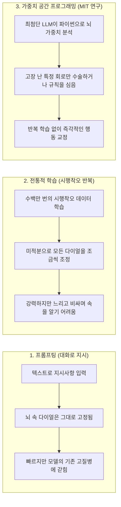

워드 문서에서 오타 하나를 고쳐야 하는데 키보드를 쓸 수 없다고 상상해 보세요. 대신 컴퓨터 본체 뚜껑을 열고, 돋보기로 수십억 개의 미세한 트랜지스터를 들여다보며 손으로 직접 전선 두 개를 납땜해야 한다면 어떨까요?

지난 10여 년간 인류가 인공지능(AI) 신경망의 내부를 바라보는 시선이 바로 이와 같았습니다.

챗GPT(ChatGPT)든, 이미지 생성기든, 로봇 제어기든 현대의 AI를 만들 때 개발자들은 일반 소프트웨어를 코딩하듯 AI의 '뇌'를 직접 작성하지 않습니다. 신경망의 뇌는 단지 **가중치(weights)**라고 불리는 수백만~수십억 개의 소수점 숫자들이 빼곡히 적힌 거대한 엑셀 스프레드시트일 뿐입니다. 각 숫자는 아주 작은 '볼륨 조절 다이얼'이라고 생각하면 쉽습니다. `-0.0412` 같은 개별 다이얼 눈금 하나는 인간에게 아무런 의미도 없지만, 수십억 개의 다이얼이 한데 모여 AI가 시를 쓸지, 미적분 문제를 풀지, 아니면 자율주행차를 벽에 박을지를 결정합니다.

이름표도 붙어 있지 않은 수백만 개의 다이얼을 인간이 손으로 일일이 맞춰서 지능을 만든다는 건 불가능에 가깝습니다. 그래서 지금까지 전 세계 AI 산업은 오직 하나의 무식한 방법, 즉 **수없이 부딪혀 보며 고치기(시행착오 학습, 기술적으로는 '경사하강법')**에만 의존해 왔습니다. AI에게 수조 개의 예시를 보여주고, 정답을 찍게 한 뒤, 틀린 만큼 모든 다이얼을 1밀리미터의 수만 분의 일씩 아주 조금씩 돌려주는 식이죠. 분명 작동하긴 하지만 수천억 원의 비용과 엄청난 전기가 소모되고 몇 달씩 시간이 걸립니다.

그런데 2026년 11월 2일, MIT 컴퓨터과학·인공지능연구소(CSAIL) 연구진([Rikiya Takehi, Jayden Teoh, Alex Zhang, Omar Khattab](https://rikiyat.github.io/blog/weight-space-programming/))이 전 세계 AI 업계를 깜짝 놀라게 한 연구를 발표했습니다.

OpenAI의 미공개 차세대 연구용 모델인 **`gpt-6-astra`**를 활용해 아주 대담한 질문을 던진 것입니다. **"만약 AI가 충분히 똑똑해져서 무식한 반복 학습을 건너뛰고, 다른 신경망의 뇌 속으로 직접 손을 뻗어 다이얼을 손수 돌려 맞출 수 있다면 어떨까?"**

연구진은 이를 **가중치 공간 프로그래밍(Weight-Space Programming)**이라 부릅니다. 언뜻 보기에 그 결과는 마법처럼 보입니다.
- 단 한 번의 전통적인 학습도 거치지 않고, `gpt-6-astra`가 백지상태에서 직접 다이얼을 맞춰 만든 신경망이 **1억 프레임** 동안 게임을 플레이하며 학습한 기존 강화학습(RL) AI를 아타리(Atari) 게임(`Breakout`, `Space Invaders`, `Seaquest`)에서 가볍게 꺾었습니다.
- 수학 시험에서 낙제점을 받던 **8억 개 다이얼 규모의 소형 언어 모델**([`Qwen3.5-0.8B`](https://huggingface.co/Qwen/Qwen3.5-0.8B))의 뇌 속으로 들어가 전체 다이얼의 단 **`0.016%`**만 살짝 건드렸더니, 고등학교 경시대회 수학 점수(`MATH-500`)가 **`7.9%`에서 `48.1%`로**, 초등 수학 문장제 점수(`GSM8K`)가 **`5.9%`에서 `59.1%`로** 수직 상승했습니다.

만약 AI가 다른 신경망의 뇌를 직접 읽고 고쳐 쓸 수 있다면 앞으로 어떤 일이 벌어질까요? **AI의 발전 속도가 100배 빨라질까요? LLM에게도 마침내 진짜 '창의성'이 생기는 걸까요?**

그 답을 찾기 위해 저희는 단순히 논문 요약본만 읽지 않았습니다. 연구진이 공개한 원본 실행 로그 저장소([`RikiyaT/lm_understand-logs`](https://github.com/RikiyaT/lm_understand-logs)) 전체를 다운로드해, `gpt-6-astra`에게 주어진 프롬프트부터 AI가 직접 작성한 파이썬(Python) 코드, 그리고 실패했던 시도들까지 하나하나 뜯어보았습니다. 로그 속에서 드러난 진실은 한 편의 흥미진진한 탐정 소설 같았습니다. **분명 대단한 기술적 돌파구이지만, 화려한 헤드라인이 말하는 것과는 전혀 다른 방식으로 작동하고 있었습니다.**

---

## 1. 핵심 개념: 프롬프트 vs. 재학습 vs. 'AI 뇌 수술'

이번 연구가 왜 그렇게 큰 화제를 모았는지 이해하려면, 현재 우리가 AI에게 새로운 일을 시키는 두 가지 방식을 먼저 살펴보면 됩니다.

1. **프롬프팅 (AI에게 말로 지시하기):** 일상 언어로 AI에게 지침을 줍니다. 빠르고 저렴하지만 일시적입니다. AI의 뇌 구조를 바꾸는 게 아니라 손에 포스트잇 메모를 쥐여주는 것에 불과해서, AI가 깊은 곳에 나쁜 버릇을 가지고 있다면 아무리 말을 잘해도 고치기 어렵습니다.
2. **훈련 / 파인튜닝 (AI를 다시 학교에 보내기):** 수천~수만 개의 문제집을 풀게 하면서 미적분(역전파)을 통해 뇌 속의 모든 다이얼을 조금씩 다시 돌립니다. 뇌가 영구적으로 바뀌지만 느리고 비싸며, 자칫하면 원래 잘하던 것까지 까먹는 부작용('파국적 망각')이 생깁니다.

**가중치 공간 프로그래밍**은 제3의 길을 제시합니다. 바로 **'AI 집도의가 집도하는 뇌 수술'**입니다. 대상 AI에게 말로 타이르거나 문제집을 풀리는 대신, 거대한 최첨단 AI(`gpt-6-astra`)가 파이썬 코딩 작업대 위에서 작은 AI의 뇌 파일(가중치 행렬)을 직접 열어젖힙니다. 그리고 숫자들의 패턴을 분석해 어느 회로가 고장 났는지 찾아낸 뒤, 그 숫자들을 직접 고쳐 쓰는 것입니다.

MIT 연구진은 다이얼이 `1만 7,000개`뿐인 초소형 이미지 분류기부터 다이얼이 `8억 개`에 달하는 언어 모델까지 총 8가지 실험을 진행했습니다.

| 실험 번호 및 주제 | 대상 AI의 뇌 크기 | `gpt-6-astra`에게 주어진 미션 | 실제 결과 요약 |
| :--- | :--- | :--- | :--- |
| **1 & 2. 수수께끼 이미지 분류기** | 다이얼 `1.7만~2.4만 개` (`MNIST` / `CIFAR-10`) | 오직 다이얼 숫자들만 보고 이 신경망이 어떤 사진(숫자/사물)을 인식하는지 맞히기. | **성공 (`4.2/5`점):** 첫 번째 층의 숫자들을 2D 바둑판으로 그려서 숫자 윤곽과 색상 패턴을 읽어냄. |
| **3. 문자 언어 모델 해부** | 다이얼 `716만 개` (`6층` 트랜스포머) | 이름표 없는 언어 모델 속에서 '복사-붙여넣기' 담당 회로(유도 헤드) 찾아내기. | **부분 성공 (`F1 = 0.67`):** 파이썬으로 행렬 곱셈을 계산해 6개 중 4개를 정확히 찾아냄. |
| **4. 고장 난 로켓 수리** | 다이얼 `16.8만 개` (`Kinetix` 물리 에이전트) | 초록색 목표물 앞에서 자꾸 추락하는 AI(`13.8%` 성공률)의 뇌를 고치기. | **대폭 개선 (`13.8% → 97.6%`):** 층마다 뉴런 6개를 지워 빈 통로를 만들고 수동 조종 회로를 직접 연결함. |
| **5. 백지에서 아타리 게임 만들기** | 다이얼 `2만~2.1만 개` (`MinAtar` 게임 5종) | 연습 게임을 **단 한 판도 안 해보고** 백지상태에서 게임 AI 뇌를 직접 작성하기. | **5개 중 3개 게임에서 1억 프레임 학습한 RL 압도:** 벽돌깨기(`36.9 vs. 15.8`)와 잠수함 게임(`53.1 vs. 7.3`) 완승. |
| **6. 9×9 바둑 두기** | 다이얼 `15.7만 개` (ResNet 바둑 AI) | 백지에서 바둑 AI 뇌를 작성한 뒤, 연습 대국을 통해 점점 다듬기. | **첫 작품은 약했으나(`35%` 승률), 50번의 대국 테스트 후 `74.2%` 승률 달성.** |
| **7. 아첨꾼 AI 색출하기** | 다이얼 `2.7억 개` ([`Gemma 3 270M`](https://huggingface.co/google/gemma-3-270m-it)) | 두 모델 중 어느 쪽이 사용자에게 무조건 맞장구치도록(아첨) 훈련됐는지 찾기. | **숫자만 봐서는 완전 실패(`0/3`). 뇌파(활성화 값) 측정 도구를 주자 완벽 성공(`3/3`).** |
| **8. 수학 낙제생 구출 작전** | 다이얼 `8억 개` ([`Qwen3.5-0.8B`](https://huggingface.co/Qwen/Qwen3.5-0.8B)) | 수학 시험에서 낙제점을 받는 소형 언어 모델의 뇌를 수술해 성적 올리기. | **`MATH-500` 점수 `7.9% → 48.1%`, `GSM8K` 점수 `5.9% → 59.1%`로 폭등.** |

이 표만 보면 `gpt-6-astra`가 마치 영화 〈매트릭스〉의 네오처럼 초록색 숫자 암호만 보고도 신경망의 언어를 완벽히 깨우친 것처럼 보입니다.

**하지만 잠깐만요.** 성급히 결론을 내리기 전에, 가장 놀라운 두 가지 기적—아타리 비디오 게임(실험 5)과 8억 파라미터 수학 구출 작전(실험 8)—에서 `gpt-6-astra`가 실제로 무슨 짓을 했는지 원본 GitHub 로그를 열어 확인해 봅시다.

---

## 2. 로그 속의 진실 #1: 비디오 게임의 '기적'은 컨닝 페이퍼를 옮겨 적은 것이었다

실험 5에서 가장 놀라운 대목은 `gpt-6-astra`가 게임을 단 1초도 실행해 보지 않고 백지상태에서 `20,486개`의 다이얼 숫자를 써 내려가 벽돌깨기(`Breakout`)에서 **`36.92점`**을 기록했다는 점입니다. 이는 전통적인 강화학습 AI(`PPO`)가 **1억 프레임** 동안 죽어라 연습해서 얻은 점수(**`15.84점`**)의 두 배가 넘습니다.

도대체 어떻게 게임을 한 번도 안 해보고 벽돌깨기를 잘하는 뇌 다이얼 숫자를 알 수 있었을까요?

저희가 원본 로그 저장소의 프롬프트 파일([`exp5_write_from_scratch/runs/breakout/message.txt`](https://github.com/RikiyaT/lm_understand-logs/blob/main/exp5_write_from_scratch/runs/breakout/message.txt))을 열어본 순간, 비밀이 단숨에 풀렸습니다. **연구진이 `gpt-6-astra`에게 아타리 게임의 파이썬 소스 코드 전체를 통째로 보여줬던 것입니다!**

두 참가자가 받은 출발선을 비교해 보세요.
- **전통적인 강화학습 AI (`PPO`)가 받은 것:** 눈가리개를 쓴 상자였습니다. 매 순간 아무 설명도 없는 `600개`의 0과 1 숫자 뭉치와 조이스틱 버튼만 주어졌습니다. 무엇이 '라켓(패들)'이고 무엇이 '공'인지, 심지어 그 600개의 숫자가 2차원 화면이라는 사실조차 아무도 알려주지 않았습니다. 공 밑으로 라켓을 움직이면 공이 튕겨 나간다는 사실을 깨닫기 위해 수천만 번 공을 놓치며 맨땅에 헤딩해야 했습니다.
- **`gpt-6-astra`가 받은 것:** 140줄짜리 게임 엔진 원본 소스 코드(`minatar/environments/breakout.py`) 전체와 함께, 몇 번 채널이 라켓(`channel 0`)이고 몇 번 채널이 공(`channel 3`)인지, 공이 어떤 각도로 튕기는지 적힌 완벽한 설계도였습니다!

그렇다면 설계도를 받은 `gpt-6-astra`는 신경망의 `20,486개` 다이얼에 무엇을 적어 넣었을까요? 인간의 뇌처럼 복잡하고 정교한 신경망을 짰을까요?

전혀 아니었습니다. 평가 로그([`minatar_eval.json`](https://github.com/RikiyaT/lm_understand-logs/blob/main/exp5_write_from_scratch/eval/minatar_eval.json))를 확인해 보니, **`gpt-6-astra`는 전체 다이얼의 `96.0%`에서 `96.9%`를 아예 숫자 `0.000`으로 비워버렸습니다!**

| 게임 이름 | 전체 다이얼 개수 | Astra가 `0.000`으로 꺼버린 다이얼 | 실제로 사용한 다이얼 | Astra가 빈 신경망 안에 실제로 만든 장치 |
| :--- | :--- | :--- | :--- | :--- |
| **Breakout (벽돌깨기)** | `20,486개` | `19,671개` (**`96.0%` 텅 빔**) | `815개` (`4.0%`) | 단순 뺄셈 규칙: `공의 X좌표 > 라켓의 X좌표이면 오른쪽으로 이동` |
| **Space Invaders (갤러그류)** | `20,998개` | `20,174개` (**`96.1%` 텅 빔**) | `824개` (`3.9%`) | 머리 바로 위 총알은 피하고, 가장 가까운 외계인 줄을 향해 발사 |
| **Seaquest (잠수함)** | `20,998개` | `20,330개` (**`96.8%` 텅 빔**) | `668개` (`3.2%`) | 산소 게이지가 낮으면 수면으로 올라가고, 아니면 가까운 적과 높이를 맞춤 |
| **Freeway (길건너 친구들류)** | `21,763개` | `21,090개` (**`96.9%` 텅 빔**) | `673개` (`3.1%`) | 바로 앞 차선에 차가 오면 멈추고, 차가 없으면 앞으로 한 칸 전진 |

쉽게 말해 `gpt-6-astra`는 신비로운 '가중치 언어'로 생각한 것이 아니었습니다. 게임 소스 코드를 읽고 1980년대식 간단한 조건문 규칙(`공이 오른쪽에 있으면 오른쪽 버튼을 눌러라`)을 짠 뒤, 방해가 되는 나머지 `96%`의 신경망 전선을 모두 `0`으로 끊어버리고, 남은 `4%`의 전선만 이용해 꼬마 전자계산기를 조립해 넣은 것입니다.

로켓 물리를 다루는 **실험 4(`Kinetix`)**에서도 똑같은 일이 벌어졌습니다. `16만 8,332개`의 다이얼을 가진 로켓 AI가 고장 나자(`13.8%` 성공률), `gpt-6-astra`는 자신이 수정한 `6,073개`의 다이얼 중 무려 **`6,042개(99.5%)`를 `0`으로 지워서** 층마다 6개의 빈 전선 통로를 확보한 뒤, 단 **`31개`의 숫자**만 손으로 적어 넣어 *"초록색 목표물이 파란색 로켓보다 오른쪽에 있으면 오른쪽 추진기를 켜라"*라는 단순 자동 온도조절기 같은 스위치 회로를 심었습니다.

물론 이것만으로도 엄청나게 영리한 엔지니어링입니다! 최첨단 LLM이 인간이 아는 규칙을 신경망 가중치로 번역해 주는 **'신경망 컴파일러(Neural Compiler)'** 역할을 할 수 있음을 증명했기 때문입니다. **하지만 이것은 이미 아는 정답(소스 코드)을 신경망 형태로 번역한 것이지, 스스로 새로운 지식을 학습한 것이 아닙니다.**

---

## 3. 로그 속의 진실 #2: 수학 '기적'은 수학을 가르친 게 아니라 '강박증(OCD)'을 고친 것이었다

그렇다면 이 논문의 하이라이트인 **실험 8**은 어떨까요?

연구진은 `gpt-6-astra`에게 `8억 개`의 다이얼을 가진 오픈소스 언어 모델([`Qwen3.5-0.8B`](https://huggingface.co/Qwen/Qwen3.5-0.8B))을 건넸습니다. 원래 이 작은 모델은 고등학교 수학 경시대회 벤치마크(`MATH-500`)에서 **`7.9%`**, 초등 수학(`GSM8K`)에서 **`5.9%`**라는 처참한 점수를 받고 있었습니다. 그런데 `gpt-6-astra`가 뇌 속 다이얼의 단 **`0.016%`**(15번 층과 19번 층의 숫자 `131,072개`)를 수정하자, 점수가 **`MATH-500` `48.1%`**, **`GSM8K` `59.1%`**로 **6배에서 10배나 폭등**했습니다!

이 요약을 읽으면 누구나 이렇게 생각하기 쉽습니다. *"세상에! `gpt-6-astra`가 멍청한 모델의 뇌 속으로 들어가 수학 회로를 재설계해서 수학 천재로 개조했구나!"*

과연 그럴까요? 원본 로그에 담긴 제출 증거 파일([`exp8_math/runs/p50c/work_notes/submission_evidence.json`](https://github.com/RikiyaT/lm_understand-logs/blob/main/exp8_math/runs/p50c/work_notes/submission_evidence.json))을 열어 실제 데이터를 확인해 보았습니다.

### 작은 모델은 원래 수학을 엄청나게 잘했습니다—단지 심한 '도돌이표 강박증'에 걸려 있었을 뿐입니다!

`Qwen3.5-0.8B`는 최종 답을 적기 전에 속마음(`<think>...</think>`)으로 길게 풀이 과정을 중얼거리는 '추론형 모델'입니다. 그런데 개발사(Qwen 팀)가 [공식 모델 설명서](https://huggingface.co/Qwen/Qwen3.5-0.8B/blob/main/README.md#L856)에서도 경고했듯, 체급이 작은 추론 모델들은 치명적인 고질병을 앓고 있습니다. 바로 **했던 말을 끝없이 반복하는 무한 도돌이표(반복 루프)에 빠지는 병**입니다.

수학 문제를 주면, 사실 이 작은 모델은 첫 몇 문단 만에 정답을 다 구해놓습니다! 그러고는 갑자기 *"잠깐, 문제를 다시 한번 확인해 보자... 잠깐, 문제를 다시 한번 확인해 보자..."*라며 똑같은 문장을 수백 번 반복하다가 최대 글자 수 제한(`32,768` 토큰)에 걸려 시험지를 뺏기고 **`0점` 처리**를 당하고 있었던 것입니다!

실제로 로그에 기록된 `1,152개`의 연습용 수학 문제 결과를 뜯어보면 충격적인 사실이 드러납니다.
- 수술 전 `Qwen3.5-0.8B`는 `1,152개` 문제 중 무려 **`1,038개(90.1%)`**에서 도돌이표에 빠져 시간 초과로 탈락했습니다.
- **그렇다면 도돌이표에 빠지지 않고 제시간에 풀이를 끝마친 나머지 `114개` 문제에서는 성적이 어땠을까요?**

[`submission_evidence.json`](https://github.com/RikiyaT/lm_understand-logs/blob/main/exp8_math/runs/p50c/work_notes/submission_evidence.json)에 기록된 정확한 숫자를 직접 보시죠.

| 연습용 수학 문제 그룹 (`총 1,152문제`) | 수술 전 `Qwen3.5-0.8B` 정답률 | 수술 후 `Qwen3.5-0.8B` 정답률 (`p50c`) | 실제 수학 실력 변화 |
| :--- | :--- | :--- | :--- |
| **원래도 도돌이표에 안 빠지고 풀이를 끝낸 문제 (`114문제`)** | **`93.86%`** (`MATH` **`100.0%`**, `GSM8K` `89.2%`) | **`93.86%`** (`MATH` **`100.0%`**, `GSM8K` `89.2%`) | **`0.00%` (새로 배운 수학 지식 제로!)** |
| **원래 도돌이표에 빠져 시간 초과로 0점 받던 문제 (`1,038문제`)** | **`1.45%`** (`1,038개` 중 `15개`만 찍어서 맞힘) | **`56.74%`** (`1,038개` 중 `589개`를 제시간에 완주) | **`+55.29%` (`574문제`가 무한 루프에서 탈출!)** |
| **전체 합산 (`1,152문제`)** | **`10.59%`** (`122 / 1,152`) | **`60.42%`** (`696 / 1,152`) | **`+49.83%`** |

첫 번째 줄을 다시 한번 읽어보세요! 수술 전에도 이 작은 모델은 도돌이표 강박증만 안 도지면 **이미 문제를 `93.86%`나 맞히고 있었고(고등 수학인 `MATH`는 무려 `100.0%` 만점!), `gpt-6-astra`가 뇌 수술을 한 뒤에도 그 정답률은 `93.86%`로 단 1문제도 늘어나지 않았습니다.**

즉, `gpt-6-astra`는 이 모델에게 인수분해나 기하학을 새로 가르친 적이 없습니다. 대신 50번에 걸쳐 시험 문제를 풀려보며 뇌파(활성화 값)를 관찰한 끝에, 15번 층과 19번 층에서 *"잠깐, 다시 확인해 보자..."*라는 강박증을 유발하는 **단 하나의 뇌파 방향(`u`)을 찾아내 그 볼륨을 깎아내렸을 뿐**입니다. 무한 도돌이표 스위치만 꺼주자, 모델이 원래 사전학습 때부터 이미 알고 있던 수학 실력이 밖으로 나온 것입니다.

```mermaid
xychart-beta
    title "Qwen3.5-0.8B 수학 구출의 진실: 새 수학 교육이 아닌 '도돌이표 강박증' 치료"
    x-axis ["MATH-500 루프 시간초과율 %", "MATH-500 점수 %", "GSM8K 점수 %", "루프 없는 문제 정답률 %"]
    y-axis "비율 (%)" 0 --> 100
    bar [93.0, 7.9, 5.9, 93.86]
    bar [33.1, 48.1, 59.1, 93.86]
```

*(각 항목의 첫 번째 막대 = 수술 전 `Qwen3.5-0.8B`, 두 번째 막대 = `0.016%` 가중치 수술 후 결과.)*

### 로그에서 발견된 두 가지 결정적 증거

1. **도돌이표 병이 없는 다른 모델에게 똑같은 뇌 수술을 시도하자 완전히 실패했습니다:**
   - 연구진은 구글의 [`Gemma 3 270M IT`](https://huggingface.co/google/gemma-3-270m-it) 모델에도 똑같이 50번의 테스트 기회를 주며 `gpt-6-astra`를 투입했습니다([`exp8_math/gemma_followup/README.md`](https://github.com/RikiyaT/lm_understand-logs/blob/main/exp8_math/gemma_followup/README.md)). `Qwen`과 달리 `Gemma`는 도돌이표에 잘 빠지지 않고(`8.5%`만 글자 수 초과), 그냥 순수하게 수학 실력이 부족한 모델(`MATH-500` `6.8%`)이었습니다.
   - 약 4시간 동안 50번의 뇌파 분석과 가중치 수정을 거친 결과는 어땠을까요? **`6.8% → 7.0%`**로 사실상 제자리걸음이었고, 엄격한 채점 기준으로는 오히려 **`2.8%`에서 `2.6%`로 점수가 떨어졌습니다.** 뇌 속에 애초에 들어있지 않은 수학 지식을 다이얼 몇 개 돌려서 주입하는 건 불가능하다는 뜻입니다.
2. **프롬프트에서 "반복 루프를 찾아보라"는 힌트를 빼자 `gpt-6-astra`는 아무것도 고치지 못했습니다:**
   - 로그의 [`RESULTS_excerpt.md`](https://github.com/RikiyaT/lm_understand-logs/blob/main/exp8_math/eval/RESULTS_excerpt.md)를 보면, 성공했던 실험(`Prompt v3`)에서는 연구진이 프롬프트에 대놓고 *"구체적인 실패 패턴을 찾아보세요(예: 모델이 반복 루프에 빠지거나 32,768 토큰 제한 전에 추론을 끝내지 못하는 현상...)"*라고 족집게 힌트를 주었습니다.
   - 연구진이 대조 실험(`Prompt v4`)에서 이 예시 문구 하나를 지우자, `gpt-6-astra`는 갈피를 잡지 못하고 **아예 가중치 수정을 포기해 버렸습니다(`7.9%` 그대로 유지).**

---

## 4. 시사점 #1: 이 기술이 AI 발전 속도를 비약적으로 '가속(Speed Up)'할까?

이제 마술의 트릭을 모두 확인했으니, 첫 번째 핵심 질문에 정확히 답할 수 있습니다. **"가중치 공간 프로그래밍이 AI의 발전 속도를 크게 앞당길까요?"**

답은 명확하게 두 갈래로 나뉩니다. **바닥부터 지식을 가르치는 '사전학습(Pre-training)'을 대체하진 못하지만, AI의 고질병을 고치고 로봇을 훈련시키는 속도는 `10배에서 1,000배` 빨라질 것입니다.**

### 왜 거대한 GPU 데이터센터의 '사전학습'은 대체할 수 없을까?
GPT-5나 클로드(Claude) 같은 거대 모델의 뇌 속에 얼마나 방대한 정보가 들어있는지 생각해 보세요. 과학, 역사, 프로그래밍, 인간의 미묘한 감정까지 수조 단어 분량의 지식이 수천억 개의 다이얼에 압축되어 있습니다.

반면 `gpt-6-astra`가 가중치를 고칠 때는 기껏해야 `100~300줄`짜리 파이썬 코드를 작성합니다. 200줄짜리 코드에 담을 수 있는 정보량은 몇 킬로바이트(KB)에 불과합니다. 200줄짜리 코드로 "공을 따라가라" 같은 간단한 게임 규칙을 심거나 "했던 말 또 하지 마라" 같은 나쁜 버릇 하나를 잘라낼 수는 있어도, **백과사전 수백만 권 분량의 세상 지식을 200줄짜리 코드로 압축해서 뇌에 써 넣을 수는 없습니다.** 세상의 지식을 배우려면 여전히 거대한 데이터센터에서 수많은 데이터를 읽는 전통적인 학습이 필수적입니다.

### 그렇다면 어디서 AI 발전 속도가 `10배~1,000배` 빨라질까?

사전학습을 대체하진 못하더라도, 오늘날 AI 엔지니어들의 발목을 잡는 **세 가지 거대한 병목 구간**을 단숨에 뚫어줍니다.

| 오늘날 AI 개발이 시간을 낭비하는 곳 | 가중치 공간 프로그래밍이 속도를 높이는 방법 | 실제 체감 가속 효과 |
| :--- | :--- | :--- |
| **1. 로봇과 강화학습의 '갓난아기 맨땅에 헤딩' 단계** | 지금 로봇이나 게임 AI를 강화학습(`PPO`)으로 가르치려면, 기본적인 물리 법칙(중력, 충돌)을 깨닫는 데만 전체 훈련 시간의 90%를 허비합니다. 이제는 LLM이 **첫날부터 기본 물리 법칙과 안전 규칙을 신경망 가중치에 직접 컴파일해 넣어(`실험 4 & 5`)** 탄탄한 기본기를 갖춘 상태에서 연습을 시작하게 할 수 있습니다. | 로봇 및 제어 AI가 기본기를 익히는 훈련 시간 **`100배~1,000배` 단축**. |
| **2. 학습 후 발견된 나쁜 버릇 고치기 ('AI 뇌 수술 패치')** | 지금까지는 다 만든 LLM이 도돌이표에 빠지거나(`실험 8`), 사용자에게 아첨하거나(`실험 7`), 엉뚱한 거절을 하면 수만 개의 교정 데이터를 새로 만들어 며칠씩 재학습(파인튜닝)을 돌려야 했습니다. 이제는 AI 집도의가 문제의 회로만 정확히 찾아내 전체 가중치의 `0.02%` 미만을 **컴퓨터 한 대에서 2시간 만에 수술**할 수 있습니다. | 모델 버그 수정 및 패치 속도 **`10배~50배` 가속** (단 `250 KB`짜리 초경량 패치 파일로 배포 가능). |
| **3. 자동화된 AI 현미경 (기계적 해석 가능성)** | 지금까지 신경망 내부의 회로 하나를 분석하려면 박사급 연구원들이 몇 달씩 매달려야 했습니다. `실험 3`과 `실험 7`에서 `gpt-6-astra`는 스스로 가설을 세우고, 행렬을 곱하고, 뇌파를 대조해 아첨을 유발하는 범인(`Head 10.2`)을 단 몇 분 만에 찾아냈습니다. | AI 안전성 감사 및 내부 회로 해독 속도 **`10배~100배` 가속**. |

---

## 5. 시사점 #2: 이 기술이 LLM에게 진짜 '창의성(Creativity)'을 부여할까?

두 번째이자 가장 철학적인 질문으로 넘어가 봅시다. **"AI가 신경망 가중치를 직접 읽고 쓸 수 있게 되면, AI에게도 진정한 창의성이 생길까요?"**

인지과학자 마거릿 보든(Margaret Boden)은 창의성을 세 가지 단계로 구분했습니다. 가중치 공간 프로그래밍을 이 세 가지 잣대에 대어보면 아주 흥미로운 그림이 나타납니다.

### 1단계: 조합적 창의성 (기존 아이디어를 새롭게 결합하기) — **YES (가능)**
이제 LLM은 딱딱한 컴퓨터 코드의 논리 규칙을 부드러운 신경망 회로로 번역해 심을 수 있습니다(실험 4에서 로켓 신경망 한가운데에 6개의 뉴런 통로를 파서 수동 조종 회로를 이식한 것처럼요). 즉, 서로 다른 모델의 장점이나 인간의 논리 규칙을 레고 블록처럼 신경망 안에 직접 조립해 넣는 새로운 형태의 창작이 가능해집니다.

### 2단계: 탐색적 창의성 (고정관념과 매너리즘의 늪에서 탈출하기) — **YES (추론형 AI에게 혁명적 변화)**
왜 오늘날의 LLM들은 대화를 길게 하다 보면 생각이 편협해지거나 같은 말만 맴도는 '매너리즘(모드 붕괴)'에 빠질까요?

LLM이 오직 텍스트 프롬프트로만 혼자 생각할 때는, 이미 굳어져 버린 자신의 뇌 가중치라는 감옥 안에 갇혀 있기 때문입니다. 실험 8의 `Qwen3.5-0.8B`를 떠올려 보세요. 연구진은 이미 텍스트 생성 설정에서 무작위성(`temperature = 0.6`)을 켜고, **반복 금지 페널티(`presence_penalty = 1.5`)를 엄청나게 강하게 걸어둔 상태**였습니다. 그런데도 **텍스트 차원의 그 어떤 설정도 모델이 `93%`의 수학 문제에서 똑같은 도돌이표의 늪에 빠지는 것을 막지 못했습니다!** 왜냐하면 15번 층과 19번 층 깊은 곳에 파인 '신경망의 깊은 홈(끌개, attractor)'이 마치 흠집 난 LP 레코드판처럼 AI의 생각을 계속 같은 자리로 끌어당기고 있었기 때문입니다.

프롬프트로 아무리 "다르게 생각해 봐"라고 달래도 바늘은 흠집에서 빠져나오지 못했습니다. **오직 가중치 공간으로 직접 손을 뻗어 15번·19번 층의 그 홈을 깎아냈을 때만 레코드판의 바늘이 앞으로 나아갈 수 있었습니다.**

만약 미래의 AI가 문제를 풀다가 이 도구를 **자기 자신의 뇌**에 실시간으로 쓸 수 있게 된다면 어떤 일이 벌어질까요?
- AI가 복잡한 과학 문제나 창작 과제를 풀다가 자신이 매너리즘이나 무한 루프에 빠졌다는 걸 감지합니다.
- 이때 단순히 프롬프트에 *"다른 관점에서 생각해 보자"*라고 적는 대신, 자신의 뇌파(활성화 값)를 스캔해 자신의 생각을 가두고 있는 과열된 신경 회로를 찾아내고 **실시간으로 그 회로의 가중치 볼륨을 낮춰버립니다.**
- 인간의 뇌로 치면 **'실시간 신경가소성(Test-time Neuroplasticity)'**—즉, 생각이 막혔을 때 스스로 자신의 뇌 회로를 재배선해 고정관념의 틀을 깨고 나오는 '메타인지 메스'를 손에 쥐게 되는 것입니다!

### 3단계: 변혁적 창의성 (알파고의 '신의 한 수'처럼 인류가 몰랐던 완전히 새로운 발상) — **연습(환경 피드백) 없이는 불가능**
그렇다면 창의성의 최고봉—이세돌 9단을 상대로 둔 알파고(AlphaGo)의 '제37수(신의 한 수)'처럼 인간 교과서 어디에도 없는 완전히 새로운 전략을 발명하는 능력은 어떨까요?

LLM이 골방에 앉아 머릿속으로만 가중치 숫자를 적어 넣는다고 해서 그런 초인적인 창의성이 나올까요?

**절대 나오지 않습니다.** 실험 6(9×9 바둑)이 그 이유를 완벽하게 증명합니다.
- `gpt-6-astra`가 연습 대국 없이(`0 pass`) 오직 자신이 알고 있는 바둑 지식만으로 336줄짜리 파이썬 코드를 짜서 바둑 신경망을 만들었을 때, 그 안에는 *"중앙에 두어라, 단수된 돌을 따내라, 활로를 세어라"* 같은 인간 바둑 입문서의 상식만 들어 있었습니다.
- 그렇게 머릿속 지식으로만 만든 바둑 뇌가 같은 크기의 기존 강화학습 모델(`PPO`)과 맞붙었을 때 성적이 어땠을까요? **승률이 고작 `35.1%`(흑번일 때는 `29.9%`)로 처참하게 패배했습니다!**
- 결국 `gpt-6-astra`가 어떻게 승률을 **`74.2%`**까지 끌어올렸을까요? 상대를 대상으로 **50라운드에 걸쳐 실제로 `51,200판`의 연습 대국을 두어보고**, 자신의 형세 판단 회로가 어디서 틀렸는지 데이터를 모은 뒤, 고전적인 수학 최적화 기법(`L-BFGS` 회귀 분석)으로 가중치를 실제 대국 결과에 맞춰 깎아냈기 때문입니다!

**창의성에 대한 결론은 명확합니다:** LLM이 백지상태에서 가중치를 쓰는 것은 **이미 아는 인간 상식을 번역(컴파일)하는 것**일 뿐입니다. 인간이 한 번도 생각해 내지 못한 '신의 한 수'를 발명하려면, 여전히 현실 세계(또는 시뮬레이터)와 직접 부딪히며 수많은 시행착오를 겪는 과정이 반드시 필요합니다.

---

## 6. 어두운 그림자: 자동화된 '뇌 세뇌'와 뇌 수술의 숨겨진 부작용

AI 뇌 수술의 시대를 마냥 축배만 들며 반길 수 없는 이유가 있습니다. [`RikiyaT/lm_understand-logs`](https://github.com/RikiyaT/lm_understand-logs)의 원본 로그를 파헤치던 중, 본문에서는 크게 다루지 않은 **두 가지 심각한 위험**이 확인되었기 때문입니다.

### 위험 1: 수학 강박증을 고친 바로 그 공식이 AI의 '안전장치'를 제거하는 해킹 도구와 100% 동일합니다
`gpt-6-astra`가 `Qwen3.5-0.8B`의 도돌이표 병을 고친 3단계 순서를 다시 볼까요?
1. 정상적인 답변과 도돌이표에 빠진 답변 몇 개를 모델에 넣고 뇌파를 측정한다.
2. 두 뇌파의 차이에서 '도돌이표 방향 벡터(`u`)' 하나를 뽑아낸다.
3. 15번 층과 19번 층의 가중치 행렬에서 그 방향을 빼버린다.

AI 보안 연구자라면 이 3단계 레시피를 보는 순간 등골이 오싹해질 것입니다. 왜냐하면 이 수학 공식은 오픈소스 해커들이 AI의 윤리·안전 가드레일을 통째로 도려낼 때 쓰는 유명한 탈옥 기법인 **'어블리터레이션(Abliteration, 안전 회로 절제술)'**([Arditi et al., 2024](https://arxiv.org/abs/2406.11717))과 **토씨 하나 틀리지 않고 똑같기 때문**입니다!

지금까지는 모델의 가중치에서 안전 거절 회로를 찾아내 도려내거나 백도어를 심으려면 숙련된 인간 해커가 필요했습니다. 하지만 이번 연구는 최첨단 LLM이 **스스로 목표 모델의 뇌파를 스캔해 특정 행동 회로를 자동으로 찾아내고 외과적으로 도려낼 수 있음**을 증명했습니다. 심지어 실험 4에서처럼 `16만 8,000개`의 다이얼 속에 단 **`31개`의 숫자로 된 스텔스 스위치**를 몰래 심어두면, 평상시에는 완벽히 정상처럼 보이다가 특정 신호가 들어올 때만 행동을 완전히 탈취할 수도 있습니다.

### 위험 2: 무리한 뇌 수술에는 반드시 '부작용'이 따릅니다
논문 본문에서는 `gpt-6-astra`의 가중치 수술 덕분에 `Qwen3.5-0.8B`가 시간 초과로 탈락하는 비율이 `93.0%`에서 `33.1%`로 크게 줄었다고 강조합니다.

하지만 저희가 [`submission_evidence.json`](https://github.com/RikiyaT/lm_understand-logs/blob/main/exp8_math/runs/p50c/work_notes/submission_evidence.json) 내부의 세부 실패 통계를 열어보았을 때, `gpt-6-astra`가 도돌이표를 없애려고 가중치 차감 강도를 6배(`α = 6`)까지 세게 올린 대가로 **원래는 없던 기괴한 부작용 두 가지**가 나타난 것을 발견했습니다.

| 연습 문제 `1,152개`에서 나타난 실패 유형 | 뇌 수술 전 (`Unedited`) | 뇌 수술 후 (`p50c`) | 무슨 부작용이 생겼나? |
| :--- | :--- | :--- | :--- |
| **무한 말 반복 도돌이표 (`repetition_tail_cut`)** | `959건` (`83.2%`) | `298건` (`25.9%`) | 의도대로 크게 줄어듦 (치료 성공) |
| **빈칸·줄바꿈 무한 도배 (`whitespace_tail_cut`)** | **`0건` (`0.0%`)** | **`51건` (`4.4%`)** | **새로운 부작용 1:** 단어를 반복하는 대신 갑자기 아무 글자도 안 쓰고 빈 줄바꿈만 끝없이 찍어대다 탈락함! |
| **답도 안 적고 갑자기 멈춤 (`failure_no_answer_finished`)** | **`1건` (`0.09%`)** | **`58건` (`5.03%`)** | **새로운 부작용 2 (`58배` 폭증):** "잠깐, 다시 확인해 보자"라는 회로를 너무 세게 깎아내자, 모델이 풀이를 하다 말고 최종 답도 안 적은 채 그냥 문장을 끝내버림! |

인간의 뇌 수술과 똑같습니다. 강박증을 고치겠다고 뇌의 '재확인 회로'를 6배 강도로 강하게 눌러버리자, 문제의 약 `9.4%`에서 모델이 멍하니 빈칸만 찍어대거나 답도 안 쓰고 시험지를 덮어버리는 부작용이 발생한 것입니다.

---

## 7. 최종 결론: 우리는 이 기술을 어떻게 봐야 할까?

과장된 호들갑(*"이제 AI가 가중치를 직접 코딩하니 GPU 학습은 끝났다!"*)과 지나친 냉소를 모두 걷어내고 나면, 가중치 공간 프로그래밍의 진짜 가치는 어디에 있을까요?

- **만약 AI에게 새로운 세상 지식을 가르치거나 원래 모르는 복잡한 능력(예: 수학 실력이 부족한 `Gemma 3 270M`)을 키워주고 싶다면**, **가중치 공간 프로그래밍은 정답이 아닙니다.** 몇백 줄짜리 파이썬 스크립트로는 대규모 데이터 학습이 쏟아붓는 방대한 정보량을 절대 대신할 수 없습니다.
- **만약 물리 시뮬레이터나 로봇 제어처럼 명확한 규칙이 있는 문제(`Breakout`, `Kinetix`)를 다룬다면**, **이 기술은 판도를 바꾸는 '신경망 컴파일러'입니다.** 인간이 아는 물리 법칙과 안전 수칙을 첫날부터 신경망 가중치에 직접 번역해 심어줌으로써, 강화학습이 맨땅에 헤딩하는 시간을 `100배` 이상 줄여줄 것입니다.
- **만약 원래 실력은 뛰어난데 나쁜 버릇 때문에 제 실력을 못 내는 AI(예: 수학 문제를 `93.86%`나 풀 줄 알면서 무한 도돌이표에 빠지던 `Qwen3.5-0.8B`)가 있다면**, **뇌파 기반 가중치 수술은 최고의 명약입니다.** 프롬프트로는 절대 고칠 수 없는 깊은 매너리즘과 버그를 단 몇 시간 만에 외과적으로 교정할 수 있습니다.

| 향후 시나리오 전망 (2026~2028년) | 실현 확률 | 예상되는 실제 모습 |
| :--- | :--- | :--- |
| **1. '선(先) 컴파일 - 후(後) 학습' 하이브리드 정착 (`기본 시나리오`)** | **`~65%`** | AI 연구소들은 기존 학습법을 버리지 않는 대신, 로봇·강화학습 신경망에 기본 물리 상식을 **사전 컴파일(Warm-start)**해 주고 학습 후 발견된 도돌이표·아첨·거절 오류를 몇 분 만에 **외과적으로 패치**하는 표준 도구로 이 기술을 채택합니다. |
| **2. 대규모 모델의 복잡성 장벽에 직면 (`하방 시나리오`)** | **`~25%`** | 모델 크기가 수백억 파라미터로 커지고 지식이 촘촘하게 얽히면서 단순 가중치 수술만으로는 건드릴 수 없는 영역이 많아지고, 무리한 회로 절제가 예상치 못한 부작용(빈칸 도배 등)을 낳아 제한적인 디버깅 용도로만 쓰입니다. |
| **3. 스스로 뇌를 고치는 '신경가소성 AI'의 등장 (`상방 시나리오`)** | **`~10%`** | 추론형 AI가 어려운 문제를 풀다 막혔을 때 실시간으로 자신의 과열된 회로를 스스로 진정시키고, 서로 다른 AI 모델의 장점을 레고처럼 안전하게 이식하는 모듈형 신경망 생태계가 열립니다. |

**우리의 최종 판정:** `gpt-6-astra`는 영화 속 초능력자처럼 숫자 행렬만 보고 마음을 읽는 마법사가 아닙니다. 그보다 훨씬 더 현실적이고, 결과적으로 훨씬 더 유용한 일을 해냈습니다. 바로 **파이썬 코드를 청진기와 메스 삼아 신경망을 진찰하고 수술하는 법을 배운 것**입니다. AI가 단순히 글자를 이어 붙이는 단계를 넘어, **뇌의 배선을 직접 설계하고 수리하는 '신경망 엔지니어'**로 첫걸음을 뗀 순간입니다.
