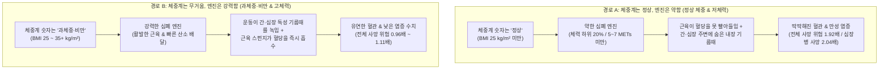
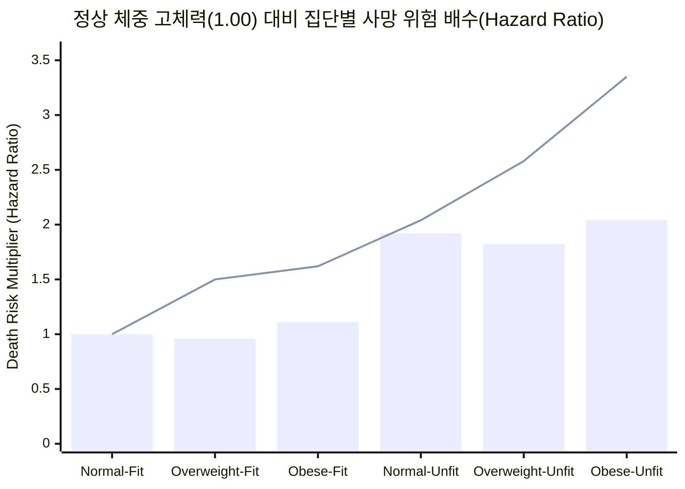
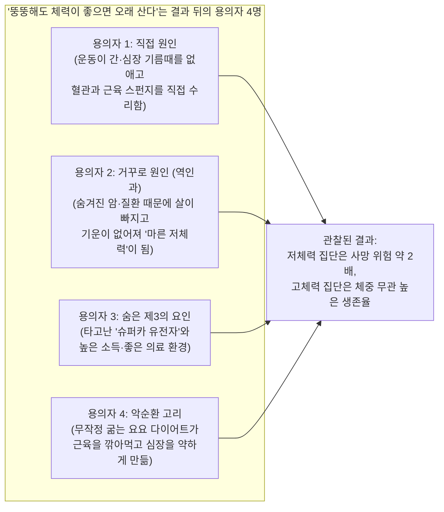

## 1. 시작하는 질문: 잠깐—무거운 배낭을 멘 사람이 날씬해 보이는 사람보다 더 오래 살 수 있다고요?

어른 두 명이 건강검진을 받으러 병원 문을 열고 들어온다고 상상해 보세요.

* **A씨 ("마르고 체력이 약한 사람")**는 체중계 위에 올라가자마자 칭찬 스티커를 받습니다. 키에 비해 몸무게가 '정상'이기 때문이죠. 하지만 A씨는 하루 종일 의자에만 앉아 있고 운동을 전혀 하지 않아서, 계단 한 층만 올라가도 증기기관차처럼 헉헉거립니다.
* **B씨 ("무겁지만 체력이 좋은 사람")**는 체중계에 올라가자 경고등을 받습니다. 몸무게가 기준보다 25 kg(대형견 골든 리트리버 한 마리 무게)이나 더 나가서 병원 차트에 '과체중' 또는 '비만'이라고 적힙니다. 하지만 B씨는 일주일에 네 번씩 빠르게 걷거나 자전거를 타고 조깅을 합니다. 심장과 폐가 워낙 튼튼해서 계단 세 층을 올라가면서도 숨이 차지 않고 친구와 수다를 떨 수 있습니다.

지난 40년 동안 거의 모든 건강 조언은 오직 체중계 숫자에만 매달렸습니다. *"일단 살부터 빼세요!"*

그런데 운동생리학자 **브래디 홀머(`Brady Holmer, @Brady_H`)**가 버지니아 대학교의 **네이선 ويل드레이어(Nathan R. Weeldreyer)**와 **시다르타 앙가디(Siddhartha S. Angadi)** 연구팀이 *영국스포츠의학저널(British Journal of Sports Medicine)*에 발표한 초대형 연구를 요약해 올리면서 전 세계적인 화제가 되었습니다 ([Weeldreyer et al., 2024/2025, PMC11874340](https://pmc.ncbi.nlm.nih.gov/articles/PMC11874340/)):

> "마르고 체력이 약한 사람과 무겁지만 체력이 좋은 사람 중 누가 더 건강할까요?
> 2025년 메타분석이 20개 코호트 연구와 약 40만 건의 관측 데이터를 하나로 모았습니다. 모든 연구는 최대 운동 검사와 BMI(체질량지수)를 직접 측정한 뒤, 모든 원인으로 인한 사망과 심장병 사망을 추적했습니다.
> 정상 체중이면서 체력이 좋은 사람들과 비교했을 때...
> - 체력이 약한(Unfit) 사람들은 체중이 얼마든 상관없이 사망 위험이 약 2배(+82%에서 +104%) 높았습니다.
> - 과체중이거나 비만이라도 체력이 좋은(Fit) 사람들은 정상 체중 고체력자와 통계적으로 차이가 없었습니다(-4% 및 +11%).
> 단, 심장병 사망만 따로 놓고 보면 과체중·비만 고체력 집단도 기준 집단보다 위험이 높게 나타나서, 심장 위험을 완전히 상쇄하려면 더 높은 체력이 필요할 수 있습니다.
> (이 연구들 대부분에서 '체력이 좋다(Fit)'는 것은 자기 나이대 하위 20%만 벗어나도 해당되었습니다)."

잠깐만요. 저 숫자를 다시 한번 읽어 보세요.
1. **마르고 체력이 약한 사람**은 마르고 체력이 좋은 사람보다 **사망할 위험이 거의 2배(+92%)**나 높았습니다.
2. 반대로 **뚱뚱하지만 체력이 좋은 사람**은 마르고 체력이 좋은 사람과 전체 사망 위험이 **거의 똑같았습니다(과체중 고체력 -4%, 비만 고체력 +11%)**!

어떻게 몸무게가 25 kg이나 더 나가는 것보다, 언덕을 오를 때 숨이 차는지 안 차는지가 생명 유지에 훨씬 더 중요할 수 있을까요? 게다가 우리가 탐정 돋보기를 들고 **398,716명**의 원본 데이터와 부록 표를 직접 열어 보면, 소셜 미디어에서는 아무도 말해주지 않은 **네 가지 거대한 미스터리**가 튀어나옵니다.

* **미스터리 #1:** 논문 초록과 화제의 게시글 모두 *"모든 연구가 완전히 지칠 때까지 달리는 최대 운동 검사(maximal exercise test)로 체력을 측정했다"*고 주장합니다. 정말 그럴까요? 전체 데이터의 **54.2%(398,716명 중 216,284명)**를 차지하는 가장 큰 두 연구의 원본 논문을 열어 보면, 두 연구 모두 최대 운동 검사를 쓰지 않았습니다!
* **미스터리 #2:** 20개 연구에 참여한 전체 인원은 원래 **458,784명**이었는데, 최종 분석에는 **398,716명**만 들어갔습니다. 중간에 사라진 **60,068명**은 대체 어디로 증발했을까요?
* **미스터리 #3:** **심장병 사망**만 따로 계산했을 때, '과체중 고체력'과 '비만 고체력' 집단의 사망 위험 배수는 각각 **1.50배(+50%)**와 **1.62배(+62%)**였습니다. 그런데 왜 논문 요약 상자에는 *"심혈관 질환 사망 위험이 통계적으로 유의미하게 증가하지 않았다"*고 적혀 있을까요?
* **미스터리 #4:** 영국 바이오뱅크(UK Biobank) 연구에서 '비만 고체력' 판정을 받은 사람들은 실내 자전거를 무려 **288.9와트(Watts)**로 밟아야 했습니다. 왜 '정상 체중 저체력' 사람(**87.0와트**)보다 **3.3배나 더 강한 힘**을 내야만 '체력 좋은 비만' 클럽에 들어갈 수 있었을까요 ([Tarp et al., 2021, PMC8174221](https://pmc.ncbi.nlm.nih.gov/articles/PMC8174221/))?

탐정 수첩을 펼치세요. 쉬는 시간 운동장에서 뛰는 우리 몸속 심장과 근육의 원리부터 시작해, 과학자들의 1차 원본 영수증을 하나씩 대조하며 무엇이 진짜로 우리를 오래 살게 하는지 바닥부터 파헤쳐 보겠습니다.

---

## 2. 0단계부터 시작하기: 우리 몸의 '산소 배달 트럭' vs '배낭 무게'

과학자들의 계산을 검증하기 전에, 이번 대결에 나선 두 선수가 정확히 무엇을 측정하는지부터 알아야 합니다. 바로 **'내 몸의 엔진 크기'**와 **'체중계에 찍히는 겉무게'**의 대결입니다.

### 측정 #1: 내 몸의 산소 배달 트럭은 얼마나 빠를까? (`CRF`, `VO2peak`, `METs`)

지금 여러분이 가만히 앉아 이 글을 읽는 순간에도, 근육과 뇌, 장기 속에 있는 수조 개의 초소형 발전소들이 연료를 태워 체온을 유지하고 생명을 지키고 있습니다. 이 발전소들이 연료를 태우려면 반드시 **산소**가 필요합니다.

여러분이 축구장을 전력 질주하기 시작하면 근육들은 당장 평소보다 10배 많은 산소를 달라고 소리칩니다. 이때 우리 몸의 세 가지 장치가 긴급 배달 특공대처럼 팀을 이룹니다.
1. **산소 하역장 (폐):** 숨을 들이마셔 공기 중의 신선한 산소를 빨아들입니다.
2. **소방차 펌프 (심장):** 더 빠르고 힘차게 뛰면서 산소를 가득 실은 혈액을 온몸 혈관으로 쏘아 보냅니다.
3. **연료 소각장 (근육):** 실핏줄(**모세혈관**)과 세포 속 화로(**미토콘드리아**)를 이용해 산소를 낚아채서 달리는 에너지로 바꿉니다.

운동할 때 폐와 심장, 혈관, 근육이 한 팀으로 호흡을 맞춰 산소를 얼마나 빨리 배달할 수 있는지 나타내는 능력을 과학자들은 **심폐체력(Cardiorespiratory Fitness)**, 줄여서 **`CRF`**라고 부릅니다. 그리고 러닝머신이나 자전거 위에서 측정한 산소 배달 트럭의 최고 속도를 **`VO2peak`**(또는 **`VO2max`**, 최대산소섭취량)라고 부릅니다.

'1분당 몸무게 1 kg이 쓰는 산소 몇 밀리리터'라고 하면 너무 복잡하니까, 의사들은 아주 쉬운 눈금자를 하나 만들었습니다. 바로 **'가만히 앉아 있기 단위'**입니다.
* **1 앉아 있기 단위**는 의자에 가만히 앉아 만화영화를 볼 때 우리 몸이 쓰는 산소량(`몸무게 1 kg당 1분에 산소 3.5 mL`)입니다.
* 동네 길을 빠른 걸음으로 걸으면 가만히 앉아 있을 때보다 산소를 약 **3~4배** 더 씁니다(3~4단위).
* 1.6 km(1마일)를 10분 페이스로 달리는 조깅을 하면 약 **10단위**를 씁니다.
* 의사들은 이 단위를 **대사당량(Metabolic Equivalents)**, 줄여서 **`METs`(메트)**라고 부릅니다 ([Mandsager et al., 2018, PMC6324439](https://pmc.ncbi.nlm.nih.gov/articles/PMC6324439/)).

### 측정 #2: 지퍼를 열어보지 않고 가방 무게만 재기 (`BMI`)

그렇다면 의사들은 누가 '정상 체중'이고 누가 '과체중'이나 '비만'인지 어떻게 나눌까요?

가장 정확한 방법은 특수 스캐너로 몸속을 들여다봐서 튼튼한 근육과 뼈가 얼마이고 지방이 얼마인지, 또 그 지방이 *어디에* 숨어 있는지 확인하는 것입니다. 하지만 대부분의 병원에서는 200년 전에 만들어진 간단한 나눗셈 공식을 씁니다. 몸무게(kg)를 키(m)의 제곱으로 나누는 것(`kg/m²`)이죠.

이것은 마치 학생이 메고 온 **책가방 지퍼를 열어보지도 않고 공항 수하물 저울에 올려 무게만 재는 것**과 같습니다. 가방 크기에 비해 무겁다는 건 알 수 있지만, 그 안에 두꺼운 수학책(근육과 뼈)이 가득 들어 있는지, 아니면 기름진 과자 봉지(해로운 지방)가 가득 들어 있는지는 전혀 알 수 없습니다. 의사들은 이 키·몸무게 나눗셈 공식을 **체질량지수(Body Mass Index)**, 줄여서 **`BMI`**라고 부릅니다(서구권 및 본 연구 기준).
* **정상 체중(Normal Weight):** BMI `18.5 ~ 24.9 kg/m²`
* **과체중(Overweight):** BMI `25.0 ~ 29.9 kg/m²`
* **비만(Obese):** BMI `30.0 kg/m²` 이상

### 왜 체중계 숫자가 그대로여도 엔진을 키우면 몸속이 고쳐질까?

잠깐—체중계 눈금이 단 1 kg도 줄어들지 않았는데, 어떻게 산소 엔진(`CRF`)을 키우는 것만으로 생명을 지킬 수 있을까요?

규칙적으로 운동을 하면 체중계에는 보이지 않는 **네 가지 몸속 대수선**이 일어나기 때문입니다 ([Gaesser & Angadi, 2021, PMC8560549](https://pmc.ncbi.nlm.nih.gov/articles/PMC8560549/); [Fabbrini et al., 2009, PMC2741268](https://pmc.ncbi.nlm.nih.gov/articles/PMC2741268/)):
1. **'엉뚱한 곳에 낀 기름때' 청소 (`내장지방 및 이소성 지방 감소`):** 모든 체지방이 똑같이 나쁜 것이 아닙니다. 피부 바로 아래(엉덩이, 허벅지, 팔뚝)에 저장된 지방은 옷장 속에 넣어둔 겨울 이불 같아서, 들고 다니기 무거울 뿐 장기를 직접 공격하지는 않습니다. 진짜 위험한 지방은 간, 췌장, 심장 주변을 끈적하게 감싸거나 장기 세포 *안쪽*으로 스며드는 기름때입니다(과학자들은 이를 **내장지방**과 **이소성 지방**이라고 부릅니다). 꾸준히 운동하면 전체 몸무게가 그대로여도 이 독성 장기 기름때가 먼저 녹아 사라집니다!
2. **근육을 '혈당 흡수 스펀지'로 개조 (`인슐린 감수성 향상`):** 점심을 먹고 나면 혈액 속으로 당분(포도당)이 들어옵니다. 운동하지 않는 근육은 이 당분을 외면해서 당분이 혈관을 떠돌며 혈관 벽을 녹슬게 합니다. 반면 단련된 근육은 거대한 마른 스펀지처럼 혈액 속 당분을 즉시 빨아들여 연료로 써버립니다.
3. **혈관 파이프를 말랑말랑하게 유지 (`혈관 내피세포 기능 개선`):** 운동할 때 심장이 피를 힘차게 뿜어낼 때마다 혈관 안쪽 벽에서는 천연 가스(산화질소)가 나와서, 딱딱하고 녹슨 쇠파이프 같던 동맥을 새 정원 호스처럼 유연하고 탄력 있게 만들어 줍니다.
4. **몸속 작은 산불 끄기 (`만성 염증 감소`):** 장기 지방이 많고 운동을 안 하는 몸속에서는 하루 24시간 내내 눈에 보이지 않는 화학적 작은 산불(만성 염증)이 혈관을 태우고 있습니다. 움직이는 근육은 작은 소방차 역할을 하는 유익한 신호 물질(마이오카인)을 뿜어내어 이 불을 끕니다.

---

## 3. 비밀 해독 링: 어른들의 어려운 의학·통계 용어 번역표

의사와 통계학자들이 '체력 대 비만(Fitness vs. Fatness)'을 두고 토론할 때 쓰는 일곱 가지 어려운 단어를 초등학교 5학년 언어로 한눈에 번역해 볼까요?

| 어른들의 전문 용어 / 약어 | 쉬운 우리말 뜻 | 초등학교 5학년 일상 비유 |
| :--- | :--- | :--- |
| **심폐체력 (`CRF`) / 최대산소섭취량 (`VO2peak`)** | 폐와 심장, 혈관이 운동하는 근육에 1분 동안 배달할 수 있는 최대 산소량입니다. | 우리 몸의 엔진 마력(마력수)—전동 킥보드 모터와 대형 소방차 엔진의 출력 차이. |
| **대사당량 (`MET`)** | 운동할 때 쓰는 산소량이 의자에 가만히 앉아 있을 때(`1 MET = 3.5 mL/kg/min`)의 몇 배인지 나타내는 숫자입니다. | '가만히 앉아 있기 에너지'의 몇 배를 쓰고 있는지 세는 단위(`8 METs` = 앉아 있을 때보다 8배 힘들게 움직임). |
| **체질량지수 (`BMI`)** | 몸무게(kg)를 키(m)의 제곱으로 나눈 값(`kg/m²`)입니다. | 책가방 지퍼를 열어보지 않고 저울에 올려, 안에 무거운 교과서(근육)가 들었는지 과자 봉지(지방)가 들었는지 모른 채 겉무게만 재는 것. |
| **제지방량 (`Fat-Free Mass, FFM`)** | 우리 몸에서 지방을 뺀 나머지 전부—근육, 뼈, 심장, 간, 뇌, 수분의 무게입니다. | 자전거 뒷짐칸에 실린 짐(지방)을 빼고, 실제 자전거 프레임과 바퀴, 체인, 페달(근육과 골격)만 잰 무게. |
| **위험비 (`Hazard Ratio, HR`)** | 기준 집단(`HR = 1.00`)과 비교했을 때 특정 집단이 시간이 지나면서 사망할 위험이 몇 배 높은지(또는 낮은지) 보여주는 배수입니다. | 게임 캐릭터가 받는 데미지 배율: `1.00`은 기본 데미지, `1.92`는 거의 2배 데미지(+92%), `0.96`은 데미지 4% 감소. |
| **95% 신뢰구간 (`95% CI`)** | 실제 정답이 100번 중 95번 들어 있을 것으로 예상되는 '오차 범위'입니다. 이 범위가 `1.00`을 걸치고 지나가면 과학자들은 "통계적으로 유의미한 차이가 없다"고 부릅니다. | 바람 부는 방에서 다트 던지기: 점수 범위가 `0.82에서 2.76`까지 흔들리면 바람이 너무 세서 `1.00`보다 진짜 높은지 95% 확신할 수 없음. |
| **역인과관계 (`Reverse Causation`)** | 원인과 결과를 거꾸로 착각하는 것—숨겨진 병 때문에 살이 빠지고 체력이 떨어진 뒤 사망했는데, 마르고 체력이 약해서 사망했다고 착각하는 현상입니다. | 비 오는 날 우산을 쓴 사람들을 보고, 우산 때문에 비가 내렸다고 범인을 거꾸로 지목하는 것. |

---

## 4. 큰 주장 vs 탐정의 검증: 398,716명 원본 데이터 영수증 열어보기

먼저 **Weeldreyer 연구팀(2024/2025)** ([PMC11874340](https://pmc.ncbi.nlm.nih.gov/articles/PMC11874340/))이 발표한 공식 성적표를 확인해 봅시다. 연구팀은 성인들을 평균 **7.7년에서 26.0년 동안** 추적 관찰한 **20개 장기 코호트 연구**를 하나로 합쳐, 기준이 되는 모범생 집단인 **'정상 체중 & 고체력'(`HR = 1.00`)**과 나머지 5개 집단을 비교했습니다.

이 위험비(`HR`) 숫자가 피부로 와닿도록, **학교 체육관에 모인 100명** 중 건강한 `정상 체중 & 고체력` 집단에서 10여 년 동안 **10명**이 세상을 떠난다고 가정할 때 다른 집단에서는 몇 명이 세상을 떠나게 되는지 함께 세어 보겠습니다.

| 집단 이름 (체중 + 심폐 엔진 상태) | BMI 범위 (`kg/m²`) | 모든 원인 사망 위험 배수 (`HR` 및 `95% CI`) | 체육관 100명 비유 (기준 집단에서 10명이 사망할 때) | 심혈관 질환(`CVD`) 사망 위험 배수 (`HR` 및 `95% CI`) | 논문에서 "통계적으로 유의미한 차이"라고 판정했나? |
| :--- | :--- | :--- | :--- | :--- | :--- |
| **1. 정상 체중 & 고체력 (기준 집단)** | `18.5–24.9` | **1.00** (기준선) | **100명 중 10명** | **1.00** (기준선) | 비교 기준 집단 (Reference) |
| **2. 과체중 & 고체력** | `25.0–29.9` | **0.96** (`0.61–1.50`) | **100명 중 약 10명** (`-4%`) | **1.50** (`0.82–2.76`) | **아니오** (전체 사망 `p = 0.80`; 심장 사망 `p = 0.104`) |
| **3. 비만 & 고체력** | `30.0+` | **1.11** (`0.88–1.40`) | **100명 중 약 11명** (`+11%`) | **1.62** (`0.87–3.01`) | **아니오** (전체 사망 `p = 0.25`; 심장 사망 `p = 0.078`) |
| **4. 정상 체중 & 저체력** | `18.5–24.9` | **1.92** (`1.43–2.57`) | **100명 중 약 19명** (`+92%`) | **2.04** (`1.32–3.14`) | **예 — 사망 위험 거의 2배!** (`p = 0.003`) |
| **5. 과체중 & 저체력** | `25.0–29.9` | **1.82** (`1.47–2.24`) | **100명 중 약 18명** (`+82%`) | **2.58** (`1.48–4.52`) | **예 — 1.8배 ~ 2.6배 위험!** (`p = 0.007`) |
| **6. 비만 & 저체력** | `30.0+` | **2.04** (`1.54–2.71`) | **100명 중 약 20명** (`+104%`) | **3.35** (`1.17–9.61`) | **예 — 2배 ~ 3.35배 위험!** (`p = 0.003`) |

아래 차트에서 6개 집단의 전체 사망 위험(막대)과 심장병 사망 위험(꺾은선)을 나란히 비교해 보세요.

*(위 차트에서 **막대(bar)**는 **모든 원인으로 인한 사망 위험**이고, **선(line)**은 **심혈관 질환(심장병·뇌졸중) 사망 위험**입니다.)*

이제 탐정 모자를 고쳐 쓰고, 뉴스 헤드라인 뒤편에 있는 개별 원본 논문과 부록(Supplementary) 데이터를 직접 열어 보겠습니다. 소셜 미디어에서는 거의 아무도 눈치채지 못한 **네 가지 놀라운 단서**가 숨어 있습니다.

### 탐정 단서 #1: "모든 연구가 최대 운동 검사를 썼다"? 아니오—절반 이상(`54.2%`)은 가벼운 6분 자전거 추정치를 썼습니다!

Weeldreyer 논문 초록(*"선정 기준: ... (3) 최대 운동 검사 또는 VO2peak 운동 검사로 평가한 심폐체력"*)과 바이럴 게시글은 모두 **20개 연구 전부가 최대 운동 검사(더 이상 못 뛸 때까지 한계까지 달리는 검사)를 사용했다**고 적었습니다.

하지만 [Weeldreyer 논문의 표 1(PMC11874340)](https://pmc.ncbi.nlm.nih.gov/articles/PMC11874340/)에 포함된 20개 연구 중 **가장 규모가 큰 최신 유럽 연구 두 편**의 원본 논문을 직접 찾아 읽어 보면 깜짝 놀랄 사실이 드러납니다.
1. **Hemmingsson 외 (2022)** 연구는 스웨덴 직장인 **169,989명**을 추적했습니다. 이 한 편의 연구가 메타분석 전체 인원(398,716명)의 무려 **42.6%**를 차지합니다 ([Europe PMC `34669922`](https://www.ebi.ac.uk/europepmc/webservices/rest/search?query=EXT_ID:34669922&format=json)). 그런데 이 연구는 최대 러닝머신 검사를 하지 않았습니다! 참가자들이 실내 자전거를 편안한 속도로 6분간 페달을 밟는 동안 심박수만 재서 추정하는 **오스트란드(Åstrand) 6분 최대하(submaximal) 자전거 검사**를 사용했습니다.
2. **Tarp 외 (2021)** 연구는 영국 바이오뱅크(UK Biobank) 성인 **46,295명**(전체 검사자 `77,169명` 중 상·하위 집단)을 분석하여 전체 메타분석의 **11.6%**를 차지합니다 ([PMC8174221](https://pmc.ncbi.nlm.nih.gov/articles/PMC8174221/)). 이 연구 역시 최대 운동 검사가 아니라, **예상 최대 출력의 30%~50%까지만 가볍게 6분 동안 페달을 밟게 한 뒤**, 심박수가 올라가는 기울기에 자를 대고 직선을 그어 최대 출력을 컴퓨터로 *추정(외삽)*했습니다!

이 두 편의 '6분 가벼운 자전거 추정' 연구를 합치면 **398,716명 중 216,284명(`54.2%`)**입니다!

가벼운 6분 자전거 타기로 심박수를 재서 체력을 어림잡으면 어떤 함정이 생길까요? **Tarp 외 (2021)** 논문의 표 1([PMC8174221](https://pmc.ncbi.nlm.nih.gov/articles/PMC8174221/))에 결정적인 증거가 나와 있습니다.
* '저체력(Low CRF)' 집단에서 **베타차단제(혈압·심장약)**를 복용하는 비율은 **4.9%**였습니다.
* 그런데 '고체력(High CRF)' 집단에서 **베타차단제 심장약**을 복용하는 비율은 오히려 **7.2%**로 훨씬 높았습니다(`p < 0.001`)!
* 왜 심장약을 먹는 환자들이 '고체력' 집단에 더 많이 들어갔을까요? 베타차단제는 **심장이 빨리 뛰지 못하게 맥박을 강제로 낮추는 약**이기 때문입니다! 이 약을 먹은 사람이 자전거 페달을 밟으면 맥박이 낮게 유지되니까, 컴퓨터 계산식이 *"와, 페달을 밟는데도 심장이 천천히 뛰는 걸 보니 마라톤 선수처럼 심장이 튼튼하군요!"*라고 착각해서 고체력자로 분류해 버린 것입니다!

### 탐정 단서 #2: 사라진 `60,068명`의 행방과 '고체력(Fit)'의 진짜 기준 (`상위 80%` vs `상위 25%`)

Weeldreyer 논문의 표 1에 나온 20개 연구 참가자 수를 모두 더하면 **458,784명**인데, 실제 분석에는 **398,716명**만 들어갔습니다. 나머지 **60,068명**은 왜 빠졌을까요?

부록 표 4(`Supplementary Table 4`, [PMC11874340](https://pmc.ncbi.nlm.nih.gov/articles/PMC11874340/))를 열어 보면 이유가 밝혀집니다.
* 20개 연구마다 체력 등급을 나누는 방식이 제각각이었습니다(어떤 연구는 2등급, 어떤 연구는 3등급이나 4등급으로 나눔).
* 연구팀은 모든 연구를 **'고체력(Fit) 대 저체력(Unfit)'** 두 그룹으로 통일하기 위해, 각 연구에서 **가장 체력이 낮은 그룹을 '저체력'**, **가장 체력이 높은 그룹을 '고체력'**으로 뽑고 **중간 등급에 있던 60,068명을 통째로 분석에서 제외**했습니다!

그 결과, 어느 연구에 속했느냐에 따라 '고체력(Fit)'의 의미가 완전히 달라졌습니다.
* **미국의 고전적인 쿠퍼 연구소(`ACLS/CCLS`) 연구들:** 처음부터 전체 인원을 **하위 20%**와 **상위 80%** 딱 두 그룹으로만 나누었습니다. 여기서는 정말로 **나이대 하위 20%만 면하면(상위 80% 안에만 들면)** 누구나 '고체력(Fit)'으로 분류되었습니다(하루 20~30분 빠른 걸음으로 걷기만 해도 달성 가능한 수준).
* **최신 대규모 유럽·보훈병원 연구들:** 체력을 3~4등급으로 나눈 뒤 중간 그룹을 버렸기 때문에, 영국 바이오뱅크([Tarp 2021](https://pmc.ncbi.nlm.nih.gov/articles/PMC8174221/))에서는 중간 체력자 `30,874명`이 빠지고 **상위 40%**만 '고체력'이 되었고, 스웨덴 연구([Hemmingsson 2022](https://www.ebi.ac.uk/europepmc/webservices/rest/search?query=EXT_ID:34669922&format=json))에서는 **상위 25%**만 '고체력'이 되었으며, 미국 재향군인 연구(`McAuley 2010`)에서는 중간 체력자 `8,429명`이 빠지고 **10 METs 이상(10분 마일 조깅 수준)**만 '고체력'으로 분류되었습니다!

즉, 하위 20%에서 벗어나는 것만으로도 가장 큰 사망 위험 감소 효과를 얻는 것은 사실이지만, 최신 대규모 연구의 '고체력' 칸에 들어가려면 자기 나이대의 **상위 25%~40%** 안에 드는 진짜 튼튼한 엔진이 필요했습니다!

### 탐정 단서 #3: 심장병 사망의 사각지대 (`1.50배`와 `1.62배`는 결코 '위험 제로'가 아닙니다!)

위 성적표에서 두 가지 사망 원인을 다시 비교해 보세요.
* **모든 원인 사망(`All-Cause Mortality`)**에서는 과체중 고체력(`0.96배`)과 비만 고체력(`1.11배`)이 정상 체중 고체력(`1.00배`)과 사실상 똑같았습니다.
* 하지만 **심혈관 질환 사망(`CVD Mortality`, 심장마비·뇌졸중 등)**에서는 과체중 고체력이 **1.50배(+50%)**(`95% CI: 0.82–2.76`, `p = 0.104`), 비만 고체력이 **1.62배(+62%)**(`95% CI: 0.87–3.01`, `p = 0.078`)나 높았습니다!

잠깐—심장병 사망 위험이 **+50%와 +62%**나 높은데(심지어 2018년 [Barry 외 메타분석, Europe PMC `29981352`](https://www.ebi.ac.uk/europepmc/webservices/rest/search?query=EXT_ID:29981352&format=json)에서 통계적으로 유의미하다고 판정했던 `+25%`, `+42%`보다 숫자가 더 커졌는데!), 왜 Weeldreyer 논문의 요약 상자는 *"심혈관 질환 사망 위험에 통계적으로 유의미한 증가가 없었다"*고 썼을까요?

바로 **오차 범위(신뢰구간)의 마술** 때문입니다! 20개 연구 중 상당수가 미국 텍사스의 같은 병원 데이터베이스(`ACLS/CCLS`)에서 나왔기 때문에, 연구팀은 중복을 보정하는 엄격한 **3수준 통계 모델(three-level random-effects model with RVE)**을 사용했습니다. 묶음(클러스터) 개수가 3~5개로 줄어들자 오차 범위(`95% CI`)가 `0.87에서 3.01`까지 고무줄처럼 넓게 늘어났고, 아래쪽 끝(`0.87`)이 `1.00` 아래로 살짝 내려갔다는 이유 하나로 컴퓨터가 "통계적으로 확정 불가(`p = 0.078`)" 판정을 내린 것입니다!

실제로 논문의 `그림 3B`(비만 고체력 심장병 사망)와 `부록 표 2`를 확인해 보면:
* **10개 연구 중 8개 연구**에서 비만 고체력자의 심장병 사망 위험이 기준선(`1.00`)보다 높았으며, 가장 큰 두 코호트인 **Farrell 2013**(`44,674명`, **HR = 4.47**, `95% CI: 2.11–9.48`)과 **Hemmingsson 2022**(`169,989명`, **HR = 3.90**, `95% CI: 1.46–10.39`)에서는 심장병 사망 위험이 **약 4배**에 달했습니다!
* 더 놀라운 사실: `부록 표 2`에서 연구팀이 **'비만 & 저체력'** 심장병 사망 모델에서 연구 묶음 딱 하나(`Stevens 2004` 또는 `Farrell 2013`)를 빼는 민감도 분석을 했더니, 오차 범위가 `0.72–22.20`(`p = 0.062`)으로 너무 넓어져서 **3.99배(+299%)나 높은 '비만 저체력'의 심장병 사망 위험조차 "통계적으로 유의미하지 않음"으로 바뀌어 버렸습니다!**

그래서 훌륭한 과학 탐정은 절대 *"오차 범위가 넓다"*는 말을 *"위험이 전혀 없다"*는 말과 혼동하지 않습니다. 저자들 역시 본문 토론(Discussion)에서 심폐체력이 비만의 심장병 사망 위험을 크게 줄여주지만(`3.35배`에서 `1.62배`로 완화), **완전히 없애지는 못한다**고 직접 인정했습니다.

### 탐정 단서 #4: 무거운 배낭의 나눗셈 트릭 (`288.9와트` vs `206.0와트`)

이번 수사에서 가장 흥미로운 물리 법칙 단서입니다. 왜 **'비만 & 고체력'** 그룹에 들어간 사람들은 전체 생존율에서 그렇게 뛰어난 성적을 거두었을까요?

운동 검사 점수를 계산하는 공식을 떠올려 보세요. 자전거를 밟는 힘(`와트, Watts`)이나 산소 섭취량을 **자기 전체 몸무게(`kg`)로 나눕니다(`W/kg`)**.

두 명의 자전거 선수가 똑같이 **몸무게 1 kg당 `3.0와트`(`3.0 W/kg`)**라는 합격 점수를 받으려 한다고 상상해 보세요.
* **선수 1 (`정상 체중 & 고체력`):** 몸무게가 `65.3 kg`입니다. `3.1 W/kg`을 기록하려면 자전거 페달을 **206.0와트**의 힘으로 밟으면 됩니다(옛날 100와트짜리 백열전구 2개를 켤 수 있는 전력).
* **선수 2 (`비만 & 고체력`):** 몸무게가 `94.5 kg`입니다(`29.2 kg`짜리 무거운 배낭을 더 메고 있는 셈이죠). 이 선수가 똑같이 몸무게 1 kg당 `3.0 W/kg`을 기록하려면 다리와 심장이 실제로 몇 와트의 힘을 내야 할까요?

추측할 필요 없이, **Tarp 외 (2021)** ([PMC8174221](https://pmc.ncbi.nlm.nih.gov/articles/PMC8174221/)) 논문의 표 2에 기록된 영국 성인 `77,169명`의 실제 자전거 페달 출력을 확인해 보겠습니다.

| 영국 바이오뱅크 집단 (`Tarp et al., 2021`) | 평균 몸무게(`kg`) 및 `BMI` | 실제 체지방률 (`BF%`) | 전체 몸무게로 나눈 점수 (`W/kg`) | 실제 페달을 밟은 절대 출력 (`Watts`) | 순수 근육·골격(`FFM`) 1 kg당 엔진 출력 (`W/kg FFM`) |
| :--- | :--- | :--- | :--- | :--- | :--- |
| **정상 체중 & 저체력** | `64.2 kg` (`BMI 22.8`) | `27.4%` | `1.3 W/kg` | **87.0 Watts** | `1.8 W/kg FFM` |
| **정상 체중 & 고체력** | `65.3 kg` (`BMI 22.8`) | `26.3%` | `3.1 W/kg` | **206.0 Watts** | `4.2 W/kg FFM` |
| **과체중 & 고체력** | `79.5 kg` (`BMI 27.1`) | `30.1%` | `3.2 W/kg` | **256.8 Watts** | `4.5 W/kg FFM` |
| **비만 & 저체력** | `97.1 kg` (`BMI 34.4`) | `38.7%` | `1.4 W/kg` | **136.8 Watts** | `2.2 W/kg FFM` |
| **비만 & 고체력** | `94.5 kg` (`BMI 32.7`) | `36.6%` | `3.0 W/kg` | **288.9 Watts** | **4.7 W/kg FFM** |

맨 아래 줄을 보세요! **'비만 & 고체력'** 그룹에 합격한 사람들은 페달을 무려 **288.9와트**로 밟았습니다! 이는 `정상 체중 & 고체력` 집단(`206.0 W`)보다 **절대 출력이 40%나 더 높고**, `정상 체중 & 저체력` 집단(`87.0 W`)보다는 **3.3배나 더 강력한 힘**입니다! 지방을 뺀 순수 근육·골격(`제지방량, FFM`) 1 kg당 출력으로 계산하면, `비만 & 고체력` 집단이 전체 참가자 중 **가장 강력한 근육 엔진(`4.7 W/kg FFM`)**을 가지고 있었습니다!

---

## 5. 네 명의 용의자: 진짜 원인은 누구일까? (4대 대안 원인 검증)

체중계 숫자와 상관없이 **고체력자**가 **저체력자**보다 사망 위험이 절반으로 줄어드는 현상을 볼 때, 예리한 탐정은 반드시 네 가지 가능성을 모두 조사합니다. *"운동이 직접 몸을 고친 걸까, 아니면 숨은 범인이 결과를 부풀린 걸까?"*

| 용의자 이름 (인과 방향) | 작동 원리 | 1차 원본 데이터가 증명하는 사실 | 전체 현상 중 설명 비중 |
| :--- | :--- | :--- | :--- |
| **용의자 #1: 직접 원인 (`심폐체력 → 수명 연장`)** | 운동으로 몸을 움직이면 체중이 그대로여도 심장 펌프가 강해지고, 간·심장의 독성 기름때가 줄어들며, 근육이 혈당을 즉시 흡수합니다. | 무작위 대조 임상시험(RCT)들은 유산소·근력 운동이 **몸무게 변화가 0 kg일 때도** 내장지방, 인슐린 저항성, 혈관 경직도를 직접 개선함을 증명했습니다 ([Gaesser & Angadi, 2021, PMC8560549](https://pmc.ncbi.nlm.nih.gov/articles/PMC8560549/)). | **핵심 주범 (효과의 약 50%~60%):** 실제 생물학적 보호 효과가 매우 강력함. |
| **용의자 #2: 거꾸로 원인 (`숨은 질병 → 마른 저체력 → 조기 사망`)** | 아직 진단받지 않은 초기 암이나 심부전, 흡연 손상이 있는 사람은 사망하기 몇 년 전부터 살이 빠지고('정상 체중') 기운이 빠져 운동을 못 하게('저체력') 됩니다. | [Tarp 외 (2021, PMC8174221)](https://pmc.ncbi.nlm.nih.gov/articles/PMC8174221/)가 기존 암·심장병 환자와 첫 2년 내 사망자를 빼고 실제 체지방률을 적용(`Model 4`)하자, **남성**에서는 결과가 그대로 유지(`비만 고체력`이 `정상 저체력`보다 사망 위험 45% 낮음, `HR = 0.55`)되었으나, **여성**(사망의 `73%`가 암)에서는 `정상 저체력`의 위험이 사라졌습니다(`HR = 0.63`). | **중간 수준의 편향 (약 15%~25%, 특히 중년 여성):** '마른 저체력'의 위험도를 실제보다 다소 부풀림. |
| **용의자 #3: 숨은 제3의 요인 (`유전자·경제력 → 높은 체력과 장수 동시 유발`)** | 어떤 사람들은 태어날 때부터 큰 심폐 엔진을 만들고 혈관이 튼튼한 DNA를 물려받습니다. 또한 20개 연구 중 12개가 미국 댈러스 쿠퍼 클리닉(`ACLS/CCLS`)을 방문한 고소득 백인 직장인 데이터입니다. | 스웨덴의 **남성 쌍둥이 4,260쌍**을 추적한 연구([Ballin, Nordström & Nordström, 2020, PMC7666408](https://pmc.ncbi.nlm.nih.gov/articles/PMC7666408/))에서 유전자가 100% 똑같은 일란성 쌍둥이끼리 체력 차이를 비교하자 생존율 차이가 상당 부분 줄어들어, 선천적 유전자도 중요한 역할을 함이 확인되었습니다. | **중간 수준의 교란 요인 (약 20%~25%):** 타고난 유전자와 소득도 영향을 주지만, 후천적으로 체력을 늘린 사람도 사망 위험이 뚜렷이 감소함. |
| **용의자 #4: 요요 악순환 고리 (`굶는 다이어트 ↔ 근손실 및 체중 재증가`)** | *"살부터 빼라"*는 말만 듣고 운동 없이 굶으면 지방과 함께 근육이 빠지고, 10년 안에 거의 100% 원래 체중으로 돌아오면서 지방만 더 늘어납니다. | 비만 성인 **176,495명**의 의무기록 연구에서 일반 다이어트로 정상 BMI에 도달한 확률은 **남성 120명 중 1명 미만, 여성 100명 중 1명 미만**이었습니다 ([Fildes et al., 2015, PMC4539812](https://pmc.ncbi.nlm.nih.gov/articles/PMC4539812/)). 반면 **당뇨병 예방 프로그램(DPP)**에서 운동 목표 달성률은 **74%**로 체중 감량 목표 달성률(**50%**)보다 훨씬 높았습니다 ([Knowler et al., 2002, PMC1370926](https://pmc.ncbi.nlm.nih.gov/articles/PMC1370926/)). | **현실 정책의 핵심 증폭기:** 왜 체중계 숫자만 쫓는 전략이 실패하는지 설명해 줌. |

---

## 6. 숨겨진 함정: 왜 '무겁지만 체력이 좋다'는 것이 모든 병의 면죄부는 아닐까?

그렇다면 체중계를 창밖으로 던져버리고 체지방은 아무리 많아도 상관없다고 생각해도 될까요? 정직한 과학 탐정은 반드시 **부정적 측면(Negative View)**—즉 무엇이 고장 나고 누가 여전히 위험한지—을 함께 살펴야 합니다.

1. **수십 년 동안 심장이 추가 근무를 해야 합니다 (`심장병 사망 위험 1.50배 ~ 1.62배`):**
   아무리 심폐 엔진이 튼튼해도 몸무게가 30~40 kg 더 나가면, 심장은 늘어난 조직에 피를 보내기 위해 하루 24시간, 1년 365일 내내 더 많은 혈액을 펌프질해야 합니다. 이 상태가 15~25년 동안 이어지면 고혈압, 심부전, 심방세동(불규칙한 맥박) 위험이 높아집니다. 가장 규모가 컸던 두 코호트([Farrell 2013](https://pmc.ncbi.nlm.nih.gov/articles/PMC11874340/) 및 [Hemmingsson 2022](https://www.ebi.ac.uk/europepmc/webservices/rest/search?query=EXT_ID:34669922&format=json))에서 `비만 & 고체력` 성인은 `비만 & 저체력`(`6.11배~6.67배`)보다 훨씬 안전했지만, `정상 체중 & 고체력`과 비교하면 여전히 심장병 사망 위험이 **3.90배~4.47배** 높았습니다.
2. **중력은 하루도 쉬지 않습니다 (무릎 관절염과 수면무호흡증):**
   이 연구는 오직 **사망진단서**만 세었습니다. 무릎 통증이나 인공관절 수술, 수면의 질은 세지 않았습니다! 몸무게가 1 kg 늘어날 때마다 걸을 때 무릎 연골이 받는 충격은 **3~4 kg씩** 늘어납니다. 또한 목과 혀 주변에 붙은 살은 밤에 잠을 잘 때 숨길을 눌러서 코를 골며 숨이 멎는 **폐쇄성 수면무호흡증**을 일으킬 수 있습니다.
3. **경도 비만(`BMI 32`)과 고도 비만(`BMI 42 이상`)은 다릅니다:**
   연구에서는 `BMI 30.0 이상`을 모두 하나의 '비만' 바구니에 넣었지만, 실제 [Tarp 외 (2021, PMC8174221)](https://pmc.ncbi.nlm.nih.gov/articles/PMC8174221/)의 `비만 & 고체력` 집단을 들여다보면 평균 `BMI`가 **32.7 kg/m²**(비만 기준선을 살짝 넘은 수준)였고 근육량(`제지방 비율 63.4%`)이 매우 많은 사람들이었습니다. 고도 비만(`BMI 40~50 이상`) 상태에서는 관절 무리 없이 `289와트`로 페달을 밟기가 물리적으로 매우 어렵습니다.
4. **최신 비만 치료제(`GLP-1` 주사제) 시대에 운동이 더 절실한 이유:**
   요즘 많은 어른들이 식욕을 줄여주는 신약(위고비, 젭바운드 등)을 맞아 체중을 크게 줄입니다. 그런데 여기에 무서운 함정이 있습니다! 운동을 하지 않고 소파에 누워 약으로만 20 kg을 빼면, **빠진 몸무게의 25%~40%가 내 몸의 소중한 근육과 뼈**일 수 있습니다! 그러면 체중계 숫자는 줄어들지만 심폐 엔진이 작아져서 오히려 가장 위험한 **'마르고 체력이 약한(정상 체중 & 저체력)'** 상태로 굴러떨어지게 됩니다.

---

## 7. 최종 성적표: 우리가 내린 진짜 결론

우리의 탐정 수사를 평생 써먹을 수 있는 명확한 **"만약(If) ... 그렇다면(Then) ..."** 실전 규칙과 확률 가중 최종 성적표로 정리해 봅시다.

### 실전 건강을 위한 "만약 ... 그렇다면 ..." 가이드

* **만약 여러분이 체중계 숫자는 '정상'(`BMI 25 미만`)이지만 운동을 안 해서 계단만 올라가도 숨이 찬다면, 체중계에 속지 마세요:** 자기 나이대 **심폐체력 하위 20%**에 머무르면 **전체 사망 위험이 1.92배**, **심장병 사망 위험이 2.04배**로 치솟습니다. 하위 20%에서 벗어나 중간 체력으로 올라가는 것(하루 25~30분 빠르게 걷기, 또는 하루 `7,000~8,000보` 걷기; [Paluch et al., 2022, PMC9289978](https://pmc.ncbi.nlm.nih.gov/articles/PMC9289978/))이 내 몸을 위해 할 수 있는 가장 수익률 높은 투자입니다.
* **만약 여러분이 과체중이나 비만(`BMI 25~35`)인데 살이 잘 안 빠져서 낙담하고 있다면, 체중계 대신 엔진 크기를 키우는 데 먼저 집중하세요:** 심폐체력(`CRF`)과 근력을 키우면 체중계 눈금이 그대로여도 저체력 상태에 머무는 것보다 전체 사망 위험이 절반 수준(`2.04배`에서 `1.11배`)으로 뚝 떨어지고, 간과 심장 주변의 독성 기름때가 즉시 줄어듭니다.
* **만약 여러분이 이미 '무겁지만 체력이 좋은' 상태이고 심장병과 무릎 통증까지 완벽하게 예방하고 싶다면, 강한 엔진에 더해 허리둘레를 서서히 줄이는 식습관을 함께 가져가세요:** 심장병 사망 위험(`1.50배~1.62배`)과 무릎 관절 부담은 체력만으로 100% 사라지지 않으므로, 튼튼한 근육 엔진을 유지하면서 내장지방을 조금씩 줄이는 것이 가장 완벽한 승리 전략입니다.

### 확률 가중 최종 판정표 (Verdict Scorecard)

| 시나리오 이름 | 발생 확률 (Epistemic Probability) | 몸속에서 실제로 일어나는 메커니즘 | 핵심 한 줄 결론 |
| :--- | :--- | :--- | :--- |
| **시나리오 1: '체중계보다 심폐 엔진' 기본 시나리오** | **~65% (가장 유력함)** | 심폐체력 하위 20%~25%만 벗어나도 체중 감량 없이 내장·간 지방 감소, 인슐린 감수성 회복, 혈관 탄력 개선을 통해 모든 체중 구간에서 전체 사망 위험이 `약 40%~50%` 감소합니다. | 병원 검진에서 체중만 재지 말고 **심폐체력(`CRF` / 보행 속도 / 계단 오르기 능력)**을 필수 활력징후(Vital Sign)로 측정해야 합니다. |
| **시나리오 2: '심장 과부하 및 관절 마모' 잔여 위험 시나리오** | **~25% (중요한 주의사항)** | 높은 심폐체력이 경도~중등도 비만의 *전체* 조기 사망 위험(`HR 1.11`)은 거의 상쇄하지만, 수십 년간 과도한 체지방을 유지하면 **심장병 특이 사망 위험이 `+30%~+62%`(`CVD HR 1.50–1.62`)** 남고 무릎 관절염·수면무호흡증 부담이 지속됩니다. | 심폐체력은 강력한 방패이지만 마법의 무적 망토는 아닙니다. 장기적인 심장·관절 건강에는 엔진 크기(`CRF`)와 허리둘레(내장지방) 관리가 모두 필요합니다. |
| **시나리오 3: '숨은 질환 및 쌍둥이 유전자' 통계 할인 시나리오** | **~10% (방법론적 보정)** | 관찰 연구 그래프에 나타난 '마른 저체력' 대 '비만 고체력' 격차의 약 4분의 1은 진단 전 숨은 질환(`역인과관계`), 6분 자전거 검사의 베타차단제 심박수 착시, 선천적 유전자 차이에서 비롯됩니다 ([Tarp 2021](https://pmc.ncbi.nlm.nih.gov/articles/PMC8174221/); [Ballin 2020](https://pmc.ncbi.nlm.nih.gov/articles/PMC7666408/)). | 원시 관찰 데이터가 효과를 `약 20%~30%` 과장하더라도, 후천적인 운동이 수명을 늘리는 실제 효과는 여전히 압도적입니다. |

---

## 1차 출처 및 검증 가능한 원본 영수증 (Primary Sources)

1. **Weeldreyer NR, De Guzman JC, Paterson C, Allen JD, Gaesser GA, Angadi SS (2024/2025).** *Cardiorespiratory fitness, body mass index and mortality: a systematic review and meta-analysis.* British Journal of Sports Medicine, 59(5), 339–346. [PMC11874340 전문 및 부록 표](https://pmc.ncbi.nlm.nih.gov/articles/PMC11874340/)
2. **Tarp J, Grøntved A, Sanchez-Lastra MA, Dalene KE, Ding D, Ekelund U (2021).** *Fitness, Fatness, and Mortality in Men and Women From the UK Biobank: Prospective Cohort Study.* Journal of the American Heart Association, 10(6), e019605. [PMC8174221 전문](https://pmc.ncbi.nlm.nih.gov/articles/PMC8174221/)
3. **Hemmingsson E, Väisänen D, Andersson G, Wallin P, Ekblom-Bak E (2022).** *Combinations of BMI and cardiorespiratory fitness categories: trends between 1995 and 2020 and associations with CVD incidence and mortality and all-cause mortality in 471,216 adults.* European Journal of Preventive Cardiology, 29(6), 959–967. [Europe PMC REST API 메타데이터 및 초록 (`PMID: 34669922`)](https://www.ebi.ac.uk/europepmc/webservices/rest/search?query=EXT_ID:34669922&format=json)
4. **Barry VW, Caputo JL, Kang M (2018).** *The Joint Association of Fitness and Fatness on Cardiovascular Disease Mortality: A Meta-Analysis.* Progress in Cardiovascular Diseases, 61(2), 136–141. [Europe PMC REST API 메타데이터 및 초록 (`PMID: 29981352`)](https://www.ebi.ac.uk/europepmc/webservices/rest/search?query=EXT_ID:29981352&format=json)
5. **Gaesser GA, Angadi SS (2021).** *Obesity treatment: Weight loss versus increasing fitness and physical activity for reducing health risks.* iScience, 24(10), 102995. [PMC8560549 전문](https://pmc.ncbi.nlm.nih.gov/articles/PMC8560549/)
6. **Ballin M, Nordström A, Nordström P (2020).** *Cardiovascular Disease and All-Cause Mortality in Male Twins With Discordant Cardiorespiratory Fitness: A Nationwide Cohort Study.* American Journal of Epidemiology, 189(10), 1114–1123. [PMC7666408 전문](https://pmc.ncbi.nlm.nih.gov/articles/PMC7666408/)
7. **Mandsager K, Harb S, Cremer P, Phelan D, Nissen SE, Jaber W (2018).** *Association of Cardiorespiratory Fitness With Long-term Mortality Among Adults Undergoing Exercise Treadmill Testing.* JAMA Network Open, 1(6), e183605. [PMC6324439 전문](https://pmc.ncbi.nlm.nih.gov/articles/PMC6324439/)
8. **Fildes A, Charlton J, Rudisill C, Littlejohns P, Prevost AT, Gulliford MC (2015).** *Probability of an Obese Person Attaining Normal Body Weight: Cohort Study Using Electronic Health Records.* American Journal of Public Health, 105(9), e54–e59. [PMC4539812 전문](https://pmc.ncbi.nlm.nih.gov/articles/PMC4539812/)
9. **Knowler WC, Barrett-Connor E, Fowler SE, et al. (2002).** *Reduction in the Incidence of Type 2 Diabetes with Lifestyle Intervention or Metformin (Diabetes Prevention Program).* New England Journal of Medicine, 346(6), 393–403. [PMC1370926 전문](https://pmc.ncbi.nlm.nih.gov/articles/PMC1370926/)
10. **Paluch AE, Bajpai S, Bassett DR, et al. (2022).** *Daily steps and all-cause mortality: a meta-analysis of 15 international cohorts.* The Lancet Public Health, 7(3), e219–e228. [PMC9289978 전문](https://pmc.ncbi.nlm.nih.gov/articles/PMC9289978/)
11. **Fabbrini E, Magkos F, Mohammed BS, et al. (2009).** *Intrahepatic fat, not visceral fat, is linked with metabolic complications of obesity.* Proceedings of the National Academy of Sciences (PNAS), 106(36), 15430–15435. [PMC2741268 전문](https://pmc.ncbi.nlm.nih.gov/articles/PMC2741268/)
12. **Gaesser GA (2022).** *Type 2 Diabetes Incidence and Mortality: Associations with Physical Activity, Fitness, Weight Loss, and Weight Cycling.* Reviews in Cardiovascular Medicine, 23(11), 364. [PMC11269068 전문](https://pmc.ncbi.nlm.nih.gov/articles/PMC11269068/)
