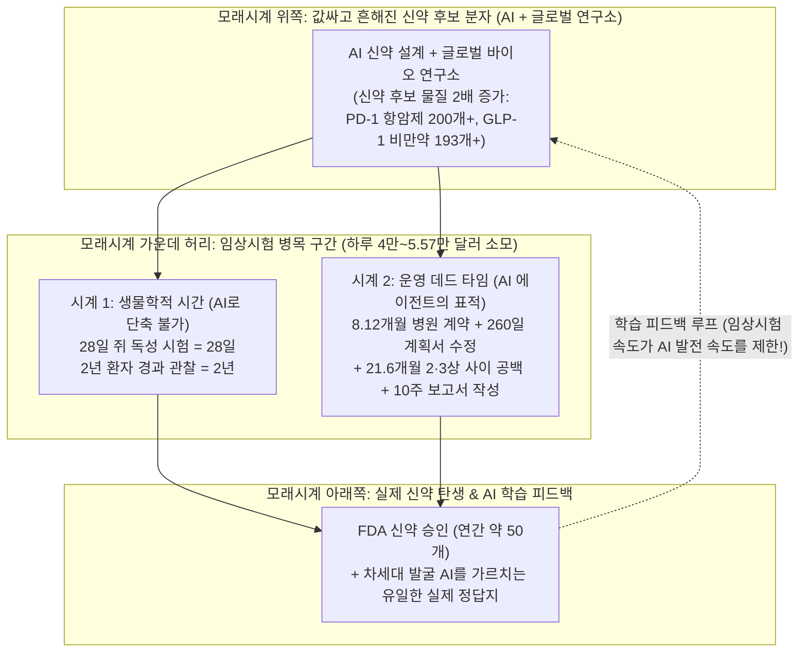
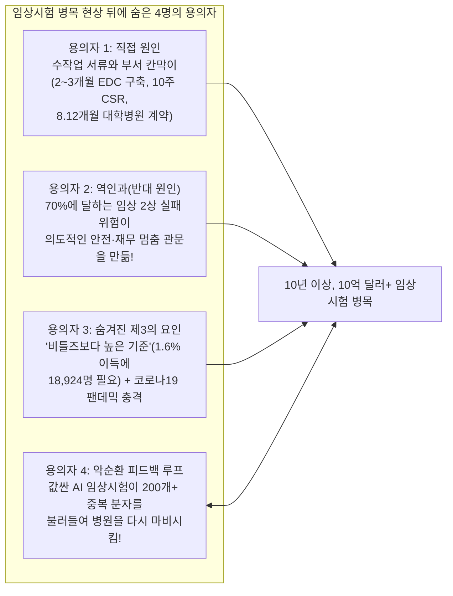
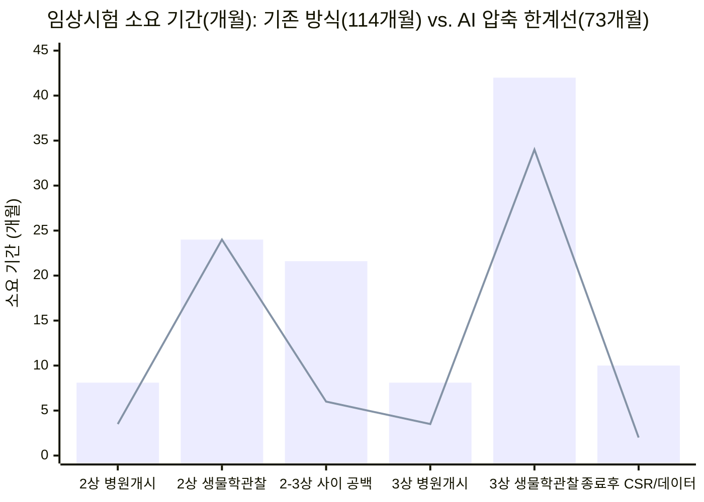

## 1. 훅(Hook): 잠깐만요—AI가 레이저 프린터처럼 신약 설계도를 찍어낼 수 있다면, 왜 오히려 진짜 약이 나오는 속도는 느려질 수도 있을까요?

방이 딱 두 개뿐인 자전거 공장을 하나 상상해 보세요.

**1번 방(설계도 그리는 방)**에서는 엔지니어들이 책상에 앉아 멋진 산악자전거 설계도를 그립니다.
**2번 방(안전 주행 테스트 트랙)**에는 외길로 된 좁은 장애물 코스 하나와 **10명의 테스트 라이더**만 있습니다. 법에 따라 어떤 새 자전거든 가게에서 팔려면 반드시 이 테스트 라이더들이 1년 동안 가파른 바위 언덕을 오르내리며 브레이크가 부러지지 않는지 직접 타 봐야 합니다.

그런데 어느 날, 누군가 1번 방에 마법 같은 인공지능(`AI`) 슈퍼컴퓨터를 들여놓았습니다! 일주일에 5개씩 그리던 자전거 설계도를 하루아침에 **매주 500개씩** 찍어내기 시작한 것입니다!

잠깐—그러면 가게에 안전하고 멋진 새 자전거가 당장 쏟아져 나올까요? **아닙니다!** 오히려 2번 방 문 앞에서 끔찍한 일이 벌어집니다.
* **테스트를 받지 못한 자전거 500대**가 좁은 트랙 문 앞 복도에 거대한 교통체증을 일으키며 쌓입니다.
* 10명의 테스트 라이더가 가장 훌륭한 자전거 2대에 집중하는 대신, 거의 비슷하게 생긴 자전거 50대를 동시에 시험하느라 여기 1명, 저기 1명씩 뿔뿔이 흩어집니다.
* 결국 어느 자전거도 제때 안전 테스트를 끝낼 만큼 충분한 라이더를 배정받지 못해, **AI가 오기 전보다 자전거 한 대를 완성하는 데 시간이 더 오래 걸리고 비용도 더 많이 들게 됩니다!**

2026년 11월 3일, 바이오테크 연구자이자 투자자인 **솔레일 위즈먼(Soleil Wizman)**([soleilwizman.com](https://www.soleilwizman.com/), 스라이브 캐피털(Thrive Capital), age1, 그리고 오픈AI가 인수한 오케스트라 바이오(Orchestra Bio)를 거쳐 현재 예일대학교와 아크 연구소(Arc Institute)에서 유전체 AI 모델을 연구 중)은 X(옛 트위터)에 ***"값싼 분자 시대의 임상 개발(Clinical Development in an Age of Cheap Molecules)"***이라는 화제의 분석 글을 발표했습니다. 이 글은 신약 인수·개발을 위해 **6억 달러(약 8,200억 원—새 통학버스 2,000대를 살 수 있는 거금!)** 규모의 펀드를 조성한 **포메이션 바이오(Formation Bio)**의 공동창업자 겸 CEO **벤 류(Ben Liu)**의 에세이 [*불균등한 프런티어(Uneven Frontiers)*](https://www.a16z.news/p/uneven-frontiers), 그리고 아틀라스 벤처(Atlas Venture)의 베테랑 투자자 **브루스 부스(Bruce Booth)**가 던진 경고("값싼 신약 후보 물질의 범람이 향후 3~5년 동안은 오히려 제약 산업 전체의 연구개발 생산성을 악화시킬 수 있다")를 정밀하게 검증한 보고서입니다.

위즈먼의 글 뒤에 있는 1차 과학 논문, 미국 정부 임상시험 등록부, 병원 통계 자료를 직접 열어 보면 **네 가지 거대한 미스터리**가 튀어나옵니다.

* **미스터리 #1 (신약 후보 물질은 2배로 늘었는데, 최종 승인은 왜 그대로일까?):** 지난 10년 동안 더 좋아진 실험실 장비, AI 설계 프로그램, 그리고 중국 바이오 연구소들의 폭발적인 성장 덕분에 새로 발굴된 신약 후보 물질(`분자 / Molecule`)의 수는 약 **2배**로 늘었습니다. 현재 **180개 이상의 회사**가 똑같은 암 스위치(`PD-1/PD-L1`)를 겨냥해 **200개가 넘는 약**을 시험 중이고, 비만 치료제 스위치(`GLP-1`) 하나에만 **193개의 약**이 몰려 있습니다([Ben Liu, 2026, *Uneven Frontiers*](https://www.a16z.news/p/uneven-frontiers))! 그런데 미국 식품의약국(`FDA`)이 매년 최종 승인하는 신약은 몇 개일까요? 여전히 **매년 약 50개**(2024년 기준 `50개`)로 제자리걸음입니다! 왜 입구에서 설계도를 두 배로 늘렸는데 출구로 나오는 약의 개수는 그대로일까요?
* **미스터리 #2 (하루 5만 5,716달러짜리 요금 미터기와 21.6개월의 텅 빈 공백기):** 미국 **터프츠대학교 의약품개발연구센터(`Tufts CSDD`)**의 실증 데이터에 따르면, 사람을 대상으로 임상시험을 운영하는 데 드는 직접 비용만 평균 **하루 4만 달러(약 5,500만 원)**이며, 마지막 3단계(`임상 3상`)에서는 **하루 5만 5,716달러(약 7,600만 원—거의 초등학교 선생님 한 분의 1년 치 연봉이 매일매일 날아가는 셈!)**에 달합니다. 게다가 시험이 하루 늦어질 때마다 약의 **20년 특허 독점 시계**가 하루씩 깎여 나가 미래 약국 매출에서 약 **하루 50만 달러(약 6억 8,000만 원)**의 기회비용이 사라집니다. 그런데 터프츠 연구진이 2008년부터 2018년 사이에 승인된 일반 신약들을 조사해 보니, 무려 **82%의 약이 임상 2상(중간 시험)을 끝내고 임상 3상(최종 시험)을 시작하기 전까지 평균 `17개월` 동안 아무런 환자도 치료하지 않는 '빈 공백기(White Space)'**로 멈춰 서 있었습니다! 심지어 이 공백기는 2008~2013년 평균 **`12개월`**에서 2014~2018년 평균 **`21.6개월`(거의 초등학교 두 학년 전체 기간!)**로 거의 두 배나 늘어났습니다!
* **미스터리 #3 (10주 걸리던 보고서를 AI로 10분 만에 줄였는데—왜 아직도 임상시험의 80%는 기한을 넘길까?):** 임상시험의 가장 마지막 환자가 마지막 병원 진료를 마친 뒤에도, 데이터를 정리하고 통계 표를 만들고 미국 정부에 제출할 거대한 최종 결과 보고서(`임상시험 결과보고서 / CSR`)를 쓰는 데만 보통 **몇 달(보고서 작성에만 `10주 이상`)**이 걸립니다. 최근 비만 치료제 `오젬픽(Ozempic)`을 만든 **노보 노디스크(Novo Nordisk)**의 **11명짜리 팀**(그중 몇 명은 컴퓨터 프로그래머도 아닌 비전공자!)이 앤트로픽(Anthropic)의 **클로드(Claude)** AI를 활용해 **`노보스크라이브(NovoScribe)`**([Anthropic 공식 사례 연구](https://claude.com/customers/novo-nordisk))라는 사내 시스템을 만들었는데, **10주 넘게 걸리던 보고서 초안을 단 10분 만에** 작성해 문서 작성 시간을 **90%**나 줄였습니다! 잠깐만요—AI가 10주짜리 서류 작업을 10분으로 줄일 수 있다면, 왜 아직도 전체 임상시험의 **약 80%**는 정해진 환자 모집 기한을 넘기고, 고용된 병원의 **11%는 환자를 단 1명(`0명`)도 등록하지 못하며**, 세계에서 가장 빠르게 AI로 임상시험을 대행하던 스타트업(**린더스 헬스 / Lindus Health**)은 왜 2026년 8월 돌연 **임상 대행 사업을 팔아치우고** 직접 약을 소유하는 회사(**린더스 테라퓨틱스 / Lindus Therapeutics**)로 변신했을까요?
* **미스터리 #4 (병원의 서류 병목이 왜 신약 발굴 AI의 지능까지 가로막을까?):** AI 과학자들은 실험실에서 분자만 만들면 끝이라고 생각하기 쉽습니다. 하지만 사람에게 직접 약을 먹여 보는 임상시험은 AI가 예측한 화학 설계도가 실제 사람의 몸속에서도 작동하는지 채점해 주는 **유일한 실제 정답지(`Ground Truth Evaluation`)**입니다! 만약 병원 임상시험 파이프가 막혀 있으면, 신약을 설계하는 AI 모델도 정답지를 돌려받지 못해 더 이상 똑똑해질 수 없습니다!

탐정 수첩을 펼쳐 보세요. 지금부터 신약 테스트가 어떻게 돌아가는지 기초부터 하나씩 조립하고, 절대로 줄일 수 없는 **'생물학적 시간(Biological Time)'**과 AI가 부술 수 있는 **'서류 대기 시간(Operational Dead Time)'**을 분리한 뒤, 미국 정부의 새로운 프로젝트 **`SURPASS`**가 이 판을 어떻게 바꾸려는지 끝까지 추적해 보겠습니다.

---

## 2. 기초부터 시작하기(Starting from Zero): 화학 설계도가 약국의 알약이 되기까지, 임상시험 속에서 째깍거리는 '두 개의 시계'는 무엇일까요?

컴퓨터 프로그램이 천식이나 암, 혹은 고지혈증을 고칠 수 있을 것 같은 아주 작은 화학 열쇠를 새로 설계했다고 해 봅시다. 과학자들은 이 후보 화학 물질을 **분자(Molecule)**라고 부릅니다.

제약회사가 이 분자를 내일 당장 동네 약국에 내다 팔 수 있을까요? **절대 안 됩니다.** 컴퓨터 화면이나 실험실 생쥐는 살아 있는 사람이 아니기 때문입니다! 유리 접시와 동물 실험에서 안전하고 효과적으로 보였던 약 100개 중 **약 90개는 실제 사람에게 시험해 보면 실패합니다**([Wong, Siah, & Lo, 2019, PMC6409418](https://pmc.ncbi.nlm.nih.gov/articles/PMC6409418/); [ARPA-H SURPASS, 2026](https://arpa-h.gov/explore-funding/programs/surpass)).

그래서 **미국 식품의약국(`FDA`)** 같은 정부 심판관은 모든 신약 후보 물질이 반드시 **임상 개발(Clinical Development)** 또는 **임상시험(Clinical Trials)**이라 불리는 3단계 인간 장애물 코스를 통과하도록 법으로 정해 두었습니다.

1. **1단계 (`임상 1상 / Phase 1` — 안전성 확인):** 의사들이 **`20~80명`의 지원자**에게 소량의 약을 투여해 사람의 혈액 속에서 안전한지, 어느 정도 용량이 적당한지 확인합니다.
2. **2단계 (`임상 2상 / Phase 2` — "진짜로 병이 낫는가?" 개념 증명):** 실제로 그 병을 앓고 있는 **`50~300명`의 환자**에게 약을 투여합니다. 여기가 신약 개발에서 가장 험난한 절벽입니다. 임상 2상에 들어간 약 중 **약 30%(10개 중 3개)**만 살아남습니다! 임상 2상을 통과했다는 것은 사람의 몸속에서 약효가 진짜로 증명되었다는 뜻이기 때문에, 벤 류가 [*불균등한 프런티어(Uneven Frontiers)*](https://www.a16z.news/p/uneven-frontiers)에서 밝혔듯 임상 2상을 통과하는 순간 그 약의 경제적 가치는 단숨에 **4배(`400%`)**로 껑충 뜁니다!
3. **3단계 (`임상 3상 / Phase 3` — 대규모 최종 챔피언 결정전):** 전 세계 수십~수백 개 병원에서 **`500명~19,000명 이상`의 환자**를 모집해, 기존 최고 치료제(또는 가짜 약인 **`위약 / Placebo`**)와 정면 대결을 펼쳐 안전성과 효과를 최종 입증합니다.

### 핵심 비밀: 모든 임상시험 달력에는 '서로 다른 두 개의 시계'가 돌아간다!

왜 임상 1상, 2상, 3상을 거치는 데 **10년 이상**이 걸리고 **10억~20억 달러(약 1조 4,000억~2조 7,000억 원)**가 들까요([ARPA-H SURPASS, 2026](https://arpa-h.gov/explore-funding/programs/surpass))?

솔레일 위즈먼은 임상시험의 일정을 두 가지 시간으로 쪼개어 보는 아주 명쾌한 기준을 제시합니다.

* **시계 #1: 생물학적 시계 ("절대 압축할 수 없는 생물학적 시간 / Irreducible Biological Time"):**
  임상시험 전에 쥐에게 28일 동안 매일 약을 먹여 간이 안전한지 확인하는 **28일 독성 시험**을 해야 한다고 해 봅시다. 28일짜리 쥐 실험은 며칠이 걸릴까요? **딱 28일 걸립니다!** 세상의 어떤 천재적인 AI 알고리즘도 살아 있는 쥐의 간이 화학 물질을 10배 빨리 소화하게 만들 수는 없습니다! 마찬가지로 임상 3상 암 시험에서 환자가 약을 먹은 뒤 **24개월 동안** 암이 재발하지 않는지 지켜봐야 한다면, 24개월이라는 실제 지구 달력 시간을 기다려야만 합니다. **AI 에이전트는 이 1번 시계를 단 1초도 줄일 수 없습니다.**
* **시계 #2: 대기 및 서류 시계 ("운영 데드 타임 / Operational Dead Time"):**
  그렇다면 *환자가 약을 먹고 있지도 않고, 생물학적 반응을 관찰하고 있지도 않은데 허비되는 수많은 달*은 무엇일까요?
  * 대학병원 변호사와 위원회가 임상시험 시작 계약서에 도장을 찍어 줄 때까지 기다리는 **8.12개월**.
  * 환자를 받기 전 컴퓨터 입력 화면(`EDC`)을 프로그래머들이 수작업으로 만드는 데 걸리는 **2~3개월**.
  * 임상시험 규칙서(`프로토콜`)를 한 번 고칠 때마다 승인을 받느라 멈춰 서 있는 **260일(약 8.5개월)**([Getz et al., 2024, PMID 38438658](https://eutils.ncbi.nlm.nih.gov/entrez/eutils/esummary.fcgi?db=pubmed&id=38438658&retmode=json)).
  * 임상 2상이 끝난 뒤 회사 임원들이 회의하고, FDA에 물어보고, 3상용 약병을 공장에서 찍어내느라 흘려보내는 **17~21.6개월의 빈 공백기**.
  * 마지막 환자가 집에 돌아간 뒤에도 데이터 오타를 고치고, 통계 코드를 짜고, 10주 동안 보고서를 쓰느라 걸리는 **수개월의 시간**!

놀랍게도 이 두 번째 시계의 작업들은 실제 일하는 시간만 따지면 **몇 시간이나 며칠**이면 끝나는 일들인데, 서류 전달과 예산 협상, 줄 서서 기다리는 시간 때문에 몇 달씩 늘어나는 것입니다. **바로 이 '대기 및 서류 시계(데드 타임)'가 자율형 AI 에이전트(Agentic AI)가 정조준하는 과녁입니다!**

---

## 3. 비밀 해독기(The Secret Decoder Ring): 어른들의 어려운 임상시험 전문용어 10가지 완벽 번역

본격적인 탐정 수사에 들어가기 전에, 이 분야의 무서운 영어 약어들을 초등학교 교실의 일상으로 바꿔 주는 **비밀 해독 표**를 먼저 챙겨 봅시다.

| 어른들의 전문용어 / 약어 | 진짜 뜻 (쉬운 설명) | 초등학교 5학년 눈높이 비유 |
| :--- | :--- | :--- |
| **`프로토콜(Protocol)` & `프로토콜 변경(Amendment)`** | 임상시험의 공식 규칙서(누가 참여할 수 있는지, 약을 얼마나 먹는지, 어떤 피검사를 언제 하는지 적은 설계도)와, 시험 도중 규칙이 안 맞아 고치는 공식 수정 절차(`Amendment`). | **거대한 레고 세트의 조립 설명서**—그리고 설명서 한 페이지를 고치느라 전국 50개 학급이 **`260일` 동안** 기다려야 하는 상황. |
| **`1차 평가변수(Primary Endpoint)`** | 시험을 시작하기 전에 미리 정해 놓는 '최종 승패 기준 점수'(예: "12주 뒤에 환자가 내쉬는 숨의 양이 얼마나 늘었는가?"). | 농구 경기를 시작하기 전에 화려한 드리블이나 운동화가 아니라 **전광판에 찍힌 골 득점**으로만 승패를 가른다고 못 박는 규칙. |
| **`EDC (전자 데이터 수집 시스템)`** | 병원 간호사와 코디네이터가 환자의 몸무게, 혈압, 혈액검사 수치를 입력하는 초고강도 보안 데이터베이스로, 글자 하나만 고쳐도 FDA 감사 기록이 남는 시스템. | 다섯 명의 교장 선생님이 동시에 감시하는 **지워지지 않는 디지털 성적표 장부**로, 숫자 하나를 고치려면 왜 고쳤는지 서명된 사유서를 붙여야 하는 장부. |
| **`CRO (임상시험수탁기관)`** | 제약회사를 대신해 수천 명의 직원을 투입하여 병원 섭외, 서류 관리, 데이터 점검을 대행해 주고 인건비를 받는 거대 외주 서비스 회사. | 학교 축제를 열 때 테이블 세팅과 출석 체크를 대신해 줄 진행 요원들을 **시간당 인건비**를 받고 빌려주는 행사 대행업체. |
| **`IRB (임상시험심사위원회)`** | 환자에게 위험하거나 불공정한 실험이 진행되지 않도록 임상시험 규칙서를 미리 읽고 허가해 주는 의사·과학자·시민 대표들의 독립 윤리 위원회. | 학교 운동장에 새 미끄럼틀을 설치했을 때 학생들이 타기 전에 안전한지 먼저 검사하고 도장을 찍어 주는 **학교 안전 심의 위원회**. |
| **`보험 급여 분석(Coverage Analysis)`** | 임상시험 중 병원에서 하는 수많은 검사 비용을 한 줄씩 따져서, 어떤 것은 **환자의 원래 건강보험**에 청구하고 어떤 것은 **제약회사**에 청구할지 나누는 까다로운 정산 작업. | 현장학습 피자 파티 영수증을 한 줄씩 보면서 기본 피자는 **학교 급식비**로 내고 특별 추가 토핑은 **동아리 후원금**으로 낼지 분류하는 작업. |
| **`CRF (증례기록서)` & `CDISC / CDASH`** | 환자가 병원에 올 때마다 채우는 표준 체크리스트 양식(`CRF`)과, 이를 FDA 컴퓨터가 자동으로 읽을 수 있게 통일한 국제 컴퓨터 데이터 표준(`CDISC`). | 전국 100개 학교의 시험지를 사람이 일일이 다시 타이핑하지 않아도 채점 기계가 바로 읽을 수 있게 맞춘 **표준 OMR 컴퓨터용 사인펜 답안지**. |
| **`데이터베이스 잠금(Database Lock)` & `CSR (임상시험 결과보고서)`** | 모든 데이터 오류 수정을 끝내고 장부를 완전히 봉인하는 것(`Database Lock`)과, 그 결과를 수천 페이지짜리 공식 책(`CSR`)으로 써서 FDA에 제출하는 것. | 학기 말에 **최종 성적표를 마감해 잠그는 것**, 그리고 교육청에 제출할 **두꺼운 연간 종합 보고서**를 작성하는 것. |
| **`PTRS (기술·규제 성공 확률)` & `rNPV (위험조정 순현재가치)`** | 신약이 모든 시험을 통과할 확률(`PTRS`)을 계산한 뒤, 미래에 벌어들일 돈에 그 확률을 곱해 지금 이 시험에 돈을 투자할 가치가 있는지 계산하는 공식(`rNPV`). | **`100달러`짜리 자전거**가 걸린 뽑기에서 당첨 확률이 `30%`일 때(기대 가치 = `30달러`), 참가비 **`10달러`**를 내고 뽑기를 하는 게 이득(`+20달러`)인지 계산하는 산수. |
| **`플랫폼 임상시험(Platform Trial)` (`ARPA-H SURPASS`)** | 약마다 따로따로 1상·2상·3상을 여는 대신, 하나의 큰 마스터 규칙서 아래에서 여러 회사의 약 5~10개를 **단 하나의 공통 대조군(가짜 약 그룹)**과 동시에 비교하는 시험. | 10명의 달리기 선수를 위해 경기장 10개를 따로 짓는 대신, **하나의 종합 경기장**에서 기준 페이스카 한 대와 10명이 동시에 달리는 합동 대회. |

---

## 4. 큰 주장 vs. 탐정의 팩트 체크: 왜 임상시험 자원은 갈수록 귀해지며, 에이전트 AI는 어디에서 진짜 위력을 발휘할까요?

돋보기를 들고 솔레일 위즈먼의 분석을 두 파트로 나누어 검증해 봅시다.
1. **왜 병원의 임상시험 파이프는 AI가 오기 전부터 이미 꽉 막혀 있었는가?**
2. **임상시험의 4대 병목을 공격하는 AI 에이전트 구조대들의 성적표는 실제 1차 자료에서 어떻게 나오는가?**

### 파트 A: 임상시험이 집어삼키는 4가지 희소 자원과 상황을 악화시키는 '3대 병목의 덫'

AI와 자동화 실험실이 신약 후보 분자를 아무리 많이 찍어내도, 임상시험은 **절대로 쉽게 늘릴 수 없는 4가지 희귀한 자원**을 태워야만 돌아갑니다.

| 희소한 임상시험 자원 | 임상 1상 (안전성) | 임상 2상 (약효 증명) | 임상 3상 (최종 확증) | AI가 마음대로 찍어낼 수 없는 이유 |
| :--- | :--- | :--- | :--- | :--- |
| **1. 실제 인간 환자** | `20~80명` 지원자 | `50~300명` 실제 환자 | `500~19,000명+` 실제 환자 | 특정 질병을 앓으면서 시험 병원 근처에 살고 까다로운 참가 조건을 모두 만족하는 사람은 한정되어 있습니다. |
| **2. 병원 기관 & 연구 코디네이터** | `1~5개` 전문 센터 | `10~50개` 병원/의원 | `50~1,300개+` 글로벌 병원 | 병원 연구 간호사와 의사의 하루 시간은 정해져 있으며, **선정된 병원의 11%는 환자를 단 1명(`0명`)도 못 뽑습니다.** |
| **3. 달력 시간 (Calendar Time)** | 중앙값 `1.6년` | 중앙값 `2.9년` (+ `17~21.6개월` 공백) | 중앙값 `3.8년` | 약물이 사람의 장기와 세포 속에서 효과를 나타내는 데는 실제 물리적 시간이 걸립니다. |
| **4. 직접 비용 & 특허 시계** | 수백만 달러 (`~$1.5만~$2.5만/일`) | 수천만 달러 (`~$2.37만~$4만/일`) | `5,000만~10억 달러` (직접비 **`$55,716/일`**) | 매일 현금이 타들어 갈 뿐 아니라 20년 특허 독점 기간이 하루씩 줄어들어 미래 매출 **`~$500,000/일`**이 사라집니다. |

게다가 위즈먼이 지적하듯, **세 가지 경제적 함정**이 이 표를 훨씬 더 가혹하게 만듭니다.

#### 함정 #1: 잭 스캐널의 "비틀즈보다 나아야 한다(Better Than the Beatles)" 딜레마와 10억 달러짜리 `ODYSSEY` 임상시험의 수학
2012년 *네이처 리뷰 드럭 디스커버리(Nature Reviews Drug Discovery)*에 실린 유명한 논문([Scannell et al., 2012, PMID 22378269](https://eutils.ncbi.nlm.nih.gov/entrez/eutils/esummary.fcgi?db=pubmed&id=22378269&retmode=json))에서 과학자 **잭 스캐널(Jack Scannell)**은 왜 신약 개발 효율이 갈수록 떨어지는지(`이룸의 법칙 / Eroom's Law`) 분석하며 **"비틀즈보다 나아야 한다"는 딜레마**를 제시했습니다.

만약 세상에 나오는 모든 신인 밴드가 전설적인 밴드 **비틀즈(The Beatles)**보다 노래를 더 잘한다는 것을 증명해야만 음반을 팔 수 있다면 어떨까요? 게다가 훌륭한 약이 하나 승인되어 값싼 일반 복제약(예: 콜레스테롤을 낮추는 **`스타틴 / Statin`** 알약)이 될 때마다, 다음 신약은 설탕 알약만 이겨서는 안 되고 **값싼 스타틴을 이미 먹고 있는 환자들에게 추가로 더 큰 효과**를 내야만 합니다!

위즈먼이 든 실제 증거인 콜레스테롤 주사제 **`알리로쿠맙(Alirocumab, 상품명 프랄런트 / Praluent)`의 [`ODYSSEY OUTCOMES` 임상 3상 시험](https://clinicaltrials.gov/study/NCT01663402)**(*New England Journal of Medicine* 게재, [Schwartz et al., 2018, PMID 30403574](https://eutils.ncbi.nlm.nih.gov/entrez/eutils/esummary.fcgi?db=pubmed&id=30403574&retmode=json))을 직접 확인해 봅시다.
* **투입된 규모:** 사노피(Sanofi)와 리제네론(Regeneron)은 전 세계 **57개국 1,315개 병원**에서 심장마비 등을 겪은 환자 **18,924명**(서울 잠실실내체육관이나 미국 매디슨 스퀘어 가든을 꽉 채울 인원!)을 모집해 약 **5년 동안**(중앙값 `2.8년` 추적 관찰) 약 **10억 달러(약 1조 3,800억 원)**를 썼습니다.
* **탐정의 통계 감사 (상대적 퍼센트 vs. 절대적 기준선!):** 뉴스 헤드라인에는 알리로쿠맙이 심장질환 위험을 **"15% 감소(상대적 위험 감소율 15%, Hazard Ratio 0.85)"**시켰다고 보도되었습니다. 잠깐—15%나 줄어들면 꽤 큰 차이 같은데, 왜 그걸 증명하는 데 환자 `18,924명`과 `10억 달러`가 필요했을까요?
* `PMID 30403574` 논문의 실제 원시 숫자를 열어 보세요! 시험에 참가한 모든 환자가 이미 강력한 `스타틴` 알약을 매일 먹고 있었기 때문에, 가짜 주사(`위약`)를 맞은 환자 **`9,462명` 중 `1,052명`(`11.1%`)**에게 심장마비·뇌졸중·사망이 발생했고, 알리로쿠맙 주사를 맞은 환자 **`9,462명` 중에서는 `903명`(`9.5%`)**에게 발생했습니다.
* `11.1%`에서 `9.5%`를 빼 보세요! **실제 절대적인 환자 비율(`절대 위험 감소율 / ARR`)로 따지면, 100명에게 거의 3년 동안 2주마다 주사를 놓았을 때 심장 사고가 줄어든 사람은 딱 `1.6명(1.6%포인트)`**(`11.1%`의 `15%`가 바로 `1.6%`입니다!)뿐이었습니다! 즉, 심장 사고 **1건**을 막기 위해 의사들은 **63명의 환자(`치료 필요 환자 수 NNT = 63`)**에게 거의 3년 동안 주사를 놓아야 했던 것입니다!
* 100명 중 `1.6명`이라는 바늘 끝 같은 차이를 우연한 동전 던지기 운과 구별해 내려면, 통계학적으로 어쩔 수 없이 **`19,000명`의 거대한 군중**이 필요합니다. 만약 내일 AI가 스타틴 옆자리를 노리는 새로운 콜레스테롤 약 후보 12개를 찍어낸다면, 그 12개 약 모두 각각 `19,000명`의 환자와 `10억 달러`가 필요합니다!

#### 함정 #2: 95%가 통계적 쓸모가 없었던 임상시험 과밀 사태 (재닛 우드콕 FDA 국장의 감사)
AI가 본격적으로 등장하기 전부터 이미 임상시험 현장은 중복 시험으로 몸살을 앓고 있었습니다. 2021년 당시 FDA 국장 대행이었던 **재닛 우드콕(Janet Woodcock)** 박사와 **케빈 부긴(Kevin Bugin)**은 전 세계에 등록된 **2,024건의 코로나19 임상시험(`2,895개 시험군`)**을 전수 조사했습니다([Bugin & Woodcock, 2021, PMC7903288](https://pmc.ncbi.nlm.nih.gov/articles/PMC7903288/)).
* 결과는 충격적이었습니다. 전 세계 코로나19 임상시험군 중 **무작위 배정(공정한 비교)과 충분한 환자 수(`통계적 검정력 / Power`)를 모두 갖추어 실제로 약효를 판단할 수 있었던 시험은 단 `5.0%`(20개 중 1개)뿐**이었습니다!
* 나머지 **95%의 시험**은 귀한 의사, 간호사, 환자를 소모하면서도 정작 "이 약이 진짜 듣는가?"라는 질문에 답하기엔 규모가 너무 작거나 설계가 부실했습니다. 그리고 지금 똑같은 과밀 현상이 항암제(`180개 이상` 회사가 `200개 이상`의 `PD-1/PD-L1` 후보 물질 시험)와 비만 치료제(`193개`의 `GLP-1` 후보 물질)에서 벌어지고 있습니다.

#### 함정 #3: 극단적으로 한쪽으로 쏠린 대박 곡선 (평균 `46억 달러` vs. 중앙값 `15억 달러`)
흔히 기술 투자자들은 *"신약 개발은 확률 게임이니 AI로 골문을 향해 슛을 더 많이 쏘면(`More shots on goal`) 무조건 돈을 더 많이 번다!"*라고 말합니다.
잠깐—**평균(Mean)과 중앙값(Median)의 함정**을 점검해 보세요!
* 신약 출시 후 평생 벌어들이는 매출 분포는 극단적으로 상위 소수에 쏠려 있습니다. **상위 10%(`Top Decile`)**의 대박 신약이 전체 신약 가치의 **50% 이상**을 독차지하며, 전체 신약의 산술적인 **평균(Mean)** 평생 매출을 약 **46억 달러(약 6조 3,000억 원)**로 끌어올립니다.
* 하지만 승인된 신약 100개를 매출 순서대로 줄 세웠을 때 정가운데인 50번째 약의 **중앙값(Median)** 평생 매출은 **약 15억 달러(약 2조 원)**로, 평균의 3분의 1에도 미치지 못합니다!
* 왜일까요? 새로운 질병 원리를 처음 뚫은 1등 약(`First-in-class`)이나 압도적인 최고 약(`Best-in-class`)이 환자를 다 가져가고, 뒤늦게 따라 나온 12번째, 15번째 비슷한 약(`Me-too drug`)들은 바닥의 부스러기를 놓고 싸우기 때문입니다. AI가 "그럭저럭 괜찮은 15번째 복제 신약 후보"를 잔뜩 만들어 병원에 밀어 넣으면, 정작 1등 신약이 써야 할 병원 침대와 간호사만 빼앗기게 됩니다!

---

### 파트 B: 왜 기존 3대 거인(`Cytel`, `Medidata`, `Veeva`)은 무너지지 않으며, 4대 AI 구조대는 어디를 공략할까?

신약 발굴 단계에서는 화학자가 화요일 오후에 혼자 노트북에 새로운 AI 프로그램을 깔아 써도 아무 문제가 없습니다.
하지만 **임상 개발**에서는 컴퓨터에 입력되는 숫자 하나하나가 FDA가 감사하는 법적 증거물이며, **제약회사(Sponsor) + 임상수탁기관(CRO) + 수십 개의 병원 + 윤리위원회(IRB) + 규제기관(FDA)**이라는 **5개 조직이 동시에 공유**해야 합니다. 그래서 수십 년 동안 세 곳의 기존 소프트웨어 거인이 시장을 철통같이 지배해 왔습니다.
1. **사이텔(Cytel, `1987년` 설립):** 거의 40년 동안 적응형 임상시험 설계와 시뮬레이션을 이끈 리더로, 대표 소프트웨어인 `East®`(2024년 `East Horizon™`으로 확장)는 **미국 FDA, 일본 PMDA, 그리고 글로벌 상위 30대 제약사**가 모두 사용합니다.
2. **메디데이터(Medidata):** 임상시험 데이터베이스(`EDC`)의 절대 강자로, **140개 이상 국가에서 38,000건 이상의 임상시험과 1,200만 명 이상의 환자 데이터**가 이 플랫폼에 기록되어 있습니다.
3. **비바 시스템즈(Veeva Systems):** 규제 기관 제출 서류와 임상시험 문서 관리(`Veeva Vault`)의 표준 플랫폼입니다.

따라서 똑똑한 AI 스타트업들은 이 거대한 금고를 부수려 하기보다, 그 위나 아래에 연결되어 임상시험의 **4대 병목 구간**을 자동화하고 있습니다. 위즈먼이 꼽은 핵심 AI 주자들과 우리의 1차 자료 팩트 체크 결과를 한눈에 비교해 보세요!

| 임상시험 4대 영역 & 병목 | 1차 자료로 확인된 비용·시간 고통 | 주요 AI 시스템 & 스타트업 | 탐정의 1차 자료 팩트 체크 (실제 한계와 진실) |
| :--- | :--- | :--- | :--- |
| **1. 시험 설계 및 규칙서 수정 (`Design`)** | 전체 시험의 `76%`가 규칙을 수정함(평균 `3.3회`); 수정 1회당 **`260일`** 소요([Getz et al., 2024, PMID 38438658](https://eutils.ncbi.nlm.nih.gov/entrez/eutils/esummary.fcgi?db=pubmed&id=38438658&retmode=json)), 직접 비용만 **2상 `$141,000` / 3상 `$535,000`**([Getz et al., 2016, PMID 30227022](https://eutils.ncbi.nlm.nih.gov/entrez/eutils/esummary.fcgi?db=pubmed&id=30227022&retmode=json)). | **PhaseV** (`5,000만 달러` 시리즈 A; 수백만 번의 베이지안 가상 시험 + `AI Conductor`), **일리노이대·Medidata `AMEND++`** ([arXiv:2601.06300](https://arxiv.org/abs/2601.06300)), **Biorce** (`200건+` FDA 거절 사유서 학습). | **결정적 한계 발견:** 우리가 `Getz et al. (2024)` 원문을 직접 확인한 결과, **프로토콜 수정의 `77%`는 시험 시작 후 FDA의 추가 요구나 전략 변경 때문에 발생한 '피할 수 없는(Unavoidable)' 수정**이었습니다! 또한 `161,970건`의 시험을 학습한 `AMEND++` 모델도 규칙이 바뀔지 여부만 **`AUROC 0.70~0.71`(정확도 약 `64.4%`)**로 맞힐 뿐, *왜* 또는 *어떻게* 고쳐야 하는지는 알려주지 못합니다. |
| **2. 병원 개시 및 단계 간 공백 (`Execution`)** | 2상과 3상 사이 **`17~21.6개월`**의 빈 공백(`82%`의 약); 병원 계약 체결까지 대학병원은 **`8.12개월`**, 일반 개인 의원은 **`4.37개월`** 소요; 병원의 **`~70%`**가 메디케어 **보험 급여 분석(Coverage Analysis)** 때문에 지연됨. | **Formation Bio `Forge`** (2상 진행 중에 3상 계획서·공급망을 미리 자동 갱신), **Medable** (`CDISC USDM 4.0` 기계 판독형 프로토콜 변환 에이전트), **UpSite Clinical** & **Advarra** (AI 보험 급여 분석). | **결정적 한계 발견:** AI 에이전트가 예산안과 계약서 초안을 몇 분 만에 만들어 줄 수는 있지만, **대학병원 계약팀의 밀린 결제 줄이나 한 달에 한 번 열리는 `IRB` 위원회 일정을 AI 혼자서 강제로 앞당길 수는 없습니다.** |
| **3. 환자 모집 및 병원 현장 운영 (`Recruitment & Ops`)** | 전체 시험의 **`~80%`**가 초기 환자 모집 기한을 못 지킴; 선정된 병원의 **`11%`는 환자를 `0명` 등록함**; 환자 1명 모집 비용 평균 **`$6,533`(약 900만 원)**. | **Formation Bio `Muse`** (사노피·오픈AI 협력), **Alleviate Health** (a16z `430만 달러` 시드; `190개+` 병원에서 `50만 건+` 환자 전화·문자 상담), **Intera** (탈락 환자를 같은 병원의 다른 시험으로 연결), **Tilda (`Tilda Sense`)** (코디네이터 업무 효율 `10배` 향상). | **결정적 한계 발견:** 직접 병원 네트워크를 만들거나 임상시험 전체를 대행하려던 **Lindus Health**와 **Topography Health** 모두 **2026년에 대행/병원 사업을 매각**했습니다! 빠른 속도를 서비스로 팔아 받는 수수료보다 직접 약을 소유하는 가치가 훨씬 크기 때문입니다. |
| **4. 데이터 정제 및 시험 종료 후 FDA 보고서 (`Data`)** | 시험 전 `EDC` 구축에 `2~3개월`; 시험 중 수작업 데이터 오류 팝업(`Query`) 해결에 수주 소요; 마지막 환자 방문 후 **`10주 이상`** 걸리는 **`임상시험 결과보고서(CSR)`** 작성 및 `SAS`/`R` 이중 코딩 검증. | **Saama** (역할별 데이터 관리 에이전트), **Octozi** (`300만 달러` 시드; 항암 3상 기준 **`500만 달러+` 절감** 추산), **GSK** (통계 분석 데이터셋 자동 코딩 에이전트), **Novo Nordisk `NovoScribe`** (클로드 기반 `CSR` 자동 작성). | **현재 가장 확실하게 검증된 1등 영역:** **노보 노디스크의 `NovoScribe`**([Anthropic 공식 사례](https://claude.com/customers/novo-nordisk))는 단 **11명의 팀**이 만들어 **`10주 이상` 걸리던 `CSR` 초안 작성을 `10분`으로 단축(`90%` 시간 절감)**했습니다! 단, 환자 데이터 수정 자체는 `임상시험관리기준(GCP)` 법규상 여전히 병원 의사가 최종 서명해야 합니다. |

### 잠깐—샌프란시스코 투자자들의 '임상시험 결과 맞히기 게임'을 수학으로 검증해 볼까요?

위즈먼은 샌프란시스코의 많은 바이오 투자자들이 *"우리 AI 모델은 임상시험 결과가 나오기 전에 성공할지 실패할지 미리 맞힐 수 있다!"*라고 자랑하는 유행을 꼬집습니다.

과연 그 AI가 진짜 실력인지, 아니면 동전 던지기 운이 좋았던 것인지 초등학교 5학년 탐정이 어떻게 판별할 수 있을까요?

벤 류가 [*불균등한 프런티어(Uneven Frontiers)*](https://www.a16z.news/p/uneven-frontiers)에서 제시한 **체육관 동전 던지기 수학(이항분포 검정)**을 해 봅시다.
* 업계에서 임상 2상이 성공할 기본 확률(`Base Rate`)은 **30%(10개 중 3개 성공)**입니다.
* 어떤 회사가 마법의 AI 안경을 썼다며 임상 2상 시험 **5개**를 골랐는데 그중 **3개가 성공(`60%`)**했다고 해 봅시다. 진짜 마법일까요? **아직 모릅니다!** 기본 성공 확률이 `30%`일 때, 눈을 감고 찍어도 5개 중 3개 이상 맞힐 확률은 **`16.3%`(주사위를 던져 특정 숫자가 나올 확률인 6분의 1 수준)**나 됩니다!
* 심지어 **10개**를 골라 **5개를 성공(`50%`)**시켜도, 우연한 운으로 그런 결과가 나올 확률이 여전히 **`15%`**나 됩니다!
* 통계학적으로 우연이 아니라는 것(`p = 0.048`, 즉 운일 확률이 `5% 미만`)을 증명하려면, 시험 결과가 나오기 전에 **미리 봉투에 예측을 적어 두고(`전향적 예측 / Prospective Readouts`) 최소한 10개 중 6개(`60%`) 또는 20개 중 10개(`50%`) 이상**을 맞혀야만 합니다!
* 임상 2상 하나가 끝나는 데 보통 **2~4년**이 걸리므로, 어떤 AI 모델이 진짜로 사람 몸속 약효를 예측할 수 있는지 증명하려면 **수년에 걸쳐 10~20개의 실제 임상시험 성적표**가 쌓여야 합니다. 그 전까지 기업들이 보여주는 화려한 예측 그래프는 모두 과거 시험지를 보고 맞힌 **사후 테스트(Backtest)**일 뿐입니다!

---

## 5. 네 명의 용의자(The Four Suspects): 임상시험 교통체증을 일으키는 진짜 범인은 누구일까요?

누군가 *"임상시험이 느리고 비싼 이유는 병원들이 낡은 소프트웨어를 쓰기 때문이니, AI 에이전트만 도입하면 다 해결된다!"*라고 말할 때, 진짜 탐정은 첫 번째 용의자만 보고 수사를 끝내지 않습니다. **네 가지 인과관계 용의자(직접 원인, 역인과, 숨겨진 제3의 요인, 피드백 루프)**를 모두 세워 놓고 증거를 대조해 봅시다.

| 용의자 | 주장의 논리 | 1차 자료 증거가 보여주는 진실 | 탐정의 최종 판결 |
| :--- | :--- | :--- | :--- |
| **용의자 #1: 직접 원인 (`낡은 수작업 업무 방식 → 느린 임상시험`)** | 간호사가 PDF 차트를 일일이 눈으로 찾고, 프로그래머가 `2~3개월` 동안 `EDC`를 만들고, 작성자가 `10주 이상` 결과보고서(`CSR`)를 타이핑하기 때문에 시험이 늦어진다. | **시험의 양 끝단(시작과 종료 후)에서는 100% 사실!** 노보 노디스크의 `NovoScribe`(`10주+ → 10분`), GSK의 통계 코딩 에이전트, `CDISC USDM 4.0` 자동 변환은 규칙 기반 서류 작업이 불필요한 마찰이었음을 증명했습니다. | **비생물학적 지연의 약 25%~35%에 대해 유죄!** (특히 병원 개시 서류, 데이터 오류 확인, 시험 종료 후 FDA 보고서 작성 구간). |
| **용의자 #2: 역인과 (`높은 생물학적 실패 위험 → 의도적인 멈춤 관문`)** | 잠깐—2상과 3상 사이의 `17~21.6개월` 공백이 단순한 게으름 때문일까, 아니면 **임상 2상의 70%가 실패한다는 냉혹한 현실** 때문에 제약회사가 3상용 약 제조와 계약에 수백억 원을 쓰기 전 일부러 결과를 확인하며 멈춰 서는 것일까? | **엄청나게 중요한 숨은 원인!** 만약 임상 2상이 끝나기도 전에 3상 약 공장을 미리 돌리고 병원 100곳과 계약을 맺으면, **10번 중 7번(`70%`)은 2상이 실패할 때 그 돈을 고스란히 날리게 됩니다!** 또한 `Getz et al. (2024)`([PMID 38438658](https://eutils.ncbi.nlm.nih.gov/entrez/eutils/esummary.fcgi?db=pubmed&id=38438658&retmode=json))에서도 프로토콜 수정의 `77%`는 시험 도중 발생한 규제·안전상의 **불가피한 변경**이었습니다. | **유죄!** 기술자들이 '느린 관료주의'라고 부르는 시간의 상당 부분은 사실 막대한 투자금을 지키기 위한 단계적 재무 방어막이자 환자 보호 장치(`IRB` + `GCP`)입니다. |
| **용의자 #3: 숨겨진 제3의 요인 (`높아진 약효 기준선 & 팬데믹 교란 변수`)** | 소프트웨어와 무관하게 외부 환경의 변화가 임상시험을 더 크고, 더 느리고, 수정이 많게 만들었다. | **두 가지 1차 데이터로 입증됨:** (1) 기존 값싼 약(`스타틴`)이 이미 너무 훌륭해서 `ODYSSEY OUTCOMES`([PMID 30403574](https://eutils.ncbi.nlm.nih.gov/entrez/eutils/esummary.fcgi?db=pubmed&id=30403574&retmode=json))는 **`1.6%`의 절대적 개선**을 증명하기 위해 **`18,924명`**을 뽑아야 했습니다. (2) `Getz et al. (2024)`의 프로토콜 수정 증가(`3.3회`, `260일`)는 **코로나19 팬데믹**으로 병원 방문 규칙이 바뀐 영향이 크게 작용했습니다! | **유죄!** 약 자체의 효과 차이가 `1.6%`에 불과할 때 필요한 대규모 환자 수는 아무리 빠른 PDF 챗봇으로도 줄일 수 없습니다. |
| **용의자 #4: 악순환 피드백 루프 (`값싼 AI 임상시험 → 분자 과밀 → 병목 재악화`)** | AI가 신약 분자 설계 비용을 낮추고 임상시험 운영비까지 낮추면, 예전 같으면 포기했을 어중간한 후보 물질들까지 기대 수익(`rNPV`) 계산을 통과해 한꺼번에 병원으로 몰려든다. | **지금 당장 벌어지고 있는 현실!** **`180개+` 회사의 `200개+` `PD-1` 항암제**와 **`193개` `GLP-1` 비만약**이 똑같은 병원 환자 풀을 놓고 경쟁하면서, 환자 1명을 등록하기 위해 더 많은 사람을 스크리닝해야 하고 병원 계약 단가가 치솟아 **AI로 아낀 비용을 도로 삼켜 버리고 있습니다!** | **유죄!** 후보 물질을 걸러내는 엄격한 사전 선별이나 공동 플랫폼 시험이 없다면, 값싼 시험이 오히려 도로 전체를 마비시킵니다(**의학계의 제본스 역설**). |

---

## 6. 숨겨진 함정(The Catch): 왜 가장 빠르다던 AI 임상시험 회사는 대행 사업을 팔아치웠고, '분자 교통체증'이 벌어지면 누가 피해를 볼까요?

새로운 기술이 모든 것을 해결할 것처럼 보일 때, 브라운과 킬리(Browne & Keeley)의 **'부정적 시각(The Negative View)'** 원칙은 이렇게 묻습니다. *"숨겨진 대가는 무엇인가? 누가 손해를 보는가? 그리고 가장 먼저 뛰어든 내부자들은 왜 방향을 바꿨는가?"*

위즈먼의 보고서에는 세 가지 날카로운 경고가 담겨 있습니다.

### 함정 #1: `린더스 헬스(Lindus Health)`의 대반전 ("왜 '속도'를 서비스로 파는 것보다 '약'을 직접 소유하는 게 훨씬 돈이 될까?")
2021년 **"안티 CRO(Anti-CRO)"**를 표방하며 화려하게 등장한 **린더스 헬스(Lindus Health)**를 보십시오. 여러 외주 업체를 쓰는 대신, **4,000만 건 이상의 전자의무기록(`EHR`)**에 연결된 단일 AI 플랫폼으로 프로토콜 작성부터 환자 모집, 데이터 수집까지 하나로 통합했습니다. 2025년 1월까지 북미와 유럽에서 **36,000명 이상의 환자**를 대상으로 **42건의 임상시험**을 완주하며 기존 CRO보다 최대 **3배 빠른 속도**를 기록했습니다!

잠깐—임상시험을 3배 빨리 돌리는 비법을 완성했다면, 당연히 세계 최대의 임상 대행 서비스 회사가 되었을까요?
**정반대입니다!** 2026년 8월, 린더스는 **자사의 CRO 임상 대행 사업부를 큐라빗 클리니컬 리서치(Curavit Clinical Research)에 통째로 매각**하고, 스스로 약을 사 와서 직접 개발하는 신약 개발사 **린더스 테라퓨틱스(Lindus Therapeutics)**로 간판을 바꿔 달았습니다! (마찬가지로 2022년 a16z 등으로부터 `2,750만 달러`를 투자받아 동네 병원 의사들을 임상시험 기관으로 키우던 **토포그래피 헬스(Topography Health)**도 2026년 5월 병원 네트워크 사업을 **FOMAT 메디컬 리서치**에 매각했습니다!)

도대체 왜 임상시험을 가장 빨리 돌리던 회사가 '속도를 파는 서비스'를 포기했을까요?
* 아주 간단한 산수를 해 보세요. 외주 대행업체(`CRO`)가 제약회사의 임상시험을 1년 앞당겨 주면, 대행업체는 고정 계약 수수료(예: `1,000만 달러`)를 **딱 한 번** 받습니다.
* 반면 그 약의 주인인 **제약회사(`Sponsor`)**는 특허 독점 판매 기간이 1년 늘어나고 임상 2상 통과 시 약의 가치가 **4배로 뛰면서 수억~수십억 달러의 과실**을 가져갑니다!
* **냉혹한 교훈:** 실제로 임상시험 속도를 획기적으로 줄일 수 있는 최고의 AI 기술 팀(**포메이션 바이오**, **린더스 테라퓨틱스** 등)은 그 기술을 남들에게 싼값에 빌려주기보다 **자기네 신약 파이프라인을 굴리는 데 독점적으로 쓸 유인**이 훨씬 큽니다!

### 함정 #2: 병원 침대에서 벌어지는 '공유지의 비극' (누가 대가를 치르는가?)
마을에 농부 12명이 함께 쓰는 푸른 목초지가 하나 있다고 상상해 보세요. 12번째 농부는 혼자 계산기를 두드립니다. *"내가 소를 한 마리 더 풀면 우리 집 지갑(`rNPV`)에는 이득이고, 풀밭이 닳는 피해는 12명이 나눠 지니까 내 손해는 작다!"* 결국 12명 모두가 소를 끝없이 풀다가 목초지가 진흙탕이 되어 모든 소가 굶어 죽습니다. 경제학자들은 이를 **공유지의 비극(Tragedy of the Commons)**이라고 부릅니다.

임상시험에서 **환자와 병원 연구 코디네이터가 바로 그 공동 목초지**입니다.
* **12번째 회사**가 이미 나와 있는 약과 거의 똑같은 12번째 `PD-1` 항암제나 `GLP-1` 비만약 시험을 시작할 때, 그 회사의 계산서는 *자기 회사 비용*만 따질 뿐 **1번부터 11번 시험에 끼치는 민폐(외부 불경제)**는 계산하지 않습니다!
* **결국 누가 피해를 볼까요?**
  1. **희귀 질환이나 난치병을 앓는 환자들:** 세상에 없던 완전히 새로운 원리의 혁신 신약(`First-in-class`) 시험이 거대 자본을 앞세운 15번째 유행 복제약 시험들에 밀려 병원의 연구 간호사와 침대를 배정받지 못합니다.
  2. **병원 연구 코디네이터(간호사·행정 인력):** 임상시험에서 가장 부족한 핵심 인력인데, 수십 개 제약회사의 서로 다른 시스템과 자동 전화 봇(`Alleviate`, `Intera`)의 홍수에 파묻혀 번아웃에 빠집니다.
  3. **소중한 몸을 과학에 맡긴 환자들:** 통계적으로 아무 결론도 내지 못하는 **95%의 부실한 시험**([Bugin & Woodcock, 2021, PMC7903288](https://pmc.ncbi.nlm.nih.gov/articles/PMC7903288/))이나 중복 시험에 참여하느라 정작 더 유망한 치료 기회를 놓칩니다.

### 함정 #3: `49% 대 16%`의 시범 도입 함정과 `ARPA-H SURPASS`가 넘어야 할 산
비슷한 약 10개를 한데 모아 **하나의 거대한 합동 시험**으로 치르면 문제가 해결되지 않을까요?

실제로 2026년 가을, 미국 정부의 보건 의료 혁신 기관인 **의료고등연구계획국(`ARPA-H`)**은 임상시험 기간을 **10년 이상에서 4년 미만으로 단축**하겠다는 야심 찬 프로젝트 [**`SURPASS`** (*Simulation-augmented, Real-time Platform Adaptive Seamless Trials*, 공고 번호 `ARPA-H-SOL-26-164`)](https://arpa-h.gov/explore-funding/programs/surpass)를 출범시켰습니다.
* 10개 회사가 각각 따로 임상 1·2·3상을 열면서 **가짜 약(`위약`)을 먹는 환자 그룹을 10번 중복해서 뽑는 대신**, 하나의 마스터 프로토콜 아래에서 여러 약이 **단 하나의 공통 대조군(위약 그룹)**을 공유합니다!
* 예를 들어 약 10개를 옛날 방식으로 시험하면 약마다 치료군 `100명` + 위약군 `100명` = 총 **`2,000명`**(`1,000명`이 가짜 약 복용!)이 필요하지만, 공통 위약군 `100명`을 함께 쓰면 치료군 `1,000명` + 공통 위약군 `100명` = **`1,100명`**이면 충분해 **900명의 환자가 가짜 약을 먹지 않아도 되고**, 효과가 없는 약은 실시간으로 조기 탈락시킬 수 있습니다!

하지만 왜 모든 제약회사가 당장 내일 `SURPASS` 같은 공동 플랫폼 시험에 줄을 서지 않을까요?
* **기업 간 자존심과 주가 리스크:** 제약회사들은 치열한 경쟁자입니다! A 회사가 5,000억 원을 들인 신약이 B 회사의 신약과 똑같은 시험판 위에서 나란히 비교되었는데 B 회사 약보다 점수가 `2%` 낮게 나오면, A 회사의 주가는 하루아침에 폭락합니다. 게다가 **베인앤드컴퍼니(Bain & Company)의 2026년 4월 설문조사**에 따르면, 제약사와 CRO의 **49%가 AI 도구를 시범 도입(Pilot)**하고 있지만, 실제로 AI에 맞춰 **업무 역할과 프로세스를 재설계한 곳은 단 16%**에 불과했습니다! 아무리 빠른 스포츠카를 사도 15개의 수동 톨게이트에서 일일이 멈춰 도장을 찍어야 한다면 도착 시간은 빨라지지 않습니다.

---

## 7. 최종 성적표(The Final Report Card): 우리의 결론 ("만약 ~라면" 법칙 & 2026~2030년 시나리오 전망)

아래 차트는 전통적인 임상 개발 일정(2상, 단계 간 공백, 3상, 종료 후 보고서까지 총 `약 114개월 / 9.5년`)에서 **AI 에이전트가 실제로 압축할 수 있는 '운영 데드 타임'**과 **절대로 줄일 수 없는 '생물학적 시간의 바닥(Floor)'**을 비교한 것입니다.

이 그래프 하나만 보면 전체 그림이 단번에 이해됩니다.
* **꺾은선이 막대그래프보다 뚝 떨어지는 구간(`2상 병원개시`, `2-3상 사이 공백`, `3상 병원개시`, `종료후 CSR/데이터`):** AI 에이전트는 계약서 검토, 프로토콜 변환, 단계 간 준비, 데이터 정제, 결과보고서 작성에서 **약 41개월(거의 3.5년!)의 순수 서류·대기 시간을 통째로 덜어낼 수 있습니다!**
* **꺾은선이 여전히 높게 유지되는 구간(`2상 생물학관찰 = 24개월`, `3상 생물학관찰 = 34~42개월`):** 환자의 몸속에서 약이 작동하는 **약 58~66개월(5~5.5년)의 실제 생물학적 시간**은 어떤 AI 챗봇으로도 빨리 감기 할 수 없으며, 오직 정교한 베이지안 시험 설계(`PhaseV`)나 공통 대조군 플랫폼(`ARPA-H SURPASS`)을 통해 필요한 환자 수를 `15%~20%` 줄여 간접적으로만 단축할 수 있습니다.

### 똑똑한 탐정을 위한 "만약 ~라면(If ... Then ...)" 판단 법칙

1. **만약 어떤 AI 기업이 '시험 종료 후 보고서 작성 및 데이터 정제' 구간(예: `NovoScribe`, `GSK`의 통계 코딩 에이전트, `Saama`, `Octozi`)을 공략한다면,** **즉각적이고 압도적인 성과(`50%~90%` 시간 단축)**를 기대해도 좋습니다. 마지막 환자 진료가 끝난 뒤 데이터를 `CDISC` 표와 `CSR` 문서로 바꾸는 일은 생물학적 기다림이 전혀 없는 100% 규칙 기반 정보 작업이기 때문입니다.
2. **만약 어떤 AI 기업이 '병원 개시 서류 및 코디네이터 업무 보조'(예: `Tilda`, `Medable`, `Alleviate Health`, `UpSite Clinical`)를 공략한다면,** 기존 `Medidata`/`Veeva` 시스템을 갈아엎으라고 요구하지 않고 그 아래에서 조용히 서류와 `메디케어 보험 급여 분석`을 처리해 준다는 조건 아래 **병원 코디네이터의 생산성을 2~3배 높이는 탄탄한 성공**을 거둘 것입니다.
3. **만약 어떤 AI 기업이 "임상 2상 성공 여부를 미리 예측한다"거나 "시험 시작 전에 프로토콜 수정을 완전히 없앤다"고 주장한다면,** 지갑을 닫고 **최소 10~20건의 사전 등록된 전향적 예측 성적표(`10건 중 6건` 또는 `20건 중 10건` 이상 적중)**를 요구하십시오. `Getz et al. (2024)`에서 프로토콜 수정의 `77%`는 시험 도중 발생한 불가피한 변경이었고, 과거 데이터 백테스트는 `30%`의 생물학적 기본 확률 변동을 이기지 못하기 때문입니다.
4. **만약 공동 선별 시스템(`ARPA-H SURPASS` 등) 없이 초기 신약 후보 분자만 계속 싸지고 흔해진다면,** 브루스 부스의 경고대로 **분자 과밀(`200개+` 중복 후보 경쟁)**이 환자 1인당 모집 비용(`$6,533+`)과 병원 예산을 폭등시켜 AI가 운영에서 아낀 비용을 상당 부분 집어삼킬 것입니다.

### 2026~2030년 확률 가중 시나리오 성적표

| 시나리오 | 발생 확률 | 2026~2030년에 벌어질 구체적 변화 | 승자와 패자 |
| :--- | :--- | :--- | :--- |
| **기본 시나리오(Base Case): "양 끝단의 서류 압축과 중간 병원의 분자 혼잡 충돌"** | **55% (가장 유력)** | 선도 기업들이 AI 에이전트로 결과보고서 작성(`10주+ → 며칠`), `EDC` 구축(`2~3개월 → 2주`), 2·3상 사이 공백(`21.6개월 → 6~9개월`)을 대폭 줄여 **약 2~3년의 데드 타임을 단축**합니다. 그러나 AI와 중국발 신약 후보 물질이 인기 표적(`PD-1`, `GLP-1`, 면역질환)에 몰리면서 병원 단가가 올라 전체 임상 2상 성공률은 `30%~35%` 부근에 머뭅니다. | **승자:** AI로 직접 신약 자산을 굴리는 기업(**Formation Bio**, **Lindus Therapeutics**), 병원·EDC 밀착형 에이전트(**Tilda**, **Saama**, **Octozi**, **PhaseV**), 대형 병원 네트워크. **패자:** 차별성 없는 15번째 후발 바이오텍 및 인건비 비례 청구형 구식 CRO. |
| **하방 시나리오(Bear Case): "병원 관료주의 병목과 시범 사업의 늪"** | **30%** | 신약 후보 물질 증가 속도가 병원 코디네이터 증가 속도를 3배 앞지르고, 대학병원의 계약 지연(`8.12개월`)과 수동 `IRB`/`GCP` 서명 관행이 AI 자동 협상을 거부하며, 대다수 제약사가 베인 조사의 `84%` 미개편 상태에 머뭅니다. 향후 3~5년간 업계 전체 R&D 투자 대비 수익률이 오히려 하락합니다. | **승자:** 기존 독점 기록 시스템(**Medidata**, **Veeva**, **Cytel**)과 가격 결정권을 쥔 최상위 병원 사이트. **패자:** 제약사 부서 칸막이 속에 단편적 AI 도구만 파는 SaaS 스타트업. |
| **상방 시나리오(Bull Case): "심리스 플랫폼 임상과 AI 트리아지의 대돌파"** | **15%** | FDA와 `ARPA-H SURPASS` 마스터 프로토콜이 항암제·희귀질환에서 표준으로 자리 잡아 5~10개 약이 단일 대조군을 공유하고, `CDISC USDM 4.0`으로 프로토콜-EDC 자동 연동이 완성되며, AI 환자 매칭이 `80%` 모집 지연율을 절반으로 줄여 2030년까지 연간 FDA 신약 승인 건수가 `~50개`에서 `75~90개`로 도약합니다. | **승자:** 희귀·난치병 환자들, 2배 빨라진 임상 피드백으로 급격히 똑똑해지는 신약 발굴 AI 모델, 소규모 정예 바이오텍. |

### 최종 한 줄 평결 (Bottom-Line Verdict)

솔레일 위즈먼의 진단은 정곡을 찌릅니다. **AI가 신약 후보 분자를 값싸게 찍어내는 시대에, 의학계에서 가장 귀한 보물은 더 이상 '화학 설계도'가 아니라 '실제 사람 몸에서의 임상 증명'입니다.**

그 어떤 소프트웨어 에이전트도 사람의 암세포가 줄어드는 생물학적 시간을 10분으로 압축하거나 3년짜리 심장 안전성 관찰을 건너뛸 수는 없습니다. AI가 **생물학적 시간(Biological Time)**을 없애 줄 것처럼 말하는 사람은 요술 가루를 파는 것입니다. 대신 **대기 및 서류 시계(Operational Dead Time)**를 주목하십시오. 노보 노디스크의 11명 팀이 **10주 이상** 걸리던 임상 결과보고서 초안을 **10분** 만에 뽑아내고, AI 에이전트들이 **21.6개월**의 단계 간 공백과 **8.12개월**의 병원 계약 정체를 걷어낼 때, 비록 생물학은 그대로일지라도 **2~3년의 순수한 서류 대기 시간을 깎아내는 것만으로도** 생명을 구하는 진짜 약이 환자들에게 수년 더 빨리 도착하고—신약 발굴 AI 역시 실제 인간의 정답지를 훨씬 빨리 돌려받아 한 단계 더 진화할 수 있습니다.

---

## 1차 출처 및 검증 영수증 (Primary Sources & Verification Receipts)

1. **Soleil Wizman (2026년 11월 3일):** *Clinical Development in an Age of Cheap Molecules* (저자 공식 포털 및 논문 목록: [soleilwizman.com](https://www.soleilwizman.com/)).
2. **Benjamine Liu, Formation Bio CEO (2026년 6월 17일):** *Uneven Frontiers: How AI Will Transform Biopharma—and Why the Sequence of Change Matters*, a16z News ([a16z.news/p/uneven-frontiers](https://www.a16z.news/p/uneven-frontiers)).
3. **Tufts CSDD 프로토콜 변경 최신 벤치마크 (Getz et al., 2024):** *New Benchmarks on Protocol Amendment Practices, Trends and their Impact on Clinical Trial Performance*, *Therapeutic Innovation & Regulatory Science* 58(3):539–548 ([PubMed PMID 38438658](https://eutils.ncbi.nlm.nih.gov/entrez/eutils/esummary.fcgi?db=pubmed&id=38438658&retmode=json)).
4. **Tufts CSDD 프로토콜 변경 비용 연구 (Getz et al., 2016):** *The Impact of Protocol Amendments on Clinical Trial Performance and Cost*, *Therapeutic Innovation & Regulatory Science* 50(4):436–441 ([PubMed PMID 30227022](https://eutils.ncbi.nlm.nih.gov/entrez/eutils/esummary.fcgi?db=pubmed&id=30227022&retmode=json)).
5. **일리노이대(UIUC) & Medidata `AMEND++` 벤치마크 (Das, Beigi, Aptekar, & Sun, 2026):** *AMEND++: Benchmarking Eligibility Criteria Amendments in Clinical Trials*, arXiv:2601.06300v2 ([arxiv.org/abs/2601.06300](https://arxiv.org/abs/2601.06300)).
6. **Jack Scannell 외 ("비틀즈보다 나아야 한다" / 이룸의 법칙, 2012):** *Diagnosing the Decline in Pharmaceutical R&D Efficiency*, *Nature Reviews Drug Discovery* 11(3):191–200 ([PubMed PMID 22378269](https://eutils.ncbi.nlm.nih.gov/entrez/eutils/esummary.fcgi?db=pubmed&id=22378269&retmode=json)).
7. **ODYSSEY OUTCOMES 알리로쿠맙 임상 3상 시험 (Schwartz et al., 2018):** *Alirocumab and Cardiovascular Outcomes after Acute Coronary Syndrome*, *New England Journal of Medicine* 379(22):2097–2107 ([PubMed PMID 30403574](https://eutils.ncbi.nlm.nih.gov/entrez/eutils/esummary.fcgi?db=pubmed&id=30403574&retmode=json); [ClinicalTrials.gov NCT01663402](https://clinicaltrials.gov/study/NCT01663402)).
8. **FDA 글로벌 임상시험 레지스트리 평가 (Bugin & Woodcock, 2021):** *Trends in COVID-19 Therapeutic Clinical Trials*, *Nature Reviews Drug Discovery* 20(4):254–255 ([PMC7903288](https://pmc.ncbi.nlm.nih.gov/articles/PMC7903288/)).
9. **MIT 임상시험 소요 기간 및 성공률 전수 분석 (Wong, Siah, & Lo, 2019):** *Estimation of Clinical Trial Success Rates and Related Parameters*, *Biostatistics* 20(2):273–286 ([PMC6409418](https://pmc.ncbi.nlm.nih.gov/articles/PMC6409418/)).
10. **Novo Nordisk & Anthropic `NovoScribe` 구축 사례:** *Novo Nordisk Accelerates Clinical Documentation and Drug Development with Claude* ([claude.com/customers/novo-nordisk](https://claude.com/customers/novo-nordisk)).
11. **미국 ARPA-H `SURPASS` 플랫폼 임상시험 이니셔티브 (2026):** *Simulation-augmented, Real-time Platform Adaptive Seamless Trials (`ARPA-H-SOL-26-164`)* ([arpa-h.gov/explore-funding/programs/surpass](https://arpa-h.gov/explore-funding/programs/surpass)).
