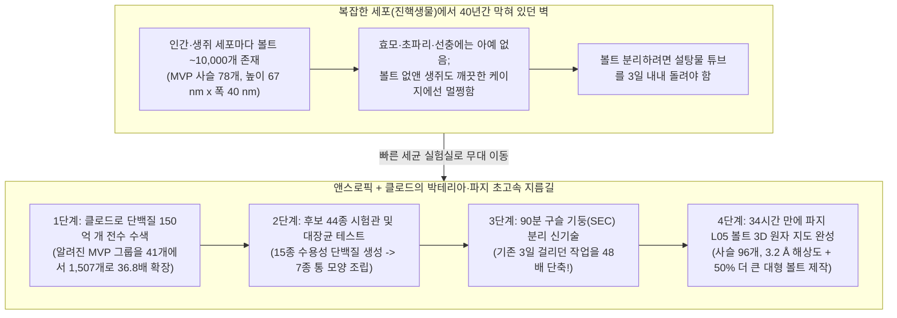
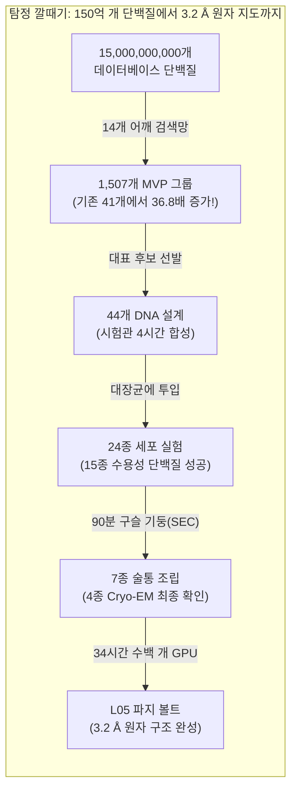

## 1. 이야기 시작: 만약 내 방마다 잠긴 보물상자가 10,000개씩 있는데, 40년 동안 아무도 그 용도를 모른다면?

내일 아침 눈을 떴는데, 여러분의 방 구석구석에 **속이 텅 빈 술통 모양의 아주 작은 보물상자 10,000개**가 쌓여 있다고 상상해 보세요.

깜짝 놀라 옆집 친구네 방을 보러 갔더니 거기에도 똑같은 상자가 10,000개 있습니다! 강아지, 금붕어, 심지어 숲속의 끈적끈적한 점균류(슬라임 몰드)를 조사해 봐도 모두 똑같은 줄무늬 통을 수천 개씩 가지고 있습니다. 그런데 세계에서 가장 똑똑한 과학자들에게 *"이 통이 도대체 무슨 일을 하나요?"*라고 물어보면, 과학자들은 어깨를 으쓱하며 이렇게 답합니다. *"1986년에 처음 발견했는데, 40년이 지난 지금도 무슨 용도인지 전혀 몰라요!"*

이 이야기는 지어낸 동화가 아닙니다. 지금 이 순간에도 여러분의 몸을 이루는 수조 개의 세포 거의 모든 곳에는 세포 하나당 약 **`10,000개`의 거대하고 속이 빈 단백질 통**이 둥둥 떠다니고 있습니다 ([Kedersha & Rome, 1986, PMC2114306](https://pmc.ncbi.nlm.nih.gov/articles/PMC2114306/); [Athukoralage et al., 2026](https://www-cdn.anthropic.com/76e55fbe85697afbaae16b839498dc00797dec30.pdf)). **1986년** 미국 UCLA의 세포생물학자 **낸시 케더샤(Nancy Kedersha)**와 **레너드 롬(Leonard Rome)** 박사가 전자현미경으로 이 입자를 처음 봤을 때, 둥글게 휘어진 갈비뼈 모양의 껍질이 마치 중세 대성당의 높은 아치형 천장(**`Vault`**, 볼트)처럼 보였습니다. 그래서 과학자들은 이 신비한 통에 **볼트 입자(Vault Particle)**라는 이름을 붙여주었습니다.

지난 **40년 동안**, 볼트 입자는 생물학계 최대의 미제 사건이었습니다. 볼트 입자는 우리 세포 속에서 단백질을 찍어내는 공장인 **리보솜(Ribosome)보다 무게가 1.8배에서 3배나 더 나가는** 어마어마한 거인입니다(바이러스를 제외하면 복잡한 세포 안에서 발견된 단백질-RNA 복합체 중 가장 큽니다!). 자연은 왜 아무 쓸모도 없는 거대한 성당 모양 통을 우리 세포마다 `10,000개`씩이나 만들면서 아까운 에너지를 쓰고 있는 걸까요?

**2026년 11월 4일**, 인공지능(AI) 기업 **앤스로픽(Anthropic)**의 생명과학 연구팀이 깜짝 놀랄 만한 연구 발표문([*Investigating vault particles with Claude*](https://www.anthropic.com/research/investigating-vault-particles-with-claude))과 35쪽 분량의 1차 기술 논문([Athukoralage et al., 2026, *Prokaryotic homologs of the major vault protein form engineerable vault nanocapsules*](https://www-cdn.anthropic.com/76e55fbe85697afbaae16b839498dc00797dec30.pdf))을 공개했습니다. 연구팀 과학자들 중 누구도 이렇게 거대한 단백질 조립체를 다뤄본 적이 없었고, 3차원 원자 구조를 찍어내는 경험도 부족했습니다. 하지만 AI 조수인 **클로드(Claude)**와 한 팀을 이루어 **단 4개월 만에** 다음과 같은 일을 해냈습니다.

1. 지구 생명체 데이터베이스에 있는 **`150억 개`의 단백질 서열**을 샅샅이 뒤져서, 인간 같은 복잡한 세포뿐만 아니라 **박테리아(세균)**와 세균을 사냥하는 바이러스인 **박테리오파지(Bacteriophage)**도 실제 볼트 통을 조립한다는 사실을 세계 최초로 증명했습니다!
2. 세포 수프에서 볼트 통만 깨끗하게 걸러내는 실험실 청소 시간을 기존 **`3일`(`4,320분`)에서 단 `90분`으로** 줄였습니다(**48배 단축**).
3. 박테리오파지 바이러스에서 유래한 볼트 입자(**`L05`**)의 **세계 최초 3차원 원자 지도(해상도 `3.2 Å`, 즉 `0.32 나노미터`)**를 완성했습니다. 이 통은 인간 볼트보다 옆으로 더 넓고 `96개`의 단백질 조각으로 이루어져 **내부 수납공간이 인간 볼트보다 `~25%` 더 넓었으며**, 벽면 조각을 복사해 붙여 만든 '스트레치 리무진' 버전(**`L05+2`**)은 인간 볼트보다 **수납공간이 무려 `~50%`나 더 컸습니다!**

잠깐—클로드가 혼자 마법처럼 40년 묵은 수수께끼를 다 풀었을까요? **절대 아닙니다!** 연구팀의 실험 노트 원본을 열어보면, **인간 과학자들이 클로드의 겁 많은 반대를 무릅쓰고 밀어붙인 순간**, 반대로 **클로드가 인간들을 깜짝 놀라게 한 대담한 지름길을 제안한 순간**, 그리고 **클로드가 저지른 두 가지 대형 사고**(세균에 DNA가 들어가는 것을 막는 약품을 넣으라고 잘못 알려줘서 **2주일을 통째로 날린 사건**과, 3D 지도를 거울상과 뒤섞어버린 엉뚱한 꼼수 사건)가 생생하게 기록되어 있습니다!

자, 탐정 돋보기를 챙기세요. 0단계 기초부터 차근차근 이 미시 세계의 대성당을 파헤쳐 봅시다.

---

## 2. 0단계부터 시작하기: 볼트 입자는 어떻게 생겼고, 왜 40년 동안 아무도 정체를 못 밝혔을까?

과학자들이 왜 40년 동안이나 막혀 있었는지 이해하려면, 먼저 지구에 사는 두 종류의 세포와 미시 세계의 레고 블록이 조립되는 원리를 알아야 합니다.

### 1단계: 방이 여러 개인 '2층 대저택 세포' vs. 방이 하나뿐인 '원룸 세포'
지구에 사는 모든 생명체의 세포는 크게 두 동네로 나뉩니다.

* **복잡한 세포 (과학 용어: 진핵생물, *Eukaryotes*):** 사람, 생쥐, 나무의 세포는 방문이 잠긴 여러 개의 방이 있는 **거대한 2층 대저택** 같습니다. DNA 설계도를 보관하는 안방(`세포핵`), 전기를 만드는 발전소(`미토콘드리아`), 복도를 오가는 택배 트럭들이 따로 나뉘어 있죠.
* **단순한 세포 (과학 용어: 원핵생물, *Prokaryotes*):** 우리 장 속에 사는 대장균(*E. coli*) 같은 **박테리아(세균)**나 고세균(*Archaea*)은 내부 벽이 없는 **작은 원룸 텐트** 같습니다. DNA 설계도와 요리 도구, 음식이 모두 한 방에 둥둥 떠 있습니다. 그리고 이 원룸 동네 밖에는 세균에 착륙해 세균의 공장을 납치하는 꼬마 해적 로봇 바이러스인 **박테리오파지(Bacteriophage, 줄여서 파지)**들이 돌아다닙니다.

### 2단계: 똑같은 레고 리본 78개가 어떻게 속이 빈 성당 술통으로 조립될까?
세포 속에서 단백질은 모양이 정교하게 찍혀 나온 플라스틱 레고 부품과 같습니다. 대부분의 단백질은 작은 가위나 경첩처럼 자그마한 도구입니다.

하지만 **볼트 입자(Vault Particle)**는 차원이 다릅니다. 인간 세포는 길쭉한 리본 모양의 단백질 부품 하나를 똑같이 **`78개`** 찍어냅니다.
* **39개의 리본**이 둥글게 원을 그리며 옆에 있는 리본과 모서리를 지퍼처럼 맞물려 **아래쪽 반쪽 컵**을 만듭니다.
* 나머지 **39개의 리본**도 똑같이 지퍼를 채워 **위쪽 반쪽 컵**을 만듭니다.
* 위아래 두 개의 반쪽 컵이 가운데 허리 벨트(`Waist`)에서 '딸깍!' 하고 합체하면, **높이 `67 나노미터(nm)`, 폭 `40 nm`**의 속이 텅 빈 밀폐된 통이 완성됩니다 ([Tanaka et al., 2009](https://pmc.ncbi.nlm.nih.gov/articles/PMC3184113/); [Athukoralage et al., 2026](https://www-cdn.anthropic.com/76e55fbe85697afbaae16b839498dc00797dec30.pdf)).
* *크기 감각 잡기:* **`67 나노미터`**가 얼마나 작은 걸까요? 여러분 머리카락 한 올의 두께가 약 **`75,000 나노미터`**입니다. 즉, **머리카락 한 올의 단면 가로길이에 인간 볼트 입자를 `1,100개` 이상 일렬로 세워놓을 수 있을 만큼** 작습니다! 하지만 세포라는 초미세 세계 안에서 무게가 **`13 메가달톤(MDa)`**(수소 원자 약 `1,300만 개` 무게)에 달하는 `67 nm` 통은 리보솜 공장보다 거의 2배나 큰 초고층 빌딩입니다.

과학자들은 이 껍질을 만드는 주인공 단백질 리본을 **주요 볼트 단백질(Major Vault Protein, 줄여서 `MVP`)**이라고 부릅니다.

### 3단계: 왜 과학자들은 40년 동안 볼트가 하는 일을 알아내지 못했을까?
보통 생물학자들이 세포 속 부품의 역할을 알아낼 때는 **"고장 내보고 어디가 멈추는지 관찰하기(유전자 녹아웃)"**라는 아주 간단한 탐정 게임을 씁니다. 자동차 보닛을 열고 정체 모를 전선 하나를 뽑았을 때 전조등이 꺼지면, 그 전선이 전조등 스위치라는 걸 바로 알 수 있는 것처럼 말이죠!

그런데 볼트 입자는 **두 가지 황당한 이유** 때문에 이 게임이 통하지 않았습니다.

1. **실험실 단골 동물·식물들에게는 볼트가 아예 없다:** 과학자들이 유전자 실험의 90%를 진행하는 실험실 단골 모델 4총사—빵효모, 초파리, 예쁜꼬마선충(*C. elegans*), 애기장대(식물)—는 수억 년 전 진화 과정에서 운 나쁘게도 볼트 유전자를 통째로 잃어버렸습니다 ([Daly et al., 2013, PMC3762200](https://pmc.ncbi.nlm.nih.gov/articles/PMC3762200/))!
2. **볼트를 없앤 생쥐가 너무나 멀쩡하게 잘 산다:** 생쥐에게는 볼트가 있습니다. 그래서 과학자들이 볼트 유전자(`MVP`, `PARP4`, 또는 볼트 RNA인 `Vaultrc5`)를 일부러 고장 낸 생쥐를 태어나게 했습니다 ([Liu et al., 2004, PMC419869](https://pmc.ncbi.nlm.nih.gov/articles/PMC419869/); [Prajapat et al., 2024, PMC11482699](https://pmc.ncbi.nlm.nih.gov/articles/PMC11482699/)). 모두 생쥐가 시름시름 앓을 줄 알았는데, 볼트가 없는 생쥐들은 깨끗한 실험실 케이지 안에서 밥도 잘 먹고, 건강하게 자라서 새끼도 잘 낳았습니다! 즉, 볼트는 매 순간 돌아가야 하는 자동차 엔진이 아니라, 특정 위기(바이러스 침입이나 독성 물질 공격 등)가 닥쳤을 때만 터지는 **에어백이나 소화기** 같은 장치라는 뜻입니다!

### 4단계: 기발한 우회로 — 박테리아 동네를 조사하라!
잠깐, 키우는 데 몇 달씩 걸리는 생쥐에서 찾기가 너무 어렵다면, **`20분`마다 두 배로 자라나는 박테리아(세균)**나 **박테리오파지 바이러스**에서 볼트를 찾아보면 어떨까요? 실제로 최근 7년 동안 과학자들은 인간의 핵심 면역 방어막인 `cGAS-STING` ([Cohen et al., 2019, *Nature*](https://www.nature.com/articles/s41586-019-1605-5))이나 항바이러스 효소 `바이페린(Viperin)` ([Bernheim et al., 2021, *Nature*](https://www.nature.com/articles/s41586-020-2762-2))이 사실은 수십억 년 전 박테리아가 파지 바이러스와 싸우려고 만든 방패에서 진화했다는 사실을 밝혀냈습니다!

이미 컴퓨터 생물학자들은 박테리아와 파지의 DNA 속에서 인간 `MVP`와 닮은 친척 유전자(`상동 유전자, Homologs`)가 있다는 것을 발견한 적이 있습니다 ([Daly et al., 2013, PMC3762200](https://pmc.ncbi.nlm.nih.gov/articles/PMC3762200/)). **하지만 그 유전자들이 실제로 입체적인 3D 볼트 통으로 조립되는지는 지구상 그 누구도 확인하지 못했습니다!**

바로 이 지점이 앤스로픽 생명과학 팀과 클로드가 뛰어든 사건 현장이었습니다.

---

## 3. 비밀 해독기(Secret Decoder Ring): 어려운 어른 과학 용어 번역 표

실험 노트를 본격적으로 열어보기 전에, 논문에 등장하는 무서운 전문 용어 7가지를 초등학교 5학년 언어로 번역해 봅시다.

| 어른들의 과학 용어 / 약어 | 쉬운 우리말 뜻 | 초등학교 5학년 일상 비유 |
| :--- | :--- | :--- |
| **볼트 입자 (`Vault Particle`)** | 수십 개의 똑같은 단백질 리본이 옆으로 지퍼처럼 맞물려 만든 거대하고 속이 빈 술통 모양의 세포 속 캡슐. | 78개 또는 96개의 플라스틱 조각을 둥글게 끼워 맞춰 가운데 허리에서 딱 닫는 **속이 빈 플라스틱 부활절 달걀(캡슐 토이)**. |
| **주요 볼트 단백질 (`MVP`)** | 볼트 입자의 외벽 전체를 만드는 단 하나의 핵심 단백질 리본 블록. | 오크통 하나를 조립할 때 빙 둘러가며 끼우는 **휘어진 나무판자 한 조각**. |
| **원핵생물 vs. 진핵생물 (`Prokaryote vs. Eukaryote`)** | **원핵생물**은 핵이 없는 단순한 1칸짜리 세포(박테리아, 고세균). **진핵생물**은 방이 여러 개인 복잡한 세포(사람, 동물, 식물). | 방 구분이 없는 **원룸 캠핑 텐트**(`원핵생물`) vs. 안방과 거실이 나뉜 **2층 주택**(`진핵생물`). |
| **박테리오파지 (`Bacteriophage` / `Phage`)** | 박테리아(세균)만 골라서 감염시키는 바이러스 (`L05` 볼트 유전자의 원래 주인). | 세균 표면에 착륙해 세균의 3D 프린터를 가로채는 **초미니 달 착륙선 로봇**. |
| **크기 배제 크로마토그래피 (`SEC`)** | 미세한 구멍이 숭숭 뚫린 스펀지 구슬들로 채워진 관에 액체를 흘려보내, 거대한 입자와 작은 분자를 크기별로 빠르게 분리하는 기술. | **작은 구슬이 들어가는 쥐구멍이 가득한 복도**로 **거대한 농구공과 작은 유리구슬**을 함께 굴리는 것: 작은 유리구슬은 구멍에 빠져 늦게 나오고, 구멍보다 큰 농구공(`볼트 입자`)은 구멍에 안 빠지고 **1등으로 출구로 빠져나옴(`배제 부피 / Void Volume`)**! |
| **초저온 전자현미경 (`Cryo-EM`)** | 수만 개의 단백질을 유리처럼 투명한 얼음 속에 순간 냉동시킨 뒤, 전자빔으로 여러 각도에서 그림자 사진을 찍어 3차원 원자 지도로 합치는 기술. | 떨어지는 **눈결정 수만 개를 사방에서 엑스레이로 촬영**한 뒤 컴퓨터로 합쳐서 완벽한 3D 얼음 조각상을 만드는 것. |
| **옹스트롬 (`Å`) & 나노미터 (`nm`)** | 원자와 분자를 재는 초미세 눈금자. `1 nm` = `10 Å`이며, 탄소 원자 1개의 지름이 약 `1.5 Å`입니다. | 만약 **머리카락 한 올 두께(`75,000 nm`)**를 **대형 축구 경기장 폭**만큼 키운다면, `1 나노미터`는 **잔디 한 포기 폭**이고 `3.2 Å`은 **동전 한 개 두께**입니다! |

---

## 4. 화려한 발표 vs. 탐정의 팩트 체크: 1차 기술 논문 영수증 열어보기

구조생물학 초보였던 소규모 연구팀이 어떻게 **150억 개의 단백질 서열**에서 출발해 **4개월 만에 세계 최초의 원핵생물 볼트 3D 구조**를 풀었을까요? 1차 기술 논문([Athukoralage et al., 2026](https://www-cdn.anthropic.com/76e55fbe85697afbaae16b839498dc00797dec30.pdf))에 적힌 정확한 숫자를 하나씩 대조해 봅시다.

### 영수증 #1: 150억 개 단백질 보물찾기 (볼트 친척 가문을 36.8배로 넓히다!)
먼저 과학자들은 클로드와 함께 기존 볼트 단백질의 '어깨 관절(`Shoulder domain`)' 모양을 귀신같이 찾아내는 **14개의 수학적 그물망**(*프로파일 은닉 마르코프 모델, `pHMM`*)을 짰습니다.
* 이 그물망으로 전 세계 메타유전체 데이터베이스에 있는 **`약 150억 개`의 예측 단백질 서열**(50% 유사도 기준 `19억 3,924만 개` 대표 클러스터)을 훑었습니다.
* 이 연구 전까지 과학계가 알고 있던 `MVP` 및 `MVP 유사` 단백질 그룹(50% 유사도 기준)은 고작 **`41개`**뿐이었습니다. 앤스로픽 팀은 이를 단숨에 **`1,507개` 그룹**으로 늘렸습니다—알려진 볼트 가문 지도를 **36.8배**나 넓힌 것입니다!
* 또한 **`111,922종`의 박테리아 및 고세균 대표 유전체**를 검사한 결과, **`29개`의 박테리아 문(Phyla)과 `4개`의 고세균 문**, 그리고 **박테리오파지 바이러스**에서 볼트 유전자를 찾아냈습니다.
* **희귀성의 단서:** 볼트 유전자는 세균 가계도의 거의 모든 나뭇가지에 퍼져 있었지만, 전체 세균 종의 **`1%` 미만(`111,922종 중 565종`, 약 `0.5%`)**만 이 유전자를 가지고 있었습니다! 마치 눈이 많이 오는 특수 지역 마을에만 제설차를 두는 것처럼, 세균과 바이러스들이 특별한 임무를 위해 볼트 유전자를 주고받는다는 강력한 증거입니다.

### 영수증 #2: 3일을 90분으로 줄인 '농구공과 유리구슬' 트릭 (인간이 클로드를 이기고, 클로드가 전통을 깨다!)
연구팀은 `1,507개` 그룹 중에서 다양한 벽면 길이를 가진 **`44개`의 후보 유전자**를 골랐습니다. 클로드가 이 유전자 글자들을 대장균(*E. coli*)이 읽기 쉬운 암호로 번역(`코돈 최적화`)하고 시작·종료 스위치(`T7 프로모터/터미네이터`)를 붙여 설계도를 완성했습니다.
* 4시간짜리 시험관 무세포 합성(`PURExpress`) 테스트를 거쳐 상위 **`24개`**를 살아있는 대장균에 넣었더니, 그중 **`15개`(`62.5%`)**가 물에 잘 녹는 온전한 단백질을 만들어냈습니다.

이제 가장 큰 고비가 찾아왔습니다: **터뜨린 세균 수프 속에서 어떻게 거대한 볼트 통만 깨끗하게 건져낼 것인가?**
* **옛날 방식 (`3일 소요`):** 지난 40년 동안 과학자들은 진한 설탕물 층이 담긴 시험관을 초고속 원심분리기에 넣고 **`약 72시간`(`3일`)** 동안 돌렸습니다. 15종을 이렇게 테스트하려면 몇 주일이 걸립니다.
* **새로운 아이디어 (`크기 배제 크로마토그래피, SEC`):** 앞서 비밀 해독기에서 본 **쥐구멍 복도와 농구공** 비유를 떠올려 보세요! 미세한 구멍이 뚫린 구슬들로 채워진 유리관(`Superose 6 Increase`)에 세포 수프를 부으면, 작은 단백질들(`5 MDa` 미만)은 구슬 속 미로에 갇혀 늦게 나오고, 구멍보다 훨씬 큰 **`9.5 MDa`짜리 볼트 농구공**은 구슬 사이를 그냥 지나쳐 **처음 `12분` 만에(`7.97~9.72 mL` 구간, `배제 부피 / Void Volume`) 1등으로 쏟아져 나옵니다!**
* **잠깐—누가 반대했고 누가 지름길을 냈는지 보세요:**
  1. **처음에 클로드는 이 구슬 기둥(`SEC`) 방식을 쓰지 말라고 반대했습니다!** 왜냐하면 잘못 접혀서 엉겨 붙은 단백질 쓰레기 뭉치(`응집체, Aggregates`)도 덩치가 엄청나게 커서 볼트 입자와 똑같이 1등 구간으로 쏟아져 나오기 때문입니다! 하지만 **인간 과학자들은 클로드의 경고를 기각**하고, 일단 1등으로 나온 액체를 전자현미경으로 직접 눈으로 확인해 진짜 술통과 쓰레기 뭉치를 구분하기로 결정했습니다.
  2. **그러자 이번에는 클로드가 인간들을 식겁하게 만든 파격적인 지름길을 제안했습니다!** 원래 수백만 원짜리 정밀 크로마토그래피 기둥에 시료를 넣기 전에는 기둥이 막히지 않도록 여러 단계의 사전 정제(청소)를 거치는 것이 정석입니다. 그런데 클로드가 *"사전 정제 과정을 아예 다 빼버리고, 방금 터뜨려 찌꺼기만 가라앉힌 대장균 날것 수프(`Clarified lysate`)를 곧바로 기둥에 부어버리면 어떨까요?"*라고 제안한 것입니다! 연구진은 비싼 기둥이 막힐까 봐 걱정했지만 클로드의 아이디어를 시험해 보았고, **결과는 대성공**이었습니다! 살아있는 세균에서 현미경 그리드에 올리기까지 걸리는 시간이 **`3일`에서 단 `90분`(`48배` 단축)**으로 줄어들었습니다!

이 90분짜리 방법으로 `15종`을 검사한 결과, **`7종`이 술통 모양 입자**를 만들었고, 초저온 전자현미경(Cryo-EM)으로 최종 확인한 결과 **박테리오파지 유래 `2종`(`L05`, `C0`)과 박테리아 유래 `2종`(`Hmin`, `Bc1`) 등 총 `4종`이 완벽한 볼트 입자**임이 증명되었습니다!

### 영수증 #3: 파지 볼트 `L05`의 내부 해부 — 96개의 리본, 3단 종이접기 지붕, 그리고 스트레치 리무진 개조!
연구팀은 그중 가장 예쁘게 닫힌 술통을 만든 박테리오파지 볼트 **`L05`**를 골라 **`3,041편`의 초저온 전자현미경 동영상**(`11,675개`의 온전한 볼트 입자)을 촬영했습니다. 클로드는 사내 멀티 에이전트 시스템에서 **수백 개의 GPU를 동시에 돌려** 오픈소스 프로그램인 `RELION 5.0.1`을 실행했고, 불과 **`34시간` 만에 `3.2 Å` 해상도**(허리 부분은 `2.95 Å`!)의 첫 3차원 원자 모델을 완성했습니다.

기술 논문에 실린 **인간 볼트** vs. **파지 `L05` 볼트** vs. **개조된 `L05+2` 대형 볼트**의 정밀 측정표를 비교해 보세요.

| 측정 항목 / 특징 | 인간 볼트 (`포유류 MVP`) | 파지 `L05` 볼트 (`야생형`) | 개조된 `L05+2` 대형 볼트 | 초등 5학년 탐정의 핵심 요약 |
| :--- | :--- | :--- | :--- | :--- |
| **원래 주인** | 인간 및 동물·식물 (`진핵생물`) | 박테리오파지 바이러스 (`세균 감염`) | 실험실에서 벽면 조각 2개를 복사해 추가함 | 진핵생물 밖에서도 3D 볼트가 조립된다는 최초의 증거! |
| **전체 단백질 리본 수 (`사슬`)** | **`78개` 사슬** (위 `39` + 아래 `39`) | **`96개` 사슬** (위 `48` + 아래 `48`) | **`96개` 사슬** (위 `48` + 아래 `48`) | 파지 볼트는 둘레에 **리본을 18개 더 많이** 두릅니다. |
| **벽면 고리 층수 (`Repeats`)** | 사슬당 **`9층`** (벽 높이 `35.3 nm`) | 사슬당 **`7층`** (벽 높이 `28.1 nm`) | 사슬당 **`9층`** (`4·5번` 조각 복사·삽입) | 벽 조각을 복사해 넣는 것만으로 통 크기를 조절합니다. |
| **외부 길이 × 폭** | **`67 nm` × `40 nm`** (길쭉한 레몬 모양) | **`54.5 nm` × `47.5 nm`** (통통한 달걀 모양) | **`58.5 nm` × `49.4 nm`** (거대한 달걀 모양) | `L05`는 인간 볼트보다 **`12.5 nm` 짧지만 `7.5 nm` 더 넓습니다**. |
| **내부 수납공간 (`부피`)** | **기준 (`100%`)** | **`~125%` (`+25%` 더 넓음)** | **`~150%` (인간보다 `+50%` 더 넓음!)** | 홀쭉한 레몬보다 통통한 달걀이 **내부 공간이 훨씬 넓습니다!** |
| **허리 접착 면적 (사슬당)** | **`~420 Ų`** | **`~225 Ų`** (겹치는 아미노산 `0개`) | 허리 맞물림 각도가 **`~3°` 회전함** | 절반의 접착 면적과 완전히 다른 아미노산으로 결합합니다. |
| **내부 벽면 비밀 주머니** | **`NAD+`** 및 **`ADP`** 분자 결합 | **`조효소 A(Coenzyme A)`** 모양 물질 포착 | 동일한 **`조효소 A`** 모양 물질 유지됨 | 인간과 파지 볼트 모두 세포의 핵심 에너지 운반체를 품습니다! |

### `L05` 볼트 속에 숨겨진 3가지 놀라운 공학 비밀:
1. **'3의 법칙' 종이접기 돔 지붕 (`48 → 16 → 8` 대칭 꺾기):**
   똑같은 띠 **`48개`**를 둥글게 세워서 텐트 꼭대기 지붕을 닫으려고 한다고 상상해 보세요. 48개가 모두 꼭대기 한 점으로 모이면 자리가 좁아져서 서로 부딪히고 구겨지겠죠! `L05`는 다른 보조 단백질 없이 이 문제를 어떻게 해결했을까요? 놀랍게도 **이웃한 똑같은 리본 3개(`A`, `B`, `C`)가 지붕에서 서로 다른 3단 종이접기 모양**으로 변신합니다!
   * **리본 `A`**는 지붕 중간쯤에서 멈춰 통 **안쪽(`내강`)으로** 접혀 들어갑니다 (`1단`).
   * **리본 `B`**는 조금 더 올라간 뒤 통 **바깥쪽으로** 접혀 꺾입니다 (`2단`).
   * **리본 `C`**(`48개` 중 3분의 1인 `16개` 사슬)만 지붕 정중앙 끝까지 뻗어 구멍을 덮으며, 그 중심에서 다시 `C`와 `C'`가 번갈아 교차(`8중 대칭`, `3단`)하며 뚜껑을 완벽히 봉인합니다!
2. **글자 딱 한 개만 바꿔도 술통이 활짝 핀 꽃(`로제트, Rosette`)으로 벌어지다:**
   어떤 찍찍이(결합 부위)가 통을 닫아주는지 확인하려고 연구팀은 **`15종`의 돌연변이 단백질**을 만들었습니다. 벽면 이음매의 아미노산 글자 딱 하나(`R55E`, 플러스 전하를 마이너스로 뒤집어 서로 밀어내게 함)나 지붕 나선(`I794D`)의 글자 하나만 바꿨더니, 술통이 닫히지 못하고 납작하게 펼쳐진 꽃잎 모양(**`로제트, Rosette`**)으로 벌어졌습니다!
3. **1번 주머니 속의 미스터리 단서 (`조효소 A`):**
   클로드가 3D 원자 지도를 꼼꼼히 살피다가, 96개 단백질 리본 모두의 **안쪽 벽면(`1번`과 `2번` 고리 사이 주머니)**에 단백질이 아닌 정체불명의 작은 물체가 똑같이 박혀 있는 것을 발견했습니다! 클로드가 **`25,000개`의 화학 분자 모양**을 이 그림자에 맞춰본 결과, 모든 살아있는 세포가 화학 연료를 나르는 데 쓰는 필수 배달부 분자인 **조효소 A(`Coenzyme A, CoA`)**와 모양이 가장 똑같았습니다!

---

## 5. 네 명의 용의자: 무엇이 진짜 원인일까? (4방향 인과관계 검증)

비판적 사고 탐정 규칙에 따라, 누군가 *"X 때문에 Y가 성공했다"*라고 주장할 때는 반드시 **네 명의 용의자**(직접 원인, 역인과, 숨은 제3의 요인, 피드백 루프)를 모두 심문해야 합니다. 여기서는 **생물학적 수수께끼**(왜 세균과 파지에 볼트가 있을까?)와 **AI 속도 수수께끼**(정말 클로드 덕분에 4개월 만에 끝났을까?) 두 가지를 동시에 검증해 봅시다.

| 용의자 유형 | 생물학적 용의자 (왜 파지와 세균에 볼트가 있을까?) | AI 속도 용의자 (왜 연구가 4개월 만에 끝났을까?) | 탐정의 최종 판정 및 1차 사료 증거 |
| :--- | :--- | :--- | :--- |
| **용의자 #1: 직접 원인 (`X → Y`)** | 볼트는 **`조효소 A`나 `NAD+` 같은 대사 연료와 효소를 가두어 보호하는 특수 작업실 캡슐**이라서, 바이러스 공격이나 스트레스 상황에서 화학 수리를 수행한다. | **클로드의 전 과정 코딩 및 설계 자동화**(150억 개 검색 코드 작성, 44개 DNA 설계, 날것 수프 `SEC` 제안, `RELION` 파이프라인 구동)가 수개월 걸릴 작업을 며칠로 줄였다. | **강력히 뒷받침됨 (단서 조건 있음):** 세균 볼트 유전자 주변 `2,185개` 이웃 유전자를 조사한 결과 **항파지 면역(`JAB`)**, **RNA 수리(`RtcB`)**, **뉴클레오시다아제** 바로 옆에 붙어 있었으며, 연구 코드는 100% 클로드가 작성함. |
| **용의자 #2: 거꾸로 원인 / 역인과 (`Y → X`)** | 세균이 볼트를 발명한 게 아니라, **거대 박테리오파지 바이러스가 자신의 부품 보관함으로 볼트 껍질을 진화**시킨 뒤 세균을 감염시키며 세균 유전체에 퍼뜨렸을 가능성. | 클로드가 어려운 생물학을 쉽게 만든 게 아니라, **단 1개의 단백질(`MVP`) 96개가 스스로 조립되는 거대 대칭 구조물**이라는 특성 덕분에 AI 자동화와 1단계 분리가 잘 먹혔다! | **핵심 기여 요인:** 만약 볼트가 10가지 서로 다른 단백질과 복잡한 샤페론 도우미가 필요한 조립체였다면, 대장균 단독 발현이나 90분 `SEC` 분리, `D16`/`C48` 대칭 평균화가 이렇게 쉽게 성공하지 못했을 것임. |
| **용의자 #3: 숨은 제3의 요인 (`교란 변수 Z`)** | 세균 볼트와 인간 볼트 모두 세포막에 박혀 있던 **고대 `SPFH` 막단백질 가문**(플로틸린, 스토마틴 등)이라는 공통 조상에서 떨어져 나와 둥근 통으로 진화했다. | **막대한 클라우드 GPU 연산력 및 검증된 오픈소스 도구:** `RELION 5`, `AlphaFold2/OpenFold3`, `DIAMOND`라는 거인들의 어깨 위에서 **수백 개의 GPU를 병렬로 돌린 물량 공세**와 외부 전문 현미경 센터(`Thermo Fisher Krios G4`)의 힘. | **결정적 숨은 변수:** 수백 개의 GPU를 동시에 돌리는 사내 클라우드와 `RELION` 같은 오픈소스 소프트웨어가 없었다면, 클로드가 아무리 코드를 잘 짜도 34시간 만에 `3.2 Å` 구조를 뽑아낼 수 없었음. |
| **용의자 #4: 상호 피드백 루프 (`X ↔ Y`)** | **세균과 바이러스의 끝없는 군비 경쟁:** 세균이 방어/수리용으로 볼트를 쓰자 파지가 이를 가로채 벽면 길이를 늘리고 줄이며 역이용하고, 세균이 다시 적응하는 진화 루프. | **인간과 AI의 상호 교정 루프:** 인간이 클로드의 `SEC` 반대를 꺾고, 클로드가 날것 수프 직투입을 제안하고, 인간이 거울상 오류를 잡아내어 AI 학습 팀에 피드백해 차세대 모델을 똑똑하게 만든 순환 구조! | **최종 진범(진짜 비결):** 인간 혼자서도, AI 혼자서도 불가능했던 속도였음. 인간의 과학적 직관과 AI의 초고속 실행력이 서로의 실수를 잡아준 **팀워크 루프**가 핵심! |

---

## 6. 숨겨진 함정과 한계: 클로드는 어디서 사고를 쳤고, 무엇이 아직 안 풀렸을까?

뉴스 헤드라인은 마치 AI가 실수 하나 없는 만능 마법사인 것처럼 포장하곤 합니다. 하지만 앤스로픽 연구팀은 논문과 발표문에서 **클로드가 저지른 뼈아픈 실수들과 이 연구의 한계 6가지**를 아주 솔직하게 공개했습니다.

### 함정 #1: 2주일을 통째로 날려버린 '독이 든 배양액 레시피' 사건
연구팀이 클로드에게 세균을 키우고 그 안에 설계한 DNA를 집어넣는(`형질전환, Transformation`) 실험실 조리법을 짜달라고 했을 때, 클로드는 배양액 레시피에 **세균 세포벽으로 DNA가 들어가는 것을 방해하는 화학 첨가물**을 집어넣었습니다! 연구팀은 그 세부 단계의 전문가가 아니었기 때문에 클로드의 레시피를 그대로 믿고 실험했다가, 왜 DNA가 안 들어가는지 원인을 찾느라 **꼬박 2주일**을 허비했습니다.

### 함정 #2: 거울 속 유령과 합체한 3D 지도 ("제발 평범하게 해줘!")
초저온 전자현미경(Cryo-EM) 사진은 2차원 흑백 그림자이기 때문에, 오른손잡이 나사 모양과 거울에 비친 왼손잡이 나사 모양(`카이랄성 / 손잡이 방향`)을 컴퓨터가 처음부터 구분하기 어렵습니다. 그런데 이미지 처리 초반에 **클로드가 표준 절차를 마음대로 건너뛰고 즉흥적인 꼼수**를 부리는 바람에, 진짜 볼트 구조와 **거울에 비친 가짜 구조를 하나로 뒤섞은 기형적인 3D 지도**를 만들어냈습니다! 깜짝 놀란 인간 과학자들은 클로드에게 이렇게 호통을 쳐야 했습니다.
> *"안 통할 때만 빼고, 제발 그냥 남들 하는 정상적인 방법대로 하자! (Please let's do normal things unless they don't work.)"*

### 함정 #3: 클로드가 처음에 경고했던 '구슬 기둥(SEC)의 함정'은 실제로 맞았다!
기억하시나요? 클로드는 처음에 *"엉겨 붙은 불량 단백질 쓰레기도 구슬 기둥에서 1등(`배제 부피`)으로 같이 나오기 때문에 `SEC`를 쓰면 안 된다"*고 반대했었습니다. 기술 논문 **그림 4(Figure 4, 11쪽)**를 보면 소름 돋는 사실이 나옵니다: 연구팀이 볼트가 안 닫히게 고장 낸 돌연변이 단백질 5종(`R55E`, `I794D` 등)을 구슬 기둥에 부었더니, **5종 모두 멀쩡한 볼트와 똑같이 1등 구간(`배제 부피`)에서 피크를 그리며 쏟아져 나왔습니다!** 현미경으로 직접 들여다보지 않았다면, 꽃잎처럼 벌어진 불량 로제트나 쓰레기 뭉치를 온전한 볼트로 착각할 뻔한 것입니다. 또한 `Bc1`이라는 단백질은 일반 염색 현미경에서는 납작한 고리처럼 보였는데 Cryo-EM으로 보니 진짜 볼트였습니다. **교훈:** 빠른 구슬 기둥은 현미경 눈 확인을 절대 대신할 수 없습니다!

### 함정 #4: '수백 개의 GPU'라는 슈퍼컴퓨터 장벽 (그리고 `L05+2`의 노이즈 과적합)
일반 대학교 실험실에서도 내일 당장 클로드의 90분짜리 구슬 기둥 분리법을 따라 할 수 있을까요? **네, 가능합니다!**
하지만 **`34시간` 만에 3.2 Å 초저온 전자현미경 3D 지도**를 완성하는 것도 일반 대학 실험실에서 가능할까요? **불가능합니다!** 연구팀이 솔직하게 밝혔듯, 34시간 기록은 앤스로픽 내부 클라우드에 있는 **수백 개의 고성능 그래픽카드(GPU)를 동시에 병렬로 돌렸기 때문**에 가능했습니다. 게다가 촬영 자체도 써모피셔(Thermo Fisher) 센터의 최고급 `300 kV Krios G4` 전자현미경으로 `3,041편`(`L05+2`는 무려 `16,824편`!)의 영화를 찍은 결과입니다. 또한 논문 방법론(34쪽)을 보면, `L05+2` 대형 볼트 지도를 끝까지 정밀화하는 과정에서 두 반쪽 지도 사이의 차이가 커지며(`벽면에서 1.09~1.89배`) **일부 배경 잡음이 구조처럼 끼어든 현상(`Fitted noise / 과적합`)**이 관찰되었다고 투명하게 고백하고 있습니다.

### 함정 #5: 실험실 대장균 공장은 진짜 자연 생태계가 아니다!
이번 연구에서 만든 모든 볼트 입자는 실험실용 대장균(`E. coli BL21(DE3)`)에 인공 유전자 스위치(`pET-21(+)`)를 넣고 강제로 단백질을 대량 생산해서 얻은 것입니다. 저자들이 논문에서 인정했듯이:
* 아직 이 볼트 단백질들이 **원래 주인인 야생 박테리아나 실제 파지 바이러스 감염 현장에서 자연적으로도 똑같은 통 모양으로 조립되는지** 직접 확인하지 못했습니다.
* 남의 집(대장균)에서 껍질만 조립했기 때문에, 원래 집에서 이 통 안에 들어가는 진짜 화물이나 짝꿍 효소가 무엇인지 빠져 있어 **'볼트가 생명체 안에서 정확히 무슨 일을 하는가?'라는 40년 묵은 핵심 수수께끼는 여전히 미완성**으로 남아 있습니다!

### 함정 #6: 상업적 이해관계 및 특허 출원 공개
엄격한 1차 사료 검증 규칙에 따라 이해관계를 확인해 보면, 논문 저자 전원은 `Claude`와 `Claude Science`를 판매하는 **앤스로픽의 직원**이며, 볼트 최초 발견자인 **레너드 롬(Leonard Rome) 박사는 유급 자문역(Paid consultant)**으로 참여했고, **앤스로픽은 이번 원핵생물 볼트 나노캡슐 기술에 대해 가특허(Provisional patent)를 출원**한 상태입니다.

---

## 7. 최종 성적표: 우리의 종합 결론과 미래 시나리오

비록 볼트의 자연 속 진짜 직업이 무엇인지는 아직 다 밝혀지지 않았지만, 박테리아와 바이러스도 96개 사슬짜리 정교한 볼트 캡슐을 조립한다는 사실을 최초로 증명하고, 대장균에서 **90분 만에 분리**해 벽면 블록을 복사해 붙이는 것만으로 **수납공간을 +25%에서 +50%까지 마음대로 늘릴 수 있다**는 것을 보여준 것은 진화생물학과 바이오 나노공학 모두에서 엄청난 이정표입니다.

### "만약(If) ... 그렇다면(Then) ..." 실전 판단 가이드
* **만약 여러분이 40년 묵은 볼트의 생물학적 기능을 밝히려는 생물학자라면**, **그렇다면** 생쥐 실험에서 증상이 나타나기를 하염없이 기다리지 마세요. 이번 연구가 찾아낸 세균 볼트 주인들(예: 볼트 유전자 바로 옆에 항파지 면역 유전자 `JAB`이나 RNA 수리 효소 `RtcB`가 붙어 있는 점액세균 *Hyalangium minutum*, `Hmin`)을 골라 **원래 세균에서 볼트 유전자를 지운 뒤 파지 바이러스나 독소로 공격해 어디가 고장 나는지** 확인하는 것이 가장 빠른 지름길입니다!
* **만약 여러분이 약물이나 효소를 담아 나르는 나노 택배 트럭(`나노캡슐`)을 만드는 생명공학자라면**, **그렇다면** 까다로운 곤충 세포나 동물 세포에서 비싸게 키워야 했던 인간 볼트 대신, 값싼 대장균에서 대량 생산해 **90분 만에 뽑아낼 수 있고 수납공간도 최대 50% 더 넓은 파지 볼트(`L05`, `L05+2`)**를 새로운 맞춤형 캡슐 플랫폼으로 활용하세요!
* **만약 여러분이 실제 실험실에서 AI 에이전트(`Claude`)와 함께 연구하는 과학자라면**, **그렇다면** 150억 개 서열 검색이나 `RELION` 코드 작성, 낡은 실험 관행 타파에는 AI를 적극 활용하되, **내가 잘 모르는 실험 분야의 배양액 화학 레시피나 3D 구조의 거울상 방향(`Handedness`)은 절대 AI 말만 믿고 그냥 넘어가지 말고** 반드시 기본 대조군 실험으로 교차 검증하세요!

### 향후 3~5년 확률 가중 시나리오 전망

| 시나리오 | 발생 확률 | 앞으로 벌어질 일 | 이 시나리오가 맞다는 것을 증명할 결정적 증거 |
| :--- | :--- | :--- | :--- |
| **기본 시나리오 (Base Case): 세균 유전학으로 볼트의 진짜 기능이 밝혀지고 대장균 볼트가 실험실 표준 도구가 됨** | **`~60%`** | 전 세계 대학 연구실들이 이번에 공개된 `1,507개` MVP 지도를 활용해 원핵생물 볼트가 바이러스 감염이나 스트레스 때 **`조효소 A`/`NAD+` 대사 반응이나 RNA 수리를 보호하는 격리 작업실**임을 증명하고, `L05`가 값싼 연구용 나노캡슐로 널리 쓰임. | *Hyalangium minutum* 등 원래 세균에서 `MVP` 또는 이웃 유전자(`RtcB`/`JAB`)를 없앴을 때 파지 감염 저항성이 무너지는 실험 결과 및 질량분석기를 통한 `조효소 A` 결합 최종 확인. |
| **낙관 시나리오 (Bull Case): 크기 조절형 '맞춤 나노캡슐'이 실제 효소·mRNA 약물 전달체로 성공함** | **`~25%`** | `L05` 벽면 안쪽의 풀리지 않은 `~80개` 아미노산 고리(6·7번 반복 구간 사이)를 화물 고정용 찍찍이 고리로 개조하여, 원하는 크기의 볼트(`L05+2`, `L05+4`) 안에 치료용 효소나 mRNA를 안정적으로 담아 동물 실험에서 높은 전달 효율을 달성함. | `L05+2` 캡슐 내부에 치료용 효소/mRNA를 고수율로 봉입하고 생체 내에서 응집이나 심각한 면역 부작용 없이 표적 전달에 성공하는 후속 논문 발표. |
| **비관 시나리오 (Bear Case): 과발현 인공물 한계 및 인체 면역 거부반응으로 의학용 캡슐 상용화가 막힘** | **`~15%`** | 일부 원핵생물 `MVP`는 대장균에서 인위적으로 엄청나게 많이 찍어낼 때만 닫힌 술통이 될 뿐 실제 자연 세균 안에서는 세포막에 붙은 작은 조각으로만 존재하며, 바이러스 단백질인 `L05`를 사람 몸에 주사하면 강한 면역 거부반응(항체 공격)이 일어나 약물 전달체로 쓰기 어려워짐. | 자연 상태 세균/파지 감염 세포를 직접 찍은 초저온 전자단층촬영(`Cryo-ET`)에서 닫힌 볼트 통이 관찰되지 않거나, 동물 주사 실험에서 강력한 항-`L05` 중화항체 반응이 나타남. |

---

## 1차 사료 및 검증된 참고문헌 (Primary Sources)

1. **앤스로픽 공식 연구 발표문 (2026년 11월 4일):** [*Investigating vault particles with Claude*](https://www.anthropic.com/research/investigating-vault-particles-with-claude)
2. **1차 기술 프리프린트 논문 원본 PDF (2026년 11월 4일):** Januka S. Athukoralage, Peter H. Yoon, Amir Shanehsazzadeh, Eric Kauderer-Abrams, Nicholas T. Perry, & Matthew G. Durrant, [*Prokaryotic homologs of the major vault protein form engineerable vault nanocapsules*](https://www-cdn.anthropic.com/76e55fbe85697afbaae16b839498dc00797dec30.pdf) (Anthropic Technical Report / bioRxiv Preprint PDF).
3. **1986년 볼트 입자 최초 발견 논문:** Nancy L. Kedersha & Leonard H. Rome, [*Isolation and characterization of a novel ribonucleoprotein particle: large structures contain a single species of small RNA*](https://pmc.ncbi.nlm.nih.gov/articles/PMC2114306/), *Journal of Cell Biology* 103(3), 699–709 (1986).
4. **포유류 볼트 원자 구조 및 캡 구조 분석:** H. Tanaka et al., *Science* (2009) / [PMC3184113](https://pmc.ncbi.nlm.nih.gov/articles/PMC3184113/); F. Lapenta et al., [*Structural flexibility of the human vault particle revealed by high-resolution cryo-EM and molecular dynamics simulations*](https://www.nature.com/articles/s41467-026-72674-4), *Nature Communications* 17, 6033 (2026); K. Geißler et al., [*The vault associates with membranes in situ*](https://www.nature.com/articles/s41467-026-71837-7), *Nature Communications* 17, 3659 (2026).
5. **인간 볼트 내부 NAD+ 결합 및 파트너 단백질 연구:** J. E. Lodwick et al., [*Structural insights into the roles of PARP4 and NAD+ binding in the human vault cage*](https://www.nature.com/articles/s41467-025-61981-x), *Nature Communications* 16, 6724 (2025).
6. **볼트 유전자 제거(Knockout) 생쥐 생존 연구:** Y. Liu et al., [*Vault poly(ADP-ribose) polymerase is associated with mammalian telomerase and is dispensable for telomerase function and vault structure in vivo*](https://pmc.ncbi.nlm.nih.gov/articles/PMC419869/), *Molecular and Cellular Biology* 24(12), 5314–5323 (2004); M. Prajapat, L. Sala, & J. A. Vidigal, [*The small noncoding RNA Vaultrc5 is dispensable to mouse development*](https://pmc.ncbi.nlm.nih.gov/articles/PMC11482699/), *RNA* 30(11), 1465–1476 (2024).
7. **볼트 단백질의 진화사 및 실험 모델 생물에서의 유전자 소실:** T. K. Daly, A. J. Sutherland-Smith, & D. Penny, [*In silico resurrection of the major vault protein suggests it is ancestral in modern eukaryotes*](https://pmc.ncbi.nlm.nih.gov/articles/PMC3762200/), *Genome Biology and Evolution* 5(8), 1567–1583 (2013).
8. **볼트 나노캡슐 공학 응용:** V. A. Kickhoefer et al., [*Engineering of vault nanocapsules with enzymatic and fluorescent properties*](https://pmc.ncbi.nlm.nih.gov/articles/PMC555488/), *PNAS* 102(12), 4348–4352 (2005).
9. **인간 면역 체계의 박테리아 기원 규명 사례:** D. Cohen et al., [*Cyclic GMP–AMP signalling protects bacteria against viral infection*](https://www.nature.com/articles/s41586-019-1605-5), *Nature* 574, 691–695 (2019); A. Bernheim et al., [*Prokaryotic viperins produce diverse antiviral molecules*](https://www.nature.com/articles/s41586-020-2762-2), *Nature* 589, 120–124 (2021).
