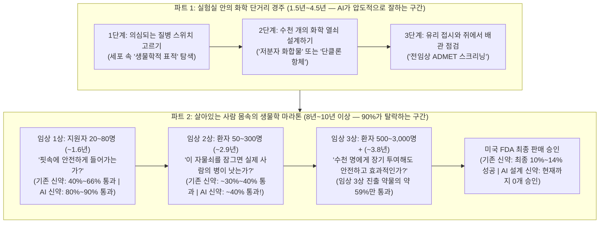
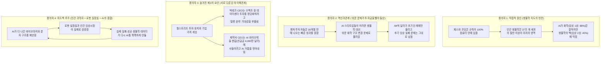

## 1. 이야기 시작: 잠깐—체스 세계 챔피언도 이기고 코딩도 몇 초 만에 끝내는 AI가 왜 아직 약은 단 하나도 못 만들었을까?

지구에서 가장 똑똑하고 돈이 많은 어른들이 거대한 학교 체육관 양쪽 끝에 서서, 컴퓨터가 언제쯤 우리의 병을 다 고쳐줄 수 있을지 열띤 말싸움을 벌이고 있다고 상상해 보세요.

**첫 번째 코너(실리콘밸리 빅테크 대표들)**에는 초거대 인공지능(`AI`) 슈퍼컴퓨터를 만드는 사람들이 서 있습니다.
* AI 기업 **앤트로픽(Anthropic)**의 다리오 아모데이(Dario Amodei) 대표는 자신의 유명한 에세이 [*은총의 기계들(Machines of Loving Grace)*](https://darioamodei.com/machines-of-loving-grace)과 엑스(X) 게시글에서 AI가 앞으로 50년~100년 걸릴 의학 발전을 단 몇 년으로 압축해, *"미친 소리처럼 들릴지 모르지만 약 5년~10년 안에 인류의 거의 모든 질병을 고치는 것이 가능해질 것"*이라고 장담했습니다.
* 또 다른 실리콘밸리 기술 기업 리더는 한 제약회사 회장에게 **"앞으로 7년 안에 AI가 인류 질병의 90%를 고칠 것"**이라고 큰소리를 쳤습니다.
* 2026년 11월 3일 *월스트리트저널(WSJ)*의 자비에르 마르티네스(Xavier Martinez) 기자가 보도한 심층 취재(*"실리콘밸리는 AI가 질병을 완치할 것이라 약속한다. 제약사 CEO들은 믿지 않는다"*)에 따르면, 심지어 한 IT 임원은 AI 연구원들이 "어차피 AI가 곧 폐암을 고쳐줄 텐데 뭐!"라며 담배를 피우기 시작했다는 농담까지 던졌습니다!

반면 **두 번째 코너(실제로 약을 만드는 제약회사 대표들과 과학자들)**에는 30년~40년 동안 실험실과 병원에서 환자들의 생명을 구하는 약을 직접 만들어 온 베테랑들이 서 있습니다.
* 낭포성 섬유증과 겸상 적혈구 빈혈 치료제를 개발한 세계적인 제약사 **버텍스 파마슈티컬스(Vertex Pharmaceuticals)**의 의사이자 과학자인 **제프 라이든(Jeff Leiden)** 회장은 "AI가 7년 안에 질병의 90%를 고친다"는 말을 듣고 단 한마디로 잘라 말했습니다. ***"완전 헛소리(Complete BS)입니다."***
* 라이든 회장은 왜 이렇게 단호할까요? 버텍스가 직접 실험해 봤기 때문입니다! 버텍스는 무려 **50곳에 달하는 AI 기업**을 고용해 자신들이 가진 **10,000개의 화학 물질 데이터**를 샅샅이 뒤지게 했습니다. 그 결과 AI가 혼자 힘으로 만들어낸 성공적인 신약은 몇 개였을까요? **단 한 개도 없었습니다(`0개`).** 라이든 회장은 월스트리트저널 인터뷰에서 *"AI 혼자서는 절대 작동하지 않습니다. 그렇게 할 수 있다고 말하는 회사가 있다면—적어도 우리가 대부분 다 검증해 본 경험으로는—사실이 아닙니다"*라고 못 박았습니다.
* 글로벌 제약사 **아스트라제네카(AstraZeneca)**의 파스칼 소리오(Pascal Soriot) 대표도 고개를 저었습니다. *"이 업계에 충분히 오래 있다 보면 금방 겸손해집니다. 질병은 복잡하고, 생명과학(생물학)은 너무나 복잡합니다. AI가 암을 정복할 거라고 말하는 건 좀 지나친 비약입니다."*
* 1,000개가 넘는 특허를 보유한 **리제네론(Regeneron)**의 최고의학책임자 **조지 얀코풀로스(George Yancopoulos)** 박사 역시 이렇게 덧붙였습니다. *"AI가 기적처럼 나타나서 우리에게 약 만드는 법을 알려주고, 15년 걸리던 개발 기간을 5년으로 뚝 줄여주지는 못할 것입니다."*

잠깐만요! 탐정 모자를 쓰고 지금 당장 전광판의 숫자를 확인해 볼까요? 월스트리트저널 기사 뒤에 숨어 있는 실제 의학 논문과 미국 정부 임상시험 기록을 열어보면 **네 가지 거대한 미스터리**가 튀어나옵니다.

* **미스터리 #1 (84억 달러를 쏟아붓고도 '0개'인 승인 성적표):** 맥킨지(McKinsey) 데이터에 따르면 벤처캐피털과 사모펀드 투자자들은 2025년 한 해에만 전 세계 AI 신약 개발 기업에 무려 **84억 달러(약 11조 7,000억 원)**를 투자했습니다. 2년 전의 **40억 달러**에서 두 배 이상 뛴 금액이자, 대당 1,000달러짜리 최신 노트북을 **초등학생 840만 명**에게 사 줄 수 있는 엄청난 돈입니다! 그런데 2026년 11월 현재, AI가 설계해서 미국 식품의약국(`FDA`)의 최종 판매 승인을 받아 약국에 나온 약은 몇 개일까요? **정확히 0개입니다.**
* **미스터리 #2 (1단계 우등생이 2단계에서 낙제하는 이유):** 보스턴컨설팅그룹(`BCG`) 연구진이 사람에게 시험 중인 모든 AI 발굴 신약 파이프라인을 전수 조사해 보니([Jayatunga et al., 2024, PMID 38692505](https://eutils.ncbi.nlm.nih.gov/entrez/eutils/esummary.fcgi?db=pubmed&id=38692505&retmode=json)), 사람에게 처음 먹여보는 **1단계 시험(`임상 1상` 안전성 확인)**에서는 AI 신약의 **80%~90%(`24개 중 21개`)가 합격**해 기존 제약업계 평균(`40%~65%`)을 압도했습니다! 그런데 정작 실제 환자의 병이 낫는지 확인하는 **2단계 시험(`임상 2상` 약효 확인)**으로 넘어가자 합격률이 **40%(`10개 중 4개`)로 곤두박질치며** 옛날 방식의 약들과 똑같은 낙제점으로 돌아갔습니다. 대체 왜 그럴까요?
* **미스터리 #3 (세계에서 가장 유명한 AI 신약 임상시험 표에 숨겨진 비밀):** **인실리코 메디슨(Insilico Medicine)**이라는 회사는 AI로 새로운 질병 표적을 찾고 새로운 알약인 **렌토서팁(`rentosertib`, `ISM001-055`)**까지 직접 설계해 단 **18개월** 만에 전임상 후보물질을 완성했습니다([Ren et al., 2024, PMC11738990](https://pmc.ncbi.nlm.nih.gov/articles/PMC11738990/)). 그리고 치명적인 폐 섬유증 환자 **71명**을 대상으로 12주 동안 진행한 임상 2a상 시험([Xu et al., 2025, PMC12353801](https://pmc.ncbi.nlm.nih.gov/articles/PMC12353801/))에서 가장 높은 용량(`60 mg`)을 먹은 환자들의 폐활량이 평균 **`+98.4 mL`**(급식 우유 한 팩 `200 mL`의 절반 정도) 늘어났다고 발표해 전 세계 뉴스의 헤드라인을 장식했습니다. 하지만 그 논문의 `표 2(Table 2)`를 직접 열어보면, 왜 불과 12주 만에 **71명 중 16명(`22.5%`)이 시험을 중도 포기**했고, 그중 **7명은 간 손상이나 간 기능 이상 때문**에 약을 끊어야 했을까요?
* **미스터리 #4 (AI가 혼자 약을 못 만든다면서, 왜 제약사들은 계속 수조 원을 투자할까?):** 제약사 대표들이 "AI 혼자서는 병을 못 고친다"고 비판하면서도, 왜 **일라이 릴리(Eli Lilly)와 엔비디아(Nvidia)**는 2026년 1월에 **5년간 10억 달러(약 1조 4,000억 원)**를 투자하는 공동 연구소를 세웠을까요? 왜 **아스트라제네카**는 AI 바이오텍 **인시트로(Insitro)에 선급금 4,000만 달러**를 지불했고, **앤트로픽**(**미스릴 메디슨**, **코이피션트 바이오** 인수)과 **오픈AI**(**오케스트라 바이오** 인수)는 바이오 스타트업들을 사들이고 있을까요?

돋보기를 챙기세요! 지금부터 우리 몸속 **37조 개의 방**에서 무슨 일이 벌어지는지 가장 기초부터 차근차근 따라가며, 왜 '생명과학'이 우주에서 가장 풀기 어려운 퍼즐인지 진짜 과학 데이터로 밝혀내 보겠습니다.

---

## 2. 기초부터 출발하기: 과학자들은 어떻게 약을 만들고, 왜 10개 중 9개는 실패할까?

실리콘밸리와 제약회사 대표들 중 누구의 말이 맞는지 판정하려면, 먼저 우리가 삼킨 알약 하나가 몸속에서 어떻게 작동하는지부터 알아야 합니다.

### 우리 몸은 '단백질'이라는 초소형 기계들이 움직이는 37조 개의 방으로 된 거대 도시

지금 이 글을 읽고 있는 여러분의 몸은 약 **37조 개의 살아있는 세포(`방`)**로 이루어져 있습니다. 이는 **지구 전체에 있는 나무의 수를 전부 합친 것보다 10배나 많은 숫자**입니다!

그 세포 방 하나하나 안에는 리본처럼 긴 사슬이 정교한 3차원 종이접기 모양으로 접혀 있는 초소형 기계 수백만 개가 쉼 없이 돌아가고 있습니다. 이 작은 기계들이 점심밥을 소화시키고, 산소를 나르고, 세포에게 "자라라" 혹은 "멈춰라"라고 명령을 내립니다. 과학자들은 이 접힌 세포 기계를 **단백질(`Protein`)**이라고 부릅니다.

### 1단계: 고장 난 자물쇠 찾기 (`생물학적 표적 / Target`)

사람이 암이나 심장병, 폐 질환 같은 큰 병에 걸리는 이유는 이 도시의 스위치 배선 중 하나가 고장 나기 때문입니다. 흔히 특정 단백질 기계 하나가 **'켜짐(ON)'** 상태에서 고장 나 멈추지 않는 일이 벌어집니다.
* **암(Cancer)**에서는 고장 난 스위치가 세포들에게 *"영원히 멈추지 말고 복제해!"*라고 소리칩니다.
* **폐 섬유증(Fibrosis)**이라는 병에서는 고장 난 스위치가 폐 세포들에게 *"딱딱한 흉터 본드를 계속 부어서 부드러운 폐를 마른 수세미처럼 뻣뻣하게 만들어!"*라고 명령합니다.

병을 고치려면 과학자들은 먼저 **수만 개의 기계 중 정확히 어느 스위치가 고장 났는지** 찾아내야 합니다. 이 고장 난 스위치를 홍수가 난 교실 문에 달린 **고장 난 자물쇠**라고 생각해 보세요. 이 자물쇠 구멍을 딱 막아서 잠가버리면 나쁜 명령이 멈추겠죠? 과학자들은 이렇게 병을 일으키는 고장 난 단백질 자물쇠를 **표적(`Biological Target`)**이라고 부릅니다.

### 2단계: 자물쇠에 딱 맞는 초소형 열쇠 깎기 (`화합물` 또는 `항체`)

어느 자물쇠(`표적`)가 고장 났는지 알아냈다면, 이제 혈관을 타고 온몸을 돌아다니다가 그 자물쇠 구멍에 쏙 들어가 스위치를 꺼버릴 **맞춤형 열쇠**를 만들어야 합니다.

과학자들은 보통 두 가지 종류의 열쇠를 만듭니다.
1. **초소형 레고 블록 열쇠 (`저분자 화합물 / Small-Molecule Compound`):** 탄소, 수소, 질소, 산소 원자 몇십 개를 조립해 만든 아주 작은 화학 열쇠입니다. 세포보다 수천 배나 작기 때문에 알약 캡슐 하나에 수백만 개를 담아 물과 함께 삼키면, 위장과 장벽을 통과해 핏속으로 스며듭니다. 과학자들은 이런 화학 열쇠 후보를 **화합물(`Compound`)** 또는 **저분자(`Small Molecule`)**라고 부릅니다.
2. **유도 벨크로 갈고리 열쇠 (`단클론 항체 / Monoclonal Antibody`):** 어떤 자물쇠는 표면이 너무 평평하고 미끄러워서 작은 알약 열쇠가 꽂히지 않습니다. 이럴 때 과학자들은 우리 몸의 면역세포가 만드는 자연 방어 무기를 본떠서, 표적에 강력하게 달라붙는 거대한 Y자 모양의 단백질 갈고리를 만듭니다. 고기(단백질)를 먹으면 위산에 소화되듯 이 큰 단백질도 삼키면 녹아버리기 때문에, 피부 아래나 혈관에 주사로 맞습니다. 과학자들은 이를 **단클론 항체(`Monoclonal Antibody`)**라고 부릅니다.

### 3단계: 살아있는 사람의 몸이 거의 모든 열쇠를 부러뜨리는 4가지 함정

잠깐만요! 약 만드는 게 단지 **"고장 난 자물쇠를 찾고, 열쇠를 깎는 것"**이라면, 왜 구글 딥마인드의 노벨상 수상 AI인 **알파폴드(`AlphaFold`—2억 개 단백질의 3차원 모양을 예측한 AI; [Jumper et al., 2021, PMC8371605](https://pmc.ncbi.nlm.nih.gov/articles/PMC8371605/); [Abramson et al., 2024, PMC11168924](https://pmc.ncbi.nlm.nih.gov/articles/PMC11168924/))** 같은 슈퍼컴퓨터로 10분 만에 완벽한 열쇠를 인쇄해서 모든 병을 고치지 못할까요?

왜냐하면 컴퓨터 화면이나 실험실 유리 접시는 **자물쇠가 딱 하나만 놓인 깨끗한 책상**이지만, 살아있는 사람의 몸은 **20,000종류의 서로 다른 자물쇠와 산성 용액, 보안 경비원, 비밀 비상문이 얽혀 있는 거대한 정글**이기 때문입니다!

우리가 알약을 삼키면 몸속에서 **네 가지 무서운 함정**이 열쇠를 가로막습니다([Sun et al., 2022, PMC9293739](https://pmc.ncbi.nlm.nih.gov/articles/PMC9293739/)).
1. **함정 #1: 배관과 간(Liver) 경비원 코스 (`ADMET / 약동학`):** 알약 열쇠는 위산이라는 뜨거운 용암을 견뎌내고, 장벽을 뚫고 피에 녹아든 뒤, **간(Liver) 경비원**들을 피해야 합니다. 우리 간은 핏속에 낯선 화학 물질이 들어오면 화학 가위(`간 효소`)로 잘게 부숴서 소변으로 내보내는 보안 검색대입니다! 간 경비원이 10분 만에 열쇠를 다 부숴버리면 약은 아픈 폐나 뇌에 도착조차 못 합니다.
2. **함정 #2: 똑같이 생긴 다른 자물쇠 건드리기 (`오프타겟 독성 / Off-Target Toxicity`):** 우리 몸은 비슷한 모양의 자물쇠를 여러 장기에 재활용합니다! 폐에 흉터를 만드는 고장 난 자물쇠 구멍과, 심장을 규칙적으로 뛰게 하거나 간을 건강하게 지키는 정상 자물쇠 구멍이 **95% 똑같이** 생겼을 수 있습니다. 만약 폐를 고치려고 만든 열쇠가 간이나 심장, 장에 있는 정상 자물쇠까지 실수로 잠가버리면 환자에게 위험한 부작용이 생깁니다. 과학자들은 이를 **오프타겟 독성(`Off-Target Toxicity`—표적 이탈 부작용)**이라고 부릅니다.
3. **함정 #3: 용량-독성 딜레마 (`조직 선택성 부족`):** 유리 접시에서는 열쇠가 폐 자물쇠에 잘 맞았는데, 정작 사람이 알약을 먹었더니 열쇠의 **1%만 폐로 가고 99%가 간에 쌓이면** 어떻게 될까요? 폐에 약효가 나타날 만큼 약을 많이 먹이려면 용량을 엄청나게 높여야 하는데, 그러면 폐가 낫기도 전에 간이 약물에 중독되어 망가집니다([Sun et al., 2022, PMC9293739](https://pmc.ncbi.nlm.nih.gov/articles/PMC9293739/))!
4. **함정 #4: 비밀 뒷문으로 도망치는 질병 (`잘못된 표적 / 경로 우회`):** 가장 허무한 함정입니다! 열쇠가 무사히 폐에 도착해서 1번 자물쇠를 완벽하게 잠갔는데도 **환자의 병이 전혀 낫지 않는 경우**입니다! 왜냐하면 암이나 알츠하이머, 심부전 같은 복잡한 질병은 앞문(1번 자물쇠)이 잠기면 옆 창문(2번 통로)이나 지하실 문(3번 통로)으로 신호를 돌려보내는 **우회 회로**를 가지고 있기 때문입니다.

### 4단계: 사람이 직접 겪어야 하는 3단계 시험 (`임상 1상, 2상, 3상`)

유리 접시나 실험용 쥐만으로는 1번~4번 함정이 실제 사람 몸에서 터질지 알 수 없기 때문에, 미국의 의약품 심판관인 **식품의약국(`FDA`)**은 모든 신약 후보에게 세 단계의 사람 대상 시험(**임상시험 / `Clinical Trials`**)을 통과하도록 요구합니다.

미국 MIT 연구진이 무려 **21,143개 화학 물질**에 대한 **406,038건의 임상시험 기록**을 전수 분석한 역사상 최대 규모의 연구([Wong, Siah, & Lo, 2019, PMC6409418](https://pmc.ncbi.nlm.nih.gov/articles/PMC6409418/))에 따르면, 각 단계에 걸리는 기간(중앙값)은 다음과 같습니다.
* **1단계 (`임상 1상 / Phase 1` — "삼켜도 안전한가?"):** **`20명~80명`**의 소수 지원자(주로 건강한 성인)에게 약을 투여해 핏속으로 잘 흡수되는지, 당장 위험한 독성은 없는지 확인합니다. **소요 기간 중앙값: `1.6년`.**
* **2단계 (`임상 2상 / Phase 2` — "실제 환자의 병이 낫는가?"):** 실제로 그 병을 앓고 있는 **`50명~300명`**의 환자에게 약을 주어, 그 자물쇠를 잠갔더니 정말 병이 호전되는지(`약효 / Efficacy`) 시험합니다! **소요 기간 중앙값: `2.9년`.**
* **3단계 (`임상 3상 / Phase 3` — "수천 명의 환자에서도 기존 치료제보다 안전하고 뛰어난가?"):** 전 세계 수십 개 병원에서 **`500명~3,000명 이상`**의 환자를 모집해 가짜 약(`위약 / Placebo`)이나 기존 표준 치료제와 맞대결을 펼쳐 확실한 효과와 드문 부작용까지 검증합니다. **소요 기간 중앙값: `3.8년`.**

사람에게 시험하는 기간만 더해도 중앙값이 **`8.3년`(`1.6 + 2.9 + 3.8년`)**이고, 여기에 단계 사이사이의 준비 기간과 FDA 최종 심사(`1~2년`), 그리고 사람에게 먹이기 전 실험실 탐색 및 동물 시험(`3~5년`)을 합치면 신약 하나를 만드는 데 **12년~15년**이라는 긴 세월이 걸리는 것입니다!

---

## 3. 비밀 해독기: 어른들의 어려운 의학·AI 용어 번역표

빅테크 억만장자들과 제약사 대표들이 뉴스에서 쓰는 어려운 전문 용어들을 한눈에 번역해 주는 **비밀 해독기(Secret Decoder Ring)**입니다.

| 어른들의 전문 용어 / 약어 | 쉬운 우리말 뜻 | 초등학교 5학년 일상 비유 |
| :--- | :--- | :--- |
| **`생물학적 표적` (`Biological Target`)** | 우리 몸속에서 고장 나서 병을 일으키고 있는 특정 단백질 스위치나 유전자. | 학교 건물에서 물이 새어 나오게 만드는 **고장 난 교실 문 자물쇠**. |
| **`화합물 / 저분자` (`Compound / Small Molecule`)** | 단백질 자물쇠 구멍에 쏙 들어가 스위치를 끄도록 만든 아주 작은 합성 화학 물질(주로 알약). | 주머니(또는 알약 캡슐)에 쏙 들어갈 만큼 작게 깎은 **맞춤형 금속 열쇠**. |
| **`단클론 항체` (`Monoclonal Antibody`)** | 특정 질병 표적 하나에만 강력하게 달라붙도록 실험실에서 설계한 거대한 Y자 모양 단백질(주사제). | 복도에 있는 특정 악당 한 명에게만 날아가 딱 들러붙는 **유도 벨크로 갈고리**. |
| **`오프타겟 독성` (`Off-Target Toxicity`)** | 약물이 질병 표적과 비슷하게 생긴 다른 장기(간, 심장 등)의 정상 단백질에 실수로 달라붙어 일으키는 해로운 부작용. | 청소도구함 문을 잠그려고 돌린 열쇠가 열쇠구멍이 비슷한 **급식실 스프링클러를 잘못 건드려 물난리가 나는 것**. |
| **`ADMET` / `약동학` (`Pharmacokinetics`)** | 약이 몸에 **흡수(A)**되고, **분포(D)**되고, 간에서 **대사/분해(M)**되고, 밖으로 **배출(E)**되는 과정과 **독성(T)**. | 택배 상자가 교실까지 무사히 배달되기 위해 통과해야 하는 **복도 배관과 보안 경비원 검색대**. |
| **`임상 1상·2상·3상 시험` (`Phase 1, 2, & 3 Trials`)** | 사람에게 신약을 시험하는 3단계: 1상은 소수에게 안전성 확인, 2상은 수백 명 환자에게 약효 확인, 3상은 수천 명에게 최종 검증. | 우승 트로피(`FDA 승인`)를 받기 전에 치르는 **체력 테스트(`1상`)**, **연습 경기(`2상`)**, **정규 챔피언십 시즌(`3상`)**. |
| **`노력성 폐활량` (`Forced Vital Capacity, FVC`)** | 숨을 끝까지 들이마신 뒤 있는 힘껏 끝까지 내뱉을 수 있는 공기의 총량(밀리리터 단위). | 숨을 크게 들이마셔 **파티용 풍선**을 한 번에 얼마나 크게 불 수 있는지 재는 폐 건강 점수. |
| **`바이오마커` (`Biomarker`)** | 환자의 피나 유전자 검사를 통해 그 환자에게 정확히 *어떤* 고장 난 자물쇠가 있는지 알려주는 생체 단서. | 새 열쇠를 주문하기 전에 **자물쇠에 적힌 고유 일련번호**를 먼저 확인하는 것. |

---

## 4. 거대한 주장 vs. 탐정의 팩트 체크: 4개의 1차 자료 영수증 열어보기

이제 실리콘밸리의 주장("AI가 5~10년 안에 질병의 90%를 고친다!")과 제약사 CEO들의 반박("생물학은 그렇게 단순하지 않다, 아직 FDA 승인받은 AI 약은 0개다!")을 실제 과학 논문과 임상시험 원본 데이터로 검증해 봅시다.

### 영수증 #1: "복도에 줄 선 100개의 열쇠" 감사—왜 AI는 1단계(`80%~90%`)를 휩쓸고 2단계(`40%`) 벽에 부딪힐까?

유리 접시와 쥐 실험을 통과한 100개의 신약 후보 열쇠가 병원 문을 열고 **사람 대상 임상 1상**에 들어왔다고 상상해 보세요.
* 역사적으로 제약업계에서는 임상 1상에 들어온 **100개의 열쇠 중 약 86개~90개가 쓰레기통에 버려지고** 오직 10개~14개만 약국에 도착합니다([Sun et al., 2022, PMC9293739](https://pmc.ncbi.nlm.nih.gov/articles/PMC9293739/); [Wong, Siah, & Lo, 2019, PMC6409418](https://pmc.ncbi.nlm.nih.gov/articles/PMC6409418/)). 특히 **암(`항암제 / Oncology`)** 분야는 훨씬 더 가혹해서, MIT가 추적한 `17,368개`의 임상 경로 중 **96.6%가 실패**하고 단 **3.4%**만 최종 승인을 받았습니다!

그 90개의 열쇠는 왜 실패할까요? 임상시험 실패 원인을 정밀 분석한 연구([Sun et al., 2022, PMC9293739](https://pmc.ncbi.nlm.nih.gov/articles/PMC9293739/))에 따르면 실패 원인은 딱 네 가지 바구니로 나뉩니다.
1. **첫 번째 바구니: 불량 배관 (`10%~15%` — `약물성 / ADME 불량`):** 알약이 피에 잘 녹지 않거나 너무 빨리 사라지는 문제입니다. *(중요한 역사적 단서: 1990년대에는 이 배관 문제가 전체 실패의 **30%~40%**를 차지했습니다! 하지만 지난 25년 동안 화학 규칙과 컴퓨터 모델이 발전하면서 이미 10%~15% 수준으로 줄어들었습니다.)*
2. **두 번째 바구니: 숨겨진 장기 부작용 폭탄 (`30%` — `감당할 수 없는 독성 / Unmanageable Toxicity`):** 맥킨지의 알렉스 데버슨 파트너가 월스트리트저널에서 지적했듯이, 약이 표적이 아닌 다른 장기를 건드리는 **오프타겟 부작용**을 일으키거나, 병든 조직보다 간이나 심장에 너무 많이 쌓여 독성을 일으키는 경우입니다.
3. **세 번째 바구니: 잘못된 자물쇠 고르기 (`40%~50%` — `임상 약효 부족 / Lack of Clinical Efficacy`):** 신약 실패의 압도적 1위 원인입니다! 약이 핏속으로 잘 들어가고 표적 자물쇠도 잘 잠갔는데, **정작 사람의 병이 낫지 않는 것**입니다. 세포 접시나 쥐의 질병과 실제 사람의 질병이 다르게 작동하기 때문입니다.
4. **네 번째 바구니: 회사 전략 및 시장 변화 (`10%`):** 경쟁사가 더 좋은 약을 먼저 내놓거나 연구비가 바닥나는 경우입니다.

자, 이제 이 네 가지 바구니를 보스턴컨설팅그룹(`BCG`)이 발표한 **세계 최초의 AI 발굴 신약 임상시험 성적표**([Jayatunga et al., 2024, PMID 38692505](https://eutils.ncbi.nlm.nih.gov/entrez/eutils/esummary.fcgi?db=pubmed&id=38692505&retmode=json))와 나란히 비교해 보세요!
* **임상 1상(첫 번째 바구니인 '화학 배관 및 기본 안전성'을 시험하는 단계):** AI가 발굴·설계한 약물들은 **87.5%(`24개 중 21개` 통과, 논문 요약 기준 `80%~90%`)**라는 놀라운 합격률을 기록해 기존 제약업계 평균(`40%~66%`)을 크게 앞질렀습니다! 왜냐하면 AI는 수백만 개의 기존 화학 분자 데이터를 학습해 '물에 잘 녹고 뻔한 독성 구조를 피하는 화학 열쇠'를 깎는 **화학 계산**을 기가 막히게 잘하기 때문입니다.
* **임상 2상(두 번째·세 번째 바구니인 '실제 인간 생물학과 약효'를 시험하는 단계):** AI 신약의 합격률은 **40%(`10개 중 4개` 통과)**로 뚝 떨어지며, 기존 제약업계의 역사적 평균(`30%~40%`)과 똑같은 벽에 부딪혔습니다!

실제로 최근 임상 2상 벽에 부딪힌 대표적인 AI 신약 사례들을 볼까요?
* **베네볼런트AI (`BenevolentAI`의 아토피 피부염 신약 `BEN-2293`):** AI로 표적을 찾고 설계해 안전성 시험은 무난히 통과했지만, 실제 아토피 환자들을 대상으로 한 임상 2a상에서 **가짜 로션(`위약`)보다 가려움증이나 습진을 전혀 더 줄이지 못해 실패**했습니다!
* **엑센시아 (`Exscientia`의 고형암 항암제 `EXS-21546`):** AI가 설계해 큰 기대를 모았던 항암 후보물질이었으나, 임상 1b/2a상 도중 실제 환자 몸에서 안전하면서도 약효를 내는 적정 용량 구간을 확보하기 어렵다는 결론이 나와 **임상시험을 자진 중단**했습니다!

```mermaid
xychart-beta
    title "임상시험 단계별 통과율 비교: 기존 인간 설계 신약 vs. AI 발굴 신약 (%)"
    x-axis ["임상 1상 (화학 배관 및 기본 안전성)", "임상 2상 (실제 사람의 병을 고치는가?)"]
    y-axis "통과율 (%)" 0 --> 100
    bar [55, 38]
    bar [88, 40]
```

> [!IMPORTANT]
> **그래프가 보여주는 핵심 진실:** **임상 1상**(왼쪽 막대)에서는 AI 신약(`88%`, `21/24` 통과; [Jayatunga et al., 2024](https://eutils.ncbi.nlm.nih.gov/entrez/eutils/esummary.fcgi?db=pubmed&id=38692505&retmode=json))이 기존 신약(`~55%`)을 압도합니다. AI가 깔끔한 화학 구조를 빠르게 깎아내기 때문입니다. 하지만 실제 환자의 복잡한 질병 생물학을 이겨내야 하는 **임상 2상**(오른쪽 막대)에서는 AI 신약(`40%`, `4/10` 통과)도 기존 신약(`~38%`)과 똑같이 반토막이 납니다!

---

### 영수증 #2: 인실리코 메디슨의 `렌토서팁(Rentosertib)`—*네이처 메디슨* 논문 표 속에 숨겨진 진짜 숫자들

잠깐만요! 월스트리트저널이 후기 임상 단계로 나아가고 있는 몇 안 되는 AI 바이오텍의 대표 주자로 꼽은 **인실리코 메디슨(Insilico Medicine)**의 폐 섬유증 신약 **`렌토서팁`(`rentosertib`, 구 명칭 `ISM001-055` / `INS018_055`)**은 어떨까요?

렌토서팁은 생성형 AI가 **새로운 질병 자물쇠(`TNIK`)를 찾고 새로운 화학 열쇠까지 직접 그린 세계에서 가장 유명한 AI 신약**입니다([Ren et al., 2024, PMC11738990](https://pmc.ncbi.nlm.nih.gov/articles/PMC11738990/)).

먼저 인실리코의 과학자들과 AI 플랫폼(`PandaOmics` + `Chemistry42`)이 이뤄낸 진짜 성취를 공정하게 칭찬해 주어야 합니다.
* 보통 새로운 표적을 찾고 수천 개의 화합물을 합성해 전임상 후보물질을 고르는 데 **4.5년**이 걸리지만, 인실리코는 이 초기 실험실 단거리 경주를 단 **18개월** 만에 해냈습니다([Ren et al., 2024, PMC11738990](https://pmc.ncbi.nlm.nih.gov/articles/PMC11738990/)).
* 이어 중국 내 22개 병원에서 치명적인 폐 질환인 **특발성 폐 섬유증(`IPF`)** 환자 **71명**을 대상으로 12주간 진행한 임상 2a상 시험([NCT05938920](https://clinicaltrials.gov/study/NCT05938920); [Xu et al., 2025, PMC12353801](https://pmc.ncbi.nlm.nih.gov/articles/PMC12353801/))에서, 가장 높은 용량인 **하루 1번 `60 mg` 복용군(`18명`)**의 폐활량(`FVC`)이 평균 **`+98.4 mL`** 늘어났고, 가짜 약(`위약`)을 먹은 그룹(`17명`)은 평균 **`-20.3 mL`** 줄어들었습니다.
* `+98.4 mL`가 어느 정도인지 상상해 볼까요? 학교 급식에 나오는 작은 우유 한 팩이 `200 mL`입니다. 즉, 딱딱하게 굳어가던 폐에 **급식 우유 반 팩 분량의 공기 방**이 다시 열린 셈입니다!

**그런데 이제 탐정 돋보기를 들고 그 *네이처 메디슨(Nature Medicine)* 논문([Xu et al., 2025, PMC12353801](https://pmc.ncbi.nlm.nih.gov/articles/PMC12353801/))의 본문과 `표 2(Table 2)`를 꼼꼼히 읽어봅시다!**

| 임상 2a상 투여 그룹 (`NCT05938920`, 12주 투여) | 시작 환자 수 (`n`) | 12주 후 평균 폐활량 변화 (`FVC`, mL) | 약물 관련 부작용 발생률 (`%`) | 3등급 이상 심각한 이상반응 (`SAE`, `%`) | 부작용으로 중도 포기한 비율 (`%`) | **간 손상/간 기능 이상으로 약을 끊은 환자 (`n / %`)** |
| :--- | :--- | :--- | :--- | :--- | :--- | :--- |
| **위약 (가짜 알약)** | `17명` | `-20.3 mL` (`95% CI: -116.1 ~ +75.6`) | `29.4%` (`5/17`) | `17.6%` (`3/17`) | `11.8%` (`2/17`) | `0 / 17` (`0%`) |
| **렌토서팁 `30 mg` 하루 1번 (`QD`)** | `18명` | `-27.0 mL` (`95% CI: -88.8 ~ +34.8`) | `50.0%` (`9/18`) | `11.1%` (`2/18`) | `5.6%` (`1/18`) | `0 / 18` (`0%`) |
| **렌토서팁 `30 mg` 하루 2번 (`BID` = 총 `60 mg/일`)** | `18명` | `+19.7 mL` (`95% CI: -60.5 ~ +99.9`) | `61.1%` (`11/18`) | `22.2%` (`4/18`) | `27.8%` (`5/18`) | **`4 / 18` (`22.2%`)** |
| **렌토서팁 `60 mg` 하루 1번 (`QD` = 총 `60 mg/일`)** | `18명` | **`+98.4 mL`** (`95% CI: +10.9 ~ +185.9`) | **`77.8%` (`14/18`)** | **`38.9%` (`7/18`)** | **`22.2%` (`4/18`)** | **`3 / 18` (`16.7%`)** |

이 표 안에 숨어 있는 **네 가지 핵심 단서**를 보세요!
1. **단서 #1 (아주 작은 표본 크기와 22.5%의 중도 탈락):** 전체 시험 인원은 **71명**(각 투여군당 `18명`)뿐이었고, 불과 12주 동안 **71명 중 16명(`22.5%`)이 시험을 중도 포기**했습니다! 12주 차에 혈중 약물 농도와 단백질 변화를 끝까지 측정한 환자는 `60 mg QD` 그룹에서 **10명**뿐이었습니다(`Extended Data Fig. 5 & 8`, [PMC12353801](https://pmc.ncbi.nlm.nih.gov/articles/PMC12353801/)).
2. **단서 #2 (간 독성 경고등):** 표의 맨 오른쪽 칸을 보세요! 하루 총 `60 mg`을 먹은 두 그룹(`30 mg BID`와 `60 mg QD`, 합계 `36명`)에서 **7명(`19.4%`)이 간 손상 또는 간 기능 이상(간 효소 수치인 `ALT`·`AST` 급증) 때문에 약 복용을 중단**해야 했고, `60 mg QD` 그룹의 `27.8%`(`5/18`)가 설사를 겪었습니다! 맥킨지의 알렉스 데버슨 파트너가 월스트리트저널에서 "현재 AI 모델은 몸속에서 일어나는 오프타겟 부작용(독성)을 예측하는 데 어려움을 겪는다"고 말했었죠? 세계 최고라는 AI 신약 임상시험에서도 **환자들이 약을 끊은 가장 큰 이유가 바로 '간 독성'**이었습니다!
3. **단서 #3 (용량 미스터리):** 하루에 `30 mg`씩 두 번 먹는 그룹(`30 mg BID`)도 하루 총 복용량은 **`60 mg`**으로 똑같습니다. 그런데 이 그룹의 폐활량 변화는 `+19.7 mL`(신뢰구간 `-60.5 ~ +99.9 mL`, 통계적으로 0과 차이 없음)에 그쳤고, **6분 보행 거리(`6MWD`)**나 폐 가스 교환 능력(`DLCO`)은 어느 그룹에서도 유의미하게 좋아지지 않았습니다.
4. **단서 #4 (면역력 약화 우려):** `60 mg QD` 그룹에서는 폐 섬유증이 갑자기 악화되는 급성 악화(`AE-IPF`)가 3건 발생했습니다(위약군은 1건). 논문 저자들 스스로도 고찰(`Discussion`) 섹션에서 *"렌토서팁의 면역 조절 작용으로 인해 국소 면역 반응이 약해져 감염에 취약해졌을 가능성을 더 긴 대규모 임상시험에서 확인해야 한다"*고 솔직하게 밝혔습니다([PMC12353801](https://pmc.ncbi.nlm.nih.gov/articles/PMC12353801/)).

즉, 렌토서팁은 매우 흥미로운 초기 과학적 단서이지만 아직 '완성된 기적의 치료제'가 아닙니다. 간을 상하게 하지 않고도 1년(`52주`) 이상 안전하게 숨을 잘 쉬게 해 주는지 증명하려면 수백 명을 대상으로 한 수년간의 임상 2b/3상 마라톤을 통과해야 합니다!

---

### 영수증 #3: 제너레이트 바이오메디슨의 `GB-0895`—왜 AI가 만든 '슈퍼 항체'도 2029년까지 기다려야 할까?

월스트리트저널이 언급한 두 번째 선두 주자인 **제너레이트 바이오메디슨(Generate Biomedicines)**의 중증 천식 치료제 **`GB-0895`**는 현재 글로벌 **임상 3상(`SOLAIRIA-1`, `SOLAIRIA-2`)**을 진행 중입니다.

미국 정부의 공식 임상시험 등록 기록([NCT07276724](https://clinicaltrials.gov/study/NCT07276724), [NCT07359846](https://clinicaltrials.gov/study/NCT07359846))을 열어보면 두 가지 결정적인 사실이 드러납니다.
1. **사실 #1: AI가 새로운 질병 자물쇠를 찾은 것이 아니라, 인간 과학자들이 이미 증명한 자물쇠를 썼다!**
   * `GB-0895`는 기도 염증을 일으키는 **`TSLP`**라는 신호 물질을 차단하는 단클론 항체입니다.
   * 과연 AI가 `TSLP`를 막으면 천식이 낫는다는 사실을 처음 발견했을까요? **아닙니다!** 인간 과학자들이 수십 년 전에 발견했고, 이미 **아스트라제네카와 암젠(Amgen)이 2021년 12월에 미국 FDA 승인을 받은 '테즈파이어(`Tezspire`, 성분명 `tezepelumab`)'**라는 `TSLP` 차단 주사제를 약국에서 팔고 있습니다!
   * 그렇다면 제너레이트 바이오메디슨의 AI가 한 일은 무엇일까요? 바로 **열쇠 업그레이드(`단백질 최적화`)**입니다! 기존 주사제는 4주마다 한 번씩 맞아야 하는데, AI로 항체의 결합력과 수명을 개량해 **6개월에 한 번(1년에 딱 두 번)**만 맞아도 되도록 업그레이드한 것입니다. 한 달마다 바람을 넣어야 하던 자전거 타이어를 6개월 동안 바람이 안 빠지게 개량한 것처럼 아주 훌륭한 공학 기술이지만, "원인을 모르는 불치병을 AI가 백지상태에서 해결했다"는 것과는 전혀 다른 이야기입니다.
2. **사실 #2: 달력의 시계는 빨리 감기가 안 된다 (`2025년 12월 ~ 2029년 1월`):**
   * 공식 임상시험 기록을 보면 `SOLAIRIA-1`([NCT07276724](https://clinicaltrials.gov/study/NCT07276724))은 **2025년 12월 3일**에 시작해 환자 `786명`을 모집하고 있으며, 1차 완료 예정일은 **2028년 12월**입니다. `SOLAIRIA-2`([NCT07359846](https://clinicaltrials.gov/study/NCT07359846))는 **2026년 1월 20일**에 시작해 또 다른 `786명`을 모집하며 **2029년 1월**에 끝납니다.
   * AI가 항체 설계를 아무리 빨리 끝냈어도, 왜 임상 3상 하나에만 **꼬박 3년 이상**이 걸릴까요? 6개월짜리 천식 주사가 사계절(`52주`) 동안 천식 발작을 정말 막아주는지 증명하려면, 전 세계에서 중증 천식 환자 **1,572명**을 찾아내어 그분들이 **실제 봄 꽃가루, 여름 더위, 겨울 독감 철을 1년 내내 겪는 동안** 기다리며 관찰해야 하기 때문입니다! 세상의 어떤 슈퍼컴퓨터도 지구가 태양 둘레를 도는 시간을 5초로 줄일 수는 없습니다.

---

### 영수증 #4: AI가 실제로 성공 확률을 최대 6.7배 높이는 곳—'부조종사(Co-Pilot)'와 `바이오마커`의 비밀

자, 이제 **미스터리 #4**가 풀립니다! AI가 혼자 힘으로 기적의 신약을 뚝딱 만들어내지 못하는데도, 왜 버텍스, 아스트라제네카, 일라이 릴리, 바이엘, 오픈AI, 앤트로픽은 수조 원을 투자하고 있을까요?

AI에게 "혼자서 만병통치약을 발명해 내라"고 시키는 대신, 인간 과학자를 돕는 **똑똑한 부조종사(`Co-Pilot`)**로 세 가지 일을 시키면 엄청난 위력을 발휘하기 때문입니다!

1. **부조종사 임무 #1: 열쇠에 딱 맞는 환자 찾아내기 (`바이오마커 환자 선별`)**
   * MIT의 `406,038건` 임상시험 분석([Wong, Siah, & Lo, 2019, Table 3, PMC6409418](https://pmc.ncbi.nlm.nih.gov/articles/PMC6409418/))을 다시 볼까요?
   * 항암제 임상시험에서 환자의 유전자 단서(`바이오마커`)를 확인하지 않고 아무 암 환자에게나 약을 시험했을 때는 임상 1상부터 최종 승인까지 성공률이 고작 **1.6%(`100개 중 1.6개`)**였습니다.
   * 반면 **바이오마커를 사용해 그 자물쇠가 고장 난 환자들만 정확히 골라내어 시험했을 때**는 최종 승인율이 **10.7%**로 치솟았습니다—무려 **6.7배(`약 7배`)나 성공 확률이 높아진 것**입니다! 모든 질병을 통틀어도 바이오마커를 쓰면 최종 승인율이 **5.5%에서 10.3%로 약 2배**가 됩니다.
   * 독일 제약사 **바이엘(Bayer)의 유전자 치료 연구팀**이 최근 AI를 사용해 불과 며칠 만에 **1억 건의 환자 의료 기록**을 샅샅이 뒤져서, 자신들의 유전자 가위 기술에 가장 잘 맞는 **최적의 질병 5가지**를 찾아낸 이유가 바로 이것입니다! 바이엘의 최고운영책임자(COO) **세바스티안 구스(Sebastian Guth)**는 월스트리트저널에 이렇게 말했습니다. *"그게 AI 자체가 병을 고치는 것인가요? 아닙니다. 진짜 마법은 인간 과학자의 탁월한 지성과 AI가 결합할 때 일어납니다."*
2. **부조종사 임무 #2: 복잡한 서류 작업, 외부 실험실 조율, 병원 임상 일정 관리**
   * **오픈AI**와 **앤트로픽**이 2025~2026년에 실제로 인수한 바이오 스타트업들을 살펴보세요.
     * **오픈AI가 인수한 오케스트라 바이오(`Orchestra Bio`, 2026년 10월):** 마법의 신약 설계 기계가 아니라, 임상시험 일정을 추적하고 병원 데이터와 제조 지연을 미리 잡아내는 **임상 운영 관리 AI 에이전트** 회사입니다!
     * **앤트로픽이 인수한 미스릴 메디슨(`Mithril Medicine`)과 코이피션트 바이오(`Coefficient Bio`):** 미스릴 메디슨은 창업자 코디 트랜바거(Cody Tranbarger) **단 한 명**이 운영하는 '1인 바이오텍'이었는데, 앤트로픽의 *클로드(Claude)* AI를 비서처럼 활용해 **11곳의 외부 실험실**과 계약을 맺고 실험 일정을 조율하여 희귀 근육병 치료제를 18개월 만에 쥐 실험 단계까지 끌고 갔습니다. 코이피션트 바이오 역시 임상시험 및 규제 전략을 짜주는 소프트웨어 스타트업입니다.
3. **부조종사 임무 #3: 로봇 실험실과 AI의 무한 반복 루프 (`피지컬 AI`)**
   * **일라이 릴리와 엔비디아**가 2026년 1월에 **5년간 10억 달러**를 투자해 공동 연구소를 세운 이유도 마찬가지입니다. 컴퓨터 속에 없는 생물학 데이터를 얻으려면 **로봇 팔이 24시간 내내 실제 세포와 약물을 섞어 실험하고, 그 실패와 성공 데이터를 다시 AI에게 먹여주는 자동화 실험실**이 필요하기 때문입니다.

---

## 5. 네 명의 용의자: 빅테크 억만장자들과 제약사 대표들의 말은 왜 이렇게 다를까?

똑같은 현상을 보고 두 집단이 정반대의 말을 할 때, 훌륭한 탐정은 **4가지 가능한 원인(4-Way Rival Cause Audit)**을 모두 조사합니다.

| 용의자 (인과 가설) | 실제로 작동하는 원리 | 1차 자료 영수증이 증명하는 사실 | 탐정의 판정 |
| :--- | :--- | :--- | :--- |
| **1. 직접적 원인: '닫힌 게임(체스)'과 '열린 정글(생물학)'의 차이** | 소프트웨어 엔지니어들은 생물학도 체스나 코딩처럼 모든 규칙이 컴퓨터 안에 있다고 착각합니다. 하지만 `AlphaFold`가 맞히는 것은 얼려놓은 단백질의 정지 사진([PMC8371605](https://pmc.ncbi.nlm.nih.gov/articles/PMC8371605/))일 뿐, 37조 개의 살아있는 세포와 간 효소, 면역계가 52주 동안 어떻게 반응할지는 컴퓨터 데이터에 없습니다. | 임상 1상 통과율 **87.5%(`21/24`)**가 임상 2상에서 **40%(`4/10`)**로 추락한 통계([Jayatunga et al., 2024](https://eutils.ncbi.nlm.nih.gov/entrez/eutils/esummary.fcgi?db=pubmed&id=38692505&retmode=json))와 렌토서팁 고용량군의 **19.4%(`7/36`) 간 독성 중도 탈락**([PMC12353801](https://pmc.ncbi.nlm.nih.gov/articles/PMC12353801/))이 직접 증명합니다. | **주범 (격차의 60% 설명)** |
| **2. 역인과관계: "쉬운 문제가 돈을 끌어당긴다"** | 가장 중요한 의학 난제를 풀기 위해 돈이 모이는 게 아니라, **18개월 만에 투자자에게 보여주기 쉬운 '초기 화학 설계' 문제로 AI 스타트업과 투자금이 몰리는 현상**입니다. | 맥킨지 알렉스 데버슨 파트너의 지적대로 *"투자가 가장 중요한 문제가 아니라 가장 풀기 쉬운 문제로 흘러가고 있습니다."* | **주요 공범 (격차의 20% 설명)** |
| **3. 숨겨진 제3의 요인 (`혼란변수`): 정반대의 금전적 이해관계** | 왜 빅테크 CEO들은 과장하고 제약사 CEO들은 시큰둥한 척하면서 뒤로는 손잡고 계약을 맺을까요? **돈의 이해관계** 때문입니다! AI 기업은 수백조 원짜리 데이터센터 건설 명분이 필요하고, 대형 제약사는 AI 기술 기업을 비싸지 않게(예: 아스트라제네카의 인시트로 계약 선급금 **4,000만 달러**) 사들이고 주주들의 무리한 기대를 낮춰야 유리합니다. | 아스트라제네카, 버텍스, 릴리, 바이엘, 리제네론, BMS, 노보 노디스크, 사노피 모두가 말로는 AI 만능론을 비판하면서 **실제로는 매일 AI 파트너십을 늘리는 이유**를 설명해 줍니다. | **숨은 핵심 동인 (격차의 15% 설명)** |
| **4. 상호 피드백 루프: 로봇 실험실 + AI 부조종사의 선순환** | 컴퓨터(`Dry Lab`)만으로는 새 생물학 데이터를 못 만들고, 사람 손(`Wet Lab`)만으로는 1억 건의 환자 기록을 다 못 읽습니다. 둘을 연결하면 시간이 갈수록 서로를 점점 더 똑똑하게 만듭니다. | 바이엘의 `1억 명` 환자 기록 분석, 릴리+엔비디아의 `10억 달러` 로봇 연구소, MIT의 `6.7배` 항암 바이오마커 성공률 상승([PMC6409418](https://pmc.ncbi.nlm.nih.gov/articles/PMC6409418/))이 이를 뒷받침합니다. | **진짜 장기 성장 엔진 (현재 5%, 빠르게 성장 중)** |

---

## 6. 숨겨진 함정: 과장이 생물학을 앞지를 때 누가 피해를 볼까?

탐정 조사를 마무리하기 전에 반드시 던져야 할 **'부정적 시각(Negative View)'** 질문이 있습니다. *"AI가 5~10년 안에 모든 병을 고친다는 과장된 약속이 퍼질 때, 실제로 무엇이 망가지고 누가 피해를 입을까?"*

1. **임상시험에 참여하는 환자들에게 쏟아지는 '설익은 후보물질의 홍수':**
   * AI 덕분에 임상 1상에 진입하는 화학 열쇠를 만드는 속도와 비용이 3배 줄어들었는데, 정작 임상 2상에서 60%가 실패하는 문제나 간 독성 문제를 해결하지 못하면 어떤 일이 벌어질까요?
   * 병원 임상시험에 **'빠르게 만들어졌지만 결국 실패할 약물'**들이 훨씬 더 많이 쏟아져 들어옵니다! 잊지 마세요. 임상 2상과 3상에 참여하는 분들은 실험용  로봇이 아니라, 간절한 마음으로 자신의 몸과 피, 소중한 시간을 내어주는 **실제 중증 환자분들**입니다(`렌토서팁` 시험에서 간 기능 이상과 설사로 고생하며 약을 끊어야 했던 환자들처럼요; [PMC12353801](https://pmc.ncbi.nlm.nih.gov/articles/PMC12353801/)). 사람 몸에서 더 빨리, 더 많이 실패하는 것은 결코 혁신이 아닙니다.
2. **기초 생명과학 실험실의 연구비 가뭄:**
   * 2025년 한 해에만 **84억 달러**가 화려한 AI 신약 소프트웨어 기업으로 몰렸습니다. 투자금이 컴퓨터 화면에서 분자 그림을 그리는 곳으로만 쏠리면, 알츠하이머나 췌장암, 루게릭병이 대체 *왜* 생기는지 현미경으로 세포와 조직을 연구하는 느리고 묵묵한 기초 생물학 실험실들은 연구비를 구하기가 더 어려워집니다.
3. **희귀병·중증 환자 가족들에게 주는 잔인한 희망 고문:**
   * 유명한 빅테크 대표가 "5년~10년 안에 거의 모든 질병이 완치될 것"이라고 말하면, 당장 아픈 가족을 돌보는 사람들은 그 날짜를 믿고 기다립니다. 하지만 제너레이트 바이오메디슨의 천식 신약 `GB-0895` 공식 기록([NCT07276724](https://clinicaltrials.gov/study/NCT07276724))에서 보았듯, 이미 초기 개발을 다 끝낸 약조차 **임상 3상 하나를 마치는 데만 2025년 12월부터 2029년 1월까지 3년 이상**이 걸립니다.

---

## 7. 최종 성적표: 우리의 결론은 무엇인가?

그렇다면 실리콘밸리와 제약회사 CEO들의 대결에서 우리의 최종 판정은 무엇일까요?

"AI는 만능 마법이다"거나 "AI는 아무 쓸모 없다"는 식의 흑백논리 대신, **세 가지 '만약(If) ... 그렇다면(Then) ...' 법칙**과 향후 10년(`2026~2035년`)에 대한 **확률 시나리오 성적표**로 정리해 보겠습니다.

### 의학 속 AI를 읽는 3가지 '만약 ... 그렇다면 ...' 법칙

* **법칙 #1 (화학과 단백질 공학의 법칙):** **만약** 과학자들이 **규칙이 명확한 공학 문제**—예를 들어 이미 인간 과학자들이 증명한 표적 자물쇠(`TSLP`)에 결합하는 항체의 수명을 6개월로 늘리거나(`GB-0895`), 임상 1상 전에 알약의 화학 배관(`ADME`) 불량을 걸러내는 일—에 AI를 쓴다면, **그렇다면** AI는 이미 임상 1상 통과율을 **80%~90%**로 끌어올리고([Jayatunga et al., 2024](https://eutils.ncbi.nlm.nih.gov/entrez/eutils/esummary.fcgi?db=pubmed&id=38692505&retmode=json)) 초기 실험실 설계 기간을 **1.5년~3년 단축**해 주는([Ren et al., 2024, PMC11738990](https://pmc.ncbi.nlm.nih.gov/articles/PMC11738990/)) 슈퍼스타입니다.
* **법칙 #2 (환자 맞춤형 부조종사의 법칙):** **만약** 제약사들이 AI를 활용해 **1억 건의 환자 기록**을 분석하고(`바이엘`), 약이 꼭 들어맞을 환자를 골라내는 유전자 **바이오마커**를 찾으며(항암제 임상 성공률을 `1.6%에서 10.7%`로 **6.7배** 높임; [Wong, Siah, & Lo, 2019, PMC6409418](https://pmc.ncbi.nlm.nih.gov/articles/PMC6409418/)), 복잡한 임상시험 행정과 실험실 조율을 자동화한다면(`오픈AI + 오케스트라 바이오`, `앤트로픽 + 미스릴/코이피션트`), **그렇다면** AI는 인간 과학자의 능력을 몇 배로 키워주는 최고의 부조종사입니다.
* **법칙 #3 ("7년 안에 질병 90% 완치" 주장에 대한 팩트 체크 법칙):** **만약** 누군가가 AI 혼자 컴퓨터 안에서 기존 데이터를 읽고 **5년~10년 안에 인류 질병의 90%를 완치할 것**이라고 주장한다면, **그렇다면** 버텍스 제프 라이든 회장의 말대로 그것은 **"완전 헛소리"**입니다. 임상 실패의 **40%~50%**는 잘못된 생물학적 자물쇠 선택 때문이고, **30%**는 예측하기 힘든 장기 독성 때문이며([Sun et al., 2022, PMC9293739](https://pmc.ncbi.nlm.nih.gov/articles/PMC9293739/)), 사람 대상 임상 1~3상 시험은 컴퓨터 시계로 건너뛸 수 없는 **8년 이상의 실제 생물학적 시간**이 필요하기 때문입니다.

### 확률 시나리오 성적표: 2035년까지 실제로 일어날 일은?

| 시나리오 | 발생 확률 | 실제 세상에서 일어날 변화 (2026~2035년) | 우리가 지켜봐야 할 핵심 증거 |
| :--- | :--- | :--- | :--- |
| **기본 시나리오 (Base Case): '똑똑한 부조종사와 바이오마커의 진화'** | **~65%** | **2028년~2032년** 사이에 최초로 **3개~10개의 AI 설계·최적화 신약**(2029년 완료 예정인 `GB-0895`처럼 검증된 표적을 겨냥한 약물이나, 임상 3상에서 간 안전성을 입증할 경우 `렌토서팁` 등)이 미국 FDA 승인을 받습니다. 전체 임상 성공률은 기존 **~10%에서 ~15%~18%**로 완만하게 오르고, 전체 개발 기간은 **12~15년에서 9~11년**으로 줄어듭니다. "질병의 90% 완치" 같은 기적은 없지만, AI는 현미경처럼 모든 실험실의 필수 도구가 됩니다. | 2028~2029년 `SOLAIRIA-1/2`([NCT07276724](https://clinicaltrials.gov/study/NCT07276724)) 임상 3상 결과 및 `렌토서팁` 후기 임상의 간 안전성·폐활량 데이터. |
| **비관적 시나리오 (Bear Case): '더 빨라진 전임상, 여전한 임상 2상의 벽'** | **~25%** | AI가 스스로 추측해 찾아낸 새로운 질병 자물쇠 후보들이 임상 2상과 3상에서 간 독성 같은 오프타겟 부작용이나 질병 우회 경로에 막혀 잇달아 실패합니다(`BEN-2293`, `EXS-21546` 사례처럼). 최종 FDA 승인율은 여전히 **~10%** 부근에 머물며, AI가 쉬운 초기 화학 단계만 빨리 감기 했을 뿐 생물학의 벽은 넘지 못했음이 드러납니다. | 2030년까지 AI가 발굴한 신규 표적 약물들의 임상 2상 통과율이 계속 **35%~40% 이하**에 머무는지 여부. |
| **낙관적 시나리오 (Bull Case): '로봇 실험실과 가상 세포의 대도약'** | **~10%** | 일라이 릴리와 엔비디아의 **10억 달러** 로봇 연구소 같은 자동화 실험 공장들이 살아있는 인간 미니 장기(`오가노이드`)에 수백만 번의 실제 약물 실험을 수행해, 인간 세포 배선과 간·심장 독성 지도를 새로 그립니다. **2031~2035년경**부터 AI가 사람에게 약을 먹이기 전에 임상 2상 약효와 다장기 독성을 정확히 예측하기 시작하며 임상 성공률이 **25%~30% 이상**으로 뜁니다. | 로봇 습식 실험실(`Physical AI`) 데이터가 2030년 이후 실제 임상 2상의 약효·독성 실패율을 눈에 띄게 낮추는지 여부. |

### 주머니에 쏙 넣어갈 한 줄 요약

**AI는 이미 18개월 만에 훌륭한 화학 열쇠를 깎는 법(`화학`)을 배웠지만, 인간 과학자들과 로봇 실험실이 살아있는 우리 몸속 37조 개 세포의 지도를 전부 그려내기 전(`생물학`)까지, AI는 실험실의 든든한 '부조종사'일 뿐 하룻밤 사이에 질병을 없애는 마법 지팡이가 아닙니다.**

---

## 1차 출처 및 검증 영수증 (Primary Sources)

1. **BCG의 AI 발굴 신약 임상시험 전수 분석 (임상 1상 `80%~90%` vs. 임상 2상 `~40%`):** Jayatunga, M. K. P., Ayers, M., Bruens, L., Jayanth, D., & Meier, C. (2024). *How successful are AI-discovered drugs in clinical trials? A first analysis and emerging lessons.* Drug Discovery Today, 29(6), 104009. [NCBI PubMed Summary (PMID 38692505)](https://eutils.ncbi.nlm.nih.gov/entrez/eutils/esummary.fcgi?db=pubmed&id=38692505&retmode=json) | [OpenAlex Work Record](https://api.openalex.org/works/pmid:38692505)
2. **임상 신약 개발의 90%가 실패하는 이유 (약효 부족 40%~50%, 독성 30%, ADME 10%~15%, 전략 10%):** Sun, D., Gao, W., Hu, H., & Zhou, S. (2022). *Why 90% of clinical drug development fails and how to improve it?* Acta Pharmaceutica Sinica B, 12(7), 3049–3062. [PMC9293739](https://pmc.ncbi.nlm.nih.gov/articles/PMC9293739/)
3. **MIT의 406,038건 임상시험 기록, 소요 기간(`1.6 + 2.9 + 3.8년`) 및 바이오마커 효과(`항암제 1.6% vs. 10.7%`) 분석:** Wong, C. H., Siah, K. W., & Lo, A. W. (2019). *Estimation of clinical trial success rates and related parameters.* Biostatistics, 20(2), 273–286. [PMC6409418](https://pmc.ncbi.nlm.nih.gov/articles/PMC6409418/)
4. **인실리코 메디슨 `렌토서팁`(`ISM001-055`) 18개월 AI 발굴 및 전임상·임상 1상 검증:** Ren, F., Aliper, A., Chen, J., et al. (2024/2025). *A small-molecule TNIK inhibitor targets fibrosis in preclinical and clinical models.* Nature Biotechnology, 43, 63–75. [PMC11738990](https://pmc.ncbi.nlm.nih.gov/articles/PMC11738990/) | [ClinicalTrials.gov NCT05154240](https://clinicaltrials.gov/study/NCT05154240)
5. **인실리코 메디슨 `렌토서팁`(`ISM001-055`) 특발성 폐 섬유증 환자 71명 임상 2a상 시험 (`+98.4 mL` FVC 및 `Table 2` 간 독성 중단 데이터):** Xu, Z., Ren, F., Wang, P., et al. (2025). *A generative AI-discovered TNIK inhibitor for idiopathic pulmonary fibrosis: a randomized phase 2a trial.* Nature Medicine, 31, 2602–2610. [PMC12353801](https://pmc.ncbi.nlm.nih.gov/articles/PMC12353801/) | [ClinicalTrials.gov NCT05938920](https://clinicaltrials.gov/study/NCT05938920)
6. **제너레이트 바이오메디슨 `GB-0895` 글로벌 임상 3상 중증 천식 시험 (`SOLAIRIA-1` & `SOLAIRIA-2`, `2025~2029년`):** U.S. National Library of Medicine ClinicalTrials.gov Registry. [NCT07276724 (SOLAIRIA-1)](https://clinicaltrials.gov/study/NCT07276724) | [NCT07359846 (SOLAIRIA-2)](https://clinicaltrials.gov/study/NCT07359846)
7. **AlphaFold 2 및 AlphaFold 3 생체분자 구조 예측:** Jumper, J., Evans, R., Pritzel, A., et al. (2021). *Highly accurate protein structure prediction with AlphaFold.* Nature, 596, 583–589 ([PMC8371605](https://pmc.ncbi.nlm.nih.gov/articles/PMC8371605/)); Abramson, J., Adler, J., Dunger, J., et al. (2024). *Accurate structure prediction of biomolecular interactions with AlphaFold 3.* Nature, 630, 493–500 ([PMC11168924](https://pmc.ncbi.nlm.nih.gov/articles/PMC11168924/)).
8. **실리콘밸리의 '압축된 21세기' 생물학 테제 (5~10년 내 질병 정복 주장):** Amodei, D. (2024). *Machines of Loving Grace: How AI Could Transform the World for the Better (Section 1: Biology and Physical Health).* [darioamodei.com/machines-of-loving-grace](https://darioamodei.com/machines-of-loving-grace)
