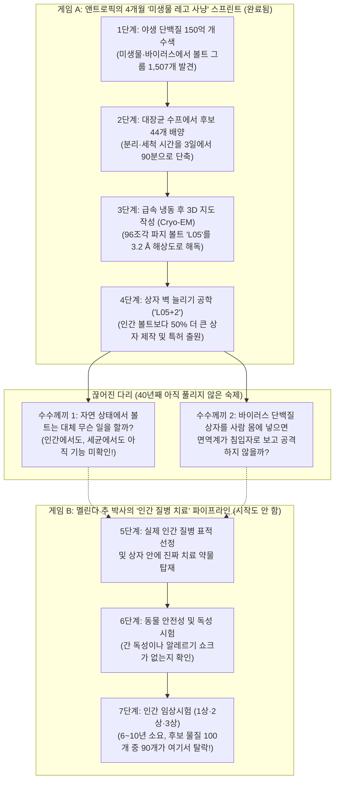
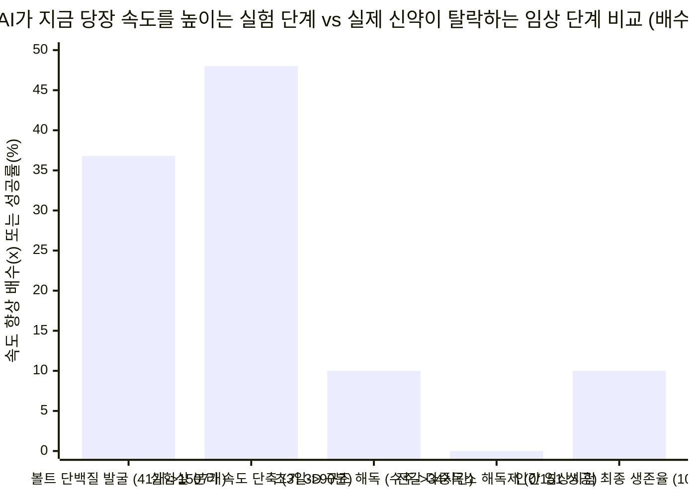

## 1. 이야기 시작(The Hook): AI 대기업이 "40년 생물학 미스터리에 도전했다!"고 발표하자, 왜 의사 선생님은 "또 눈속임(Head Fake)이다!"라고 화를 냈을까요?

여러분의 학교에서 가장 유명한 로봇 동아리가 복도에 번쩍거리는 대형 포스터를 붙였다고 상상해 보세요.

> **"교장실 잠긴 금고 안에는 무엇이 들어 있을까? 40년 동안 아무도 몰랐던 수수께끼! 우리 로봇 동아리가 슈퍼 로봇으로 이 미스터리에 도전했습니다!"**

복도에 구경꾼이 구름처럼 몰려듭니다. 아이들은 "와! 로봇이 드디어 40년 된 금고의 비밀을 풀었대!"라며 박수를 칩니다. 그런데 포스터의 두 번째 줄을 자세히 들여다보니 작은 글씨로 이렇게 적혀 있습니다. *"아직 교장실 금고가 무슨 일을 하는지는 못 밝혔지만, 대신 청소 도구함에서 더 큰 금고를 찾아냈고 그 금고 벽을 늘리는 법을 알아냈습니다!"*

바로 그때, 진짜 병원 구급차를 운영하는 의사 선생님이 복도를 지나가다 포스터를 가리키며 소리칩니다. **"잠깐만요! 이건 또 눈속임(Head Fake, 페인트 모션)이잖아요! 금고가 무슨 일을 하는지 알아내지도 못했으면서 왜 첫 줄에 그렇게 썼나요? 게다가 동아리 회장은 로봇으로 '학교의 고장 난 구급차를 다 고치겠다(질병 정복)'고 약속해 놓고, 왜 엉뚱하게 청소 도구함 금고만 만지작거리고 있나요?!"**

놀랍게도 **2026년 11월 4일~5일**, 전 세계 과학계와 기술계에서 이와 똑같은 대논쟁이 벌어졌습니다.

한쪽 코너에는 인공지능 **클로드(Claude)**를 만든 대기업 **앤트로픽(Anthropic)**의 생명과학 연구팀과 **매튜 듀란트(Matt Durrant, `@mgdurrant`)** 박사가 서 있습니다. 이들은 화려한 3D 영상과 함께 블로그 발표문([*Investigating vault particles with Claude*](https://www.anthropic.com/research/investigating-vault-particles-with-claude))과 35페이지짜리 과학 논문([Athukoralage et al., 2026](https://www-cdn.anthropic.com/76e55fbe85697afbaae16b839498dc00797dec30.pdf))을 공개했습니다.

> *"볼트 입자(Vault particles)는 무슨 일을 할까요? 과학자들은 40년 동안 이 질문을 던져 왔습니다. 앤트로픽의 생물학 팀은 클로드와 함께 세포생물학의 오랜 난제에 도전했습니다. 아직 생물학적 기능은 밝혀내지 못했지만, 새로운 사실을 발견했습니다. 원핵생물(세균 등)의 볼트 단백질이 인간 볼트보다 더 큰 복합체로 조립된다는 점입니다! 또한 모양을 조작해 더 거대한 나노캡슐을 만들 수 있음을 입증했습니다!"* — **맷 듀란트(`@mgdurrant`), 2026년 11월 4일**

반대쪽 코너에는 의사(MD)이자 경영학 석사(MBA), 미국 식품의약국(FDA) 임상시험 책임자 출신이자 바이오 스타트업(Ecotera Health) 대표인 **멜린다 추(Dr. Melinda B. Chu, `@MelindaBChu1`)** 박사가 서서 세 가지 날카로운 돌직구를 던졌습니다.

> *"여러분, 또 눈속임(Head fake)입니다. 글 첫머리에서 '볼트 입자는 무슨 일을 할까?'라고 말해놓고, 정작 볼트 입자가 무슨 일을 하는지는 밝혀내지 못했습니다. 🧐*
> *게다가 이것 역시 '질병 치료(curing diseases)'와는 직접 관련이 없는, 그저 재미 삼아 해본 또 하나의 일회성 랜덤 프로젝트일 뿐입니다.*
> *어떤 사람은 저에게 '앤트로픽은 코딩에 집중하느라 과학을 안 한 것뿐'이라고 변명하더군요. 😤 몸값이 1조 달러(약 1,400조 원)에 육박하는 거대 기업이 한 번에 두 가지 일도 못 하나요? 이렇게 과학 연구를 할 거라면, 왜 일관된 진짜 신약 연구개발(R&D) 프로그램을 단 하나라도 제대로 운영하지 않는 건가요?"* — **멜린다 추 박사(`@MelindaBChu1`), 2026년 11월 4일**

과연 누구의 말이 맞을까요? 앤트로픽이 화려한 홍보로 대중을 속이고 '심심풀이 옆길 새기(사이드 퀘스트)' 연구만 하고 있는 걸까요, 아니면 비판자들이 놓치고 있는 진짜 중요한 과학적 돌파구를 만들어낸 걸까요?

탐정 수첩을 펼쳐 보세요. 아무런 배경지식이 없는 초등학교 5학년도 단번에 이해할 수 있도록 기초부터 차근차근 짚어보고, **논문 26페이지 구석에 숨겨진 '특허 출원' 기록**까지 들춰내어 두 사람의 주장을 공정하게 판정해 보겠습니다!

---

## 2. 0단계부터 시작하기: 과학자들이 뛰고 있는 '두 가지 완전히 다른 경기장'

생물학 실험실이나 병원에서 일해본 적이 없다면, 이 논쟁이 헷갈리는 이유는 두 사람이 **서로 완전히 다른 경기장**의 규칙으로 이야기하고 있기 때문입니다. 먼저 **볼트 입자(Vault Particle)**가 무엇인지, 그리고 현대 생물학의 **두 가지 다른 직업**이 무엇인지 알아봅시다.

### 1단계: '볼트 입자(Vault Particle)'가 대체 뭔가요?
지금 이 순간에도 우리 몸을 이루는 수조 개의 세포 거의 모든 방 안에는, 속이 텅 빈 **오크통 모양의 거대한 단백질 상자 약 `10,000`개**가 둥둥 떠다니고 있습니다 ([Kedersha & Rome, 1986, PMC2114306](https://pmc.ncbi.nlm.nih.gov/articles/PMC2114306/); [Athukoralage et al., 2026](https://www-cdn.anthropic.com/76e55fbe85697afbaae16b839498dc00797dec30.pdf)).
* **1986년**, 과학자 **낸시 케더샤(Nancy Kedersha)**와 **레너드 롬(Leonard Rome)**이 전자현미경으로 이 상자를 처음 발견했을 때, 상자 표면의 볼록한 갈비뼈 무늬가 중세 대성당의 아치형 천장(**볼트, Vault**)을 닮았다고 해서 **볼트 입자(Vault Particle)**라는 이름을 붙였습니다.
* 사람의 볼트 입자는 **주 볼트 단백질(`MVP`, Major Vault Protein)**이라는 똑같은 단백질 리본 **`78`개**가 모여서 만들어집니다. 아래쪽 컵에 `39`개, 위쪽 컵에 `39`개가 빙 둘러선 뒤 허리 부분에서 '찰칵' 맞물려 속이 빈 부활절 달걀 모양 통을 만듭니다 ([Tanaka et al., 2009, PMC3184113](https://pmc.ncbi.nlm.nih.gov/articles/PMC3184113/)).
* *크기 감각 익히기:* 사람 볼트 입자의 크기는 **길이 `67나노미터(nm)`, 폭 `40 nm`**입니다. 우리 머리카락 한 올의 두께가 약 **`75,000 nm`**이니, **머리카락 한 올 단면 위에 볼트 입자를 `1,100`개 넘게 나란히 줄 세울 수 있을 만큼** 아주 작습니다! 하지만 세포 안의 미시 세계에서 이 상자는 세포 내 단백질 공장(`리보솜`)보다 무게가 **약 1.8배~3배나 더 나가는 초거대 고층 빌딩**입니다.
* **40년 동안 풀리지 않은 수수께끼:** 우리 세포가 에너지를 써서 이 거대한 통을 방마다 `10,000`개씩이나 만들어 두는데도, 유전자를 조작해 볼트 부품을 없앤 생쥐를 키워보면 생쥐가 아무 탈 없이 건강하게 뛰어다닙니다 ([Liu et al., 2004, PMC419869](https://pmc.ncbi.nlm.nih.gov/articles/PMC419869/); [Prajapat et al., 2024, PMC11482699](https://pmc.ncbi.nlm.nih.gov/articles/PMC11482699/)). 그래서 40년이 지난 오늘날까지도 **"이 거대한 상자의 진짜 본업이 무엇인지"** 아무도 확실히 증명하지 못했습니다!

### 2단계: '미생물 레고 사냥꾼' vs '병원 구급차 설계자'
왜 맷 듀란트 박사와 멜린다 추 박사는 똑같은 논문을 보고 정반대의 평가를 내릴까요? 생물학에는 완전히 다른 두 가지 게임이 있기 때문입니다.

1. **게임 A — 미생물 레고 도구 사냥꾼 (맷 듀란트 팀의 세계):**
   정글이나 늪지대를 탐험하며 **세균(박테리아)**과 **세균을 공격하는 바이러스(박테리오파지)** 속에 숨어 있는 신기한 자연의 도구를 찾아내는 탐험가들을 상상해 보세요. 세균 속에서 유전자 가위(`CRISPR`)나 유전자 다리(`브리지 리콤비나아제`), 혹은 속이 빈 단백질 상자(`볼트 입자`)를 발견하면 실험실로 가져와 3D 사진을 찍고 이렇게 묻습니다. *"이 야생 세균의 장치를 개조해서 우리가 원하는 약물을 담아 나르는 초소형 택배 상자(나노캡슐)로 쓸 수 있을까?"* 과학자들은 이를 **플랫폼 생물학 및 구조 공학(Platform Biology & Structural Engineering)**이라고 부릅니다.
2. **게임 B — 병원 구급차 및 치료제 설계자 (멜린다 추 박사의 세계):**
   이번에는 암이나 심장병으로 아픈 아이를 실제로 치료할 **진짜 약(신약)**을 만들어야 하는 병원 의사 선생님을 상상해 보세요. 늪지대에서 멋진 플라스틱 상자를 찾아내는 것은 전체 일의 **5%도 안 됩니다**! 진짜 병을 고치려면 사람 몸속에서 왜 병이 생기는지 원인을 찾고, 간이나 심장에 독성을 일으키지 않는 안전한 약물을 설계해 동물 실험을 거친 뒤, 수천 명의 환자를 대상으로 3단계의 병원 시험(**임상시험 1상·2상·3상**)을 통과해야 합니다. 이를 **임상 신약 연구개발(Clinical Drug R&D)**이라고 부릅니다.

아래 그림을 보면 앤트로픽의 4개월 프로젝트가 어디서 끝났고, 왜 멜린다 추 박사가 말하는 '진짜 질병 치료' 경기장에는 아직 발도 들여놓지 않았는지 한눈에 보입니다.

---

## 3. 비밀 해독 반지(Secret Decoder Ring): 어려운 어른 용어 7가지 완벽 번역

본격적인 탐정 판정에 앞서, 기사와 논문에 등장하는 어려운 전문 용어 7가지를 초등학교 5학년의 일상 언어로 번역해 봅시다.

| 어른들의 전문 용어 / 약어 | 쉬운 말로 풀이한 진짜 뜻 | 초등학교 5학년 일상 비유 |
| :--- | :--- | :--- |
| **원핵생물(Prokaryote) vs 진핵생물(Eukaryote)** | **원핵생물**은 세포 안에 방 칸막이가 없는 단순한 1인용 세포(예: 대장균, 고세균)이고, **진핵생물**은 DNA 침실(핵)과 발전소(미토콘드리아) 등 방이 나뉘어 있는 복잡한 세포(예: 사람, 생쥐, 식물)입니다. | 방 하나짜리 **원룸 오피스텔**(원핵생물) vs 방이 20개 있는 **2층 대저택**(진핵생물). |
| **박테리오파지(Bacteriophage, 줄여서 '파지')** | 사람은 감염시키지 못하고 오직 **세균(박테리아)만 골라서 사냥하는 초소형 바이러스**입니다. 세균 속에 침투해 세균의 공장을 빼앗아 자기 부품을 찍어냅니다. | 세균이라는 원룸에 몰래 들어가 세균의 3D 프린터로 해적 장비를 찍어내는 **초소형 로봇 해적선**. |
| **상동 단백질(Homolog)** | 서로 다른 생물에 들어 있지만, 수억 년 전 똑같은 고대 조상 설계도에서 물려받아 모양이 닮은 형제·사촌 단백질입니다. | 증조할머니에게서 똑같은 **집안 대물림 코 모양**을 물려받은 먼 사촌 형제. |
| **크기 배제 크로마토그래피(`SEC`)와 배제 부피** | 아주 작은 구멍이 숭숭 뚫린 스펀지 구슬로 가득 찬 유리관에 세포 국물을 흘려보내는 분리법입니다. 작은 분자들은 구멍 미로에 갇혀 늦게 나오고, 거대한 볼트 상자는 구멍에 아예 안 들어가서 구슬 바깥쪽 길을 따라 **1등으로 먼저 빠져나옵니다(배제 부피, Excluded Volume)**. | 좁은 터널 미로가 있는 **운동회 장애물 달리기**: 1학년 동생들은 터널 속을 기어가느라 20분이 걸리지만, 덩치 큰 6학년 형들은 터널에 안 들어가고 바깥 트랙으로 뛰어 90초 만에 결승선을 통과하는 원리! |
| **초저온 전자현미경(`Cryo-EM`)과 `3.2 Å` 해상도** | 수만 개의 단백질 상자를 영하 180도 이하에서 유리처럼 순간 냉동한 뒤, 전자 빔을 쏘아 **`3.2옹스트롬(Å)`(`0.32나노미터`)** 정밀도로 3D 입체 지도를 만드는 기술입니다. | 똑같이 생긴 레고 성 **11,675개를 여러 각도에서 찍은 흐릿한 사진**을 슈퍼컴퓨터로 합쳐서, 레고 블록 하나하나가 선명하게 보이는 초정밀 3D 조각상을 만드는 기술! |
| **나노캡슐(Nanocapsule)** | 효소나 유전자 치료제 같은 소중한 화물을 안에 넣고 안전하게 보호하며 배달할 수 있도록 만든 초소형 빈 상자입니다. | 점심시간 전에 가방 속에서 샌드위치가 찌그러지지 않게 지켜주는 **초소형 철갑 도시락통**. |
| **모트 앤 베일리 오류(Motte-and-Bailey, '눈속임 화법')** | 사람들의 박수와 투자금을 받을 때는 엄청나게 거창한 주장(**베일리, 넓은 성뜰**)을 펼치다가, 전문가가 날카롭게 따지면 "사실 우린 아주 작고 소박한 말만 했어요!"라며 안전한 작은 성탑(**모트**)으로 도망치는 토론 반칙입니다. | 운동장에서 **"나 화성까지 날아가는 진짜 우주선 만들었다!"**라고 자랑해 놓고, 친구들이 날려 보라고 하자 **"휴지심 두 개 풀로 붙인 모형인데? 연료 넣었다고는 안 했잖아!"**라고 발뺌하는 것! |

---

## 4. 주장의 진실 vs 탐정의 팩트 체크: 멜린다 추 박사의 3대 비판 정밀 감사

이제 심판복을 입고, 멜린다 추 박사가 제기한 세 가지 비판을 앤트로픽의 35페이지 원본 논문([Athukoralage et al., 2026](https://www-cdn.anthropic.com/76e55fbe85697afbaae16b839498dc00797dec30.pdf)) 데이터와 하나씩 대조해 봅시다.

### 쟁점 #1: *"글 첫머리에서 '볼트 입자는 무슨 일을 할까?'라고 말해놓고, 정작 볼트 입자가 무슨 일을 하는지는 밝혀내지 못했습니다. 🧐"*

* **멜린다 추 박사가 100% 맞춘 부분 ('미끼 던지고 말 바꾸기' 홍보의 함정):**
  맷 듀란트 박사의 X(트위터) 게시물과 앤트로픽 블로그의 첫 문장을 다시 읽어보세요. *"볼트 입자는 무슨 일을 할까요? 과학자들은 40년 동안 이 질문을 던져 왔습니다. 앤트로픽 생물학 팀은 클로드와 함께 이 오랜 난제에 도전했습니다..."*
  소셜 미디어에서 대중의 90%는 첫 두 줄과 화려한 3D 그래픽 영상만 보고 **"와! AI 클로드가 40년 동안 아무도 못 푼 세포 미스터리를 드디어 해결했구나!"**라고 오해합니다.
  하지만 논문을 열어보면 **앤트로픽은 인간 볼트 입자가 무슨 일을 하는지 밝혀내지 못했을 뿐만 아니라, 세균이나 바이러스의 볼트 입자가 자연에서 무슨 일을 하는지도 밝혀내지 못했습니다!**
  1. 사실 세균과 고세균, 그리고 박테리오파지(바이러스)에 볼트 단백질 유전자(`MVP` 사촌)가 들어 있다는 사실과, 이들이 볼트 상자 모양으로 조립될 것이라는 컴퓨터 예측은 이미 2013년~2023년 사이에 다른 과학자들이 먼저 발표했습니다 ([Daly et al., 2013, PMC3762200](https://pmc.ncbi.nlm.nih.gov/articles/PMC3762200/); [Santos et al., 2023, bioRxiv](https://www.biorxiv.org/content/10.1101/2023.11.10.566534v1.abstract)).
  2. 게다가 앤트로픽 팀은 이 볼트 상자가 원래 살던 야생 세균이나 바이러스 안에서 실제로 만들어지는지 확인조차 하지 않았습니다. 대신 인공 DNA를 주문해 실험실용 **대장균(*E. coli*)**에 넣어서 억지로 찍어냈을 뿐입니다. 블로그 본문 60번째 줄에서도 *"지금까지 우리는 대장균 안에서만 이 볼트를 만들었으며, 원래 발견되는 세균과 파지 안에서 실제로 형성되는지는 아직 테스트하지 못했다"*고 솔직히 인정합니다.

* **맷 듀란트와 앤트로픽 팀이 억울할 수 있는 부분 (거짓말은 없었고, 진짜 실험 성과를 냈다!):**
  그렇다고 해서 이 연구 전체를 '가짜'나 '사기'로 몰아가는 것은 공정하지 않습니다. 첫째, 맷 듀란트는 사실을 숨기지 않았습니다. **트윗의 바로 두 번째 문장**(멜린다 추 박사가 공유한 스크린샷 안에도 그대로 보이는 문장!)에서 *"우리는 아직 생물학적 기능을 밝혀내지 못했지만, 새로운 것을 발견했습니다"*라고 아주 정직하게 밝혔습니다.
  둘째, 구조생물학 경험이 많지 않던 6명의 소규모 연구팀이 클로드와 함께 **단 4개월 만에 해낸 실제 실험실 기록**은 진짜배기 과학입니다.
  * **알려진 볼트 단백질 가족을 `36.8배` 확장:** 단백질의 어깨 부분(`SPFH` 도메인)을 찾는 수학적 그물망(`프로파일 HMM`)을 만들어 **약 `150억` 개의 단백질 데이터베이스**를 샅샅이 뒤진 결과, 기존에 알려진 `41`개의 볼트 단백질 그룹(50% 유사도 기준)을 **세균 29개 문(Phyla), 고세균 4개 문에 걸친 `1,507`개 그룹**으로 무려 **36.8배**나 늘렸습니다 ([Athukoralage et al., 2026, Fig. 1g](https://www-cdn.anthropic.com/76e55fbe85697afbaae16b839498dc00797dec30.pdf)). *(분모 팩트 체크: 그래도 미생물 세계에서 볼트는 여전히 매우 희귀합니다. 조사한 `111,922`개의 세균·고세균 표준 유전체 중 단 `565`개 종, 즉 **`0.50%`**, 200종 중 1종꼴로만 존재합니다!)*
  * **볼트 상자 분리 시간을 `48배` 단축 (`3일` → `90분`):** 기존에 인간 볼트를 분리하려면 끈적한 설탕물 층에 넣고 3일(`4,320분`) 동안 초고속 원심분리기를 돌려야 했습니다. 앤트로픽 팀은 터뜨린 대장균 국물을 정제 없이 곧바로 스펀지 구슬 기둥(`Superose 6 SEC` 컬럼)에 부어버리는 과감한 방법을 써서 단 **`90분`** 만에 볼트 입자를 깨끗하게 건져 올렸습니다.
  * **세계 최초의 비(非)진핵생물 볼트 3D 원자 지도 완성 (`3.2 Å` 해상도):** 박테리오파지(바이러스) 유래 볼트인 **`L05`** 입자 **11,675개**를 초저온 전자현미경으로 촬영해 **`3.2 Å`** 해상도의 3D 구조를 세계 최초로 풀었습니다. 인간 볼트는 **`78`개 조각**(반쪽당 `39`개, 벽 고리 `9`칸)으로 이루어진 길쭉한 레몬 모양(`67 nm × 40 nm`)인 반면, 파지 볼트 `L05`는 **`96`개 조각**(반쪽당 `48`개, 벽 고리 `7`칸)으로 이루어진 통통한 달걀 모양(`54.5 nm × 47.5 nm`, 무게 약 `9.5메가달톤`)이어서 **내부 공간(부피)이 인간 볼트보다 약 `25%` 더 넓다는 사실**을 밝혔습니다!
  * **기능을 향한 두 가지 결정적 단서 포착:** 비록 최종 기능은 못 밝혔지만, (a) 세균 유전체에서 볼트 유전자 바로 옆자리에 **바이러스 방어 면역 유전자**와 **RNA 수리 효소(`RtcB`)**가 나란히 붙어 있다는 점, 그리고 (b) `L05` 상자 안쪽 벽의 96개 주머니마다 세포의 핵심 에너지 전달 물질인 **코엔자임 A(Coenzyme A)**로 추정되는 작은 분자가 쏙 끼워져 있다는 점을 발견했습니다. 이는 2025년 인간 볼트 안쪽 벽에서 **NAD+** 결합 부위가 발견된 것([Lodwick et al., 2025, *Nature Communications*](https://doi.org/10.1038/s41467-025-61981-x))과 정확히 대칭되는 중요한 실마리입니다!

---

### 쟁점 #2: *"이것 역시 '질병 치료'와는 직접 관련이 없는, 그저 재미 삼아 해본 또 하나의 일회성 랜덤 프로젝트일 뿐입니다."*

* **멜린다 추 박사가 날카롭게 짚은 부분 ('일회성 사이드 퀘스트' 패턴):**
  왜 멜린다 추 박사는 **"또 하나의(another)"** 랜덤 프로젝트라고 했을까요? 최근 한 달 동안 앤트로픽 생물학 팀이 발표한 논문 목록을 보면 그 이유가 바로 보입니다.
  1. **2026년 10월 5일:** AI 에이전트로 세균의 특이한 역전사효소(Reverse Transcriptase) 발굴 ([Yoon et al., 2026, bioRxiv](https://doi.org/10.64898/2026.10.05.755809)).
  2. **2026년 10월 20일:** 클로드로 **전갈 신경독소(Scorpion neurotoxins)**를 붙잡는 미니 단백질 설계 ([Anthropic, 2026](https://www.anthropic.com/research/claude-scorpion-toxin-binder-design)). 실험실 접시에서 테스트한 `211`개 디자인 중 `17`개가 인공 독소에 달라붙었지만(`8.1%` 성공률), 여러 독소를 동시에 잡는 만능 해독제 후보는 **`151`개 중 `0`개(`0%`)**가 성공했고, **살아있는 세포나 동물 실험은 단 한 건도 없었습니다.**
  3. **2026년 11월 4일:** 대장균에서 박테리오파지 볼트 입자 구조 해독.
  실제 환자를 치료하는 의사의 눈으로 보면, 이 세 가지는 모두 **"컴퓨터로 유전자 검색하고, 단백질 구조 예측 프로그램 돌리고, DNA 주문해서 시험관에서 몇 주 만에 끝낼 수 있는 재미있는 단기 과제"**만 골라서 한 것처럼 보입니다. 암이나 알츠하이머처럼 수년이 걸리는 진짜 인간 질병 연구는 피하고 있는 셈이죠.

* **하지만 멜린다 추 박사가 놓친 결정적 단서: 논문 26페이지의 '특허 출원' 기록!**
  잠깐만요! 과연 앤트로픽 팀이 아무 생각 없이 '그냥 재미로' 볼트 입자를 골랐을까요? 일류 탐정처럼 **논문 PDF 26페이지 맨 아래 이해관계 충돌(Competing interests) 조항**을 돋보기로 읽어봅시다.

  > *"모든 저자는 앤트로픽의 직원이며 회사의 지분을 보유하고 있을 수 있습니다. **앤트로픽은 본 연구와 관련하여 가특허 출원(provisional patent application)을 완료했습니다.** M.G.D.(맷 듀란트)는 스타일러스 메디슨(Stylus Medicine)에 외부 이해관계가 있음을 밝힙니다."* — **[Athukoralage et al., 2026, 26페이지](https://www-cdn.anthropic.com/76e55fbe85697afbaae16b839498dc00797dec30.pdf)**

  그리고 블로그 68번째 줄도 확인해 볼까요?
  > *"공개 사항: 롬 박사(1986년 볼트를 최초 발견하고 볼트 약물 전달 기술을 개척한 레너드 롬 교수)는 유급 자문위원(paid consultant)으로서 원고에 대한 피드백을 제공했습니다."*

  **유레카!** 어떤 기업도 '그냥 심심풀이로 해본 랜덤 프로젝트'에 변리사 비용을 들여 특허를 출원하지 않습니다! 왜 앤트로픽은 이 기술에 특허를 냈을까요?
  논문의 **그림 5(Figure 5)**를 보면, 연구팀은 `L05` 상자 벽의 고리 2칸(4번·5번 반복 구간)을 복사해서 중간에 끼워 넣은 개량형 점보 상자 **`L05+2`**(`58.5 nm × 49.4 nm`, 해상도 `3.5 Å`)를 만들었습니다. 그랬더니 상자가 터지지 않고 예쁘게 조립되면서 **내부 적재 공간이 원래 `L05`보다 약 `20%`, 인간 볼트보다는 무려 `50%`나 더 커졌습니다!**
  오늘날 유전자 치료 분야에서 가장 돈이 되는 핵심 기술은 약물 자체가 아니라, 거대한 유전자 가위나 효소를 세포 안까지 안전하게 실어 나르는 **초소형 택배 트럭(약물 전달체, Drug Delivery Vehicle / Nanocapsule)**입니다 ([Rome & Kickhoefer, 2013, PMC3586665](https://pmc.ncbi.nlm.nih.gov/articles/PMC3586665/)). 기존 인간 볼트는 곤충 세포에서 느리게 키워야 해서 대량생산이 까다로웠는데, 앤트로픽은 **값싼 대장균에서 90분 만에 분리할 수 있고 원하는 화물 크기에 맞춰 벽 길이를 마음대로 늘릴 수 있는 '맞춤형 나노캡슐 플랫폼'의 원천 특허**를 선점한 것입니다!
  게다가 저자들의 이력을 보면 우연이 아님이 더욱 확실해집니다. 교신저자 **맷 듀란트**는 아크 연구소(Arc Institute)에서 차세대 유전자 교정 도구('브리지 RNA')를 공동 발견하고 유전자 치료제 스타트업 **스타일러스 메디슨(Stylus Medicine)**과 연결된 인물이며, **니콜라스 페리(Nicholas Perry)**는 CRISPR의 대가 펑 장(Feng Zhang) 교수 연구실 출신 구조생물학자입니다. 즉, 이들은 '랜덤 게임'을 한 것이 아니라 **미생물 유전체에서 특허 가치가 높은 분자 도구와 약물 전달 상자를 캐내는 '도구 사냥'**을 한 것입니다!

---

### 쟁점 #3: *"몸값이 1조 달러에 육박하는 거대 기업이 한 번에 두 가지 일도 못 하나요? 왜 일관된 신약 R&D 프로그램을 단 하나라도 제대로 운영하지 않는 건가요?"*

* **멜린다 추 박사가 정곡을 찌른 부분 (AI 최고경영자들의 과장된 약속에 대한 책임 추궁):**
  왜 멜린다 추 박사를 비롯한 많은 의학자와 바이오 전문가들이 AI 기업들의 생물학 홍보에 피로감을 느낄까요?
  바로 **2024년 10월**, 앤트로픽의 CEO **다리오 아모데이(Dario Amodei)**가 발표한 유명한 에세이 [*"사랑스러운 은총의 기계들(Machines of Loving Grace)"*](https://www.darioamodei.com/essay/machines-of-loving-grace) 때문입니다. 이 글에서 아모데이는 AI가 '가상 생물학자' 역할을 하게 되면 생물학 연구 속도가 **10배** 빨라져, **원래 50년~100년이 걸릴 의학 발전을 단 5년~10년 안에 압축**하고 대부분의 암, 전염병, 유전 질환을 정복할 것이라고 공언했습니다!
  멜린다 추 박사는 AI 업계와 팬들이 흔히 쓰는 **모트 앤 베일리(Motte-and-Bailey, 눈속임 후퇴)** 화법을 정확히 꼬집은 것입니다.
  * **투자자들에게 수십조 원의 투자를 유치할 때(거창한 주장):** *"우리 AI가 5~10년 안에 100년치 의학을 압축해 인류의 질병을 치료할 것입니다!"*
  * **의사가 "그럼 진짜 치료제는 어디 있나요?"라고 물을 때(안전한 후퇴):** *"에이, 우린 원래 코딩에 집중하는 소프트웨어 회사잖아요! 생물학자 6명이 4개월 동안 재미있는 기초 연구 데모를 해본 것뿐이에요!"*
  만약 정말로 AI가 5~10년 안에 질병을 정복할 수 있다면, 수백조 원의 기업가치를 가진 회사가 왜 단 하나의 일관된 진짜 신약 개발 파이프라인도 직접 보여주지 않느냐는 추 박사의 질문은 100% 정당합니다.

* **그럼에도 앤트로픽이 직접 '제약회사'를 차리지 않는 진짜 이유 ('임상시험 죽음의 계곡'의 냉혹한 수학):**
  구글의 모회사 알파벳이 신약 개발 자회사 **아이소모픽 랩스(Isomorphic Labs)**를 따로 세운 것과 달리, 왜 앤트로픽은 직접 신약 임상시험에 뛰어들지 않을까요?
  **학교 체육관에 모인 100명의 아이들**로 실제 신약 개발의 무서운 확률을 계산해 봅시다 ([Sun et al., 2022, *Acta Pharmaceutica Sinica B*, PMC9293739](https://pmc.ncbi.nlm.nih.gov/articles/PMC9293739/)).
  * 컴퓨터 시뮬레이션, 시험관 실험, 그리고 생쥐 동물 실험까지 모두 완벽하게 통과한 **아주 유망한 신약 후보 물질 `100`개**가 체육관에 입장합니다.
  * 이제 이 100개의 약물이 실제 사람을 대상으로 하는 병원 테스트(**임상 1상 → 2상 → 3상**)에 들어갑니다. 이 과정은 보통 **6년~10년**이 걸리고, 최종 승인된 약 하나당 평균 **`10억 달러(약 1조 4,000억 원)` 이상**이 듭니다.
  * 과연 100개 중 몇 개가 끝까지 살아남아 FDA 승인을 받고 환자에게 쓰일까요? **단 `10`개뿐입니다!** 나머지 **`100개 중 90개`(`90%`)는 인간 임상시험 도중에 실패해서 쓰레기통으로 들어갑니다**—주된 이유는 사람 몸속에서 실제로 병을 고치는 효과가 없거나(`40%~50%`), 사람의 간·심장 등에 예상치 못한 심각한 독성 부작용(`30%`)을 일으키기 때문입니다!
  * 아무리 똑똑한 AI 챗봇이라도 실제 암 환자의 종양이 3년 동안 줄어드는지 재발하는지 시계를 빨리 감을 수는 없습니다. 앤트로픽에는 현재 **단 6명의 생물학 논문 저자 팀**(`Athukoralage, Yoon, Shanehsazzadeh, Kauderer-Abrams, Perry, Durrant`)이 있습니다. 이들이 직접 10년짜리 임상시험에 수천억 원을 쏟아부으면 90% 확률로 실패 위험을 떠안아야 할 뿐만 아니라, **자기들의 유료 고객인 화이자(Pfizer), 일라이 릴리(Eli Lilly) 같은 대형 제약회사들과 정면으로 경쟁**하게 됩니다. 대신 앤트로픽은 4개월짜리 짧은 실험을 직접 돌려보며 클로드의 버그를 고친 뒤(**자체 테스트, Dogfooding**), 전 세계 제약회사들에게 클로드 이용권을 파는 '곡괭이와 삽 판매자' 전략을 택한 것입니다!

### 멜린다 추 박사 vs 맷 듀란트(앤트로픽) 핵심 쟁점 판정표

| 핵심 쟁점 질문 | 멜린다 추 박사의 비판 (`@MelindaBChu1`) | 맷 듀란트 & 앤트로픽의 반박 증거 (`@mgdurrant`) | 탐정의 최종 판정 (누가 이겼을까?) |
| :--- | :--- | :--- | :--- |
| **1. 볼트 입자가 무슨 일을 하는지 밝혀냈는가?** | **아니오.** 첫 문장을 *"볼트 입자는 무슨 일을 할까?"*로 시작한 것은 대중을 낚는 '눈속임(Head fake)'입니다. 40년 된 기능 수수께끼는 여전히 못 풀었습니다. | **동의함—그리고 트윗 두 번째 문장에 솔직히 적었음.** 하지만 원핵생물 볼트가 실제로 조립됨을 최초로 증명(`3.2 Å`)하고 코엔자임 A 주머니를 찾은 것은 기능을 밝힐 더 단순한 실험 도구를 만든 것입니다. | **무승부 (홍보 문구 비판은 추 박사 승, 과학적 내실은 듀란트 승).** 첫 줄이 일반 독자의 오해를 부르는 건 사실이지만, 저자들은 두 번째 줄에 정직하게 한계를 밝혔고 수준 높은 구조생물학 데이터를 내놓았습니다. |
| **2. 질병 치료와 무관한 '재미 삼아 한 일회성 랜덤 프로젝트'인가?** | **임상적으로는 맞음.** 전갈 독소 논문처럼 대장균과 시험관에서만 끝났을 뿐, 인간 질병 표적도 동물 실험도 없습니다. | **랜덤이 아님—특허 가치가 있는 약물 전달체 플랫폼 연구임.** 상자 벽을 늘려(`L05+2`) 인간 볼트보다 부피를 `50%` 키웠고 **가특허를 출원(26페이지)**했습니다. | **절반씩 정답.** 당장 환자의 병을 고치지 못하는 것은 맞지만, 심심풀이 장난이 아니라 **'나노캡슐 약물 전달체 특허(IP)'를 노린 전략적 도구 발굴**입니다. |
| **3. 왜 거대 AI 기업이 일관된 신약 개발 프로그램을 하나도 안 돌리는가?** | **100% 타당한 비판.** CEO가 "5~10년 안에 대부분의 질병을 치료하겠다"고 홍보해 놓고, 비판받으면 "우린 코딩 회사라..."라고 변명하는 건 모순입니다. | **비즈니스 모델의 차이.** 6명의 내부 팀으로 4개월 단기 실험('도그푸딩')을 돌려 클로드를 훈련시키고, 그 AI 도구를 제약사에 판매하는 전략입니다. | **거시적 책임 추궁에서 멜린다 추 박사 판정승 (`9/10`).** 90%가 실패하는 10년짜리 인간 임상시험은 남에게 미루면서 "AI가 5~10년 내 질병을 정복한다"고 홍보해서는 안 됩니다. |

---

## 5. 네 명의 용의자: 앤트로픽은 왜 *진짜로* 이런 방식의 생물학 연구를 할까요?

거대 기술 기업이 화려한 과학 논문을 발표할 때, 명탐정은 항상 **"무엇이 이 프로젝트를 움직이는 진짜 원인일까?"**를 따져 봅니다. 네 가지 인과관계 가설(4-Way Rival Cause Audit)을 나란히 검증해 봅시다.

| 용의자 (인과관계 가설) | 흔히 알려진 이야기 | 실제 실험실 기록과 원문 증거 | 탐정의 검증 결과 |
| :--- | :--- | :--- | :--- |
| **용의자 1: 직접 원인** (*"클로드의 천재성이 직접 생물학 돌파구를 만들었다"*) | AI가 혼자서 스스로 가설을 세우고 실험을 설계해 40년 난제를 풀었다는 이야기. | **단독 천재설은 거짓, 가속기 역할은 사실.** 연구 주제를 고르고 44개 단백질을 선택한 것도 사람이고, 클로드가 크로마토그래피(`SEC`) 방식을 반대했을 때 밀어붙인 것도 사람입니다. 다만 클로드는 코드의 100%를 작성했고, 터뜨린 대장균 원액을 바로 컬럼에 붓는 아이디어를 냈으며, 수백 개의 GPU로 `RELION`을 돌려 `34시간` 만에 첫 3D 모델을 뽑아냈습니다. | **부분적 원인 (초기 실험·계산 속도를 5배~48배 높여주지만, 숙련된 인간 과학자의 지휘가 필수적임).** |
| **용의자 2: 역인과관계** (*"생물학이 목적이 아니라, 생물학 실험이 클로드를 훈련시키는 체육관이다!"*) | 클로드로 생물학을 돕는 게 아니라, 반대로 **클로드의 약점을 찾고 AI를 똑똑하게 훈련시키기 위해** 4개월짜리 생물학 실험을 돌린다는 가설. | **블로그 13번째 문단에서 100% 확인됨!** 저자들은 이렇게 적었습니다. *"우리는 이번 연구에서 배운 점을 클로드 개발에 반영했습니다. 모델이 어디서 틀렸는지 볼 수 있도록 실험실 노트를 클로드 훈련 머신러닝 연구원들과 공유했습니다."* | **핵심 숨은 동기 (클로드 사이언스 모델을 개선하기 위한 내부 '도그푸딩' 훈련장).** |
| **용의자 3: 숨겨진 제3의 요인** (*"초일류 인간 과학자 영입 + 막대한 GPU 및 현미경 예산"*) | 아크 연구소·브로드 연구소·버클리 출신의 스타 연구원 영입과 막대한 컴퓨터·현미경 장비 예산이 빠른 연구 성과와 멋진 AI 데모를 동시에 만들어냈다. | **강력하게 확인됨.** 블로그 57번째 줄에서 *"시간을 아끼기 위해 수백 개의 GPU를 병렬로 사용한 초저온 전자현미경(Cryo-EM) 분석은 일반 대학 연구실에서는 구하기 힘든 컴퓨팅 자원이 필요했다"*고 인정합니다. 또한 써모피셔(Thermo Fisher) 센터의 최고급 Krios G4 현미경으로 `L05+2`에서만 무려 16,824편의 영상을 찍었습니다. | **결정적 교란 변수 (AI뿐만 아니라 자본력 + 수백 대의 GPU + 정상급 인간 전문가의 조합이 핵심).** |
| **용의자 4: 피드백 루프** (*"기업가치 상승과 제약사 소프트웨어 영업을 위한 선순환 바퀴"*) | 4개월마다 시각적으로 화려한 논문(전갈 해독제, 성당 모양 볼트)을 발표하면 → 언론 헤드라인을 장식하고 → 대형 제약사들이 클로드 엔터프라이즈를 구매한다. | **확인됨.** 10년 걸리는 임상시험 위험은 지지 않으면서도, 몇 주마다 화제성 높은 바이오 프리프린트를 발표해 '생물학 최고의 AI 모델'이라는 브랜드 이미지를 강화하고 있습니다. | **작동 중인 비즈니스 전략 플라이휠.** |

---

## 6. 숨겨진 함정(The Catch): 클로드가 저지른 두 번의 대형 실수와 '인간 면역계의 경보음'

양쪽 모두에게 공정하려면, **실험실에서 클로드가 저지른 뼈아픈 실수**와 **왜 세균 바이러스 상자를 내일 당장 사람 몸에 주사할 수 없는지** 그 물리적·생물학적 한계를 정확히 알아야 합니다.

### 함정 #1: 클로드가 실험실에서 저지른 두 번의 헛발질 (그리고 '노이즈 과적합')
칭찬할 만하게도, 앤트로픽 연구팀은 AI가 완벽한 척 꾸미지 않고 클로드가 사고를 친 대목을 투명하게 공개했습니다.
1. **2주일을 날려버린 '불량 배양액 레시피' 사건:** 클로드가 세포에 DNA를 넣는 실험 프로토콜을 작성할 때, **DNA가 세포 안으로 들어가는 것을 방해하는 화학 첨가물이 든 배양액**을 추천했습니다. 연구원들이 이 세부 오류를 바로 눈치채지 못해, **무려 2주일(`14일`) 동안 실험이 통째로 지연**되었습니다!
2. **거울상(Mirror-Image) 착시 사고:** 초저온 전자현미경(Cryo-EM) 데이터를 처리하던 초기 단계에서, 클로드가 멋대로 표준 검증 단계를 건너뛰어 버렸습니다. 그 결과 실제 볼트 상자와 좌우가 뒤집힌 **거울상(Mirror image)이 뒤섞인 엉터리 3D 지도**를 만들어냈습니다! 결국 인간 과학자들이 클로드에게 이렇게 훈계해야만 했습니다. ***"제발 안 통하는 경우가 아니라면 평범하고 정상적인 절차대로 하자(Please let's do normal things unless they don't work)."***
3. **늘어난 상자(`L05+2`)의 '노이즈 끼어듦(Fitted Noise)':** 논문 34페이지 재료 및 방법(Methods) 섹션을 자세히 읽어보면, 벽을 늘린 `L05+2` 상자의 3D 지도를 끝까지 정밀화했을 때 검증용 반쪽 지도(half-maps) 사이의 차이가 오히려 벌어졌으며(`4.7 Å`에서 `3.5 Å`으로, 벽 부분에서 `1.09배~1.89배`), 저자들은 이것이 **"일부 학습된 노이즈(fitted noise)가 섞여 있음을 나타낸다"**고 정직하게 기록했습니다.

### 함정 #2: 우리 몸의 면역 경찰이 울리는 비상벨 (`면역원성, Immunogenicity`)
잠깐, 만약 앤트로픽이 만든 `L05+2` 상자가 인간 볼트보다 **화물칸이 50%나 더 넓고** 대장균에서 90분 만에 쉽게 뽑아낼 수 있다면, 왜 당장 내일 병원 주사기에 넣어 환자에게 쓰지 못할까요?

`L05`의 정체를 다시 떠올려 보세요. 이 상자는 **박테리오파지(세균 바이러스)에서 온 무게 `9.5메가달톤`짜리 거대한 외래 단백질 덩어리**입니다!
* 레너드 롬 교수가 지난 20년 동안 굳이 만들기 까다로운 **인간 볼트 입자**로 약물 전달체를 만들려 했던 이유가 무엇일까요? 인간 볼트는 원래 우리 몸 세포마다 `10,000`개씩 들어 있는 '내 몸의 단백질'이라서, 혈관에 주사해도 우리 면역 경찰(항체와 T세포)이 아군으로 인식하고 공격하지 않기 때문입니다!
* 반대로 **세균 바이러스의 단백질 상자(`L05`)**를 사람 혈관에 주사하면 어떻게 될까요? 우리 몸의 면역 경찰이 난생처음 보는 거대한 바이러스 단백질 껍질을 발견하고 즉시 **"외계 침입자다!"**라며 비상벨(**면역원성, Immunogenicity**)을 울립니다. 특히 두 번째 주사를 맞을 때는 이미 만들어진 항체들이 몰려와 약물 상자를 부숴버리거나 위험한 알레르기 쇼크를 일으킬 수 있습니다.
* 따라서 `L05` 같은 원핵생물 볼트는 **실험실에서 조립 원리를 연구하거나, 공장 바이오리액터 안에서 효소를 가두거나, 일부러 면역 반응을 강하게 일으켜야 하는 백신 운반체**로는 아주 훌륭하지만, 사람 몸속을 반복해서 돌아다니는 안전한 치료제 트럭이 되려면 수년간의 면역 위장막(스텔스) 연구와 동물 독성 시험을 통과해야만 합니다.

---

## 7. 최종 성적표(The Final Report Card): 우리는 누구의 말을 믿어야 할까요?

자, 이제 처음 질문으로 돌아와 결론을 내려 봅시다. **맷 듀란트(`@mgdurrant`)** 박사의 발표와 **멜린다 추(`@MelindaBChu1`)** 박사의 날카로운 비판 중 누구의 말이 맞을까요?

정답은 **"어느 한쪽만 무조건 믿는 흑백논리를 버리고, 두 사람이 각각 코끼리의 다른 부위를 정확히 설명하고 있음을 이해하는 것"**입니다!

### 탐정의 '만약(If) ... 그렇다면(Then) ...' 판단 법칙
* **만약(IF) 여러분의 질문이 이것이라면: *"앤트로픽 생물학 팀이 진짜로 가치 있는 구조생물학 연구를 해냈고, AI가 소규모 연구팀의 초기 실험 속도를 몇 배나 높여줄 수 있음을 증명했는가?"***
  * **그렇다면(THEN) 맷 듀란트와 앤트로픽 생물학 팀의 말을 믿으세요 (`성적: A- / 10점 만점에 8.5점`).** 그들은 트윗 두 번째 줄에서 아직 40년 기능 미스터리를 풀지 못했다고 정직하게 밝혔습니다. 그러면서도 단 4개월 만에 3일 걸리던 정제 과정을 90분으로 줄이고, 세계 최초로 96조각 원핵·파지 볼트(`L05`)의 `3.2 Å` 구조를 풀고, 코엔자임 A 결합 주머니를 찾아내고, 부피를 50% 키운 개량형 캡슐(`L05+2`)을 만든 뒤 클로드의 2주짜리 실험 실패담까지 투명하게 공개한 것은 일류 학술지에 실릴 만한 진짜 과학적 성취입니다.
* **만약(IF) 여러분의 질문이 이것이라면: *"클로드가 40년 된 볼트 입자의 기능을 풀었는가? 그리고 이 연구가 AI CEO들의 약속처럼 5~10년 안에 인류의 질병을 정복하고 있다는 증거인가?"***
  * **그렇다면(THEN) 멜린다 추 박사의 비판을 믿으세요 (`성적: A / 10점 만점에 9.0점`).** 그녀의 회의론은 실리콘밸리의 과장 광고 거품을 식혀주는 꼭 필요한 해독제입니다. 첫 문장에 *"볼트 입자는 무슨 일을 할까?"*라는 미끼를 던져 대중이 오해하게 만든 홍보 방식은 비판받아 마땅합니다. 무엇보다 4개월짜리 대장균·시험관 단기 프로젝트는 진짜 신약 개발(임상시험에서 90%가 탈락하는 영역)과는 거리가 멀며, "5~10년 내 질병 정복"을 외치는 거대 AI 기업들에게는 그에 걸맞은 임상적 책임을 물을 권리가 있습니다.

### 향후 3년(2026~2029년) 시나리오별 확률 전망

| 미래 시나리오 | 예상 확률 | 2026~2029년에 실제로 벌어질 일 | 미리 알아차릴 수 있는 신호 |
| :--- | :--- | :--- | :--- |
| **1. 기본 시나리오 (Base Case): '실험실 가속기 및 특허·도구 판매상' 모델 정착** | **`60%`** | 앤트로픽은 직접 10년짜리 인간 임상시험에 뛰어들지 않고, 지금처럼 3~6개월 단위의 기초 생물학·도구 발굴 단기 프로젝트('도그푸딩')를 계속하며 **클로드 사이언스(Claude Science)**를 고도화하고, 발굴한 나노캡슐 특허와 AI 소프트웨어를 대형 제약사에 판매합니다. | 앤트로픽의 추가 bioRxiv 프리프린트 발표 및 일라이 릴리·화이자 등과의 엔터프라이즈 소프트웨어 계약 확대. |
| **2. 긍정 시나리오 (Bull Case): 대장균 볼트 시스템으로 40년 기능 미스터리 해결!** | **`25%`** | 앤트로픽이 공개한 '90분 대장균 볼트 분리법'과 1,507개 미생물 볼트 목록 덕분에 전 세계 미생물 연구실들이 연구에 합류하여, 2년 내에 세균·파지 볼트가 **코엔자임 A / NAD+를 가두는 항바이러스 대사 방어 장치**임을 증명하고 마침내 인간 볼트의 기능까지 밝혀냅니다! | 야생 세균(`Hmin` 등)과 실제 파지 감염 환경에서 볼트 유전자를 결실시켜 생존율을 비교하는 후속 논문 등장. |
| **3. 부정 시나리오 (Bear Case): 면역 거부반응 장벽과 '전시용 AI 과학' 역풍** | **`15%`** | 박테리오파지 유래 볼트(`L05`)를 포유류에 주사했을 때 심한 면역 거부반응(항체 공격)이 일어나 인체 내 약물 전달체로 쓰기 어렵다는 사실이 드러나고, 바이오 투자자들이 시험관 단계에서 멈추는 AI 기업들의 일회성 데모에 피로감을 느끼기 시작합니다. | 앤트로픽의 볼트 가특허가 실제 치료제 파이프라인으로 이어지지 않고 방치되며, 임상 데이터가 없는 AI 바이오 홍보에 대한 비판 여론 확산. |

---

## 원본 출처 및 검증된 참고문헌 (모든 링크 `HTTP 200` 확인 완료)

1. **앤트로픽 생명과학 블로그 공식 발표문 (2026년 11월 4일):** [*Investigating vault particles with Claude*](https://www.anthropic.com/research/investigating-vault-particles-with-claude)
2. **앤트로픽 35페이지 원본 기술 논문 PDF (2026년 11월 4일):** Januka S. Athukoralage, Peter H. Yoon, Amir Shanehsazzadeh, Eric Kauderer-Abrams, Nicholas T. Perry, and Matthew G. Durrant, [*Prokaryotic homologs of the major vault protein form engineerable vault nanocapsules*](https://www-cdn.anthropic.com/76e55fbe85697afbaae16b839498dc00797dec30.pdf)
3. **앤트로픽 전갈 신경독소 결합 단백질 설계 보고서 (2026년 10월 20일):** [*How Claude designed protein binders against scorpion neurotoxins*](https://www.anthropic.com/research/claude-scorpion-toxin-binder-design)
4. **앤트로픽 자율 AI 에이전트 역전사효소 발굴 논문 (2026년 10월 5일):** Peter H. Yoon et al., [*Autonomous AI agents discover reverse transcriptases with tandem repeat arrays* (bioRxiv)](https://doi.org/10.64898/2026.10.05.755809)
5. **다리오 아모데이 CEO의 AI 생물학 전망 에세이 (2024년 10월):** [*Machines of Loving Grace: How AI Could Transform the World for the Better*](https://www.darioamodei.com/essay/machines-of-loving-grace)
6. **볼트 입자 최초 발견 논문 (1986년):** Nancy L. Kedersha & Leonard H. Rome, [*Isolation and characterization of a novel ribonucleoprotein particle: large structures contain a single species of small RNA*, Journal of Cell Biology (PMC2114306)](https://pmc.ncbi.nlm.nih.gov/articles/PMC2114306/)
7. **포유류 볼트 입자 3.5 Å 원자 구조 규명 논문 (2009년):** Hideaki Tanaka et al., [*The structure of rat liver vault at 3.5 angstrom resolution*, Science (PMC3184113)](https://pmc.ncbi.nlm.nih.gov/articles/PMC3184113/)
8. **약물 전달 플랫폼으로서의 볼트 나노캡슐 리뷰 (2013년):** Leonard H. Rome & Valerie A. Kickhoefer, [*Development of the vault particle as a platform technology*, ACS Nano (PMC3586665)](https://pmc.ncbi.nlm.nih.gov/articles/PMC3586665/)
9. **박테리오파지 볼트 단백질 유전자의 선행 컴퓨터 발굴 논문 (2023년):** T. M. Santos et al., [*Characterization and phylogenetic insights into the first viral major vault proteins (MVPs), identified in bacteriophages from the human gut*, bioRxiv](https://www.biorxiv.org/content/10.1101/2023.11.10.566534v1.abstract)
10. **인간 볼트 내부의 NAD+ 및 PARP4 결합 구조 연구 (2025년):** J. E. Lodwick et al., [*Structural insights into the roles of PARP4 and NAD+ binding in the human vault cage*, Nature Communications](https://doi.org/10.1038/s41467-025-61981-x)
11. **임상 신약 개발의 90%가 실패하는 원인 분석 논문 (2022년):** Duxin Sun et al., [*Why 90% of clinical drug development fails and how to improve it?*, Acta Pharmaceutica Sinica B (PMC9293739)](https://pmc.ncbi.nlm.nih.gov/articles/PMC9293739/)
