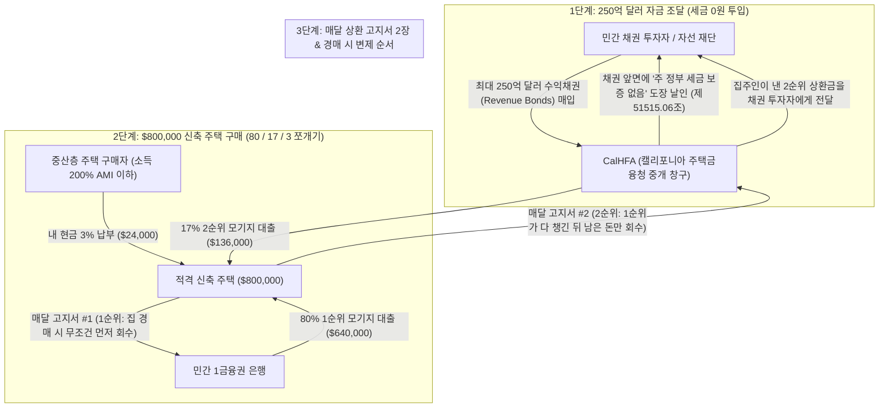
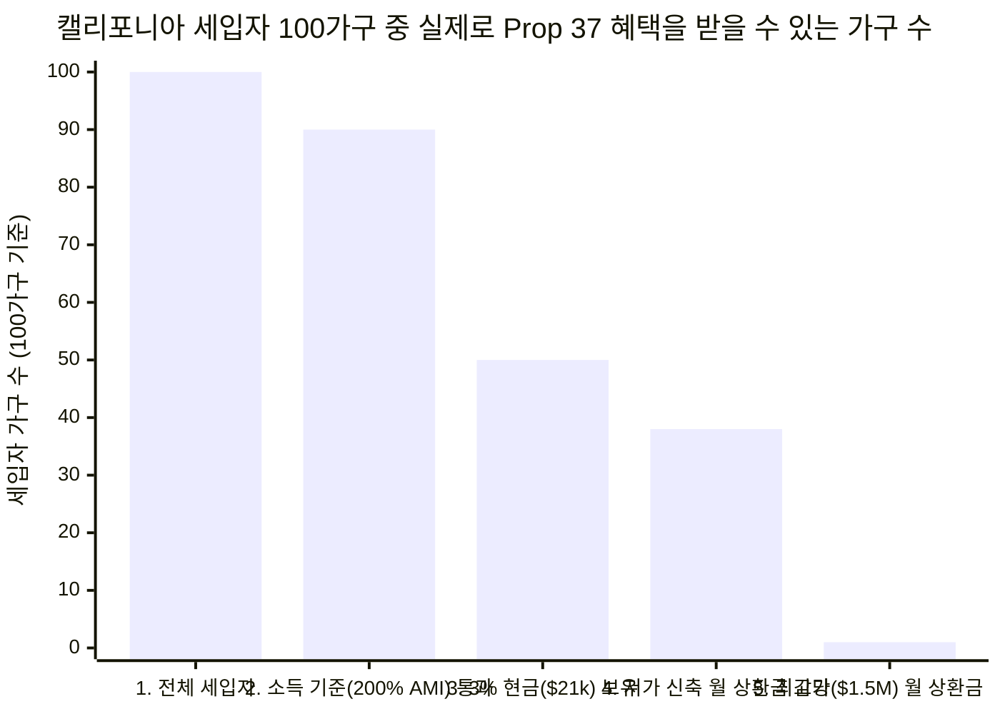
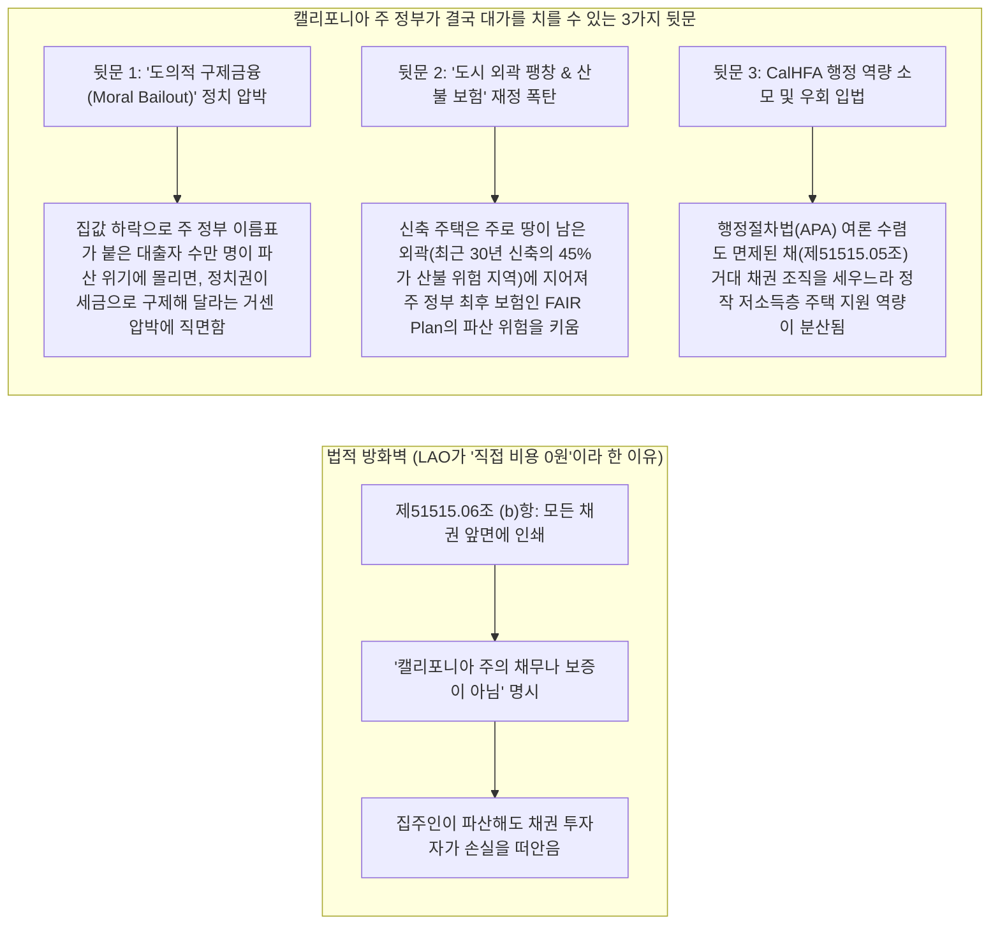

## 1. 도입부(Hook): 잠깐만요—세금 한 푼 안 쓰고 집값의 3%만으로 캘리포니아 새 집을 살 수 있다고요?

장난감 가게에서 `80만 원`(`$800`)짜리 초대형 레고 밀레니엄 팔콘 세트를 사고 싶다고 상상해 보세요. 원래 가게 사장님은 이렇게 말합니다. *"매주 받는 용돈으로 나머지 금액을 조금씩 갚아나가는 할부로 사려면, 오늘 당장 가격의 `20%`인 `16만 원`(`$160`)을 현금으로 계산대에 올려놓아야 한단다."*

오늘날 캘리포니아에서 평범한 가족이 살 만한 집 한 채 가격은 약 **`$800,000`에서 `$930,000`(약 11억~13억 원)**에 달합니다. 즉, 처음에 내야 하는 `20%` 현금 뭉치만 무려 **`$160,000`에서 `$186,000`(약 2억 2천만~2억 6천만 원)**이나 됩니다!
- **물리적 스케일 비교(Scale Anchor):** 현금 `$186,000`를 모으려면, 매달 꼬박꼬박 **`$1,000`(약 140만 원)씩 단 한 푼도 안 쓰고 15년 6개월 동안** 저금통에 넣어야 합니다—그사이 월세는 매년 오르는데 말이죠! 법안을 만든 밥 허츠버그(Bob Hertzberg) 전 캘리포니아 주하원의장의 비유처럼, 평범한 맞벌이 가정에 그만한 목돈을 모으라는 건 *"골판지로 만든 로켓을 타고 달나라에 가라는 것"*과 같습니다 ([CalMatters](https://calmatters.org/politics/2026/10/prop-37-explained-homeownership/)).

그런데 바로 며칠 전인 **2026년 11월 3일**, 캘리포니아 유권자들은 **주민발의안 37호(Proposition 37, '2026년 중산층 내 집 마련 및 가족 주택 건설법')**를 **찬성 `61.3%` 대 반대 `38.7%`**라는 압도적 표차로 통과시켰습니다 ([SOS 공식 가이드](https://quickguidetoprops.sos.ca.gov/propositions/2026-11-03/37), [CalMatters](https://calmatters.org/politics/2026/11/california-election-2026-props-1-37/)).

광고 문구만 보면 마법 같은 이야기입니다.
1. **새로 지은 집(신축 주택이나 콘도)**을 살 때, 내 주머니에서는 집값의 **`3%`만 현금**으로 내면 됩니다(`$800,000`짜리 집이라면 `$160,000` 대신 `$24,000`만 내면 끝!).
2. 캘리포니아 주 정부 기관인 **주택금융청(CalHFA)**이 최대 **`$25 billion`(250억 달러, 약 35조 원)**을 동원해 나머지 **`17%`**(`$136,000`)를 메꿔주어 합계 `20%`를 채워줍니다.
3. 게다가 초당파 감사기관인 **캘리포니아 주의회 입법분석처(LAO)**가 투표용지에 적어놓은 공식 재정 평가는 단 한 줄입니다. **"재정 영향: 주 정부나 지방 정부에 직접적인 비용 부담 없음(No direct state or local costs)"** ([LAO Prop 37 분석서](https://lao.ca.gov/BallotAnalysis/Proposition?number=37&year=2026)).

잠깐만요! 여기서 여러분의 머릿속에 *"세상에 공짜 점심이 어디 있어? 너무 조건이 좋은데?"*라는 탐정 경보음이 울렸다면, **정확히 핵심을 찌르셨습니다!**
- **세금을 한 푼도 안 쓰는데 대체 250억 달러(`$25 billion`)는 어디서 하늘에서 뚝 떨어지는 걸까요?**
- **주 정부가 보태준다는 `17%`는 공짜 지원금일까요, 아니면 매달 내야 하는 두 번째 빚 고지서일까요?**
- **만약 집값이 떨어져서 집주인들이 돈을 못 갚으면, 결국 캘리포니아 주 정부가 빚더미를 떠안게 되는 건 아닐까요?**

법률 원문과 경제학 연구소들의 영수증을 열어보기 전에, 탐정의 핵심 결론부터 먼저 공개합니다!
> **여러분의 직감이 100% 맞습니다. 수학의 세계에 공짜 마법은 없습니다.**
> 1. **주 정부 세금(납세자) 관점:** 법적으로는 캘리포니아 주 정부의 세금 금고(일반기금, General Fund)가 **철저히 차단**되어 있습니다. Prop 37은 세금으로 갚는 채권이 아니라 민간 투자자가 위험을 부담하는 **'수익채권(Revenue Bonds)'**을 사용하며, 채권 앞면에 *"주 정부는 이 빚을 보증하지 않는다"*는 경고문(`보건안전법 제51515.06조 (b)항`)을 의무적으로 찍어야 하기 때문입니다. 집주인들이 파산하면 법적으로는 월스트리트 채권 투자자들이 손해를 봅니다. **하지만 간접적인 폭탄은 남아 있습니다.** 만약 부동산 불황으로 수만 가구가 한꺼번에 파산 위기에 몰리면 정치인들이 세금으로 구제금융(Bailout)을 해줘야 한다는 강력한 정치적 압박을 받게 되고, 외곽 산불 위험 지역에 신축 주택이 늘어나면서 주 정부의 최후 화재보험(**FAIR Plan**) 적자가 눈덩이처럼 불어날 수 있습니다.
> 2. **집을 사는 사람(구매자) 관점:** "너무 좋아서 믿기 힘든" 진짜 함정은 주 정부 금고가 아니라 **집을 산 사람의 매달 가계부**에 떨어집니다! 과거 캘리포니아의 *Dream For All* 프로그램(집을 팔 때까지 매달 이자를 `0원` 내던 '조용한 대출')과 달리, Prop 37의 `17%` 지원금은 **매달 원금과 이자를 갚아야 하는 '두 번째 주택담보대출'**(`제51515.05조 (c)항`)입니다. `$800,000`짜리 집을 살 때 처음에 `$136,000`를 아끼는 대신 집값의 **97%를 빚**으로 떠안게 되어, 매달 내야 하는 대출 상환금이 **`$860`에서 `$1,000` 이상(약 120만~140만 원) 폭증**하고, 집값이 고작 `4%`만 떨어져도 집값보다 빚이 더 많아지는 **'깡통주택(Underwater)'** 함정에 빠지게 됩니다!

이 거대한 250억 달러짜리 기계 속 톱니바퀴가 어떻게 맞물려 돌아가는지, 이제 0단계 기초부터 하나씩 살펴봅시다.

---

## 2. 0단계부터 시작하기: 집을 사는 원리와 주 정부 채권은 어떻게 작동할까?

평생 집을 사본 적도, 정부 채권을 본 적도 없다고 가정해 봅시다. 가장 쉬운 네 가지 레고 블록으로 전체 원리를 조립해 볼게요.

### 블록 1: 계약금(Down Payment), 주택담보대출(Mortgage), 그리고 'PMI 벌금'
캘리포니아에서 새로 지은 집 한 채가 **`$800,000`**라고 해봅시다. 돼지저금통에 현금 `$800,000`를 가진 사람은 거의 없으니 집값을 두 조각으로 나눕니다.
1. **처음에 내는 내 현금 뭉치:** 첫날 내 저금통에서 꺼내 내는 돈입니다. 어른들은 이걸 **계약금 / 다운페이먼트(Down Payment)**라고 부릅니다.
2. **은행에서 빌리는 큰돈:** 나머지 금액은 민간 은행에서 빌리고, 앞으로 `30년` 동안 매달 원금과 돈 빌린 사용료(**이자, Interest**)를 갚아나갑니다. 어른들은 이 30년짜리 집 대출을 **모기지(Mortgage, 주택담보대출)**라고 부릅니다.

그런데 왜 은행들은 항상 마법의 숫자 **`20%`**를 고집할까요?
- 내가 내 돈 **`20%`(`$160,000`)**를 내고 은행에서 **`80%`(`$640,000`)**만 빌리면 은행은 안심합니다. 나중에 부동산 경기가 나빠져 집값이 `10%~15%` 떨어져도, 은행이 그 집을 팔아서 빌려준 `$640,000`를 전부 회수할 수 있기 때문입니다.
- 반대로 내가 내 돈을 **`3%`(`$24,000`)**만 내고 은행에서 `97%`(`$776,000`)를 빌리면 은행은 덜덜 떱니다! 집값이 겨우 `5%`(`$40,000`)만 내려가도 집값은 `$760,000`가 되어, 내가 갚아야 할 빚(`$776,000`)보다 집값이 더 싸지기 때문입니다.
- 그래서 계약금을 `20%`보다 적게 내면, 은행은 구매자에게 *"네가 돈을 못 갚을 때를 대비해 은행을 보호하는 특별 보험료를 매달 추가로 내라!"*고 강요합니다. 어른들은 이 추가 비용을 **민간 모기지 보험(PMI, Private Mortgage Insurance)**이라고 부르는데, `$800,000`짜리 집에서는 내 빚을 단 1원도 안 깎아주면서 매달 **`$350`에서 `$650`씩 허공으로 날아가는 벌금** 같은 돈입니다!

### 블록 2: Prop 37이 파이를 세 조각으로 나누는 법 (`80% + 17% + 3% = 100%`)
Prop 37의 핵심 아이디어는 `$800,000`짜리 집값을 두 조각이 아니라 **세 조각**으로 나누는 것입니다 ([SOS 공식 유권자 안내서 PDF](https://vig.cdn.sos.ca.gov/2026/general/pdf/prop37.pdf)).
1. **첫째 조각 — 내 현금(`3%` = `$24,000`):** 구매자가 자기 저금통(빌린 돈 제외)에서 최소 `3%`를 냅니다.
2. **둘째 조각 — 주 정부 기관의 2순위 대출(`최대 17%` = `$136,000`):** 캘리포니아 주택금융청(**CalHFA**)이 집값의 최대 `17%`를 빌려줍니다. 내 현금 `3%`와 주 정부 대출 `17%`를 합치면 `20%`가 되므로, 1순위 민간 은행 눈에는 안전판 `20%`가 확보된 것처럼 보입니다—덕분에 **매달 내던 `PMI` 보험료 벌금이 사라집니다!**
3. **셋째 조각 — 일반 은행의 1순위 대출(`80%` = `$640,000`):** 나머지 `80%`는 일반 민간 은행에서 평소처럼 1순위 주택담보대출을 받습니다.

잠깐만요! 은행에서 `80%`를 빌리고 주 정부 기관에서 `17%`를 빌렸다면, 결국 내가 빌린 빚은 집값의 몇 퍼센트일까요?
**`80% + 17% = 97%`입니다!** 즉, 이제 매달 날아오는 대출 고지서가 한 장이 아니라 **두 장**(은행 1순위 대출 고지서 + 주 정부 2순위 대출 고지서)이 됩니다.

### 블록 3: 왜 세금이 안 들어갈까? (일반보증채권 vs. 수익채권)
캘리포니아 주 정부가 수백억 달러의 큰돈을 빌릴 때는 **채권(Bond)**이라는 공식 차용증을 인쇄해 투자자(연기금, 부자, 은행 등)에게 팝니다. 채권에는 완전히 다른 두 가지 종류가 있습니다.
- **종류 A — '납세자 세금 카드'(일반보증채권, General Obligation Bonds):** 이번 2026년 11월 투표에서 함께 통과된 **주민발의안 1호(Prop 1, 저소득층 및 노숙인 임대주택 건설용 112억 5천만 달러)**는 **일반보증채권(`GO Bond`)**입니다 ([CalMatters](https://calmatters.org/politics/2026/11/california-election-2026-props-1-37/)). 즉, 학교와 병원을 짓는 주 정부의 세금 금고(**일반기금, General Fund**)에서 앞으로 수십 년간 시민들의 세금으로 원금과 이자를 갚겠다고 약속한 채권입니다.
- **종류 B — '통행료로만 갚는 유료 다리'(수익채권, Revenue Bonds):** 반면 **주민발의안 37호(Prop 37)**는 일반보증채권이 아니라 최대 **`$25 billion`(250억 달러) 규모의 수익채권(Revenue Bonds)**을 발행합니다 ([LAO 분석서](https://lao.ca.gov/BallotAnalysis/Proposition?number=37&year=2026)). 유료 다리를 짓는다고 생각해 보세요. 투자자들이 다리 공사비를 빌려주면, 주 정부 세금이 아니라 **그 다리를 건너는 운전자들이 내는 `$5` 통행료로만** 투자자에게 돈을 갚는 방식입니다. Prop 37에서 CalHFA는 중간 다리 역할만 합니다. 민간 채권 투자자에게 최대 250억 달러를 빌려서 신축 주택 구매자들에게 `17%` 2순위 대출로 빌려주고, 집주인들이 매달 갚는 2순위 대출 원금과 이자를 받아서 그대로 채권 투자자들에게 전달합니다.

이 전체 돈의 흐름과 빚의 줄서기를 한눈에 보여주는 그림입니다.

---

## 3. 비밀 해독기(Secret Decoder Ring): 어려운 부동산·금융 용어 통역 표

법 조문의 세부 함정을 파헤치기 전에, 이번 사건에 등장하는 일곱 가지 어려운 어른들의 전문 용어를 초등학교 5학년 언어로 번역해 봅시다.

| 어른들의 전문 용어 / 약어 | 진짜 뜻 (쉬운 한국어 설명) | 초등학교 5학년 일상 비유 |
| :--- | :--- | :--- |
| **수익채권 (Revenue Bond)** | 일반 세금은 단 1원도 쓰지 않고, 오직 그 사업을 이용한 사람들이 내는 요금이나 대출 상환금으로만 갚는 정부 차용증입니다. | 삼촌에게 레모네이드 가판대 재료비 5만 원을 빌리면서, "내 생일 용돈에서는 절대 안 갚고 오직 레모네이드를 팔아서 번 돈으로만 갚을게요"라고 약속하는 것. |
| **일반보증채권 (`GO Bond`)** | 주 정부가 "무슨 일이 있어도 시민들이 낸 세금(일반기금)으로 끝까지 갚겠다"고 보증하는 정부 차용증입니다. | 부모님 가족 신용카드로 새 자전거를 사는 것—내가 자전거를 안 타도 부모님이 매달 가족 생활비에서 카드값을 내야 합니다. |
| **2순위 모기지 (Secondary / Subordinate Mortgage)** | 1순위 은행 대출 위에 얹는 추가 집 대출입니다. '후순위(Subordinate)'라는 뜻은 집주인이 망해서 집을 팔 때 **1순위 은행이 자기 돈을 100% 먼저 다 챙기고, 남은 부스러기만 2순위가 가져간다**는 뜻입니다. | 희귀 포켓몬 카드를 사려고 친구 두 명에게 돈을 빌렸는데, 카드를 도로 팔 때 1번 친구가 빌려준 돈을 먼저 다 가져가고 2번 친구는 남는 돈이 있을 때만 받는 규칙. |
| **합산 담보인정비율 (`CLTV`)** | 집값 중에서 1순위 대출과 2순위 대출을 **모두 합쳐서 빌린 빚의 비율**입니다 (`80%` + `17%` = **`97% CLTV`**). | 10만 원짜리 스케이트보드를 내 동전 3천 원(`3%`)과 빌린 돈 9만 7천 원(`97%`)으로 사는 것. 스케이트보드는 내 발밑에 있지만 가치의 `97%`는 남의 돈입니다. |
| **조용한 2순위 대출 vs. 매달 갚는 2순위 대출** | '조용한 대출(Silent Second, 예: *Dream For All*)'은 집을 팔 때까지 매달 내는 돈이 `0원`입니다. 반면 Prop 37은 첫달부터 **매달 원금과 이자를 갚아야 하는 대출**입니다. | 조용한 대출은 졸업할 때 한꺼번에 반납하면 되는 도서관 책이고, Prop 37은 매달 꼬박꼬박 이용료를 내야 하는 넷플릭스 구독권입니다. |
| **지역 중위소득 (`AMI`, Area Median Income)** | 특정 카운티(군)에 사는 가족들을 소득 순서대로 줄 세웠을 때 정확히 한가운데(`50번째`)에 있는 가족의 소득입니다. Prop 37은 **`200% AMI`(중간 소득의 2배!)**까지 신청할 수 있습니다. | 우리 동네 100가구를 소득 순으로 줄 세웠을 때 50등 가족이 `100% AMI`입니다. 50등 가족 월급의 **2배**를 버는 부유한 가족까지도 Prop 37을 쓸 수 있습니다. |
| **가격 전가 / 자본화 (Price Capitalization)** | 집 숫자는 그대로인데 사는 사람들에게 대출금만 더 쥐여주면, 건설사와 집주인들이 그만큼 집값 가격표를 올려버리는 현상입니다. | 학교 바자회에 컵케이크가 딱 10개뿐인데 교장 선생님이 전교생에게 5천 원씩 나눠주면, 컵케이크를 더 많이 먹을 수 있는 게 아니라 컵케이크 값만 5천 원 비싸지는 현상! |

---

## 4. 화려한 광고 vs. 탐정의 팩트체크: 실제 법 조문 영수증 열어보기

유권자들이 본 찬성 캠페인 광고에서는 공인중개사, 목수 노조, 교사, 간호사 단체가 나와 *"납세자 비용 0원으로 중산층에게 저금리 다운페이먼트 대출을 제공합니다!"*라고 홍보했습니다 ([SOS 유권자 안내서 PDF, 42쪽](https://vig.cdn.sos.ca.gov/2026/general/pdf/prop37.pdf)). 심지어 공식 선거 공보물에는 **반대 측 의견서가 단 한 줄도 제출되지 않았습니다** ([SOS PDF, 43쪽](https://vig.cdn.sos.ca.gov/2026/general/pdf/prop37.pdf)).

왜 아무도 돈을 들여 반대 TV 광고를 안 했을까요? 당장 세금을 올리거나 주 정부 예산을 깎는 법안이 아니었기 때문입니다!
- **누가 Prop 37 캠페인 돈을 댔을까?** [CalMatters](https://calmatters.org/california-voter-guide-2026/proposition-37-homebuyers-loan/)와 스탠퍼드 대학교 [후버 연구소(Hoover Institution)](https://www.hoover.org/proposition-lab-proposition-37)가 추적한 선거자금 내역을 보면, 이 법안은 밥 허츠버그 전 주하원의장이 주도했고 전체 산업계 후원금의 **52% 이상을 '캘리포니아 부동산중개인협회(California Association of Realtors)'**가 대주었으며, **캘리포니아 목수 노조(California Conference of Carpenters)**가 함께 밀어붙였습니다.

하지만 이번 투표 통과로 캘리포니아 법률에 새로 추가된 **보건안전법 제11.5장(제`51515`조~제`51515.06`조) 실제 법 조문** ([법률 전문 PDF, 118~123쪽](https://vig.cdn.sos.ca.gov/2026/general/pdf/prop37-text-proposed-laws.pdf))을 직접 열어보고, [캘리포니아 예산정책센터(CalBudgetCenter)](https://calbudgetcenter.org/resources/will-proposition-37-make-homeownership-more-affordable-its-not-guaranteed/), [캘리포니아 공공정책연구소(PPIC)](https://calmatters.org/politics/2026/10/prop-37-explained-homeownership/), [SPUR](https://www.spur.org/voter-guide/2026-11/ca-prop-37-homeowner-loans), [California YIMBY](https://cayimby.org/blog/proposition-37-2026/)의 감사 보고서를 대조해 보면 놀라운 반전이 드러납니다.

### 정밀 비교표: 기존 *Dream For All* 프로그램 vs. 새로 통과된 *Prop 37*

많은 유권자가 Prop 37을 기존에 인기 있었던 캘리포니아의 **Dream For All** 지원금([CalHFA Dream For All](https://www.calhfa.ca.gov/dream/))을 250억 달러로 키운 버전이라고 착각했습니다. **하지만 두 제도는 완전히 다릅니다!**

| 비교 항목 | 기존 *Dream For All* 프로그램 (CalHFA 운영) | 새로 통과된 *Prop 37* (*중산층 내 집 마련 대출*, 2026년 11월) | 구매자와 납세자에게 미치는 실제 차이 |
| :--- | :--- | :--- | :--- |
| **돈이 어디서 나오나?** | **주 정부 세금 금고(일반기금)** (2023~2024년 총 약 `$550M` 투입). | **최대 `$25 Billion`(250억 달러) 민간 수익채권** (`보건안전법 제51515.06조`). | *Dream For All*은 세금 예산이 며칠 만에 바닥나서 4,000가구도 못 썼지만, Prop 37은 규모가 `45배` 크고 세금이 안 들어갑니다(단, 투자자가 채권을 사줄 때만!). |
| **다운페이먼트 대출금을 매달 갚아야 하나?** | **아니요 (매달 `$0` 내는 '조용한 대출').** 사는 동안 매달 이자를 안 내고, 나중에 집을 팔거나 재융자할 때 원금 + 집값 상승분의 `15%~20%`를 주 정부에 나눕니다. | **예! 매달 고정금리로 원금+이자를 갚아야 함 (`제51515.05조 (c)항`).** 집값 상승분은 100% 집주인이 갖지만, 채권 투자자에게 줄 이자를 **매달 다달이 납부**해야 합니다! | *Dream For All*은 매달 내는 돈이 줄어들었지만, Prop 37은 **매달 약 `$860~$1,000+`의 두 번째 대출 고지서**가 추가됩니다! |
| **어떤 집을 살 수 있나?** | **모든 주택** (기존 구축 주택과 신축 주택 모두 가능). | **오직 '신축 주택'만 가능 (`제51515.01조 (b)항`).** 새로 지은 단독주택, 타운홈, 콘도, 조립식 주택, 또는 비주거용 건물을 개조한 주택의 **첫 번째 구매자**여야 함. | 동네에 있는 기존 중고 주택은 아예 못 삽니다! 카운티별 적격 대출 한도의 `125%` 이하(약 `$1.0M~$1.56M`)인 **새 집만** 살 수 있습니다. |
| **누가 신청할 수 있나?** | **매우 엄격함:** 생애 최초 구매자 + 부모님도 집이 없었던 **1세대 주택 구매자(First-Generation)**여야 하며, 소득도 중저소득층(`120%~150% AMI` 이하)으로 제한. | **매우 넓음 (`제51515.01조 (a)항`):** 소득이 **지역 중위소득의 `200%`(`200% AMI`) 이하**면 누구나 가능 (산타클라라 `$375,800`, 샌프란시스코 `$401,600`, 산마테오 **`$410,000`**!). **생애 최초 조건도 없음!** | 이미 집을 가졌던 사람이나 실리콘밸리에서 연봉 `$400,000`(약 5억 5천만 원)를 버는 고소득 가족도 `3%` 계약금으로 150만 달러짜리 새 집을 살 수 있습니다. |
| **법조문에 숨겨진 이익단체 조항** | 일반 CalHFA 대출 규칙 적용, 부동산 중개인 의무 고용 조항 없음. | **공인중개사 의무 고용 조항(`제51515.04조 (c)항`)** + **적격 건설사 옵션(`제51515.02조`)**으로 하자 소송 변호사 성공보수를 `30%`로 제한. | 캠페인 최대 후원자인 부동산중개인협회가 법조문에 **"구매자는 반드시 공인중개사를 고용해야 한다"**고 못 박아 `2%~3%` 중개수수료를 보장받았습니다! |

---

## 5. 네 명의 용의자(4-Way Causal Audit): Prop 37은 진짜 집을 많이 짓게 할까, 아니면 집값만 올릴까?

찬성 측은 Prop 37 덕분에 캘리포니아에 최대 **`190,000채`의 새 집**이 지어질 것이라고 주장합니다 ([California YIMBY](https://cayimby.org/blog/proposition-37-2026/), [CalMatters](https://calmatters.org/politics/2026/10/prop-37-explained-homeownership/)). 반면 비판하는 경제학자들은 집이 부족한 캘리포니아에 250억 달러의 대출금을 풀면 새 집 가격표만 올라갈 것이라고 경고합니다.

진짜 탐정처럼 네 가지 인과관계 용의자(**4-Way Rival Cause Audit**)를 모두 심문해 봅시다!

| 용의자 (인과관계 방향) | 이 메커니즘이 작동하는 원리 (쉬운 설명) | 1차 출처 데이터와 증거의 판정 |
| :--- | :--- | :--- |
| **용의자 1: 직접 인과 (`Prop 37 대출 → 신축 주택 19만 채 건설 & 내 집 마련 증가`)** | 오직 *새로 지은 집*에만 `17%` 대출을 해주고 건설사들에게 하자 소송 보호막(`제51515.02조`)을 주면, 건설사들이 "사줄 손님이 확실히 있구나!"라고 안심해 새 아파트를 대거 짓는다. | **해안 대도시에서는 약함 / 내륙 외곽에서는 중간 효과.** [California YIMBY](https://cayimby.org/blog/proposition-37-2026/)가 지적하듯, LA나 샌프란시스코 같은 대도시는 '집을 살 손님'이 부족해서 안 짓는 게 아닙니다(새 집이 나오면 이미 입찰 전쟁이 벌어집니다). 다만 수요가 약한 내륙 외곽(센트럴 밸리 등)에서는 건설을 앞당기는 효과가 일부 있을 수 있습니다. |
| **용의자 2: 역인과 / 가격 전가 (`Prop 37 대출 → 건설사들이 신축 분양가를 인상함`)** | 시청의 까다로운 건축 허가와 토지 규제 때문에 매년 지어지는 분양 주택 수가 `4만 6천~5만 5천 채`에 묶여 있다면, 손님들에게 `$136,000~$255,000`의 대출 무기를 더 쥐여주었을 때 건설사들이 새 집 분양가를 `3%~8%` 올려서 이익을 챙긴다. | **강력한 역사적 증거 존재.** 2020~2022년 캘리포니아 집값이 폭등했을 때도 주 전체 민간 분양 주택 허가 건수는 사실상 제자리걸음이었습니다(`2019년 48,000호` → `2020년 43,000호` → `2021년 55,000호` → `2022년 47,000호` → `2023년 46,000호`—[CA YIMBY](https://cayimby.org/blog/proposition-37-2026/)). 공급이 규제로 막혀 있을 때 구매 보조금을 주면 집값 상승으로 흡수됩니다! |
| **용의자 3: 숨은 제3의 변수 (`6.5%~7% 고금리와 건축 규제가 양쪽 모두를 가로막음`)** | 지금 내 집 마련을 막는 진짜 끝판왕 보스는 계약금 `20%`가 아니라 **`6.5%~7.0%`에 달하는 높은 시장 금리**와 **건축 규제**입니다! 금리가 높으면 채권 투자자도 높은 이자를 요구하고, 구매자도 매달 나가는 원리금을 감당하지 못합니다. | **PPIC 통계 모델로 완벽히 입증됨.** [캘리포니아 공공정책연구소(PPIC)](https://calmatters.org/politics/2026/10/prop-37-explained-homeownership/)의 **'체육관에 모인 세입자 100명 테스트'**를 보십시오. 캘리포니아 세입자 **100가구** 중 **90가구**가 소득 기준(`200% AMI` 이하)을 통과합니다. 하지만 `~7%` 금리로 집값의 `97%`를 빌리면 매달 갚을 돈이 너무 커서, 가장 싼 신축 주택조차 감당할 수 있는 가구는 **40가구 미만**이고, 상한선(`$1.5M`) 근처 집을 감당할 수 있는 세입자는 **100가구 중 1가구도 안 됩니다(`<0.5%`)**! |
| **용의자 4: 악순환 피드백 루프 (`97% 빚 + 외곽 관리비 폭탄 → 연체 증가 → 채권 판매 중단`)** | 구매자들이 집값의 `97%`를 빌려 신축 주택을 샀다가 비싼 관리비(HOA)와 산불 보험료에 시달립니다. 경기가 나빠져 집값이 `5%~10%` 하락하면 집주인들이 깡통주택이 되어 상환을 멈추고, 채권 투자자들이 손실을 입어 프로그램 전체가 얼어붙습니다. | **실제 존재하는 경기 침체 리스크.** 구매자의 초기 자기자본이 단 `3%`뿐이므로, 집값이 조금만 흔들려도 2순위 채권 투자자의 원금이 깎여나가는 구조적 취약성이 있습니다 ([Hoover Institution](https://www.hoover.org/proposition-lab-proposition-37)). |

[캘리포니아 예산정책센터(CalBudgetCenter)](https://calbudgetcenter.org/resources/will-proposition-37-make-homeownership-more-affordable-its-not-guaranteed/)와 [PPIC](https://calmatters.org/politics/2026/10/prop-37-explained-homeownership/) 데이터를 바탕으로 **학교 체육관에 모인 캘리포니아 세입자 100가구** 중 실제로 몇 가구가 Prop 37을 쓸 수 있는지 깔때기 차트로 확인해 봅시다.

위 차트의 3번 막대와 4번 막대를 자세히 보세요.
- **통장 잔고의 현실:** `$700,000`짜리 신축 주택의 `3%` 계약금만 해도 **현금 `$21,000`**(취등록세·수수료 별도)가 필요합니다. 그런데 [캘리포니아 예산정책센터](https://calbudgetcenter.org/resources/will-proposition-37-make-homeownership-more-affordable-its-not-guaranteed/)가 인용한 PPIC 조사에 따르면, 캘리포니아 가구의 **입출금 및 저축통장 잔고 중앙값(딱 중간 가구의 전 재산)은 `$18,000`를 조금 넘는 수준**입니다! 즉, 절반 이상의 가구는 통장을 전부 털어도 `3%` 계약금조차 내기 어렵습니다.
- **월 상환금의 거대한 벽:** 설령 현금 `3%`가 있더라도, 나머지 `97%`를 이자 내는 두 개의 대출로 빌리면 **자격이 되는 세입자 100명 중 60명 이상은 매달 날아오는 원리금 고지서를 감당할 수 없습니다!**

---

## 6. 숨겨진 함정(The Catch): Prop 37 속 5가지 비밀 함정과 주 정부 재정 부담의 진실

이제 여러분이 가장 궁금해하셨던 질문에 정면으로 답할 시간입니다.
**"조건이 너무 좋아서 믿기 힘든데, 결국 나중에 주 정부에 재정적 부담을 지우게 될까요, 아닐까요?"**

`보건안전법 제51515조~제51515.06조` 원문을 현미경으로 들여다보면 **다섯 가지 숨겨진 함정**이 나옵니다—세 가지는 집을 사는 사람과 채권 투자자에게 떨어지고, 두 가지는 뒷문을 통해 캘리포니아 주 정부에 부담을 줄 수 있습니다.

### 함정 #1: 매달 날아오는 '두 번째 모기지' 고지서 충격 (왜 `PMI`를 안 내도 월 부담금은 더 비쌀까?)
계약금 `20%`(`3%` 내 현금 + `17%` 주 정부 대출)를 채우면 모기지 보험료(`PMI`)가 사라져서 매달 내는 돈이 싸지지 않을까요?
**`$800,000`짜리 신축 주택**을 30년 만기 연 `6.5%` 1순위 모기지로 살 때, 매달 통장에서 빠져나가는 돈을 초등학교 산수로 직접 계산해 봅시다!

| 매달 나가는 비용 항목 | 선택 A: 전통 방식 `20%` 현금 납부 (`$160k` 현금) | 선택 B: 일반 `3%` 다운 대출 (`$24k` 현금, Prop 37 미사용) | 선택 C: Prop 37 `3%` 현금 + `17%` 2순위 대출 (`$24k` 현금) |
| :--- | :--- | :--- | :--- |
| **첫날 필요한 내 현금** | **`$160,000`** (`20%`) | **`$24,000`** (`3%`) | **`$24,000`** (`3%`) |
| **1순위 은행 대출 월 상환금 (`6.5%`)** | 월 `$4,045` (`$640k` 대출) | 월 `$4,905` (`$776k` 대출) | 월 `$4,045` (`$640k` 대출) |
| **매달 내는 `PMI` 모기지 보험료** | 월 `$0` | 월 약 `$485` (지분 `20%` 도달 시 자동 소멸) | **월 `$0`** (면제됨!) |
| **Prop 37 2순위 대출 월 상환금 (`$136k` 대출)** | 월 `$0` | 월 `$0` | **월 `$860`(금리 `6.5%` 시) ~ 월 `$998`(금리 `8.0%` 시)** (자선단체가 `3.0%`로 채권을 사줄 때만 월 `$573`!) |
| **매달 내는 총 대출 원리금 + PMI 합계** | **월 `$4,045`** | **월 `$5,390`** | **월 `$4,905` ~ `$5,043`** (자선채권 `3%` 성공 시 월 `$4,618`) |

위 표의 숫자를 보세요!
- 현금 `20%`를 내고 산 사람(월 `$4,045`)과 비교하면, Prop 37을 쓴 사람은 `$136,000`를 더 빌렸기 때문에 **매달 `$573`에서 `$998`씩(1년에 약 `$6,876~$11,976`) 더 많은 돈**을 30년 내내 내야 합니다!
- 심지어 일반 `3%` 대출(`PMI` 포함 월 `$5,390`)과 비교해도, 만약 월스트리트 투자자들이 위험 수당을 요구해 Prop 37의 2순위 대출 금리가 `8.0%`로 정해지면 당장 매달 아끼는 돈은 `$347`에 불과합니다—게다가 일반 대출의 `PMI` 보험료는 원금을 `20%` 갚거나 집값이 오르면 자동으로 사라지지만, **Prop 37의 2순위 대출 고지서는 30년 동안 계속 날아옵니다!**

### 함정 #2: '2순위 채권'의 금리 딜레마 (월스트리트 투자자 vs. 자선가들의 '전쟁 채권')
왜 Prop 37의 2순위 대출 금리가 1순위 은행 금리(`~6.5%`)보다 오히려 **더 비싸질** 위험이 있을까요?
법 조문 `제51515.05조 (b)항`과 `제51515.06조 (b)항`([법률 원문 PDF, 121~122쪽](https://vig.cdn.sos.ca.gov/2026/general/pdf/prop37-text-proposed-laws.pdf))을 보면 이유가 명확합니다.
1. Prop 37 대출은 1순위 은행 대출보다 **후순위(Subordinate, 경매 시 두 번째 줄)**입니다.
2. 이 채권은 **캘리포니아 주 정부나 연방 보증기관(Fannie Mae / Freddie Mac)이 보증하지 않습니다.**
3. 게다가 `제51515.05조 (c)항`에 따라, CalHFA는 채권 투자자에게 줄 원금과 이자, 그리고 기관 운영비를 **모두 충당할 수 있는 수준으로 집주인의 대출 금리를 설정해야만 합니다.**

미국기업연구소(AEI) 주택센터의 에드워드 핀토(Edward Pinto) 소장과 [캘리포니아 예산정책센터](https://calbudgetcenter.org/resources/will-proposition-37-make-homeownership-more-affordable-its-not-guaranteed/)가 지적하듯, 집주인이 자기 돈을 `3%`밖에 안 넣은 무보증 2순위 대출 채권을 일반 월스트리트 투자자에게 팔려면 `7.5%~9.0%` 이상의 **높은 위험 금리**를 줘야 합니다!
- **밥 허츠버그의 해결책?** 법안 작성자인 허츠버그는 *"제2차 세계대전 당시 애국심으로 사주던 전쟁 채권(War Bonds)처럼"* 억만장자 자선가들('기빙 플레지' 서약자), 자선 재단, 그리고 지역재투자법(`CRA`, `제51515.03조 (b)항`) 점수가 필요한 은행들을 설득해 연 **`3%`의 싼 이자**로 채권을 사주게 만들겠다고 장담했습니다 ([CalMatters](https://calmatters.org/politics/2026/11/california-election-2026-props-1-37/)).
- **팩트체크 결과:** 2026년 11월 3일 선거 당일까지 **이 채권을 사겠다고 공개적으로 약속한 자선 재단이나 억만장자는 단 한 곳도 없었습니다!** 만약 자선가들이 사주지 않으면, 금리가 높아져 아무도 안 빌리거나 250억 달러 한도가 종이 위의 숫자로 남게 됩니다.

### 함정 #3: 결국 주 정부가 재정 부담을 지게 될까? (법적 방화벽 vs. 3가지 뒷문 리스크)
캘리포니아 주 정부가 법적으로 어떻게 보호받는지, 그리고 어떤 **세 가지 뒷문**을 통해 결국 주 정부와 시민들이 부담을 떠안을 수 있는지 다이어그램으로 확인해 봅시다.

1. **법적 방화벽 (직접 세금 책임 `$0`):** `보건안전법 제51515.06조 (b)항`은 발행되는 모든 채권 앞면에 다음 문구를 의무적으로 새기도록 규정합니다.
   > *"이 채권은 주택금융청(Agency) 외에 캘리포니아 주의 채무나 책임, 또는 주의 신뢰와 신용을 담보한 것으로 간주되지 아니하며, 오직 이를 위해 마련된 자금(대출 상환금)으로만 지급된다."*
   즉, 집주인들이 돈을 안 갚아서 채권 투자자들이 손해를 보더라도 캘리포니아 주 정부를 상대로 세금으로 물어내라고 소송을 걸 수 없습니다. 법적으로는 납세자 부담이 **`$0`**입니다.
2. **뒷문 리스크 #1 — '도의적 책임(Moral Obligation)'과 정치적 구제금융 압박:** 하지만 스탠퍼드 [후버 연구소(Hoover Institution)](https://www.hoover.org/proposition-lab-proposition-37)가 날카롭게 경고하듯, 법조문의 작은 글씨가 정치 현실을 다 막아주지는 못합니다. 구매자들이 **집값의 `97%`를 빚(`3%` 자기자본)**으로 시작하기 때문에, 부동산 경기가 식어서 집값이 겨우 `5%~10%`만 내려가도 수만 명의 Prop 37 대출자들이 집값보다 빚이 많은 **'깡통주택(Underwater)'**에 갇힙니다. 게다가 법안 `제51515.04조 (d)항`은 대출자가 **"월 이자 납부의 일시적 경제적 어려움 유예(Hardship Deferral)"**를 신청할 수 있게 허용하고 있습니다. 만약 경기 침체기에 수만 명의 교사, 간호사, 소방관들이 '캘리포니아 주 주택금융청(CalHFA)' 로고가 찍힌 대출을 못 갚아 길거리에 나앉게 되거나 CalHFA 기관 자체의 신용등급이 추락할 위기에 처하면, 주지사와 주의회 의원들은 결국 세금을 투입해 구제기금을 만들라는 엄청난 정치적 압력을 받게 됩니다!
3. **뒷문 리스크 #2 — '도시 외곽 난개발(Sprawl), HOA 관리비, 멜로-루스 세금, 그리고 산불 보험(FAIR Plan)' 폭탄:** Prop 37은 기존 도심의 중고 주택 구매를 금지하고 **오직 신축 주택만** 지원합니다 (`제51515.01조 (b)항`). 그런데 캘리포니아에서 `$700,000~$1,000,000`짜리 새 단독주택을 지을 빈 땅은 어디에 남아 있을까요? 일자리 중심지에서 멀리 떨어진 **외곽 지역(Urban Sprawl)**뿐입니다! [캘리포니아 예산정책센터](https://calbudgetcenter.org/resources/will-proposition-37-make-homeownership-more-affordable-its-not-guaranteed/) 보고서가 밝혀낸 숨은 비용을 보세요.
   - 미국 내 신축 분양 주택의 **약 `70%`**는 매달 내야 하는 입주자협회(**HOA**) 관리비가 붙어 있습니다(기존 주택은 `38%`). 캘리포니아 평균 HOA 관리비는 **월 `$280`**이며, 현행법상 주민 투표 없이도 **매년 최대 `20%`씩 인상**될 수 있습니다!
   - 외곽 신축 단지에는 도로, 상하수도, 학교를 짓기 위해 일반 재산세 위에 얹어 내는 **멜로-루스(Mello-Roos) 특별세**가 수십 년간 추가로 부과됩니다.
   - 무엇보다 지난 30년간 캘리포니아에 지어진 새 집의 **거의 `45%`가 산불 위험 경계 지역(WUI, Wildland-Urban Interface)**에 지어졌습니다! 민간 보험사들이 이 지역의 화재보험 가입을 거절하면서 집주인들이 주 정부가 만든 최후의 보루 보험인 **FAIR Plan**으로 몰려들고 있는데, 외곽 신축을 부추기는 Prop 37은 이 FAIR Plan의 재정 폭탄 위험을 한층 더 키우게 됩니다!

### 함정 #4: 연봉 `$400,000`도 중산층? 상위 계층 쏠림 현상
Prop 37은 소득 상한선을 **지역 중위소득의 `200%`(`200% AMI`)**로 잡았고(`제51515.01조 (a)(1)(C)`), 생애 최초 구매자 조건도 없앴습니다. 그 결과 산타클라라 카운티에서는 연 소득 **`$375,800`**, 샌프란시스코에서는 **`$401,600`**, 산마테오 카운티에서는 **`$410,000`(약 5억 6천만 원)**를 버는 가구까지 자격을 얻습니다 ([CalBudgetCenter](https://calbudgetcenter.org/resources/will-proposition-37-make-homeownership-more-affordable-its-not-guaranteed/), [SPUR](https://www.spur.org/voter-guide/2026-11/ca-prop-37-homeowner-loans)). 정작 진짜 도움이 절실한 중저소득 세입자들은 매달 `$860~$1,000`씩 추가되는 2순위 대출 원리금을 감당할 수 없기 때문에, [여성유권자연맹(League of Women Voters)](https://igs.berkeley.edu/library/california-ballot-proposition-guides/november-3-2026-general-election/proposition-37-loan)의 경고처럼 실제 혜택은 부모님 도움을 받을 수 있거나 소득이 높은 상위 계층에 집중될 가능성이 높습니다.

### 함정 #5: 공인중개사 의무 고용 조항과 건설사-노조의 물밑 거래
마지막으로 법조문 깊숙이 숨겨진 두 가지 이해관계 조항을 확인해 보세요.
- **제`51515.04`조 (c)항 (공인중개사 의무 고용):** Prop 37 대출을 받는 모든 구매자는 **반드시 캘리포니아 면허를 가진 부동산 중개인(Realtor/Broker)을 고용해야 합니다.** 원래 신축 분양 아파트나 주택은 모델하우스에 직접 찾아가 중개인 없이 계약하면서 분양가 할인을 협상할 수 있습니다. 하지만 캠페인 자금의 `52%` 이상을 댄 부동산중개인협회는 모든 구매자가 중개인을 쓰도록 법으로 강제해 **집값의 `2%~3%`(`$800k` 집 기준 `$16,000~$24,000`) 중개수수료**를 챙길 수 있게 만들었습니다 ([CA YIMBY](https://cayimby.org/blog/proposition-37-2026/))!
- **제`51515.02`조 & 제`51515.04`조 (e)항 (적격 건설사 옵션):** 건설사가 노조 훈련 인력 기준과 하청업체 임금 체불 연대책임(`공공자원법 제21080.66조 (d)항`)을 수용하면, 집주인들의 집단 하자 보수 소송 절차를 까다롭게 만들고 수리 완료 시 소송 포기 각서를 받을 수 있게 해주며(`민법 제895조` 개편), 하자 소송 변호사의 성공보수 상한선을 **`30%`**로 묶어버립니다 (`제51515.04조 (e)(2)`). 게다가 **부칙 제`3`조**에 따라, 캘리포니아 주의회가 이 법의 문제점을 고치려면 **상·하원 모두 `60%` 이상의 초다수 찬성**을 얻어야만 수정할 수 있습니다!

---

## 7. 최종 성적표(The Final Report Card): 탐정의 최종 결론과 시나리오

이제 모든 증거를 종합해, 법 발효 후 1년 이내(**2027년 11월**까지, `제51515.05조 (a)항`)에 출범할 Prop 37에 대한 명확한 **"만약(If) ... 그렇다면(Then) ..."** 행동 지침과 확률 시나리오 성적표를 정리합니다.

### 유권자와 내 집 마련 준비생을 위한 "만약 ... 그렇다면 ..." 가이드

1. **만약 여러분이 "내 세금이 오르지 않을까?" 걱정하는 캘리포니아 납세자라면:**
   - **그렇다면 당장 세금 고지서 걱정은 놓으셔도 되지만, 미래의 '정치적 구제금융'과 '산불 보험료'를 감시하세요.** 법적으로 Prop 37 채권은 주 정부 세금 금고에 손을 댈 수 없습니다 (`제51515.06조 (b)항`). 채권 시장에서 이 채권이 위험하다고 판단하면 그냥 채권이 안 팔리고 프로그램이 작게 끝날 뿐, 세금이 날아가지는 않습니다. 단, 향후 부동산 침체기에 수만 가구가 깡통주택에 빠졌을 때 정치인들이 세금으로 메꿔주려 하는지, 그리고 외곽 신축 단지가 주 정부 FAIR Plan 화재보험 적자를 키우는지 지켜봐야 합니다.
2. **만약 여러분이 Prop 37을 이용해 `3%` 계약금으로 새 집을 사려는 세입자라면:**
   - **그렇다면 계약서에 도장을 찍기 전에 반드시 '월 총비용 5종 합산 + 최소 5~7년 거주 테스트'를 해보세요!** 처음에 내는 `3%`만 보지 마세요. 매달 나가는 (1) `80%` 1순위 은행 대출 원리금, (2) `17%` Prop 37 2순위 대출 원리금, (3) 신축 단지 HOA 관리비(평균 월 `$280+`), (4) 멜로-루스(Mello-Roos) 특별 재산세, (5) 산불 화재보험료를 모두 더해보아야 합니다. 그리고 **최소 5년에서 7년 이상 그 집에 살 계획이 아니라면 절대 `3%` 다운으로 사지 마세요**—빚이 `97%`인 상태에서 집값이 조금만 멈칫해도, 집을 팔 때 중개수수료(`5%~6%`)를 내고 나면 오히려 내 생돈 수만 달러를 물어내야 집을 팔 수 있습니다!
3. **만약 자선 재단과 은행들이 실제로 연 `3%` 저금리로 수십억 달러어치 채권을 사준다면:**
   - **그렇다면 연 소득 `$150,000~$350,000` 사이의 탄탄한 맞벌이 중산층 가구가 신축 타운홈이나 내륙 주택을 살 때는 진짜 좋은 기회가 됩니다.** 2순위 대출 금리가 `3%`로 낮아지면 매달 나가는 추가 부담이 절반으로 줄어들어 민간 `PMI` 보험료를 내는 것보다 훨씬 유리해지기 때문입니다.
4. **만약 캘리포니아가 진짜로 집값을 낮추고 싶다면:**
   - **그렇다면 [California YIMBY](https://cayimby.org/blog/proposition-37-2026/)의 분석처럼, 30년짜리 구매자 대출 대신 '건설사들의 단기 건축 대출(Construction Loans)'을 지원하고 도심 내 다세대·콘도 건축 규제를 푸는 것이 `6배~10배` 더 효과적입니다.** 건축 대출은 `2~3년`이면 회수되어 같은 돈으로 30년 동안 집을 `6번~10번` 반복해서 지을 수 있기 때문입니다!

### 확률 가중 시나리오 예측: 향후 5년간(2027~2032년) Prop 37의 실제 결말

| 시나리오 | 발생 확률 | 실제 벌어질 상황 (메커니즘) | 누가 이득을 보나 (Winners) | 누가 손해를 보나 (Losers) |
| :--- | :--- | :--- | :--- | :--- |
| **시나리오 A: '소규모 틈새 프로그램' 안착 (기본 시나리오)** | **`~60%`** | 지역재투자법(`CRA`) 점수가 필요한 은행과 일부 자선재단이 `$25B` 중 일부(`$1B~$4B`)만 저금리로 매입하고, 일반 투자자들은 높은 금리(`7%~8.5%`)를 요구함. 약속했던 `19만 채` 대신 5년간 약 **`15,000~40,000가구`**만 이용하며, 주로 내륙 외곽(인랜드 엠파이어, 새크라멘토, 센트럴 밸리)의 상위 중산층(`120%~200% AMI`)이 혜택을 봄. 직접 세금 비용은 **`$0`** 유지. | 부동산 중개인(`2%~3%` 수수료 법적 보장), 외곽 주택 건설사, 현금만 부족한 고소득 맞벌이 세입자. | 높은 월 상환금에 가로막힌 중저소득 세입자, 신축 분양가 `2%~5%` 인상을 감수해야 하는 일반 구매자. |
| **시나리오 B: '부동산 침체와 깡통주택 쇼크' (하락 시나리오)** | **`~25%`** | CalHFA가 시장 금리(`7%+`)로 `$5B~$10B` 규모의 채권을 발행해 고점에서 `97% CLTV` 대출을 대거 실행함. 이후 경기 침체로 캘리포니아 집값이 `8%~12%` 하락하자 수천 가구가 **깡통주택(Underwater)**에 빠져 이자 유예(`제51515.04조 (d)항`) 및 디폴트 발생. 채권 투자자들이 손실을 입고 신규 발행이 중단되며, 주의회에 세금 구제금융 요구가 빗발침. | 하락장 직전에 신축 물량을 털고 나간 초기 분양업체. | `97%` 빚으로 깡통주택에 갇힌 구매자, 원금 손실을 입은 채권 투자자, 정치적 구제금융 시 캘리포니아 납세자. |
| **시나리오 C: '자선 전쟁채권 대성공' (낙관 시나리오)** | **`~15%`** | 대형 자선재단, 연기금, 테크 억만장자들이 실제로 연 `3%~4%` 저금리로 `$10B~$25B` 채권을 대거 매입하고, 다수의 건설사가 `제51515.02조` 적격 건설사 트랙에 참여해 하자 소송 걱정 없이 중산층용 타운홈·콘도를 대량 공급함. 세금 부담 `0원`으로 **`80,000~120,000채`**의 새 집이 공급됨. | 중산층 생애 최초 구매자, 목수 노조, 타운홈·콘도 건설사, 캘리포니아 전체 주택 공급. | `제51515.04조 (e)(2)`에 의해 하자 소송 성공보수가 `30%`로 제한된 소송 전문 변호사들. |

### 탐정의 한 줄 최종 평결 (Bottom-Line Verdict)

*"세금 한 푼 안 들이고 20% 대신 3%만 내고 새 집을 산다"*는 말을 의심한 여러분의 직감은 백점 만점입니다. Prop 37은 마법 지팡이가 아니라 **위험과 비용의 위치를 옮겨놓은 정교한 금융 설계**입니다. 법조문(`제51515.06조 (b)항`)을 통해 주 정부 세금 금고는 안전하게 지켰지만, 그 대신 **민간 채권 투자자에게는 경매 후순위 위험**을, **집을 사는 사람에게는 집값의 `97%`에 달하는 빚과 매달 날아오는 두 번째 모기지 고지서**를 안겨주었습니다. 만약 소득이 탄탄한 가정이 한집에서 최소 7~10년 이상 거주할 계획이고, CalHFA가 실제로 자선 재단들을 설득해 `3%~4%`대의 저금리 2순위 대출을 내놓는다면 훌륭한 사다리가 될 수 있습니다. 다만 현관문을 열기 전에 반드시 **'두 번째 열쇠의 매달 할부금'**부터 계산해 보세요!

---

## 1차 출처 및 검증 영수증 (Primary Sources & Verification Receipts)

본 보고서에 인용된 모든 법 조문과 통계 수치는 캘리포니아 주 정부 공식 문서 및 비당파 연구기관의 1차 자료를 통해 직접 검증되었습니다(모든 외부 링크 `HTTP 200` 확인 완료):

1. **주민발의안 37호(Prop 37) 공식 법률 원문 (`보건안전법 제51515조~제51515.06조`):** California Secretary of State, *Official Voter Information Guide — Text of Proposed Laws (November 3, 2026 General Election)*, pp. 118–123. [vig.cdn.sos.ca.gov/2026/general/pdf/prop37-text-proposed-laws.pdf](https://vig.cdn.sos.ca.gov/2026/general/pdf/prop37-text-proposed-laws.pdf)
2. **공식 법안 제목, 요약, LAO 분석 및 찬반 주장 전문:** California Secretary of State, *Proposition 37 Official Voter Information Guide (2026)*, pp. 40–43. [vig.cdn.sos.ca.gov/2026/general/pdf/prop37.pdf](https://vig.cdn.sos.ca.gov/2026/general/pdf/prop37.pdf)
3. **캘리포니아 주의회 입법분석처(LAO) 공식 재정 분석:** *Proposition 37: Creates Loan Program for Middle-Income Buyers of Qualified New Homes. Initiative Statute* (2026년 11월 3일 투표 분석). [lao.ca.gov/BallotAnalysis/Proposition?number=37&year=2026](https://lao.ca.gov/BallotAnalysis/Proposition?number=37&year=2026)
4. **캘리포니아 주 국무장관실 공식 요약 가이드:** *Proposition 37 — Quick Guide to Props (November 3, 2026)*. [quickguidetoprops.sos.ca.gov/propositions/2026-11-03/37](https://quickguidetoprops.sos.ca.gov/propositions/2026-11-03/37)
5. **캘리포니아 예산정책센터(California Budget & Policy Center):** Monica Davalos, Nishi Nair, and Kristin Schumacher, *"Will Prop. 37 Make Homeownership More Affordable? It's Not Guaranteed"* (2026년 8월). [calbudgetcenter.org/resources/will-proposition-37-make-homeownership-more-affordable-its-not-guaranteed/](https://calbudgetcenter.org/resources/will-proposition-37-make-homeownership-more-affordable-its-not-guaranteed/)
6. **스탠퍼드 대학교 후버 연구소(Hoover Institution):** *California Decides | Proposition Lab: Proposition 37 — The Middle-Class Homeownership Bond Initiative* (2026). [hoover.org/proposition-lab-proposition-37](https://www.hoover.org/proposition-lab-proposition-37) | [전체 보고서 PDF](https://hoover-s3-website.s3.us-west-2.amazonaws.com/s3fs-public/2026-10/California%20Decides_Proposition%2037.pdf)
7. **California YIMBY 공급·수요 탄력성 분석:** Max Dubler, *"Proposition 37: No Recommendation — Supply Constraints & Demand Subsidies Analysis"* (2026년 9월 23일). [cayimby.org/blog/proposition-37-2026/](https://cayimby.org/blog/proposition-37-2026/)
8. **SPUR (샌프란시스코 베이 에어리어 도시계획연구협회):** *November 2026 Voter Guide — California Prop 37: Homeowner Loans*. [spur.org/voter-guide/2026-11/ca-prop-37-homeowner-loans](https://www.spur.org/voter-guide/2026-11/ca-prop-37-homeowner-loans)
9. **UC 버클리 정부연구소(IGS):** *November 3, 2026 General Election Guide — Proposition 37: Loan Program*. [igs.berkeley.edu/library/california-ballot-proposition-guides/november-3-2026-general-election/proposition-37-loan](https://igs.berkeley.edu/library/california-ballot-proposition-guides/november-3-2026-general-election/proposition-37-loan)
10. **CalMatters 심층 취재 및 개표 보도:** Ben Christopher, *"Prop. 37 explained: Can a $25 billion bond make homeownership in California attainable?"* ([calmatters.org/politics/2026/10/prop-37-explained-homeownership/](https://calmatters.org/politics/2026/10/prop-37-explained-homeownership/)) 및 *"California housing bonds: Voters pass Prop. 37, Prop. 1"* ([calmatters.org/politics/2026/11/california-election-2026-props-1-37/](https://calmatters.org/politics/2026/11/california-election-2026-props-1-37/)).
11. **캘리포니아 주택금융청(CalHFA):** *California Dream For All Shared Appreciation Loan Program*. [calhfa.ca.gov/dream/](https://www.calhfa.ca.gov/dream/)
