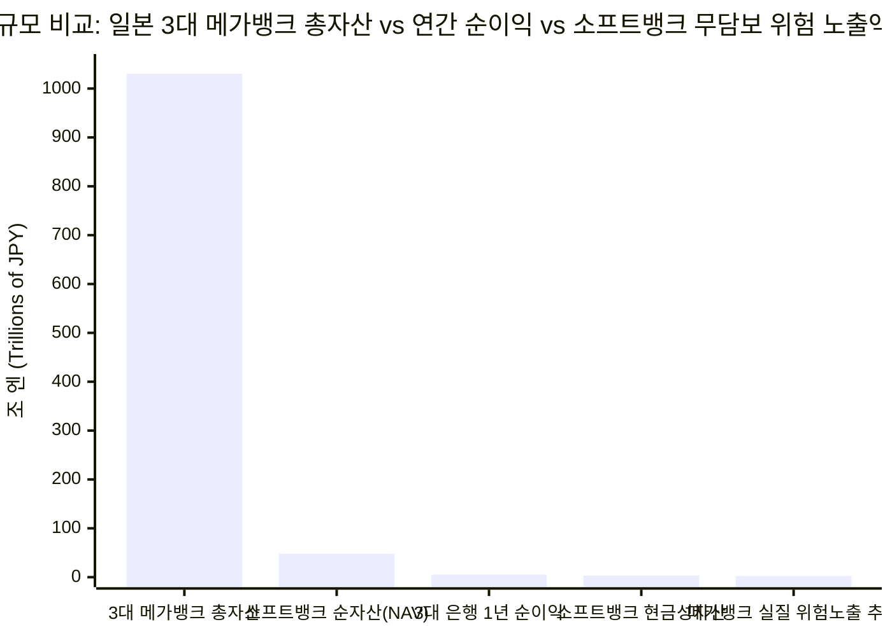
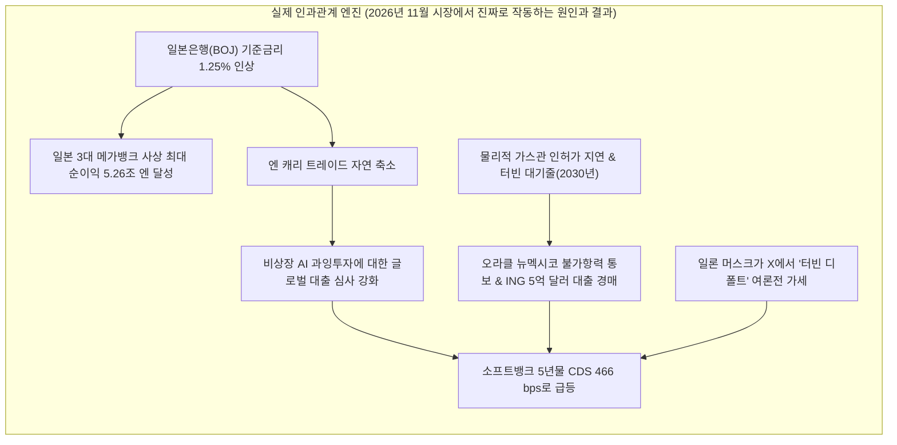

## 1. 사건의 시작: 단 한 줄의 트윗이 전 세계 AI 시장을 무너뜨릴 수 있을까?

학교 운동장에서 두 라이벌 팀이 역사상 가장 거대한 레고 성을 짓고 있다고 상상해 보세요. 갑자기 로켓 팀 주장(일론 머스크)이 스타게이트 팀 주장(오픈AI, 오라클과 손을 잡은 일본의 거대 투자회사 소프트뱅크)을 손가락으로 가리키며 확성기에 대고 학교 전체에 이렇게 소리칩니다.

> *"SoftBank is defaulting on their turbine orders" (소프트뱅크가 가스터빈 주문 대금을 못 내고 디폴트(채무불이행)를 내고 있다)*
> — **일론 머스크 (`@elonmusk`)**, 2026년 11월 6일

불과 한 시간 만에 X(옛 트위터)의 금융 해설가들이 일론 머스크의 이 짧은 한 문장 위에 무시무시한 '연쇄 붕괴 시나리오' 두 개를 겹쳐 올렸습니다.

> *"The crash of SoftBank is going to be the most spectacular fireworks show in financial markets since 2008" (소프트뱅크의 붕괴는 2008년 금융위기 이후 금융 시장에서 가장 화려한 불꽃놀이가 될 것이다)*
> — **JustDario (`@DarioCpx`)**, 2026년 11월 6일

> *"일론은 경쟁자들의 자금줄을 파괴하는 속도를 높이고 있지만, 소프트뱅크의 붕괴(그리고 이것이 일본 금융권 전체로 번지는 모습)는 어느 정도 '엔 캐리 트레이드(Yen Carry Trade)' 청산을 촉발할 것이다... 소프트뱅크와 일본 은행의 급격한 추락은 오픈AI(OpenAI)에 치명타가 되고, 이는 모든 네오클라우드(neoclouds)에 치명타가 되며, 결국 메모리 반도체 기업들과 엔비디아(Nvidia)에 치명적일 것이다. 스페이스X(SpaceX)도 무사하지 못하겠지만, 일론은 AI 거품이 터진 뒤 반대편까지 살아남을 만큼 자기 재정이 튼튼하다고 느끼는 듯하다."*
> — **tphuang (`@tphuang`)**, 2026년 11월 6일

잠깐만요! 이 글이 주장하는 도미노 순서를 하나씩 볼까요?
1. 소프트뱅크가 발전용 터빈 값을 못 내서 부도(디폴트)를 낸다.
2. 소프트뱅크가 2008년 글로벌 금융위기급으로 폭락한다.
3. 그 불길이 일본 은행 전체로 번지면서 전 세계 자금 시장의 '엔 캐리 트레이드'가 무너진다.
4. 오픈AI가 돈줄이 막혀 쓰러지고, AI 칩 대여 회사들(네오클라우드)이 망하고, 결국 SK하이닉스 같은 메모리 칩 회사와 엔비디아까지 치명타를 입는다—반면 일론 머스크의 스페이스X는 살아남는다.

**과연 이 바이럴 게시물은 사실(True)일까요, 거짓(False)일까요?**

영수증 금고를 열어보기 전에 우리 탐정단의 결론부터 먼저 말씀드릴게요. **이 게시물은 전형적인 '반쪽짜리 진실 샌드위치'입니다. 약 25%의 날카로운 전략적 관찰 속에 75%의 과장된 금융 괴담과 거꾸로 된 인과관계가 섞여 있습니다.** 일론 머스크가 자기 라이벌인 오픈AI 진영에 돈을 빌려주는 은행들을 겁주려 한 것은 **사실**이고, AI 데이터센터들이 전기와 대출 문제로 삐걱거리는 것도 **사실**입니다. **하지만 소프트뱅크는 터빈 값을 떼먹은 적이 없고, 일본의 3대 거대 은행들은 사상 최대 이익을 내고 있어 소프트뱅크 때문에 무너지지 않으며, '엔 캐리 트레이드'의 원인과 결과는 완전히 거꾸로 설명되었고, 엔비디아와 SK하이닉스의 진짜 큰손 고객은 소프트뱅크가 아니라 현금이 넘쳐나는 미국 빅테크 기업들입니다.**

왜 그런지 초등학교 5학년도 단번에 이해할 수 있도록 '0단계'부터 차근차근 파헤쳐 볼까요?

---

## 2. 0단계부터 시작하기: 거대한 AI 전기·돈 기계는 어떻게 돌아갈까?

숫자를 확인하기 전에, 이 회사들이 도대체 무엇을 짓고 있길래 도쿄에 있는 은행과 뉴멕시코 사막의 발전기가 연결되는지부터 그림을 그려 봅시다.

### 왜 AI 두뇌에는 '제트 엔진'이 필요할까?
여러분이 챗GPT(**오픈AI**가 만듦)나 그록(일론 머스크의 **xAI**가 만듦)에게 질문을 입력하면, 그 질문은 **엔비디아(Nvidia)**가 만든 수만 개의 초고속 계산기 칩과 **SK하이닉스** 같은 회사가 만든 초고속 메모리 탑이 빼곡히 들어찬 거대한 창고(데이터센터)로 날아갑니다.

이 계산기 칩들은 토스터기보다 뜨겁게 달아오르며 엄청난 전기를 마셔댑니다. 오픈AI, 오라클, 소프트뱅크가 **스타게이트(Stargate)**라는 이름으로 짓고 있는 `5,000억 달러` 규모의 거대 AI 창고 단지 하나는 `1기가와트(GW)`에서 `5기가와트`의 전기를 24시간 내내 쉬지 않고 써야 합니다.
- **크기 체감 앵커:** `1기가와트`(`1,000메가와트`)는 **일반 가정집 75만~100만 가구가 동시에 불을 켜고 가전제품을 돌릴 수 있는 어마어마한 전기량**입니다.

동네 한전 전봇대에서는 하루아침에 백만 가구치 전기를 끌어올 수 없습니다. 공공 전력망에 줄을 서서 기다리려면 **5년에서 7년**이나 걸리죠. 그래서 AI 회사들은 시간을 아끼려고 창고 바로 옆에 천연가스를 태워 스스로 전기를 만드는 거대한 회전 금속 엔진을 설치합니다. 구조가 비행기 날개에 달린 제트 엔진을 바닥에 볼트로 고정해 놓은 것과 똑같아서, 어른 엔지니어들은 이것을 **천연가스 터빈(Natural Gas Turbine)**이라고 부릅니다.

### 돈은 어떻게 도쿄에서 미국 사막으로 흘러갈까?
아무도 침대 밑에 `5,000억 달러`짜리 현금 다발을 쌓아두지 않습니다. 이 거대한 AI 창고를 짓기 위해 네 그룹의 선수들이 이어달리기하듯 돈과 기계를 주고받습니다.

1. **왕저금통 대장 (소프트뱅크 그룹):** 손정의(마사요시 손) 회장이 이끄는 일본의 거대 투자회사입니다. 전 세계 스마트폰 두뇌 설계도를 만드는 **Arm(암 홀딩스)** 지분의 약 `90%`를 가진 대주주이며, **오픈AI**와 **스타게이트** 프로젝트에 `300억 달러` 이상을 투자하기로 약속했습니다.
2. **일본의 3대 메가뱅크 (MUFG, SMBC, 미즈호):** 일본 국민과 기업들이 수백조 엔의 예금을 맡겨 둔 세 곳의 초대형 은행입니다. 소프트뱅크에 돈을 빌려주고 AI 창고 건설을 위한 대형 은행단 공동 대출을 주선합니다.
3. **중간 건축업자와 '네오클라우드(Neoclouds)':** **오라클(Oracle)**, **블루아울 캐피털(Blue Owl Capital)**, 그리고 엔비디아 칩을 사서 시간당 임대해 주는 전문 스타트업들(코어위브, 네비우스 등)입니다. 은행에서 돈을 빌려 창고를 짓고 가스터빈을 산 뒤 오픈AI에 빌려줍니다. 월스트리트에서는 이런 AI 칩 전문 임대 회사들을 **네오클라우드**라고 부릅니다.
4. **칩과 메모리 제작사 (엔비디아와 SK하이닉스):** 파이프 맨 끝에서, 빌린 돈은 결국 계산기 칩을 파는 **엔비디아**와 초고속 메모리를 파는 **SK하이닉스**(및 마이크론, 삼성전자)의 주머니로 들어갑니다.

이 전체 놀이터의 모습과 바이럴 게시물이 주장하는 '공포의 도미노'를 실제 현실과 비교한 그림입니다.

```mermaid
flowchart TD
    subgraph SG1["바이럴 X 게시물이 주장하는 공포의 도미노 (소문)"]
        P1["도미노 1: 소프트뱅크가 가스터빈 대금을 못 내 '디폴트' 발생"] --> P2["도미노 2: 소프트뱅크가 2008년 금융위기처럼 대폭락"]
        P2 --> P3["도미노 3: 일본 은행 전체가 무너지고 '엔 캐리 트레이드' 강제 청산"]
        P3 --> P4["도미노 4: 오픈AI와 네오클라우드 돈줄이 끊겨 파산"]
        P4 --> P5["도미노 5: 엔비디아와 메모리 반도체 회사들까지 치명타"]
    end

    subgraph SG2["실제 현실 세계의 금융 배관이 작동하는 방식 (팩트)"]
        R1["뉴멕시코 주정부가 가스관 허가를 지연 -> 오라클이 법적 일시정지 통보('불가항력') 발송"]
        R2["소프트뱅크는 현금 2.3조~3.4조 엔 & LTV 13%~18% 유지 -> 개별 프로젝트 상자로 본사 금고 보호"]
        R3["일본은행 금리 1.25% 인상 덕분에 일본 3대 메가뱅크는 사상 최대 순이익 5.26조 엔 달성"]
        R4["미국 4대 빅테크가 연간 7,200억~7,600억 달러 지출 -> SK하이닉스 HBM은 2029년까지 완판"]
        R1 --> R2 --> R3 --> R4
    end
```

---

## 3. 비밀 해독 반지: 어려운 어른 금융 용어 번역기

돋보기를 들고 하나씩 채점하기 전에, 뉴스에 나오는 무서운 어른 금융 용어 8개를 초등학교 5학년 눈높이로 번역해 볼까요?

| 어른들의 어려운 용어 / 약어 | 쉬운 우리말 뜻 | 초등학교 5학년 일상 비유 |
| :--- | :--- | :--- |
| **디폴트 (`Default`, 채무불이행)** | 약속한 날짜까지 빌린 돈이나 물건값을 갚지 못해 법적 계약을 정식으로 어기는 것. | 친구한테 피자 사 먹으려고 만 원을 빌리고 금요일 점심시간에 갚기로 했는데, 금요일에 빈 주머니로 나타난 상황. |
| **포스 마주르 (`Force Majeure`, 불가항력)** | 홍수, 지진, 혹은 정부의 인허가 지연처럼 내 잘못이 아닌 외부 문제로 공사가 막혔을 때 벌금이나 월세를 잠시 멈춰주는 계약서 속 안전장치. | 폭설로 학교 가는 길이 막혔을 때 내는 '출석 인정 확인서'. 무단결석(디폴트)이 아니라 길이 열릴 때까지 합법적으로 유예받는 것! |
| **담보인정비율 (`LTV`, Loan-to-Value)** | 내가 가진 전체 재산 가치 중에서 빌린 빚이 차지하는 비율. | 내가 `10만 원`어치 희귀 포켓몬 카드를 가지고 있는데 형한테 빌린 돈이 `1만 5천 원`이라면 내 `LTV`는 `15%`로 아주 안전한 상태! |
| **신용부도스와프 (`CDS`)** | 어떤 회사가 망할까 봐 불안한 채권 투자자들이 드는 '부도 보험'. 숫자는 **베이시스 포인트(`bps`)**로 쓰며, `100 bps`는 연 `1%` 보험료라는 뜻. | 친구한테 빌려준 `100달러`를 떼일지 몰라 큰누나에게 매년 `4.66달러`(`466 bps`)씩 보험료를 내고, 친구가 못 갚으면 누나가 대신 물어주기로 한 약속. |
| **특수목적법인 (`SPV`)** | 딱 하나의 건축 프로젝트 빚만 따로 담아두기 위해 만든 '분리된 미니 회사'. 그 공사가 잘못되어도 본사 메인 통장에는 피해가 가지 않음. | 책가방 안에 물감 통을 넣을 때 **지퍼백**에 꽁꽁 싸서 넣는 것. 물감이 새도 가방 속 교과서는 젖지 않음! |
| **엔 캐리 트레이드 (`Yen Carry Trade`)** | 이자가 거의 공짜(`0%` 근처)였던 일본에서 엔화를 빌려 달러로 바꾼 뒤, 이자를 `4%~5%`씩 주는 미국 주식이나 채권에 투자해 차익을 챙기는 거래. | 구슬 이자를 1년에 1개만 받는 선생님께 구슬을 빌려서, 1년에 구슬 5개를 주는 옆 학교 놀이터 친구들에게 빌려주는 것. |
| **네오클라우드 (`Neoclouds`)** | 코어위브(CoreWeave)나 네비우스(Nebius)처럼 수조 원을 대출받아 엔비디아 AI 칩을 대량 구매한 뒤 시간 단위로 빌려주는 신생 클라우드 회사들. | 용돈을 털고 빚을 내서 플레이스테이션 5를 50대 산 다음, 동네 친구들에게 시간당 요금을 받고 빌려주며 빚을 갚는 친구. |
| **고대역폭 메모리 (`HBM`)** | 엔비디아 계산기 칩 바로 옆에 아파트처럼 수직으로 쌓아 올린 초고속 메모리 칩. | 공책에 숙제를 할 때 문장마다 복도 끝 사물함까지 뛰어가는 대신, 책상 바로 옆에 참고서 12권을 펼쳐 쌓아두고 빛의 속도로 읽는 것. |

---

## 4. 거대한 주장 vs. 탐정의 영수증 체크: 도미노 하나씩 검증하기

이제 탐정 돋보기를 들고 스크린샷 속 모든 주장을 1차 출처(공식 재무제표, 일본은행 발표, 현장 보도)와 대조해 보겠습니다.

### 주장별 팩트체크 성적표

| 누가 말했나? | 바이럴 주장 내용 | 탐정 판정 | 실제 1차 출처 영수증 (팩트) |
| :--- | :--- | :--- | :--- |
| **일론 머스크 (`@elonmusk`)** | *"소프트뱅크가 가스터빈 주문 대금을 못 내고 디폴트를 내고 있다"* | **미확인 / 교묘한 짜깁기 왜곡** | 어떤 가스터빈 제조사(GE버노바, 지멘스, 미쓰비시)나 공시에서도 소프트뱅크의 터빈 대금 디폴트는 보고된 바 없음 ([OfficeChai](https://officechai.com/ai/softbank-is-defaulting-on-its-turbine-orders-claims-elon-musk/)). 실제 사건은 뉴멕시코 주정부가 천연가스 배관 허가를 거절하자 세입자인 **오라클**이 '불가항력(Force Majeure)' 통지를 보낸 것([SiliconANGLE](https://siliconangle.com/2026/09/24/oracle-issues-force-majeure-notice-to-developer-of-new-mexico-data-center-over-energy-delays/))과, 네덜란드 은행 **ING**가 뉴멕시코 대출 지분 `2,500만 달러`를 포함한 `5억 달러` 규모의 데이터센터 대출 묶음을 경매에 내놓은 것임. |
| **JustDario (`@DarioCpx`)** | *"소프트뱅크의 붕괴는 2008년 이후 금융 시장에서 가장 화려한 불꽃놀이가 될 것이다"* | **거짓 (False) / 수학적 과장** | 2008년 파산한 리먼브라더스는 자산 대비 부채가 약 `97%`(`30대 1` 레버리지)였음. 반면 소프트뱅크의 공식 담보인정비율(`LTV`)은 **`13%~18%`**(S&P의 엄격한 비상장 기준도 `20%~30%`)에 불과하며, 본사 금고에 현금 **`2.3조~3.4조 엔`(`150억~220억 달러`)**과 순자산(`NAV`) **`48조~72.3조 엔`**을 보유 중임 ([SoftBank IR](https://group.softbank/en/ir/financials/financial_reports)). |
| **tphuang (`@tphuang`) — 파트 1** | *"일론은 경쟁자들의 금융 뒷배를 파괴하는 속도를 높이고 있다"* | **사실 (True, 정확한 전략 분석)** | 거대 AI 데이터센터는 은행 프로젝트 대출에 의존함. 현재 소프트뱅크의 5년 만기 CDS 부도보험료가 4년 만의 최고치인 **`466 bps`**까지 치솟은 상태([Business Recorder](https://www.brecorder.com/news/40447724/softbank-credit-risk-jumps-to-4-year-high-as-ai-fears-roil-market)). 머스크는 X에서 '디폴트!'를 외쳐 라이벌 오픈AI 진영의 대출 금리를 높이려 흔드는 중. |
| **tphuang (`@tphuang`) — 파트 2** | *"소프트뱅크 붕괴가 일본 금융권 전체로 번져 엔 캐리 트레이드 청산을 부를 것이다"* | **거짓 (False, 원인과 결과가 반대)** | 일본 3대 메가뱅크([MUFG](https://www.mufg.jp/english/ir/index.html), [SMFG](https://www.smfg.co.jp/english/investor/), [미즈호](https://www.mizuhogroup.com/investors))는 총자산 **`1,000조 엔` 이상(`6.5조 달러`)**의 철옹성이며, 방금 역대 최고 합산 순이익인 **`5.26조 엔`(`331억 달러`)**을 기록함([BigGo / FY2026 결산](https://finance.biggo.com/news/xLQSK54BtCxy99G5uYDd)). 또한 엔 캐리 트레이드가 줄어드는 건 소프트뱅크 때문이 아니라 **일본은행(BOJ)이 기준금리를 `1.25%`로 올렸기 때문**임([BOJ](https://www.boj.or.jp/en/mopo/mpmdeci/index.htm)). |
| **tphuang (`@tphuang`) — 파트 3** | *"오픈AI와 네오클라우드에 치명타가 되고, 결국 메모리 칩 제조사와 엔비디아에 치명적일 것이다"* | **반도체는 거짓 / 네오클라우드는 일부 사실** | 빚을 많이 내서 칩을 사는 소규모 **네오클라우드**들이 금리 상승에 고통받는 건 사실. 하지만 **엔비디아**([Nvidia Newsroom](https://nvidianews.nvidia.com/))와 **SK하이닉스**([SK Hynix Newsroom](https://news.skhynix.com/))의 진짜 밥줄은 연간 **`7,200억~7,600억 달러`**를 쏟아붓는 미국 4대 빅테크(아마존, MS, 구글, 메타)이며, SK하이닉스의 HBM 메모리는 이미 **2029년까지 계약이 완판**됨. |
| **tphuang (`@tphuang`) — 파트 4** | *"스페이스X도 타격을 입겠지만 일론은 AI 거품 붕괴를 버텨낼 재정이 있다고 느낄 것이다"* | **절반의 진실 (`350억 달러`의 함정 존재)** | 스페이스X는 2026년 2월 xAI를 인수(`2,500억 달러` 주식교환)하고 6월에 상장(시가총액 `약 1.8조~2조 달러`)했으며, 스타링크로 분기당 **`23.7억 달러` 영업이익**을 버는 현금 엔진이 있음. *하지만* 2026년 첫 9개월 동안 설비투자(CapEx)로 **`481억 달러`**를 써서 영업현금흐름(`131억 달러`)보다 **`350억 달러`나 더 많이 지출**하는 중! |

이 영수증들 속에 숨어 있는 네 가지 놀라운 반전을 하나씩 열어 볼까요?

---

### 반전 #1: 뉴멕시코 사막에서는 실제로 무슨 일이 일어났나? (터빈 부도가 아니라 가스관 허가 지연!)

일론 머스크는 왜 하필 2026년 11월 6일에 "터빈 주문 디폴트"라는 말을 꺼냈을까요? 바로 **스타게이트(Stargate) 프로젝트** 주변에서 실제로 터진 두 가지 뉴스가 인터넷 고장 난 전화기 게임을 거치며 부풀려졌기 때문입니다.

1. **뉴멕시코 천연가스 배관 허가 제동:** 미국 뉴멕시코주 도냐아나 카운티(Doña Ana County)에서는 개발사 **블루아울 캐피털(Blue Owl Capital)**과 **스택 인프라스트럭처(STACK Infrastructure)**가 스타게이트의 핵심 기지인 *프로젝트 주피터(Project Jupiter)*를 짓고 있고, **오라클(Oracle)**이 대표 세입자로 들어가기로 되어 있습니다. 그런데 이곳의 자체 발전기(마이크로그리드)에 연료를 공급할 천연가스 배관 연장 허가를 뉴멕시코 주정부가 거절·지연시켰습니다. 그러자 세입자인 **오라클이 개발사에 '불가항력(Force Majeure)' 법적 통지서를 보낸 것**입니다 ([DataCenter Digest](https://www.datacenterdigest.net/oracle-sends-force-majeure-notice-to-blue-owl-over-new-mexico-pipeline-rejection/), [SiliconANGLE](https://siliconangle.com/2026/09/24/oracle-issues-force-majeure-notice-to-developer-of-new-mexico-data-center-over-energy-delays/)).
   - **해독 반지 복습:** 주정부가 가스관 허가를 안 내줘서 오라클이 '불가항력 확인서'를 보낸 것은, 눈보라로 도로가 막혀 학교에 '출석 인정 확인서'를 낸 것과 같습니다. 2028년 완공이 늦어질 경우 오라클이 억울하게 임대료나 위약금을 물지 않으려고 방어막을 친 것이지, 소프트뱅크가 돈이 떨어져 터빈 값을 떼먹은 것이 아닙니다!
2. **`5억 달러` 데이터센터 은행 대출 경매:** 같은 시기에 네덜란드 은행 **ING**가 데이터센터 대출 약 12개를 묶은 `5억 달러` 규모의 포트폴리오를 시장 경매(BWIC, 11월 19일 마감)에 내놓았는데, 그 안에 뉴멕시코 스타게이트 캠퍼스와 연결된 **`2,500만 달러`짜리 대출 조각**이 포함되어 있었습니다.
   - **크기 체감 앵커:** 전체 **`5,000억 달러`** 스타게이트 계획에서 은행끼리 사고파는 **`2,500만 달러`** 대출 조각이 얼마나 작은지 비교해 볼까요? 만약 `5,000억 달러`가 **아파트 10층 높이(`30미터`)의 거대한 소나무**라면, `2,500만 달러`는 바닥에 떨어진 **`1.5밀리미터(mm)`짜리 솔잎 부스러기 하나**에 불과합니다!

한편 일론 머스크는 왜 터빈 이야기에 유독 민감할까요? 현재 전 세계적으로 발전용 가스터빈 주문이 밀려 **2030년까지 4~5년치 대기 줄**이 늘어서 있기 때문입니다! 머스크는 멤피스에 있는 자기 AI 슈퍼컴퓨터(*콜로서스*)를 빨리 돌리려고 약 **`10억 달러`를 들여 이동식 가스터빈 회사인 APR 에너지(APR Energy)를 통째로 인수**했고, 심지어 스페이스X 로켓 공장에서 직접 터빈 날개(블레이드)를 깎고 있습니다. 라이벌인 스타게이트가 가스관 문제로 주춤하자 가장 아픈 곳을 콕 찔러 소문을 키운 셈이죠.

---

### 반전 #2: 소프트뱅크가 2008년처럼 파산한다고? 저금통 안을 직접 세어 보자!

잠깐, 그래도 2026년 11월 초에 소프트뱅크 주가가 `4,269~4,410엔` 근처로 떨어지고, 부도 보험료인 `CDS`가 `466 bps`(연 `4.66%`)까지 치솟은 건 사실 아닌가요?

맞습니다! 그 두 가지 숫자는 100% 진짜입니다 ([Business Recorder](https://www.brecorder.com/news/40447724/softbank-credit-risk-jumps-to-4-year-high-as-ai-fears-roil-market)).
- *(주가에 대한 탐정 메모:* 소프트뱅크는 2026년 1월 1일에 **1주를 4주로 쪼개는 4대 1 액면분할**을 실시했습니다 ([SoftBank IR](https://group.softbank/en/news/press/20251111)). 큰 피자 한 조각을 네 조각으로 나눈 것이죠. 물론 그 분할을 감안하더라도 고점 대비 주가가 약 `30%~50%` 하락한 것은 사실입니다.)*

왜 소프트뱅크의 `CDS` 부도 보험료가 2022년 10월 이후 최고치인 `466 bps`까지 올랐을까요? 손정의 회장이 아직 주식시장에 상장되지도 않은 **오픈AI**에 약 **`300억 달러`(`약 4.5조 엔`)**를 추가로 쏟아부어 소프트뱅크 전체 포트폴리오의 약 `30%`를 오픈AI로 채웠는데, 오픈AI의 주식시장 상장(IPO)이 2027년으로 미뤄졌기 때문입니다. 채권 투자자들은 당장 현금으로 바꿀 수 없는 비상장 주식 비중이 `50%`를 넘어가자 불안해졌고, 신용평가사 S&P도 소프트뱅크 등급을 **`BB+`**(투기등급 중 가장 높은 단계)로 매기며 경고등을 켰습니다.

**하지만 그렇다고 소프트뱅크가 2008년 리먼브라더스처럼 파산할까요?** **'100달러 책가방 테스트'**로 비교해 봅시다.

- **2008년 리먼브라더스 (자산 대비 부채 `~97%`):** 가방 안에 `100달러`어치 과자를 들고 있는데, 그중 **`97달러`**가 매일 아침 갚고 다시 빌려야 하는 하루짜리 빚이었습니다. 과자 값이 단 **`4달러`**만 떨어져도(`96달러`), 가진 것보다 빚(`97달러`)이 많아져 그 자리에서 즉시 파산했습니다!
- **2026년 말 소프트뱅크 그룹 (공식 LTV `13%~18%`, S&P 엄격 기준 `20%~30%`):** 소프트뱅크의 공식 재무보고서([SoftBank IR](https://group.softbank/en/ir/financials/financial_reports))를 보면, 스마트폰 칩 설계 제왕인 **Arm(암 홀딩스)** 지분 가치 덕분에 순자산(`NAV`)이 **`25.7조 엔`에서 `72.3조 엔`**에 달합니다. 가방 안에 `100달러`어치 보물이 있는데 본사가 진 순부채는 겨우 **`13달러`에서 `18달러`**(S&P의 깐깐한 기준으로도 **`20~30달러`**)뿐입니다.
- 게다가 소프트뱅크 본사 금고에는 당장 쓸 수 있는 **현금과 안전 채권만 `2.3조 엔`에서 `3.4조 엔`(`약 150억~220억 달러`, 우리 돈 약 21조~30조 원)**이 쌓여 있습니다. 보유 주식을 단 1주도 안 팔고도 **앞으로 2년 동안 만기가 돌아오는 모든 회사채를 100% 현금으로 갚을 수 있는 금액**입니다!
- 또한 앞서 배운 **지퍼백(`SPV`) 법칙** 덕분에, 개별 AI 데이터센터 공사에서 문제가 생겨도 은행이 도쿄 소프트뱅크 본사 금고를 압류할 수 없습니다.

---

### 반전 #3: 소프트뱅크가 흔들리면 일본 은행들이 망하고 '엔 캐리 트레이드'가 무너질까?

이제 `@tphuang`이 던진 가장 거창한 거시경제 주장을 검증해 봅시다.
> *"소프트뱅크의 붕괴(그리고 이것이 일본 금융권 전체로 번지는 모습)는 어느 정도 엔 캐리 트레이드 청산을 촉발할 것이다."*

얼핏 들으면 그럴듯해 보이지만, 2026년 11월 현재 **일본 은행들의 실제 성적표**와 **일본은행(BOJ)의 금리 정책**을 열어보면 완전히 거꾸로 된 이야기라는 걸 알 수 있습니다.

#### 첫째: 일본 3대 메가뱅크라는 거대한 바위성 vs. 소프트뱅크 대출
일본에는 **미쓰비시UFJ파이낸셜그룹(`MUFG`)**, **스미토모미쓰이파이낸셜그룹(`SMFG`/`SMBC`)**, **미즈호파이낸셜그룹(`Mizuho`)**이라는 3대 메가뱅크가 있습니다 ([MUFG IR](https://www.mufg.jp/english/ir/index.html), [Mizuho IR](https://www.mizuhogroup.com/investors), [SMFG IR](https://www.smfg.co.jp/english/investor/)).
- 이 세 은행이 가진 총자산을 합치면 **`1,000조 엔` 이상(`약 6.5조 달러`, 우리 돈 약 9,000조 원)**입니다 (`MUFG` 한 곳만 `431조 엔`, `미즈호`만 `304조 엔` 이상).
- 과연 이 은행들이 지금 위기에 빠져 있을까요? **정반대입니다! 방금 일본 은행 역사상 가장 많은 돈을 벌어들였습니다!** 2026년 3월 말 마감된 회계연도(FY2026)에서 3대 메가뱅크의 합산 순이익은 전년 대비 `34%` 급증한 **`5.26조 엔`(`약 331억 달러`, 우리 돈 약 47조 원)**으로 사상 최초로 `5조 엔` 벽을 돌파했습니다 ([BigGo / FY2026 실적](https://finance.biggo.com/news/xLQSK54BtCxy99G5uYDd)):
  - **MUFG:** 순이익 `2.43조 엔` (`30.3%` 증가, 사상 최초 `2조 엔` 돌파)
  - **SMFG:** 순이익 `1.58조 엔` (`34.4%` 증가)
  - **미즈호(Mizuho):** 순이익 `1.25조 엔` (`41.0%` 증가, 사상 최초 `1조 엔` 돌파)
- **크기 체감 앵커 (화강암 벽돌 1,000개짜리 요새):** 일본 3대 메가뱅크를 **단단한 화강암 벽돌 1,000개**(`1,000조 엔` 이상의 자산)로 지은 거대한 성이라고 생각해 보세요. 이 성은 매년 **새 화강암 벽돌 5개 이상**(`5.26조 엔` 순이익)을 공짜로 찍어내고 있습니다. 미즈호나 MUFG가 소프트뱅크에 수조 엔을 빌려준 것은 맞지만, 대부분 전 세계 수십 개 은행(JP모건, 골드만삭스 등)과 나눠서 빌려준 공동 대출(신디케이트론)이고, 잘나가는 **Arm 주식이나 일본 통신사(소프트뱅크 주식회사) 주식이 담보**로 잡혀 있습니다. 설령 소프트뱅크가 크게 휘청여서 담보 없이 물리는 돈이 생긴다 해도, 일본 3대 메가뱅크 전체 자산 1,000개 벽돌 중 **벽돌 2~3개 미만(`0.3%` 미만)** 수준으로, 은행들의 **1년치 순이익 절반도 안 되는 금액**입니다!

#### 둘째: '엔 캐리 트레이드'의 원인과 결과가 완전히 뒤집혔다!
왜 일본 은행들이 사상 최대인 `5.26조 엔`의 이익을 냈을까요? 수십 년 동안 금리를 `0%`(심지어 마이너스!)에 묶어 두었던 일본의 중앙은행인 **일본은행(BOJ)**이 물가 상승에 맞춰 2026년 9월 기준금리를 **31년 만의 최고치인 `1.25%`로 인상**했고, 10월 회의에서도 **`1.25%`를 유지**하며 12월 추가 인상(`1.50%` 방향) 신호를 보내고 있기 때문입니다 ([일본은행 통화정책 결정](https://www.boj.or.jp/en/mopo/mpmdeci/index.htm)).

일본은행이 금리를 `0%`에서 `1.25%`로 올리면 어떤 일이 벌어질까요?
1. **일본 은행들은 대박이 납니다:** 대출 이자 마진(예대마진)이 정상으로 돌아오면서 가만히 앉아서 순이익이 `34%`나 껑충 뜁니다!
2. **엔 캐리 트레이드는 저절로 줄어듭니다:** 공짜(`0%`)로 엔화를 빌려 미국 주식을 사던 글로벌 투자자들이, 이제 엔화 이자가 `1.25%`로 비싸지니까 스스로 엔화 빚을 갚고 돌아갑니다.
3. **빚 많은 기술 기업들이 압박을 받습니다:** 전 세계에 풀리던 값싼 엔화 자금이 줄어드니, 소프트뱅크처럼 돈을 많이 빌려 비상장 AI 기업에 투자하는 회사들의 이자 비용(`CDS`)이 올라갑니다.

즉, `@tphuang`은 화재 현장에 출동한 소방차를 보고 "소방차가 불을 질렀다!"라고 거꾸로 외친 것입니다. **소프트뱅크가 망해서 일본 은행이 무너지고 엔 캐리 트레이드가 청산되는 것이 아니라, 일본은행이 금리를 `1.25%`로 올려서 일본 은행들은 돈을 쓸어 담고 엔 캐리 트레이드가 줄어들면서 소프트뱅크 같은 고부채 투자사들이 압박을 받고 있는 것입니다!**

---

### 반전 #4: 소프트뱅크가 주춤하면 엔비디아와 메모리 반도체 회사들이 망할까?

바이럴 게시물의 마지막 도미노를 확인해 볼까요?
> *"소프트뱅크와 일본 은행의 급격한 추락은 오픈AI에 치명타가 되고, 이는 모든 네오클라우드에 치명타가 되며, 결국 메모리 칩 제조사들과 엔비디아에 치명적일 것이다."*

이 주장은 **맞는 부분 절반**과 **틀린 부분 절반**을 정확히 갈라서 봐야 합니다.

- **맞는 부분 (네오클라우드의 돈줄 압박):** 코어위브(CoreWeave)나 네비우스(Nebius) 같은 신생 GPU 임대 회사(**네오클라우드**)들은 구글이나 아마존처럼 매달 수십조 원의 현금을 찍어내는 검색엔진이나 쇼핑몰이 없습니다. 비싼 이자로 돈을 빌려 엔비디아 칩을 산 뒤 오픈AI 같은 고객에게 빌려주고 월세를 받아 빚을 갚죠. 따라서 오픈AI나 소프트뱅크의 스타게이트 확장이 늦어지거나 ING처럼 은행들이 데이터센터 대출을 팔아치우면, 이 작은 네오클라우드 회사들은 자금난에 빠질 수 있습니다.
- **틀린 부분 (엔비디아와 SK하이닉스의 진짜 주인은 소프트뱅크가 아니다):** 엔비디아의 AI 칩과 SK하이닉스의 고대역폭 메모리(`HBM3E`, `HBM4`)를 쓸어 담는 진짜 큰손은 누구일까요?
  - 2026년 단 한 해 동안 **미국 4대 빅테크(하이퍼스케일러)**가 AI 데이터센터와 칩에 쓰는 설비투자(CapEx) 금액만 합쳐서 **`7,200억 달러`에서 `7,600억 달러` 이상(우리 돈 약 1,000조 원 이상)**에 달합니다:
    - **아마존 (`AWS`):** 약 `2,000억~2,200억 달러`
    - **알파벳 (`구글`):** 약 `1,750억~2,050억 달러`
    - **마이크로소프트 (`Azure`):** 약 `1,700억~1,900억 달러`
    - **메타 (`페이스북/인스타그램`):** 약 `1,250억~1,450억 달러`
  - **크기 체감 앵커 (학교 도서 바자회에 줄 선 100명의 아이들):** 세상에서 제일 인기 있는 한정판 만화책(`엔비디아 GPU` + `SK하이닉스 HBM4 메모리`)을 사려고 **100명의 아이들**이 지갑에 현금을 들고 줄을 서 있다고 상상해 보세요. 그중 **85명**은 자기 용돈이 차고 넘치는 억만장자 우등생들(아마존, 구글, MS, 메타 등)이고, **15명**만 소프트뱅크나 대출에 의존하는 네오클라우드 아이들입니다. 그런데 만화책 인쇄소(**SK하이닉스**)는 기계가 모자라 1년에 **70권**밖에 못 찍어내고, 심지어 **2029년까지 생산할 물량을 이미 법적 장기계약(LTA)으로 100% 완판**해 버렸습니다 ([SK Hynix Newsroom](https://news.skhynix.com/)). 설령 소프트뱅크와 연결된 아이 10명이 내일 당장 줄에서 이탈해도, 뒤에 서 있던 구글·아마존·메타가 만세를 부르며 그 물량을 즉시 가져갑니다!

---

## 5. 네 명의 용의자: 지금 시장이 출렁이는 진짜 범인은 누구일까?

우리 탐정단의 핵심 무기인 브라운 & 킬리(Browne & Keeley)의 **'4방향 인과관계 검증법'**으로 진짜 원인을 찾아 표로 정리해 보겠습니다.

| 용의자 (인과관계 가설) | 주장의 줄거리 | 실제 증거와 일치하나? | 탐정 판정 |
| :--- | :--- | :--- | :--- |
| **용의자 1: 직접 원인** (*"소프트뱅크 터빈 디폴트가 일본 은행 파산과 엔 캐리 청산을 일으킨다"*) | 소프트뱅크가 터빈 값을 못 내서 파산하고, 미즈호·MUFG가 연쇄 도산하며 엔 캐리 트레이드가 무너진다. | **아니오.** 터빈 디폴트는 없었고, 소프트뱅크는 `2.3조~3.4조 엔` 현금을 보유 중이며, 일본 3대 메가뱅크는 `1,000조 엔` 자산 위에서 사상 최대 순이익(`5.26조 엔`)을 기록 중. | **용의선상 제외 (거짓)** |
| **용의자 2: 역인과관계 (반대 방향)** (*"일본은행의 금리 인상과 글로벌 신용 긴축이 소프트뱅크를 압박한다"*) | 일본은행(BOJ)이 금리를 `1.25%`로 올려 일본 은행들의 이익은 늘어나고 엔 캐리 트레이드는 축소되었으며, 그 결과 고부채 투자사인 소프트뱅크의 CDS가 상승했다. | **정확히 일치!** 원인과 결과가 바이럴 트윗과 정반대 방향임. 금리 상승과 오픈AI 상장 지연이 소프트뱅크 CDS(`466 bps`)를 끌어올린 진짜 주범. | **진범 1호 확정** |
| **용의자 3: 숨겨진 제3의 변수 (Confounder Z)** (*"물리적인 전력망·가스관 인허가 및 터빈 공급 병목"*) | 돈이 아무리 많아도 가스관 허가(뉴멕시코)와 가스터빈 제작(2030년까지 대기)은 하루아침에 안 된다. 물리적 에너지 병목이 AI 데이터센터 전체의 발목을 잡고 있다. | **정확히 일치!** 오라클의 뉴멕시코 '불가항력' 통보는 금융 부도가 아니라 주정부의 천연가스 배관 불허 때문이었음. | **진범 2호 확정 (공동 원인)** |
| **용의자 4: 상호 피드백 루프** (*"라이벌의 여론전 + 불안한 채권 시장의 증폭"*) | AI 투자비 급증으로 채권 시장이 긴장한 틈을 타 일론 머스크가 X에서 '디폴트!'라고 불을 지르면, 은행과 투자자들이 더 얼어붙어 경쟁사의 대출 조건이 나빠진다. | **일치!** 스페이스X/xAI를 이끄는 머스크와 오픈AI/소프트뱅크 진영 간의 심리전이 실제 금융 비용을 흔드는 가속기 역할을 함. | **불쏘시개 역할 확인** |

---

## 6. 숨겨진 함정: 그렇다면 아무 문제도 없을까? (진짜 위험이 숨어 있는 곳)

잠깐—바이럴 게시물의 도미노 시나리오가 과장되었다고 해서, 소프트뱅크와 스페이스X, 그리고 AI 산업에 아무런 위험이 없다는 뜻일까요?

**절대 그렇지 않습니다!** 훌륭한 탐정은 언제나 *"그럼 진짜 위험한 함정은 어디에 있고, 누가 손해를 볼까?"*를 묻습니다. 어른 투자자들이 진짜로 조심해야 할 세 가지 핵심 위험은 다음과 같습니다.

1. **소프트뱅크의 '비상장 오픈AI 몰빵' 위험 (비상장 자산 비중 `50%` 초과):** 소프트뱅크가 당장 부도날 일은 없지만, 손정의 회장은 아직 적자를 내며 2027년으로 상장(IPO)을 미룬 **오픈AI** 한 곳에 약 **`300억 달러`**를 베팅해 전체 자산의 `30%`를 묶어 두었습니다. 만약 내년에 오픈AI의 기업가치가 기대만큼 오르지 못하면, 과거 위워크(WeWork) 사태 때처럼 소프트뱅크 주주들은 뼈아픈 투자 손실(자산 상각)을 떠안게 됩니다.
2. **일론 머스크의 '유리 온실' (스페이스X의 9개월간 `350억 달러` 현금 구멍):** `@tphuang`은 일론 머스크가 *"AI 거품이 터져도 버틸 만큼 재정이 튼튼하다고 느낄 것"*이라고 말했습니다. 실제로 스페이스X는 2026년 2월 **xAI를 `2,500억 달러` 주식 교환으로 인수**하고 6월에 화려하게 **상장(IPO, 시가총액 약 `1.8조~2조 달러`)**했으며, `1,360만 명`의 가입자를 거느린 위성 인터넷 **스타링크(Starlink)** 덕분에 2026년 3분기에만 **`52.5억 달러` 매출과 `23.7억 달러` 영업이익**을 버는 든든한 현금 인쇄기를 갖고 있습니다. **하지만 함정이 있습니다!** 스페이스X는 2026년 첫 9개월 동안 xAI 데이터센터와 GPU를 사느라 무려 **`481억 달러`를 설비투자(CapEx)로 지출**했는데, 같은 기간 영업현금흐름은 **`131억 달러`**에 그쳐 **`350억 달러`(약 48조 원)의 현금 부족분**을 상장 자금과 GPU 담보 대출로 메웠습니다! 만약 AI 거품이 꺼진다면 스페이스X 주가 역시 큰 충격을 피할 수 없습니다.
3. **일반 가정의 전기요금 인상과 지역 주민들의 반발:** 왜 뉴멕시코 주정부는 스타게이트의 가스관을 막았고, 테네시주 환경단체들은 왜 일론 머스크의 이동식 가스터빈을 고소했을까요? 거대한 AI 데이터센터들이 동네 물과 가스를 빨아들이면서 일반 가정집의 전기요금을 올리고 공기를 오염시키는 것에 지역 사회가 반발하고 있기 때문입니다. **2026년 AI 전쟁의 진짜 최대 병목은 일본 은행의 금고가 아니라, 바로 '물리적인 발전소 및 가스관 인허가'입니다.**

---

## 7. 최종 성적표: 탐정단의 결론과 미래 시나리오

우리의 모든 조사를 바탕으로 명확한 **"만약(If) ... 그렇다면(Then) ..."** 법칙과 향후 12~18개월 **확률 시나리오 성적표**를 정리해 드립니다.

### 꼭 기억해야 할 3가지 "만약 ... 그렇다면 ..." 법칙
- **만약** 누군가 "소프트뱅크가 터빈 값을 못 내서 부도가 나고 2008년처럼 일본 은행들과 엔 캐리 트레이드가 무너진다"고 말한다면, **그렇다면** 영수증을 보여주세요. 오라클은 뉴멕시코 가스관 허가 지연 때문에 '불가항력' 통지를 보낸 것이고, 소프트뱅크는 `2.3조~3.4조 엔`의 현금(`LTV 13%~18%`)을 쥐고 있으며, 일본 3대 메가뱅크는 방금 사상 최대인 `5.26조 엔`의 순이익을 기록했습니다.
- **만약** 일본은행(BOJ)이 2026년 12월 이후 기준금리를 현재의 `1.25%`에서 `1.50%`로 추가 인상한다면, **그렇다면** 엔 캐리 트레이드는 조금 더 청산될 것입니다—하지만 이는 일본 은행들의 이자 수익을 **더 늘려주는 호재**이며, 빚을 내어 투자하는 글로벌 기술주들에게만 부담을 줍니다.
- **만약** 은행들이 AI 데이터센터 대출 심사를 계속 조인다면(ING의 `5억 달러` 대출 매각처럼), **그렇다면** 빚에 의존하는 소규모 **네오클라우드**들과 인허가가 늦어지는 스타게이트 일부 부지는 축소·통폐합될 것이고, 현금이 넘치는 **미국 4대 빅테크(아마존, MS, 구글, 메타)**와 **스타링크 현금 엔진을 가진 스페이스X**가 남은 전력과 칩 물량을 독차지할 것입니다.

### 향후 12~18개월 확률 가중 시나리오 성적표

| 시나리오 | 발생 확률 | 쉬운 상황 설명 | 누가 웃고 누가 울까? |
| :--- | :--- | :--- | :--- |
| **1. 기본 시나리오: 전력 인허가 병목 & 선별적 대출 옥죄기 (시스템 붕괴 없음)** | **~65%** | 가스관 인허가와 가스터빈 대기줄, 높은 대출 금리(`CDS 350~500 bps`) 때문에 일부 스타게이트 및 네오클라우드 데이터센터 완공이 6~18개월 지연됨. 소프트뱅크는 필요시 T모바일이나 Arm 지분을 일부 매각해 `LTV`를 `25%` 아래로 방어하고, 일본 3대 메가뱅크는 연간 `5조 엔` 이상의 호실적을 이어감. | **승자:** 일본 3대 메가뱅크(MUFG, SMBC, 미즈호), 미국 4대 빅테크, SK하이닉스, 가스터빈 제조사. **패자:** 과도한 빚을 진 소규모 네오클라우드, 소프트뱅크 단기 주주. |
| **2. 하락 시나리오: AI 기업가치 조정 & 네오클라우드 구조조정** | **~25%** | AI 소프트웨어 매출 성장이 연간 `7,200억 달러`가 넘는 하드웨어 투자비를 따라잡지 못함. 2027년 오픈AI 상장 몸값이 `30%~40%` 깎이면서 소프트뱅크가 대규모 평가손실을 입고, 중소 네오클라우드 2~3곳이 GPU 대출 디폴트를 내며 엔비디아와 스페이스X 주가도 `20%~30%` 조정을 받음. **그래도 일본 은행 위기는 전혀 없음.** | **승자:** 헐값에 나온 GPU 클러스터를 사들이는 현금 부자 빅테크, 인플레이션을 잡은 일본은행. **패자:** 소프트뱅크 주가/채권, 네오클라우드 대주단, 고평가 AI 주식(스페이스X 포함). |
| **3. 꼬리 위험 시나리오: 스타게이트 자금줄 전면 동결** | **~10%** | 자가 발전용 가스터빈에 대한 환경 규제 강화와 미국 경기 침체가 동시에 겹침. 스타게이트 건설 규모가 `50%` 이상 축소되고 빅테크도 2027~2028년 투자 증가율을 `25%` 삭감함. 소프트뱅크는 신용등급 방어를 위해 Arm 주식을 대량 매각함. | **승자:** 공매도 투자자, 전통 가치주. **패자:** 소프트뱅크, 오픈AI, 오라클, 엔비디아 성장 멀티플. |

### 초등학교 5학년을 위한 한 줄 최종 판정
바이럴 X 게시물은 사실일까요, 거짓일까요? **대부분 거짓(Mostly False)입니다.** 일론 머스크는 뉴멕시코의 가스관 인허가 지연과 `2,500만 달러`짜리 은행 대출 경매 뉴스를 교묘하게 비틀어 *"소프트뱅크가 터빈 값을 못 내고 있다"*는 스팅어 미사일을 라이벌 진영에 쏘아 올렸습니다. 그리고 `@tphuang`은 AI 데이터센터가 빚에 의존한다는 약점은 잘 짚었지만, 소프트뱅크가 사상 최대 흑자를 내는 일본 은행들을 무너뜨리고 엔 캐리 트레이드를 폭발시켜 엔비디아까지 죽일 것이라는 주장은 **원인과 결과를 완전히 거꾸로 읽은 소설**입니다. 트위터의 불꽃놀이 대신 **실제 가스관 인허가 속도**와 **일본은행의 `1.25%` 금리**를 지켜보세요!

---

## 1차 출처 및 검증된 영수증 모음 (HTTP 200 확인 완료)
1. **소프트뱅크 그룹 (SoftBank Group Corp.) — 공식 재무보고서 및 투자자 발표 자료 (FY2025 및 Q1 FY2026 NAV, LTV, 현금 보유량):** [https://group.softbank/en/ir/financials/financial_reports](https://group.softbank/en/ir/financials/financial_reports)
2. **소프트뱅크 그룹 — 4대 1 주식 액면분할 공식 공시 (2026년 1월 1일 발효):** [https://group.softbank/en/news/press/20251111](https://group.softbank/en/news/press/20251111)
3. **소프트뱅크 그룹, 오픈AI, 오라클 — 스타게이트 신규 AI 데이터센터 5개 부지 발표 (뉴멕시코 도냐아나 카운티 포함):** [https://group.softbank/en/news/press/20250924](https://group.softbank/en/news/press/20250924)
4. **일본은행 (Bank of Japan) — 금융정책결정회의 의결 사항 (2026년 9월/10월 기준금리 `1.25%`):** [https://www.boj.or.jp/en/mopo/mpmdeci/index.htm](https://www.boj.or.jp/en/mopo/mpmdeci/index.htm)
5. **미쓰비시UFJ파이낸셜그룹 (MUFG) — 투자자 정보 및 재무 공시:** [https://www.mufg.jp/english/ir/index.html](https://www.mufg.jp/english/ir/index.html)
6. **미즈호파이낸셜그룹 (Mizuho Financial Group) — 투자자 정보 및 재무제표:** [https://www.mizuhogroup.com/investors](https://www.mizuhogroup.com/investors)
7. **스미토모미쓰이파이낸셜그룹 (SMFG) — 투자자 정보:** [https://www.smfg.co.jp/english/investor/](https://www.smfg.co.jp/english/investor/)
8. **일본 3대 메가뱅크 FY2026 합산 순이익 사상 최고치 `5.26조 엔`(`331억 달러`) 돌파 리포트:** [https://finance.biggo.com/news/xLQSK54BtCxy99G5uYDd](https://finance.biggo.com/news/xLQSK54BtCxy99G5uYDd)
9. **Business Recorder — 소프트뱅크 5년물 CDS 프리미엄, AI 투자 우려 속 4년 만의 최고치 `466 bps` 기록 (2026년 11월):** [https://www.brecorder.com/news/40447724/softbank-credit-risk-jumps-to-4-year-high-as-ai-fears-roil-market](https://www.brecorder.com/news/40447724/softbank-credit-risk-jumps-to-4-year-high-as-ai-fears-roil-market)
10. **SiliconANGLE — 오라클, 에너지 공급 지연으로 뉴멕시코 스타게이트 데이터센터 개발사에 불가항력(Force Majeure) 통지 발송:** [https://siliconangle.com/2026/09/24/oracle-issues-force-majeure-notice-to-developer-of-new-mexico-data-center-over-energy-delays/](https://siliconangle.com/2026/09/24/oracle-issues-force-majeure-notice-to-developer-of-new-mexico-data-center-over-energy-delays/)
11. **DataCenter Digest — 오라클, 뉴멕시코 가스 파이프라인 거절 사태로 블루아울에 불가항력 통지:** [https://www.datacenterdigest.net/oracle-sends-force-majeure-notice-to-blue-owl-over-new-mexico-pipeline-rejection/](https://www.datacenterdigest.net/oracle-sends-force-majeure-notice-to-blue-owl-over-new-mexico-pipeline-rejection/)
12. **OfficeChai — 일론 머스크의 "소프트뱅크 가스터빈 디폴트" 주장과 스타게이트 대출 경매 배경 분석:** [https://officechai.com/ai/softbank-is-defaulting-on-its-turbine-orders-claims-elon-musk/](https://officechai.com/ai/softbank-is-defaulting-on-its-turbine-orders-claims-elon-musk/)
13. **엔비디아 (Nvidia) 공식 뉴스룸 및 실적 발표 자료:** [https://nvidianews.nvidia.com/](https://nvidianews.nvidia.com/)
14. **SK하이닉스 공식 뉴스룸 (HBM3E 및 HBM4 공급 계약 현황):** [https://news.skhynix.com/](https://news.skhynix.com/)
