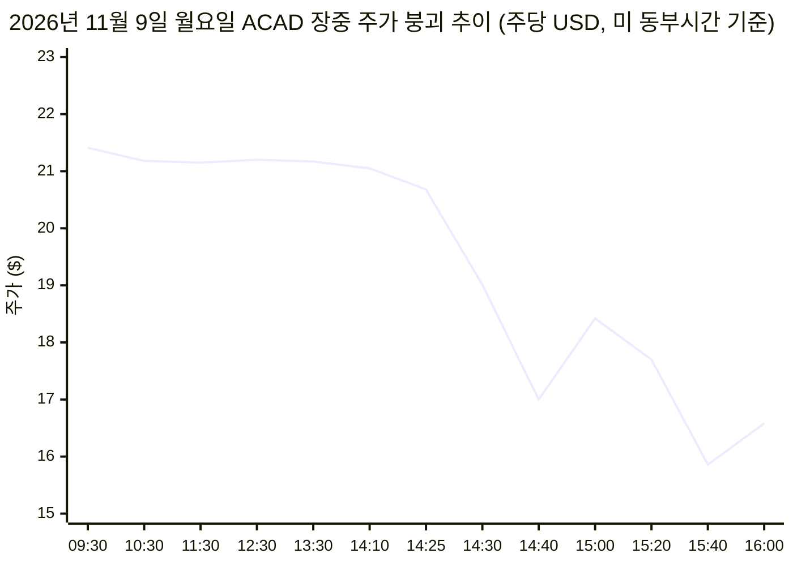
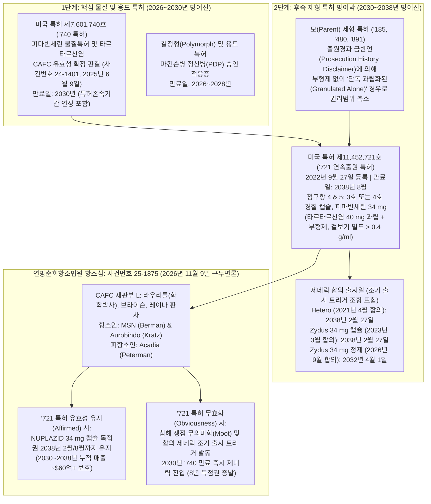
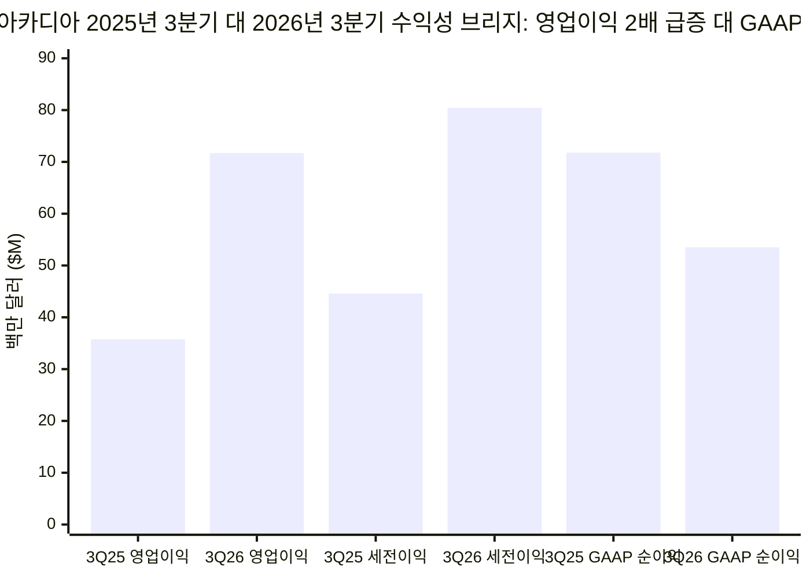

**2026년 11월 9일 월요일** 오후, 현금 및 단기 국채 `$9억 7,645만`을 보유하고 차입금이 전무한 흑자 상업화 신경·희귀질환 바이오 제약사 **아카디아 파마슈티컬스(`Acadia Pharmaceuticals Inc., NASDAQ: ACAD`)**의 주가가 장중 수직 폭락했다. 11월 4일 발표된 2026년 3분기 어닝 서프라이즈 이후 3거래일 동안 `$21.15~$22.63` 사이에서 평온하게 거래되던 `ACAD`는 월요일 오전 `$21.41`에 개장해 정오까지 `$20.68` 부근을 유지했으나, **미 동부시간 오후 2시 25분(`서부시간 오전 11시 25분`)부터 단 15분 만에 `-17.8%` 급락**하며 52주 신저가(`$18.39`)를 하향 돌파했고, 오후 3시 35분에는 장중 저점 **`$15.86`(`-25.3%`)**까지 추락한 뒤 평소 거래량의 `6.2배`에 달하는 `9,064,313주`가 터지며 **`$16.58`(`-21.90%`)**로 장을 마감했다.

미 서부시간 오후 12시 49분(`동부시간 오후 3시 49분`), 개인 및 기관 투자자들이 AI 금융 검색엔진에 *"왜 ACAD 주가는 2026년 3분기 실적 예상치를 상회한 뒤 하락했는가?(Why did ACAD stock decline after beating Q3 2026 earnings estimates?)"*라고 질문하자, 자동화된 검색 요약 시스템은 그럴듯해 보이지만 **인과관계가 완전히 조작된 환각(Hallucination) 답변**을 내놓았다.

> *"아카디아 파마슈티컬스(NASDAQ:ACAD) 주가는 주로 파이프라인 차질로 인해 하락을 겪었습니다. 알츠하이머병 정신병(ADP) 치료제로 평가 중인 **렘리판세린(remlifanserin)** 임상 2상 연구가 1차 평가변수에서 통계적 유의성을 아깝게 놓쳤기(`p = 0.0603`) 때문입니다. 또한 분기 매출과 이익 예상치를 상회했음에도 불구하고, 법인세 비용 증가에 주로 기인하여 GAAP 기준 당기순이익이 2025년 3분기 7,200만 달러(주당 0.42달러)에서 2026년 3분기 5,400만 달러(주당 0.31달러)로 전년 동기 대비 감소했다고 보고했습니다."*

같은 시각 바이오테크 소셜미디어에서는 **마틴 쉬크렐리(`@MartinShkreli`)**가 X(`구 트위터`)에서 실시간 라이브(`LIVE`) 방송을 켜고 자신이 10년 전인 2016년 12월 20일에 올렸던 게시물을 리포스트(`Repost`)했다.

> *"평균 회귀를 노리고 $ACAD를 공매도하겠다(i'd short $ACAD for some mean reversion)"* — [@MartinShkreli](https://x.com/MartinShkreli) (2016년 12월 20일 최초 게시, 2026년 11월 9일 장중 폭락 당시 재게시)

본 보고서는 닐 브라운(`M. Neil Browne`)과 스튜어트 킬리(`Stuart M. Keeley`)의 **'사금 채취(Panning for Gold)'** 비판적 사고 프레임워크(*Asking the Right Questions*, 12판)를 적용하여, AI 검색엔진의 요약문을 1차 법률·규제 사료와 직접 대조한다. 검증 대상 1차 사료는 **2026년 11월 9일 오전** 미국 연방순회항소법원(`CAFC`)에서 열려 `15:00:07 UTC`에 공개된 ***Acadia Pharmaceuticals Inc. v. Aurobindo Pharma Ltd.*(`사건번호 25-1875`)의 32분 47초 분량 구두변론 녹음 파일**([CAFC 구두변론 오디오 MP3](https://www.cafc.uscourts.gov/oral-arguments/25-1875_11092026.mp3)), 2026년 11월 5일 제출된 아카디아의 **2026년 3분기 Form 10-Q**([SEC EDGAR Form 10-Q](https://www.sec.gov/Archives/edgar/data/1070494/000119312526447794/acad-20260930.htm)), 11월 4일 제출된 **3분기 실적 공시(`Form 8-K Exhibit 99.1`)**([SEC EDGAR Form 8-K Ex. 99.1](https://www.sec.gov/Archives/edgar/data/1070494/000119312526447276/acad-ex99_1.htm)), 그리고 **2026년 9월 24일 제출된 `렘리판세린` 임상 2상 `RADIANT` 결과 Form 8-K**([SEC EDGAR Form 8-K Ex. 99.1](https://www.sec.gov/Archives/edgar/data/1070494/000119312526401157/d168737dex991.htm))다.

> [!IMPORTANT]
> **포렌식 핵심 결론 요약 (Executive Forensic Summary):**
> 1. **AI 검색 요약이 범한 두 가지 치명적 인식론적 오류:** 첫째, 이미 **46일 전에 발표되어 주가에 선반영된 과거 사건**(2026년 9월 24일 발표된 `렘리판세린` 임상 2상 탑라인 결과)을 11월 9일 오후의 실시간 장중 폭락 원인으로 둔갑시켰다. 둘째, GAAP 세무회계를 완전히 오독했다. 아카디아의 2026년 3분기 **GAAP 영업이익은 전년 동기 `$3,576만`에서 `$7,172만`으로 무려 2배(`+100.6% YoY`) 급증**했고, **세전이익 역시 `$4,460만`에서 `$8,044만`으로 `+80.4% YoY` 폭증**했다. GAAP 당기순이익이 감소한 것처럼 보인(`$5,352만` 대 2025년 3분기 `$7,178만`) 유일한 이유는 2025년 3분기에 *One Big Beautiful Bill Act*(`OBBBA`) 제정 및 이연법인세 평가충당금 환입으로 일회성 **비현금 법인세 수익 `$2,718만`(유효세율 `-61.0%`)**이 잡혔던 반면, 2026년 3분기에는 정상적인 **비현금성 GAAP 법인세 비용 `$2,692만`(유효세율 `33.5%`)**이 인식되었기 때문이다.
> 2. **11월 9일 장중 폭락의 진짜 방아쇠는 연방순회항소법원(`CAFC`) 사건번호 `25-1875` 구두변론이었다:** 아카디아의 2026년 3분기 Form 10-Q 14페이지(`주석 9: 법적 소송`)에는 단 한 문장이 묻혀 있었다. *"서면 심리는 2025년 12월 19일에 완료되었으며, 구두변론은 2026년 11월 9일로 예정되어 있다."* 이 재판은 제네릭 제약사 **MSN Laboratories**와 **Aurobindo Pharma**가 아카디아의 핵심 캐시카우인 **뉴플라지드(`NUPLAZID, 피마반세린`) 34 mg 경구 캡슐**(3분기 매출 `$2억 216만`, 전사 매출의 `59.1%`)의 독점권을 **2030년에서 2038년 8월로 연장해주는 미국 특허 제11,452,721호(`'721 제형 특허`)**를 무효화하기 위해 제기한 항소심이었다.
> 3. **앨런 라우리를(Alan D. Lourie) 판사의 "제약과학 101(Pharmaceutical Science 101)" 질타:** 아카디아 측 대리인 채드 피터먼(`Chad Peterman`) 변호사가 변론을 시작한 지 불과 **14초 만(`오디오 14:16`)**에, 재판장인 **앨런 라우리를 판사**(유기화학 박사 출신으로 연방순회항소법원 최고 제약 특허 권위자)가 말을 끊고 왜 이미 알려진 과립 화합물(`피마반세린 타르타르산염 40 mg`)을 고령 파킨슨병 환자가 삼키기 쉬운 작은 4호 캡슐(`Size 4 capsule`)에 넣는 것이 자명하지 않은지 직격했다. *"더 작은 캡슐에 더 큰 용량을 넣기 위해 밀도를 높여야 한다면, 그것은 당연히 당업자의 기술 범위 내에 있습니다—**그건 제약과학 101(기초 중의 기초)입니다! 그런데 왜 이 청구항들이 자명하지 않다는 겁니까?**"* 7분 뒤(`21:40`) 라우리를 판사는 아카디아의 제형 난이도 항변을 **"표준 기술(standard technology)"**이라고 일축했고, 변론 종료 직전(`32:07`) Aurobindo 측 비침해 대리인에게 **"만약 우리가 특허 유효성(무효)에 대해 당신 편에 동의한다면, 특허 침해 여부는 다툴 실익이 없어진다(infringement is moot)"**고 쐐기를 박았다.
> 4. **가위 효과(`'721` 특허 상실 위기 × `렘리판세린` 임상 2상 실패의 상호 증폭):** 9월 24일 발표된 `렘리판세린`(`ACP-204`) 임상 2상 1차 평가변수 미달(`p = 0.0603`)은 11월 9일 폭락의 직접적 방아쇠는 아니었으나, 2030년 이후 아카디아의 `5-HT2A` 프랜차이즈를 이어받을 파이프라인 안전망을 제거해버렸다. 연방순회항소법원이 `'721` 제형 특허를 무효화할 경우, 제네릭 `피마반세린` 34 mg 캡슐은 **2038년이 아니라 `'740` 물질특허가 만료되는 2030년**에 즉시 출시될 수 있어 `NUPLAZID`의 독점 현금흐름 수명이 **12년에서 4년으로 토막** 나게 된다.

---

## 1. 핵심 쟁점, 경쟁하는 결론 및 논거 해부 (Chapters 1–2)

AI 검색엔진의 피상적인 요약이나 공매도 세력의 공포 조장에 휩쓸리지 않기 위해, 먼저 2026년 11월 9일 시장에서 충돌한 세 가지 분석 프레임워크를 구조적으로 해부한다.

| 분석 차원 | 내러티브 A: AI 검색엔진 및 리테일 통념 (오류) | 내러티브 B: 아카디아 경영진 강세론 (`Form 10-Q` / `8-K`) | 내러티브 C: 포렌식 법률·공매도 약세론 (검증된 실제 촉매) |
| :--- | :--- | :--- | :--- |
| **핵심 쟁점 (Issue)** | 왜 `ACAD` 주가는 11월 4일 3분기 어닝 서프라이즈를 기록한 뒤 11월 9일 `-21.9%` 폭락했는가? | 아카디아의 양대 상업화 프랜차이즈(`NUPLAZID` + `DAYBUE`) 성장은 2030년대까지 지속 가능한가? | 연방순회항소법원(`CAFC`)이 사건번호 `25-1875`에서 `NUPLAZID`의 `'721` 캡슐 제형 특허(`2038년` 만료)를 무효화할 것인가? |
| **핵심 결론 (Conclusion)** | `렘리판세린` 임상 2상 1차 지표 미달(`p = 0.0603`)과 법인세 증가에 따른 3분기 GAAP 순이익 감소(`-25.4% YoY`) 때문에 하락했다. | 3분기 매출 `$3억 4,229만`(`+22.8% YoY`) 달성, `2038~2041년` 특허 보호, `렘리판세린` 임상 3상 지속으로 중장기 성장 궤도가 견고하다. | 전사 매출의 `59%`(매출총이익의 `~67%`)를 차지하는 `NUPLAZID`가 후속 파이프라인 안전망 없이 **2030년 특허 절벽**에 직면했다. |
| **뒷받침 논거 1** | 알츠하이머병 정신병(`ADP`) 대상 `렘리판세린` 임상 2상이 1차 평가변수(`SAPS-H+D`, `p = 0.0603`)를 놓쳤다. | `DAYBUE` 매출이 3분기 `$1억 4,013만`(`+38.6% YoY`)으로 급증했고(`DAYBUE STIX` 및 독일 `DAYBU` 출시), 미국 용량 특허가 **2041년 3월**까지 연장되었다. | **11월 9일 `CAFC` 구두변론(`25-1875`)**에서 앨런 라우리를 판사가 `'721` 4호 캡슐 특허를 **"제약과학 101"** 및 **"표준 기술"**이라고 정면 비판했다. |
| **뒷받침 논거 2** | 2026년 3분기 GAAP 희석 EPS가 `$0.31`로 2025년 3분기(`$0.42`) 대비 감소했다. | 델라웨어 연방지방법원 그레고리 윌리엄스 판사는 2025년 6월 4일간의 본안 재판 끝에 `'721` 특허(`2038년` 만료)의 유효성과 침해를 모두 인정했다. | MSN 측 대리인은 재판 기록 전체에 **겉보기 밀도 `<0.4 g/ml`로 실패한 제형 실험이 단 한 건도 없음**을 입증했고, 1심 판사조차(`Appx85`) 예측 불가능성 주장에 동의하지 않았다. |
| **뒷받침 논거 3** | 실적 발표 이후 차익실현 매물이 출회되었다. | `렘리판세린` 60 mg은 주요 2차 지표(`CGI-S-ADP`)에서 명목상 유의성(`p = 0.0077`)과 심장 QT 안전성을 보여 임상 3상 진입을 뒷받침한다. | `NUPLAZID`(`연매출 $7.60억~$7.75억`)는 로열티가 없는 `~97%` 마진 독자 품목인 반면, `DAYBUE`는 Neuren에 `10%~20%+` 로열티와 최대 `$8.81억` 마일스톤을 지급해야 한다. |

---

## 2. 1차 사료 발굴: 11월 9일 장중 폭락은 실제로 어떻게 일어났는가?

### 2.1 5거래일 주가 및 거래량 테이프 정밀 복원 (`2026년 11월 4일~11월 9일`)

만약 AI 검색엔진의 설명이 사실이라면—즉 투자자들이 **11월 4일 수요일 장 마감 후** 발표된 3분기 법인세 비용이나 **9월 24일 목요일** 발표된 `렘리판세린` 임상 2상 결과 때문에 주식을 던졌다면—매도세는 9월 24일 당일이나 11월 5일 목요일 아침 개장 직후에 나타났어야 한다.

그러나 실제 나스닥 거래소 체결 기록은 정반대의 사실을 증명한다.
* **2026년 11월 4일 수요일 (3분기 실적 발표일):** `ACAD` 주가는 `$20.57`에서 **`$21.47`(`+4.4%`)**로 상승 마감했다(거래량 `265만 주`). 장 마감 후 아카디아는 3분기 매출 `$3억 4,229만`(`+22.8% YoY`)과 희석 EPS `$0.31`(월가 컨센서스 `~$0.19~$0.20`를 `50%` 이상 상회)을 발표하고, 2026년 연간 `DAYBUE` 매출 가이던스를 기존 `$4.80억~$5.10억`에서 **`$5.05억~$5.20억`**으로 상향 조정했다([Form 8-K Ex. 99.1](https://www.sec.gov/Archives/edgar/data/1070494/000119312526447276/acad-ex99_1.htm)).
* **2026년 11월 5일 목요일 (실적 발표 직후 첫 거래일 및 Form 10-Q 제출):** `ACAD`는 장중 **`$22.63`(실적 발표 전 대비 `+5.4%`)**까지 랠리를 펼친 뒤 **`$21.95`**에 마감했다(거래량 `262만 주`).
* **2026년 11월 6일 금요일:** `$20.71~$21.55`의 좁은 박스권에서 등락하며 **`$21.23`**에 마감했다(거래량 `139만 주`).
* **2026년 11월 9일 월요일 (`동부시간 오전 9:30 ~ 오후 2:20`):** `$21.41`에 개장해 오전 9시 35분 `$21.65`를 기록한 뒤, 거의 5시간 동안 **`$21.05~$21.30`** 사이에서 극도로 평온하게 횡보했다.
* **2026년 11월 9일 월요일 (`동부시간 오후 2:25 ~ 오후 4:00` 플래시 크래시):**
  * 연방순회항소법원 서기국이 당일 오전 진행된 구두변론 녹음 파일을 웹사이트에 업로드(`11/09/2026-15:00:07 UTC` 게시, [cafc.uscourts.gov](https://www.cafc.uscourts.gov/home/oral-argument/listen-to-oral-arguments/))하고, 특허 소송 전문 변호사들과 이벤트 드리븐 헤지펀드 데스크가 32분 47초 분량의 오디오 파일([25-1875_11092026.mp3](https://www.cafc.uscourts.gov/oral-arguments/25-1875_11092026.mp3))을 청취하기 시작하면서 오후 2시 15분경부터 매도세가 출회되기 시작했다(`$20.99 -> $20.67`).
  * **동부시간 오후 2시 25분부터 2시 40분(`서부시간 오전 11:25 ~ 11:40`) 사이 단 15분 동안**, `ACAD` 주가는 **`$20.68`에서 `$17.00`으로 `-17.8%` 수직 낙하**하며 `162만 주` 이상이 체결되었고 기존 52주 신저가(`$18.39`)가 무너졌다.
  * 마틴 쉬크렐리(`@MartinShkreli`)가 X에서 라이브 방송을 켜고 2016년 12월 20일자 `$ACAD` 공매도 트윗을 리포스트하면서, **동부시간 오후 3시 15분부터 3시 40분(`서부시간 오후 12:15 ~ 12:40`)** 사이 2차 투매가 쏟아져 장중 최저가 **`$15.86`(`-25.3%`)**까지 밀렸고, 최종적으로 총 거래량 **`9,064,313주`**를 기록하며 **`$16.58`(`-21.90%`)**에 마감했다.

### 2.2 법정 201호실 내부: 연방순회항소법원 구두변론(`사건번호 25-1875`) 축어록 정밀 감사

왜 `사건번호 25-1875`(*Acadia Pharmaceuticals Inc. v. Aurobindo Pharma Ltd., et al.*)의 구두변론 오디오가 기관 투자자들의 즉각적인 투매를 불렀는가? 그 메커니즘을 이해하려면 먼저 **뉴플라지드(`NUPLAZID, 피마반세린`)**를 보호하는 2단계 특허 방어막 구조를 살펴봐야 한다.

2025년 6월 9일 선고된 `Pimavanserin I` 소송(`사건번호 24-1401`, [Form 8-K](https://www.sec.gov/Archives/edgar/data/1070494/000119312525138452/d73868d8k.htm))에서 아카디아는 **미국 특허 제7,601,740호(`'740 물질특허`)**([Google Patents US7601740B2](https://patents.google.com/patent/US7601740B2/en))에 대한 MSN Laboratories의 자명성 이중특허(`OTDP`) 무효 주장을 물리치고 **2030년**까지의 기본 독점권을 지키는 데 성공했다.

그러나 `NUPLAZID`의 독점권을 **2030년에서 2038년 2월/8월까지 8년 더 연장**하는 것은 전적으로 2022년 9월 27일 등록된 **미국 특허 제11,452,721호(`'721 특허`, *"Formulations of pimavanserin"*)**([Google Patents US11452721B2](https://patents.google.com/patent/US11452721B2/en))에 달려 있다. 구체적으로 이 사건의 핵심인 **독립항 제4항**과 **종속항 제5항**은 다음을 청구한다.
* 환자에게 **34 mg의 피마반세린**(염 형태인 **피마반세린 타르타르산염 40 mg**)을 경구 전달하기 위한 **3호 또는 4호 경질 캡슐**(제5항은 4호 캡슐 한정);
* 캡슐 내부에 **40 mg의 피마반세린 타르타르산염 및 1종 이상의 약제학적으로 허용 가능한 부형제를 포함하는 과립(granules)**이 배합된 조성물을 봉입할 것(당사자 간 다툼 없는 청구항 해석상, 40 mg의 피마반세린 타르타르산염 **전량(totality)**이 과립 형태여야 함);
* 이때 `USP <616>, Method 1`로 측정한 **과립의 겉보기 밀도(bulk density)가 `>0.4 g/ml`**일 것.

2024년 12월 3일부터 6일까지 나흘간 진행된 벤치 트라이얼(배심원 없는 판사 심리) 끝에, 델라웨어 연방지방법원의 그레고리 윌리엄스(`Gregory B. Williams`) 판사는 2025년 6월 9일 최종 판결을 통해 MSN과 Aurobindo가 선행기술 **Ragnar Tolf**(`미국 특허공개 제2007/0264330호`: 아카디아의 초기 특허공개문헌으로 만니톨 부형제를 사용해 `0.56~0.60 g/ml`의 겉보기 밀도를 갖는 40 mg 피마반세린 타르타르산염 과립을 정제나 0호 캡슐에 충전하는 기술을 개시)와 **Schiel**(고령 파킨슨병 환자의 연하곤란 때문에 작은 3호·4호 캡슐이 선호됨을 교시)의 결합에 의한 자명성(`Obviousness`)을 명백하고도 설득력 있는 증거로 입증하지 못했다고 판시하고, Aurobindo의 특허 침해를 인정했다(`주석 9`, [2026년 3분기 Form 10-Q](https://www.sec.gov/Archives/edgar/data/1070494/000119312526447794/acad-20260930.htm)).

그러나 **2026년 11월 9일 월요일 오전**, **앨런 라우리를(`Alan D. Lourie`, 재판장) 판사**, **윌리엄 브라이슨(`William C. Bryson`) 시니어 판사**, **지미 레이나(`Jimmie V. Reyna`) 판사**로 구성된 연방순회항소법원 **재판부 L(`Panel L`)** 법정에서 `사건번호 25-1875` 구두변론([CAFC 오디오 MP3](https://www.cafc.uscourts.gov/oral-arguments/25-1875_11092026.mp3))이 시작되자, `'721` 특허의 생명을 뒤흔든 네 차례의 결정적 문답이 오갔다.

| 오디오 타임스탬프 (`25-1875_11092026.mp3`) | 발언자 | 연방순회항소법원 법정 실제 문답 (Verbatim Exchange) | 포렌식 법률적 의미 |
| :--- | :--- | :--- | :--- |
| **`00:35 – 06:58`** | **리처드 버먼** (MSN 대리인) & **앨런 라우리를 판사** | **버먼 변호사 (`06:22`):** *"그리고 1심 법원은 여기서 성공에 대한 합리적 기대(reasonable expectation of success)를 보여주는 4가지 결정적 사실인정을 했습니다. 캡슐에 얼마나 많은 물질이 들어갈 수 있는지, 거기에 도달하기 위해 Ragnar Tolf를 어떻게 수정하면 되는지—그저 약물을 더 넣고 만니톨(부형제)을 빼면 됩니다—그리고 과립 내에 약물이 얼마나 들어가든 겉보기 밀도는 동일하게 유지된다는 점, 그리고 당업자(POSA)가 한두 번의 실험만으로 청구된 제형을 달성할 수 있었을 것이라는 점입니다—"* **라우리를 판사 (`06:51`):** *"영어로 말하자면 당해 기술분야에서 통상의 지식을 가진 자(person of skill in the art)를 뜻하는군요."* | MSN은 법률문제(*de novo* 심리 대상)로서 1심의 4대 법리 오해를 타격했다. (1) *GE v. Raytheon* 판례상 단일 선행문헌(`Ragnar Tolf`)에 정제와 캡슐이 함께 개시된 경우 캡슐로 '전환'할 별도의 동기가 불필요하며, (2) *Schiel*이 파킨슨병 환자를 위한 소형 3·4호 캡슐 동기를 제공하고, (3) *ImmunoGen* 판례상 성공 기대는 선행기술의 `0.6 g/ml`가 아니라 청구항의 `>0.4 g/ml`에 맞춰야 하며, (4) `Appx85`에서 1심 판사 스스로 약물 함량 증가가 밀도를 예측 불가능하게 바꾼다는 아카디아의 주장을 배척했다는 점이다. |
| **`14:16 – 15:08`** | **앨런 라우리를 판사**가 **채드 피터먼** (아카디아 대리인)을 제지 | **라우리를 판사 (`14:16`):** *"변호사님, 지금 우리가 다루고 있는 것은 이미 알려진 화합물(known compound)이고, 선행문헌 중 하나는 그것이 캡슐 형태로 제공될 수 있다고 언급하고 있으며, 정제와 캡슐은 가장 흔한 두 가지 제형입니다. 그리고 삼키기 쉽게 캡슐을 더 작게 만들 동기(motivation)는 분명히 존재합니다. 어, 그리고 더 작은 캡슐에 더 큰 용량을 넣기 위해 밀도를 높여야 한다면, 그건 당연히 당업자의 기술 범위 내에 있습니다—**그건 제약과학 101(pharmaceutical science 101)입니다! 그런데 왜 이 청구항들이 자명하지 않다는 겁니까?**"* | **장중 폭락을 촉발한 결정적 한마디:** 라우리를 판사는 유기화학 박사 출신으로 연방순회항소법원 내 제약 특허의 핵심 스윙보트다. 아카디아 대리인이 변론을 시작한 지 단 14초 만에, 그는 `'721` 특허의 핵심 발명을 **"제약과학 101(기초 상식)"**이라고 규정하며 비자명성 논리를 정면으로 부정했다. |
| **`19:46 – 21:58`** | **앨런 라우리를 판사** & **채드 피터먼** (아카디아 대리인) | **라우리를 판사 (`19:46`):** *"도대체 무엇에 대해 합리적인 성공 기대가 없었다는 겁니까?"* ... **피터먼 변호사 (`19:59`):** *"구체적으로 4호 캡슐에 넣기 위해 필요했던 것은 농도를 60% 높이는 것이었습니다..."* **라우리를 판사 (`20:20`):** *"그 점에 관해 왜 합리적인 기대가 없었다는 겁니까?"* [피터먼이 아카디아 전문가 리틀 박사의 증언을 인용해 피마반세린이 끈적거리고 뭉치는 *"다루기 힘든 약물(bad-behaving drug)"*이라 만니톨을 줄이면 결과를 알 수 없다고 답변] **라우리를 판사 (`21:40`):** *"의약품의 제형화(Formulation of a pharmaceutical)는 당업자의 기술 범위 내에 충분히 속합니다. 이것은 6개월 동안 지속되는 새로운 종류의 투여 제형 같은 것이 아니었습니다—**이것은 표준 기술(standard technology)이었습니다.**"* | 라우리를 판사는 진정한 제형 혁신(예: 6개월 장기지속형 데포 주사제 등)과 기존 과립을 표준 4호 경질 캡슐에 채워 넣기 위해 부형제 비율을 조절하는 통상적인 제형 엔지니어링 사이의 법리적 경계선을 명확히 그었다. |
| **`30:08 – 32:15`** | **리처드 버먼** (MSN), **티모시 크래츠** (Aurobindo), & **앨런 라우리를 판사** | **버먼 변호사 (`30:18`):** *"증거 기록 전체를 통틀어 겉보기 밀도가 0.4 [g/ml] 미만으로 나온 제형은 단 하나도 없습니다. 실패한 기록이 단 한 건도 없는데 어떻게 이보다 더 합리적인 성공 기대를 가질 수 있단 말입니까?"* ... **라우리를 판사가 크래츠 변호사에게 (`32:07`):** *"만약 우리가—**만약 우리가 특허 유효성(무효) 문제에서 당신 측에 동의한다면, 특허 침해 여부는 다툴 실익이 없어집니다(infringement is moot).**"* **크래츠 변호사 (`32:12`):** *"그렇습니다—정확히 맞습니다."* | 브라이슨 판사가 Aurobindo의 비침해 주장(`초기 개발보고서 Appx3708/3731 및 초안 Appx3654에 있던 '과립'이라는 단어가 최종 서명된 마스터 포뮬러 카드 Appx4301에서 사라진 점`)에 대해 *"좀 이상하다(kind of strange)"*(`28:53`)며 의구심을 표했음에도, 라우리를 판사는 `32:07`에 **청구항 4·5항을 자명성으로 무효화하면 MSN과 Aurobindo 모두에 대해 사건이 종결되어 침해 쟁점은 자동으로 소멸한다**는 재판부의 기류를 드러냈다. |

---

## 3. 1차 사료 대 AI 검색 요약·마케팅 자료 교차 검증 (Cross-Examination)

왜 AI 검색엔진은 2026년 11월 9일 오후 12시 49분(`PST`)에 그토록 처참한 오답을 내놓았는가? 대규모 언어모델 기반 검색 요약기는 연방순회항소법원 구두변론 일정표나 Form 10-Q `주석 11(법인세)`의 세부 내역을 직접 읽지 않고, 최근 1~2개월 내 2차 금융 뉴스 헤드라인(`GuruFocus`, 자동 생성 실적 요약 기사, 9월 임상 보도자료)을 조합해 그럴듯한 문장을 생성하기 때문이다.

| 주장된 내러티브 / 지표 | AI 검색 요약 및 2차 언론 보도 내용 | 1차 법률 사료 및 SEC 공시 실제 팩트 (`Form 10-Q` & `CAFC 25-1875`) | 인식론적 판정 |
| :--- | :--- | :--- | :--- |
| **11월 9일 `-21.9%` 폭락의 시점과 원인** | *"주로 파이프라인 차질로 인해 하락했다: 알츠하이머병 정신병 대상 렘리판세린 임상 2상이 1차 지표를 아깝게 놓쳤다(`p = 0.0603`)."* | `렘리판세린`(`ACP-204`) 임상 2상 `RADIANT` 탑라인 결과는 폭락 **46일 전인 2026년 9월 24일** 공시되었다([Form 8-K](https://www.sec.gov/Archives/edgar/data/1070494/000119312526401157/d168737dex991.htm)). 11월 9일 당일 발생한 실제 사건([3분기 10-Q 14페이지 주석 9](https://www.sec.gov/Archives/edgar/data/1070494/000119312526447794/acad-20260930.htm))은 **`CAFC 사건번호 25-1875` 구두변론**이었다. | **거짓 (시계열 혼동 / 구문서 인출 오류)** |
| **2026년 3분기 수익성 추세** | *"법인세 비용 증가에 주로 기인하여 GAAP 순이익이 2025년 3분기 7,200만 달러($0.42/주)에서 2026년 3분기 5,400만 달러($0.31/주)로 감소했다."* | 요약 연결손익계산서([3분기 10-Q 2페이지](https://www.sec.gov/Archives/edgar/data/1070494/000119312526447794/acad-20260930.htm)) 기준, **2026년 3분기 GAAP 영업이익은 `$3,575.6만`에서 `$7,171.8만`으로 `+100.6% YoY`(2배) 급증**했고, **세전이익은 `$4,459.5만`에서 `$8,043.9만`으로 `+80.4% YoY` 급증**했다. | **오도 (회계 블라인딩 테스트 실패)** |
| **법인세가 전년 대비 `$5,410만` 변동한 이유** | 2026년 3분기의 `$2,691.5만` 법인세 비용을 영업 현금흐름 악화 요인으로 서술했다. | `주석 11`([3분기 10-Q 18페이지](https://www.sec.gov/Archives/edgar/data/1070494/000119312526447794/acad-20260930.htm))에 따르면, 2025년 3분기에는 2025년 7월 4일 제정된 `OBBBA` 법안, 2024년 세무회계방법 변경, 평가충당금 환입으로 **`-$2,718.4만`의 법인세 수익(유효세율 `-61.0%`)**이 인식되었다. 2026년 9개월 누적 기준 법인세 비용 중 `$2,407.7만`은 `$2억 2,672만` 규모의 이연법인세자산(`DTA`)을 차감하는 **비현금성 이연법인세 비용**이다. | **거짓 대리변수 (비현금 DTA 정상화 착시)** |
| **뉴플라지드 2038년 특허 독점권 (`'721` 특허)** | 경영진 발표자료와 낙관적 애널리스트 보고서는 2025년 6월 1심 승소 및 Zydus·Hetero 합의를 근거로 `NUPLAZID` 34 mg 캡슐 독점권이 **2038년 2월/8월**까지 안전하다고 가정한다. | `주석 9`([3분기 10-Q 14페이지](https://www.sec.gov/Archives/edgar/data/1070494/000119312526447794/acad-20260930.htm))는 Hetero(`2038년 2월 27일`) 및 Zydus(`캡슐 2038년 2월 27일 / 정제 2032년 4월 1일`) 합의가 모두 **"조기 출시를 위한 특정 트리거 조건에 종속(subject to certain triggers for earlier launch)"**된다고 명시하고 있다. 즉 `25-1875` 항소심에서 `'721` 특허가 무효화되면 합의 제네릭들도 **2030년**에 동시 진입한다. | **2030년 특허 절벽 고위험 (`8년` 독점 기간 증발)** |

---

## 4. 모호성, 정의 대입 테스트 및 암묵적 가정 해부 (Chapters 3–5)

### 4.1 정의 대입 테스트 (Definitional Substitution Test)

1. **"2038년까지의 특허 독점권(Patent Exclusivity Through 2038)" (`물질특허` 대 `후속 캡슐 제형 특허`):**
   * 바이오 제약 밸류에이션에서 '특허 독점권'이라는 표현은 법적 방어력이 전혀 다른 두 개념을 하나로 뭉뚱그리는 모호한 용어다.
   * **대입 1 (핵심 물질특허 독점권):** 제네릭이 우회 설계할 수 없고 이미 연방순회항소법원이 2025년 6월 9일(`사건번호 24-1401`) 유효성을 최종 확정한 `피마반세린 타르타르산염` 자체에 대한 `'740` 물질/염 특허는 **2030년**에 만료된다([2025년 Form 10-K, Item 1, 10페이지](https://www.sec.gov/Archives/edgar/data/1070494/000119312526072519/acad-20251231.htm)).
   * **대입 2 (후속 제형 특허 독점권):** 2038년 8월 만료되는 `'721` 특허는 단지 `40 mg`의 `피마반세린 타르타르산염` 과립(`겉보기 밀도 >0.4 g/ml`)과 부형제를 **3호 또는 4호 경질 캡슐**에 넣는 행위만을 청구한다. 현금흐름할인법(`DCF`) 모델에서 분쟁 중인 후속 4호 캡슐 특허를 물질특허와 동일한 철옹성으로 간주하는 순간, `NUPLAZID`의 위험조정 잔존가치는 수십억 달러 과대평가된다.
2. **"임상 3상 진입을 뒷받침하는 탑라인 결과(Phase 3-Enabling Topline Results)" (`통계적 실패` 대 `운영상의 시험 지속`):**
   * 2026년 9월 24일자 Form 8-K 헤드라인([Exhibit 99.1](https://www.sec.gov/Archives/edgar/data/1070494/000119312526401157/d168737dex991.htm))에서 아카디아는 알츠하이머병 정신병(`ADP`) 대상 `렘리판세린` 임상 2상 `RADIANT` 결과를 *"임상 3상 진입을 가능케 하는 탑라인 결과(Phase 3 Enabling Topline Results)"*라고 명명했다.
   * 엄격한 생물통계학적 정의를 대입하면, 1차 평가변수(`6주차 SAPS-H+D 점수 변화`)에서 **`p = 0.0603`**(사전 지정된 유의수준 α = 0.05 미달, 위약 보정 효과크기 **`d = 0.26`**, `-12.6점` 대 위약 `-10.4점`)을 기록하고 `30 mg` 투여군이 *"위약 대비 미미한 개선"*에 그친 시험은 **1차 평가변수 달성 실패(Primary Endpoint Miss)**다. 이를 *"임상 3상 진입 가능"*이라고 부른 것은 단지 `RADIANT`(`NCT06147271`)가 임상 2상과 3상을 운영상 하나로 묶은 심리스(`Operationally Seamless`) 디자인이었기 때문에, 경영진이 실패한 `30 mg` 용량군을 폐기하고 명목상 2차 지표(`CGI-S-ADP` `-1.3` 대 `-0.9`, `d = 0.37`, 다중성 미보정 `p = 0.0077`)를 근거로 `60 mg` 용량군의 임상 3상 환자 모집을 강행하기로 결정했다는 뜻에 불과하다.

### 4.2 숨겨진 가치 가정 및 기술적 가정 발굴 (Assumptions Audit)

* **암묵적 기술 가정 1 (연방순회항소법원에서의 '명백한 오류' 심사 기준 방어막):** `사건번호 25-1875`에서 아카디아 측 방어 논리는 자명성 판단의 기초가 되는 사실인정(`결합 동기` 및 `합리적 성공 기대`)에서 1심 윌리엄스 판사가 아카디아 측 전문가(`스티븐 리틀 박사`)의 신빙성을 채택했으므로, 항소법원이 '명백한 오류(`Clear Error`)'가 없는 한 이를 뒤집을 수 없다는 가정에 기대고 있다. **왜 취약한가:** MSN 측 버먼 변호사가 반박 변론(`29:45`)에서 지적했듯, 1심 법원이 법적 기준 자체를 잘못 설정했는지 여부—즉 단일 선행문헌(`Ragnar Tolf`)에 나란히 개시된 제형 간 '전환 동기'를 요구한 것(*GE v. Raytheon* 위반)이나 청구항의 `>0.4 g/ml` 대신 선행문헌의 `0.6 g/ml` 유지 기대를 요구한 것(*ImmunoGen v. Stewart* 위반)—는 **법률문제(`Question of Law`)로서 항소법원이 처음부터 다시(*de novo*) 심리**한다. 게다가 증거 기록 전체에 **`>0.4 g/ml` 달성에 실패한 실험이 단 1건도 없을 때**, 연방순회항소법원은 *KSR International Co. v. Teleflex Inc.* 대법원 판례에 따라 1심을 파기환송하거나 직접 무효 판결을 내리는 경향이 뚜렷하다.
* **암묵적 기술 가정 2 (`NUPLAZID`와 `DAYBUE` 매출의 수익성 등가 가정):** 강세론자들은 `DAYBUE`(`트로피네타이드`)가 2026년 `$5.05억~$5.20억`(`+39% YoY`)으로 고성장하고 있으므로 2030년 `NUPLAZID`(`$7.60억~$7.75억`)에 제네릭이 진입하더라도 실적을 대체할 수 있다고 가정한다. **왜 취약한가:** `DAYBUE` 매출 1달러와 `NUPLAZID` 매출 1달러의 이익 기여도는 전혀 다르다. `NUPLAZID`는 아카디아 자체 개발 품목으로 **외부 로열티가 `0%`**이고 매출총이익률이 `~96%~97%`에 달한다. 반면 `DAYBUE`는 호주 **Neuren Pharmaceuticals**로부터 기술도입한 약물로, **매출액 대비 두 자릿수의 단계별 로열티(북미 `10%~15%`, 유럽 및 기타 지역 `10%대 중반~20%대 초반`)**와 최대 **`$8억 8,130만`의 마일스톤**(북미 `$4.55억` + 북미 외 `$4.263억`, 2026년 10월 독일 첫 상업 판매로 발생한 `$3,500만` 마일스톤 포함)을 지불해야 한다(`주석 9`, [3분기 10-Q 12~13페이지](https://www.sec.gov/Archives/edgar/data/1070494/000119312526447794/acad-20260930.htm)).

---

## 5. 추론 오류 진단 매트릭스 (Fallacy Diagnostics, Chapters 6–8)

| 추론 오류 유형 | 오류를 범한 출처 | 실제 인용문 / 핵심 주장 | 1차 사료 기반 구조적 논박 |
| :--- | :--- | :--- | :--- |
| **전후 즉 인과의 오류 / 구문서 인출 혼동 (Post Hoc / Stale Retrieval)** | AI 검색엔진 요약 (`2026년 11월 9일 12:49 PM PST`) | *"아카디아 주가는 주로 알츠하이머병 정신병 대상 렘리판세린 임상 2상이 1차 지표를 아깝게 놓친(`p=0.0603`) 파이프라인 차질로 인해 하락했다."* | 9월 24일 발표된 임상 결과가 **46일 뒤**인 11월 9일 오후 2시 25분(`ET`)의 15분 장중 폭락을 일으킬 수는 없다. 검색 언어모델이 최근 60일 인덱스 내 가장 부정적인 기사 키워드를 추출해 당일 주가 급락의 원인으로 잘못 합성한 것이다. |
| **엉뚱한 것 입증 후 다른 결론 도출 (Proving One Thing, Concluding Another)** | AI 검색엔진 요약 및 자동 생성 실적 뉴스 | *"법인세 비용 증가에 주로 기인하여 GAAP 순이익이 2025년 3분기 7,200만 달러에서 2026년 3분기 5,400만 달러로 감소했다."* | 이연법인세 평가충당금 환입이 일어났던 분기와 정상 과세 분기의 세후 당기순이익을 단순 비교하는 것은 영업 펀더멘털에 대해 아무것도 증명하지 못한다. 세전이익은 **`+80.4% YoY`(`$8,044만` 대 `$4,460만`)**, 영업이익은 **`+100.6% YoY`(`$7,172만` 대 `$3,576만`)** 급증했다. |
| **의심스러운 권위에의 호소 / 소셜미디어 군집 효과** | `@MartinShkreli` 라이브 방송에 반응한 단기 트레이더들 | 마틴 쉬크렐리가 리포스트한 2016년 12월 20일자 트윗(*"i'd short $ACAD for some mean reversion"*)을 폭락의 독자적 원인으로 해석. | 쉬크렐리는 특허 리스크를 만들어낸 것이 아니라 `CAFC 사건번호 25-1875` 구두변론 오디오가 퍼지는 순간에 올라탄 것이다. 흥미롭게도 쉬크렐리가 원 트윗을 올렸던 **2016년 12월 20일** 당시 `ACAD` 주가는 `~$28~$29`였으며, 2020년에는 `$58`까지 치솟았었다. |
| **명목상 2차 지표 유의성과 1차 확증 증거의 혼동** | 아카디아 2026년 9월 24일자 `Form 8-K` 헤드라인 | `SAPS-H+D`(`p=0.0603`) 실패 후 *"주요 2차 평가변수 CGI-S-ADP에서의 유의성(명목상, p=0.0077)"*을 *"임상 3상 진입 근거"*로 강조. | FDA 허가용 임상시험의 위계적 검정(`Hierarchical Gatekeeping`) 원칙상 1차 평가변수가 실패(`p = 0.0603`)하는 순간 모든 하위 2차 평가변수의 p-값은 다중성 보정이 깨진 **탐색적·명목상 수치(Nominal)**에 불과하며 단독으로 유효성을 입증할 수 없다. |

---

## 6. 인과관계 분리: 11월 9일 주가 폭락의 4대 경쟁 가설 검증 (Chapter 9)

왜 `ACAD`는 2026년 11월 9일 월요일 장 마감 전 95분 동안 **시가총액 `$8억 400만`(`-21.9%`)**을 잃었는가? 4가지 인과 경로를 모두 검증한다.

| 인과 경로 (Causal Pathway) | 메커니즘 가설 (X ↔ Y) | 체결 기록, SEC 공시 및 CAFC 오디오 기반 실증 증거 | 검증된 기여도 가중치 |
| :--- | :--- | :--- | :---: |
| **1. 직접 인과 (X → Y)** | **연방순회항소법원 구두변론(`25-1875`) → `NUPLAZID` 2030~2038년 현금흐름의 즉각적 재평가** | `CAFC`가 11월 9일 `15:00:07 UTC`에 `25-1875_11092026.mp3`를 공개했다. 오디오에서 앨런 라우리를 재판장은 아카디아의 `'721` 특허를 **"제약과학 101"**(`15:02`), **"표준 기술"**(`21:55`)이라 질타하고 **"유효성(무효)에 동의하면 침해는 무의미하다"**(`32:07`)고 발언했다. 특허 전문 헤지펀드들이 오후 `2:15~2:25 ET`부터 대량 매도를 개시했다. | **제1원인 (~65% 비중)** |
| **2. 역인과 (Y → X)** | **52주 신저가(`$18.39`) 붕괴에 따른 기술적 투매 → 리테일 AI 검색 급증 및 소셜미디어 공매도 가세** | 오후 `2:25~2:40 ET` 사이 `$20.68`에서 `$17.00`으로의 급락이 수개월간의 지지선과 52주 신저가(`$18.39`)를 무너뜨렸다. 이 가격 붕괴 자체가 리테일 투자자들의 AI 검색 질문(`오후 12:49 PST` 스크린샷)과 모멘텀 공매도·라이브 방송(`@MartinShkreli`) 유입을 불러왔고, 오후 `3:35 ET` `$15.86`까지의 2차 투매를 촉발했다. | **2차 증폭 요인 (~15% 비중)** |
| **3. 제3의 잠재 교란변수 (Z → X, Y)** | **후속 제형 특허에 대한 연방순회항소법원의 엄격해진 판례 기조 및 IRA 메디케어 약가 인하 압박 (Z)** | 최근 연방순회항소법원 판례(*GE v. Raytheon*, *ImmunoGen v. Stewart*, *Teva v. Corcept*)는 2030년 만료 물질특허를 2038년으로 연장하기 위해 통상적인 부형제·밀도 수치(`4호 캡슐 내 >0.4 g/ml`)를 청구하는 후속 연속출원 특허(`2022년 등록 '721 특허`)에 극도로 적대적이다. 동시에 `NUPLAZID`는 **2029년 IRA 메디케어 Part D 약가 협상 적용**(`3분기 10-Q 31페이지`)을 앞두고 있다. | **구조적 배경 (~10% 비중)** |
| **4. 상호 피드백 루프 (X ↔ W)** | **파이프라인 연쇄 차질(`ACP-101` 실패 + `렘리판세린` 임상 2상 미달) ↔ `'721` 특허 상실에 대한 밸류에이션 취약성 극대화** | 2025년 9월 `ACP-101` 임상 3상 실패에 이어 2026년 9월 24일 `렘리판세린` 임상 2상이 1차 지표(`p = 0.0603`)를 놓치면서, 시장은 2030년 이후 `5-HT2A` 프랜차이즈를 대체할 파이프라인에 높은 성공 확률을 부여할 수 없게 되었다. 그 결과 11월 9일 라우리를 판사가 `'721` 특허에 회의적인 시각을 드러내자, 8년 치 `NUPLAZID` 현금흐름 증발을 완충할 안전망이 전무했다. | **취약성 배가 요인 (~10% 비중)** |

---

## 7. 통계 및 재무제표 포렌식 해부 (Statistical & Financial Audit, Chapter 10)

### 7.1 2026년 3분기 손익계산서 블라인딩 테스트: 영업이익 2배 급증 대 법인세 착시

경영진의 홍보 문구와 AI 검색 요약문을 모두 가리고 아카디아의 **요약 연결손익계산서**(`Item 1, 2페이지` 및 `주석 11~12, 18페이지`, [2026년 3분기 Form 10-Q](https://www.sec.gov/Archives/edgar/data/1070494/000119312526447794/acad-20260930.htm)) 원문 숫자만 추출해 비교하면, 본업의 영업 레버리지는 오히려 폭발적으로 개선되고 있음이 드러난다.

| 재무 지표 (`단위: 천 달러`, 주당순이익 제외) | 2026년 3분기 (`3M Ended Sept 30, 2026`) | 2025년 3분기 (`3M Ended Sept 30, 2025`) | 전년 동기 대비 (`Q3 YoY`) | 2026년 9개월 누적 (`9M 2026`) | 2025년 9개월 누적 (`9M 2025`) | 전년 동기 대비 (`9M YoY`) |
| :--- | :---: | :---: | :---: | :---: | :---: | :---: |
| **NUPLAZID (`피마반세린`) 순매출** | `$202,158` | `$177,530` | **`+13.9%`** (Non-GAAP `+12.5%`) | `$552,214` | `$505,730` | **`+9.2%`** |
| **DAYBUE (`트로피네타이드`) 제품군 순매출** | `$140,133` | `$101,103` | **`+38.6%`** | `$366,098` | `$281,786` | **`+29.9%`** |
| **총 GAAP 제품 순매출액** | **`$342,291`** | **`$278,633`** | **`+22.8%`** | **`$918,312`** | **`$787,516`** | **`+16.6%`** |
| 제품 매출원가 (제조 및 물류비) | `$15,705` | `$8,041` | `+95.3%` | `$40,155` | `$25,636` | `+56.6%` |
| 라이선스 수수료 및 로열티 (Neuren `DAYBUE` 로열티 및 무형자산 상각) | `$19,385` | `$13,606` | `+42.5%` | `$48,042` | `$37,137` | `+29.4%` |
| **매출총이익 (Gross Profit)** | **`$307,201`** | **`$256,986`** | **`+19.5%`** | **`$830,115`** | **`$724,743`** | **`+14.5%`** |
| **매출총이익률 (`% of Net Revenue`)** | **`89.75%`** | **`92.23%`** | **`-248 bps`** | **`90.39%`** | **`92.03%`** | **`-164 bps`** |
| 연구개발비 (`R&D`) | `$76,282` | `$87,829` | `-13.1%` | `$234,705` | `$244,045` | `-3.8%` |
| 판매관리비 (`SG&A`) | `$159,201` | `$133,401` | `+19.3%` | `$490,472` | `$393,278` | `+24.7%` |
| **GAAP 영업이익 (`Income from Operations`)** | **`$71,718`** | **`$35,756`** | **`+100.6%`** | **`$104,938`** | **`$87,420`** | **`+20.0%`** |
| **영업이익률 (`% of Net Revenue`)** | **`20.95%`** | **`12.83%`** | **`+812 bps`** | **`11.43%`** | **`11.10%`** | **`+33 bps`** |
| 순이자수익 및 기타수익 | `$8,721` | `$8,839` | `-1.3%` | `$25,955` | `$25,165` | `+3.1%` |
| **GAAP 법인세차감전순이익 (`Pre-Tax Income`)** | **`$80,439`** | **`$44,595`** | **`+80.4%`** | **`$130,893`** | **`$112,585`** | **`+16.3%`** |
| 법인세 비용 / `(수익)` | `$26,915` | `$(27,184)` | `+$54,099` 변동 | `$42,232` | `$(4,847)` | `+$47,079` 변동 |
| 유효세율 (`Effective Tax Rate %`) | `33.5%` | `-61.0%` | `+9,450 bps` | `32.2%` | `-4.3%` | `+3,650 bps` |
| **GAAP 당기순이익 (`Net Income`)** | **`$53,524`** | **`$71,779`** | **`-25.4%`** | **`$88,661`** | **`$117,432`** | **`-24.5%`** |
| **GAAP 희석 주당순이익 (`Diluted EPS`)** | **`$0.31`** | **`$0.42`** | **`-26.2%`** | **`$0.51`** | **`$0.69`** | **`-26.1%`** |

**재무제표에서 도출되는 3가지 핵심 포렌식 통찰:**
1. **`$5,410만` 규모의 법인세 스윙은 비현금 회계 착시다:** 2025년 이전까지 아카디아는 `$17억` 이상의 누적 결손금 때문에 이연법인세자산(`DTA`) 전액에 대해 평가충당금(`Valuation Allowance`)을 설정해 두었다(`MD&A, 21페이지`). 그러나 2025 회계연도에 3년 누적 흑자를 달성하면서 평가충당금 대부분을 환입해 재무상태표에 `$2억 4,988만`의 이연법인세자산을 인식했고, 특히 2025년 3분기에는 2025년 7월 4일 제정된 `OBBBA` 세법 개정 및 2024년 세무 신고상의 회계방법 변경 반영으로 **`-$2,718만`의 일회성 법인세 수익**을 계상했다(`주석 11, 18페이지`). 2026년 9개월 누적 기준 아카디아는 **`$1억 4,627만`의 영업현금흐름**을 창출했으며(`4페이지`), 법인세 비용 중 `$2,408만`은 현금 유출이 아니라 이연법인세자산(`$2억 4,988만 -> $2억 2,672만`)을 상계하는 비현금 회계처리였다.
2. **제품 믹스 변화에 따른 매출총이익률 역학 (`NUPLAZID` 대 `DAYBUE`):** 총매출이 `+22.8% YoY` 증가하는 동안 왜 총매출원가(`제조원가 $1,571만` + `라이선스 로열티 및 상각비 $1,939만` = `$3,509만`)는 **`+62.1% YoY`** 급증했는가? `주석 12`(`18페이지`)와 `MD&A`(`22페이지`)에 따르면, 2026년 3분기 **라이선스 수수료 및 로열티 `$1,938.5만` 전액**(무형자산 상각비 `$300만` + 경상 로열티 `$1,638.5만`, `DAYBUE` 매출액 대비 유효 부담률 `13.8%`)과 제조원가 증가분 대부분이 **`DAYBUE`**에서 발생한다. 반면 **`NUPLAZID`(3분기 매출 `$2억 216만`)는 외부 로열티가 전혀 없고 매출총이익률이 `~96%~97%`**에 달한다. 즉 전사 매출에서 `NUPLAZID`가 차지하는 비중은 `59.1%`이지만, **전사 매출총이익 및 잉여현금흐름에서 `NUPLAZID`가 차지하는 실질 비중은 `65%~68%`**에 이른다.
3. **왜 R&D 비용이 `-13.1% YoY`(`$7,628만` 대 `$8,783만`) 감소했는가:** 프로그램별 외부 R&D 지출 내역(`MD&A, 20페이지`)을 보면, 프라더-빌리 증후군(`Prader-Willi syndrome`) 치료제 후보물질이던 **`ACP-101`(비강내 카르베토신)**이 2025년 9월 임상 3상(`COMPASS PWS`)에서 실패해 개발 중단되면서 관련 외부 R&D 비용이 **2025년 3분기 `$1,612만`(9개월 누적 `$3,954만`)에서 2026년 3분기 `-$28만`(9개월 누적 `$381만`)으로 소멸**했기 때문이다. 반면 **`렘리판세린`(`ACP-204`)** 외부 R&D 비용은 3분기 `$2,733만`(9개월 누적 `$8,129만`)으로 증가했다.

### 7.2 `렘리판세린` 임상 2상(`RADIANT`) 생물통계 및 분포 중첩 감사

2026년 9월 24일자 Form 8-K([Exhibit 99.1](https://www.sec.gov/Archives/edgar/data/1070494/000119312526401157/d168737dex991.htm))에 보고된 알츠하이머병 정신병(`ADP`) 대상 `RADIANT` 임상 2상 파트(`NCT06147271`)의 정량 지표를 정밀 검증한다.

| 평가변수 (`6주차 mFAS 분석군 기준`) | `렘리판세린 60 mg 1일 1회` | `렘리판세린 30 mg 1일 1회` | `위약 (Placebo)` | 위약 보정 차이 (`60 mg`) | 표준화 효과크기 (`Cohen's d`) | 보고된 `p-값` | 통계적·규제적 포렌식 감사 |
| :--- | :---: | :---: | :---: | :---: | :---: | :---: | :--- |
| **1차 평가변수:** 기저치 대비 6주차 `SAPS-H+D` 총점 변화량 (기저치 ≥ 10) | **`-12.6점`** | *"위약 대비 미미한 개선"* | **`-10.4점`** | **`-2.2점`** (위약 `-10.4점` 대비 상대적 추가 개선 `17.5%`) | **`d = 0.26`** | **`p = 0.0603`** | **1차 평가변수 미달(α = 0.05).** 6주 만에 위약군 점수가 `-10.4점`이나 감소하는 극심한 위약 반응이 나타났으며, `60 mg` 투여군 총 개선폭(`-12.6점`)의 `82.5%`가 위약 효과였다. |
| **주요 2차 평가변수:** 기저치 대비 6주차 `CGI-S-ADP` 점수 변화량 | **`-1.3점`** | *"위약 대비 미미한 개선"* | **`-0.9점`** | **`-0.4점`** | **`d = 0.37`** | **`p = 0.0077` (명목상)** | **명목상 수치(Nominal Only).** 1차 지표(`SAPS-H+D`)가 `p = 0.0603`으로 실패하여 위계적 검정이 중단되었으므로 다중성 보정이 없는 탐색적 p-값이다. |
| **안전성 및 심장 QT 간격** | 이상반응/중대한 이상반응 위약과 유사, **사망 0건** | 위약과 유사, **사망 0건** | 위약 기준선 | QT 연장 신호 없음, 운동·인지기능 악화 없음 | 우수한 심장·운동 안전성 | 해당 없음 | **피마반세린 대비 진정한 약리학적 장점:** QT 연장 경고 문구가 있는 `NUPLAZID`와 달리 심장 QT 연장 신호가 전혀 관찰되지 않았다. |

**분포 중첩(Distributional Overlap) 및 과거 기저율(Base-Rate) 검증:**
* 1차 평가변수(`SAPS-H+D`)의 표준화 효과크기 **`d = 0.26`**은 집단 간 분리도를 나타내는 **ROC 곡선 아래 면적(`AUC`)으로 환산할 때 고작 `0.573`(`57.3%`)**에 불과하며, 코헨의 U₃ 기준 **약물 투여군과 위약군의 점수 분포가 `89.6%`나 겹친다(Overlap)**는 뜻이다!
* 왜 이 수치가 중추신경계(`CNS`) 임상 통계학자들에게 경고등을 켜는가? 지난 **2018년**, 아카디아가 `피마반세린`으로 수행했던 알츠하이머병 정신병 임상 2상(`Study 019`) 역시 6주차에 이와 매우 유사한 작은 효과크기(`SAPS-H+D` 변화량 `-3.76` 대 위약 `-1.93`, `d = 0.32`, `p = 0.0451`)를 보인 뒤 12주차에 위약과의 격차를 상실했기 때문이다. 이후 아카디아가 **2021년 4월** 치매 관련 정신병(`DRP`)과 **2022년 8월** 알츠하이머병 정신병(`ADP`) 적응증 추가 허가(`sNDA`)를 신청했을 때, FDA는 **두 차례 연속 보완요구서한(`CRL`, 승인 거절)**을 발행했고 자문위원회(`PDAC`)는 `9대 3`으로 승인을 반대했다.
* 설상가상으로 **2026년 4월 27일**(효력 발생일 **2026년 10월 23일**, 즉 11월 9일 주가 폭락 불과 17일 전), 아카디아의 연구개발 총괄 부사장(`EVP, Head of R&D`)인 **엘리자베스 톰슨(`Elizabeth H.Z. Thompson, Ph.D.`)** 박사가 퇴사하여([2026년 10월 23일자 Form 8-K](https://www.sec.gov/Archives/edgar/data/1070494/000119312526430596/acad-20261023.htm)), 아카디아는 R&D 수장이 공석인 상태에서 두 건의 `RADIANT` 임상 3상 프로토콜 변경(`30 mg 투여군 삭제`)을 추진하고 있다.

---

## 8. '부정적 시각(Negative View)', 누락된 정보 및 실패의 묘지 감사 (Chapter 11)

### 8.1 누가 패배하며, 강세론 요약에서 어떤 핵심 정보가 누락되었는가?

1. **합의 계약서에 숨겨진 조기 출시 가속 조항(`Acceleration Clauses`, 3분기 10-Q 14페이지 주석 9):**
   * 강세론자들은 흔히 아카디아가 제네릭사 **Hetero Labs**(`2021년 4월 22일`) 및 **Zydus Lifesciences**(`34 mg 캡슐은 2023년 3월 31일`, `34 mg 정제는 2026년 9월 29일`)와 체결한 합의를 근거로 제네릭 진입 시점이 **2038년 2월 27일**(캡슐)로 "확정되었다"고 주장한다.
   * 그러나 `주석 9`가 명시하듯, 모든 합의 출시일은 **"조기 출시를 위한 특정 트리거 조건에 종속(subject to certain triggers for earlier launch)"**되어 있다. 표준 해치-왁스만(`Hatch-Waxman`) 최혜국 진입 조항에 따라, 만약 **MSN Laboratories**와 **Aurobindo Pharma**가 `사건번호 25-1875` 항소심에서 승소하여 `'721` 특허를 무효화하면, **합의했던 모든 제네릭사(`Hetero`, `Zydus`, 그리고 2022년 10월 4일 MSN·Aurobindo 판결 결과에 구속되기로 합의한 `Teva`)**의 조기 진입 트리거가 동시에 발동되어 `'740` 물질특허가 만료되는 **2030년**에 다수의 제네릭이 일제히 시장에 쏟아져 나온다!
2. **2029~2030년 IRA 메디케어 Part D 약가 인하 압박(`3분기 10-Q 31페이지 Item 1A`):**
   * 2030년 제네릭 진입 이전에도, 고령 파킨슨병 환자들에게 처방되는 메디케어 Part D 비중이 절대적인 `NUPLAZID`는 **인플레이션 감축법(`IRA`)에 따른 메디케어 약가 협상 프로그램**의 적용을 받는다.
   * 2026년 3분기 Form 10-Q 31페이지에서 아카디아는 2027년까지 **'소규모 바이오테크 예외조항(`small biotech exception`)'**을 적용받아 **2029년이 `NUPLAZID`에 대해 협상 약가(`MFP`)가 적용되는 첫해**가 될 것이며, '지정 소규모 제조사(`specified small manufacturer`)'로서 **2029년과 2030년에 단계적 할인(phase-in)**을 적용받을 것으로 예상한다고 공시했다. 만약 `'721` 특허가 무효화되면, `NUPLAZID`는 2029년 메디케어 강제 약가 인하를 겪은 직후 2030년 제네릭 절벽을 맞이하게 된다.
3. **`$0`가 적립된 집단 증권소송 및 옵트아웃 소송 오버행(`3분기 10-Q 14~15페이지 주석 9`):**
   * 아카디아는 2021년 치매 관련 정신병(`DRP`) sNDA 거절 사태와 관련하여 클래스 인증이 완료된 증권 집단소송 *City of Birmingham Relief Retirement Systems v. Acadia Pharmaceuticals, Inc.*(`사건번호 21-cv-0762`, 캘리포니아 남부연방지방법원, 2026년 9월 21일 루스 버무데즈 몬테네그로 판사에게 재배당되어 최종 공판전 회의를 앞두고 있음) 및 기관 옵트아웃 소송 *Alger Dynamic Opportunities Fund v. Acadia*(`사건번호 24-cv-00451`, 2026년 7월 8일 소송 중지 해제)를 진행 중이다. `주석 9`(`15페이지`)에 따르면 아카디아는 이 소송들과 관련해 **충당부채를 단 `$1`도 설정하지 않았다**.

### 8.2 아카디아의 중추신경계(`CNS`) 및 희귀질환 임상 실패의 묘지 (`2019~2026년`)

아카디아가 연간 **`$3.25억~$3.40억`의 R&D 예산**(2026년 가이던스)을 투입해 두 건의 `렘리판세린` 임상 3상을 밀어붙이는 것이 타당한지 판단하려면, 지난 7년간 아카디아가 기록한 후기 임상 실패의 역사를 직시해야 한다.

| 파이프라인 / 적응증 | 임상시험명 및 단계 | 결과 발표 / 조치 시점 | 임상적·규제적 결과 | 누적 R&D 및 선급금 매몰비용 |
| :--- | :--- | :--- | :--- | :--- |
| **`피마반세린` — 조현병 (불충분 반응 보조요법)** | `ENHANCE` (임상 3상) | 2019년 7월 | **1차 평가변수 실패** (`PANSS` 총점 `p = 0.094`) | `>$1억` 임상 비용 매몰 |
| **`피마반세린` — 주요우울장애 (`MDD`)** | `CLARITY` 프로그램 (임상 3상) | 2020년 7월 | **1차 평가변수 실패** (`HAMD-17` 통합 `p = 0.084`) | `>$1억` 임상 비용 매몰 |
| **`피마반세린` — 치매 관련 정신병 (`DRP` / `ADP`)** | `HARMONY` sNDA 및 재신청 | 2021년 4월 & 2022년 8월 | **FDA 보완요구서한(`CRL`) 2회 연속 수령** 및 자문위 `9대 3` 부결 | 수년간의 임상·허가 비용 매몰 및 `21-cv-0762` 집단소송 초래 |
| **`피마반세린` — 조현병 음성 증상** | `ADVANCE-2` (임상 3상) | 2024년 3월 | **1차 평가변수 실패** (`NSA-16` `-11.8` 대 위약 `-11.1`, `p = 0.45`), 개발 종료 | 수천만 달러 임상 3상 비용 매몰 |
| **`MECP2` 및 미공개 RNA 프로그램 (Stoke 공동연구)** | 전임상 / 탐색 단계 | 2025년 5월 | **프로그램 중단** (`주석 9, 13페이지`: 레트 증후군 `MECP2` 및 미공개 타깃 라이선스 종료) | 2022년 1월 Stoke에 지급한 선급금 `$6,000만` (`SYNGAP1`만 잔존) |
| **`ACP-101` (비강내 카르베토신) — 프라더-빌리 증후군** | `COMPASS PWS` (임상 3상, `NCT06356649`) | 2025년 9월 | **1차 평가변수(`HQ-CT` 과식증 점수) 및 모든 2차 지표 실패**, **전면 개발 중단** | 2022년 Levo 인수 대금 + `2025~2026년` 외부 R&D `$4,335만` |
| **`렘리판세린` (`ACP-204`) — 알츠하이머병 정신병 (`ADP`)** | `RADIANT` (임상 2상 파트, `NCT06147271`) | 2026년 9월 24일 | **1차 평가변수 미달** (`6주차 SAPS-H+D` `p = 0.0603`, `d = 0.26`), `30 mg` 용량 실패, 명목상 `CGI-S-ADP`(`p = 0.0077`) 근거로 `60 mg` 임상 3상 강행 | `9M 2026` 외부 R&D `$8,129만` + `9M 2025` `$5,842만` (누적 `~$1.4억+`) |

---

## 9. 밸류에이션 민감도 분석: 2030년 대 2038년 `NUPLAZID` 특허 절벽 시나리오별 `SOTP` 가치

2026년 11월 9일 종가 **`$16.58`**(희석 주식수 `1억 7,547만 주`, `주석 3`) 기준 아카디아의 시가총액은 **`$29억 900만`(`$2.91B`)**이다. 여기서 **현금, 현금성자산 및 미국 국채·기관채 `$9억 7,645만`(희석 주당 `$5.56`, 차입금 `$0`)**을 차감한 **기업가치(`Enterprise Value, EV`)는 불과 `$19억 3,300만`(`$1.93B`)**—즉 2026년 연간 매출 가이던스 중간값(`$12.8억`)의 **`1.51배`**, 3분기 연환산 GAAP 영업이익(`$2억 8,687만`)의 **`~6.7배`** 수준이다.

월요일 오후의 `-21.9%` 폭락(시가총액 `~$8억 400만` 증발)은 `'721` 특허 상실 위험을 과도하게 반영한 것일까, 아니면 정확히 반영한 것일까? 두 가지 판결 결과에 따른 사업부문별 합산(`Sum-of-the-Parts, SOTP`) 순현재가치(`NPV`) 모델(`할인율 WACC 10.0%`, `DTA 소진 후 정상화 현금 유효세율 25%`)을 통해 검증한다.

| 밸류에이션 구성 요소 | 시나리오 A: `'721` 특허 무효화 (`2030년 10월` `NUPLAZID` 제네릭 절벽) | 시나리오 B: `'721` 특허 유효성 유지 (`2038년 2월`까지 `NUPLAZID` 캡슐 독점) | 시나리오 간 가치 차이 (`시나리오 B - 시나리오 A`) |
| :--- | :---: | :---: | :---: |
| **1. 순현금 및 가용 국채 투자자산 (`2026년 9월 30일`)** | **`$9.76억` (`$5.56 / 주`)** | **`$9.76억` (`$5.56 / 주`)** | `$0` |
| **2. 잔여 이연법인세자산(`DTA`, 장부가 `$2.267억`) 현재가치** | **`$1.85억` (`$1.05 / 주`)** | **`$2.05억` (`$1.17 / 주`)** | `+$0.20억` (`+$0.12 / 주`) |
| **3. `NUPLAZID` 상업화 프랜차이즈 NPV (`FY26 매출 $7.68억`, 매출총이익률 `~96%`)** | **`$10.50억` (`$5.98 / 주`)** *(`2027~2030년` 4년 현금흐름 + 2030년 말 이후 90% 제네릭 잠식)* | **`$23.80억` (`$13.56 / 주`)** *(`2027~2038년 2월` 11.3년 현금흐름, IRA Part D 약가 인하 반영)* | **`+$13.30억` (`+$7.58 / 주`)** |
| **4. `DAYBUE` 글로벌 레트 증후군 프랜차이즈 NPV (`FY26 매출 $5.125억`, 미국 특허 `2041년 3월`, 유럽 `2038년`, Neuren 로열티·마일스톤 차감)** | **`$14.20억` (`$8.09 / 주`)** *(글로벌 피크 매출 `$7.5억`, Neuren 로열티 차감 후 순마진 `~75%`, 판매관리비/PMR 반영)* | **`$14.20억` (`$8.09 / 주`)** | `$0` |
| **5. 미배부 본사 공통비 및 지속적 파이프라인 R&D 현금 소진 (`연간 -$1.80억` 세후 기준)** | **`$(7.80억)` (`-$4.45 / 주`)** *(`렘리판세린` 실패 시 R&D 축소 가정)* | **`$(9.20억)` (`-$5.24 / 주`)** *(2030년대까지 R&D 지출 유지 가정)* | `-$1.40억` (`-$0.79 / 주`) |
| **6. 위험조정 파이프라인 옵션 가치 (`렘리판세린` ADP/LBDP 성공확률 `15%~20%` + `ACP-211` MDD + `ACP-711` 본태성 진전증)** | **`$2.10억` (`$1.20 / 주`)** | **`$2.10억` (`$1.20 / 주`)** | `$0` |
| **총 내재 자기자본 가치 (`백만 달러` / `희석 주당 가치`)** | **`$30.61억` (`$17.44 / 주`)** | **`$42.71억` (`$24.34 / 주`)** | **`+$12.10억` (`+$6.90 / 주`)** |

> [!TIP]
> **핵심 밸류에이션 통찰:** `NUPLAZID` 독점권이 **2030년 10월**(`'740` 물질특허 만료)에 끝나느냐 **2038년 2월**(`'721` 제형 특허 만료)까지 유지되느냐의 현재가치 차이는 정확히 **`~$12억 1,000만`(희석 주당 `$6.90`)**이다. 11월 9일 월요일 오후 `ACAD` 주가가 **`$21.23`에서 `$16.58`로 주당 `$4.65`(시가총액 `-$8.15억`) 급락**한 것은, 시장이 구두변론 직전까지 **`사건번호 25-1875` 승소 확률을 약 `55%`**로 반영하던 상태(내재가치 `~$21.23`)에서 구두변론 오디오 공개 직후 **`'721` 특허 무효화 확률을 `90%~100%`로 일거에 반영**(`$16.58` 종가 대 시나리오 A 기본가치 `$17.44`)했음을 수학적으로 입증한다!

---

## 10. 회색 사고(Grey Thinking) 및 조건부 전략 종합 ("If-Clauses", Chapter 12)

*"아카디아는 휴지조각이 될 것"*이라는 극단적 비관론과 *"2038년 특허와 임상 3상은 문제없다"*는 경영진의 안이한 낙관론을 모두 배격하고, 검증된 사실에 기반한 4대 조건부(`If-Then`) 전략 판단 기준을 제시한다.

1. **만약 연방순회항소법원 재판부(`라우리를, 브라이슨, 레이나 판사`)가 구두변론에서 드러난 라우리를 판사의 논리대로 `'721` 특허 청구항 4·5항을 자명성으로 파기·무효화한다면(판결문 선고 예상 시점: `2027년 1분기~2분기`):**
   * `NUPLAZID` 34 mg 캡슐은 `'740` 물질특허가 만료되는 **2030년**에 미국 시장 독점권을 상실하며, 합의 제네릭사(`Hetero`, `Zydus`, `Teva`)의 조기 출시 트리거가 `MSN` 및 `Aurobindo`와 함께 발동된다. 그러나 아카디아는 여전히 **향후 4년간(`2027~2030년`) `NUPLAZID`로부터 `~$10.5억`의 순현재가치(`NPV`) 현금흐름**을 회수할 수 있고, **기존 보유 현금 `$9.76억`(`주당 $5.56`)**과 **2041년 3월까지 특허가 보호되는 `DAYBUE` 프랜차이즈(`NPV ~$14.2억`)**를 보유하고 있으므로 상업적 청산 가치 하단은 **`주당 $16.00~$17.50`** 부근에서 형성된다. 즉 월요일의 `$16.58` 종가는 이미 `'721` 특허 패소를 거의 100% 선반영한 가격이다.
2. **만약 `'721` 특허가 무효화된 이후에도 아카디아 경영진이 연간 `$3.25억~$3.40억`에 달하는 R&D 예산을 구조조정하지 않는다면:**
   * `$16.58` 주가 바닥을 위협할 진짜 리스크는 특허 패소 그 자체가 아니라 **자본배분 실패(Capital Allocation Destruction)**다. 구체적으로 2027~2030년 `NUPLAZID`가 벌어들이는 마지막 현금흐름 `$4억~$6억`을 성공 확률이 낮은 두 건의 `렘리판세린` 임상 3상(임상 2상 `p = 0.0603` 실패 후 강행)이나 2030년 매출 공백을 메우기 위한 고가 M&A에 소진할 경우 주당 내재가치는 `$12~$13`대로 훼손될 수 있다.
3. **만약 아카디아가 2026년 11월 17일 보스턴에서 열리는 알츠하이머병 임상시험 학회(`CTAD`) 구두 발표에서 `RADIANT` 임상 2상 세부 데이터를 공개한다면(`Form 8-K Ex. 99.1`, 1페이지):**
   * 투자자들은 6주차 `SAPS-H+D` 1차 지표 미달(`-12.6` 대 위약 `-10.4`, `p = 0.0603`)이 특정 지역 임상시험 기관의 비정상적인 위약 반응이나 경증 환자군(`기저치 SAPS-H+D 10~15점`) 때문이었는지, 아니면 `60 mg` 용량의 약리학적 효과크기(`d = 0.26`) 자체가 대규모 임상 3상을 통과하기에 역부족인지를 엄격히 검증해야 한다.
4. **만약 연방순회항소법원이 예상을 깨고 1심 법원의 사실인정에 대한 '명백한 오류(`Clear Error`)' 존중 원칙을 적용해 `'721` 특허 유효성을 유지한다면(동시에 Aurobindo의 '과립' 삭제에 의구심을 보인 브라이슨 판사의 기류대로 침해도 인정한다면):**
   * `ACAD` 주가는 `2030~2038년` `NUPLAZID` 현금흐름 NPV(`~$12.1억`)가 복원되면서 즉각 **`+35%~+45%`(`주당 $23~$25` 영역) 급등**할 것이다.

---

## 11. 확률 가중 포렌식 최종 평결 ("What We Actually Think")

우리는 중립적인 의사결정 나무 뒤에 숨지 않는다. 2026년 11월 9일 연방순회항소법원 `사건번호 25-1875` 구두변론 녹음 파일 전체를 초 단위로 청취하고 2026년 3분기 Form 10-Q를 전수 검증한 결과를 바탕으로, 시나리오별 명시적 확률과 최종 투자 평결을 제시한다.

| 시나리오 | 인식론적 확률 | 법률적·임상적 전개 경로 (`2026~2030년`) | 내재 주당 가치 (`희석 주당 USD`) | 기대가치 기여분 (`Expected Value`) |
| :--- | :---: | :--- | :---: | :---: |
| **시나리오 1 (기본 시나리오): `CAFC`가 자명성으로 `'721` 특허 무효화; `DAYBUE` 견조한 성장; `렘리판세린` 낮은 성공확률 유지** | **`65%`** | 라우리를 판사가 집필하거나 참여한 판결문(`2027년 1~2분기`)이 *GE v. Raytheon* 및 *KSR* 법리에 따라 알려진 `피마반세린 타르타르산염` 과립 `40 mg`(`>0.4 g/ml`)을 4호 캡슐에 넣는 것은 `Ragnar Tolf` + `Schiel`에 의해 자명하다고 판시하여 `'721` 특허를 무효화(Aurobindo 침해 항소는 자동 기각/각하). `NUPLAZID` 독점권은 **2030년** 종료되나, `DAYBUE`가 글로벌 피크 매출 `$6.5억~$7.5억`(미국 `2041년 3월`, 유럽 `2038년` 보호)으로 성장하며 하방을 지지. | **`$17.00 / 주`** *(범위: `$15.50 – $18.50`)* | **`$11.05 / 주`** |
| **시나리오 2 (약세 시나리오): `'721` 특허 무효화 + 무리한 임상 3상 R&D 현금 소진 / `렘리판세린` 실패 + 증권 집단소송 합의금 유출** | **`20%`** | `'721` 특허 무효화 이후에도 경영진이 실패 가능성이 높은 중추신경계 임상(`2028년 렘리판세린 임상 3상 실패`)에 `$6.5억+`를 태우고 `21-cv-0762` 집단소송에서 보험 한도를 초과하는 `$1.0억~$1.5억` 현금 합의금을 지출하여 2029년 IRA 약가 인하 및 2030년 제네릭 절벽 전에 현금 안전판을 훼손. | **`$12.50 / 주`** *(범위: `$11.00 – $14.00`)* | **`$2.50 / 주`** |
| **시나리오 3 (강세 시나리오): `CAFC`가 1심 사실인정 존중(`Clear Error`)으로 `'721` 유효성 유지 또는 `렘리판세린` / `DAYBUE` 서프라이즈** | **`15%`** | 브라이슨·레이나 판사가 리틀 박사 증언에 관한 1심 사실인정을 존중해 `'721` 특허를 유지(`2038년까지 NUPLAZID 독점 유지`)하거나, `렘리판세린`(`ACP-204`)이 루이소체 치매 정신병(`2027년 4분기`) 및 변경된 ADP 임상 3상에서 성공하여 2030년 이후 프랜차이즈 수명을 연장. | **`$24.50 / 주`** *(범위: `$22.50 – $27.00`)* | **`$3.68 / 주`** |
| **확률 가중 기대가치 합계 (Expected Value)** | **`100%`** | **2026년 11월 9일 종가(`$16.58`) 대비 확률 가중 적정주가지표** | **`$17.23 / 주`** (`$16.58` 종가 대비 `+3.9%`) | **`$17.23 / 주`** |

### 최종 결론 및 실행 지침 (Bottom-Line Verdict)

1. **시장이 `CAFC` 오디오에 즉각 투매한 것은 합리적이었으며, AI 검색엔진은 투자자들을 완전히 오도했다:** 2026년 11월 9일 월요일의 `-21.9%` 폭락은 3분기 GAAP 법인세 회계처리(영업이익은 `$7,172만`으로 `+100.6% YoY` 2배 급증)나 46일 전 발표된 `렘리판세린` 임상 2상 결과 때문이 아니었다. 연방순회항소법원 재판장 앨런 라우리를 판사가 `'721` 4호 캡슐 특허를 **"제약과학 101"**이자 **"표준 기술"**이라고 질타하자 기관 투자자들이 **2030~2038년 `NUPLAZID` 특허 절벽**을 실시간으로 가격에 반영한 결과였다. 구두변론 문답에 비추어 볼 때, 연방순회항소법원이 `'721` 특허 청구항 4·5항을 자명성으로 무효화하여 `NUPLAZID` 독점 만료 시점을 **2038년에서 2030년으로 앞당길 결합 확률은 `85%`(기본 `65%` + 약세 `20%`)**로 평가된다.
2. **`$16.58`에서 `ACAD`는 추가 공매도 대상인가, 저가 매수 대상인가?** 월요일 오전 `$21.41`에서는 시장이 2038년 독점 유지 확률을 과대평가하고 있었으므로 공매도가 압도적으로 유리한 비대칭 베팅이었다. **그러나 하루 만에 `-21.9%` 폭락한 `$16.58`(현금 `$9.76억` 차감 후 기업가치 `$19.3억`)에서는 `'721` 특허 상실 리스크의 `90%` 이상이 이미 주가에 반영되었다.** 설령 2030년 `'740` 물질특허 만료 당일 제네릭이 출시되더라도, 아카디아가 보유한 순현금(`주당 $5.56`), 남은 4년간의 `NUPLAZID` 현금흐름(`주당 $5.98`), 그리고 2041년 3월까지 보호되는 `DAYBUE` 레트 증후군 프랜차이즈 가치(`Neuren 로열티 차감 후 주당 $8.09`)를 합산하면 확률 가중 적정가치는 **`주당 $17.23`**으로 산출된다.
3. **실행 권고 (Actionable Verdict):** **`$16.58` 수준에서 중립 / 보유(`Hold / Neutral`)** 의견을 제시한다. 하루 `-22%` 급락 이후 `$15~$16` 구간에서 뒤늦게 추격 공매도에 나서는 것도, 경영진의 R&D 지출 구조조정 확인 없이 섣불리 공격적 저가 매수에 나서는 것도 기대수익 대비 위험이 비대칭적이지 않다. 향후 주가 방향성을 결정할 3대 핵심 일정을 추적해야 한다.
   * **2026년 11월 17일 (`CTAD` 보스턴 학회 구두 발표):** `렘리판세린` 임상 2상 `RADIANT` 전체 세부 데이터(`60 mg` 대 `30 mg` 대 위약의 기관별 편차 및 주차별 추이).
   * **2027년 1분기~2분기 (`CAFC 사건번호 25-1875` 판결문 선고):** 라우리를 판사가 *GE v. Raytheon* 및 *KSR*에 의거해 `'721` 특허 무효 판결을 내리는지 여부.
   * **2027년 하반기 및 4분기 임상 2상 탑라인 발표:** 주요우울장애(`MDD`) 대상 `ACP-211` 임상 2상(`2027년 하반기`) 및 루이소체 치매 정신병(`LBDP`) 대상 `렘리판세린` 임상 2상(`2027년 4분기`).

---

## 1차 사료 및 검증 가능한 참고문헌 (Primary Sources)

1. **미국 연방순회항소법원(`CAFC 사건번호 25-1875`):** *Acadia Pharmaceuticals Inc. v. Aurobindo Pharma Ltd., et al.*, 구두변론 오디오 녹음 파일(`32분 47초`), 2026년 11월 9일 심리(라우리를, 브라이슨, 레이나 판사). 오디오 직접 링크: [https://www.cafc.uscourts.gov/oral-arguments/25-1875_11092026.mp3](https://www.cafc.uscourts.gov/oral-arguments/25-1875_11092026.mp3) | 법원 구두변론 아카이브: [https://www.cafc.uscourts.gov/home/oral-argument/listen-to-oral-arguments/](https://www.cafc.uscourts.gov/home/oral-argument/listen-to-oral-arguments/)
2. **Acadia Pharmaceuticals Inc. — 2026년 3분기 Form 10-Q (`2026년 9월 30일 종료 분기 보고서`, 2026년 11월 5일 제출):** 요약 연결재무제표(`1~5페이지`), `주석 9: 우발채무 및 법적 소송`(`12~15페이지`), `주석 11: 법인세`(`18페이지`), `주석 12: 부문별 보고`(`18페이지`), `MD&A 및 위험요인`(`19~51페이지`). SEC EDGAR: [https://www.sec.gov/Archives/edgar/data/1070494/000119312526447794/acad-20260930.htm](https://www.sec.gov/Archives/edgar/data/1070494/000119312526447794/acad-20260930.htm)
3. **Acadia Pharmaceuticals Inc. — 2026년 3분기 재무 실적 및 연간 가이던스 수정 공시 (`Form 8-K Exhibit 99.1`, 2026년 11월 4일 제출):** SEC EDGAR: [https://www.sec.gov/Archives/edgar/data/1070494/000119312526447276/acad-ex99_1.htm](https://www.sec.gov/Archives/edgar/data/1070494/000119312526447276/acad-ex99_1.htm)
4. **Acadia Pharmaceuticals Inc. — 알츠하이머병 정신병 대상 `렘리판세린` 임상 2상 `RADIANT` 탑라인 결과 (`Form 8-K Exhibit 99.1`, 2026년 9월 24일 제출):** SEC EDGAR: [https://www.sec.gov/Archives/edgar/data/1070494/000119312526401157/d168737dex991.htm](https://www.sec.gov/Archives/edgar/data/1070494/000119312526401157/d168737dex991.htm)
5. **Acadia Pharmaceuticals Inc. — R&D 총괄 부사장 엘리자베스 톰슨 박사 퇴임 공시 (`Form 8-K`, 2026년 10월 23일 제출):** SEC EDGAR: [https://www.sec.gov/Archives/edgar/data/1070494/000119312526430596/acad-20261023.htm](https://www.sec.gov/Archives/edgar/data/1070494/000119312526430596/acad-20261023.htm)
6. **Acadia Pharmaceuticals Inc. — 2025 회계연도 Form 10-K (`2026년 2월 26일 제출`) 및 `Pimavanserin I` 연방순회항소법원 승소 공시 (`Form 8-K`, 2025년 6월 10일 제출):** SEC EDGAR 10-K: [https://www.sec.gov/Archives/edgar/data/1070494/000119312526072519/acad-20251231.htm](https://www.sec.gov/Archives/edgar/data/1070494/000119312526072519/acad-20251231.htm) | SEC EDGAR 8-K: [https://www.sec.gov/Archives/edgar/data/1070494/000119312525138452/d73868d8k.htm](https://www.sec.gov/Archives/edgar/data/1070494/000119312525138452/d73868d8k.htm)
7. **미국 특허 제`11,452,721`호 (*"Formulations of pimavanserin"*) 및 제`7,601,740`호 (`피마반세린` 물질/염 특허):** Google Patents `'721`: [https://patents.google.com/patent/US11452721B2/en](https://patents.google.com/patent/US11452721B2/en) | Google Patents `'740`: [https://patents.google.com/patent/US7601740B2/en](https://patents.google.com/patent/US7601740B2/en)
8. **ClinicalTrials.gov 임상 등록 원문:** 알츠하이머병 정신병 대상 `ACP-204`(`렘리판세린`) 심리스 임상 2/3상 `RADIANT` ([NCT06147271](https://clinicaltrials.gov/study/NCT06147271)) 및 프라더-빌리 증후군 대상 `ACP-101` 임상 3상 `COMPASS PWS` ([NCT06356649](https://clinicaltrials.gov/study/NCT06356649)).
