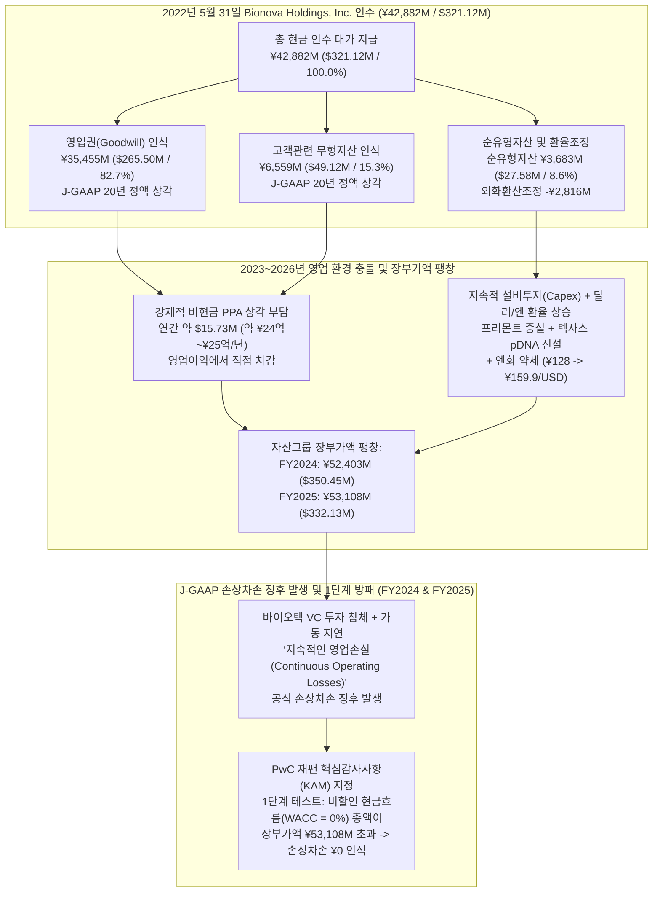
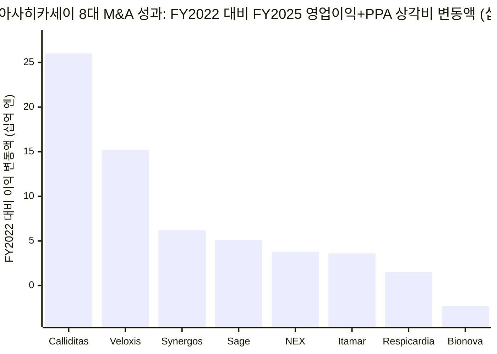
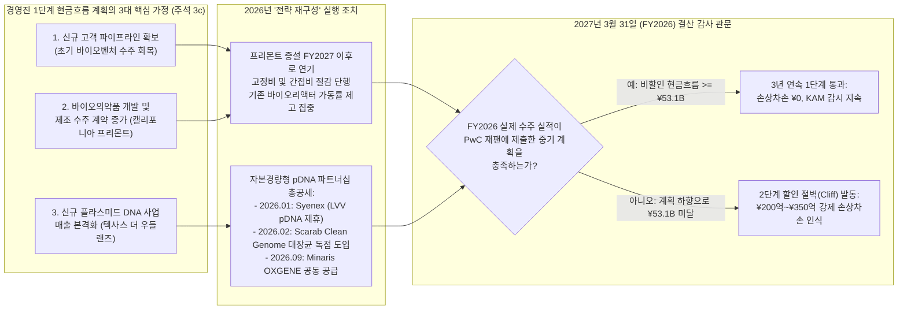

다국적 대기업의 연결재무제표라는 장막 뒤에서 운영되는 100% 비상장 자회사에 위기가 닥칠 때, 시장의 루머는 모기업 이사회 밖으로 단독 손익계산서(P&L)가 공개되기 훨씬 전부터 퍼지기 시작합니다. 도쿄에 본사를 둔 종합화학·헬스케어 대기업 **아사히카세이(Asahi Kasei Corporation, `TSE: 3407`)**가 팬데믹 직후 바이오 공정 호황의 정점이었던 2022년 5월에 인수한 미국 캘리포니아주 프리몬트(Fremont) 소재 바이오의약품 위탁개발생산(CDMO) 기업 **바이오노바 사이언티픽(Bionova Scientific, LLC)** 역시 마찬가지였습니다. 최근 샌프란시스코 베이 에어리어부터 텍사스주 더 우들랜즈(The Woodlands)에 이르는 바이오 제조 업계에서는 바이오노바의 바이오리액터 가동률 저하, 바이오텍 벤처 수주 침체, 그리고 도쿄 본사의 강도 높은 통제에 관한 소문이 끊이지 않았습니다.

바이오노바는 아사히카세이 헬스케어 부문 산하의 비상장 종속기업이므로 미국 증권거래위원회(SEC)에 단독 재무제표를 공시하지 않습니다. 그러나 아사히카세이의 일본 회계기준(`J-GAAP`) 감사 연결재무제표(`FY2022`~`FY2025`, 2026년 3월 31일 종료), 분기별 결산 보충자료(`Q1 FY2025`~`H1 FY2026`, 2026년 9월 30일 종료), 경영설명회 발표자료, 기관투자자 질의응답(Q&A) 녹취록을 전수 발굴·교차 검증한 결과, 시장의 루머는 단순한 소문이 아니라 **감사보고서 주석에 공식 기록되어 있으며, 외부감사인인 PwC 재팬(`PricewaterhouseCoopers Japan LLC`)에 의해 2년 연속 핵심감사사항(`KAM, Key Audit Matter`)으로 지정된 엄연한 사실**임이 확인되었습니다.

동시에, 1차 원천 공시자료에 대한 포렌식 검증은 상업용 데이터베이스나 2차 언론 보도가 놓치고 있는 핵심적인 구조적 실체를 밝혀냅니다.

1. **숨겨진 인수가격배분(`PPA`)의 실체:** 인수 당시 업계 언론은 거래 금액을 '비공개(undisclosed)'로 보도했고 일부 외부 블로그는 4억 7,300만 달러라는 추측성 수치를 인용했으나, **아사히카세이 FY2022 감사 연결재무제표 주석 16(a)**([2303statements.pdf](https://www.asahi-kasei.com/content/dam/asahi-kasei/us/en/ir/library/financial-briefing/pdf/2303statements.pdf), 44~45쪽)에 따르면 아사히카세이는 바이오노바 홀딩스(`Bionova Holdings, Inc.`) 지분 100% 인수 대가로 정확히 **428억 8,200만 엔(3억 2,112만 달러)**의 현금을 지급했습니다. 충격적인 사실은 이 인수가 중 **354억 5,500만 엔(2억 6,550만 달러, 82.7%)이 영업권(Goodwill)**으로, **65억 5,900만 엔(4,912만 달러, 15.3%)이 고객관계 무형자산(Customer Relationships)**으로 계상되었다는 점입니다. 즉, **전체 인수가의 98.0%(`420억 1,400만 엔`)가 상각 대상 무형자산과 영업권**이었으며, 실제 **순유형자산(Net Tangible Assets)은 불과 36억 8,300만 엔(약 2,758만 달러, 인수가의 8.6%)**에 지나지 않았습니다.
2. **2년 연속(`FY2024` 및 `FY2025`) 공식 손상차손 징후 발생:** **FY2024 감사 연결재무제표 주석 3(c)**([2503statements.pdf](https://www.asahi-kasei.com/content/dam/asahi-kasei/us/en/ir/library/financial-briefing/pdf/2503statements.pdf), 15쪽)와 **FY2025 감사 연결재무제표 주석 3(c)**([2603statements.pdf](https://www.asahi-kasei.com/content/dam/asahi-kasei/us/en/ir/library/financial-briefing/pdf/2603statements.pdf), 14쪽, 2026년 6월 24일 서명) 모두에서, 아사히카세이는 환율 효과와 설비투자로 인해 장부가액이 **531억 800만 엔(3억 3,213만 달러)**까지 불어난 바이오노바 자산그룹에서 ***"바이오텍 벤처에 대한 자금 유입 감소에 따른 수요 침체 등으로 인해 지속적인 영업손실(continuous operating losses)이 발생하여 손상차손 징후(impairment indicators)가 식별되었다"***고 공식 인정했습니다.
3. **J-GAAP '비할인 미래현금흐름' 방패를 통한 상각 회피:** 만약 아사히카세이가 국제회계기준(`IFRS IAS 36`)이나 미국 회계기준(`US GAAP ASC 350`)을 적용했다면, 531억 엔의 장부가액을 가중평균자본비용(`WACC 8%~10%`)으로 **할인한 현재가치**와 즉시 비교해야 하므로 대규모 손상차손 인식이 불가피했을 것입니다. 그러나 일본 회계기준(`ASBJ 기업회계기준적용지침 제6호`)의 1단계(손상 인식 판정) 테스트에서는 잔여 회수 기간 동안의 **할인 전(undiscounted, `WACC = 0%`) 미래현금흐름 총액**이 장부가액을 단 1엔이라도 초과하면 손상차손을 인식하지 않습니다. 경영진은 신규 고객 파이프라인 확보와 텍사스 플라스미드 DNA(`pDNA`) 공장의 가파른 매출 성장을 가정한 중기 사업계획을 제출함으로써 이 1단계 허들을 간신히 넘겼습니다.
4. **2026년 4월~11월 '확장'에서 '투자 연기·고정비 절감·전략 재구성'으로의 공식 선회:** **2026년 4월 15일 경영설명회 발표자료 슬라이드 16**([e260415en.pdf](https://www.asahi-kasei.com/content/dam/asahi-kasei/us/en/ir/library/initiative/pdf/e260415en.pdf))에서 아사히카세이는 FY2022 이후 단행한 8건의 주요 M&A의 이익 성장률(영업이익 + PPA 상각비 변동폭) 차트를 공개했습니다. **8개 피인수 기업 중 FY2023, FY2024, FY2025 3년 내내 이익 변동폭이 마이너스를 기록한 곳은 바이오노바가 유일했습니다.** 동시에 경영진은 2025년 가을 통합보고서의 *"향후 수요 증가에 대응하여 생산능력을 확장 중"*이라는 문구를 삭제하고, ***"투자 연기 및 고정비 절감(investment deferrals and fixed-cost reductions)"***([e260415en.pdf](https://www.asahi-kasei.com/content/dam/asahi-kasei/us/en/ir/library/initiative/pdf/e260415en.pdf), 슬라이드 16·44) 및 ***"바이오노바(CDMO)의 기초 체력 강화 및 전략 재구성(Strengthening the fundamentals and reconfiguring the strategy of Bionova)"***([2603supplement.pdf](https://www.asahi-kasei.com/content/dam/asahi-kasei/us/en/ir/library/financial-briefing/pdf/2603supplement.pdf), 27쪽; [2606supplement.pdf](https://www.asahi-kasei.com/content/dam/asahi-kasei/us/en/ir/library/financial-briefing/pdf/2606supplement.pdf), 25쪽; [2609supplement.pdf](https://www.asahi-kasei.com/content/dam/asahi-kasei/us/en/ir/library/financial-briefing/pdf/2609supplement.pdf), 30쪽)으로 공식 전략 문구를 전면 수정했습니다.

---

## 1. 핵심 쟁점 분류 및 반증 가능성(Falsifiability) 기준

회계적 팩트와 시장의 추측을 엄격히 분리하기 위해 본 조사를 두 가지 분석 축으로 구분합니다.

* **기술적 감사 (Descriptive Audit — 경험적 사실 검증):** 아사히카세이는 2022년 5월 바이오노바 사이언티픽 인수에 실제로 얼마를 지불했는가? 일본 회계기준(`J-GAAP`) 하에서 바이오노바의 대차대조표는 어떻게 구성되어 있는가? 어떤 구체적인 영업·회계적 트리거가 PwC 재팬으로 하여금 바이오노바의 **524억 엔(`FY2024`)** 및 **531억 엔(`FY2025`)** 자산그룹을 핵심감사사항(`KAM`)으로 지정하게 만들었으며, 2025년 4월부터 2026년 11월 사이에 어떤 법인 분할과 설비투자(Capex) 연기가 실제로 집행되었는가?
* **규범적 감사 (Prescriptive Audit — 향후 리스크 및 가치평가 판단):** 고정비 절감, 캘리포니아 프리몬트 상업용 바이오리액터 증설 연기, 그리고 2026년에 체결된 3건의 플라스미드 DNA 사업 제휴(`Syenex`, `Scarab Genomics`, `Minaris`)를 축으로 하는 바이오노바의 '전략 재구성'이 **2027년 3월 31일(`FY2026`)** 결산 감사에서 PwC 재팬의 *과거 사업계획 대비 실제 실적 비교 검증*을 통과할 만큼 충분한 수주 잔고를 창출할 수 있을 것인가, 아니면 FY2022 미국 분리막 자회사 **폴리포어(`Polypore International, LLC`)에서 발생한 1,863억 7,600만 엔(약 14억 달러) 규모의 강제 손상차손**과 같은 대규모 상각 사태를 맞이할 것인가?

### 인식론적 반증 가능성(Falsifiability) 조건

바이오노바가 2027년 3월 31일(`FY2026`) 또는 2028년 3월 31일(`FY2027`) 기말 결산에서 구조적 손상차손 인식 위험에 직면해 있다는 본 보고서의 결론은 향후 1차 공시자료에서 다음 중 하나라도 입증될 경우 **기각(반증)**됩니다.
1. 바이오노바가 연간 약 **24억~26억 엔(약 1,573만 달러)**에 달하는 J-GAAP 영업권 및 고객 무형자산 상각비를 차감한 **후**에도 단독 기준 영업이익 흑자 전환에 성공하여, 2027년 6월 발표될 FY2026 연결재무제표 주석 3(c)에서 '지속적인 영업손실'이라는 손상 징후 사유가 소멸하는 경우.
2. `아사히카세이 라이프사이언스(Asahi Kasei Life Science Corp.)`의 매출 성장이 기존의 고수익 바이러스 제거 필터(`Planova`)나 바이오 안전성 시험(`ViruSure` / `Bionique`)이 아닌, **프리몬트 및 텍사스 CDMO 시설의 가동률 급등**에 의해 주도되었음이 공시 자료로 확인되는 경우.
3. 외부감사인 PwC 재팬이 감사보고서의 핵심감사사항(`KAM`) 목록에서 바이오노바 사이언티픽의 고정자산 및 영업권 평가 항목을 제외하는 경우.

---

## 2. 1차 공시자료 대조 매트릭스: 대외 확장 서사 vs. 감사보고서 주석의 실제 현실

보도자료, 상업용 DB 추정치, 초기 통합보고서의 서사와 아사히카세이의 감사 연결재무제표 주석 및 2026년 4월~11월 결산 보충자료를 나란히 대조하면 극명한 간극이 드러납니다.

| 분석 차원 | 대외 M&A 홍보 서사 및 2차 추정치 (2022년~2025년 가을) | 감사보고서 주석, PwC KAM 및 결산 설명회 실제 현실 (2025년 6월~2026년 11월) | 검증된 1차 원천 공시자료 |
| :--- | :--- | :--- | :--- |
| **2022년 5월 인수가격 및 자산 구성** | 언론 보도에서 인수가 '비공개' 처리; 일부 외부 블로그는 대규모 유형 바이오리액터 설비를 가정하며 '4억 7,300만 달러' 추측. | 실제 현금 인수가액은 **428억 8,200만 엔(3억 2,112만 달러)**. 이 중 **98.0%(`420억 1,400만 엔`)**가 **영업권(`354억 5,500만 엔`)**과 **고객관계 무형자산(`65억 5,900만 엔`)**으로 계상되었고, 실제 순유형자산은 **36억 8,300만 엔(약 2,758만 달러)**에 불과. | [FY2022 감사 연결재무제표 (`2303statements.pdf`, 주석 16(a), 44–45쪽)](https://www.asahi-kasei.com/content/dam/asahi-kasei/us/en/ir/library/financial-briefing/pdf/2303statements.pdf) |
| **단독 매출 규모 vs. 세그먼트 연결 합산** | 외부 상업용 DB(`PitchBook`, `LeadIQ` 등)는 바이오노바 단독 매출을 **5,000만~1억 달러**(직원 약 140~220명)로 추정하며 라이프사이언스 부문 전체 매출과 혼동. | `아사히카세이 라이프사이언스` 세그먼트(`FY2025` 실적 **554억 엔 / 약 3.67억 달러**, 혈액정화·진단 사업 매각 후 계속사업 기준; `FY2026` 전망치 **670억 엔 / 약 4.32억 달러**) 내부에 통합되어 고마진 **플라노바(Planova)** 필터 수익이 바이오노바의 적자를 가리는 구조. | [FY2025 결산 보충자료 (`2603supplement.pdf`, 41쪽)](https://www.asahi-kasei.com/content/dam/asahi-kasei/us/en/ir/library/financial-briefing/pdf/2603supplement.pdf) 및 [H1 FY2026 보충자료 (`2609supplement.pdf`, 42쪽)](https://www.asahi-kasei.com/content/dam/asahi-kasei/us/en/ir/library/financial-briefing/pdf/2609supplement.pdf) |
| **인수 후 이익 궤적 (FY2022~FY2025)** | 2025년 가을 발행된 *아사히카세이 통합보고서*에서는 *"사업 환경이 회복 궤도에 있으며 향후 수요 증가에 맞춰 설비 확장 중"*으로 서술. | 2026년 4월 경영설명회에서 FY2022 대비 바이오노바의 영업이익+PPA 상각비 변동폭이 **3년 연속 마이너스(`약 -20억~-25억 엔`)**였음을 공개. 최근 8대 M&A 중 **유일한 마이너스** 기록. | [2026년 4월 15일 경영설명회 (`e260415en.pdf`, 슬라이드 16)](https://www.asahi-kasei.com/content/dam/asahi-kasei/us/en/ir/library/initiative/pdf/e260415en.pdf) vs. [통합보고서 2025 (`25en.pdf`, 39쪽)](https://www.asahi-kasei.com/content/dam/asahi-kasei/us/en/ir/library/asahikasei-report/pdf/25en.pdf) |
| **손상차손 징후 및 외부감사인 감시** | 바이오노바 보도자료나 텍사스 pDNA 시설 개소식 기사에는 손상차손 징후나 감사인 경고 언급 전무. | *"지속적인 영업손실"*로 인해 **FY2024(`524억 300만 엔`)와 FY2025(`531억 800만 엔` / `3억 3,213만 달러`) 2년 연속 공식 손상차손 징후 발생**; **PwC 재팬이 2년 연속 핵심감사사항(`KAM`)으로 지정**. | [FY2024 감사보고서 (`2503statements.pdf`, 4–6, 15쪽)](https://www.asahi-kasei.com/content/dam/asahi-kasei/us/en/ir/library/financial-briefing/pdf/2503statements.pdf) 및 [FY2025 감사보고서 (`2603statements.pdf`, 4–5, 14쪽)](https://www.asahi-kasei.com/content/dam/asahi-kasei/us/en/ir/library/financial-briefing/pdf/2603statements.pdf) |
| **설비투자(Capex) 일정 및 전략 기조** | 캘리포니아 프리몬트(바이오의약품)와 텍사스 더 우들랜즈(플라스미드 DNA)의 공격적 확장으로 홍보. | 2026년 5월~11월 공식 전략 문구가 ***"바이오노바(CDMO)의 기초 체력 강화 및 전략 재구성"***으로 변경; 프리몬트 증설 완료 시점은 `FY2025 이후`에서 `FY2027 이후`로 2년 이상 연기, 텍사스 GMP pDNA는 `FY2025 이후`에서 `FY2026 이후`로 순연되며 ***"투자 연기 및 고정비 절감"*** 공식화. | [2026년 4월 15일 경영설명회 (`e260415en.pdf`, 슬라이드 44)](https://www.asahi-kasei.com/content/dam/asahi-kasei/us/en/ir/library/initiative/pdf/e260415en.pdf) 및 [H1 FY2026 보충자료 (`2609supplement.pdf`, 30, 49쪽)](https://www.asahi-kasei.com/content/dam/asahi-kasei/us/en/ir/library/financial-briefing/pdf/2609supplement.pdf) |

---

## 3. 2022년 5월 인수가격배분(PPA) 포렌식 해부: 순유형자산 2,758만 달러 기업이 어떻게 531억 엔의 장부상 폭탄이 되었는가

바이오노바 사이언티픽이 왜 4년 연속 영업손실을 기록하고 2년 연속 공식 손상차손 징후를 촉발했는지 이해하려면, 2026년이 아니라 아사히카세이 메디칼(`Asahi Kasei Medical Co., Ltd.`)이 바이오노바 사이언티픽의 모회사인 **바이오노바 홀딩스(`Bionova Holdings, Inc.`, 델라웨어 법인, CEO Darren Head)**의 의결권 지분 100% 인수를 완료한 **2022년 5월 31일**([아사히카세이 공식 보도자료 `e220601`](https://www.asahi-kasei.com/news/2022/e220601))로 거슬러 올라가야 합니다.

2022년 4월~5월 당시, 초기 단계 바이오텍 및 세포·유전자 치료제(CGT) 스타트업으로 유입되던 벤처캐피털(VC) 자금은 2020~2021년 제로금리 버블의 끝자락에 머물러 있었습니다. 전임상 및 임상 1·2상 바이오벤처들이 포유류 세포배양(`CHO`) 바이오리액터 슬롯을 확보하기 위해 경쟁하면서 바이오 CDMO 기업들은 천문학적인 희소성 프리미엄을 누렸습니다.

아사히카세이가 공시한 **FY2022 상세 감사 연결재무제표**(2023년 3월 31일 종료 회계연도; [2303statements.pdf](https://www.asahi-kasei.com/content/dam/asahi-kasei/us/en/ir/library/financial-briefing/pdf/2303statements.pdf))의 **주석 16(a)(*기업결합 — Bionova Holdings, Inc. 인수*, 44~45쪽)**와 **연결현금흐름표 주석(22쪽)**은 이 거래의 정확한 해부도를 다음과 같이 공개하고 있습니다.

| 인수가격배분(`PPA`) 세부 항목 (2022년 5월 31일 기준) | 감사 확정 엔화 금액 (`백만 엔`) | 감사 확정 달러 환산액 (`천 달러`) | 총 인수가 대비 비중 (`%`) | J-GAAP 회계 처리 및 상각 기간 |
| :--- | :--- | :--- | :--- | :--- |
| **총 현금 인수 대가 (Purchase Consideration)** | **¥42,882M** | **$321,117K ($321.12M)** | **100.0%** | 전액 현금 지급 (별도 자문수수료 ¥534M / $4.00M는 판관비 비용 처리) |
| 차감: 인수 시점 바이오노바 보유 현금및예치금 | (¥341M) | ($2,555K) | (0.8%) | 지분 취득에 따른 순현금유출액 = **¥42,541M ($318.56M)** |
| **취득 유동자산 (Current Assets)** | ¥1,543M | $11,555K | 3.6% | 운전자본 (현금, 매출채권, 재고자산 등) |
| **취득 비유동자산 총계 (Noncurrent Assets)** | ¥13,246M | $99,191K | 30.9% | 유형자산(PP&E) 및 식별가능 무형자산 합계 |
| — *이 중 식별가능 고객관련 무형자산(Customer Relationships)* | **¥6,559M** | **$49,116K ($49.12M)** | **15.3%** | **20년 정액법 상각** (인수 환율 기준 연간 약 ¥328M 상각) |
| — *이 중 유형자산(PP&E) 및 기타 비유동자산* | ¥6,687M | $50,075K ($50.08M) | 15.6% | 프리몬트 소재 바이오리액터, 연구장비, 리스사용권 자산 등 |
| **취득 식별가능 자산 총계** | **¥14,789M** | **$110,746K ($110.75M)** | **34.5%** | 부채 차감 전 총 식별가능 자산 |
| **인수 유동부채 (Current Liabilities)** | (¥1,491M) | ($11,165K) | (3.5%) | 매입채무, 미지급비용, 선수금 등 |
| **인수 비유동부채 (Noncurrent Liabilities)** | (¥3,056M) | ($22,885K) | (7.1%) | 장기 리스부채 및 이연법인세부채 등 |
| **인수 부채 총계** | **(¥4,547M)** | **($34,050K / -$34.05M)** | **(10.6%)** | 인수 시점 승계 부채 총액 |
| **순식별가능자산 (영업권 제외 장부 순자산)** | **¥10,242M** | **$76,696K ($76.70M)** | **23.9%** | 고객관련 무형자산 ¥6,559M ($49.12M) 포함 기준 |
| **실제 취득 순유형자산 (고객 무형자산 제외)** | **¥3,683M** | **$27,580K ($27.58M)** | **8.6%** | **실제 물리적 순자산 기반 (`¥10,242M - ¥6,559M`)** |
| 인수가격배분 시점 외화환산조정계정 | (¥2,816M) | ($21,084K) | (6.6%) | 인수일과 PPA 확정일 간의 환율 변동 조정 |
| **인수 시점 인식된 영업권 (Goodwill)** | **¥35,455M** | **$265,501K ($265.50M)** | **82.7%** | **20년 정액법 상각** (인수 환율 기준 연간 약 ¥1,773M 상각) |
| **영업권 + 고객 무형자산 합산 부담액** | **¥42,014M** | **$314,617K ($314.62M)** | **98.0%** | **전체 인수가의 98.0%가 20년 상각 대상 무형 서류자산** |

위 표의 마지막 두 줄을 면밀히 살펴보십시오. 아사히카세이가 바이오노바 홀딩스를 인수하기 위해 송금한 **428억 8,200만 엔(3억 2,112만 달러)** 가운데, 부채와 무형 고객목록을 제외한 **실제 물리적 순유형자산(Net Tangible Assets)은 단 36억 8,300만 엔(2,758만 달러), 즉 인수가의 8.6%**에 불과했습니다. 나머지 **420억 1,400만 엔(3억 1,462만 달러)—전체 인수가의 무려 98.0%—이 영업권(`354억 5,500만 엔`)과 고객관계 무형자산(`65억 5,900만 엔`)**으로 채워졌습니다.

심지어 연결 편입 첫해인 2022년 7월 1일부터 2023년 3월 31일까지의 9개월(`FY2022`) 동안에도, 주석 16(a)(45쪽)에 기록된 바이오노바의 매출 기여액은 **54억 엔(4,044만 달러)**에 그쳤으며 **영업손실 6억 5,800만 엔(-493만 달러)**을 기록했습니다. 당시 경영진은 상업용 바이오리액터와 플라스미드 DNA 라인이 가동되면 이 초기 적자가 곧바로 흑자로 전환될 것이라 낙관했습니다.

### 왜 J-GAAP은 고가 M&A를 즉각적인 '영업이익의 덫'으로 만드는가

미국 회계기준(`US GAAP ASC 350`)이나 국제회계기준(`IFRS IAS 36`)에서는 영업권을 매년 정액 상각하지 않고 연례 손상검사만 수행합니다. 반면 **일본 회계기준(`ASBJ 기업회계기준 제21호`)**은 영업권을 **20년 이내의 기간 동안 정액법으로 강제 상각**하도록 규정하며, 이 상각비를 손익계산서상의 **영업이익(`営業利益`)에서 직접 차감**합니다.

게다가 바이오노바는 미국 달러화(`USD`)를 기능통화로 사용하는 미국 법인이므로, 달러 기준 영업권(초기 총액 `약 2억 6,550만 달러`)과 고객관계 무형자산(초기 총액 `약 4,912만 달러`)은 매 결산기 환율로 엔화 재무제표에 환산됩니다. 2022년 5월 당시 달러당 약 `128엔`이던 환율이 FY2024~FY2025에 걸쳐 `150~160엔`으로 급등(엔화 약세)하면서, 바이오노바 자산그룹의 엔화 장부가액과 연간 엔화 상각비 부담은 동시에 불어났습니다.

$$\text{연간 J-GAAP PPA 상각비 (엔화)} = \left(\frac{\text{USD } 265.50\text{M 영업권}}{20\text{년}} + \frac{\text{USD } 49.12\text{M 고객 무형자산}}{20\text{년}}\right) \times \text{환율}_{\text{JPY/USD}} = \text{USD } 15.73\text{M/년} \times \text{환율}_{\text{JPY/USD}}$$

달러당 `150~160엔` 환율에서 바이오노바는 **비현금성 PPA 상각비만으로 매년 23억 6,000만 엔~25억 2,000만 엔(약 1,573만 달러)**의 고정 비용을 떠안고 출발합니다. 여기에 프리몬트 바이오리액터 및 텍사스 플라스미드 공장의 유형자산 감가상각비가 추가됩니다. 즉, 바이오노바가 엔지니어 급여나 세포배양 배지 비용을 지불한 뒤 J-GAAP 기준 영업이익 손익분기점(BEP)을 맞추려면 **매년 최소 1,600만 달러 이상의 현금 EBITDA**를 먼저 창출해야만 하는 구조적 족쇄에 묶여 있는 것입니다.

---

## 4. 용어의 정밀성 및 대체 테스트(Substitution Test): 도쿄 본사의 회계 완곡어법 해독

일본 기업의 공시 서류에서 경영진과 회계감사인은 일반 독자에게는 평이해 보이지만 일본 금융상품거래법(`FIEA`) 및 기업회계기준위원회(`ASBJ`) 규정상 엄격한 법적 의미를 지닌 표준화된 전문용어를 사용합니다. 브라운과 킬리(Browne & Keeley)의 **모호성 제거 및 대체 테스트**를 적용하여 아사히카세이 FY2024~FY2026 공시에 등장하는 세 가지 핵심 문구를 포렌식 실체로 치환해 봅니다.

1. ***"바이오노바 사이언티픽 자산그룹에서 손상차손 징후가 식별되었다(Impairment indicators were identified within Bionova Scientific, LLC's asset group)"*** ([2503statements.pdf](https://www.asahi-kasei.com/content/dam/asahi-kasei/us/en/ir/library/financial-briefing/pdf/2503statements.pdf), 15쪽; [2603statements.pdf](https://www.asahi-kasei.com/content/dam/asahi-kasei/us/en/ir/library/financial-briefing/pdf/2603statements.pdf), 14쪽):
   * **법적·회계적 의미 (`ASBJ 기업회계기준적용지침 제6호 제12항`):** 일본 회계기준에서 '손상 징후(`減損の兆候`)'는 주관적 의견이 아닙니다. 영업활동에서 **2기 연속 영업손실**이 발생하거나 인수 당시 사업계획 대비 실적이 현저히 하회할 때 의무적으로 발동되는 법적 트리거입니다. 바이오노바는 `FY2022`(-6억 5,800만 엔), `FY2023`, `FY2024`, `FY2025`까지 인수 후 **4년 연속 영업손실**을 기록했기 때문에 FY2024와 FY2025 2년 연속 강제적으로 손상 인식 판정 테스트 대상이 되었습니다.
2. ***"할인 전 미래현금흐름 총액이 자산그룹의 장부가액을 초과하므로 손상차손을 인식하지 아니하였다(No impairment loss was recognized since the total amount of undiscounted future cash flows exceeded the carrying amount of the assets)"*** ([2603statements.pdf](https://www.asahi-kasei.com/content/dam/asahi-kasei/us/en/ir/library/financial-briefing/pdf/2603statements.pdf), 14쪽):
   * **법적·회계적 의미 (`고정자산 손상에 관한 회계기준 제2부 2(1)`):** 할인된 현재가치(회수가능가액)가 장부가액을 밑돌면 즉시 손상차손을 인식하는 IFRS(`IAS 36`)와 달리, J-GAAP은 2단계 관문을 둡니다. **1단계(손상 인식 판정)**에서는 잔여 회수 기간(영업권 포함 시 최대 **20년**) 동안 발생할 명목 현금흐름을 **할인율 0%(`WACC = 0%`)로 단순 합산**합니다. 이 단순 합산액이 `531억 800만 엔`을 밑돌 때만 **2단계(손상 측정)**로 넘어가며, 2단계로 넘어가는 순간 현금흐름이 즉시 `WACC`(`약 8%~10%`)로 할인되어 거대한 절벽형 상각(Cliff Write-Down)이 발생합니다.
3. ***"바이오노바(CDMO)의 기초 체력 강화 및 전략 재구성(Strengthening the fundamentals and reconfiguring the strategy of Bionova)"*** ([2603supplement.pdf](https://www.asahi-kasei.com/content/dam/asahi-kasei/us/en/ir/library/financial-briefing/pdf/2603supplement.pdf), 27쪽; [2606supplement.pdf](https://www.asahi-kasei.com/content/dam/asahi-kasei/us/en/ir/library/financial-briefing/pdf/2606supplement.pdf), 25쪽; [2609supplement.pdf](https://www.asahi-kasei.com/content/dam/asahi-kasei/us/en/ir/library/financial-briefing/pdf/2609supplement.pdf), 30쪽):
   * **포렌식 치환 (`e260415en.pdf`, 슬라이드 16 및 44):** '기초 체력 강화 및 전략 재구성'이 현장에서 무엇을 뜻하는지는 2026년 4월 15일 경영설명회 슬라이드 44에 명시되어 있습니다. 바로 ***"장기화된 바이오텍 침체로 매출 부진이 지속됨에 따라, 플라스미드 판매 확대에 주력하는 한편 투자 연기(investment deferrals) 및 고정비 절감(fixed-cost reductions)을 단행하고 있음"***입니다. 즉, 프리몬트 설비 증설을 멈추고 고정비(인건비·운영비)를 깎으면서, 비어 있는 텍사스 클린룸을 채우기 위해 외부 파트너십에 매달리고 있다는 뜻입니다.

---

## 5. 외부감사인의 현미경 아래 놓인 2년: 주석 3(c), PwC 재팬의 KAM 경고, 그리고 '1단계 절벽(Step 1 Cliff)'

아사히카세이의 **FY2024**(2025년 3월 31일 종료) 및 **FY2025**(2026년 3월 31일 종료) 상세 연결재무제표 주석 원문과 PwC 재팬의 독립감사인 보고서를 정밀 대조해 보겠습니다.

### 주석 3(c)의 변화 추이 (`중요한 회계적 추정 — Bionova Scientific, LLC의 고정자산 평가`)

**FY2024([2503statements.pdf](https://www.asahi-kasei.com/content/dam/asahi-kasei/us/en/ir/library/financial-briefing/pdf/2503statements.pdf), 15쪽)**와 **FY2025([2603statements.pdf](https://www.asahi-kasei.com/content/dam/asahi-kasei/us/en/ir/library/financial-briefing/pdf/2603statements.pdf), 14쪽)** 모두에서, 아사히카세이는 총자산 4조 1,000억 엔 규모의 그룹 전체 종속기업 중 고정자산 및 영업권 평가에 관해 별도의 **'중요한 회계적 추정(Significant Accounting Estimate)'** 경고를 부여한 단 3곳의 자회사 중 하나로 바이오노바 사이언티픽을 지목했습니다(나머지 두 곳은 주석 3(b)의 미국 분리막 자회사 **Polypore International, LLC**와 주석 3(a)의 유럽 제약사 **Calliditas Therapeutics AB**).

| 감사보고서 공시 지표 | FY2024 연결재무제표 (2025년 3월 31일 종료) | FY2025 연결재무제표 (2026년 3월 31일 종료) | 전년 대비 변화 및 포렌식 함의 |
| :--- | :--- | :--- | :--- |
| **바이오노바 자산그룹 장부가액 (엔화)** | **524억 300만 엔 (¥52,403M)** | **531억 800만 엔 (¥53,108M)** | 1년간의 감가상각 및 PPA 상각에도 불구하고 텍사스·캘리포니아 설비투자 및 환율 상승으로 **+7억 500만 엔(+1.3%) 증가** |
| **바이오노바 자산그룹 장부가액 (달러 환산)** | **$350,451K (3억 5,045만 달러)** (환율 약 ¥149.53/USD) | **$332,133K (3억 3,213만 달러)** (환율 약 ¥159.90/USD) | 상각에 따른 달러 기준 감소분이 설비투자로 일부 상쇄되어 **-1,832만 달러(-5.2%) 감소** |
| **아사히카세이 연결 총자산 대비 비중** | 연결 총자산의 **약 1.0%** | 연결 총자산의 **1.3%** | 총자산 대비 노출 비중 30 bps 상승 |
| **공시된 손상 징후 발생 사유** | *"바이오텍 벤처로의 자금 유입 감소에 기인한 수요 침체 등의 요인으로 지속적인 영업손실이 기록되어 잠재적 손상 징후가 나타남"* | *"바이오텍 벤처로의 자금 유입 감소에 따른 수요 침체로 인해 지속적인 영업손실을 기록함에 따라 손상 징후를 식별함"* | 2년 연속 감사보고서에 '지속적인 영업손실' 명시 |
| **경영진 사업계획의 3대 핵심 가정** | 1. 향후 신규 고객 파이프라인 확보; 2. 바이오의약품 개발·제조 수주 계약 증가; 3. 신규 출범한 플라스미드 DNA 사업의 매출 발생 | 1. 향후 신규 고객 파이프라인 확보; 2. 바이오의약품 개발·제조 수주 계약 증가; 3. 신규 출범한 플라스미드 DNA 사업의 매출 발생 | 2년 연속 완전히 동일한 3대 턴어라운드 가정을 감사인에게 제출 |
| **J-GAAP 1단계 테스트 결과** | *"할인 전 미래현금흐름 총액이 장부가액을 초과하므로 손상차손을 인식하지 않음"* | *"할인 전 미래현금흐름 총액이 자산 장부가액을 초과하므로 당기말 손상차손을 인식하지 않음"* | 오직 J-GAAP 1단계 비할인 합산(`WACC = 0%`) 덕택에 상각 회피 |

### PwC 재팬이 핵심감사사항(`KAM`)에 남긴 결정적 문구

**2026년 6월 24일**, **PwC 재팬(`PricewaterhouseCoopers Japan LLC`)**의 업무수행 사원(Engagement Partners) **고다 겐스케(Kensuke Koda), 고다이 히데키(Hideki Godai), 닛타 마사키(Masaki Nitta)** 공인회계사는 아사히카세이의 FY2025 연결재무제표에 대한 독립감사인 보고서([2603statements.pdf](https://www.asahi-kasei.com/content/dam/asahi-kasei/us/en/ir/library/financial-briefing/pdf/2603statements.pdf), 4~5쪽)에 서명했습니다. PwC 재팬은 바이오노바의 531억 800만 엔 자산그룹을 핵심감사사항(`KAM`)으로 선정한 이유를 다음과 같이 밝혔습니다.

> *"당 감사인은 바이오노바 고정자산에 대한 손상차손 인식 여부의 평가가 핵심감사사항에 해당한다고 판단하였다. 미래현금흐름은 경영진이 작성한 사업계획에 기초하여 추정되었으며, 향후 신규 고객 파이프라인의 확보, 바이오의약품 개발 및 제조 수주 건수의 증가, 신규 개시한 플라스미드 DNA 사업의 매출 등 핵심 가정은 향후 시장 동향의 영향을 받을 수 있어 **높은 추정 불확실성(high estimation uncertainty)**을 수반하며 **경영진의 중대한 판단(significant management judgment)**을 요구하기 때문이다."*

가장 결정적인 대목은 PwC 재팬이 수행한 **감사절차 (2)**([2603statements.pdf](https://www.asahi-kasei.com/content/dam/asahi-kasei/us/en/ir/library/financial-briefing/pdf/2603statements.pdf), 4쪽)입니다.

> ***"나아가 당 감사인은 과거 사업계획과 실제 실적을 비교하였으며, 실제 실적이 사업계획에 미달한 경우(where actual results fell short of the business plans) 그러한 미달의 원인을 평가하고, 그 원인이 차기 및 이후 연결회계연도의 사업계획 수립에 적절히 반영되었는지 여부를 검토하였다."***

이 한 문장이 바로 감사보고서 내의 스모킹 건(Smoking Gun)입니다. PwC 재팬은 바이오노바의 **"실제 실적이 과거 사업계획에 미달했다"**는 사실을 공식 확인했으며, 과거의 계획 미달이 왜 FY2026 이후의 장밋빛 전망을 무효화하지 않는지 경영진에게 소명을 요구했음을 명시한 것입니다.

### J-GAAP '1단계 절벽(Step 1 Cliff)'의 수학적 증명 (`WACC = 0%` vs. `WACC = 9%`)

왜 J-GAAP의 2단계 손상차손 구조는 장부가액 531억 엔(`3억 3,213만 달러`)을 보유한 자본집약적 CDMO에게 '전부 아니면 전무(All-or-Nothing)의 절벽'을 만들어낼까요?

2026년 3월 31일 기준 바이오노바 자산그룹(영업권 포함)의 장부가액을 `C_book = 531.1억 엔`이라 하고, 잔여 회수 기간 `T = 16년`(2022년 5월 인수 후 영업권 상각 기간 20년 중 잔여 기간) 동안 `t`차 연도에 창출될 세전·이자지급전 영업현금흐름을 `CF_t`라 합시다.

**J-GAAP 1단계(손상 인식 판정 테스트)** 하에서는 다음 조건이 충족되면 손상차손을 단 1엔도 인식하지 않습니다.

$$\text{CF}_{\text{Step 1 (비할인 합산)}} = \sum_{t=1}^{16} \text{CF}_t \ge 531.1\text{억 엔}$$

예를 들어, 경영진이 제출한 중기 사업계획에서 1차 연도에는 현금흐름이 손익분기점(`0.0억 엔`)에 머물고, 2~4차 연도에 점진적으로 반등(`15억 엔`, `25억 엔`, `35억 엔`)한 뒤, 5~16차 연도의 12년간 매년 `40억 엔`(약 2,500만~2,600만 달러)의 정상 상태 잉여현금흐름을 창출한다고 가정해 봅시다(`12년 × 40억 엔 = 480억 엔`).

* **1단계 비할인 현금흐름 합계 (`WACC = 0%`):**

$$\sum_{t=1}^{16} \text{CF}_t = 0.0 + 15.0 + 25.0 + 35.0 + (12 \times 40.0) = 555.0\text{억 엔} > 531.1\text{억 엔}$$

비할인 합계 `555.0억 엔`이 장부가액 `531.1억 엔`을 불과 `4.5%`(`23.9억 엔`) 차이로 웃돌기 때문에, **1단계 테스트를 통과하며 대차대조표에 인식되는 손상차손은 정확히 0엔입니다.**

그러나 만약 다가오는 `FY2026`(2027년 3월 31일 종료) 결산에서 실제 수주 실적이 계획보다 단 10% 미달하여, PwC 재팬이 향후 현금흐름 추정치를 10% 하향 조정(`연 40억 엔 → 36억 엔`)하도록 강제한다면 어떻게 될까요?

* **수정된 1단계 비할인 현금흐름 합계 (`WACC = 0%`):**

$$\sum_{t=1}^{16} \text{CF}_t^{\text{수정}} = 0.0 + 13.5 + 22.5 + 31.5 + (12 \times 36.0) = 499.5\text{억 엔} < 531.1\text{억 엔}$$

비할인 합계가 `531.1억 엔` 밑으로 단 1엔이라도 내려가는 순간 **1단계 테스트는 실패**합니다. 그리고 J-GAAP(`고정자산 손상에 관한 회계기준 제2부 2(2)`) 규정에 따라, 인식해야 할 손상차손은 단순 차액인 `531.1억 - 499.5억 = 31.6억 엔`이 **아닙니다**. 즉시 **2단계(손상 측정 테스트)**가 발동되어, 미래현금흐름을 바이오 CDMO 업계의 가중평균자본비용인 `r = 9.0%`로 **할인한 현재가치(회수가능가액)**로 장부가액을 일시에 감액해야 합니다!

$$\text{PV}_{\text{Step 2}} = \sum_{t=1}^{16} \frac{\text{CF}_t^{\text{수정}}}{(1 + 0.09)^t} \approx 234.0\text{억 엔}$$

$$\text{강제 인식해야 할 J-GAAP 2단계 손상차손} = C_{\text{book}} - \text{PV}_{\text{Step 2}} = 531.1\text{억 엔} - 234.0\text{억 엔} = 297.1\text{억 엔}\; (\approx \text{USD } 186\text{M})$$

즉, **비할인 현금흐름 가정이 단 10%만 깎여도**, 1단계 문턱을 넘는 순간 할인율이 `0%`에서 `9%`로 즉각 전환되면서 **장부가액의 56%(`약 297억 엔`)가 하루아침에 증발하는 회계적 절벽(Accounting Cliff)**이 작동하는 것입니다.

### 바로 위 문단(주석 3(b))에 기록된 폴리포어(Polypore)의 섬뜩한 선례

일본 대기업이 주력 자회사의 1단계 영업권 손상 테스트를 영원히 방어할 수 있다고 믿는 낙관론자라면, **아사히카세이 FY2024 및 FY2025 연결재무제표의 똑같은 페이지(14쪽) 바로 위 문단인 주석 3(b)**([2603statements.pdf](https://www.asahi-kasei.com/content/dam/asahi-kasei/us/en/ir/library/financial-briefing/pdf/2603statements.pdf))를 읽어야 합니다.

> *"주석 3(b) Polypore International, LLC의 고정자산 평가: ... FY2022 당시 미국 내 인플레이션 심화, 지정학적 리스크 고조, 자동차 감산 등의 배경 속에서 폴리포어를 둘러싼 사업 환경이 악화되었다... 그 결과 향후 사업계획을 재검토함에 따라 영업권, 기타 무형자산 및 유형자산에 대해 **1,863억 7,600만 엔의 손상차손**을 인식하였다."*

미국 배터리 분리막 자회사 폴리포어의 중기 사업계획이 FY2022 감사에서 PwC 재팬의 '계획 대비 실적 검증'을 통과하지 못하자, 아사히카세이는 단 한 번에 **1,863억 8,000만 엔(약 14억 달러)의 거대한 손상차손**을 계상해야 했습니다. 심지어 FY2025 결산에서도 아사히카세이는 여타 화학·헬스케어 설비에서 **209억 7,200만 엔(1억 3,116만 달러)의 연결 손상차손**을 인식했습니다([2603statements.pdf](https://www.asahi-kasei.com/content/dam/asahi-kasei/us/en/ir/library/financial-briefing/pdf/2603statements.pdf), 20쪽). 비할인 현금흐름 완충지대가 소진되는 순간 PwC 재팬의 감사는 예외를 두지 않습니다.

---

## 6. 도쿄 기관투자자들의 추궁과 2026년 4월 M&A 성적표의 스모킹 건

### 결산 설명회 Q&A 녹취록에 대한 포렌식 팩트체크 (`2025년 7월 31일`)

도쿄의 기관투자자와 애널리스트들은 2025년 6월 유가증권보고서(`有価証券報告書`)에 바이오노바가 KAM으로 등재되자마자 즉각 반응했습니다. **2025년 7월 31일 개최된 FY2025 1분기 결산 설명회 Q&A**([2506summary.pdf](https://www.asahi-kasei.com/content/dam/asahi-kasei/us/en/ir/library/financial-briefing/pdf/2506summary.pdf), 2쪽)에서 한 기관 애널리스트는 바이오노바의 손상차손 리스크를 직격으로 질문했습니다.

*(포렌식 인물 팩트체크: 일부 2차 시장 논평에서는 아사히카세이의 최고재무책임자(CFO)인 **호리에 도시야스(Toshiyasu Horie)**와 헬스케어 부문 총괄 전무집행임원인 **나카노 세이지(Seiji Nakano)**의 이름을 결합하여 'CFO 나카노 도시야스'로 잘못 인용하곤 합니다. 그러나 공식 Q1 FY2025 Q&A 요약본([2506summary.pdf](https://www.asahi-kasei.com/content/dam/asahi-kasei/us/en/ir/library/financial-briefing/pdf/2506summary.pdf), 1~2쪽)을 확인하면, 당일 콜에는 호리에 도시야스 CFO와 나카노 세이지 헬스케어 총괄 임원이 함께 참석했으며, `Healthcare: Pharmaceuticals & Life Science` 세션에서 바이오노바 손상차손 질문에 직접 답변한 인물은 **나카노 세이지(Seiji Nakano)** 전무집행임원입니다.)*

공식 투자자 녹취록에 기록된 실제 문답 원문은 다음과 같습니다.

> **애널리스트 질문:** *"바이오노바 사이언티픽(Bionova Scientific, LLC)과 관련된 손상차손 리스크를 어떻게 보고 계십니까?"*
>
> **나카노 세이지 (헬스케어 부문 총괄 전무집행임원):** *"현시점에서는 어떠한 손상차손도 예상하지 않고 있습니다. 당사는 중기 계획을 지속적으로 재검토하고 회계감사인과 적절한 검증을 수행해 나갈 것입니다(At this point, we do not anticipate any impairment. We will continue to review our medium-term plans and conduct appropriate verification with our accountants)."*

나카노 임원의 신중한 화법에 주목하십시오. 그는 바이오노바가 흑자로 돌아섰다거나 수주 잔고가 목표치를 초과 달성했다고 답하지 **않았습니다**. 대신 *"중기 계획을 지속적으로 재검토하고 회계감사인과 적절한 검증을 수행하겠다"*고 답했는데, 이는 정확히 11개월 뒤인 2026년 6월 24일 PwC 재팬이 감사보고서에서 다시 한번 경고한 1단계 사업계획 검증 절차 그 자체였습니다.

### 2026년 4월 15일 경영설명회 슬라이드 16에 등장한 결정적 차트

바이오노바의 단독 실적을 보여주는 가장 결정적인 정량 지표는 **2026년 4월 15일 아사히카세이 경영설명회 발표자료**(*중기경영계획 2025–2027 "Trailblaze Together" 업데이트*, [e260415en.pdf](https://www.asahi-kasei.com/content/dam/asahi-kasei/us/en/ir/library/initiative/pdf/e260415en.pdf))의 **슬라이드 16**에서 공개되었습니다.

**"주요 최근 M&A의 이익 성장 (FY2022 대비 영업이익 + PPA 상각비 변동액)"**이라는 제목의 막대그래프에서 경영진은 최근 인수한 8대 기업—**Calliditas**(제약), **Veloxis**(제약), **Synergos**(주택), **Sage**(소재), **NEX**(주택), **Itamar**(중증치료), **Bionova**(라이프사이언스), **Respicardia**(중증치료)—의 누적 이익 추이(`FY2023 실적`, `FY2024 실적`, `FY2025 전망`)를 나란히 비교했습니다.

이 지표는 **영업이익에 PPA 상각비를 다시 더한 값(`Operating Income + PPA Amortization`, 즉 M&A 영업권 상각 전 실질 영업이익)**의 FY2022 대비 증감을 측정한 것이므로, 비현금성 J-GAAP 영업권 상각비 때문이라는 변명이 통하지 않습니다. 놀랍게도 PPA 상각 전 기준으로도 **8개 피인수 기업 중 FY2023, FY2024, FY2025 3년 연속 이익 변동폭이 마이너스에 머문 곳은 바이오노바 단 한 곳뿐이었습니다.**

더욱 극적인 변화는 **2025년 가을 발간된 *아사히카세이 통합보고서 2025* 39쪽**([25en.pdf](https://www.asahi-kasei.com/content/dam/asahi-kasei/us/en/ir/library/asahikasei-report/pdf/25en.pdf))과 **2026년 4월 15일 경영설명회 슬라이드 16 및 44**([e260415en.pdf](https://www.asahi-kasei.com/content/dam/asahi-kasei/us/en/ir/library/initiative/pdf/e260415en.pdf)) 사이의 문구 수정(Redline)에서 확인됩니다.

* **2025년 가을 (*아사히카세이 통합보고서 2025*, 39쪽):**
  > *"바이오노바 사이언티픽은 사업 환경 변화의 영향을 크게 받았으나, 현재 사업 환경이 회복 궤도에 올라 있으며 향후 수요 증가에 대응하기 위해 생산능력을 확장하고 있습니다."*
* **2026년 4월 15일 (*경영설명회*, 슬라이드 16):**
  > *"벤처캐피털 자금 조달 정체로 인해 바이오텍 스타트업으로부터의 수주가 부진함. 회복 조짐이 일부 보이나, **실적 개선을 위해 투자 연기 및 비용 절감 등의 조치를 적용하고 있음.**"*
* **2026년 4월 15일 (*경영설명회*, 슬라이드 44 — `CDMO 사업(Bionova) 강화 대책`):**
  > *"장기화된 바이오텍 침체로 인해 매출 약세가 지속됨. 플라스미드 매출 확대에 주력하는 한편, **투자 연기(investment deferrals) 및 고정비 절감(fixed-cost reductions)을 실행하고 있음.**"*

---

## 7. 세그먼트 정량 해부 및 캘리포니아·텍사스 설비투자(Capex) 지연 감사

왜 외부 상업용 데이터베이스(`PitchBook`, `LeadIQ` 등)는 바이오노바의 단독 매출을 **5,000만~1억 달러**로 추정하는 반면, 외부 관찰자들은 이를 아사히카세이의 공시 숫자와 대조하는 데 어려움을 겪을까요? 그 이유는 아사히카세이가 **2025년 4월~7월** 헬스케어 부문의 보고 체계를 전면 개편하면서 **혈액정화(Blood Purification) 사업**(2025년 4월 양도)과 **진단(Diagnostics) 사업**(2025년 7월 양도)을 매각·분리하고, 남은 바이오공정(`Planova` 바이러스 제거 필터, `BioOptimal` 마이크로필터, 대형 크로마토그래피 장비), 바이오안전성 시험 CRO(`ViruSure`, `Bionique`), 그리고 바이오의약품 CDMO(`Bionova Scientific`)를 **2025년 4월 1일 신설된 독립 법인 `아사히카세이 라이프사이언스(Asahi Kasei Life Science Corp.)`**([공식 보도자료 `e250401`](https://www.asahi-kasei.com/news/2025/e250401)) 내부로 통합했기 때문입니다.

### `라이프사이언스(Life Science)` 서브세그먼트 정밀 해부 (`FY2023` ~ `FY2026 전망`)

[2503supplement.pdf](https://www.asahi-kasei.com/content/dam/asahi-kasei/us/en/ir/library/financial-briefing/pdf/2503supplement.pdf)(37쪽), [2603supplement.pdf](https://www.asahi-kasei.com/content/dam/asahi-kasei/us/en/ir/library/financial-briefing/pdf/2603supplement.pdf)(41쪽), 그리고 2026년 11월 공시된 반기 결산 보충자료 [2609supplement.pdf](https://www.asahi-kasei.com/content/dam/asahi-kasei/us/en/ir/library/financial-briefing/pdf/2609supplement.pdf)(42쪽)의 세그먼트 표를 교차 검증하면 `Life Science` 부문의 정확한 매출 및 손익 추이를 분리해 낼 수 있습니다.

| 헬스케어 서브세그먼트 재무 지표 (`십억 엔`) | FY2023 실적 (사업 매각 전 기준) | FY2024 실적 (사업 매각 전 기준) | FY2024 실적 (매각 후 계속사업 기준) | FY2025 실적 (2026년 3월 31일 종료) | H1 FY2026 반기 실적 (2026년 9월 30일 종료) | FY2026 연간 수정 전망 (2026년 11월 상향) |
| :--- | :--- | :--- | :--- | :--- | :--- | :--- |
| **의약·라이프사이언스 합산 매출액** | ¥216.2B | ¥246.0B | ¥208.1B (계속사업) | **¥237.7B** | **¥128.8B** | **¥255.0B** |
| — *의약(Pharmaceuticals) 서브세그먼트 매출액* | ¥123.6B | ¥153.1B | ¥153.1B | **¥182.3B** | **¥92.9B** | **¥188.0B** |
| — ***라이프사이언스(Life Science) 서브세그먼트 매출액*** | **¥92.6B** (혈액정화·진단 포함) | **¥93.0B** (혈액정화·진단 포함) | **¥55.0B** (바이오공정+CRO+Bionova) | **¥55.4B (~$367M)** | **¥36.0B (~$232M)** (전년동기비 +28.4%) | **¥67.0B (~$432M)** (전년비 +20.9%) |
| **의약·라이프사이언스 합산 영업이익** | ¥7.0B | ¥26.5B | ¥26.5B | **¥40.4B** | **¥27.8B** | **¥40.0B** |
| **바이오노바 단독 매출 기여분 (추정)** | ~¥6.0B–¥7.5B (~$42M–$52M) | ~¥6.5B–¥8.0B (~$43M–$53M) | ~¥6.5B–¥8.0B (~$43M–$53M) | **~¥7.0B–¥8.5B (~$45M–$55M)** | ~¥3.8B–¥4.5B (~$25M–$29M) | **~¥8.0B–¥10.0B (~$52M–$65M)** |
| **바이오노바 단독 영업손익 (J-GAAP, PPA 차감 후)** | **적자 (영업손실)** | **적자 (손실; KAM 지정)** | **적자 (손실; KAM 지정)** | **적자 (손실; KAM 지정)** | **적자 지속 / 손익분기 근처** | **고정비 절감을 통한 적자 축소 목표** |

`Life Science` 내부의 뚜렷한 양극화에 주목하십시오.
1. **FY2025**(2026년 3월 31일 종료) 기준 계속사업 `Life Science` 매출액(`Planova` 바이러스 제거 필터, 바이오공정 장비, `ViruSure`/`Bionique` 시험 서비스, `Bionova Scientific`)은 전년 `550억 엔`에서 `554억 엔(약 3억 6,700만 달러)`으로 불과 **+0.7%** 성장하는 데 그쳤습니다.
2. 반면 **H1 FY2026**(2026년 9월 30일 종료 반기; [2609supplement.pdf](https://www.asahi-kasei.com/content/dam/asahi-kasei/us/en/ir/library/financial-briefing/pdf/2609supplement.pdf), 42쪽)에는 `Life Science` 반기 매출이 전년 동기 대비 **+28.4% 급증한 360억 엔**을 기록했고, 이에 힘입어 연간 전망치도 **670억 엔(약 4억 3,200만 달러)**으로 상향 조정되었습니다.
3. **누가 FY2026 라이프사이언스의 성장을 견인했는가?** 바이오노바가 아닙니다. FY2026 1분기 결산 Q&A 요약본([2606summary.pdf](https://www.asahi-kasei.com/content/dam/asahi-kasei/us/en/ir/library/financial-briefing/pdf/2606summary.pdf), 2쪽, 2026년 7월 31일)에서 헬스케어 부문 임원은 실적 호조의 원인이 차세대 셀룰로오스 멤브레인 필터 신제품 **Planova™ FG1**을 필두로 한 **플라노바(Planova™) 바이러스 제거 필터 및 상업용 바이오의약품 생산 소모품의 판매 급증** 덕분이라고 설명했습니다. 반면 [2606supplement.pdf](https://www.asahi-kasei.com/content/dam/asahi-kasei/us/en/ir/library/financial-briefing/pdf/2606supplement.pdf)(25쪽)와 [2609supplement.pdf](https://www.asahi-kasei.com/content/dam/asahi-kasei/us/en/ir/library/financial-briefing/pdf/2609supplement.pdf)(30쪽)에서 바이오노바는 여전히 별도의 구조조정 불릿 포인트(**`Strengthening the fundamentals and reconfiguring the strategy of Bionova (CDMO)`**) 아래 격리되어 있습니다.

### 설비투자(Capex) 일정 지연 스코어카드: 캘리포니아와 텍사스의 완공 시점 연기 증거

아사히카세이는 매 분기 결산 보충자료에 **"주요 진행 중인 설비투자 프로젝트(`Major Investments — Capital expenditure Projects in Progress`)"** 표를 공시합니다. **2025년 5월(`2503supplement.pdf`, 43쪽)**, **2026년 5월(`2603supplement.pdf`, 48쪽)**, **2026년 11월(`2609supplement.pdf`, 49쪽)** 세 시점의 바이오노바 관련 2개 프로젝트를 추적하면, 2026년 4월 경영설명회 슬라이드 44에서 언급된 '투자 연기(investment deferrals)'의 물리적 증거가 그대로 드러납니다.

| 진행 중인 설비투자(Capex) 프로젝트명 | 2025년 5월 공시 (`2503supplement.pdf`, 43쪽) | 2026년 5월 공시 (`2603supplement.pdf`, 48쪽) | 2026년 11월 공시 (`2609supplement.pdf`, 49쪽) | 포렌식 일정 지연(Slippage) 진단 |
| :--- | :--- | :--- | :--- | :--- |
| **바이오의약품 CDMO 바이오노바 생산능력 증설 (미국 캘리포니아주 프리몬트)** | *"완공 예정: **FY 2025 이후** (To be completed in FY 2025 or later)"* | *"완공 예정: **FY 2027 이후** (To be completed in FY 2027 or later)"* | *"완공 예정: **FY 2027 이후** (To be completed in FY 2027 or later)"* | **2년 이상 완공 연기:** 가동률이 떨어진 프리몬트 시설에 고정 감가상각비가 추가되는 것을 막기 위해 상업용 바이오리액터 증설을 의도적으로 이연. |
| **바이오의약품 CDMO 바이오노바의 플라스미드 DNA 제조시설 신설 (미국 텍사스주 더 우들랜즈 — 2635 Technology Forest Blvd, 약 10,000 sq ft)** | *"공정개발(PD): 2025년 상반기 완공 예정; GMP 제조: **FY 2025 이후** 완공 예정"* | *"공정개발(PD): 2025년 상반기 완공; GMP 제조: **FY 2026 이후** 완공 예정"* | *"공정개발(PD): 2025년 상반기 완공; GMP 제조: **FY 2026 이후** 완공 예정"* | **GMP 가동 1년 이상 순연:** 비GMP 공정개발(PD) 연구소는 2025년 상반기에 문을 열었으나, 실제 수익원인 cGMP 상업 생산 검증은 FY2025에서 FY2026 이후로 지연. |

---

## 8. 4대 인과관계 감사(4-Way Causal Audit): 왜 플라노바(Planova)가 호황을 누리는 동안 바이오노바는 침체에 빠졌는가?

왜 같은 모기업 사업부 내의 **플라노바(Planova™)** 바이러스 필터는 사상 최대 매출을 경신하는 동안 바이오노바 사이언티픽은 4년 연속 영업적자에 빠졌을까요? 브라운과 킬리 프레임워크 제9장의 4방향 인과관계 분리 모델을 통해 네 가지 가설을 검증합니다.

| 인과 경로 (Causal Pathway) | 메커니즘 가설 | 1차 공시자료 기반 실증적 근거 | 설명력 가중치 |
| :--- | :--- | :--- | :--- |
| **1. 직접 인과 (`X → Y`)** | **초기 바이오텍 VC 자금 가뭄 → 전임상·임상 1상 CDMO 발주 급감:** 프리몬트 공장의 기존 고객층은 공정개발(`PD`)과 초기 임상(`Phase I/II`) `CHO` 배치가 필요한 비상장 바이오벤처에 편중되어 있음. 2022~2025년 시리즈 A/B 바이오 VC 투자가 위축되자 고객사들이 후속 파이프라인 개발을 중단하며 수주 유입이 고갈됨. | 아사히카세이 주석 3(c)(`2503statements.pdf`, `2603statements.pdf`)는 손실 원인을 *"바이오텍 벤처 자금 유입 감소에 따른 수요 침체"*로 명시. 반면 `Planova`는 VC 자금과 무관하게 상업 생산 물량에 연동되는 **임상 3상 및 시판 후 상업용 혈장분획제제·항체의약품 공정**에 주로 판매됨. | **45% (핵심 경기순환적 요인)** |
| **2. 역인과 (`Y → X`)** | **소규모 임상 설비 한계 및 상업용(Phase III/BLA) 트랙레코드 부족 → 빅파마 대형 수주 실패:** 거시 시장 침체 때문만이 아니라, 바이오노바가 원래 `500L~2,000L` 일회용(Single-use) 바이오리액터 중심의 임상용 부티크 CDMO로 설계되었기 때문에 빅파마의 상업용 항체·이중항체·ADC 외주 물량을 흡수하지 못함. | 아사히카세이가 프리몬트 설비 증설을 `FY2025`에서 `FY2027 이후`로 연기(`2603supplement.pdf`, 48쪽)함으로써 바이오노바는 단기적으로 상업 규모 입찰(RFP)에 참여할 수 없게 되었고, 변동성이 큰 초기 바이오벤처 의존도가 고착화됨. | **20% (구조적 설비 역량 한계)** |
| **3. 제3의 교란변수 (`Confounder Z`)** | **2021~2022년 고점 M&A 밸류에이션 + 업계 전반의 pDNA/바이오리액터 과잉 증설 (`Z`):** 2021년 글로벌 초저금리 유동성이 (a) 아사히카세이로 하여금 2022년 5월 `428.8억 엔`(`98%` 영업권·무형자산)이라는 고가를 지불하게 만들었고, 동시에 (b) 경쟁 CDMO(`Catalent`, `Charles River/Cobra`, `Lonza`, `WuXi`, `Aldevron/Danaher`, `Forge Biologics` 등)들이 일제히 플라스미드 DNA 및 일회용 바이오리액터 설비를 과잉 증설하게 만들어 2025년 바이오노바의 텍사스 진입 시점에 극심한 공급 과잉을 초래함. | 바이오텍 VC 투자가 2019년 수준으로 회복되더라도, 바이오노바는 북미 전역의 유휴 pDNA 클린룸들과 가격 경쟁을 벌이면서 동시에 매년 `약 1,573만 달러`(`약 24억~25억 엔`)의 2022년 버블기 PPA 상각비를 감당해야 함. | **25% (근본적 회계 및 공급과잉 교란요인)** |
| **4. 상호 피드백 루프 (`X ↔ Y`)** | **손상차손 감시(KAM) → 설비투자 연기 및 고정비 절감 → 상업 생산 준비 지연 → 파이프라인 매출 전환 둔화:** 현금흐름을 방어하고 감사인(PwC)을 설득하기 위해 도쿄 본사는 *"투자 연기 및 고정비 절감"*(`e260415en.pdf`, 슬라이드 44)을 지시함. 그러나 프리몬트 증설 연기와 인력·비용 감축은 GMP 스케일업 속도를 늦추어 중기 현금흐름 상단을 낮추는 악순환을 유발함. | *"바이오노바 수주 확대"*(`2503supplement.pdf`, 27쪽)에서 *"기초 체력 강화 및 전략 재구성"*(`2603supplement.pdf`, 27쪽)으로의 문구 변경과 프리몬트 완공 2년 연기가 동시에 발생한 사실로 입증됨. | **10% (자기강화적 운영 함정)** |

---

## 9. 구조적 링펜싱(Ring-Fencing)과 2026년 플라스미드 DNA 제휴 총공세

### 2025년 4월 1일 `아사히카세이 라이프사이언스` 법인 분할이 갖는 전략적 의미

**2025년 4월 1일**, 아사히카세이는 헬스케어 부문 내에서 중대한 법인 구조조정을 단행했습니다. 기존 **아사히카세이 메디칼(`Asahi Kasei Medical Co., Ltd.`)**(같은 시점에 혈액투석·혈장교환 등 혈액정화 사업을 매각)로부터 바이오공정(`Planova`, `BioOptimal`, 크로마토그래피 장비), 바이오안전성 시험(`ViruSure`, `Bionique`), 바이오의약품 CDMO(`Bionova Scientific`) 사업을 떼어내어 **시노미야 겐(Ken Shinomiya)** 사장이 이끄는 100% 신설 독립 법인 **아사히카세이 라이프사이언스(`Asahi Kasei Life Science Corp.`)**를 출범시킨 것입니다([공식 보도자료 `e250401`](https://www.asahi-kasei.com/news/2025/e250401)).

이 법인 분할은 재무적·법적으로 두 가지 목적을 동시에 달성합니다.
1. **세그먼트 보고 차원의 마진 차폐(Margin Masking):** 적자를 내고 있는 미국 CDMO 바이오노바를 고수익 현금창출원인 **플라노바(Planova™)** 바이러스 필터와 함께 단일 서브세그먼트(`Life Science`, FY2025 매출 **554억 엔**, FY2026 전망 **670억 엔**) 안에 묶음으로써, 외부 주식 투자자들에게는 수익성 높은 성장 사업부로 보이게 하는 동시에 바이오노바의 단독 손익이 별도 보고 세그먼트로 노출되는 것을 차단합니다.
2. **법적·대차대조표 차원의 링펜싱(Ring-Fencing):** 바이오공정 및 CDMO 자회사들을 별도의 지주·사업법인(`Asahi Kasei Life Science Corp.`) 산하로 격리함으로써, 자본 배분과 채무 보증 및 향후 잠재적인 합작투자(JV)·구조조정 옵션을 아사히카세이 헬스케어 부문의 양대 핵심 캐시카우인 **졸 메디칼(`ZOLL Medical`, 중증치료 부문, FY2025 매출 `3,485억 엔`, 영업이익 `448억 엔`)** 및 **아사히카세이 파마 / Veloxis / Calliditas(의약 부문, FY2025 매출 `1,823억 엔`)**로부터 깔끔하게 분리했습니다. 다만 핵심적으로 유의할 점은, **법인 분할이 J-GAAP 손상차손 테스트에서 바이오노바 자산그룹을 플라노바와 합산해 주지는 않는다는 사실**입니다. 주석 3(c)가 증명하듯 PwC 재팬은 여전히 **바이오노바 사이언티픽(`531억 800만 엔`)을 독립된 현금창출단위(Asset Group)로 분리하여 감사**하고 있습니다!

### 2026년 플라스미드 DNA 제휴 총공세: 대규모 설비투자 없이 텍사스 공장 채우기

주석 3(c)에서 바이오노바의 비할인 미래현금흐름을 `531억 800만 엔` 이상으로 유지해 주는 3대 핵심 가정 중 하나로 **"신규 출범한 플라스미드 DNA 사업의 매출(sales of the newly launched plasmid DNA business)"**이 명시되어 있기 때문에, 바이오노바 경영진은 대규모 추가 설비투자 없이 **텍사스주 더 우들랜즈 소재 10,000 평방피트(`2635 Technology Forest Blvd`) 신축 시설**의 가동률을 즉각 끌어올리기 위해 2026년 들어 9개월 동안 3건의 자본경량형(Capital-light) 상업·기술 제휴를 연달아 체결했습니다.

1. **Syenex 전략적 제휴 (2026년 1월 8일):** 렌티바이러스 벡터(`LVV`) 플랫폼 개발사 **Syenex**와 손잡고, Syenex의 외피 플라스미드(envelope plasmid) 및 생산 세포주 기술을 사용하는 세포·유전자 치료제 개발사들에게 바이오노바가 우선 플라스미드 DNA 제조 파트너로 공급하는 협약을 체결했습니다([바이오노바 공식 발표, 2026년 1월 8일](https://bionovascientific.com/2026/01/08/bionova-scientific-and-syenex-forge-strategic-alliance-to-expand-access-to-high-quality-plasmid-dna-for-advanced-therapies/)).
2. **Scarab Genomics 독점 라이선스 파트너십 (2026년 2월 4일):** 비필수 박테리아 유전체 서열의 약 15%와 이동성 유전인자(IS element)를 제거하여 플라스미드 수율과 유전적 안정성을 높인 **Scarab Genomics의 Clean Genome® 대장균(*E. coli*)** 균주를 CDMO 플라스미드 생산용으로 독점 도입했습니다([바이오노바 공식 발표, 2026년 2월 4일](https://bionovascientific.com/2026/02/04/scarab-genomics-and-bionova-enter-exclusive-licensing-partnership-to-advance-high-efficiency-plasmid-dna-production/)).
3. **Minaris Advanced Therapies 공동 공급 파트너십 (2026년 9월 9일):** 글로벌 세포·유전자 치료제 CDMO인 **미나리스(`Minaris Advanced Therapies`)**와 제휴하여, 미나리스의 `OXGENE™` 플라스미드 설계·최적화 플랫폼과 바이오노바 텍사스 공장의 HQD 및 cGMP 플라스미드 DNA 생산을 결합한 통합 공급망을 구축했습니다([바이오노바 공식 발표, 2026년 9월 9일](https://bionovascientific.com/2026/09/09/bionova-scientific-and-minaris-announce-partnership-to-accelerate-plasmid-dna-supply-for-cell-and-gene-therapy-manufacturing/)).

---

## 10. 부정적 시각(Negative View), 분배적 영향 및 글로벌 CDMO 생존자 편향 감사

브라운과 킬리 프레임워크 제11장을 적용하여 기업 발표자료가 침묵하는 영역을 해부합니다. **바이오노바의 전략 재구성 비용은 누가 떠안으며, 2021~2022년에 똑같은 베팅을 했던 경쟁 CDMO들은 어떤 결말을 맞이했는가?**

### 분배적 영향(Distributional Impact): '투자 연기 및 고정비 절감'으로 누가 손해를 보는가?

1. **바이오노바 임직원 및 공정 엔지니어 (캘리포니아 프리몬트 & 텍사스 더 우들랜즈):** 모기업이 공식 발표자료에서 ***"투자 연기 및 고정비 절감"***([e260415en.pdf](https://www.asahi-kasei.com/content/dam/asahi-kasei/us/en/ir/library/initiative/pdf/e260415en.pdf), 슬라이드 44)을 명시하고 주력 설비 증설을 2년 연기(`FY2025 → FY2027 이후`)할 때, 현장에서 가장 먼저 타격을 입는 주체는 채용 동결, 교대조 통폐합, 엔지니어링 프로젝트 지연을 겪는 현장 인력입니다.
2. **전임상 및 임상 1·2상 바이오벤처 고객사:** 2025년까지 프리몬트 상업용 포유류 세포배양 라인이 완공될 것으로 기대하고 2022~2024년에 바이오노바와 초기 개발 계약을 맺었던 고객사들은 상업 증설 일정이 `FY2027 이후`로 밀림에 따라, 파이프라인이 후기 임상으로 빠르게 진입할 경우 타 CDMO로의 기술이전(Tech Transfer)을 고민해야 하는 상황에 놓였습니다.
3. **아사히카세이 주주:** 주주들은 2022년 5월 **인수가의 98%가 영업권과 고객 무형자산**이었던 거래에 **428억 8,200만 엔(3억 2,112만 달러)**의 현금을 지출했고 이후 수천만 달러의 추가 Capex를 투입했으나, 4년 연속 연결 투하자본수익률(`ROIC`)을 갉아먹으며 대차대조표에 **531억 800만 엔**의 잠재적 부실 자산을 묶어두는 기회비용을 치르고 있습니다.

### 2021~2026년 바이오·플라스미드 DNA CDMO 무덤(Graveyard) 감사

바이오노바의 곤경은 개별 기업의 이례적 실패가 아니라, **2021~2022년 바이오공정 및 유전자치료제 CDMO 고점 인수 함정**의 전형적인 사례입니다. 2021~2022년 매출 대비 `15~25배`(또는 인수가의 `80%~98%` 영업권)를 지불하고 부티크 바이오·플라스미드 CDMO를 인수한 글로벌 기업들은 2023~2026년 사이 일제히 대규모 자산 상각을 겪었습니다.

* **찰스리버 래보래토리스(`Charles River Laboratories, CRL`) — Cobra Biologics 및 Cognate BioServices 인수 (`2021년`):** 찰스리버는 2021년 3월 세포·유전자 치료제 CDMO인 Cognate를 8억 7,500만 달러에, 플라스미드 DNA 및 바이러스 벡터 CDMO인 Cobra Biologics를 1억 7,000만 달러에 인수했습니다. 이후 CGT 벤처 투자가 급감하고 플라스미드 가동률이 추락하자, 찰스리버는 CDMO 부문에서 대규모 영업권 손상차손을 인식하고 저가동 사이트 폐쇄 및 전략적 구조조정에 착수했습니다.
* **캐털란트(`Catalent`, 노보 홀딩스 피인수):** 2021~2022년 유전자치료제 및 바이오의약품 생산시설(`Paragon`, `MaSTherCell` 등)을 공격적으로 사들였던 캐털란트는 팬데믹 이후 수요 정상화와 고정비 급증에 직면하며 연속 가이던스 하향과 영업권 상각을 겪은 끝에 매각되었습니다.
* **다나허(`Danaher`, 2021년 8월 `Aldevron`을 96억 달러에 인수):** 플라스미드 DNA 시장의 절대 강자인 알데브론(`Aldevron`)조차 2023~2025년 바이오텍 자금 경색과 고객사 재고 조정으로 인해 인수 당시의 고성장 전망치를 대폭 하향 조정해야 했습니다.
* **아사히카세이 내부의 직접 선례 (`Polypore International, LLC`):** 22억 달러(약 2,600억 엔)에 인수했던 미국 폴리포어 역시 막대한 영업권을 안고 있다가 미국 내 비용 상승과 수요 변화가 겹치자 **FY2022에 1,863억 7,600만 엔(약 14억 달러)의 영업권 및 고정자산 손상차손**을 일괄 인식했습니다([2603statements.pdf](https://www.asahi-kasei.com/content/dam/asahi-kasei/us/en/ir/library/financial-briefing/pdf/2603statements.pdf), 주석 3(b), 14쪽).

---

## 11. 회색 사고(If-Clauses) 및 포렌식 최종 평결: 우리의 실제 판단

### 조건부 전략 종합 ("If-Clauses")

바이오노바가 "당장 파산할 것"이라는 극단적 비관론(아사히카세이의 연결 재무력과 `Planova`의 현금창출력을 감안하면 거짓)과 "FY2025에 손상차손이 없었으니 아무 문제가 없다"는 안이한 낙관론(J-GAAP 1단계 비할인 방패의 아슬아슬한 수학적 구조를 감안하면 거짓)을 모두 배격하고, 세 가지 조건부 명제를 제시합니다.

* **만약(If) 바이오노바가 2026년에 체결한 3건의 플라스미드 DNA 제휴(`Syenex`, `Scarab Genomics`, `Minaris`)가 FY2026 4분기(2027년 1월~3월)까지 구속력 있는 cGMP 다회 배치 공급 계약으로 전환되고 고정비 절감을 통해 단독 영업적자를 최소 50% 이상 축소한다면**, 경영진은 2027년 5월~6월 감사에서 16년 비할인 현금흐름 모델을 방어할 실증적 근거를 확보하여 대차대조표 상각 없이 3년 연속 KAM 감시를 버텨낼 것입니다.
* **만약(If) 미국 전임상·임상 1상 단일클론항체(mAb) 및 세포·유전자 치료제 수주 전환 속도가 FY2025 중기 계획에 반영된 우상향 궤적을 다시 한번 밑돈다면**, PwC 재팬의 의무적인 *과거 계획 대비 실적 미달 검증*(`감사절차 2`)에 따라 2027년 3월 31일 결산에서 중기 현금흐름 가정치에 하향 조정이 가해질 것이며, 비할인 현금흐름 합계가 **531억 800만 엔** 아래로 떨어지면서 **200억 엔~350억 엔(1억 3,000만~2억 2,500만 달러) 규모의 J-GAAP 2단계 할인 손상차손**이 강제 집행될 것입니다.
* **만약(If) FY2026 또는 FY2027에 2단계 영업권 및 고정자산 손상차손이 실제로 인식된다면**, 역설적이게도 **그다음 해부터 바이오노바의 J-GAAP 보고 영업이익은 연간 약 18억 엔~25억 엔(1,200만~1,600만 달러)씩 즉각 개선될 것입니다.** 2022년 인수 당시 계상된 영업권과 고객 무형자산 거품을 일거에 털어냄으로써 2022년 5월 이래 바이오노바를 회계적 영업적자에 가두어 두었던 20년 정액법 PPA 상각비 부담이 사라지기 때문입니다.

### 포렌식 최종 평결: 2027년 3월 31일(`FY2026`) 결산 감사 확률 가중 시나리오

| 시나리오 및 인식론적 확률 | 2027년 3월 31일 (`FY2026`) 결산 감사 시점의 작동 트리거 | 아사히카세이 연결 재무제표 영향 | 바이오노바 사이언티픽의 운영상 귀결 |
| :--- | :--- | :--- | :--- |
| **시나리오 A: J-GAAP 2단계 영업권 및 고정자산 강제 손상차손 인식 (`확률 55% — 기본 / 최고 확률 시나리오`)** | 바이오노바의 FY2026 실제 매출·EBITDA가 2026년 6월 PwC 재팬에 제출한 턴어라운드 궤적에 미달; 감사인이 중기 현금흐름 전망치에 `10%~20%` 헤어컷(하향 조정)을 부과하여 비할인 현금흐름 총액이 **531.1억 엔** 하회. | 바이오노바 영업권·고객무형자산·유형자산에 대해 **200억~350억 엔(1.3억~2.25억 달러) 규모의 일회성 특별손실(손상차손)** 계상; 이후 연간 `약 18억~23억 엔`의 미래 PPA 상각 부담 소멸. | `아사히카세이 라이프사이언스` 산하로의 조직 통합 가속화; 연기되었던 프리몬트 상업 증설 계획의 영구 취소 또는 축소; 고난도 발현 단백질 및 텍사스 파트너십 기반 pDNA 니치 시장으로 사업 축소 재편. |
| **시나리오 B: 고정비 절감 및 pDNA 수주 잔고를 통한 3년 연속 1단계 '턱걸이 통과' (`확률 30% — 현상유지 시나리오`)** | 프리몬트 고정비 감축과 2026년 `Scarab` / `Minaris` / `Syenex` pDNA 파트너십의 초기 계약 실적을 근거로 점진적 개선 소명; 16년 비할인 현금흐름 합계가 **531.1억 엔**을 `1%~5%` 차이로 아슬아슬하게 상회. | **FY2026 손상차손 0엔**, 그러나 주석 3(c) 경고 유지 및 2027년 6월 감사보고서에서 **PwC 재팬이 3년 연속 KAM 지정**; 최종 심판이 2028년 3월 31일(`FY2027`)로 1년 순연. | 고강도 설비투자 긴축(`"투자 연기 및 고정비 절감"`) 지속; 본격적인 바이오텍 VC 업황 회복 시점까지 프리몬트 및 텍사스 인력·비용 통제 유지. |
| **시나리오 C: 실질적 영업 턴어라운드 달성 및 손상 징후 완전 해소 (`확률 15% — 강세 시나리오`)** | 미국 시리즈 A/B 바이오텍 자금 조달 급반등과 pDNA 가동률 급상승으로 바이오노바 단독 매출이 `8,500만~1억 달러`를 돌파하고 연간 `약 1,573만 달러`의 PPA 상각비를 차감한 후에도 J-GAAP 영업이익 흑자 달성. | 주석 3(c)의 손상차손 징후 공식 소멸; FY2027 감사보고서에서 PwC 재팬의 KAM 지정 해제. | 현재 `FY2027 이후`로 보류된 프리몬트 상업용 바이오리액터 증설 공사 재개 승인 및 텍사스 pDNA 추가 클린룸 확장. |

### 최종 결론 (Bottom-Line Stance)

바이오노바 사이언티픽을 둘러싼 시장의 루머는 감사보고서로 입증된 냉혹한 현실에 기반하고 있으며, 그 구조적 원인은 **아사히카세이 FY2022 연결재무제표 주석 16(a)**에 명확히 기록되어 있습니다. 2022년 5월 아사히카세이는 **순유형자산이 36억 8,300만 엔(2,758만 달러)**에 불과한 임상 단계 CDMO를 인수하면서 **428억 8,200만 엔(3억 2,112만 달러)**을 지불했고, **인수가의 98.0%(`420억 1,400만 엔`)를 20년 정액 상각 대상인 영업권과 고객 무형자산**으로 채웠습니다.

팬데믹 이후 바이오텍 벤처 투자 한파가 이 **연간 약 1,573만 달러(`약 24억~25억 엔`)의 비현금 J-GAAP PPA 상각 부담**과 정면충돌하면서 바이오노바는 4년 연속 영업손실의 늪에 빠졌고, **2026년 4월 경영설명회 슬라이드 16에 공개된 아사히카세이의 8대 M&A 중 유일하게 마이너스 이익 성장을 기록한 아픈 손가락**이 되었습니다. 지난 2년(`FY2024` 및 `FY2025`) 동안 아사히카세이는 오직 **일본 회계기준의 1단계 비할인 현금흐름 규정(`WACC = 0%`)**을 방패 삼아 **531억 800만 엔(3억 3,213만 달러)** 자산그룹의 상각을 피해 왔습니다. 그러나 프리몬트 설비 증설이 공식적으로 `FY2027 이후`로 연기되고 고정비 절감이 단행되는 가운데 PwC 재팬이 과거 사업계획 미달분을 실제 실적과 대조하며 압박 수위를 높이고 있는 지금, 바이오노바는 중기 가동률 가정치가 조금만 하향 조정되어도 J-GAAP 2단계 할인 절벽이 작동하여 2022년 버블 인수가 프리미엄을 일거에 털어내는 **200억~350억 엔(1억 3,000만~2억 2,500만 달러) 규모의 대차대조표 리셋(Write-Down)**을 맞이할 회계적 임계점에 서 있습니다.

---

## 1차 원천 공시자료 및 검증 링크 색인

1. **아사히카세이 FY2022 상세 감사 연결재무제표 (2023년 3월 31일 종료):** 주석 16(a) (*기업결합 — Bionova Holdings, Inc. 인수*, 44–45쪽) 및 연결현금흐름표 주석 (22쪽). [https://www.asahi-kasei.com/content/dam/asahi-kasei/us/en/ir/library/financial-briefing/pdf/2303statements.pdf](https://www.asahi-kasei.com/content/dam/asahi-kasei/us/en/ir/library/financial-briefing/pdf/2303statements.pdf)
2. **아사히카세이 FY2023 상세 감사 연결재무제표 (2024년 3월 31일 종료):** [https://www.asahi-kasei.com/content/dam/asahi-kasei/us/en/ir/library/financial-briefing/pdf/2403statements.pdf](https://www.asahi-kasei.com/content/dam/asahi-kasei/us/en/ir/library/financial-briefing/pdf/2403statements.pdf)
3. **아사히카세이 FY2024 상세 감사 연결재무제표 (2025년 3월 31일 종료):** 독립감사인 보고서 (`PwC 재팬 바이오노바 KAM 지정`, 4–6쪽) 및 주석 3(c) (*Bionova Scientific, LLC 고정자산 평가 — 장부가액 524억 300만 엔*, 15쪽). [https://www.asahi-kasei.com/content/dam/asahi-kasei/us/en/ir/library/financial-briefing/pdf/2503statements.pdf](https://www.asahi-kasei.com/content/dam/asahi-kasei/us/en/ir/library/financial-briefing/pdf/2503statements.pdf)
4. **아사히카세이 FY2025 상세 감사 연결재무제표 (2026년 3월 31일 종료; 2026년 6월 24일 감사보고서 서명):** 독립감사인 보고서 (`PwC 재팬 바이오노바 KAM 지정`, 4–5쪽), 주석 3(b) (*Polypore 1,863억 7,600만 엔 손상차손*, 14쪽), 주석 3(c) (*Bionova Scientific, LLC 고정자산 평가 — 장부가액 531억 800만 엔 / 3억 3,213만 3,000달러*, 14쪽). [https://www.asahi-kasei.com/content/dam/asahi-kasei/us/en/ir/library/financial-briefing/pdf/2603statements.pdf](https://www.asahi-kasei.com/content/dam/asahi-kasei/us/en/ir/library/financial-briefing/pdf/2603statements.pdf)
5. **아사히카세이 중기경영계획 2025–2027 "Trailblaze Together" 경영설명회 발표자료 (2026년 4월 15일):** 슬라이드 16 (*주요 최근 M&A의 이익 성장 — 바이오노바 영업이익+PPA 상각비 변동*) 및 슬라이드 44 (*CDMO 사업(Bionova) 강화 대책: 투자 연기 및 고정비 절감*). [https://www.asahi-kasei.com/content/dam/asahi-kasei/us/en/ir/library/initiative/pdf/e260415en.pdf](https://www.asahi-kasei.com/content/dam/asahi-kasei/us/en/ir/library/initiative/pdf/e260415en.pdf)
6. **아사히카세이 Q1 FY2025 결산 설명회 Q&A 요약본 (2025년 7월 31일):** 나카노 세이지(헬스케어 부문 총괄 전무집행임원)의 바이오노바 손상차손 리스크 문답 (2쪽). [https://www.asahi-kasei.com/content/dam/asahi-kasei/us/en/ir/library/financial-briefing/pdf/2506summary.pdf](https://www.asahi-kasei.com/content/dam/asahi-kasei/us/en/ir/library/financial-briefing/pdf/2506summary.pdf)
7. **아사히카세이 분기별 결산 보충자료 (`FY2024` ~ `H1 FY2026`):**
   * `FY2024 결산 보충자료` (2025년 5월, 27, 37, 43쪽): [https://www.asahi-kasei.com/content/dam/asahi-kasei/us/en/ir/library/financial-briefing/pdf/2503supplement.pdf](https://www.asahi-kasei.com/content/dam/asahi-kasei/us/en/ir/library/financial-briefing/pdf/2503supplement.pdf)
   * `FY2025 결산 보충자료` (2026년 5월, 27, 41, 48쪽): [https://www.asahi-kasei.com/content/dam/asahi-kasei/us/en/ir/library/financial-briefing/pdf/2603supplement.pdf](https://www.asahi-kasei.com/content/dam/asahi-kasei/us/en/ir/library/financial-briefing/pdf/2603supplement.pdf)
   * `Q1 FY2026 보충자료 및 Q&A 요약본` (2026년 7월 31일): [https://www.asahi-kasei.com/content/dam/asahi-kasei/us/en/ir/library/financial-briefing/pdf/2606supplement.pdf](https://www.asahi-kasei.com/content/dam/asahi-kasei/us/en/ir/library/financial-briefing/pdf/2606supplement.pdf) | [https://www.asahi-kasei.com/content/dam/asahi-kasei/us/en/ir/library/financial-briefing/pdf/2606summary.pdf](https://www.asahi-kasei.com/content/dam/asahi-kasei/us/en/ir/library/financial-briefing/pdf/2606summary.pdf)
   * `H1 FY2026 반기 보충자료` (2026년 11월, 30, 42, 49쪽): [https://www.asahi-kasei.com/content/dam/asahi-kasei/us/en/ir/library/financial-briefing/pdf/2609supplement.pdf](https://www.asahi-kasei.com/content/dam/asahi-kasei/us/en/ir/library/financial-briefing/pdf/2609supplement.pdf)
8. **아사히카세이 통합보고서 2025 (*Asahi Kasei Report 2025*, 2025년 가을):** M&A 사후 진행 경과표 (38–39쪽) 및 헬스케어 전략 (43쪽). [https://www.asahi-kasei.com/content/dam/asahi-kasei/us/en/ir/library/asahikasei-report/pdf/25en.pdf](https://www.asahi-kasei.com/content/dam/asahi-kasei/us/en/ir/library/asahikasei-report/pdf/25en.pdf)
9. **기업 구조조정 및 상업 제휴 공식 보도자료 (`2022–2026`):**
   * 미국 바이오의약품 CDMO 바이오노바 사이언티픽 인수 완료 (2022년 6월 1일): [https://www.asahi-kasei.com/news/2022/e220601](https://www.asahi-kasei.com/news/2022/e220601)
   * 아사히카세이 라이프사이언스(`Asahi Kasei Life Science Corp.`) 출범 및 영업 개시 (2025년 4월 1일): [https://www.asahi-kasei.com/news/2025/e250401](https://www.asahi-kasei.com/news/2025/e250401)
   * Bionova Scientific & Syenex 플라스미드 DNA 전략적 제휴 (2026년 1월 8일): [https://bionovascientific.com/2026/01/08/bionova-scientific-and-syenex-forge-strategic-alliance-to-expand-access-to-high-quality-plasmid-dna-for-advanced-therapies/](https://bionovascientific.com/2026/01/08/bionova-scientific-and-syenex-forge-strategic-alliance-to-expand-access-to-high-quality-plasmid-dna-for-advanced-therapies/)
   * Scarab Genomics & Bionova 독점 Clean Genome® *E. coli* 라이선스 파트너십 (2026년 2월 4일): [https://bionovascientific.com/2026/02/04/scarab-genomics-and-bionova-enter-exclusive-licensing-partnership-to-advance-high-efficiency-plasmid-dna-production/](https://bionovascientific.com/2026/02/04/scarab-genomics-and-bionova-enter-exclusive-licensing-partnership-to-advance-high-efficiency-plasmid-dna-production/)
   * Bionova Scientific & Minaris Advanced Therapies 플라스미드 DNA 공동 공급 파트너십 (2026년 9월 9일): [https://bionovascientific.com/2026/09/09/bionova-scientific-and-minaris-announce-partnership-to-accelerate-plasmid-dna-supply-for-cell-and-gene-therapy-manufacturing/](https://bionovascientific.com/2026/09/09/bionova-scientific-and-minaris-announce-partnership-to-accelerate-plasmid-dna-supply-for-cell-and-gene-therapy-manufacturing/)
