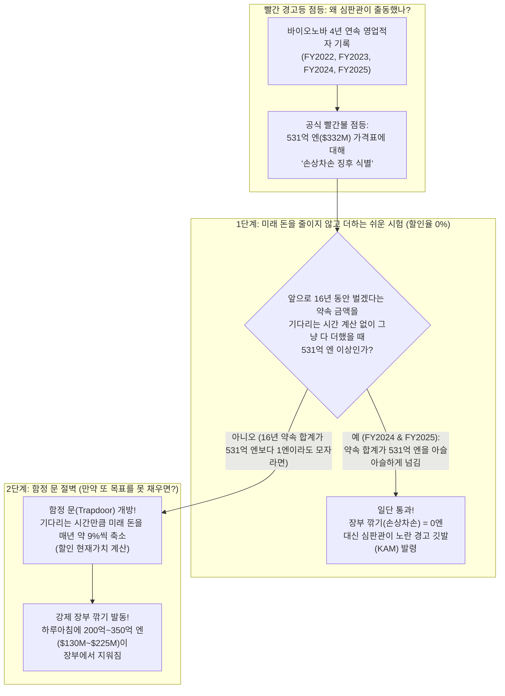
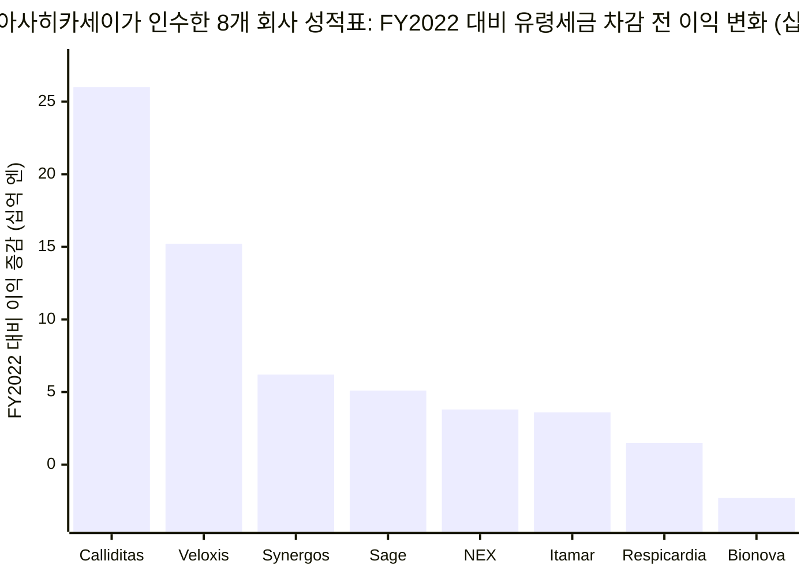
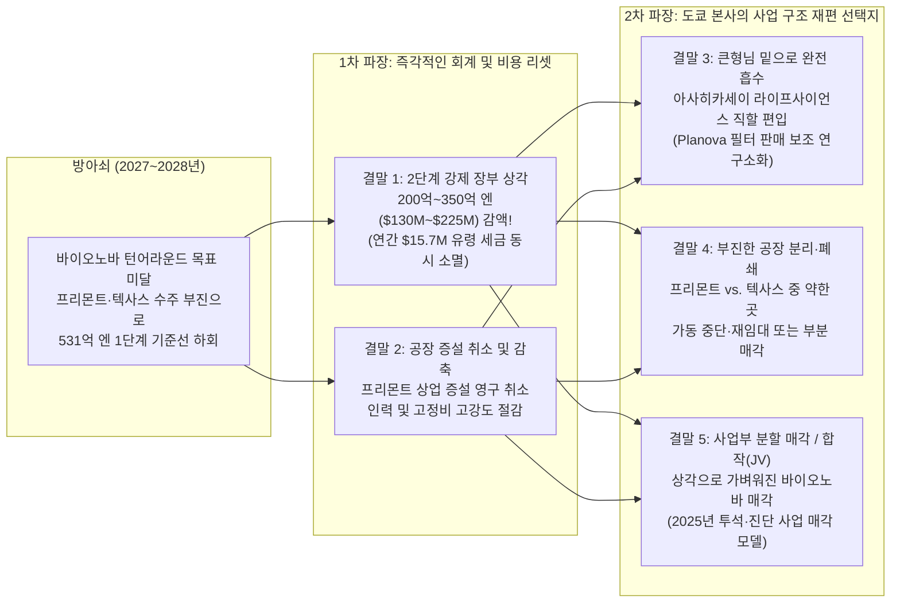

## 1. 탐정의 첫 질문: 3억 2,100만 달러를 주고 산 '맞춤형 약 주방'이 계속 적자를 내면 무슨 일이 벌어질까요?

상상해 보세요. 부모님이 여러분에게 **3억 2,100만 달러(한화 약 4,400억 원)**—새 노란색 **스쿨버스를 1,000대 넘게** 살 수 있는 어마어마한 돈—를 주시면서 미국 캘리포니아에서 가장 인기 있는 '맞춤형 케이크 베이커리'를 사라고 하셨습니다.

기쁜 마음으로 돈을 지불하고 베이커리 문을 열어보니 깜짝 놀랄 사실이 밝혀집니다. 가게 안에 있는 실제 오븐, 냉장고, 반죽 기계의 진짜 가격은 겨우 **2,758만 달러(스쿨버스 약 86대 가격)**뿐이었던 겁니다! 나머지 **3억 1,462만 달러**—여러분들이 낸 돈 **100달러 중 무려 98달러**—는 기계값이 아니라 *"이 가게 앞에는 케이크를 주문하려는 동네 친구들이 줄을 서 있으니까 앞으로 돈을 엄청 많이 벌 거예요!"*라는 **'인기 프리미엄 스티커(영업권)'** 값이었습니다.

그런데 얼마 지나지 않아 동네 친구들의 용돈이 똑 떨어졌습니다. 가게 앞 줄이 싹 사라졌죠. 결국 여러분의 비싼 베이커리는 **4년 연속으로 매년 적자**를 냈습니다. 설상가상으로 엄격한 규칙 심판관(회계감사인)들이 **2년 연속 노란색 경고 깃발**을 들고 찾아와 이렇게 경고합니다. *"만약 이 베이커리가 조만간 약속한 만큼 돈을 벌지 못하면, 영수증에 붙어 있는 3억 1,462만 달러짜리 '인기 스티커'를 찢어버리고 그 돈이 날아갔다고 공식 발표해야 합니다!"*

이 이야기는 지어낸 동화가 아닙니다. 기업 가치가 **260억 달러(약 4조 1,000억 엔)**가 넘는 일본의 거대 기업 **아사히카세이(`Asahi Kasei Corporation`, 도쿄증권거래소 `3407`)**와, 이 회사가 **2022년 5월 31일** **428억 8,200만 엔(3억 2,112만 달러)**을 주고 인수한 미국 캘리포니아·텍사스 소재 맞춤형 약 제조 공장 **바이오노바 사이언티픽(`Bionova Scientific, LLC`)** 사이에서 지금 실제로 벌어지고 있는 일입니다([FY2022 감사 연결재무제표, 주석 16(a), 44–45쪽](https://www.asahi-kasei.com/content/dam/asahi-kasei/us/en/ir/library/financial-briefing/pdf/2303statements.pdf)).

**2025년 6월**과 **2026년 6월** 두 해 연속으로, 아사히카세이의 외부 회계 심판관인 **PwC 재팬(`PricewaterhouseCoopers Japan LLC`)**은 바이오노바에 **핵심감사사항(`KAM, Key Audit Matter`)**이라는 공식 특별 경고등을 켰습니다([FY2025 감사 연결재무제표, 4–5, 14쪽](https://www.asahi-kasei.com/content/dam/asahi-kasei/us/en/ir/library/financial-briefing/pdf/2603statements.pdf)). 그리고 **2026년 4월부터 11월** 사이, 아사히카세이는 발표자료에서 바이오노바를 '확장(expansion)' 단계라고 부르던 설명을 지우고 ***"바이오노바(CDMO)의 기초 체력 강화 및 전략 재구성"***이라는 문구로 바꾸었습니다([H1 FY2026 반기 보충자료, 30쪽](https://www.asahi-kasei.com/content/dam/asahi-kasei/us/en/ir/library/financial-briefing/pdf/2609supplement.pdf)).

여기서 가장 중요한 탐정의 질문이 등장합니다. **만약 바이오노바 사이언티픽이 충분히 빠른 시간 안에 실적을 회복하지 못하면, 그다음에는 실제로 어떤 일들이 벌어질까요?** 회사가 당장 파산할까요? 심판관들이 강제로 장부 가격을 깎아버릴까요? 도쿄 본사가 공장을 닫거나, 더 큰 형님 부서 속으로 합쳐버리거나, 아니면 다른 회사에 팔아버릴까요?

탐정 수첩을 펼쳐 보세요. 지금부터 초등학교 5학년도 월스트리트 전문가처럼 **5가지 가능한 결말**을 완벽하게 예측할 수 있도록 밑바닥부터 하나씩 조립해 보겠습니다.

---

## 2. 기초부터 차근차근: 거대한 수프 탱크, 3억 1,400만 달러짜리 '인기 스티커', 그리고 16년 숫자 더하기 마술

문제가 터졌을 때 어떤 결말이 찾아올지 알기 위해서는 먼저 세 가지 기본 퍼즐 조각을 이해해야 합니다. **바이오노바가 무엇을 만드는 곳인지**, **왜 매년 적자가 나는지**, 그리고 **지금까지 어떤 회계 규칙이 바이오노바를 지켜주었는지**입니다.

### 퍼즐 조각 #1: 돈을 받고 빌려주는 '전문 약 주방'이란 무엇일까요? (`CDMO`)

어떤 똑똑한 과학자 팀이 암이나 희귀병을 고치는 새로운 약 조리법(레시피)을 발명했다고 해봅시다. 실험실 책상 위에서 작은 시험관 하나 분량의 약을 섞는 건 어렵지 않습니다.

하지만 병원에 있는 환자 수천 명에게 주사할 수 있도록 **티끌 하나 없이 깨끗한 약 10,000병**을 만들려면 어떻게 해야 할까요? 거대한 무균 약 공장을 직접 짓는 데는 수백억 원의 돈과 수년의 안전 검사 기간이 필요합니다. 작은 바이오 스타트업들은 공장을 지을 돈도, 시간도 없습니다.

그래서 작은 약 개발 회사들은 **거대한 전문 약 주방을 빌려서** 그 안의 요리사들에게 돈을 주고 약을 대신 끓여 달라고 맡깁니다! 어른들은 이렇게 약을 대신 개발하고 만들어 주는 전문 주방 회사를 **CDMO**(**위탁개발생산 기업**)라고 부릅니다.

바이오노바 사이언티픽은 미국에서 두 곳의 약 주방을 운영하고 있습니다.
1. **캘리포니아 프리몬트(Fremont) 주방 (항체 수프 탱크):** 최대 `2,000리터`(콜라 캔 약 **5,600개**가 들어가는 크기)짜리 거대한 통 안에서 살아있는 세포를 키워 **단일클론항체**라는 복잡한 단백질 약을 끓여냅니다.
2. **텍사스 더 우들랜즈(The Woodlands) 주방 (유전자 설계도 고리):** 농구 코트 약 **2개 크기(`10,000 평방피트`)**의 새 건물에서 착한 대장균을 키워 유전자 치료제의 핵심 재료가 되는 작은 원형 DNA 고리, 즉 **플라스미드 DNA(`pDNA`)**를 찍어냅니다.

### 퍼즐 조각 #2: 3억 1,462만 달러짜리 '인기 스티커'(`영업권`)와 매년 빠져나가는 '유령 세금'

2022년 5월 31일 아사히카세이가 바이오노바를 **428억 8,200만 엔(3억 2,112만 달러)**에 샀을 때, 왜 빚을 뺀 실제 기계와 장비 값(`순유형자산`)은 겨우 **36억 8,300만 엔(2,758만 달러)**밖에 안 되었을까요?

2021년과 2022년 초에는 바이오 스타트업들에 투자금이 폭포수처럼 쏟아지던 시절이라, 약 주방의 빈 가스레인지를 차지하려는 줄이 엄청나게 길었기 때문입니다. 아사히카세이는 바이오노바의 미래 인기와 단골 명단을 보고 **3억 1,462만 달러(`420억 1,400만 엔`, 전체 인수가의 98.0%)**의 웃돈을 얹어 주었습니다. 회계사들은 이 웃돈을 장부 위의 두 가지 보이지 않는 통장에 나누어 적었습니다([FY2022 감사보고서, 주석 16(a), 44쪽](https://www.asahi-kasei.com/content/dam/asahi-kasei/us/en/ir/library/financial-briefing/pdf/2303statements.pdf)).
* **고객관계 무형자산 (`Customer Relationships`):** 기존 단골 고객 명단의 가치 **65억 5,900만 엔(4,912만 달러)**.
* **영업권 (`Goodwill`):** 그 외에 순수하게 더 얹어준 '인기 프리미엄 스티커' **354억 5,500만 엔(2억 6,550만 달러)**.

그런데 여기에 무서운 함정이 숨어 있습니다! **일본 회계 규칙(`J-GAAP`)**에서는 이 3억 1,462만 달러짜리 인기 스티커를 선반 위에 그냥 두지 못하게 합니다. 반드시 **20등분으로 똑같이 잘라서**, 매년 한 조각씩(`$314.62M ÷ 20년 = 연간 1,573만 달러`, 엔화로 **매년 약 24억~25억 엔**)을 바이오노바의 한 해 영업이익 성적표에서 무조건 깎아야 합니다!

매년 빠져나가는 이 **1,573만 달러(스쿨버스 약 50대 값)**를 **'유령 세금'(`PPA 상각비`)**이라고 생각해 보세요. 바이오노바가 손님들에게 돈을 받아 과학자 월급, 전기세, 건물 월세를 다 내고도 남겼더라도, **1년에 1,573만 달러 이상의 추가 이익**을 남기지 못하면 성적표에는 무조건 **'영업적자(손실)'**가 찍힙니다! 2023년, 2024년, 2025년에 바이오 스타트업들의 지갑이 닫히자 바이오노바는 이 유령 세금을 이기지 못하고 **4년 연속(`FY2022`~`FY2025`) 영업적자**를 기록했습니다.

### 퍼즐 조각 #3: 16년치 미래 돈을 줄이지 않고 더하는 '1단계 마술' (`J-GAAP Step 1`)

2026년 3월 31일(`FY2025`) 기준, 캘리포니아와 텍사스 공장에 새 기계를 들이고 달러 대비 엔화 가치가 떨어지면서 아사히카세이 장부에 적힌 바이오노바의 총 가격표(`장부가액`)는 **531억 800만 엔(3억 3,213만 달러)**까지 커졌습니다([FY2025 감사보고서, 주석 3(c), 14쪽](https://www.asahi-kasei.com/content/dam/asahi-kasei/us/en/ir/library/financial-briefing/pdf/2603statements.pdf)).

자회사가 여러 해 연속으로 적자를 내자 일본 회계 규칙에 따라 **손상차손 징후(`減損の兆候`)**라는 빨간 경고등이 켜졌고, 외부 심판관인 **PwC 재팬**의 감시 아래 **2단계 시험**을 치르게 되었습니다.

---

## 3. 비밀 해독 반지: 어른들의 어려운 회계·바이오 용어 번역기

바이오노바가 살아나지 못할 때 벌어질 5가지 결말을 살펴보기 전에, 아사히카세이 보고서에 나오는 무서운 어른 말들을 단번에 꿰뚫어 볼 수 있는 **비밀 해독 반지**를 먼저 끼워 드립니다.

| 어른들의 전문 용어 / 약어 | 쉬운 우리말로 진짜 뜻은? | 초등학교 5학년 일상 비유 |
| :--- | :--- | :--- |
| **CDMO (위탁개발생산 기업)** | 다른 약 회사들의 주문을 받아 무균 실험실과 거대한 배양 탱크에서 약을 대신 개발하고 끓여 주는 공장. | 큰 오븐이 없는 동네 과자 브랜드들을 위해 쿠키를 대신 구워 포장해 주는 대형 전문 베이커리 공장. |
| **영업권(`Goodwill`) & PPA 상각** | 회사를 살 때 실제 기계값보다 더 얹어준 '인기 프리미엄'(`영업권`)으로, 일본 규칙상 20년 동안 똑같이 나누어 매년 이익에서 빼야 하는 비용(`PPA 상각`). | 1만 원짜리 레고 세트가 인기 많다고 10만 원에 산 뒤, 부모님이 20년 동안 매년 용돈 성적표에서 4,500원씩 깎는 규칙. |
| **손상차손 징후 (`Impairment Indicator`)** | 자회사가 2년 이상 연속 적자를 낼 때 일본 회계 규칙에 따라 의무적으로 울리는 위험 경보음. | 주방에서 2년 내내 탄 식빵만 나오자 복도 천장의 연기 감지기가 삐삐 울리기 시작하는 것. |
| **핵심감사사항 (`KAM, Key Audit Matter`)** | 독립 회계 심판관(`PwC 재팬`)이 감사보고서 맨 앞에 따로 박스를 만들어 *"이 숫자는 회사 전체에서 가장 위험해서 돋보기로 감시 중입니다"*라고 투자자에게 알리는 경고장. | 교장 선생님이 성적표의 특정 과목에 빨간 매직으로 동그라미를 치고 *"이번 학기에 이 과목 점수를 특별 감시하겠음"*이라고 적어 놓은 것. |
| **비할인 vs. 할인 현금흐름 (`1단계 vs. 2단계`)** | *비할인(`1단계`)*은 15년 뒤에 받을 1만 원도 오늘의 1만 원과 똑같이 쳐주는 것. *할인(`2단계`)*은 15년이나 기다려야 하고 못 받을 위험도 있으니 오늘 가치로는 훨씬 작게 줄여서 계산하는 것. | *비할인*은 "15년 뒤에 아이스크림 10개 줄게"라는 약속을 오늘의 아이스크림 10개와 똑같이 세는 것; *할인*은 15년 뒤 약속은 오늘의 아이스크림 2개 가치밖에 안 된다고 깎는 것. |
| **손상차손 / 감액 (`Write-Down / Impairment Loss`)** | 회계 심판관이 장부에 너무 비싸게 적혀 있는 자산 가격표를 검은 매직으로 지우고, 깎인 금액만큼을 한 번에 큰 손실로 기록하게 강제하는 것. | 장난감 상자에 붙은 '3억 3,200만 달러' 스티커를 긋고 '1억 3,000만 달러'로 고쳐 쓴 뒤, '-2억 200만 달러 벌점'을 받는 것. |
| **법인 분할 / 링펜싱 (`Carve-Out / Ring-Fencing`)** | 문제가 생긴 부서를 별도의 독립된 회사 상자에 따로 담아 다른 우량 부서로 불똥이 튀지 않게 막고, 나중에 팔기 쉽게 만드는 작업. | 거실에서 연기가 나는 과학 실험 세트를 뒷마당의 별도 창고로 옮겨 문을 따로 달아 두는 것. |

---

## 4. 회사의 주장 vs. 탐정의 팩트체크: 왜 '1단계 함정 문'이 코앞까지 다가왔을까?

2025년 7월, 도쿄의 한 투자자가 아사히카세이 헬스케어 총괄 임원인 **나카노 세이지(Seiji Nakano)**에게 바이오노바의 장부 가치를 깎아야 할 위험이 있는지 묻자, 나카노 임원은 이렇게 답했습니다([Q1 FY2025 Q&A 요약본, 2쪽](https://www.asahi-kasei.com/content/dam/asahi-kasei/us/en/ir/library/financial-briefing/pdf/2506summary.pdf)).

> *"현시점에서는 어떠한 손상차손도 예상하지 않고 있습니다. 당사는 중기 계획을 지속적으로 재검토하고 회계감사인과 적절한 검증을 수행해 나갈 것입니다."*

왜 PwC 재팬 심판관들은 **2025년 6월(`FY2024`)**과 **2026년 6월(`FY2025`)** 두 번이나 장부를 깎지 않고 `1단계` 통과를 허락해 주었을까요? 아사히카세이 경영진이 다음 세 가지 대역전극을 약속하는 사업계획서를 제출했기 때문입니다([FY2025 감사보고서, 주석 3(c), 14쪽](https://www.asahi-kasei.com/content/dam/asahi-kasei/us/en/ir/library/financial-briefing/pdf/2603statements.pdf)).
1. 앞으로 새로운 바이오 스타트업 손님들을 많이 데려오겠습니다.
2. 캘리포니아 프리몬트 공장의 항체 약 제조 계약이 빠르게 늘어날 것입니다.
3. 텍사스에 새로 문을 연 플라스미드 DNA(`pDNA`) 주방에서 매출이 쑥쑥 나올 것입니다.

### 탐정의 돋보기가 2026년 서류에서 찾아낸 3가지 결정적 단서

하지만 **2026년 4월 15일 경영설명회 슬라이드**([e260415en.pdf](https://www.asahi-kasei.com/content/dam/asahi-kasei/us/en/ir/library/initiative/pdf/e260415en.pdf))와 **2026년 11월 반기 보고서**([2609supplement.pdf](https://www.asahi-kasei.com/content/dam/asahi-kasei/us/en/ir/library/financial-briefing/pdf/2609supplement.pdf))를 열어보면, 왜 이 약속의 유효기간이 끝나가고 있는지 알 수 있습니다.

* **단서 #1 — 아사히카세이가 산 8개 회사 중 바이오노바만 유일하게 마이너스입니다:** 2026년 4월 15일 발표자료 슬라이드 16에는 아사히카세이가 최근 인수한 **8개 회사**(`Calliditas`, `Veloxis`, `Synergos`, `Sage`, `NEX`, `Itamar`, `Respicardia`, `Bionova`)의 성적표가 나와 있습니다. 매년 빠져나가는 유령 세금(`PPA 상각비`)을 다시 더해주고 계산했는데도, **8개 중 7개 회사는 FY2022보다 이익이 늘어난 반면 오직 바이오노바 단 한 곳만 3년 내내 0 아래(`약 -23억 엔`)에 머물렀습니다!**
* **단서 #2 — PwC 재팬이 '과거 약속 대 실제 성적'을 대조하기 시작했습니다:** FY2025 감사보고서 4쪽([2603statements.pdf](https://www.asahi-kasei.com/content/dam/asahi-kasei/us/en/ir/library/financial-briefing/pdf/2603statements.pdf))에서 PwC 재팬은 ***"과거 사업계획과 실제 실적을 비교하였으며, 실제 실적이 사업계획에 미달한 경우 그 원인을 평가했다"***고 적었습니다. 쉽게 말해 선생님께 2년 연속 *"다음 시험엔 꼭 100점 맞을게요!"*라고 약속해 놓고 계속 50점을 받아 오면, 3년째에는 선생님이 더 이상 그 약속을 믿어주지 않는 것과 같습니다!
* **단서 #3 — 아사히카세이는 이미 다른 미국 자회사에서 초대형 장부 깎기를 당한 적이 있습니다:** 바이오노바가 적힌 똑같은 페이지(14쪽) 바로 위 문단(`주석 3(b)`)에는 아사히카세이의 미국 배터리 분리막 자회사 **폴리포어(`Polypore International, LLC`)** 이야기가 나옵니다. 폴리포어가 FY2022에 약속한 계획을 지키지 못하자, 심판관들은 단 한 번에 **1,863억 7,600만 엔(약 14억 달러 — 스쿨버스 4,600대 값!)**의 장부 가치를 지워버렸습니다!

---

## 5. 다섯 가지 가능한 결말: 바이오노바가 제때 살아나지 못하면 실제로 무슨 일이 벌어질까요?

만약 이번 회계연도가 끝나는 **2027년 3월 31일(`FY2026`)**—또는 그다음 해인 **2028년 3월 31일(`FY2027`)**—이 되었는데도 캘리포니아와 텍사스 주방에 손님이 충분히 차지 않는다면 어떻게 될까요?

먼저 오해 하나를 바로잡겠습니다. **바이오노바가 내일 당장 전기세를 못 내서 문을 닫는 '부도(파산)'가 나지는 않습니다.** 모기업인 아사히카세이는 총자산이 **4조 1,000억 엔(260억 달러 이상)**에 달하는 거대한 부자 회사이기 때문입니다. 대신 거대 일본 모기업 밑에 있는 미국 자회사가 목표를 달성하지 못하면, 다음 **5가지 실제 결말**이 도미노처럼 차례대로 찾아옵니다!

### 결말 #1: '2단계 함정 문' 개방 — 200억~350억 엔(1.3억~2.25억 달러) 강제 장부 상각 (그리고 기묘한 이익 역설!)

바이오노바가 올해 또 매출과 이익 목표를 놓치면, PwC 재팬 심판관들은 아사히카세이 경영진에게 이렇게 말할 것입니다. *"앞으로 16년 동안 531억 엔 넘게 벌겠다는 계획은 너무 장밋빛입니다. 미래 예상치를 깎으세요."*

예상치를 단 **10%**만 깎아도 어떤 수학적 절벽이 나타나는지 보십시오.
* **깎기 전 (`1단계 통과`):** 경영진이 16년 동안 총 **555억 엔**(`1년 차 0엔`에서 시작해 `5~16년 차에 매년 40억 엔`)을 벌겠다고 약속하면, 장부 가격표인 `531억 엔`보다 크므로 손상차손은 **0엔**입니다.
* **10% 깎은 후 (`1단계 탈락 -> 2단계 함정 문 개방`):** 심판관이 이 계획을 딱 **10%**만 줄여서 16년 합계가 **499.5억 엔**이 되면, `531억 엔` 밑으로 떨어집니다. 일본 회계 규칙에서는 모자란 차이(`531억 - 499.5억 = 31.5억 엔`)만 깎는 게 **아닙니다**! 즉시 **2단계** 함정 문이 열리면서, 먼 미래에 받을 돈을 기다리는 시간만큼 **매년 약 9%씩 축소(`할인 현재가치`)**해서 다시 계산합니다. `499.5억 엔`을 16년에 걸쳐 매년 `9%`씩 줄이면 오늘의 진짜 가치는 약 **234억 엔**으로 쪼그라듭니다!
* **거대한 지우개 등장:** 아사히카세이는 즉시 차액인 **약 297억 엔(약 1억 8,600만 달러)**—넓게는 **200억 엔에서 350억 엔(1억 3,000만~2억 2,500만 달러)**—을 장부에서 지우고 한 번에 **특별손실(손상차손)**로 발표해야 합니다!

**잠깐—여기서 회계 세계의 가장 기묘한 반전 마술이 일어납니다!**
그렇게 거대한 장부 깎기를 당한 **다음 날부터**, 바이오노바의 매년 영업이익 성적표는 어떻게 바뀔까요? 놀랍게도 **성적표가 하루아침에 훨씬 좋아집니다!**
왜 그럴까요? 2022년에 붙였던 3억 1,462만 달러짜리 '인기 스티커(`영업권 및 고객 무형자산`)'를 쓰레기통에 버리고 나면, 매년 강제로 빼야 했던 **연간 1,573만 달러(`약 24억~25억 엔`)의 '유령 세금(`PPA 상각비`)'도 함께 사라지기 때문**입니다! 유령 세금이 사라지면 바이오노바는 지금보다 훨씬 적은 주문만 받아도 장부상 흑자를 낼 수 있게 됩니다.

### 결말 #2: '살아남기 위한 몸집 줄이기' — 캘리포니아 공장 증설 영구 취소 및 비용 삭감

장부를 깎기 전부터 모기업은 새 건물 공사를 멈추고 지출을 줄이는 '용돈 다이어트'에 들어갑니다. 사실 아사히카세이는 이미 2026년에 **결말 #2의 1단계**를 시작했습니다.
* 2026년 4월 15일 경영설명회 슬라이드 44([e260415en.pdf](https://www.asahi-kasei.com/content/dam/asahi-kasei/us/en/ir/library/initiative/pdf/e260415en.pdf))에서 도쿄 본사는 ***"투자 연기 및 고정비 절감(investment deferrals and fixed-cost reductions)"***을 공식 명령했습니다.
* 2026년 11월 투자 현황표([2609supplement.pdf, 49쪽](https://www.asahi-kasei.com/content/dam/asahi-kasei/us/en/ir/library/financial-briefing/pdf/2609supplement.pdf))에서는 **캘리포니아 프리몬트 공장 증설 완공 시점**을 원래의 `FY2025 이후`에서 **`FY2027 이후`**로 2년 이상 미루었고, **텍사스 GMP 플라스미드 DNA** 완공 시점도 `FY2025`에서 **`FY2026 이후`**로 늦추었습니다.

**만약 바이오노바가 그래도 살아나지 못한다면:**
1. 현재 `FY2027 이후`로 미뤄둔 프리몬트 상업용 공장 증설 계획은 아예 **영구 취소**됩니다. 기존 탱크도 다 못 채우는데 비싼 새 탱크를 지어 감가상각비를 늘릴 이유가 없기 때문입니다.
2. '고정비 절감'의 강도가 높아져 캘리포니아와 텍사스 현장의 **신규 채용 동결, 근무 교대조 축소, 인력 감축**으로 이어지며, 꼭 필요한 소규모 맞춤형 과제만 수행하는 작은 연구소 형태로 몸집이 줄어듭니다.

### 결말 #3: '우등생 큰형님 밑으로 흡수' — 독립성 상실 및 `아사히카세이 라이프사이언스` 내부 편입

현재 바이오노바는 2025년 4월 1일 새로 만들어진 모기업 자회사 **아사히카세이 라이프사이언스(`Asahi Kasei Life Science Corp.`)**([보도자료 `e250401`](https://www.asahi-kasei.com/news/2025/e250401)) 소속입니다. 바로 이 같은 지붕 아래에는 돈을 엄청나게 잘 버는 우등생 큰형님이 살고 있는데, 바로 약을 만들 때 바이러스를 걸러내는 초정밀 필터인 **플라노바(`Planova™`)** 사업부입니다.

바이오노바가 고전하던 2025~2026년에도 큰형님 **플라노바**는 날개 돋친 듯 팔리면서 `라이프사이언스` 부문 전체 매출을 FY2025 **554억 엔(약 3.67억 달러)**에서 FY2026 전망치 **670억 엔(약 4.32억 달러)**으로 끌어올렸습니다([2609supplement.pdf, 42쪽](https://www.asahi-kasei.com/content/dam/asahi-kasei/us/en/ir/library/financial-briefing/pdf/2609supplement.pdf)).

**만약 바이오노바가 독자적인 대형 CDMO로 성장하는 데 실패한다면:**
* 도쿄 본사는 바이오노바의 독립적인 투자 권한을 회수하고, 미국 현지 경영진 조직을 축소하여 영업·재무·엔지니어링 팀을 **아사히카세이 라이프사이언스** 본부 직할로 완전히 흡수할 수 있습니다.
* 바이오노바는 대형 CDMO들과 경쟁하는 대신, 아사히카세이의 진짜 효자 상품인 `Planova` 필터와 `ViruSure` / `Bionique` 안전성 검사 서비스를 더 많이 팔기 위한 **'작은 시범 주방(Test Kitchen) 겸 묶음 판매 보조 연구소'** 역할로 축소됩니다.

### 결말 #4: '장난감 상자 나누기' — 두 공장 중 부진한 한 곳 폐쇄 또는 전대(`프리몬트 vs. 텍사스`)

바이오노바는 서로 완전히 다른 두 개의 주방을 갖고 있습니다. **캘리포니아의 항체 수프 탱크(`프리몬트`)**와 **텍사스의 유전자 고리 공장(`더 우들랜즈`)**입니다.
2026년 들어 바이오노바는 큰돈을 들이지 않고 텍사스 공장을 채우기 위해 세 번 연속으로 외부 파트너십(`1월 Syenex`, `2월 Scarab Genomics`, `9월 Minaris`)을 맺었습니다.

**만약 두 공장 중 한 곳만 살아나고 다른 한 곳은 계속 텅 비어 있다면 어떻게 될까요?**
2021년 똑같은 버블 꼭대기에서 10억 달러 넘게 주고 CDMO 공장들(**Cobra Biologics**와 **Cognate BioServices**)을 샀던 경쟁사 **찰스리버 래보래토리스(`Charles River Laboratories, CRL`)**의 사례를 보면 답이 나옵니다. 유전자 치료제 주문이 마르자 찰스리버는 대규모 회계 상각을 단행한 뒤, 반쯤 비어 있는 모든 건물의 월세와 전기세를 계속 내는 대신 **실적이 나쁜 CDMO 공장을 폐쇄하거나 정리**했습니다. 만약 텍사스 플라스미드 공장이 끝내 안 차거나 반대로 프리몬트 노후 설비가 계속 놀게 된다면, 아사히카세이 역시 부진한 쪽 건물을 가동 중단(Mothball)하거나 다른 회사에 재임대(Sublease)·매각할 수 있습니다.

### 결말 #5: '뒷마당 창고 통째로 팔기' — 합작법인(JV) 전환 또는 제3자 매각(Divestiture)

과연 아사히카세이는 돈이 안 되는 헬스케어 사업을 과감하게 파는 회사일까요? **네—바로 2025년에만 두 번이나 그렇게 팔았습니다!**
* **2025년 4월**, 아사히카세이는 수익성이 낮아진 **혈액정화(인공신장 투석) 사업**을 떼어내어 매각했습니다([2603supplement.pdf, 41쪽](https://www.asahi-kasei.com/content/dam/asahi-kasei/us/en/ir/library/financial-briefing/pdf/2603supplement.pdf)).
* **2025년 7월**, 아사히카세이는 **진단시약(Diagnostics) 사업**도 떼어내어 매각했습니다.

그리고 아사히카세이가 **2025년 4월 1일**에 해놓은 작업을 다시 보십시오. 바이오노바를 기존 `아사히카세이 메디칼`에서 빼내어 별도 법인인 `아사히카세이 라이프사이언스` 밑으로 옮김으로써, 그룹의 진짜 보물인 **졸 메디칼(`ZOLL Medical`, 중증치료 부문, 연간 영업이익 `448억 엔`)** 및 **의약(Pharmaceuticals) 부문**과 법적으로 깔끔하게 칸막이(`링펜싱`)를 쳐 두었습니다.

지금 당장은 바이오노바의 장부 가격표가 **531억 엔(3억 3,200만 달러)**으로 너무 비싸서 아무도 사려 하지 않을 것입니다. **하지만 결말 #1(200억~350억 엔 장부 상각)이 먼저 실행되어 2022년의 거품 가격표가 지워지고 나면**, 바이오노바의 장부 가격은 실제 기계 설비 가치 근처(`약 8,000만~1억 2,000만 달러`)로 뚝 떨어집니다. 그 낮아진 가격표에서는 아사히카세이가 추가 손실 없이 사모펀드(PEF)나 더 큰 CDMO 회사에 바이오노바를 팔거나 합작법인(JV)으로 넘기기가 훨씬 쉬워집니다!

---

## 6. 숨겨진 함정: 왜 바이오노바가 살아나기 힘들고, 누가 진짜 피해를 입을까요?

훌륭한 탐정은 왜 반등이 어려운지 **4명의 용의자**를 심문하고, 회사가 전략을 바꿀 때 **누가 진짜 비용을 치르는지** 확인합니다.

### 바이오노바의 반등을 가로막는 4명의 용의자

| 용의자 | 어떻게 바이오노바의 반등을 가로막는가? | 1차 공시자료 증거 |
| :--- | :--- | :--- |
| **용의자 #1: 스타트업 저금통 가뭄 (문제의 45%)** | 바이오노바의 주 고객은 새 약을 실험하는 작은 바이오 스타트업들입니다. 2022~2025년 투자자들이 스타트업 지갑을 닫자 실험용 약 주문이 뚝 끊겼습니다. | 아사히카세이 주석 3(c)는 *"바이오텍 벤처 자금 유입 감소에 따른 수요 침체"*를 적자의 제1원인으로 지목했습니다. |
| **용의자 #2: '거인들에게는 너무 작은 냄비' 함정 (문제의 20%)** | 화이자, 일라이 릴리 같은 대형 제약사들은 지금도 수조 원어치 상업용 약을 만들고 있지만, 이들에게는 **10,000~20,000리터**짜리 거대한 탱크가 필요합니다. 바이오노바의 프리몬트 탱크(`최대 2,000L`)는 소규모 임상용이고, 증설 공사를 `FY2027 이후`로 미루면서 대형 상업 수주를 따낼 길이 막혔습니다. | [H1 FY2026 보충자료, 49쪽](https://www.asahi-kasei.com/content/dam/asahi-kasei/us/en/ir/library/financial-briefing/pdf/2609supplement.pdf)에서 프리몬트 증설 완공이 `FY2027 이후`로 연기된 사실이 확인됩니다. |
| **용의자 #3: 미국 전역에 너무 많이 지어진 빈 주방들 (문제의 25%)** | 2021~2022년 호황기에 수많은 경쟁 CDMO(`Catalent`, `Charles River`, `Aldevron`, `Lonza`, `Forge`)들이 동시에 항체 및 플라스미드 주방을 지었습니다. 지금은 손님보다 빈 주방이 훨씬 많아 가격 할인 경쟁이 벌어지고 있습니다. | 플라스미드 1위 기업 `Aldevron`(다나허가 96억 달러에 인수)조차 팬데믹 이후 고객 재고 조정으로 성장률이 급락했습니다. |
| **용의자 #4: 다이어트가 달리기를 늦추는 악순환 (문제의 10%)** | 현금을 아끼고 심판관(PwC)을 달래려고 도쿄 본사가 *"투자 연기 및 고정비 절감"*을 지시했지만, 새 기계 투자를 멈추고 예산을 깎으면 새 손님을 끌어오기가 더 힘들어집니다! | [2026년 4월 15일 경영설명회, 슬라이드 44](https://www.asahi-kasei.com/content/dam/asahi-kasei/us/en/ir/library/initiative/pdf/e260415en.pdf)는 매출 부진과 투자 연기·고정비 절감을 동시에 명시하고 있습니다. |

### 바이오노바가 살아나지 못하면 누가 가장 큰 피해를 입을까요?

1. **캘리포니아 프리몬트와 텍사스 현장의 엔지니어·연구원들:** 도쿄 본사 임원들이 발표자료에 *"투자 연기 및 고정비 절감"*이라는 점잖은 한 줄을 적을 때, 현장에서 실제로 그 무게를 견디는 사람들은 채용 동결, 예산 삭감, 증설 취소, 그리고 결말 #2·#4·#5에 따른 구조조정 위험에 놓인 140~200명의 현지 직원들입니다.
2. **더 큰 배양 탱크를 기대했던 초기 바이오벤처 고객사들:** 2025년이면 프리몬트에 상업용 대형 탱크가 완성될 줄 알고 바이오노바에 초기 약 개발을 맡겼던 스타트업들은 완공이 `FY2027 이후`로 밀리면서, 약 개발이 성공해 임상 3상으로 갈 때 다른 큰 CDMO로 조리법을 이사(기술이전)해야 하는 부담을 안게 되었습니다.
3. **아사히카세이 주주들과 2022년 인수를 결정한 경영진:** 2022년 시장 꼭대기에서 **인수가의 98%가 인기 스티커(영업권·무형자산)**였던 회사에 **3억 2,112만 달러**를 지출한 결정은, PwC 재팬이 **200억~350억 엔의 손상차손**을 강제하는 순간 뼈아픈 경영 성적표로 남게 됩니다(비록 상각 후 유령 세금이 사라져 미래 이익 숫자는 깔끔해지더라도 말입니다).

---

## 7. 탐정의 최종 성적표: "만약(If) ... 그렇다면(Then) ..." 법칙과 체육관 100명 확률표

지금까지 모은 모든 단서를 세 가지 명확한 **"만약 ... 그렇다면 ..."** 법칙과, **학교 체육관에 모인 100명의 아이들**로 세어 볼 수 있는 최종 확률 성적표로 정리해 봅니다.

* **만약(IF)** 바이오노바가 2026년에 맺은 3건의 텍사스 플라스미드 DNA 파트너십(`Syenex`, `Scarab Genomics`, `Minaris`)이 **2027년 3월 31일** 전까지 실제 돈이 들어오는 GMP 생산 계약으로 이어지고, 비용 절감으로 프리몬트의 적자를 절반 이상 줄인다면, **그렇다면(THEN)** 아사히카세이는 3년 연속으로 `1단계` 16년 더하기 시험을 아슬아슬하게 통과할 것입니다(`결말 #2 + #3`: 비용 다이어트와 `아사히카세이 라이프사이언스` 내부 통제는 계속되지만, 2027년 6월 장부 상각은 0엔).
* **만약(IF)** 프리몬트와 텍사스의 주문량이 이번 `FY2026`(2027년 3월 31일 종료)에도 경영진의 약속에 미치지 못한다면, **그렇다면(THEN)** PwC 재팬은 16년 미래 현금 전망치를 **531억 엔** 아래로 깎도록 강제할 것이고, 즉시 `2단계` 함정 문이 열릴 것입니다(`결말 #1 + #2`: **200억~350억 엔 / 1.3억~2.25억 달러 강제 장부 상각**, 프리몬트 증설 영구 취소, 그리고 연간 1,573만 달러 유령 세금 소멸).
* **만약(IF)** 대규모 장부 상각으로 유령 세금을 없애준 **뒤에도** 바이오노바가 스스로 돈을 벌지 못한다면, **그렇다면(THEN)** 도쿄 본사는 `결말 #4` 또는 `결말 #5`의 버튼을 누를 것입니다—비어 있는 건물을 닫거나, 2025년 투석·진단 사업을 팔았던 것처럼 낮아진 장부가격에 맞추어 바이오노바를 사모펀드나 다른 CDMO에 매각할 것입니다.

### 학교 체육관 100명 확률 성적표 (FY2026~FY2027 향후 1~2년 전망)

학교 체육관에 **100명의 아이들**이 서 있고, 한 명 한 명이 앞으로 1~2년 동안 바이오노바 사이언티픽에 일어날 수 있는 **100가지 가능한 미래**를 나타낸다고 상상해 보세요.

| 결말 경로 | 체육관 100명 중 몇 명? (`확률`) | 아사히카세이 장부(대차대조표)에는 무슨 일이? | 캘리포니아와 텍사스 공장 안에서는 무슨 일이? |
| :--- | :--- | :--- | :--- |
| **경로 A: 함정 문 상각 발동 + 영구 몸집 줄이기 (`결말 #1, #2, #3 결합`)** | **100명 중 55명 (`55% — 가장 유력한 결말`)** | PwC 재팬이 **200억~350억 엔($130M~$225M) 2단계 강제 손상차손** 명령; 대신 매년 빠지던 `$15.73M` 유령 세금이 사라져 이후 성적표는 가벼워짐. | 연기됐던 프리몬트 상업 증설은 영구 취소 또는 대폭 축소; 바이오노바는 `아사히카세이 라이프사이언스` 직할의 소규모 특화 연구소로 재편됨. |
| **경로 B: 허리띠 졸라매고 3년 연속 '턱걸이 통과' (`상각 없이 결말 #2 & #3 진행`)** | **100명 중 20명 (`20% — 현상유지 버티기`)** | 비용 절감과 텍사스 pDNA 초기 계약 덕분에 16년 약속 합계가 `531억 엔`을 `1%~5%` 차이로 겨우 넘김; **FY2026 상각 0엔**, 하지만 PwC의 노란 경고 깃발(`KAM`)은 3년 연속 유지. | 엄격한 채용·지출 동결 지속; 바이오 스타트업 경기가 완전히 살아날 때까지 도쿄 본사의 깐깐한 예산 감시 아래 운영됨. |
| **경로 C: 장부 상각 후 공장 폐쇄 또는 제3자 매각 (`결말 #1 후 #4 또는 #5 실행`)** | **100명 중 10명 (`10% — 구조조정 / 매각 탈출`)** | `200억~350억 엔` 상각으로 바이오노바의 장부 가격표를 현실화한 뒤, 도쿄 본사가 CDMO 사업의 변동성이 너무 크다고 판단함. | 두 공장 중 부진한 곳을 폐쇄·재임대하거나, 2025년 혈액정화·진단 사업 매각처럼 바이오노바를 사모펀드나 대형 CDMO에 매각(또는 합작법인화). |
| **경로 D: 진짜 대역전극 성공 (`완전한 턴어라운드`)** | **100명 중 15명 (`15% — 최고의 깜짝 반전`)** | 바이오 스타트업 투자가 급반등하고 `Scarab` / `Minaris` / `Syenex` 제휴 물량이 쏟아져 유령 세금을 내고도 진짜 영업이익 흑자 달성! | PwC 재팬이 `KAM` 경고 깃발을 내림; 도쿄 본사가 `FY2027 이후`로 미뤄둔 프리몬트 증설 공사를 다시 허가하고 클린룸을 확장함. |

---

## 1차 원천 공시자료 및 탐정 증거물 색인

1. **아사히카세이 FY2022 상세 감사 연결재무제표 (2023년 3월 31일 종료):** 주석 16(a) (*Bionova Holdings, Inc. 인수 — 현금 인수가 428억 8,200만 엔, 영업권 354억 5,500만 엔, 고객 무형자산 65억 5,900만 엔*, 44–45쪽). [https://www.asahi-kasei.com/content/dam/asahi-kasei/us/en/ir/library/financial-briefing/pdf/2303statements.pdf](https://www.asahi-kasei.com/content/dam/asahi-kasei/us/en/ir/library/financial-briefing/pdf/2303statements.pdf)
2. **아사히카세이 FY2024 상세 감사 연결재무제표 (2025년 3월 31일 종료):** PwC 재팬 KAM 및 주석 3(c) (*장부가액 524억 300만 엔 및 손상차손 징후*, 4–6, 15쪽). [https://www.asahi-kasei.com/content/dam/asahi-kasei/us/en/ir/library/financial-briefing/pdf/2503statements.pdf](https://www.asahi-kasei.com/content/dam/asahi-kasei/us/en/ir/library/financial-briefing/pdf/2503statements.pdf)
3. **아사히카세이 FY2025 상세 감사 연결재무제표 (2026년 3월 31일 종료; 2026년 6월 24일 서명):** PwC 재팬 KAM (`과거 계획 대 실제 실적 미달 검증`, 4–5쪽), 주석 3(b) (*Polypore 1,863억 7,600만 엔 손상차손*, 14쪽), 주석 3(c) (*Bionova 장부가액 531억 800만 엔 / 3억 3,213만 달러*, 14쪽). [https://www.asahi-kasei.com/content/dam/asahi-kasei/us/en/ir/library/financial-briefing/pdf/2603statements.pdf](https://www.asahi-kasei.com/content/dam/asahi-kasei/us/en/ir/library/financial-briefing/pdf/2603statements.pdf)
4. **아사히카세이 중기경영계획 "Trailblaze Together" 경영설명회 발표자료 (2026년 4월 15일):** 슬라이드 16 (*8대 M&A 이익 성장 비교 차트*) 및 슬라이드 44 (*Bionova 투자 연기 및 고정비 절감*). [https://www.asahi-kasei.com/content/dam/asahi-kasei/us/en/ir/library/initiative/pdf/e260415en.pdf](https://www.asahi-kasei.com/content/dam/asahi-kasei/us/en/ir/library/initiative/pdf/e260415en.pdf)
5. **아사히카세이 결산 보충자료 및 Q&A 요약본 (`2025–2026`):**
   * `Q1 FY2025 Q&A 요약본` (2025년 7월 31일, 2쪽): [https://www.asahi-kasei.com/content/dam/asahi-kasei/us/en/ir/library/financial-briefing/pdf/2506summary.pdf](https://www.asahi-kasei.com/content/dam/asahi-kasei/us/en/ir/library/financial-briefing/pdf/2506summary.pdf)
   * `FY2025 결산 보충자료` (2026년 5월, 27, 41, 48쪽): [https://www.asahi-kasei.com/content/dam/asahi-kasei/us/en/ir/library/financial-briefing/pdf/2603supplement.pdf](https://www.asahi-kasei.com/content/dam/asahi-kasei/us/en/ir/library/financial-briefing/pdf/2603supplement.pdf)
   * `H1 FY2026 반기 보충자료` (2026년 11월, 30, 42, 49쪽): [https://www.asahi-kasei.com/content/dam/asahi-kasei/us/en/ir/library/financial-briefing/pdf/2609supplement.pdf](https://www.asahi-kasei.com/content/dam/asahi-kasei/us/en/ir/library/financial-briefing/pdf/2609supplement.pdf)
6. **법인 분할 및 2026년 플라스미드 DNA 파트너십 공식 발표:**
   * 아사히카세이 라이프사이언스 출범 (2025년 4월 1일): [https://www.asahi-kasei.com/news/2025/e250401](https://www.asahi-kasei.com/news/2025/e250401)
   * Syenex 제휴 (2026년 1월 8일): [https://bionovascientific.com/2026/01/08/bionova-scientific-and-syenex-forge-strategic-alliance-to-expand-access-to-high-quality-plasmid-dna-for-advanced-therapies/](https://bionovascientific.com/2026/01/08/bionova-scientific-and-syenex-forge-strategic-alliance-to-expand-access-to-high-quality-plasmid-dna-for-advanced-therapies/)
   * Scarab Genomics 독점 라이선스 (2026년 2월 4일): [https://bionovascientific.com/2026/02/04/scarab-genomics-and-bionova-enter-exclusive-licensing-partnership-to-advance-high-efficiency-plasmid-dna-production/](https://bionovascientific.com/2026/02/04/scarab-genomics-and-bionova-enter-exclusive-licensing-partnership-to-advance-high-efficiency-plasmid-dna-production/)
   * Minaris 공동 공급 파트너십 (2026년 9월 9일): [https://bionovascientific.com/2026/09/09/bionova-scientific-and-minaris-announce-partnership-to-accelerate-plasmid-dna-supply-for-cell-and-gene-therapy-manufacturing/](https://bionovascientific.com/2026/09/09/bionova-scientific-and-minaris-announce-partnership-to-accelerate-plasmid-dna-supply-for-cell-and-gene-therapy-manufacturing/)
