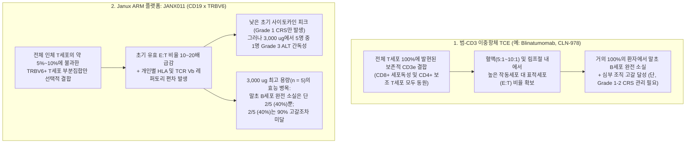
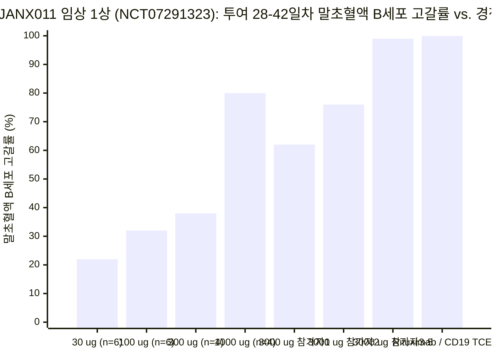
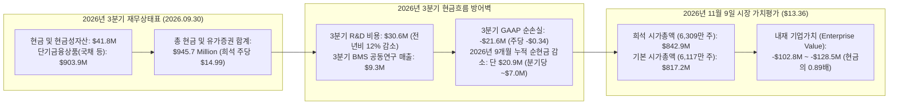

## 핵심 요약 및 쟁점 분류 (Issue Classification)

2026년 11월 9일 오전, **Janux Therapeutics, Inc.** (`NASDAQ: JANX`)는 건강한 성인 자원자 **25명**을 대상으로 진행한 임상 1상 단회 용량 증량(`SAD`) 시험([NCT07291323](https://clinicaltrials.gov/study/NCT07291323), `ARMV-011-001`)의 초기 임상 데이터를 발표했습니다. 평가 약물인 **JANX011**은 범(Pan)-`CD3` 대신 T세포 수용체 베타 사슬 가변 영역인 **TRBV6** 도메인만을 선택적으로 결합하도록 설계된 CD19 표적 **적응형 면역반응 조절제(`ARM`)** 이중항체 T세포 인게이저(`TCE`)입니다. 회사의 보도자료 헤드라인은 고무적이었습니다. 단 1회 **3,000 µg (`3.0 mg`)** 피하주사(`SC`)만으로 "과반수 참가자(a majority of participants)"에서 42일차까지 `90% 이상`의 말초혈액 B세포 고갈을 달성했으며, 사이토카인 방출 증후군(`CRS`)은 모두 경미한 **1등급(Grade 1)**에 그쳤고 용량제한독성(`DLT`)은 전혀 없었다는 발표였습니다.

그러나 장이 열리자마자 기관 투자자들은 `JANX` 주식을 대거 투매하며 전일 종가(**$17.63**) 대비 **24.22% (-$4.27)** 폭락한 **$13.36**(장중 최저가 **$12.43**)으로 끌어내렸습니다. 단 하루 만에 약 **2억 6,900만 달러**의 시가총액이 증발하면서, 희석 주식 수(`6,309만 주`) 기준 Janux의 진성 시가총액(**8억 4,290만 달러**)은 2026년 3분기 말 보유 현금 및 단기금융상품 잔고인 **9억 4,570만 달러**(주당 **$14.99**)보다 무려 **1억 280만 달러나 낮은 마이너스 기업가치(Negative EV)**로 추락했습니다.

바이오텍 투자자 Jing Liang(`@AppleHelix`)은 2026년 11월 9일 `JANX011` 발표 슬라이드를 인용하며 시장의 회의론을 다음과 같이 정확히 짚어냈습니다.

> *"`JANX` 데이터에 대한 회의론의 핵심은 다른 이중항체(`TCE`)들보다 B세포 고갈 능력이 더 뛰어나다는 점을 입증하지 못했다는 것입니다. 리툭시맙(Rituximab) 단 1회 투여만으로도 (비록 용량은 더 높지만) 동일한 수준의 말초혈액 B세포 고갈을 달성할 수 있습니다."*

**Browne & Keeley의 비판적 사고 프레임워크**를 적용하여 오늘의 25% 주가 폭락을 두 가지 독립된 분석 쟁점으로 분리합니다.

1. **기술적·면역학적 쟁점 (Descriptive Issue):** T세포 동원을 전체 T세포의 **약 5%~10%에 불과한 `TRBV6` 발현 T세포 부분집합**으로 제한하는 설계가, 균일하고 완전한 B세포 박멸에 필수적인 국소 작동세포 대 표적세포(`E:T`) 화학양론적 비율을 훼손했는가? 그리고 이것이 왜 최고 용량인 `3,000 µg` 코호트 **5명 중 단 2명(40%)**만이 말초혈액 B세포 검출 한계 미만(Undetectable)에 도달했는지를 설명해 주는가?
2. **가치평가 및 자본배분 쟁점 (Prescriptive Issue):** **9억 4,570만 달러의 현금**, 분기당 **930만 달러**의 브리스톨 마이어스 스큅(`BMS`) 공동연구 매출, 그리고 **분기당 약 700만 달러에 불과한 순현금 소진율**(2026년 첫 9개월간 총 현금 감소액 단 `$20.9M`)을 보유한 기업이 **$13.36**(현금의 `0.89배`, 기업가치 `-$102.8M`)에 거래될 때, 시장은 실패한 플랫폼을 합리적으로 가격에 반영하고 있는가, 아니면 전립선암 핵심 파이프라인인 `JANX007`(`PSMA-TRACTr`)과 현금 금고까지 과도하게 할인하고 있는가?

### 반증 가능성 기준 (Falsifiability Criteria)

* **`JANX011`에 대한 약세론이 반증되는 조건:** 2027년 개시될 자가면역 환자(`ITP` 및 `RA`) 임상에서 용량 증량(Step-up) 또는 다회 피하주사(`예: 1일차 + 8일차`)를 통해 **환자 100%에서 말초혈액 B세포 검출 한계 미만** 및 조직 생검 기준 `95% 이상`의 림프절/활막 B세포 고갈을 달성하면서, 동시에 Grade 2 이상 CRS와 반복적인 Grade 3 간효소(`ALT/AST`) 상승이 `0%`로 유지되는 경우.
* **`JANX011`에 대한 강세론이 반증되는 조건:** 용량을 높이거나 반복 투여하더라도 환자별 기저 세포독성 `CD8+ TRBV6+` T세포 빈도 차이로 인해 하위 `40%` 불완전 반응군을 해결하지 못하거나, `TRBV6+` T세포의 클론 증식과 함께 Grade 3 이상의 `ALT/AST` 간독성 및 Grade 2 이상 CRS가 발생하는 경우.

---

## 1차 문헌 교차 검증: 보도자료 헤드라인 vs. 발표 슬라이드 스파게티 플롯의 진실

2026년 11월 9일 공개된 Janux의 발표 슬라이드 그래프(`DOSE RESPONSE AND PERSISTENCE` 및 `3,000 µg | 2/5 subjects with undetectable`), [NCT07291323](https://clinicaltrials.gov/study/NCT07291323) 임상 프로토콜, 그리고 2026년 3분기 Form 10-Q 보고서(11월 5일 제출)를 정밀 대조하면, 낙관적인 보도자료 문구와 실제 임상 데이터 사이에 5가지 결정적 괴리가 드러납니다.

| 감사 항목 | 보도자료 공식 헤드라인 (2026년 11월 9일) | 발표 슬라이드 개별 환자 그래프, 프로토콜 및 공시 현실 |
| :--- | :--- | :--- |
| **`3,000 µg (3.0 mg)` 최고 용량군의 B세포 고갈 깊이 (`n = 5`)** | *"단 1회 3 mg 피하주사로 참가자 과반수에서 >90% 말초 B세포 고갈을 달성했으며, 검출 한계 미만의 말초 B세포 수준에 도달함."* | 우측 `3,000 µg`(`n = 5`) 개별 환자 스파게티 그래프 확인 결과, **"과반수"란 5명 중 3명(`60%`)**을 의미했으며, **검출 한계 미만(Undetectable)에 도달한 참가자는 5명 중 단 2명(`40%`)**에 불과함. 1번 참가자(`파란색 원`)는 2일차에 `-15%`로 반등한 뒤 28일차까지 **`-55%~-65%`** 수준에 머물렀고(70% 고갈조차 실패), 2번 참가자(`보라색 역삼각형`)는 3일차 `-88%` 도달 후 28일차에 **`-75%`**로 조기 반등함. |
| **3 mg 미만 저·중용량군의 지속성 (`30 µg` ~ `1,000 µg`, `n = 20`)** | *"지속적인 약리학: 25명의 건강인 자원자에서 42일차까지 용량 의존적 B세포 고갈 유지."* | 좌측 용량-반응 곡선(`n = 25`)에서 `30 µg(n = 6)`과 `100 µg(n = 6)`은 14일차에 이미 `-20%~-30%`로 복귀했고, `300 µg(n = 4)`은 3~7일차 `-90%` 찍은 후 **42일차에 `-35%`로 급반등**했으며, `1,000 µg(n = 4)` 역시 7일차 `-90%`에서 **42일차 `-80%`로 반등**함. |
| **말초혈액(전체 B세포의 `<2%`) vs. 림프절 조직 벤치마크** | 건강인의 말초혈액 B세포 감소를 자가면역질환에서의 "계열 내 최고(Best-in-class)" 질병 조절 잠재력의 증거로 제시. | 말초혈액에 존재하는 B세포는 **인체 전체 B세포의 `2% 미만`**임. 연속 인체 림프절 생검 연구(`Tur & Schett et al., ARD 2025`, [PMID: 39874224](https://pubmed.ncbi.nlm.nih.gov/39874224/) 및 [PMID: 40651933](https://pubmed.ncbi.nlm.nih.gov/40651933/))가 입증했듯, 구세대 **리툭시맙(`anti-CD20`)조차 거의 100%의 환자에서 말초혈액 B세포를 완전히 소실**시키지만 림프절 내부에는 `14%`의 잔존 B세포와 여포수지상세포 네트워크를 남겨 재발을 초래함. |
| **`3,000 µg`에서의 간효소(`ALT`) 상승 신호** | *"중대한 이상반응(SAE)이나 용량제한독성(DLT)이 없고 Grade 1 CRS만 관찰된 우수한 안전성 프로파일."* | 최고 용량인 `3,000 µg`(`n = 5`) 코호트에서 **5명 중 1명(`20%`)의 건강인에게서 Grade 3 ALT 간효소 상승** 및 Grade 2 ALT/AST 상승이 발생함. 간독성 기저 약물을 전혀 복용하지 않는 건강인에서 나타난 `20%`의 Grade 3 ALT 신호는 단회 피하주사 용량을 `3 mg` 이상으로 올리는 데 구조적 제약으로 작용함. |
| **자가면역 적응증 선택 및 임상 진입 타임라인** | *"2027년 상반기 면역성 혈소판 감소증(ITP), 2027년 하반기 류마티스 관절염(RA) 환자 임상 진입 계획."* | 2027년 상반기 첫 적응증으로 림프절/심부 조직 질환(`SLE`, `LN`, `SSc`) 대신 리툭시맙도 듣는 혈관 내/비장 질환인 `ITP`를 택하고, `RA` 진입을 **2027년 하반기**로 미룸으로써 경쟁 범-CD3/CD19 및 BCMA 이중항체(`CLN-978`, `blinatumomab` [[PMID: 38671240](https://pubmed.ncbi.nlm.nih.gov/38671240/)], `teclistamab` [[PMID: 39231353](https://pubmed.ncbi.nlm.nih.gov/39231353/)]) 대비 **18~30개월 뒤처진 타임라인**을 노출함. |

---

## 모호성 제거 및 플랫폼 성숙도 감사 (Ambiguity & Maturity Audit)

### 핵심 기업 주장에 대한 대체 테스트 (Substitution Test)

* **"참가자 과반수에서 >90% 고갈 달성 (Achieved >90% Depletion in a Majority of Participants)":** 임상 발표에서 "과반수(a majority)"라는 표현은 대다수 환자에서 일관된 효과가 나타난 것처럼 들립니다. 그러나 5명짜리 코호트(`n = 5`)에 **Browne & Keeley 대체 테스트**를 적용하면, "과반수"란 문자 그대로 **`5명 중 3명(60%)`**이며, 뒤집어 말하면 **`5명 중 2명(40%)은 말초혈액에서조차 90% B세포 고갈에 실패`**했고, **`5명 중 3명(60%)은 말초혈액 B세포 검출 한계 미만(Undetectable) 도달에 실패`**했다는 뜻입니다. 특허가 만료된 리툭시맙 정맥주사 1회만으로도 거의 `100%`의 환자에서 말초혈액 B세포가 검출 한계 미만(`>99%` 고갈)으로 사라지는 현실([PMID: 39874224](https://pubmed.ncbi.nlm.nih.gov/39874224/))에 비추어 볼 때, 최고 용량(`3,000 µg`)에서 말초혈액 완전 고갈률이 `40%`(`2/5`)에 그친 것은 효능 병목이지 혁신이 아닙니다.
* **"건강인 자원자에서 확인된 차별화된 시작 프로파일":** [NCT07291323](https://clinicaltrials.gov/study/NCT07291323) 선정 기준을 대입하면, 건강인 자원자(`18~65세`)는 기저 B세포 수치가 정상이고 림프절 염증이 없으며 `BAFF/BLyS` 생존 인자가 정상 수준이고 T세포 탈진이 없습니다. 반면 실제 자가면역 환자(`SLE`, `RA`, `SSc`)의 배아중심(Germinal center)에서는 B세포 생존 신호(`BAFF`, `APRIL`, `IL-6`, `IL-21`)가 폭발적으로 증가해 있으며, 환자의 T세포는 스테로이드와 면역억제제 복용으로 인해 감소하거나 기능이 저하되어 있습니다. **건강인의 60%(`3/5`)에서조차 말초혈액 B세포를 완전히 지우지 못한 용량(`3,000 µg`)**이 실제 류마티스 관절염 활막이나 루푸스 림프절 내부의 저항성 B세포를 뿌리 뽑기는 훨씬 더 어렵습니다.

### 4단계 파이프라인 및 임상 성숙도 스코어카드

| 파이프라인 및 플랫폼 | 표적 및 기전 | 적응증 및 임상시험 번호 | 임상 단계 및 현황 (2026년 11월) | 근거 등급 및 포렌식 상태 |
| :--- | :--- | :--- | :--- | :--- |
| **JANX011** (`ARM` 플랫폼) | `CD19 × TRBV6` (비마스킹 이중항체; `TRBV6+` T세포 부분집합 선택적 결합) | 건강인 자원자 (`FIH`) — [NCT07291323](https://clinicaltrials.gov/study/NCT07291323) (향후 `ITP` 2027 상반기, `RA` 2027 하반기 예정) | 임상 1상 SAD (`30 µg`~`3,000 µg` 피하주사 `25명` 투약; 목표 `N = 60`) | **Tier 2 (건강인 데이터만 존재):** `3,000 µg`에서 `3/5`(`60%`) `>90%` 고갈 및 **`2/5`(`40%`)만 검출 한계 미만** 도달; Grade ≥ 2 CRS `0%`; `1/5`(`20%`) Grade 3 ALT 발생; **실제 자가면역 환자 투약 0명**. |
| **JANX007** (`TRACTr` 플랫폼) | `PSMA × CD3` (종양 프로테아제 절단형 마스킹 이중항체) | 전이성 거세저항성 전립선암 (`mCRPC`) — [NCT05519449](https://clinicaltrials.gov/study/NCT05519449) | 임상 1b상 확장 코호트 (2022년 9월 개시; 목표 `N = 272`; 1차 완료 예정 `2027년 7월`) | **Tier 2 (임상 1b상 용량 최적화 장기화):** 초기 1a상에서 높은 PSA50/PSA90 반응률을 보였으나, 탁산 미경험(`Taxane-naive`) 확장군 및 다로루타마이드 병용군 최적화에 4년 이상 소요되며 3상 진입 지연. |
| **JANX013 + JANX007** (`TRACIr + TRACTr`) | `PSMA × CD28` 공자극 이중항체 + `PSMA × CD3` | `mCRPC` 병용요법 — [NCT07813637](https://clinicaltrials.gov/study/NCT07813637) | 임상 1상 모집 중 (2026년 개시) | **Tier 1/2 (초기 1상 병용):** `JANX007` 단독요법의 반응 지속성 한계를 마스킹된 `CD28` 공자극제 병용으로 극복할 수 있는지 탐색 중. |
| **JANX014** (`TRACTr` 플랫폼) | 차세대 `PSMA × CD3` 마스킹 이중항체 | `mCRPC` — [NCT07545811](https://clinicaltrials.gov/study/NCT07545811) | 임상 1상 모집 중 | **Tier 1/2 (초기 1상):** 후속/백업 PSMA 파이프라인. |
| **JANX008** (`TRACTr` 플랫폼) | `EGFR × CD3` (종양 프로테아제 절단형 마스킹 이중항체) | 진행성 고형암 (`CRC`, `NSCLC`, `SCCHN`, `RCC`) — [NCT05783622](https://clinicaltrials.gov/study/NCT05783622) | 임상 1상 (목표 `N = 130`, 모집 중단) | **Tier 2 — 개발 중단 (2026년 4월):** 고형암에서 경쟁력 있는 치료 창(Therapeutic window) 입증에 실패하여 2026년 2분기에 공식 개발 종료. |

---

## 기전적 해부: TRBV6 작동세포 대 표적세포(`E:T`) 화학양론의 함정

왜 Janux는 `JANX011`을 설계할 때 범(Pan)-**CD3ε** 대신 **TRBV6**(T세포 수용체 베타 사슬 가변 영역 6)를 표적하도록 만들었으며, 왜 바로 그 설계가 오늘 투자자들을 실망시킨 불완전한 B세포 고갈 곡선(`5명 중 2명만 완전 소실`)을 낳았을까요?

항암 파이프라인(`JANX007`)에서 Janux는 **TRACTr** 플랫폼을 사용합니다. 이는 범-`CD3` 이중항체에 펩타이드 마스크를 씌워 고형암 내부의 종양 특이적 프로테아제에 의해서만 마스크가 잘려 나가도록 한 구조입니다. 그러나 **자가면역질환 환자의 혈액, 비장, 림프절에 있는 B세포를 제거할 때는 종양 프로테아제 마스크를 사용할 수 없습니다.** 정상 혈액이나 림프절에는 종양 기질 금속단백분해효소(MMP)가 과발현되어 있지 않기 때문입니다!

전신 B세포 고갈을 위해 프로테아제 마스크를 포기해야만 했던 Janux는 대안으로 **ARM (`Adaptive Immune Response Modulator`)** 플랫폼(`JANX011`)을 고안했습니다. `CD3ε`을 통해 T세포의 `100%`를 깨우는 대신, T세포 수용체 베타 사슬이 **`TRBV6` 유전자 패밀리**를 사용하는 T세포 부분집합만을 선택적으로 끌어들이는 방식입니다.

### 화학양론적 수식 증명: 왜 10~20배 낮은 `E:T` 비율은 림프절 심부 조직에서 실패하는가?

특정 생리적 구획(말초혈액 vs. 이차 림프절 여포) 내 표적 `CD19+` B세포 농도를 `B₀`, 국소 총 T세포 농도를 `T_total`이라 합시다. 약물 농도 `C`에서 이중항체(`TCE`)에 의해 매개되는 순간 B세포 사멸 속도 `dB/dt`는 삼중 복합체(`T세포 – 약물 – B세포`) 형성률 `θ(C) ∈ [0, 1]`과 실제 세포독성 살상 능력을 갖춘 작동 T세포의 비율 `f_eff`에 의해 결정됩니다.

$$\frac{dB}{dt} = -k_{\text{kill}} \cdot \theta(C) \cdot \left(\frac{f_{\text{eff}} \cdot T_{\text{total}}}{B_0}\right) \cdot B(t)$$

여기서 `E:T_effective = (f_eff · T_total) / B₀`는 국소 조직에서의 **유효 작동세포 대 표적세포 비율(Effective Effector-to-Target Ratio)**입니다.

범-`CD3ε` 표적(`f_eff = 1.0`)에서 **`TRBV6` 부분집합 표적**(`f_eff = f_TRBV6 · f_CD8_EM ≈ 0.02 ~ 0.08`)으로 전환할 때 각 신체 구획에서 `E:T_effective`가 어떻게 붕괴하는지 살펴보십시오.

1. **말초혈액 구획 (인체 전체 B세포의 `2% 미만`):**
   * 건강한 성인의 말초혈액에서는 T세포가 B세포보다 약 `5:1`에서 `8:1`로 많습니다.
   * **범-CD3 이중항체**는 T세포의 `100%`를 동원하므로 압도적인 `E:T_blood ≈ 5:1 ~ 8:1` 비율을 확보하여 투여 몇 시간 만에 혈중 B세포의 `99% 이상`을 완전 소실시킵니다([PMID: 38671240](https://pubmed.ncbi.nlm.nih.gov/38671240/), [PMID: 40651933](https://pubmed.ncbi.nlm.nih.gov/40651933/)).
   * 반면 **`JANX011`(`TRBV6` 제한)**은 전체 T세포의 `약 5%~10%`만 결합하므로, 유효 `E:T_blood` 비율이 **10배에서 20배 급감**하여 `~0.25:1 ~ 0.8:1` 수준으로 떨어집니다. 설상가상으로, 모든 인간에서 100% 발현되는 `CD3ε`과 달리 각 개인의 `TRBV6+` T세포 비율과 그중 실제 그랜자임 B(Granzyme B)/퍼포린 무장력을 갖춘 **`CD8+` 작동기억 T세포(`T_EM`)의 비중은 개인의 HLA 유전자형과 과거 바이러스 감염력에 따라 사람마다 3~5배씩 차이**가 납니다! 만약 어떤 참가자의 `TRBV6+` T세포 풀이 세포독성 `CD8+ T_EM`이 아니라 미감작(Naive) `CD4+` T세포 위주로 구성되어 있다면, 아무리 `3,000 µg`의 약물을 주사해도 말초혈액 B세포 감소율이 **`-60%~-75%`에서 멈춰 서게 됩니다**—오늘 발표된 `3,000 µg` 코호트 5명 중 2명에서 나타난 현상이 바로 이것입니다!
2. **림프절 여포 및 염증 조직 심부 (인체 전체 B세포의 `98% 이상`):**
   * 림프절, 비장, 류마티스 활막의 B세포 여포(Follicle) 내부에서는 `CD19+` B세포가 빽빽하게 밀집해 있어 침투한 `CD8+` T세포보다 오히려 `10:1`에서 `50:1`로 많습니다(`E:T_total ≈ 0.02:1 ~ 0.1:1`).
   * `Tur & Schett et al.` 연구진이 *Annals of the Rheumatic Diseases*(2025년 12월, [PMID: 40651933](https://pubmed.ncbi.nlm.nih.gov/40651933/))에 발표한 연속 인체 서혜부 림프절 생검 연구에 따르면, **말초혈액에서 100% B세포 완전 고갈**을 달성한 단백질 기반 치료제들(리툭시맙, 오비누투주맙, 저용량 블리나투모맙)조차 **12명 중 11명(`91.7%`)의 환자에서 림프절 여포 구조를 파괴하지 못하고 잔존 B세포를 남겨** 질환 재발을 초래했습니다.
   * 그런데 `JANX011`처럼 동원 가능한 T세포를 `~5%~10%`의 `TRBV6+` 부분집합으로 제한해 버리면, 림프절 B세포 여포 내부의 유효 `E:T_node` 비율은 **`≈ 0.001:1 ~ 0.008:1` (즉, 작동 T세포 1개당 B세포 125개~1,000개)**로 추락합니다! `3,000 µg` 용량으로 건강인 5명 중 3명(`60%`)의 **말초혈액** B세포조차 완전히 지우지 못하는 약물이, T세포가 극도로 희박한 **림프절 배아중심**을 깨끗이 청소하기를 기대하는 것은 화학양론적 모순입니다.

---

## 필수 4자 인과관계 감사: 왜 `JANX`는 2026년 11월 9일 하루 만에 24.22% 폭락했는가?

**Browne & Keeley 제9장(경쟁 원인 분석)**에 따라 오늘 `JANX` 주가가 **$13.36**으로 급락한 네 가지 인과 가설을 검증합니다.

| 인과 가설 (Causal Hypothesis) | 인과 방향 | 기전적 경로 | 실증적 근거 및 포렌식 가중치 |
| :--- | :--- | :--- | :--- |
| **1. 직접적 임상 실망 (`JANX011`의 불완전한 효능 및 편차)** | `2/5만 완전 고갈 + 1/5 Grade 3 ALT → 기관 투매` | 기관 투자자들이 `3,000 µg`(`n = 5`) 개별 환자 그래프에서 단 `2/5`(`40%`)만 검출 한계 미만에 도달하고 `1/5`(`20%`)에서 Grade 3 ALT 간효소 상승이 발생한 것을 확인하며, `TRBV6`(`ARM`) 플랫폼이 범-`CD3` 이중항체나 리툭시맙보다 우월하다는 가설을 기각함. | **제1차 핵심 촉매 (가중치: ~55%):** `JANX011` 슬라이드 공개 직후 개장과 동시에 발생한 24% 갭하락을 직접적으로 설명함. |
| **2. 경쟁 벤치마크의 상향 평준화 (`Confounder Z`)** | `ACR 2026 경쟁 TCE 및 CAR-T 환자 데이터 → 높아진 시장 눈높이` | 2026년 11월은 **ACR Convergence 2026** 학회 주간으로, 경쟁 범-CD3 이중항체(`CLN-978`, `blinatumomab`, `teclistamab`)와 `CD19` CAR-T들이 실제 자가면역 *환자*에서의 깊은 조직 관해 데이터를 쏟아냄. 이 시점에 불완전한 건강인 혈액 데이터와 **2027년 `ITP`/`RA` 임상 개시** 일정을 발표한 것은 2년 이상의 경쟁 지연을 부각시킴. | **주요 구조적 교란 요인 (가중치: ~25%):** 2024년에는 "Grade 1 CRS + B세포 감소"만으로도 주가가 급등했으나, 2026년 11월 시장의 기준은 **100% 혈중 소실 + 환자 조직 리셋**으로 높아짐. |
| **3. 누적된 플랫폼 회의론 (`JANX008` 중단 및 `JANX007` 지연)** | `기존 항암 파이프라인 답보 → 신규 ARM 플랫폼에 대한 신뢰 프리미엄 소멸` | Janux는 **2026년 4월 `JANX008`(`EGFR-TRACTr`) 개발을 공식 중단**([NCT05783622](https://clinicaltrials.gov/study/NCT05783622))했으며, 핵심 자산인 전립선암 치료제 `JANX007`(`PSMA-TRACTr`, [NCT05519449](https://clinicaltrials.gov/study/NCT05519449))은 4년 넘게 임상 1/1b상 용량 최적화에 머물며 아직 3상에 진입하지 못함. | **맥락적 증폭 요인 (가중치: ~15%):** `JANX011`은 비마스킹(`ARM`) 구조라 마스킹된 `JANX007`(`TRACTr`)과 화학적 기전은 다르나, 경영진의 단백질 공학 설계 능력에 대한 프리미엄을 깎아내림. |
| **4. 상호 피드백 루프 (`마이너스 EV 가치 함정 역학`)** | `현금 가치 하회 주가 ↔ R&D 현금 소진에 대한 공포 매도` | 주가가 주당 현금(`$14.99`) 아래인 `$13.36`으로 깨지면, 퀀트 및 일반 펀드들은 경영진이 `$945.7M`의 현금을 주주에게 환원하지 않고 향후 5년간 비경쟁적 파이프라인(`JANX011`, `JANX013`, `JANX014`)에 소진할 것을 우려해 기계적 매도에 나섬. | **부차적 증폭 요인 (가중치: ~5%):** 단기 모멘텀 매도를 유발하나, Janux의 분기 순현금 소진액이 `~$7.0M`에 불과해 현금 증발 위험은 매우 낮음. |

---

## 재무 포렌식 감사: 9억 4,570만 달러의 현금 요새 vs. 8억 4,290만 달러의 시가총액

여기서 우리는 **Janux (`NASDAQ: JANX`)**와 앞서 분석한 일반적인 바이오텍 폭락 사례(예: 분기당 `$27.2M`을 태우는 Nkarta) 사이의 **가장 중대한 재무적 차이점**을 발견하게 됩니다. 현금 아래로 거래되는 대다수 바이오텍이 분기당 3,000만~5,000만 달러의 현금을 태우며 금고가 빠르게 녹아내리는 것과 달리, **Janux는 중형 바이오텍 중 가장 압도적인 현금 잔고와 가장 낮은 순현금 소진율(Net Cash Burn)을 보유하고 있습니다.**

2026년 11월 5일 공시된 **2026년 3분기 Form 10-Q 보고서**(2026년 9월 30일 마감)의 정확한 수치를 검증합니다.

### 핵심 재무 및 밸류에이션 지표 (2026년 11월 9일 기준)

| 재무 항목 | 2026년 3분기 공시 수치 (2026년 9월 30일 기준) | 주가 **$13.36** 기준 주당 가치 및 밸류에이션 영향 |
| :--- | :--- | :--- |
| **총 현금, 현금성자산 및 단기금융상품** | **9억 4,570만 달러 ($945.7M)** (현금 `$41.8M` + 단기투자자산 `$903.9M`; 2025년 12월 31일 `$966.6M` 대비) | 경제적 희석 주식(`6,309만 주`) 기준 **주당 $14.99** / 기본 보통주(`6,117만 주`) 기준 **주당 $15.46** |
| **2026년 9개월 누적 순현금 감소액 (`2025.12.31 → 2026.09.30`)** | 3개 분기 동안 **단 2,090만 달러 ($20.9M)** 감소 (**분기당 평균 약 697만 달러** 순현금 소진) | `$945.7M` 현금에서 발생하는 이자수익(`분기당 ~$10M–$11M`) + **BMS 공동연구 매출(3분기 `$9.3M`)**이 총 영업비용의 `60% 이상`을 상쇄함! |
| **2026년 3분기 R&D 비용 및 당기순손실** | R&D 비용 = **3,060만 달러** (전년 동기 `$34.6M` 대비 12% 감소); 3분기 GAAP 순손실 = **2,160만 달러** (`-$0.34/주`) | 극도로 낮은 분기 순현금 유출 덕분에 향후 추가 BMS 마일스톤 없이도 **8~10년 이상의 압도적인 자본 런웨이** 보유. |
| **주가 `$13.36` 기준 시가총액 및 기업가치(`EV`)** | 희석 시가총액 **8억 4,290만 달러** (`63,089,950주`) / 기본 시가총액 **8억 1,720만 달러** (`6,117만 주`) | **기업가치(`EV`) = `-1억 280만 달러` (현금의 `0.89배`)** — 시장은 `JANX007`, `JANX011`, `JANX013`, `JANX014` 및 BMS 파트너십 전체에 **`-1억 300만 달러`의 음(-)의 가치**를 부여 중. |

---

## 부정적 시각 및 생략된 정보 감사 (The Negative View & Omitted Information)

**Browne & Keeley 제11장(생략된 정보와 부정적 시각)**을 적용하여 오늘 `JANX011` 발표에서 생략된 네 가지 핵심 질문을 추적합니다.

1. **왜 `3,000 µg` 투여군 5명 중 2명만 완전 고갈에 도달했는가? (기저 `TRBV6+` T세포 표현형 데이터 누락):**
   * Janux는 약력학(`PD`) 데이터가 "표적 `TRBV6` 발현 T세포 부분집합에 집중된 용량 반응성 활성화를 확인했다"고 밝혔습니다. 그러나 슬라이드에는 가장 결정적인 상관관계 데이터가 빠져 있습니다. **`3,000 µg` 용량군에서 불완전 고갈을 보인 2명(1번 참가자 `-60%`, 2번 참가자 `-75%`)은 기저 상태에서 세포독성 `CD8+ TRBV6+` 작동 T세포 비율이 선천적으로 낮았던 것입니까, 아니면 3일차 이후 약물을 중화시키는 항약물항체(`ADA`)가 발생한 것입니까?**
   * 만약 일반 인구의 `40%`에서 기저 `CD8+ TRBV6+` 빈도가 낮아 불완전 고갈이 발생한다면, 향후 모든 자가면역 환자는 `JANX011` 처방 전에 유세포분석 동반진단(Companion diagnostic) 선별 검사를 받아야만 합니다!
   * 반대로 만약 14~28일차의 B세포 조기 반등이 **항약물항체(`ADA`)** 때문이라면(2025년 초 IGM Biosciences의 `imvotamab` 자가면역 임상을 침몰시킨 주범), `ITP`나 `RA` 환자에서 반복 투여를 할 때 급격한 약효 소실에 직면할 수 있습니다.
2. **건강인 자원자에서 발생한 Grade 3 `ALT` 간독성 신호 (`3,000 µg`에서 `5명 중 1명`):**
   * 병용 약물을 전혀 복용하지 않는 건강한 18~65세 성인에서 단 1회 `3.0 mg` 피하주사 후 **Grade 3 `ALT` 상승(정상 상한치의 5~20배)**이 발생한 것은 결코 가벼운 신호가 아닙니다. 왜 `CD19 × TRBV6` 이중항체가 간효소를 올릴까요? 간 동모양혈관(Hepatic sinusoids)에는 상주 `TRBV6+` T세포와 쿠퍼세포(Kupffer cells)가 밀집해 있어 용해된 B세포 잔해와 면역복합체를 처리하기 때문입니다. 간독성이 있는 **메토트렉세이트(Methotrexate)**나 **레플루노마이드(Leflunomide)**를 기본 복용하는 류마티스 관절염(`RA`) 환자에서 `20%`의 Grade 3 `ALT` 발생률은 FDA 임상 보류(Clinical hold)를 부르거나 복잡한 단계적 용량 증량(Step-up dosing)을 강제할 수 있습니다(실제로 [NCT07291323](https://clinicaltrials.gov/study/NCT07291323) 공식 프로토콜 제목에는 이미 `"With Optional Step-Up Dosing"`이 포함되어 있습니다!).
3. **조직 및 림프절 B세포 고갈 데이터의 부재:**
   * `Tur & Schett et al.`([PMID: 40651933](https://pubmed.ncbi.nlm.nih.gov/40651933/)) 연구와 달리 건강인 임상에서는 림프절이나 활막 생검을 수행할 수 없습니다. 말초혈액에서조차 불완전한 고갈(`2/5` 완전 소실)을 보인 상태에서는 심부 림프절 침투력을 기대하기 어렵습니다.
4. **"저독성·저-CRS 이중항체"의 무덤 전례 (`Imvotamab`의 교훈):**
   * 기관 투자자들은 자가면역 영역에서 "Grade 1 CRS만 유발하는 안전한 T세포 인게이저"를 표방했다가 실패한 **IGM Biosciences(`imvotamab`, IgM `CD20 × CD3`)**의 전례를 생생히 기억하고 있습니다. `Imvotamab` 역시 낮은 CRS를 자랑했지만 류마티스 관절염과 루푸스 환자에서 일관되고 깊은 B세포 고갈에 실패하며 2025년 1월 프로그램이 전격 폐기되었습니다. 이중항체가 Grade 2 CRS를 피하기 위해 T세포 동원 출력(Potency)을 희생하면, 결국 리툭시맙보다 못하면서 구조만 복잡한 약물로 전락할 위험이 있습니다.

---

## 회색 사고(Grey Thinking) 종합 및 확률 가중 포렌식 평결

이분법적 맹신이나 패닉 셀링을 배제하고, 조건부 **If-절(If-Clauses)**을 통해 **Janux Therapeutics (`NASDAQ: JANX`)**의 과학적·재무적 현실을 종합합니다.

* **만약 (If)** 오늘 발표된 **`JANX011` (`CD19 × TRBV6` ARM)**만을 순수하게 임상적·기전적 잣대로 평가한다면, **그때는 (Then)** 시장의 회의론이 **과학적으로 정당합니다**. `3,000 µg` 최고 용량에서도 건강인 5명 중 3명(`60%`)에서 말초혈액 B세포를 검출 한계 미만으로 낮추지 못했고, 5명 중 1명(`20%`)에서 Grade 3 `ALT` 간독성 신호가 나타났으며, 환자 임상 진입이 2027년(`ITP` 상반기, `RA` 하반기)으로 밀린 것은 `JANX011`을 범-CD3 이중항체(`CLN-978`, `blinatumomab`, `teclistamab`) 및 차세대 항-CD19/CD20 항체(`obinutuzumab` [[PMID: 40651933](https://pubmed.ncbi.nlm.nih.gov/40651933/)], `obexelimab`) 대비 열위에 놓이게 합니다.
* **반면 만약 (If)** **$13.36으로 폭락한 `JANX` 주식(희석 시가총액 `$842.9M`)**을 **9억 4,570만 달러의 현금 잔고(주당 `$14.99`)** 및 **분기당 약 700만 달러에 불과한 순현금 소진율**과 대조하여 평가한다면, **그때는 (Then)** 오늘 하루 `-24.22%`(시가총액 `-2억 6,900만 달러` 증발)의 폭락은 **전형적인 마이너스 기업가치(`-$102.8M EV`) 과잉 반응**입니다. 시장은 `JANX011`의 가치를 `0원`으로 상각했을 뿐 아니라, 임상 1b상이 진행 중인 **전립선암 핵심 프랜차이즈(`JANX007` 탁산 미경험 mCRPC + 다로루타마이드 병용 [NCT05519449](https://clinicaltrials.gov/study/NCT05519449), `JANX013` 병용 [NCT07813637](https://clinicaltrials.gov/study/NCT07813637), `JANX014` [NCT07545811](https://clinicaltrials.gov/study/NCT07545811))**와 매 분기 현금을 벌어들이는 **브리스톨 마이어스 스큅(`BMS`) 파트너십**(3분기 매출 `$9.3M`) 전체에 **`-1억 300만 달러`의 마이너스 가치**를 매기고 있기 때문입니다.

### 확률 가중 시나리오 분석 (향후 12개월 기준)

| 시나리오 | 발생 확률 | 기전적·임상적 및 재무적 트리거 | 예상 기업가치 및 목표 주가 범위 |
| :--- | :--- | :--- | :--- |
| **기본 시나리오 (Base Case): 현금 하방 지지 및 `JANX007` 전립선암 재초점화** | **55%** | `JANX011`은 2027년 상반기 `ITP` 임상에서 단계적 증량(Step-up dosing)을 시험하는 부차적 옵션으로 격하; 그러나 분기당 `~$7M`의 낮은 순현금 소진율 덕분에 2027년 내내 `>$915M`(주당 `~$14.50`) 현금 유지; `JANX007` 임상 1b상 탁산 미경험 mCRPC 추적 데이터가 발표되며 양(+)의 기업가치 회복. | 마이너스 EV에서 벗어나 **보유 현금의 1.05x–1.30x (`$15.75 – $19.50/주`)**로 반등. |
| **강세 시나리오 (Bull Case): `JANX007` 임상 3상 가시화/빅파마 딜 + `JANX011` 다회 투여 구제** | **25%** | `JANX007` + 다로루타마이드 병용군([NCT05519449](https://clinicaltrials.gov/study/NCT05519449))이 탁산 미경험 mCRPC에서 지속적인 PSA90/rPFS를 입증하며 등록 3상 진입 또는 대형 기술이전 성사; `JANX011` 2회 분할 증량 투여가 Grade 3 `ALT` 없이 `100%` B세포 완전 고갈 달성. | **보유 현금의 1.50x–2.00x (`$22.50 – $30.00/주`)**로 리레이팅. |
| **약세 시나리오 (Bear Case): `JANX007` 지속성 저하 + `JANX011` 간독성/ADA 정체** | **20%** | `JANX011` 다회 증량 투여 시 Grade 3 `ALT` 재발 또는 중화 항약물항체(`ADA`) 발생; `JANX007` 확장 코호트에서 반응 지속 기간(`DOR`) 단축; 3상 가시성 없이 R&D 지출만 증가하며 만성적 현금 할인 고착화. | **보유 현금의 0.70x–0.85x (`$10.50 – $12.75/주`)**에서 장기 정체. |

### 최종 포렌식 평결 ("What We Actually Think")

1. **`JANX011`의 생물학적 평가:** 비판론자들(`@AppleHelix`)의 지적이 **정확합니다**. 말초혈액 B세포 고갈은 자가면역 면역학에서 가장 넘기 쉬운 기초 관문이며, 특허 만료된 리툭시맙조차 거의 `100%`의 환자에서 통과하는 시험입니다([PMID: 39874224](https://pubmed.ncbi.nlm.nih.gov/39874224/)). `JANX011` 단회 `3,000 µg` 투여가 건강인 5명 중 3명(`60%`)에서 말초혈액 B세포를 완전히 지우지 못했고(5명 중 2명은 `90%` 고갈조차 미달), 5명 중 1명(`20%`)에서 **Grade 3 `ALT` 간효소 상승**을 유발했다는 사실은 전체 T세포의 `~5%~10%`에 불과한 `TRBV6+` 부분집합만 동원할 때 발생하는 화학양론적 효능 손실을 여실히 보여줍니다.
2. **주가 $13.36에서의 재무적 평가:** 그러나 이자수익과 분기 `$9.3M`의 BMS 공동연구 매출 덕분에 **분기 순현금 소진액이 약 700만 달러**(9개월간 단 `$20.9M`)에 불과한 회사를 하루 만에 **시가총액 2억 6,900만 달러를 깎아내려 $13.36**(희석 시가총액 `$842.9M` vs. **현금 `$945.7M`**, 즉 **기업가치 `-$102.8M`**)으로 투매한 것은 **재무상태표와 `JANX007`에 대한 시장의 과잉 할인**입니다. 투자자가 `JANX011`의 가치를 **`0원`으로 전액 감액**하더라도, 녹아내리지 않는 주당 `$14.99`의 현금과 임상 1b상 `JANX007`(`PSMA-TRACTr`) 및 BMS 파트너십을 **$13.36**에 매수하는 것은 현금을 빠르게 태우는 다른 마이너스 EV 바이오텍들과 비교할 때 훨씬 유리한 하방 비대칭성(Risk-asymmetric floor)을 제공합니다.

---

## 1차 출처 및 검증 가능한 참고문헌

1. **ClinicalTrials.gov ([NCT07291323](https://clinicaltrials.gov/study/NCT07291323)):** *A Phase 1, Open-Label Study to Investigate the Safety, Tolerability, Pharmacokinetics, and Pharmacodynamics of Single Ascending Doses of JANX011 With Optional Step-Up Dosing in Healthy Adult Volunteers (`ARMV-011-001`).* 의뢰자: Janux Therapeutics, Inc.
2. **ClinicalTrials.gov ([NCT05519449](https://clinicaltrials.gov/study/NCT05519449)), ([NCT07813637](https://clinicaltrials.gov/study/NCT07813637)), ([NCT07545811](https://clinicaltrials.gov/study/NCT07545811)), 및 ([NCT05783622](https://clinicaltrials.gov/study/NCT05783622)):** 전립선암(`mCRPC`) 대상 `JANX007`(`ENGAGER-PSMA-01`), `JANX013 + JANX007`, `JANX014` 임상 1/1b상 및 개발 중단된 고형암 대상 `JANX008`(`EGFR-008-001`). 의뢰자: Janux Therapeutics, Inc.
3. **Janux Therapeutics 공식 발표 및 SEC 공시:** [januxrx.com](https://www.januxrx.com/) — 2026년 11월 9일 `JANX011` 임상 1상 건강인 자원자(`N = 25`) 데이터 발표 자료 및 2026년 3분기 Form 10-Q 보고서(2026년 9월 30일 마감, 11월 5일 공시).
4. **Tur C, Eckstein M, Bucci L, et al. (Schett G, Raimondo MG).** *Effects of different B-cell-depleting strategies on the lymphatic tissue.* **Annals of the Rheumatic Diseases** (2025 Dec). [PMID: 40651933](https://pubmed.ncbi.nlm.nih.gov/40651933/).
5. **Tur C, Eckstein M, Velden J, et al. (Schett G, Raimondo MG).** *CD19-CAR T-cell therapy induces deep tissue depletion of B cells.* **Annals of the Rheumatic Diseases** (2025 Jan). [PMID: 39874224](https://pubmed.ncbi.nlm.nih.gov/39874224/).
6. **Bucci L, Hagen M, Rothe T, et al. (Schett G, Grieshaber-Bouyer R).** *Bispecific T cell engager therapy for refractory rheumatoid arthritis.* **Nature Medicine** (2024 Jun); 30(6):1593–1601. [PMID: 38671240](https://pubmed.ncbi.nlm.nih.gov/38671240/).
7. **Hagen M, Bucci L, Böltz S, et al. (Schett G, Grieshaber-Bouyer R).** *BCMA-Targeted T-Cell-Engager Therapy for Autoimmune Disease.* **The New England Journal of Medicine** (2024 Sep 5); 391(9):867–869. [PMID: 39231353](https://pubmed.ncbi.nlm.nih.gov/39231353/).
