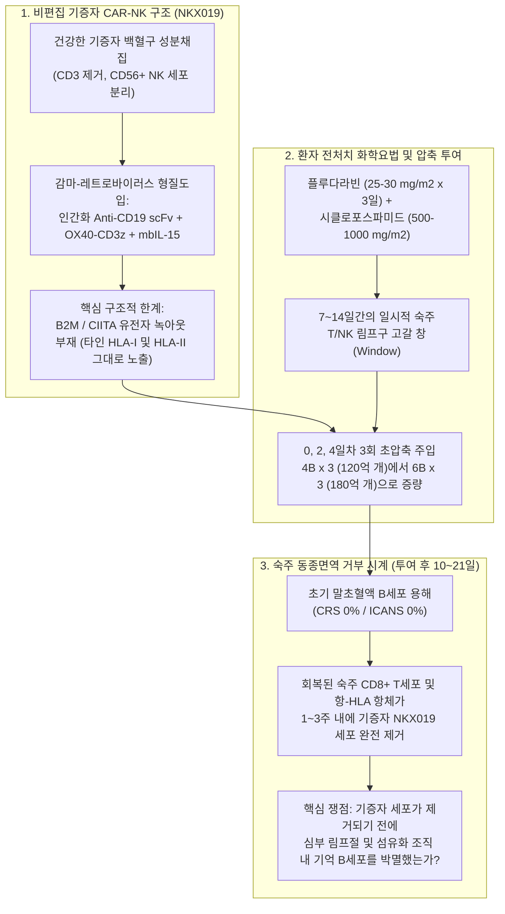
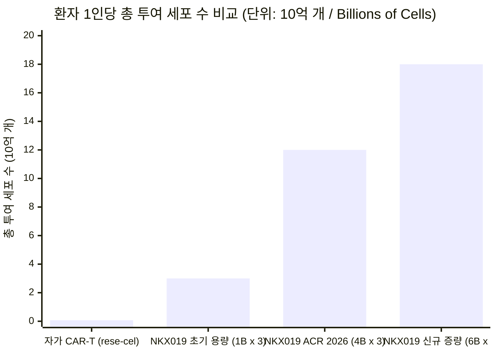
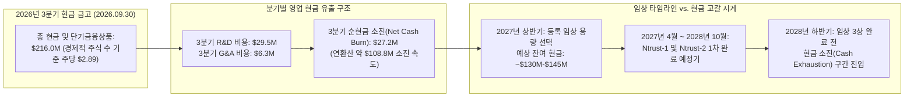

## 핵심 요약 및 쟁점 분류 (Issue Classification)

2026년 11월 9일, 동종유래(Allogeneic) CAR-NK 세포치료제 개발사 **Nkarta, Inc.** (`NASDAQ: NKTX`)의 주가는 **$1.34**를 기록하며, 2026년 7월 고점(**$3.72**) 대비 최근 6개월간 **58.02% (-$1.85)** 급락했고 장중 52주 신저가인 **$1.13**까지 추락했습니다. 표면적으로 보면 이 폭락은 역설적입니다. 불과 며칠 전 올랜도에서 열린 **미국류마티스학회(ACR Convergence 2026)**에서 Nkarta는 기성품(Off-the-shelf) CD19 표적 CAR-NK 세포치료제 **NKX019**의 임상 1/2상(**Ntrust** 프로그램) 초기 데이터를 발표하며 "인상적인 임상 반응"을 강조했고, 2026년 3분기 말 기준 **2억 1,600만 달러($216.0M)**의 현금성 자산을 보유해 표면 시가총액(**9,562만 달러**)의 두 배가 넘는 현금을 쥐고 있기 때문입니다.

왜 기관 투자자들은 "긍정적인" 자가면역 CAR-NK 데이터와 막대한 마이너스 기업가치(Negative EV)에도 불구하고 `NKTX`를 사상 최저가로 매도했을까요? **Browne & Keeley의 비판적 사고 프레임워크**를 적용하여 이 퍼즐을 두 가지 핵심 쟁점으로 분리합니다.

1. **기술적·기전적 쟁점 (Empirical Fact):** 유전자 편집(HLA 녹아웃)이 없는 건강한 기증자 유래 동종 CAR-NK 세포(`NKX019`) 3회 투여가, 투여 직전 시행되는 고강도 **플루다라빈 + 시클로포스파미드(`Flu/Cy`)** 림프구 제거 화학요법의 독자적인 면역억제 효과와 무관하게 자가면역질환에서 지속적이고 무약물(Drug-free) 상태의 B세포 리셋과 조직 내 관해를 유도하는가?
2. **가치평가 및 자본배분 쟁점 (Prescriptive Issue):** 선지급 워런트(Pre-funded warrants)를 포함한 경제적 주식 수(`7,464만 주`) 기준 주당 **$2.89**에 달하는 **2억 1,600만 달러**의 현금 잔고가 **$1.34** 주가에서 진정한 안전마진을 제공하는가, 아니면 분기당 **2,720만~3,330만 달러의 현금 소진(Cash Burn)** 속도가 **2027년 상반기(1H 2027)** 등록 임상 용량 확정 및 2/3상 완료 전에 현금 금고를 고갈시킬 것인가?

### 반증 가능성 기준 (Falsifiability Criteria)

확증 편향을 배제하기 위해 명확한 반증 기준을 선제적으로 설정합니다.

* **약세론(Bearish Thesis)이 반증되는 조건:** Nkarta가 12개월 추적 관찰 시점에서 전체 등록 코호트(`N ≥ 40`)의 전신경화증(`SSc`), 특발성 염증성 근염(`IIM`), 루푸스 신염(`LN`) 환자 중 `70% 이상`이 B세포 재구성 이후에도 스테로이드 및 면역억제제 없이 완전 관해를 유지함을 입증하고(자가 유래 CD19 CAR-T의 1~2년 지속성 [`PMID: 38381673`]과 대등), 3회 투여 사이클당 총 제조원가(`COGS`)를 `$15,000` 미만으로 유지하는 경우.
* **강세론(Bullish Thesis)이 반증되는 조건:** 투여 후 90일(`3개월`) 이후 추적 관찰에서 `Flu/Cy` 화학요법의 일시적 항염증 효과가 사라지자마자 병원성 기억 B세포 클론이 재출현하며 임상적 재발이 발생하거나, **1회당 60억 개 세포(0, 2, 4일차 총 180억 개 세포)**로의 초고용량 증량이 용량제한독성(DLT), 항-HLA 동종면역 감작(Allo-immunization)을 유발하거나 기증자 1명당 생산 배치 수율을 급격히 떨어뜨려 "기성품" 경제성을 파괴하는 경우.

---

## 1차 문헌 교차 검증: 기업 홍보 헤드라인 vs. 임상 프로토콜의 괴리

Nkarta 공식 웹사이트([nkartatx.com](https://nkartatx.com/) 및 [ntruststudy.com](https://ntruststudy.com/)), ClinicalTrials.gov에 등록된 4건의 임상 프로토콜([NCT06557265](https://clinicaltrials.gov/study/NCT06557265), [NCT06733935](https://clinicaltrials.gov/study/NCT06733935), [NCT05020678](https://clinicaltrials.gov/study/NCT05020678), [NCT04623944](https://clinicaltrials.gov/study/NCT04623944)), 그리고 2026년 3분기 Form 10-Q 보고서를 교차 검증한 결과, 기업의 대외 홍보 메시지와 실제 임상 데이터 사이에 5가지 구조적 괴리가 확인되었습니다.

| 감사 항목 | 기업 보도자료 및 투자자 홍보 헤드라인 | 1차 공시 자료, 임상 프로토콜 및 실제 임상 현실 |
| :--- | :--- | :--- |
| **ACR 2026 전체 투여 환자 수 vs. 유효성 부각 표본** | 근염(`IIM`)에서 **83% (5/6)** 반응률, 전신경화증(`SSc`)에서 **86% (6/7)** `rCRISS-25` 달성(`mRSS` 중앙값 `-15점` 개선)을 대대적으로 강조. | 2026년 9월 18일 데이터 컷오프 기준 5개 자가면역 적응증(`IIM`, `SSc`, `LN`, `AAV`, `pMN`)에서 총 **40명의 환자**가 투여받았으나, 헤드라인 유효성 표는 `40억 개 세포 × 3회` 용량군에서 `3개월 이상` 추적된 **13명(32.5%)**만 선별하여 제시함. 나머지 **27명(67.5%)**—특히 핵심 임상인 [NCT06557265](https://clinicaltrials.gov/study/NCT06557265)(`Ntrust-1`) 루푸스 신염(`LN`) 코호트 및 저용량 코호트—의 구체적 유효성 수치는 헤드라인에서 누락됨. |
| **90일 추적 관찰의 한계 vs. `Flu/Cy` 화학요법 교란 효과** | 90일 시점의 피부 경화(`mRSS`) 및 근육(`TIS`) 개선을 `NKX019`에 의한 "면역 리셋" 효과로 귀속시킴. | 유효성이 강조된 모든 환자는 투여 전 **플루다라빈(`25–30 mg/m²/일 × 3일`) + 시클로포스파미드(`500–1,000 mg/m²`)** 림프구 제거 화학요법(`Flu/Cy`)을 투여받음. 정맥주사 시클로포스파미드는 그 자체로 중증 `SSc`와 `IIM`의 표준 유도요법 약물로서 단독 투여만으로도 60~90일간 뚜렷한 임상 증상 완화와 림프구 감소를 유도함. |
| **동종 면역 거부반응 및 용량 증량 트레드밀** | 막 결합형 IL-15(`mbIL-15`)를 통해 체내 지속성을 높인 편리한 "기성품(Off-the-shelf)" 세포치료제로 홍보. | CRISPR 유전자 편집 스텔스 CAR-T/NK와 달리 `NKX019`는 **HLA class I/II 녹아웃 등 동종면역 회피 유전자 편집이 전혀 없음**. 숙주 T/NK 세포가 비편집 기증자 세포를 `7~14일` 내에 거부·제거하기 때문에, 투여 일정을 기존 `0, 7, 14일`에서 **`0, 2, 4일`**로 극단적으로 압축하고 환자당 총 세포 투여량을 `30억 개`(`1B × 3`)에서 `120억 개`(`4B × 3`), 이제는 **`180억 개`(`6B × 3`)**로 증량하며 등록 임상 용량 결정을 **2027년 상반기**로 연기함. |
| **항암 파이프라인의 무덤 (`NKX101` 및 `NKX019` 림프종)** | 검증된 CAR-NK 플랫폼을 자가면역질환으로 성공적으로 확장하는 것처럼 포지셔닝. | Nkarta가 자가면역질환으로 피벗한 근본 원인은 항암 임상의 실패 때문임. 급성골수성백혈병(`AML`) 대상 `NKX101`([NCT04623944](https://clinicaltrials.gov/study/NCT04623944), `N = 61`)과 B세포 림프종 대상 `NKX019`([NCT05020678](https://clinicaltrials.gov/study/NCT05020678), `N = 150`) 모두 짧은 체내 지속성과 3개월 이후 높은 재발률로 인해 개발이 중단·후순위화되었고 구조조정이 단행됨. |
| **현금 런웨이 및 실제 주식 수 회계 감사** | 2026년 9월 30일 기준 현금 **2억 1,600만 달러**와 보통주 `7,170만 주`(시가총액 `9,562만 달러`)를 제시하며 "2029년까지 현금 런웨이 확보" 주장. | 2026년 3분기 Form 10-Q 확인 결과, 행사가 `$0.0001`의 선지급 워런트 `3,000,031주`를 포함한 가중평균 주식 수는 **`74,637,689주`**(진성 시가총액 **$100.0M**)이며, 3분기 영업비용 **$35.8M**(R&D `$29.5M` + G&A `$6.3M`), 분기 순손실 **$33.3M**, 분기 순현금 소진액 **$27.2M**(연환산 `~$108.8M/년`)을 기록함. 현재 소진 속도 유지 시 런웨이는 약 2.0년(**2028년 하반기**)에 불과함. |

---

## 모호성 제거 및 임상 성숙도 감사 (Ambiguity & Maturity Audit)

### 핵심 기업 수사에 대한 대체 테스트 (Substitution Test)

* **"기성품의 편리성 (Off-the-Shelf Convenience)":** 일반 투자자들이 "기성품"이라는 단어를 들으면 피하주사 자가면역 항체(예: 휴미라, 듀피젠트)나 간단한 외래 정맥주사를 떠올립니다. 그러나 [NCT06733935](https://clinicaltrials.gov/study/NCT06733935)(`Ntrust-2`) 임상 프로토콜의 실제 절차를 대입(**Browne & Keeley 대체 테스트**)해 보면, "기성품 `NKX019` 치료"란 **투여 전 3일 연속 세포독성 항암제인 플루다라빈과 시클로포스파미드(`Days -5 to -3`)를 정맥 투여받은 뒤, 0일, 2일, 4일차에 걸쳐 회당 40억~60억 개의 초저온 동결 기증자 NK 세포를 총 3회 해동·주입(총 120억~180억 개 세포)하고, 항-HLA 및 항-NKX019 항체 생성 여부를 추적 관찰하는 고위험 세포치료 프로토콜**입니다. 화학요법 림프구 제거가 전혀 필요 없는 진정한 기성품 이중항체 T세포 인게이저(`TCE`: `teclistamab`, `CLN-978`, `obexelimab` 등)와 비교할 때, `NKX019`는 항암 화학요법의 독성과 다회차 세포 해동·주입의 물류 부담을 고스란히 안고 있습니다.
* **"보유 현금의 절반 이하에 거래되는 저평가":** 2026년 3분기 재무제표 수치를 대입하면, 경제적 주식 수 `7,464만 주`와 주가 `$1.34` 기준 진성 시가총액은 **1억 달러($100.0M)**입니다. 2026년 9월 말 현금은 **2억 1,600만 달러**(주당 `$2.89`)이지만, 3분기 한 분기에만 **2,720만 달러**(주당 `$0.36`)의 현금이 소진되었습니다. 등록 임상 용량이 확정되는 **2027년 상반기**(3개 분기 후)가 되면 누적 `8,000만~9,000만 달러`의 현금이 소진되어 잔여 현금은 `1억 2,600만~1억 3,600만 달러`(주당 `~$1.70–$1.82`)로 줄어들며, 이 시점에는 아직 임상 3상 환자 단 한 명도 투약하지 못한 상태가 됩니다.

### 4단계 임상 성숙도 스코어카드 (4-Tier Clinical Maturity Scorecard)

| 파이프라인 및 표적 | 적응증 및 임상시험 번호 | 임상 단계 및 목표 환자 수 | 보고된 유효성 및 지속성 현황 | 근거 등급 (Evidence Tier) |
| :--- | :--- | :--- | :--- | :--- |
| **NKX019** (`CD19 CAR + mbIL-15` 비편집 기증자 NK) | 전신경화증(`SSc`) 및 근염(`IIM`) — [NCT06733935](https://clinicaltrials.gov/study/NCT06733935) (`Ntrust-2`) | 임상 1/2상 공개 라벨 (목표 `N = 240`; 전체 프로그램 `40명` 투약) | `4B × 3` 용량군 중 **90일(`≥ 3개월`)** 추적된 `13명`에서 근염 `5/6`(`83%`) TIS 반응, 전신경화증 `6/7`(`86%`) `rCRISS-25`(`mRSS` 중앙값 `-15점`); 현재 `6B × 3`(`180억 개`)으로 증량 중. | **Tier 2** (비대조군 소규모 표본; `Flu/Cy` 교란이 심한 3개월 단기 데이터) |
| **NKX019** (`CD19 CAR + mbIL-15` 비편집 기증자 NK) | 루푸스 신염(`LN`) 및 원발성 막성 신증(`pMN`) — [NCT06557265](https://clinicaltrials.gov/study/NCT06557265) (`Ntrust-1`) | 임상 1/2상 공개 라벨 (목표 `N = 120`, 2024년 6월 개시) | `40명` 안전성 통합 풀에는 포함(`0%` CRS/ICANS)되었으나, ACR 2026 헤드라인 테이블에서 **코호트별 유효성(`CRR`) 수치 미공개**. | **Tier 3** (안전성만 공개; 헤드라인 유효성 미검증) |
| **NKX019** (`CD19 CAR + mbIL-15` 비편집 기증자 NK) | 재발성/불응성 B세포 림프종(`NHL`) — [NCT05020678](https://clinicaltrials.gov/study/NCT05020678) | 임상 1상 (`N = 150`, 모집 중단) | 초기 완전관해(CR)가 관찰되었으나 비편집 NK 세포의 짧은 지속성으로 재발이 빈발하여 **항암제 개발 후순위화(중단)**. | **Tier 2 — 개발 중단** |
| **NKX101** (`NKG2D CAR + mbIL-15` 비편집 기증자 NK) | 재발성/불응성 `AML` 및 `MDS` — [NCT04623944](https://clinicaltrials.gov/study/NCT04623944) | 임상 1상 (`N = 61`, 모집 중단) | 초기 소규모 코호트 반응이 확장 코호트에서 재현되지 못하고 지속성 한계를 드러내며 **프로그램 공식 종료**. | **Tier 2 — 개발 종료** |

---

## 기전적 아키텍처 및 90일 임상 반응에 대한 4자 인과관계 감사

왜 Nkarta의 임상 설계가 숙주 면역계의 거부반응 시계와 끝없는 경주를 벌여야 하는지 이해하기 위해, `NKX019`의 세포 공학적 구조와 투약 프로토콜을 도식화합니다.

### 필수 4자 인과관계 감사 (4-Way Causal Audit): 90일 시점의 호전은 무엇 때문인가?

Nkarta가 전신경화증 환자 `7명 중 6명`(`86%`)에서 `rCRISS-25` 반응(`mRSS` 피부 점수 중앙값 `-15점` 감소)과 근염 환자 `6명 중 5명`(`83%`)에서 `TIS` 개선을 달성했다고 발표했을 때, **Browne & Keeley 제9장(경쟁 원인 분석)**에 따라 네 가지 인과 가설을 모두 검증해야 합니다.

| 인과 가설 (Causal Hypothesis) | 인과 방향 | 기전적 경로 | 실증적 근거 및 포렌식 판정 |
| :--- | :--- | :--- | :--- |
| **1. 직접 인과 (Direct Causation)** | `NKX019 → B세포 리셋 → 임상 반응` | 투여된 `120억 개`의 `NKX019` 세포가 첫 14일 동안 말초혈액 및 림프 조직의 `CD19+` B세포를 용해하여 자가면역 레퍼토리를 리셋함. | **부분적 기여 (단기 혈중 고갈은 사실이나 장기 조직 리셋은 미입증):** 말초 B세포 고갈은 빠르게 일어나며, 유전자 편집이나 이중 표적을 적용한 학계 CAR-NK 연구(`PMID: 40562027`, `PMID: 41240964`)에서는 6~12개월 반응이 보고된 바 있음. 그러나 90일 시점은 심부 조직 B세포 박멸을 입증하기에 너무 이름. |
| **2. 제3의 잠복 변수 (`Confounder Z`)** | `Flu/Cy 화학요법 → B세포 감소 및 90일 임상 호전 동시 유발` | 유효성이 부각된 모든 환자는 **플루다라빈 + 시클로포스파미드(`Flu/Cy`)**와 프로토콜이 허용한 기저 스테로이드(`NCT06733935` 기준 프레드니손 `≤ 20 mg/일`)를 투여받음. 정맥주사 시클로포스파미드(`500–1,000 mg/m²`)는 중증 전신경화증 피부/폐 섬유화 및 난치성 근염의 표준 유도 항암제로서, 단독으로도 60~90일 동안 증식성 림프구를 파괴하고 `mRSS`와 `TIS` 점수를 개선함. | **90일 시점의 강력한 교란 변수:** `Flu/Cy` 단독 대조군이나 화학요법 효과가 완전히 사라지는 `12개월 이상` 무약물 추적 데이터가 없다면, 90일차 `-15점` `mRSS` 감소 중 얼마가 `Flu/Cy` 덕분이고 얼마가 `NKX019` 덕분인지 과학적으로 분리하는 것은 불가능함. 특히 시클로포스파미드(`Cy`) 단독 전처치 코호트 결과는 헤드라인 표에서 공개되지 않음. |
| **3. 표본 선택 및 보고 편향 (`Funnel Attrition`)** | `코호트 필터링 (40명 → 13명) → 헤드라인 반응률 부풀리기` | 5개 적응증과 여러 용량군(`1B`, `1.5B`, `4B` 세포/회)에 걸쳐 치료받은 **40명** 중, `4B × 3` 최고 용량군에서 `3개월 이상` 추적된 **13명**(`IIM 6명`, `SSc 7명`)만을 분리하여 헤드라인 반응률을 산출함. | **분모 왜곡 위험 매우 높음:** 치료받은 환자의 **67.5% (27명)**—저용량 코호트 및 5개월 먼저 시작된 `Ntrust-1` 루푸스 신염([NCT06557265](https://clinicaltrials.gov/study/NCT06557265)) 환자 포함—를 제외한 것은 전형적인 사후 부분집합 필터링임. 또한 `mRSS`는 연구자가 손으로 피부를 집어 평가하는 주관적 지표로 공개 라벨(Open-label) 임상에서 위약/기대 편향에 매우 취약함. |
| **4. 상호 피드백 루프 (`동종면역 제거 ↔ 초고용량 증량`)** | `숙주 면역에 의한 조기 제거 ↔ 투여 일정 압축 및 180억 개 증량` | 비편집 기증자 `NKX019` 세포가 숙주 면역계에 의해 `1~2주` 내에 제거되므로, `1B × 3`(`30억 개`)의 낮은 조직 침투력을 극복하기 위해 `4B × 3`(`120억 개`), 나아가 **`0, 2, 4일`에 `6B × 3`(`180억 개`)**을 쏟아붓는 극단적 증량이 강제됨. | **임상 설계 변경으로 입증됨:** 만약 `120억 개`(`4B × 3`) 용량이 이미 완벽하고 지속적인 심부 조직 B세포 박멸을 달성했다면, Nkarta는 지금 즉시 임상 2상 등록 용량을 확정했을 것이지, 세포 수를 50%나 더 늘려 **`180억 개`** 코호트를 추가하고 용량 결정을 **2027년 상반기**로 늦추지 않았을 것임. |

---

## 통계 및 화학양론적 해부: 200배의 세포 질량 페널티와 제조원가(COGS)의 역설

왜 Cabaletta Bio의 **rese-cel (`CABA-201`)**이나 Erlangen 대학 연구진(`Müller & Schett et al., NEJM 2024`, [PMID: 38381673](https://pubmed.ncbi.nlm.nih.gov/38381673/))의 자가 유래(Autologous) CD19 CAR-T는 체중 kg당 `1 × 10⁶ 개`(70 kg 성인 기준 **약 7,000만 개 세포**)의 **단 1회 투여**만으로 1~2년의 완전 관해를 유도하는 반면, Nkarta의 `NKX019`는 3회에 걸쳐 **120억~180억 개의 세포**(**171배~257배 더 많은 세포 수**)를 주입해야만 할까요?

그 해답은 환자 체내에서 기하급수적으로 증식하는 자가 T세포의 **생체 내 증식 약동학(`PK`)**과, 증식하지 못하고 숙주 면역에 의해 파괴되는 비편집 기증자 NK 세포의 약동학적 차이에 있습니다. 시간 `t ∈ [0, T]` 동안 표적 조직 내 유효 작동 세포 노출량(`AUC_tissue`)을 수식화하면 다음과 같습니다.

$$AUC_{\text{tissue}} = \int_{0}^{T} D_0 \cdot f_{\text{homing}} \cdot \exp\big((r_{\text{prolif}} - k_{\text{allo}} - k_{\text{apoptosis}}) \cdot t\big) \, dt$$

여기서 `D₀`는 초기 주입 세포 용량, `f_homing`은 혈관 내피를 통과해 섬유화된 피부·근육 및 심부 림프절로 이동(Homing)하는 세포 비율, `r_prolif`는 항원 자극에 의한 체내 클론 증식 속도, `k_allo`는 숙주 면역계에 의한 동종 거부 제거 속도입니다.

* **자가 유래 CD19 CAR-T (`rese-cel` / Schett CAR-T):** 환자 본인의 T세포이므로 동종 거부반응이 전혀 없습니다(`k_allo = 0`). 체내 `CD19+` B세포를 만나면 `4-1BB` 또는 `CD28` 공자극 신호를 통해 `10~14일` 동안 폭발적인 클론 증식(`r_prolif ≫ k_apoptosis`)을 일으켜, 초기 `7,000만 개`의 세포가 환자 림프절 내부에서 **100배~1,000배**로 스스로 증폭되며 평균 **`112 ± 47일`** 동안 완전한 B세포 무형성증(Aplasia)을 유지합니다([PMID: 38381673](https://pubmed.ncbi.nlm.nih.gov/38381673/)).
* **비편집 동종 CAR-NK (`NKX019`):** 성숙한 말초혈액 NK 세포는 T세포에 비해 체내 증식 능력이 제한적이고 내인성 TCR 생존 신호가 없으며, 타인의 HLA 항원을 표면에 그대로 지니고 있습니다(투여 7~10일 후 숙주 림프구가 회복되면 `k_allo ≫ r_prolif`). 결과적으로 `NKX019`는 자가 증폭하는 살아있는 약물이라기보다 **고용량 바이오의약품 볼루스(Bolus) 충격 요법**처럼 작동합니다. 숙주 면역계가 기증자 세포를 파괴하기 전에 경화증 피부나 염증 근육 조직으로 충분한 세포를 밀어 넣으려면, 96시간(`0, 2, 4일차`)이라는 짧은 시간 안에 **120억~180억 개의 세포**를 혈관에 쏟아부어야만 하는 것입니다.

### 제조 수율(Batch Yield) 및 매출원가(COGS)의 딜레마

동종 CAR-NK가 자가 CAR-T 대비 내세우는 최대 경제적 명분은 대량 생산성입니다. 건강한 기증자 1명의 성분채집으로 **100~300명분의 기성품 도즈**를 생산하여 환자당 제조원가(`COGS`)를 `$10,000` 미만으로 낮추겠다는 논리입니다.

그러나 환자 1인당 필요 세포 수가 초기 `30억 개`(`1B × 3`)에서 **`180억 개`(`6B × 3`)**로 6배 폭증하면 이 경제성 공식은 정면으로 붕괴합니다.

1. **배치당 환자 공급 수율 6분의 1 토막:** `30억 개/인` 기준으로 **60명의 환자**에게 투여할 수 있었던 바이오리액터 생산 배치가, `180억 개/인` 기준으로는 단 **10명분**(동결보존 과충전 및 품질관리 보관 시료를 제외하면 그 이하)으로 줄어듭니다.
2. **3배의 초저온 물류 및 병원 해동 부담:** 0일차 `60억 개`, 2일차 `60억 개`, 4일차 `60억 개`를 투여하려면 환자 1명당 액체질소 증기상 초저온 운송·보관·해동 및 정맥 주입 절차를 **3일에 걸쳐 세 번 반복**해야 합니다.
3. **항-HLA 동종면역 감작 위험 ([NCT06733935](https://clinicaltrials.gov/study/NCT06733935) 2차 평가지표 #331):** 유전자 편집이 없는 타인의 HLA 발현 세포 `180억 개`를 반복 주입하면 환자 체내에서 **기증자 특이 항-HLA 항체(`DSA`)**가 생성될 위험이 커집니다. 향후 신장 이식이나 폐 이식이 필요할 수 있는 젊은 루푸스 신염(`LN`) 및 전신경화증(`SSc`) 환자에서 광범위한 항-HLA 감작을 유발하는 것은 재투여(Retreatment)를 불가능하게 만들 뿐 아니라 장기 이식 적합성을 해치는 심각한 임상적 부채입니다.

---

## ACR Convergence 2026 경쟁 구도: 위아래에서 조여오는 샌드위치 압박

ACR Convergence 2026 직후 `NKTX` 주가가 폭락한 결정적 이유는 같은 학회장에서 발표된 경쟁 모달리티들과의 냉정한 비교 때문입니다. `NKX019`는 위로는 **장기 무약물 관해를 입증한 단회 투여 CAR-T / 편집된 스텔스 CAR**에 밀리고, 아래로는 **화학요법이 전혀 필요 없는 피하주사 이중항체(`TCE`)**에 끼인 샌드위치 신세가 되었습니다.

| 치료 모달리티 및 파이프라인 | 개발사 | 전처치 화학요법 필요 여부 | 총 투여 용량 및 횟수 | 임상 성숙도 및 ACR 2026 벤치마크 데이터 | `NKX019` 대비 구조적 우위 |
| :--- | :--- | :--- | :--- | :--- | :--- |
| **자가 유래 CD19 CAR-T (`rese-cel / CABA-201`)** | Cabaletta Bio (`CABA`) | `Flu/Cy` (1회) | **단 1회 주입** (`1 × 10⁶ cells/kg` ≈ `0.07B` 세포) | `70명 이상` 투약; **1~2년 장기 무약물 관해 입증**: 피부근염 1년차 `6/6`(`100%`) 반응; 전신경화증 1년차 `5/7`(`71%`) `rCRISS-50` 및 폐활량(`FVC`) `+9%` 개선; 루푸스 신염 `100%` DORIS 관해 및 신장 생검 조직 내 B세포 완전 제거 확인; 근염 등록 임상 진행 중(2028년 `BLA` 목표). | 단 1회 투여로 **4~8배 더 긴 추적 기간(`1~2년` vs. `3개월`)** 및 신장 생검 수준의 심부 조직 B세포 리셋 입증. |
| **CRISPR 유전자 편집 동종 CAR-T (`zugo-cel / CTX112`)** | CRISPR Therapeutics (`CRSP`) | `Flu/Cy` | **단 1회 주입** (`~0.1B–0.3B` 세포) | 숙주 거부반응 및 세포 탈진을 막기 위해 `TRAC`, `B2M`, `TGFBR2` 3중 유전자 녹아웃 적용; 단회 투여로 강력한 체내 증식 및 깊은 B세포 고갈 달성. | **동종면역 회피 편집(`B2M` KO)**을 통해 `180억 개` 3회 분할 주입 없이도 숙주 조기 거부를 차단. |
| **iPSC 유래 유전자 편집 이중 표적 CAR-NK (`QN-139b`)** | 학계 / Qihan (`PMID: 40562027`) | `Flu/Cy` | 클론성 iPSC 마스터 셀 뱅크 (`CD19/BCMA` 이중 CAR + 스텔스 편집) | *Cell* 지 발표(2025년 8월, [PMID: 40562027](https://pubmed.ncbi.nlm.nih.gov/40562027/)): 동종면역 저감 유전자 편집 및 `CD19 + BCMA` 이중 표적을 통해 6개월 추적에서 피부 섬유화 역전 및 형질세포 유래 자가항체 제거 입증. | **클론 균질성 + `BCMA` 형질세포 동시 타격 + 면역회피 편집**으로 비편집 `CD19` 단독 CAR-NK의 한계 극복. |
| **기성품 이중항체 T세포 인게이저 (`TCE`: `CLN-978`, `teclistamab`)** | Cullinan / J&J / Amgen / Zenas | **불필요 (`Flu/Cy` 화학요법 0%)** | 외래 피하주사(SC) 또는 일반 정맥주사 | **림프구 제거 화학요법 없이** 난치성 자가면역질환에서 심부 조직 B세포 및 형질세포 고갈 달성; 초기 저등급 CRS는 외래 용량 증량(Step-up dosing)으로 관리 가능. | **진정한 기성품 바이오의약품:** `Flu/Cy` 항암제 독성, 불임/감염 위험, 초저온 세포 물류를 완전히 제거함. |
| **비편집 기증자 CD19 CAR-NK (`NKX019`)** | **Nkarta (`NKTX`)** | **`Flu/Cy` 필수** (주요 유효성 코호트) | **3회 분할 주입** (`0, 2, 4일차` 회당 `4B–6B` = **총 `120억~180억 개` 세포**) | 투여 환자 `40명` 중 **90일(`≥ 3개월`)** 시점 `13명` 부각(`IIM 5/6`, `SSc 6/7`); CRS/ICANS `0%`; 등록 용량 결정 **2027년 상반기**로 지연. | CRS/ICANS `0%`의 우수한 초기 안전성을 보이나, **`Flu/Cy` 항암 독성 부담과 90일 이후 지속성 미입증 사이에 갇힘**. |

---

## 재무 포렌식 감사: 현금 2억 1,600만 달러 vs. 진성 시가총액 1억 달러의 실체

개인 투자자 게시판에서는 흔히 `NKTX`가 보유 현금(**2억 1,600만 달러**)의 절반에도 못 미치는 시가총액(**9,562만 달러**)에 거래되므로 `NKX019` 파이프라인을 "공짜로 사는 셈"이라고 주장합니다. 그러나 2026년 3분기 재무제표(2026년 9월 30일 마감)를 정밀 감사하면 왜 기관 투자자들이 현재 현금 대비 가파른 할인율을 적용하는지 명확히 드러납니다.

### 핵심 재무상태표 및 현금 소진 지표 (2026년 9월 30일 기준)

1. **경제적 희석 주식 수 (`7,464만 주` vs. `7,170만 주`):** 금융 포털에는 기본 보통주 `7,170만 주`(주가 `$1.34` 기준 시가총액 `9,562만 달러`)만 표시되지만, Nkarta의 2026년 3분기 가중평균 기본/희석 주식 수는 행사가 `$0.0001`의 미행사 선지급 워런트(Pre-funded warrants) **`3,000,031주`**를 포함하여 **`74,637,689주`**입니다. 이를 반영한 `$1.34` 기준 진성 시가총액은 **1억 1만 달러($100.01M)**입니다.
2. **분기별 현금 소진(Cash Burn) 궤적:**
   * 2026년 6월 30일 현금성 자산: **2억 4,320만 달러 ($243.2M)**
   * 2026년 9월 30일 현금성 자산: **2억 1,600만 달러 ($216.0M)**
   * **2026년 3분기 순현금 감소액:** **2,720만 달러 ($27.2M)** (연환산 **1억 880만 달러**)
   * **2026년 3분기 GAAP 영업비용:** **3,580만 달러** (R&D `$29.5M` + G&A `$6.3M`; 3분기 당기순손실 = **3,330만 달러**).
3. **"2029년까지 현금 런웨이" 가이던스의 수학적 압박:** 보유 현금 `2억 1,600만 달러`를 3분기 순현금 소진액(`$27.2M/분기`)으로 나누면 정확히 **7.94개 분기(약 1.98년)**가 나오며, 이는 2029년이 아니라 **2028년 3분기 말~4분기 초**에 현금이 바닥남을 의미합니다. 더욱이 `Ntrust-1`(목표 `120명`)과 `Ntrust-2`(목표 `240명`)를 환자당 **`180억 개 세포`(`6B × 3`)**라는 초고용량으로 확장하고 2027년 등록 임상을 개시하면, GMP 세포 생산비와 임상 사이트 비용은 줄어드는 것이 아니라 오히려 증가할 수밖에 없습니다.

---

## 부정적 시각 (The Negative View): 무엇이 누락되었고 누가 비용을 치르는가?

**Browne & Keeley 제11장(생략된 정보와 부정적 시각)**에 입각하여, Nkarta의 2026년 11월 발표에서 생략된 핵심 리스크를 짚어냅니다.

1. **사라진 27명의 환자 (전체 투약군의 `67.5%` 누락):** 2026년 9월 18일 기준 총 **40명의 환자**가 치료받았는데, 왜 유효성 수치는 `4B × 3` 용량군의 근염 `6명`과 전신경화증 `7명`(합계 `13명`)으로만 제한되었을까요?
   * **`1.0B × 3`(`30억 개`) 및 `1.5B × 3`(`45억 개`) 코호트**의 6~12개월 결과는 어떠했습니까? 만약 저용량군 환자들이 90일(`Flu/Cy` 약효 지속 기간) 이후 대거 재발했다면, 이는 비편집 NK 세포의 빠른 숙주 거부가 날카로운 용량 절벽을 만든다는 직접적인 증거입니다.
   * `Ntrust-2`(2024년 11월 개시)보다 거의 5개월이나 먼저 시작된 **[NCT06557265](https://clinicaltrials.gov/study/NCT06557265) (`Ntrust-1`: 루푸스 신염 `LN` 및 원발성 막성 신증 `pMN`, 2024년 6월 개시)** 환자들의 유효성 데이터는 왜 헤드라인에서 통째로 빠졌습니까?
2. **세포 약동학(`PK`) 및 B세포 표현형 재구성 곡선의 부재:** `Müller & Schett et al.`([PMID: 38381673](https://pubmed.ncbi.nlm.nih.gov/38381673/)) 및 `Marin & Rezvani et al.`([PMID: 38238616](https://pubmed.ncbi.nlm.nih.gov/38238616/)) 연구에서 가장 결정적인 바이오마커는 **CAR 세포의 체내 지속 일수**, **말초 B세포 무형성증 지속 기간(CAR-T 평균 `112 ± 47일`)**, 그리고 재출현하는 B세포가 **100% 미감작(Naive, `CD27- IgD+`) B세포**인지 아니면 재발을 일으키는 **`CD27+` 기억 B세포**인지 여부입니다. 6~12개월 시점의 B세포 재구성 표현형 데이터 없이는 90일차 임상 점수의 의미를 판단할 수 없습니다.
3. **`180억 개 세포`가 장기 관해에 실패할 경우 환자가 치르는 대가:** 난치성 전신경화증, 근염, 루푸스 신염 환자들은 `NKX019` 투여를 위해 생식선 독성과 골수 억제 위험이 있는 `Flu/Cy` 항암 화학요법을 견뎌야 합니다. 만약 비편집 기증자 NK 세포가 심부 림프절의 병원성 B세포를 뿌리 뽑기 전에 숙주 면역에 의해 제거된다면, 환자들은 화학요법의 독성만 감수하고 자가 CAR-T가 제공하는 수년간의 무약물 관해 혜택은 얻지 못하는 불균형한 위험을 떠안게 됩니다.

---

## 회색 사고(Grey Thinking) 종합 및 확률 가중 포렌식 평결

이분법적 낙관론이나 비관론을 배제하고, 조건부 **If-절(If-Clauses)**을 통해 **Nkarta (`NASDAQ: NKTX`)**의 임상적·재무적 경로를 종합합니다.

* **만약 (If)** 2027년에 발표될 **6~12개월 장기 추적 데이터**에서 `4B × 3`(`120억 개`) 및 `6B × 3`(`180억 개`) 코호트 환자의 `70% 이상`이 12개월 시점에도 스테로이드 및 면역억제제 없이 완전 관해를 유지하고, 플루다라빈을 뺀 시클로포스파미드(`Cy`) 단독 전처치 코호트에서도 동일한 효능이 재현된다면—**그때는 (Then)** 40명 전원에서 입증된 `NKX019`의 **0% CRS / 0% ICANS** 안전성이 CAR-T 신경독성을 감당할 수 없는 지역 류마티스 센터에서 강력한 외래 치료 니치를 확보하며 주가는 주당 순현금 가치(`$2.50–$3.50`)를 향해 재평가될 것입니다.
* **반면 만약 (If)** 투여 후 **6~12개월 추적 관찰**에서 90일간의 `Flu/Cy` 화학요법 효과가 걷히자마자 병원성 기억 B세포가 재출현하고 임상적 재발이 발생한다면—과거 림프종([NCT05020678](https://clinicaltrials.gov/study/NCT05020678))과 급성골수성백혈병([NCT04623944](https://clinicaltrials.gov/study/NCT04623944))에서 3개월 이후 재발로 항암 파이프라인이 좌초했던 패턴의 반복—**그때는 (Then)** `NKX019`는 고효능 영역에서는 단 1회 투여 자가 CAR-T(`rese-cel`)에, 편의성 영역에서는 화학요법이 없는 피하주사 이중항체(`TCE`)에 밀려 구조적 도태에 직면할 것입니다.

### 확률 가중 시나리오 분석 (향후 12~18개월 기준)

| 시나리오 | 발생 확률 | 기전적 및 임상적 트리거 | 예상 기업가치 및 주가 영향 |
| :--- | :--- | :--- | :--- |
| **기본 시나리오 (Base Case): 90일 이후 부분 재발 및 현금 소진 지속** | **55%** | 6~12개월 추적 시 초기 90일 반응자의 `30%–50%`가 비편집 `NKX019` 조기 소실로 인해 스테로이드/면역억제제를 재복용; `180억 개` 증량으로 제조원가 상승; 2027년 중반 현금 `~$120M` 수준으로 감소. | 만성적인 현금 할인 세포치료제 가치 함정에 머물며 **선행 현금의 0.45x–0.65x (`$0.85 – $1.35/주`)** 박스권 거래. |
| **약세 시나리오 (Bear Case): 높은 재발률, 루푸스 신염 부진 및 구조조정** | **25%** | 공개가 지연된 `Ntrust-1`(`LN`) 및 저용량 코호트에서 `Flu/Cy` 약효 소실 후 낮은 지속성 확인; `6B × 3`(`180억 개`) 투여 시 항-HLA 항체 감작 또는 생산 수율 병목 발생; 2027~2028년 파이프라인 축소 또는 액면병합 위험 부각. | **선행 현금의 ~0.35x (`$0.50 – $0.80/주`)**로 추가 하락하며 전략적 대안 모색 또는 구조조정 강제. |
| **강세 시나리오 (Bull Case): 12개월 무약물 관해 입증 및 `Cy` 단독 전처치 성공** | **20%** | `120억~180억 개` 투여군 `SSc` 및 `IIM` 환자의 `70% 이상`이 12개월차에 미감작 B세포 재구성과 함께 무약물 관해 및 `0%` CRS/ICANS 유지; `Cy` 단독 전처치 성공으로 2027년 깔끔한 등록 임상 진입. | 빅파마 기술이전 또는 인수 기대감에 힘입어 **현금 가치의 1.0x–1.4x (`$2.50 – $4.00/주`)**로 리레이팅. |

### 최종 포렌식 평결 ("What We Actually Think")

지난 6개월간 **Nkarta (`NKTX`) 주가가 58% 폭락하여 $1.34**에 이른 것은 시장이 **2억 1,600만 달러**의 현금을 못 봐서가 아닙니다. 이는 ACR Convergence 2026에서 드러난 **세 가지 구조적 적신호**에 대한 기관 투자자들의 냉철한 할인(Discounting)입니다.

1. **40명 투약 중 13명만 공개한 유효성 깔때기(보고 분모 `32.5%`)**: 5개월 먼저 시작된 `Ntrust-1` 루푸스 신염([NCT06557265](https://clinicaltrials.gov/study/NCT06557265))을 포함한 나머지 `27명`의 유효성 데이터가 헤드라인에서 빠져 있습니다.
2. **`Flu/Cy` 화학요법 교란에 완전히 노출된 90일 단기 평가 창**: 시클로포스파미드 단독으로도 60~90일간 피부와 근육 염증이 완화되므로, 90일 데이터만으로는 `NKX019`의 진정한 장기 면역 리셋을 증명할 수 없습니다.
3. **0, 2, 4일차 총 180억 개 비편집 세포(`6B × 3`)로의 증량 트레드밀**: 숙주 면역 거부를 수량으로 압도하기 위해 세포 투여량을 6배나 늘리면서 등록 용량 결정은 **2027년 상반기**로 밀렸고, 그사이 분기당 **약 2,720만 달러**의 현금이 증발하고 있습니다.

Nkarta가 **치료받은 40명 이상 환자 전원의 필터링 없는 유효성**을 투명하게 공개하고, `Flu/Cy` 화학요법 약효가 완전히 사라진 **12개월 시점의 무약물 장기 관해**를 입증하기 전까지, `NKTX`는 저평가 우량주가 아니라 철저한 검증이 필요한 **가치 함정(Show-Me Value Trap)**입니다.

---

## 1차 출처 및 검증 가능한 참고문헌

1. **ClinicalTrials.gov ([NCT06557265](https://clinicaltrials.gov/study/NCT06557265)):** *A Phase 1/2 Open-Label Study to Investigate the Safety and Clinical Activity of NKX019 in Participants With Autoimmune Disease (`Ntrust-1`: Lupus Nephritis and Primary Membranous Nephropathy).* 의뢰자: Nkarta, Inc.
2. **ClinicalTrials.gov ([NCT06733935](https://clinicaltrials.gov/study/NCT06733935)):** *A Phase 1/2 Study of NKX019 in Autoimmune Diseases (`Ntrust-2`: Systemic Sclerosis, Idiopathic Inflammatory Myopathy, ANCA-Associated Vasculitis, and Rheumatoid Arthritis).* 의뢰자: Nkarta, Inc.
3. **ClinicalTrials.gov ([NCT05020678](https://clinicaltrials.gov/study/NCT05020678)) 및 ([NCT04623944](https://clinicaltrials.gov/study/NCT04623944)):** B세포 악성종양 대상 `NKX019` 임상 1상(`N = 150`) 및 AML/MDS 대상 `NKX101` 임상 1상(`N = 61`). 의뢰자: Nkarta, Inc.
4. **Nkarta 기업 공시 및 학회 발표 자료:** [nkartatx.com](https://nkartatx.com/) 및 [ntruststudy.com](https://ntruststudy.com/) — ACR Convergence 2026 구두 및 포스터 발표(데이터 컷오프 2026년 9월 18일) 및 2026년 3분기 재무보고서(2026년 9월 30일 마감 Form 10-Q).
5. **Müller F, Taubmann J, Bucci L, et al. (Schett G).** *CD19 CAR T-Cell Therapy in Autoimmune Disease — A Case Series with Follow-up.* **The New England Journal of Medicine** (2024 Feb 22); 390(8):687–700. [PMID: 38381673](https://pubmed.ncbi.nlm.nih.gov/38381673/).
6. **Marin D, Li Y, Basar R, et al. (Rezvani K).** *Safety, efficacy and determinants of response of allogeneic CD19-specific CAR-NK cells in CD19+ B cell malignancies.* **Nature Medicine** (2024 Mar); 30(3):772–784. [PMID: 38238616](https://pubmed.ncbi.nlm.nih.gov/38238616/).
7. **Wang X, Zhang Y, Jin Y, et al. (Xu H).** *An iPSC-derived CD19/BCMA CAR-NK therapy in a patient with systemic sclerosis.* **Cell** (2025 Aug 07). [PMID: 40562027](https://pubmed.ncbi.nlm.nih.gov/40562027/).
8. **Changhai Hospital / Naval Medical University Investigators.** *Efficacy and safety of allogeneic CD19 CAR NK-cell therapy in systemic lupus erythematosus: a case series.* **The Lancet** (2025). [PMID: 41240964](https://pubmed.ncbi.nlm.nih.gov/41240964/).
