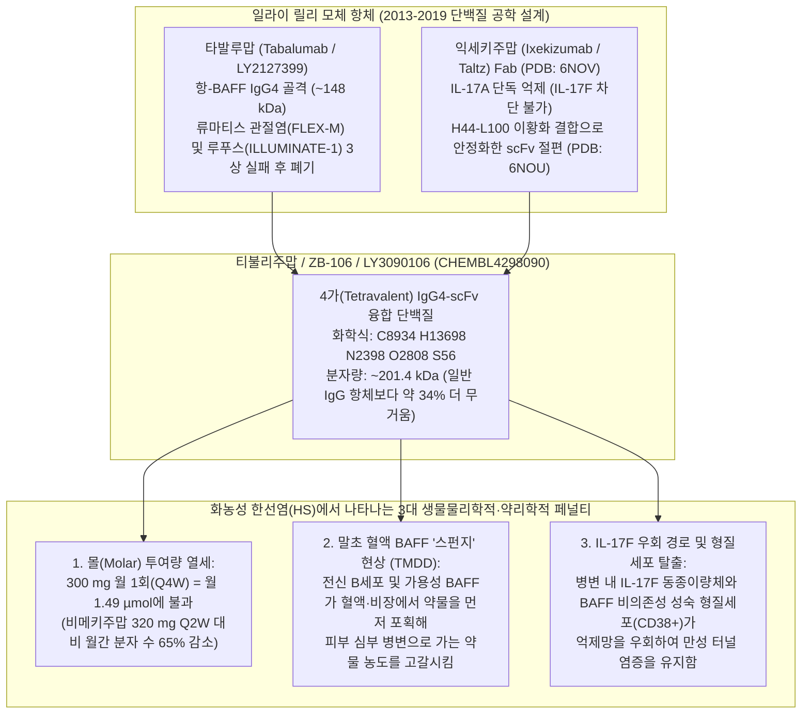
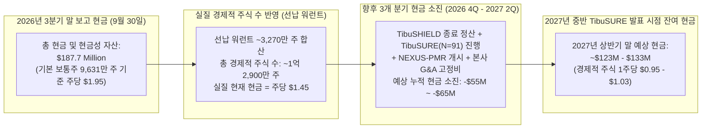

2026년 11월 9일 오전, 나스닥 상장 면역질환 바이오텍 **주라 바이오(Zura Bio Limited, NASDAQ: ZURA)**의 주가는 단 하루 만에 약 4.15달러에서 1.00달러 수준으로 75% 이상 폭락했습니다. 폭락의 도화선은 중등도~중증 **화농성 한선염(Hidradenitis Suppurativa, HS)** 성인 환자 247명을 대상으로 핵심 파이프라인 **티불리주맙(tibulizumab, ZB-106)**을 평가한 16주 임상 2상 [**TibuSHIELD (NCT06993610)**](https://clinicaltrials.gov/study/NCT06993610)의 탑라인(topline) 결과 발표였습니다. 화농성 한선염은 피부 깊숙한 곳에 극심한 통증을 동반하는 농양(abscess), 염증성 결절(inflammatory nodule), 그리고 고름이 배출되는 피부 터널(배농 누관, draining tunnel)을 형성하는 난치성 만성 염증 질환입니다.

임상 결과, 월 1회(Q4W) 피하주사로 투여된 티불리주맙 150 mg 투여군과 300 mg 투여군 모두 16주 차 총 농양 및 염증성 결절(AN) 수의 기저치 대비 백분율 감소라는 1차 평가지표에서 위약(placebo) 대비 통계적 유의성을 확보하지 못했습니다. 주요 2차 평가지표인 **HiSCR50**과 **HiSCR75** 역시 모두 실패했습니다. 결과 발표 직후 주라 바이오는 화농성 한선염 적응증에서 티불리주맙 개발을 즉각 중단한다고 선언했으며, 2027년 상반기 탑라인 결과가 예정된 전신경화증(Systemic Sclerosis, SSc) 임상 2상 [**TibuSURE (NCT06843239)**](https://clinicaltrials.gov/study/NCT06843239) 및 2026년 말 개시 예정인 류마티스 다발근통(PMR) 임상 2상 **NEXUS-PMR**로 자원을 집중하겠다고 밝혔습니다.

이처럼 중기 임상시험이 참담하게 실패할 때마다 월가에서는 두 가지 상반된 해석이 정면으로 충돌합니다.
1. **'불운한 위약 효과 폭증(Placebo Spike)' 가설:** 경영진과 우호적인 애널리스트들은 위약군의 농양 및 염증성 결절(AN) 수가 **52.5% 감소**하고 **HiSCR50 반응률이 45.5%**에 달했다는 점에 주목합니다. 이는 과거 화농성 한선염 임상 3상들의 위약군 HiSCR50 반응률(약 26%~34%)을 크게 웃도는 수치입니다. 이 시각에 따르면 약물은 작동했으나 임상시험 기관의 노이즈로 위약군 반응이 비정상적으로 높았을 뿐이며, 2026년 3분기 말 기준 **1억 8,770만 달러의 현금**을 보유한 주라 바이오를 주당 1.00달러(기본 주식 수 기준 시가총액 약 9,630만 달러)에 매수하는 것은 전형적인 '순현금 이하(net-net)' 저가 매수 기회라는 주장입니다.
2. **'약리학적·화학량론적 한계(Mechanistic Ceiling)' 가설:** 반면 활성 투여군(active arms)의 원시 데이터를 포렌식 관점에서 해부하면 훨씬 심각한 구조적 결함이 드러납니다. 티불리주맙 투여량을 월 150 mg에서 300 mg으로 **두 배 증량했음에도 추가적인 치료 효과가 전혀 나타나지 않았으며**, 오히려 300 mg 투여군이 150 mg 투여군보다 AN 감소율(56.0% vs. 58.1%)과 HiSCR50 반응률(48.0% vs. 52.7%) 모두에서 수치상 **더 낮은 성적**을 기록했기 때문입니다.

과연 진실은 무엇일까요? 그리고 주당 1.00달러로 추락한 주라 바이오는 현금 가치 대비 반값에 거래되는 저평가 기회일까요, 아니면 분기당 2,580만 달러를 태우며 빅파마가 버린 후보물질을 재활용하는 '밸류 트랩(가치 함정)'일까요? 보도자료의 수식어를 걷어내고 분자 공학 구조, 몰 화학량론(molar stoichiometry), 임상 레지스트리 원문, 그리고 SEC 재무제표 주석을 직접 대조해 보겠습니다.

---

## 1. 핵심 쟁점 정의와 반증 가능성(Falsifiability) 기준

단 하나의 백분율 수치도 해석하기 전에, 먼저 **기술적·생물학적 질문(Descriptive Question)**과 **자본 배분 및 투자 전략 질문(Prescriptive Question)**을 분리하고 명확한 반증 기준을 수립해야 합니다.

* **기술적·기전적 핵심 질문:** [`NCT06993610`](https://clinicaltrials.gov/study/NCT06993610) 임상이 실패한 원인은 단순히 임상 현장의 노이즈와 평균으로의 회귀(regression to the mean)가 16주 차 위약군 반응률(AN 감소율 52.5%, HiSCR50 45.5%)을 부풀렸기 때문인가, 아니면 **201.4 kDa에 달하는 거대 IgG4-scFv 분자 구조**, **월 1회(Q4W) 투여의 몰(molar) 농도 부족**, **IL-17F를 차단하지 못하는 IL-17A 단독 결합 특성**, 그리고 **전신 BAFF 표적 매개 약물 소실(TMDD)**이라는 약리학적 한계에 부딪혔기 때문인가?
* **규범적·가치평가 핵심 질문:** 주가가 75% 폭락해 약 1.00달러가 된 현재, 주라 바이오의 1억 8,770만 달러 현금 보유고(2026년 9월 30일 기준)는 2027년 상반기 [`TibuSURE (NCT06843239)`](https://clinicaltrials.gov/study/NCT06843239) 전신경화증 결과 발표 전까지 비대칭적 안전마진을 제공하는가, 아니면 선납 워런트(pre-funded warrants)를 포함한 실질 유통주식수(약 1억 2,900만 주)와 분기당 2,580만 달러의 현금 소진율이 그 할인 폭을 모두 잠식하는가?
* **반증 조건(Falsifiability Criteria):** 만약 다음 두 가지가 동시에 확인된다면 '단순 위약군 노이즈' 가설은 **반증(기각)**됩니다.
  1. 150 mg Q4W 투여군과 300 mg Q4W 투여군 사이에서 **용량 반응 곡선이 평탄하거나 역전(inverted dose-response)**되어, 약물 노출량을 두 배로 늘려도 심부 병변 제거 효과가 전혀 증가하지 않았음이 입증될 경우.
  2. 위약군 반응률이 28.1%로 낮아진 더 엄격한 **HiSCR75** 지표에서조차 티불리주맙의 절대 반응률 상한선(150 mg 34.0%, 300 mg 35.3%)이 조직 침투력이 뛰어난 저분자량 IL-17A/F 이중 나노바디나 경구용 세포 내 키나아제 억제제에 미치지 못할 경우.

---

## 2. 분자 고고학: 일라이 릴리(Eli Lilly)는 어떻게 티불리주맙(LY3090106)을 만들고 매각했는가?

티불리주맙이 왜 [`TibuSHIELD`](https://clinicaltrials.gov/study/NCT06993610)에서 한계를 드러냈는지 이해하려면 이 분자의 태생을 추적해야 합니다. 주라 바이오는 티불리주맙(`ZB-106`)을 자체 개발하지 않았습니다. 이 물질은 10여 년 전 **일라이 릴리(Eli Lilly and Company)**가 내부 코드명 **LY3090106**으로 설계한 사가(tetravalent) 이중특이항체로, 2019년 학술지 *mAbs*에 발표된 일라이 릴리 연구진의 구조생물학 논문(Benschop et al., 2019)과 단백질 데이터 뱅크(RCSB PDB)에 등록된 X선 결정 구조([**PDB 6NOU**](https://www.rcsb.org/structure/6NOU) 및 [**PDB 6NOV**](https://www.rcsb.org/structure/6NOV))에 설계 과정이 상세히 기록되어 있습니다.

노바티스의 **세쿠키누맙(Cosentyx)**이나 UCB의 **비메키주맙(Bimzelx)** 같은 일반적인 단일클론항체(IgG)를 분자량 약 **146~151 kDa**짜리 정밀한 Y자형 렌치라고 생각해 보십시오. 일라이 릴리의 단백질 공학자들은 하나의 도구로 두 개의 면역학적 볼트—**B세포 활성화 인자(BAFF)**와 **인터루킨-17A(IL-17A)**—를 동시에 조일 수 있는 이중 렌치를 만들고자 했습니다.

이를 위해 릴리는 자사 선반에 있던 두 개의 항체를 용접하듯 결합했습니다.
1. **IgG4 중심 골격 (타발루맙 / Tabalumab, LY2127399):** Y자형 본체로는 일라이 릴리의 항-BAFF IgG4 단일클론항체인 **타발루맙(tabalumab)**을 사용했습니다. 주목할 점은 타발루맙 자체가 빅파마 면역학 역사에서 손꼽히는 임상 실패 사례라는 사실입니다. 일라이 릴리는 타발루맙이 2013~2014년 류마티스 관절염 임상 3상(`FLEX-M`)과 전신 홍반성 루푸스(SLE) 임상 3상(`ILLUMINATE-1`)에서 잇달아 실패하자 타발루맙 개발을 전면 중단했습니다.
2. **꼬리에 용접된 단일사슬 절편 (익세키주맙 / Ixekizumab, Taltz scFv):** 타발루맙 중쇄(heavy chain)의 양쪽 끝(C-말단)에 글리신이 풍부한 유연한 펩타이드 링커(`GGGGSGGGGTGGGGS`)를 달고, 그 끝에 릴리의 항-IL-17A 항체인 **익세키주맙(Taltz)**에서 잘라낸 단일사슬 가변 절편(`scFv`, [`PDB 6NOV`](https://www.rcsb.org/structure/6NOV))을 덧붙였습니다. 초기 융합 단백질이 용액 속에서 스스로 엉겨 붙고(self-association) 화학적으로 분해되는 문제가 발생하자, 릴리 연구진은 상보성 결정 부위(CDR)의 전하 분포를 인위적으로 바꾸고 `H44-L100` 위치에 인공 이황화 결합(disulfide bond, [`PDB 6NOU`](https://www.rcsb.org/structure/6NOU)) 스테이플을 박아 넣어서야 가까스로 응집을 막을 수 있었습니다.

주라 바이오가 설립되기 전, 원개발사 일라이 릴리가 [`LY3090106`](https://www.ebi.ac.uk/chembl/explore/compound/CHEMBL4298090)을 어떻게 처리했는지 임상 레지스트리 기록을 살펴보십시오.
* 2013년부터 2019년까지 6년 동안 릴리는 총 **105명**만을 대상으로 소규모 임상 1상 3건만 진행했습니다: [`NCT01925157`](https://clinicaltrials.gov/study/NCT01925157)(건강한 지원자 및 류마티스 관절염 환자 43명), [`NCT02614716`](https://clinicaltrials.gov/study/NCT02614716)(쇼그렌 증후군 환자 32명), [`NCT03736772`](https://clinicaltrials.gov/study/NCT03736772)(일본인 및 백인 건강한 지원자 30명).
* 이후 원발성 쇼그렌 증후군에서 계획되었던 연구자 주도 임상 2/3상([`NCT04563195`](https://clinicaltrials.gov/study/NCT04563195))은 **단 한 명의 환자도 등록하지 못한 채(N = 0) 철회(Withdrawn)**되었습니다.
* 결국 2023년 4월, 일라이 릴리는 자체적으로 임상 2상 비용을 태우는 대신 신생 법인 주라 바이오(`ZB17 LLC`)에 **선급금 현금 580만 달러**, **데이터·노하우 이전비 500만 달러**, 그리고 **보통주 100만 주**(당시 가치 약 425만 달러)라는 헐값에 `LY3090106`의 전 세계 권리를 넘겼습니다.

### 대외 홍보 내러티브 vs. 1차 임상 레지스트리 및 SEC 공시 실체 비교

주라 바이오의 공식 파이프라인 웹페이지([`zurabio.com/pipeline/zb-106/`](https://zurabio.com/pipeline/zb-106/), [`zb-168`](https://zurabio.com/pipeline/zb-168/), [`zb-880`](https://zurabio.com/pipeline/zb-880/)) 및 다운로드 가능한 [`전신경화증(SSc) 팩트시트 PDF`](https://zurabio.com/wp-content/uploads/ZuraBio_SSc_Factsheet_Digital_FINAL.pdf)의 홍보 문구와 1차 원천 데이터를 대조하면 다음과 같은 구조적 괴리가 드러납니다.

| 검증 항목 | 주라 바이오 공식 웹사이트 및 마케팅 내러티브 | 1차 임상 레지스트리, 분자 구조 및 SEC 공시 실체 |
| :--- | :--- | :--- |
| **티불리주맙 (`ZB-106`)의 기원과 검증 수준** | [`zurabio.com/pipeline/zb-106/`](https://zurabio.com/pipeline/zb-106/)에서 *"순수 항-IL-17A 약물의 한계를 넘어 T세포와 B세포 시너지를 결합한 계열 내 최초(first-in-class) 이중 길항제"*로 홍보. | 일라이 릴리의 임상 3상 실패 항-BAFF 항체(**타발루맙**)에 항-IL-17A 단독 scFv(**익세키주맙**, [`PDB 6NOU`](https://www.rcsb.org/structure/6NOU))를 결합한 물질. 릴리는 1상 3건(`N = 105`) 후 개발을 멈췄고, 쇼그렌 2/3상([`NCT04563195`](https://clinicaltrials.gov/study/NCT04563195))은 환자 0명으로 철회된 뒤 현금 총 1,080만 달러 + 주식 100만 주에 매각됨. |
| **월 1회 (`Q4W`) 투여 편의성 강조** | [`zb-106`](https://zurabio.com/pipeline/zb-106/) 페이지에서 *"월 1회 피하주사 요법으로 환자와 의료진에게 편리한 투여 일정을 제공할 수 있다"*고 강조. | 분자량이 `201.4 kDa`에 달해 150 mg 및 300 mg `Q4W` 투여 시 월간 몰 투여량은 각각 `0.745 µmol`, `1.490 µmol`에 불과함. 이는 승인된 비메키주맙 `320 mg Q2W`(`4.267 µmol/월`) 대비 **월간 결합 분자 수가 65%~83% 적은 수준**이며, 세쿠키누맙조차 `SUNSHINE` 3상에서 `300 mg Q4W` 요법은 통계적 유의성 확보에 실패함(`p = 0.042`). |
| **화농성 한선염(HS)에서 BAFF 억제 선례** | HS 병변 내 B세포 및 BAFF 신호를 동시에 잡는 미개척 혁신 기전으로 제시. | 노바티스가 이미 다중 코호트 임상 2상([`NCT03827798`](https://clinicaltrials.gov/study/NCT03827798) 코호트 E)에서 강력한 항-BAFF-R 항체인 **이아날루맙(ianalumab / VAY736, 300 mg Q4W)**을 시험했으나, 반응률 51.6%(`16/31`)로 동시 모집된 코호트 E 위약군 반응률 **54.5%(`6/11`)**에도 뒤처져 **HS 적응증 개발을 중단**함. |
| **후속 파이프라인 (`ZB-168` 및 `ZB-880`)의 실체** | [`zb-168`](https://zurabio.com/pipeline/zb-168/)(`크레반키투그`, 항-IL-7Rα)와 [`zb-880`](https://zurabio.com/pipeline/zb-880/)(`토루도키맙`, 항-IL-33)을 *"임상 2상 진입 준비 중(Phase 2 readiness)"*인 핵심 자산으로 소개. | 각각 화이자의 구형 물질(`PF-06342674 / RN168`, 2019년 1b상)과 릴리의 구형 물질(`LY3375880`)로, 2026년 11월 현재 **진행 중인 임상 2상이 단 한 건도 없으며** *"외부 카탈리스트를 모니터링 중"*이라며 사실상 보류 상태임. |
| **현금 보유고와 주식 수 분모의 착시** | **1억 8,770만 달러 현금**(2028년까지 런웨이)과 기본 보통주 `96,306,411주`(주당 1.00달러 시 시총 약 9,630만 달러)를 부각. | 2026년 3분기 순손실 **2,580만 달러**(주당순손실 $0.20) 역산 시, 행사 가격 $0.0001~$0.001의 **선납 워런트(pre-funded warrants) 약 3,270만 주**가 포함된 실질 경제적 주식 수는 **약 1억 2,900만 주**에 달함. 연간 약 1억 달러 규모의 현금 소진 속도가 가치를 빠르게 잠식 중. |

---

## 3. 용어 대체 테스트(Substitution Test) 및 파이프라인 성숙도 진단

바이오텍 투자에서는 추상적인 마케팅 용어가 실험실 생화학과 실제 임상 현장의 간극을 가리곤 합니다. 주라 바이오를 둘러싼 두 가지 핵심 주장에 **브라운과 킬리(Browne & Keeley)의 용어 대체 테스트**를 적용해 보겠습니다.

### 대체 테스트 1: "이중 경로 시너지 (Dual-Pathway Synergy: IL-17A + BAFF)"
* **엄격한 정의 (임상 조직 내 약리학적 시너지):** 단일 이중특이항체가 임상 투여 용량에서 섬유화된 심부 피부 병변 내부로 충분히 침투하여 *두 가지* 사이토카인 수용체를 모두 포화시키고, 단일 표적 생물학적 제제보다 뛰어난 병변 소실률을 달성하는 것.
* **느슨한 정의 (시험관 내 동시 결합):** 한쪽 표적(전신 혈액 내 BAFF)이 약물을 흡수하는 거대한 스펀지 역할을 하여 정작 두 번째 표적(피부 병변 내 IL-17A)에 도달할 약물이 고갈되든 말든, 시험관(ELISA)이나 원숭이 혈액에서 재조합 IL-17A와 BAFF에 동시에 결합할 수 있는 물리적 성질.
* **대체 결과:** 엄격한 정의를 대입하면 `TibuSHIELD`의 가설은 즉시 무너집니다. 인체 혈액과 림프절의 B세포 구획에는 막대한 양의 BAFF가 분포하기 때문에 티불리주맙은 전형적인 **표적 매개 약물 소실(TMDD)** 특성을 보입니다. 월 1회(`Q4W`) 150 mg 또는 300 mg이라는 희소한 투여 간격에서는 전신 BAFF 구획이 혈중 약물을 먼저 포획해 버리고, 혈관 분포가 빈약한 화농성 한선염의 섬유화 터널 내부로 침투할 `201.4 kDa` 거대 분자의 유효 농도는 턱없이 부족해집니다.

### 대체 테스트 2: "현금의 반값에 거래되는 주식 (1.00달러 주가 vs. 1억 8,770만 달러 현금)"
* **엄격한 정의 (실질 경제적 주당 청산 가능 순현금):** 임상 종료 비용과 이미 계약된 임상 2상(`TibuSURE` 및 `NEXUS-PMR`) 운영 채무를 차감한 후, 행사가격 $0.0001~$0.001인 선납 워런트를 모두 포함한 **총 경제적 주식 수(~1억 2,900만 주)**로 나눈 실질 주당 순현금.
* **느슨한 정의 (표면적 기본 주식 수 대비 현금 비율):** 선납 워런트 약 3,270만 주를 무시하고 당장 내일 아침부터 분기당 2,580만 달러의 현금 소진이 0원으로 멈춘다고 가정한 채, 2026년 3분기 말 현금(1억 8,770만 달러)을 기본 보통주(`9,631만 주` = 주당 1.95달러)로만 나눈 수치.
* **대체 결과:** 엄격한 정의를 적용하면 1억 8,770만 달러는 경제적 주식 1억 2,900만 주 기준 **주당 1.45달러**입니다. 여기에 `TibuSURE` 결과 발표 시점인 2027년 상반기까지 2~3개 분기 동안 소진될 현금(약 5,500만~6,500만 달러)을 차감하면 2027년 중반 예상 순현금은 **경제적 주식 1주당 약 0.95~1.03달러**로 줄어듭니다. 즉, 현재 주가 1.00달러는 현금 대비 50% 할인이 아니라 **2027년 상반기 예상 잔여 현금 가치에 정확히 수렴해 있는 가격**입니다!

### 주라 바이오 전체 파이프라인 4단계 임상 성숙도 진단표

주라 바이오가 빅파마로부터 도입한 3개 후보물질의 실제 임상 성숙도를 4단계 기준으로 평가하면 다음과 같습니다.

| 후보물질 및 코드명 | 원개발사 및 작용 기전 | 성숙도 등급 (Tier 1~4) | 실제 임상 검증 현황 (2026년 11월 9일 기준) | 핵심 구조적 병목 및 리스크 |
| :--- | :--- | :--- | :--- | :--- |
| **티불리주맙 (`ZB-106` / `LY3090106`) — 화농성 한선염(HS)** | 일라이 릴리; 201.4 kDa 항-BAFF(타발루맙) + 항-IL-17A(익세키주맙 scFv) 이중항체 | **Tier 2 실패 (임상 2상 중단)** | 임상 2상 `TibuSHIELD`(`NCT06993610`, `N = 247`)에서 1차·2차 평가지표 모두 실패; 2026년 11월 9일 개발 중단. | 300 mg(`56.0%`)이 150 mg(`58.1%`)보다 낮은 역전된 용량 반응; IL-17F 차단 불가; Q4W 몰 농도 부족. |
| **티불리주맙 (`ZB-106`) — 전신경화증(SSc)** | 일라이 릴리; BAFF + IL-17A 이중 억제 | **Tier 2 (2027년 상반기 임상 2상 결과 대기)** | 임상 2상 `TibuSURE`(`NCT06843239`)에 미만성 피부 전신경화증(dcSSc) 환자 `91명` 등록 완료; 1차 지표는 24주 차 `mRSS` 변화량. | `mRSS` 피부 두께 점수는 자연적 피부 연화(평균 회귀)와 배경 면역억제제(`MMF`) 교란으로 위약 반응이 악명 높은 지표임. |
| **티불리주맙 (`ZB-106`) — 류마티스 다발근통(PMR)** | 일라이 릴리; BAFF + IL-17A 이중 억제 | **Tier 1.5 (IND 승인 / 환자 투여 전 단계)** | 임상 2상 `NEXUS-PMR`을 2026년 말 개시할 예정이나, 현재까지 PMR 환자에게 투여된 임상 데이터는 **0건**. | 저렴한 경구 스테로이드 및 이미 FDA 승인을 받은 항-IL-6R 항체 사릴루맙(`Kevzara`)과 경쟁해야 함. |
| **크레반키투그 (`ZB-168` / `PF-06342674` / `RN168`)** | 화이자(Pfizer); 항-IL-7Rα 인간화 IgG1 단일클론항체 | **Tier 1.5 (1b상 이후 휴면 상태인 빅파마 방출 자산)** | 과거 화이자 1형 당뇨병 1/1b상(2019~2020)에서 `93명` 투여 완료 후 방출; 주라 바이오에서 **진행 중인 임상 0건**. | 티불리주맙 자금 보존을 위해 "CMC 및 규제 준비" 명목으로 사실상 동결 상태. |
| **토루도키맙 (`ZB-880` / `LY3375880`)** | 일라이 릴리; 항-IL-33 인간 단일클론항체 | **Tier 1.5 (1/1b상 이후 휴면 상태인 빅파마 방출 자산)** | 과거 릴리 1/1b상에서 `244명` 투여 후 방출; 주라 바이오에서 **진행 중인 임상 0건**. | 이미 거대 빅파마들이 경쟁 중인 IL-33/ST2 호흡기 질환(천식·COPD)에서 단독으로 대규모 임상을 감당할 자금력 부재. |

---

## 4. 정량적 통계 감사: 블라인딩 테스트(Blinding Test), 몰 화학량론, 그리고 노바티스의 잊혀진 선례

이제 [`TibuSHIELD (NCT06993610)`](https://clinicaltrials.gov/study/NCT06993610) 16주 데이터셋에 **블라인딩 테스트(Blinding Test)**를 적용해 보겠습니다. 위약군 수치를 완전히 가리고, 무작위 배정된 247명 중 티불리주맙을 투여받은 두 활성 투여군의 성적만 나란히 놓고 보십시오.

* **티불리주맙 150 mg Q4W 투여군:** 총 농양·결절(AN) 수 `-58.1%` 감소 — HiSCR50 `52.7%` — HiSCR75 `34.0%`
* **티불리주맙 300 mg Q4W 투여군:** 총 농양·결절(AN) 수 `-56.0%` 감소 — HiSCR50 `48.0%` — HiSCR75 `35.3%`

스스로에게 물어보십시오: *이 두 줄의 데이터만으로 직접 도출할 수 있는 유일한 과학적 결론은 무엇입니까?*
약물 용량을 150 mg에서 300 mg으로 두 배 늘렸는데도 **AN 감소율은 오히려 2.1%포인트 낮아졌고, HiSCR50 반응률은 4.7%포인트 하락**했으며, HiSCR75 반응률 차이는 불과 +1.3%포인트(군당 약 82명 중 환자 1명 차이)에 그쳤습니다. 임상약리학에서 용량을 2배로 증량했을 때 반응률이 48%~53%(HiSCR50) 구간에서 완전히 평탄하거나 역전된다는 것은, 해당 투여 주기와 작용 기전이 도달할 수 있는 **약효 상한선(efficacy ceiling)에 이미 부딪혔음**을 의미합니다.

```mermaid
xychart-beta
    title "TibuSHIELD 임상 2상 (NCT06993610) 16주 차 투여군별 주요 결과 (%)"
    x-axis ["AN Count Reduction (%)", "HiSCR50 Response (%)", "HiSCR75 Response (%)"]
    y-axis "Percentage of Patients / Reduction (%)" 0 --> 70
    bar [52.5, 45.5, 28.1]
    bar [58.1, 52.7, 34.0]
    bar [56.0, 48.0, 35.3]
```

*(차트 범례 — 왼쪽 막대: 위약군(Placebo); 가운데 막대: 티불리주맙 150 mg Q4W; 오른쪽 막대: 티불리주맙 300 mg Q4W. 출처: 주라 바이오 2026년 11월 9일 탑라인 발표 및 [`NCT06993610`](https://clinicaltrials.gov/study/NCT06993610).)*

### 왜 약효 상한선에 부딪혔는가? 몰 화학량론(Molar Stoichiometry)과 조직 확산 방정식

다른 IL-17 억제제들은 성공한 화농성 한선염에서 왜 티불리주맙 300 mg 월 1회 요법은 분리되지 못했을까요? 분자량 `MW_drug`인 생물학적 제제를 1회 질량 용량 `D_mass`, 월간 투여 횟수 `f_mo`(Q4W는 `1`, Q2W는 `2`)로 투여할 때 실제로 체내에 공급되는 **월간 몰 투여량**(`n_monthly`)과 **표준 IgG(150 kDa) 환산 질량 용량**(`D_IgG-equiv`)을 수식으로 유도해 보겠습니다.

$$n_{\text{monthly}} = \frac{D_{\text{mass}} \cdot f_{\text{mo}}}{\text{MW}_{\text{drug}}}, \qquad D_{\text{IgG-equiv}} = D_{\text{mass}} \cdot f_{\text{mo}} \cdot \left(\frac{\text{MW}_{\text{IgG}}}{\text{MW}_{\text{drug}}}\right)$$

더 나아가, 두껍게 섬유화된 화농성 한선염의 피부 터널(Hurley Stage II 및 III 병변) 내부로 거대 단백질이 수동 확산될 때, 간질 확산 계수(`D_diff`)는 스토크스-아인슈타인 관계식(`D_diff ∝ MW^(-1/3)`)에 따라 유체역학적 반지름에 반비례합니다.

$$\frac{D_{\text{diff}}(\text{Drug})}{D_{\text{diff}}(\text{Nanobody})} \approx \left(\frac{\text{MW}_{\text{Nanobody}}}{\text{MW}_{\text{Drug}}}\right)^{1/3}$$

[`Benschop et al. (2019)`](https://www.rcsb.org/structure/6NOU)에 보고된 티불리주맙의 실제 분자량(`MW = 201.4 kDa`)을 이 방정식에 대입하여 기존 HS 치료제들과 비교해 보겠습니다.
1. **티불리주맙 150 mg Q4W (`MW = 201.4 kDa`, `f = 1회/월`):** 월간 공급되는 분자 수는 **0.745 µmol/월**로, 표준 150 kDa IgG 항체로 환산하면 **월 111.7 mg**에 불과합니다!
2. **티불리주맙 300 mg Q4W (`MW = 201.4 kDa`, `f = 1회/월`):** 월간 공급되는 분자 수는 **1.490 µmol/월**로, 표준 150 kDa IgG 항체 기준 **월 223.4 mg**에 해당합니다.
3. **비메키주맙 320 mg Q2W (`MW = 150.0 kDa`, `f = 2회/월`, `BE HEARD I & II`):** 월간 **4.267 µmol/월**(`640 mg/월`)을 공급합니다. 이는 티불리주맙 300 mg Q4W보다 **약 2.9배**, 150 mg Q4W보다 **5.7배 많은 몰 농도**일 뿐 아니라, **IL-17A와 IL-17F를 동시에 차단**합니다!
4. **세쿠키누맙 300 mg Q2W (`MW = 151.0 kDa`, `SUNSHINE & SUNRISE`):** 첫 한 달 동안 **매주 300 mg씩 5회 초기 부하 용량(loading dose)**(`1,500 mg` = **첫 달에만 9.93 µmol**!)을 투여한 뒤 격주(`Q2W`, **3.97 µmol/월**)로 유지합니다. 결정적으로, `SUNSHINE` 임상 3상(`N = 541`)에서 유지 용량을 월 1회(`300 mg Q4W`, **1.99 µmol/월**)로 줄인 투여군은 **위약군 대비 통계적 유의성 확보에 실패**했습니다(`41.8%` vs. 위약 `33.7%`, `p = 0.042`)!
5. **소넬로키맙 120 mg (`MW = 40.0 kDa` VHH 나노바디, `MIRA` 임상 2상):** 티불리주맙의 5분의 1 크기(`40 kDa` vs. `201.4 kDa`)에 불과하여 **3차원 확산 속도 계수가 1.71배 빠르며**(`(201.4 / 40.0)^(1/3) = 1.71`), 알부민 결합 도메인을 통해 염증성 피부 터널 내부로 깊숙이 침투해 IL-17A와 IL-17F를 모두 중화합니다.

### 교차 임상 통계 감사: 노바티스의 잊혀진 BAFF-R 실패 데이터 (`NCT03827798`)

화농성 한선염에서 BAFF 경로 억제가 왜 작동하지 않는지 보여주는 더욱 결정적인 1차 증거가 [`ClinicalTrials.gov NCT03827798`](https://clinicaltrials.gov/study/NCT03827798)—노바티스가 중등도~중증 화농성 한선염 환자를 대상으로 수행한 5개 코호트 플랫폼 임상 2상—의 결과 섹션(`resultsSection`)에 공개되어 있습니다. 노바티스는 이 임상의 **코호트 E**에서 BAFF 수용체(`BAFF-R`)를 직접 차단하는 강력한 단일클론항체 **이아날루맙(ianalumab / VAY736, 300 mg Q4W)**을 시험했습니다.

[`NCT03827798`](https://clinicaltrials.gov/study/NCT03827798)에 등록된 환자 수 원시 데이터를 직접 추출해 보면 놀라운 사실이 확인됩니다.
* **이아날루맙 (`VAY736` 300 mg Q4W, 코호트 E `OG007`):** 31명 중 16명(**51.6%**)이 16주 차 단순화 HiSCR(`sHiSCR`)을 달성했습니다.
* **코호트 A~D 통합 위약군 (`OG006`):** 49명 중 17명(**34.7%**)이 `sHiSCR`을 달성했습니다.
* **코호트 A~E 전체 통합 위약군 (`OG008`):** 60명 중 23명(**38.3%**)이 `sHiSCR`을 달성했습니다.
* **코호트 E 동시 모집 위약군의 실제 성적 (`OG008 빼기 OG006`):** 코호트 A~E 통합 위약군(`23/60`)에서 코호트 A~D 통합 위약군(`17/49`)을 빼면, **이아날루맙과 동시에 모집된 코호트 E 자체 위약군에서는 11명 중 6명(54.5%)이 sHiSCR을 달성**하여 이아날루맙 활성군(**51.6%**)보다 오히려 높았습니다! 노바티스가 초기 코호트들의 낮은 위약군을 합산해 `38.3%`(`23/60`)라는 통합 위약군을 사용했음에도 90% 신뢰구간(`-4.2% ~ +31.5%`)이 0을 교차했고, 결국 노바티스는 HS에서 이아날루맙 개발을 영구 중단했습니다. 반면, 동일한 플랫폼 임상의 **코호트 D(`OG004`)**에서 B세포와 비만세포·호염기구의 세포 내 신호전달을 동시에 차단하는 경구용 저분자 BTK 억제제 **레미브루티닙(remibrutinib / LOU064, 25 mg 1일 2회)**은 **72.7%(`24/33`)의 압도적인 sHiSCR 반응률**(위약 34.7% 대비 +37.2%p, 사후 확률 99.9%)을 기록하며 임상 3상으로 직행했습니다!

주요 화농성 한선염 임상시험들의 정량적 비교 성적표는 다음과 같습니다.

| 임상시험 및 레지스트리 ID | 약물명 및 작용 기전 | 분자량 및 투여 요법 | 표본 크기 (`N`) | 활성군 HiSCR50 (또는 sHiSCR) | 위약군 HiSCR50 (또는 sHiSCR) | 활성군 HiSCR75 | 위약군 HiSCR75 | 1차 평가지표 판정 및 결과 |
| :--- | :--- | :--- | :--- | :--- | :--- | :--- | :--- | :--- |
| **TibuSHIELD ([`NCT06993610`](https://clinicaltrials.gov/study/NCT06993610))** | **티불리주맙 (`ZB-106`)** (IL-17A + BAFF IgG4-scFv) | **201.4 kDa** \| 150 mg Q4W 및 300 mg Q4W | `N = 247` | **52.7%** (150 mg) \| **48.0%** (300 mg) | **45.5%** (AN: -52.5%) | **34.0%** (150 mg) \| **35.3%** (300 mg) | **28.1%** | **실패 (FAILED)** (2026년 11월 9일 개발 중단; 용량 반응 역전) |
| **노바티스 플랫폼 ([`NCT03827798`](https://clinicaltrials.gov/study/NCT03827798) 코호트 E)** | **이아날루맙 (`VAY736`)** (항-BAFF-R 단일클론항체) | **~150 kDa** \| 300 mg Q4W | 활성군 `n = 31` \| 통합 위약 `n = 60` (코호트 E 위약 `n = 11`) | **51.6%** (`16/31` sHiSCR) | 통합 **38.3%** (`23/60`) \| 코호트 E 단독 **54.5%** (`6/11`) | 미보고 | 미보고 | **개발 중단 (TERMINATED)** (90% CI `-4.2% ~ +31.5%`; 동시 모집 위약군에 열세) |
| **노바티스 플랫폼 ([`NCT03827798`](https://clinicaltrials.gov/study/NCT03827798) 코호트 D)** | **레미브루티닙 (`LOU064`)** (경구용 공유결합 BTK 억제제) | **0.51 kDa** (저분자 합성신약) \| 25 mg BID 경구 | 활성군 `n = 33` \| 통합 위약 `n = 49` | **72.7%** (`24/33` sHiSCR) | **34.7%** (`17/49` sHiSCR) | 미보고 | 미보고 | **성공 (SUCCEEDED)** (+37.2%p 격차; 90% CI `+19.7% ~ +53.0%`; 3상 진입) |
| **SUNSHINE ([`NCT03713619`](https://clinicaltrials.gov/study/NCT03713619))** | **세쿠키누맙 (`Cosentyx`)** (항-IL-17A 단일클론항체) | **151.0 kDa** \| 300 mg 주 1회×5회 부하 후 Q2W 또는 Q4W | `N = 541` (Q2W `181`, Q4W `180`, 위약 `180`) | **45.0%** (Q2W, `p = 0.007`) \| **41.8%** (Q4W, `p = 0.042` 유의성 미달) | **33.7%** (`60.7/180`) | 비주요 지표 | 비주요 지표 | **Q2W 성공 / Q4W 실패** (HS에서 월 1회 IL-17A 단독 억제의 한계 입증) |
| **SUNRISE ([`NCT03713632`](https://clinicaltrials.gov/study/NCT03713632))** | **세쿠키누맙 (`Cosentyx`)** (항-IL-17A 단일클론항체) | **151.0 kDa** \| 300 mg 주 1회×5회 부하 후 Q2W 또는 Q4W | `N = 543` (Q2W `180`, Q4W `180`, 위약 `183`) | **42.3%** (Q2W, `p = 0.015`) \| **46.1%** (Q4W, `p = 0.0022`) | **31.2%** (`57.1/183`) | 비주요 지표 | 비주요 지표 | **성공 (SUCCEEDED)** (5주 연속 초기 부하 용량 조건으로 FDA 승인) |
| **BE HEARD I & II (통합 임상 3상)** | **비메키주맙 (`Bimzelx`)** (IL-17A + IL-17F 이중 억제 항체) | **150.0 kDa** \| 320 mg Q2W 또는 Q4W | 두 시험 합산 `N = 1,014` | **47.8%–52.0%** (Q2W) \| **45.3%–53.8%** (Q4W) | **28.7%–32.2%** | **~33%–36%** (16주) | **~16%–18%** | **성공 (SUCCEEDED)** (IL-17A/F 동시 차단; 단, BE HEARD I에서 Q4W는 엄격 알파 미달) |
| **MIRA 임상 2상 & VELA-1/2 임상 3상** | **소넬로키맙 (Sonelokimab)** (IL-17A/F + 알부민 결합 나노바디) | **40.0 kDa** \| 120 mg Q2W/Q4W | `N = 234` (MIRA) \| `N > 800` (VELA-1/2) | **~65%+** (MIRA 12/16주) | **~28%–31%** (MIRA) | **43.3%** (MIRA 120 mg 12주) | **14.7%** (MIRA) \| **17.5% / 25.6%** (VELA-1/2 16주) | **MIRA & VELA-1 성공** (VELA-2는 위약군 HiSCR75 25.6% 급등으로 타격) |

---

## 5. 인과관계 해부: 왜 TibuSHIELD는 실패했는가? (4대 경쟁 가설 매트릭스)

왜 [`TibuSHIELD (NCT06993610)`](https://clinicaltrials.gov/study/NCT06993610)에서는 AN 감소율이 **58.1%(150 mg)**, **56.0%(300 mg)** 대 **52.5%(위약)**라는 통계적 불능 구간에 갇혔을까요? '단순 위약 불운'이나 '약효 전무'라는 이분법적 결론 대신, 4가지 경쟁 인과 경로를 **4-Way 인과 감사 매트릭스**로 검증합니다.

| 인과 가설 유형 | 기전적·운영적 작동 경로 | 1차 데이터 내 실증적 증거 | 인과 기여도 가중치 |
| :--- | :--- | :--- | :--- |
| **1. 직접적 약리학·화학량론적 실패 (`약물 설계 -> 약효 상한선`)** | 초기 부하 용량 없는 월 1회(`Q4W`) 저몰 농도 투여(`0.74–1.49 µmol/월`), `201.4 kDa` 거대 분자의 조직 확산 저항, 말초 혈액 BAFF에 의한 약물 포획(`TMDD`), **IL-17F** 미차단 및 이미 분화를 마친 병변 내 **CD38+/BCMA+ 장수 형질세포**(생존에 더 이상 BAFF-R에 즉각 의존하지 않음) 제거 실패. | **활성군 내부 데이터가 직접 증명:** 용량을 두 배 늘린 300 mg Q4W(`-56.0%` AN, `48.0%` HiSCR50)가 150 mg Q4W(`-58.1%` AN, `52.7%` HiSCR50)를 전혀 앞지르지 못함. `SUNSHINE` Q4W 실패(`p = 0.042`) 및 노바티스 `ianalumab`(51.6%) 선례와 정확히 일치. | **핵심 원인 (~55% 기여)** |
| **2. 제3의 교란 변수 (`임상 설계 Z -> 활성군·위약군 동반 상승`)** | [`NCT06993610`](https://clinicaltrials.gov/study/NCT06993610)은 비교적 낮은 기저 결절 기준(`AN >= 5`)과 최대 `20개`의 배농 터널을 허용함. 급성 악화(flare) 정점에 있는 환자를 등록하면 16주 동안 **평균으로의 회귀(regression to the mean)**가 강하게 발생하며, 전군에 적용된 국소 소독·상처 관리가 표재성 결절을 공통으로 감소시킴. | 위약군 AN 감소율이 **52.5%**, 위약군 HiSCR50이 **45.5%**에 달했으며, 심지어 엄격한 위약군 HiSCR75조차 **28.1%**(`VELA-2`의 위약 급등치 25.6%보다 높음)를 기록함. | **공동 핵심 원인 (~30% 기여)** |
| **3. 역인과 및 기대 편향 (`2:1 활성군 배정 확률 + 공개 연장 -> 평가자 편향`)** | [`NCT06993610`](https://clinicaltrials.gov/study/NCT06993610) 참가자는 Period 1에서 실약을 받을 확률이 **66.7%(3분의 2)**였고, 16주 후 시작되는 공개 연장 기간(`Period 2`)에는 **100% 실약 투여가 보장**됨. 높은 기대감은 스크리닝 시 등록 기준(`AN >= 5`)을 맞추기 위한 기저 병변 수 과대평가와 16주 차 전환 직전 호전도 과대평가를 유발함. | 최근 2:1 무작위 배정 피부과 임상(`VELA-2`, `STOP-HS` 등)에서 반복 관찰되는 현상으로, '소실된 결절'과 '만져지는 반흔 조직' 사이의 주관적 촉진 판정이 활성군과 위약군의 격차를 압축시킴. | **보조 증폭 요인 (~10% 기여)** |
| **4. 상호 피드백 루프 (`표재성 결절 소실 <-> 위약 바닥선 수렴`)** | 화농성 한선염에서 표재성 농양·결절은 8~16주 주기로 자연 호전과 악화를 반복하는 반면 심부 상피화 터널은 고정되어 있음. 저용량 `Q4W` IL-17A 항체가 건드릴 수 있는 표재성 결절은 위약군에서도 자연 치유와 상처 소독만으로 이미 사라지는 병변과 정확히 겹침. | 결과적으로 티불리주맙과 위약군의 격차가 AN 감소율에서는 **3.5%~5.6%p**, HiSCR75에서는 **5.9%~7.2%p**라는 좁은 밴드 안에 완전히 갇히게 됨. | **구조적 상호작용 (~5% 기여)** |

---

## 6. 부정적 시각(The Negative View): 전신경화증(TibuSURE)으로의 전이 위험과 '순현금 할인'의 착시

이제 기업 설명회(IR) 자료가 침묵하는 가장 불편한 질문들을 던져야 합니다. **누가 손실을 떠안는가, 대차대조표에 숨겨진 실질 부채와 희석 요인은 무엇인가, 그리고 `TibuSHIELD` 실패는 주라 바이오의 남은 파이프라인에 어떤 경고등을 켜는가?**

### 1. 전신경화증(SSc)의 함정: 왜 `TibuSURE (NCT06843239)`는 평가지표 노이즈에 더욱 취약한가?
화농성 한선염 적응증이 폐기된 지금, 임상 단계 바이오텍으로서 주라 바이오의 명운은 2027년 상반기 결과 발표 예정인 초기 미만성 피부 전신경화증(`dcSSc`) 임상 2상 [**TibuSURE (NCT06843239)**](https://clinicaltrials.gov/study/NCT06843239)(등록 환자 `N = 91`)에 전적으로 걸려 있습니다. 그러나 [`NCT06843239`](https://clinicaltrials.gov/study/NCT06843239) 프로토콜과 주라 바이오 자체 [`전신경화증 팩트시트 PDF`](https://zurabio.com/wp-content/uploads/ZuraBio_SSc_Factsheet_Digital_FINAL.pdf)를 대조해 보면 심각한 위험 신호가 포착됩니다.
* **1차 평가지표는 24주 차 `mRSS`(수정 로드난 피부 점수):** `TibuSURE`의 1차 평가지표는 24주 차 **mRSS(modified Rodnan Skin Score)** 변화량입니다. `mRSS`는 연구자가 환자 전신 17개 부위의 피부를 손가락으로 직접 꼬집어 두께를 0점(정상)부터 3점(심한 비후)까지 매기는 합산 점수(0~51점)입니다.
* **`mRSS` 임상시험들의 공동묘지:** 류마티스학계에서 `mRSS`는 평가자 간 편차가 극심하고 위약군 노이즈가 가장 심한 지표로 악명이 높습니다. 기저 피부 두께가 높은 초기 환자(`mRSS 15~45점`, 유병 기간 ≤ 7년)를 등록하면 24~52주 사이에 **피부가 자연적으로 부드러워지는 평균으로의 회귀 현상**이 빈번하게 일어납니다. 게다가 주라 바이오의 [`SSc 팩트시트`](https://zurabio.com/wp-content/uploads/ZuraBio_SSc_Factsheet_Digital_FINAL.pdf) 2페이지에서도 표준 치료제로 명시한 **미코페놀레이트 모페틸(MMF)** 등 배경 면역억제제 병용 투여가 위약군의 `mRSS` 점수를 크게 개선시킵니다.
* **역사적 실패 사례들:** 로슈의 항-IL-6R 항체 **토실리주맙(Actemra)**은 임상 2상(`faSScinate`)과 임상 3상(`focuSSced`) 모두에서 1차 지표인 `mRSS` 통계적 유의성 확보에 실패했습니다(단, 2차 지표인 폐기능 `FVC` 보존 효과로만 SSc-ILD 승인을 받음). 코버스(Corbus)의 **레나바숨**(`RESOLVE-1`), 바이엘의 **리오시구아트**(`RISE-SSc`), 그리고 다수의 B세포·BAFF 표적 임상들도 배경 치료제 대비 유의미한 `mRSS` 차이를 입증하지 못해 좌초했습니다. 전체 환자가 **91명(`N = 91`)**에 불과하고 관찰 기간도 **24주**로 짧은 `TibuSURE`는 `TibuSHIELD`와 똑같은 위약군 수렴 리스크에 노출되어 있습니다.

### 2. 재무제표 포렌식 감사: '마이너스 기업가치(Negative EV)' 착시 해부
2026년 11월 9일 주당 1.00달러 기준, 일반 주식 시세 화면에는 주라 바이오의 시가총액이 **9,630만 달러**(기본 보통주 `96,306,411주`)로 표시되며, 2026년 9월 30일 기준 현금 및 현금성 자산 **1억 8,770만 달러**와 비교해 기업가치(EV)가 **-9,140만 달러**인 것처럼 보입니다.

그렇다면 왜 기관 투자자들의 차익거래 자금이 즉각 유입되어 주가를 1.80달러 이상으로 끌어올리지 않을까요? 전문 바이오텍 펀드들은 **실질 경제적 희석 주식 수(pre-funded warrants 포함)**와 **향후 현금 소진율(forward cash burn)**을 정확히 반영하기 때문입니다.

$$\text{Projected Net Cash per Economic Share (Mid-2027)} = \frac{\text{Cash}_{\text{Q3'26}} - \left(\text{Burn}_{\text{quarterly}} \times N_{\text{quarters}}\right) - \text{WindDown}_{\text{HS}}}{S_{\text{basic}} + S_{\text{prefunded warrants}}}$$

2026년 10월 27일 공시된 주라 바이오의 2026년 3분기(Q3) 재무제표 수치를 위 수식에 대입해 보겠습니다.
1. **선납 워런트를 포함한 실질 주식 수 분모 (`~1억 2,900만 주`):** 주라 바이오는 2026년 3분기에 **2,580만 달러의 순손실**을 기록했으며, 이를 **기본 및 희석 주당순손실 $0.20**으로 보고했습니다. 2,580만 달러를 주당 0.20달러로 나누면 GAAP 기본 주당순손실 계산에 이미 약 **3,270만 주의 선납 워런트(pre-funded warrants, 행사가격 $0.0001~$0.001)**가 보통주와 동일하게 합산되어 있음을 알 수 있습니다. 즉, 기본 보통주 `9,631만 주`에 선납 워런트를 더한 실질 경제적 주식 수는 **약 1억 2,900만 주**입니다.
2. **실질 시가총액 및 현재 주당 현금:** 주당 1.00달러에서 주라 바이오의 실질 경제적 시가총액은 9,630만 달러가 아니라 **약 1억 2,900만 달러**이며, 1억 8,770만 달러의 3분기 말 현금은 경제적 주식 1주당 **1.45달러**(1.95달러가 아님)입니다.
3. **2027년 상반기(`TibuSURE` 발표 시점)까지의 현금 소진 궤적:** 2026년 3분기 한 분기 동안 주라 바이오는 **2,580만 달러**(연구개발비 1,950만 달러 + 일반관리비 등 순비용 약 630만 달러)를 소진했습니다. 비록 `TibuSHIELD` 공개 연장 임상(`Period 2`)을 중단하더라도, 2026년 4분기 HS 임상 종료 정산 비용, `TibuSURE` 환자 91명에 대한 임상 유지비, `NEXUS-PMR` 임상 개시 비용, 그리고 연간 약 2,500만 달러 규모의 본사 일반관리비(G&A)가 계속 지출됩니다. 2026년 4분기부터 2027년 2분기까지 3개 분기 동안 누적 **약 5,500만~6,500만 달러**의 현금이 소진되면, `TibuSURE` 결과가 나오는 2027년 중반 잔여 현금은 **약 1억 2,300만~1억 3,300만 달러**—즉 **경제적 주식 1주당 0.95~1.03달러**로 줄어들게 됩니다!

### 3. 누가 비용과 피해를 떠안는가?
* **기관 투자자 코호트 (주당 4.25달러 사모 및 2026년 초 1억 2,500만 달러 유상증자 참여자):** 2023년 주당 4.25달러 사모 발행과 2026년 초 대규모 공모 증자에 참여했던 기관 투자자들은 단숨에 70%~76%의 평가 손실을 입었습니다.
* **`TibuSHIELD` 참가 환자 247명:** 16주간의 공개 연장 기간(`Period 2`)에 실약을 투여받기 위해 3분의 1 확률의 위약 배정과 고통스러운 화농성 한선염 악화를 견뎌낸 환자들은 프로그램 폐기로 치료 기회를 잃었으며, 300 mg 투여군에서는 시험 기간 중 심정지(cardiac arrest)로 인한 사망 사례 1건이 발생했습니다(연구자는 약물과 무관하다고 판정했으나 임상 참여의 무거운 신체적 리스크를 상기시킵니다).

---

## 7. 조건부 전략 합성("If-Clauses") 및 포렌식 최종 평결

단순한 흑백논리식 매수·매도 구호 대신, 향후 전개될 핵심 조건에 따른 **조건부 전략(If-Clauses)**을 제시합니다.

* **만약(If) 주라 바이오 이사회가 `NEXUS-PMR` 개시를 즉각 동결하고, 본사 일반관리비(G&A)를 40% 감축하며, 이미 등록이 끝난 91명 규모의 `TibuSURE` 전신경화증 임상 완료에만 자금을 제한한다면,** **그때는(Then)** 분기 현금 소진율을 1,200만~1,400만 달러 수준으로 압축하여 2027년 중반까지 **약 1억 4,500만~1억 5,000만 달러(경제적 주당 $1.12~$1.16)**의 현금을 보존할 수 있으며, 주주들에게 전신경화증 임상에 대한 진정한 '무료 콜옵션'을 제공할 수 있습니다.
* **만약(If) 경영진이 기존 지출 계획을 고수하여 류마티스 다발근통(`NEXUS-PMR`) 임상을 강행하고 휴면 자산인 `크레반키투그(ZB-168)` 및 `토루도키맙(ZB-880)`의 CMC 준비에 분기당 2,000만~2,500만 달러를 계속 태운다면,** **그때는(Then)** 2027년 중반 실질 주당 현금이 1.00달러 아래로 잠식되면서 현재의 '현금 할인'은 전형적인 바이오텍 밸류 트랩으로 전락할 것입니다.
* **만약(If) 2027년 상반기 `TibuSURE (NCT06843239)`에서 24주 차 `mRSS` 점수가 위약 대비 4.0점 이상 통계적으로 유의미하게 개선되고 폐기능(`FVC`) 및 고해상도 CT 폐섬유화 점수(`QILD`)까지 동반 호전된다면,** **그때는(Then)** 자가항체(`anti-Scl-70`, `anti-RNA Pol III`)와 순환 B세포가 핵심 병리를 주도하는 전신경화증에서 BAFF + IL-17A 이중 억제 기전이 입증되며 주가는 주당 $3.00~$4.50 구간으로 강력하게 재평가(re-rating)될 것입니다.

---

### 포렌식 최종 평결: 우리의 실제 판단 (What We Actually Think)

1. **임상 증거에 대한 최종 판단:** 우리는 [`TibuSHIELD (NCT06993610)`](https://clinicaltrials.gov/study/NCT06993610)의 실패를 52.5%라는 높은 위약군 반응률 탓으로만 돌리는 변명을 **기각합니다**. 비록 위약군 HiSCR50 반응률(45.5%)이 평균으로의 회귀와 2:1 배정·공개 연장 기대감으로 부풀려진 것은 사실이나, **티불리주맙 활성 투여군 자체가 스스로의 한계를 증명했습니다**. 300 mg Q4W 투여군(`-56.0%` AN, `48.0%` HiSCR50)이 150 mg Q4W 투여군(`-58.1%` AN, `52.7%` HiSCR50)보다 수치상 더 나쁜 성적을 거두었기 때문입니다. IL-17F를 차단하지 못하는 `201.4 kDa` 거대 이중항체를 월 1회(`0.74–1.49 µmol/월`) 투여할 경우 혈중 BAFF 스펀지(`TMDD`)에 포획되어 심부 피부 터널에 충분한 농도로 도달하지 못하며, 이는 노바티스가 [`NCT03827798`](https://clinicaltrials.gov/study/NCT03827798)에서 항-BAFF-R 항체 `이아날루맙(VAY736)`을 폐기했을 때 확인된 교훈과 정확히 일치합니다.
2. **주당 1.00달러 밸류에이션에 대한 최종 판단:** 선납 워런트 약 3,270만 주를 반영한 총 경제적 주식 수(~1억 2,900만 주 기준 현재 현금 주당 $1.45)와 2027년 상반기 `TibuSURE` 발표 시점까지의 예상 현금 소진액(약 5,500만~6,500만 달러 차감 시 2027년 중반 예상 현금 주당 $0.95~$1.03)을 계산하면, 주당 1.00달러는 현금의 반값이 아니라 **2027년 중반 잔여 현금 바닥선에 정확히 부합하는 합리적 시장 가격**입니다.

| 시나리오 | 인식론적 확률 가중치 | 핵심 촉매 및 임상·재무 경로 | 12개월 예상 주가 범위 (주당) |
| :--- | :--- | :--- | :--- |
| **기본 시나리오 (Base Case): 현금 바닥선 표류 및 `TibuSURE` 혼조세** | **55%** | 주라 바이오가 `NEXUS-PMR`을 개시하며 3개 분기 동안 약 6,000만 달러를 소진; `TibuSURE`(`N = 91`)에서 24주 차 `mRSS`가 위약 대비 소폭 개선(`-2.0 ~ -3.0점`)되나 피부 1차 지표 통계적 유의성에 미달하고 폐(`FVC`/`QILD`) 하위 분석에서만 부분적 신호를 보임. 주가는 2027년 중반 잔여 현금(~$1.00/주) 대비 15%~25% 할인 거래. | **$0.75 – $1.15** |
| **하락 시나리오 (Bear Case): `TibuSURE` 완전 실패 및 파이프라인 리셋** | **30%** | 2027년 상반기 `TibuSURE`에서 피부(`mRSS`)와 폐(`FVC`/`QILD`) 지표 모두 실패; 티불리주맙(`ZB-106`)이 SSc와 PMR에서 모두 폐기되고 잔여 현금 1억 1,000만~1억 2,000만 달러로 휴면 자산(`ZB-168`, `ZB-880`) 전환 또는 행동주의 펀드의 청산 압박 직면. | **$0.45 – $0.70** |
| **상승 시나리오 (Bull Case): 전신경화증(`TibuSURE`) 피부·폐 동시 성공** | **15%** | 화농성 한선염 피부 터널과 달리 순환 자가항체(`anti-Scl-70`, `anti-RNA Pol III`)와 미성숙 B세포 병리가 강한 전신경화증 특성상, 티불리주맙이 24주 차 `mRSS`에서 위약 대비 ≥ 4.0점(`p < 0.05`) 격차와 `FVC`/`QILD` 안정화를 동시에 달성하며 희귀질환 신약으로 강력한 리레이팅 발생. | **$2.80 – $4.20** |

**결론 및 실전 투자 평결:** 세 가지 시나리오를 확률 가중 평균한 12개월 기대가치는 **주당 약 1.14달러**(`0.55 × $0.95 + 0.30 × $0.575 + 0.15 × $3.50 = $1.22` 세전, 마찰 비용 차감 후 약 $1.10~$1.20)로, 경영진이 현금 소진을 과감히 축소하지 않는 한 현재 주가(~$1.00) 대비 기대 상승 여력은 제한적입니다. 따라서 규율 있는 바이오텍 투자자에게 현재 1.00달러의 ZURA는 무조건적인 '순현금 저가 매수' 대상이 아니라 **보유/관망(Hold / Special-Situation Watch)** 대상이며, (a) 경영진이 후속 파이프라인(`NEXUS-PMR`, `ZB-168`, `ZB-880`) 지출을 동결하여 2027년 중반 주당 현금 바닥선을 $1.15 이상으로 고정하거나, (b) 전신경화증 조직 내에서 `Q4W` 투여로도 두 표적이 완전히 포화된다는 바이오마커·자가항체 층화 데이터가 확인될 때에만 진입하는 것이 타당합니다.

---

## 1차 출처 및 검증 가능한 임상 레퍼런스

1. **ClinicalTrials.gov 레지스트리 [`NCT06993610`](https://clinicaltrials.gov/study/NCT06993610):** *Tibulizumab Skin Healing and Inflammation Evaluation for Lasting Defense (TibuSHIELD)* — 임상 2상 설계, 선정·제외 기준(`AN >= 5`, 배농 터널 ≤ 20), 16주 차 평가지표 정의(`N = 247`).
2. **ClinicalTrials.gov 레지스트리 [`NCT06843239`](https://clinicaltrials.gov/study/NCT06843239):** *Tibulizumab Systemic Sclerosis Understanding and Response Evaluation (TibuSURE)* — 전신경화증 임상 2상 설계, 24주 차 `mRSS` 1차 평가지표 및 `QILD`/`FVC` 2차 폐 평가지표(`N = 91` 실제 등록 vs. `80` 목표).
3. **ClinicalTrials.gov 레지스트리 [`NCT03827798`](https://clinicaltrials.gov/study/NCT03827798):** *Study of Efficacy and Safety of Investigational Treatments in Patients With Moderate to Severe Hidradenitis Suppurativa* — 코호트 E(`VAY736 / 이아날루맙` 항-BAFF-R: `16/31 = 51.6%` vs. 코호트 E 동시 위약군 `6/11 = 54.5%` 및 전체 통합 위약군 `23/60 = 38.3%`) 및 코호트 D(`LOU064 / 레미브루티닙` 25 mg BID: `24/33 = 72.7%`) 공개 결과.
4. **일라이 릴리 과거 임상 1상 및 철회된 임상 레지스트리:** [`NCT01925157`](https://clinicaltrials.gov/study/NCT01925157)(류마티스 관절염 및 건강인, `N = 43`), [`NCT02614716`](https://clinicaltrials.gov/study/NCT02614716)(쇼그렌 증후군, `N = 32`), [`NCT03736772`](https://clinicaltrials.gov/study/NCT03736772)(일본인·백인 건강인, `N = 30`), [`NCT04563195`](https://clinicaltrials.gov/study/NCT04563195)(환자 0명으로 철회된 쇼그렌 증후군 임상 2/3상).
5. **단백질 데이터 뱅크(RCSB PDB) 및 분자 공학 문헌:** Benschop RJ et al. (2019), *"Development of tibulizumab, a tetravalent bispecific antibody targeting BAFF and IL-17A for the treatment of autoimmune disease,"* *mAbs* 11(6):1175–1190; 결정 구조 [**PDB 6NOU**](https://www.rcsb.org/structure/6NOU)(H44-L100 이황화 안정화 항-IL-17A scFv) 및 [**PDB 6NOV**](https://www.rcsb.org/structure/6NOV)(익세키주맙 Fab); 화합물 레지스트리 [**ChEMBL4298090**](https://www.ebi.ac.uk/chembl/explore/compound/CHEMBL4298090).
6. **화농성 한선염 주요 임상 3상 비교 문헌:** Kimball AB et al. (2023), *The Lancet* ([`NCT03713619 / SUNSHINE`](https://clinicaltrials.gov/study/NCT03713619) 및 [`NCT03713632 / SUNRISE`](https://clinicaltrials.gov/study/NCT03713632)) 세쿠키누맙 Q2W vs. Q4W 효능 비교; Sabat R et al. (2023), *J Allergy Clin Immunol* (화농성 한선염 병변 내 호중구 유래 BAFF 및 형질세포 지속 기전).
7. **주라 바이오 파이프라인 서브페이지 및 전신경화증 팩트시트:** [`zurabio.com/pipeline/`](https://zurabio.com/pipeline/), [`zurabio.com/pipeline/zb-106/`](https://zurabio.com/pipeline/zb-106/), [`zurabio.com/pipeline/zb-168/`](https://zurabio.com/pipeline/zb-168/), [`zurabio.com/pipeline/zb-880/`](https://zurabio.com/pipeline/zb-880/), [`zurabio.com/patients/`](https://zurabio.com/patients/), [`ZuraBio_SSc_Factsheet_Digital_FINAL.pdf`](https://zurabio.com/wp-content/uploads/ZuraBio_SSc_Factsheet_Digital_FINAL.pdf), 그리고 2026년 3분기 Form 10-Q(2026년 9월 30일 종료) 및 2026년 11월 9일 탑라인 보도자료.
