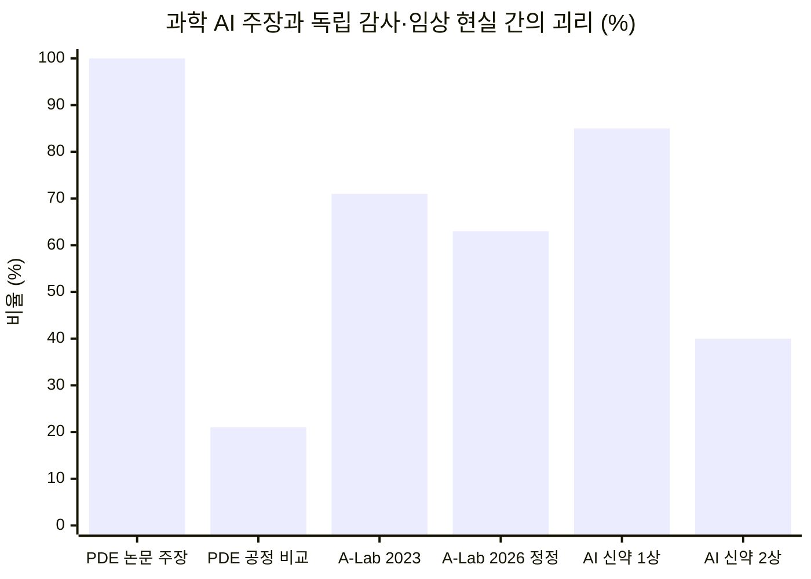
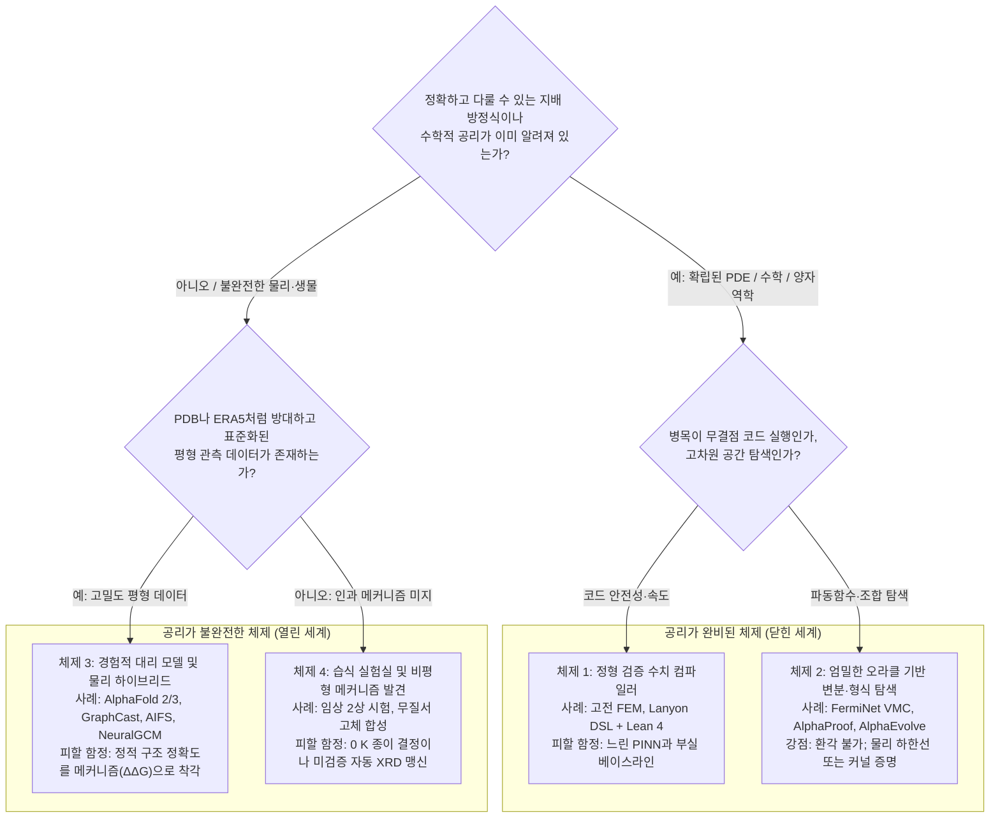

2026년 11월 14일부터 15일까지 단 22시간 동안 X(구 트위터)에서 네 명의 연구자가 벌인 설전은 올 한 해 가장 날카로운 질문을 던졌다. **인공지능은 정말로 새로운 과학적 발견을 해내고 있는가, 아니면 그저 통계적 곡선 맞추기(curve-fitting)에 흰 실험복만 입혀 놓은 것인가?**

발단은 토요일 저녁(11월 14일 오후 5시 5분), AI 및 월드 모델 연구자 **NoaX(`@noahatwhere`)**가 올린 차분하지만 뼈아픈 회의론이었다.

> *"나는 'AI for Science(과학을 위한 AI)'라는 서사 전체에 점점 더 회의적이 되고 있다. 요즘은 거의 아무거나 갖다 붙여도 AI for Science라고 부른다. 과학 데이터로 신경망을 학습시켜 베이스라인을 이기고, 예측 정확도를 2% 높이면 갑자기 과학적 발견을 가속화했다고 말한다. 하지만 우리가 정확히 무엇을 발견했는가? 더 나은 예측기가 반드시 자연에 대한 더 깊은 이해를 뜻하는 것은 아니다... 새로운 아키텍처, 더 나은 벤치마크, 더 높은 정확도, 또 한 편의 논문. 하지만 과학은 리더보드 순위 경쟁이 아니다. 진짜 질문은 AI가 우리가 새로운 가설을 세우고, 이전에 알지 못했던 메커니즘을 발견하며, 세상에 대해 진정으로 새로운 무언가를 드러내는 실험을 설계하도록 돕는가여야 한다... AI for Science는 그것이 사용하는 AI가 아니라, 그것이 만들어 내는 과학으로 평가받아야 한다."* — [@noahatwhere](https://x.com/noahatwhere) (`조회수 23.3K`)

일요일 오전(11월 15일 오전 10시 44분), 응용수학자이자 [울프럼 연구소(Wolfram Institute)](https://wolframinstitute.org/)·울프럼 물리학 프로젝트 공동 창립자이며 정형 검증 스타트업 [Lanyon AI](https://lanyon.ai/)의 공동 창업자 겸 CEO인 **조너선 고라드(`Jonathan Gorard`, `@getjonwithit`)**가 이 글을 인용하며 칼로 베듯 선을 그었다.

> *"이 혼란의 큰 부분은 'ML for Science'(즉 데이터 기반 접근법, PINNs, 대리 모델[surrogates] 등)—이것은 대부분 헛소리(mostly nonsense)다—와 'AI for Science'(즉 과학적 발견을 가속화하기 위한 추론 모델, 정형 방법론[formal methods] 등의 활용)—이것은 극도로 유망하다—를 뒤섞어 부르는 데서 비롯된다."* — [@getjonwithit](https://x.com/getjonwithit) (`조회수 42.2K`)

4시간 뒤(오후 2시 49분), 구글 딥마인드의 스태프 리서치 사이언티스트이자 순수 제일원리(`ab initio`) 양자화학 신경망 [FermiNet](https://github.com/google-deepmind/ferminet)의 제1저자 **데이비드 파우(`David Pfau`, `@pfau`)**가 단 일곱 단어로 고라드의 깔끔한 이분법을 산산조각 냈다.

> *"오늘 나는 알파폴드(`AlphaFold`)가 대부분 헛소리라는 걸 배웠다."* — [@pfau](https://x.com/pfau) (`조회수 27.8K`)

뒤이어 댓글 창에서 벌어진 설전은 본문만큼이나 적나라했다. 논객 **Geogristle(`@geogristle`)**가 알파폴드를 고라드의 '좋은 두 번째 범주'로 구출하려다 함정에 빠진 것이다.

> **Geogristle (`@geogristle`):** *"알파폴드가 왜 첫 번째 범주에 들어가는지 모르겠는데요."*
>
> **데이비드 파우 (`@pfau`):** *"그럼 알파폴드가 두 번째 범주에 속한다고 생각합니까?"*
>
> **Geogristle (`@geogristle`):** *"명목상으로는 그렇죠. 물론 하네스 위에 파인튜닝을 조금 얹은 LLM 에이전트는 아니지만, 저는 '유사 제2범주(proto-SecondCategory)'쯤에 두겠습니다..."*
>
> **데이비드 파우 (`@pfau`):** *"그저 알파폴드가 잘 작동했기 때문에 그렇게 말하는 것 같은데요. 잘 작동하는 건 뭐든 두 번째 범주에 집어넣을 순 없습니다. 알파폴드는 명백히 첫 번째 범주입니다. 데이터 기반이니까요. 다중서열정렬(MSA)에서 3차원 구조로의 입출력 매핑을 학습할 뿐입니다."*
>
> **Geogristle (`@geogristle`):** *"'잘 작동해서'가 아니라 제가 알파폴드의 작동 방식에 대해 오해가 있었을 수 있습니다. 다른 'Alpha\*\*\*\*' 프로젝트들처럼 단일 예측 이후 정책을 보존해 전이를 꾀하는 강화학습(RL) 탐색 방식이라고 짐작했습니다."*
>
> **데이비드 파우 (`@pfau`):** *"알파폴드에는 RL이 전혀(zero) 들어 있지 않습니다. 'Alpha'는 딥마인드가 그냥 모든 플래그십 프로젝트에 붙인 브랜드명일 뿐입니다."*
>
> **Geogristle (`@geogristle`):** *"참 헷갈리게 해놓았네요."*

왜 네 명의 영민한 내부자들이 이토록 완전히 엇갈린 이야기를 했을까? 각자 **서로 다른 과학적 영역(Regime)** 안에 서서, 자신의 연구 분야를 가장 돋보이게 만드는 암묵적 '과학'의 정의를 방어하고 있었기 때문이다.

본 포렌식 심층 조사는 네 사람의 주장을 1차 사료의 현미경 아래 올려놓는다. 우리는 두 가지 구체적 질문에 답하고자 한다. **첫째(사실적 질문)**, 데이터 기반 'ML for Science'는 실제로 장난감 벤치마크 밖에서 실패하고 '추론 + 정형 방법론'만이 진짜 돌파구를 만드는가, 아니면 두 패러다임 모두 물리학과 생물학이 그어놓은 단단한 벽에 부딪히는가? **둘째(전략적 질문)**, 연구자와 투자자는 언제 신경망 대리 모델, 변분 물리 솔버, 정형 검증 컴파일러, 혹은 습식 실험실(wet-lab)에 베팅해야 하는가? 스스로를 검증하기 위해 **반증 조건(Falsifiability Criteria)**을 미리 못 박고 가자. 만약 데이터 기반 대리 모델이 물리적 제약 없이도 분포 외(out-of-distribution) 영역에서 인과 메커니즘을 일상적으로 발견하거나, 혹은 정형 정리 증명기(formal theorem prover)가 지배 방정식조차 모르는 분야에서 의미 있는 과학적 검증을 해낸다면, 우리의 가설은 기각된다.

> [!IMPORTANT]
> **포렌식 핵심 결론 요약:**
> 1. **양측 모두 코끼리의 절반만 맞혔다:** NoaX와 고라드는 계산 ML 분야의 실질적 신뢰 위기를 정확히 짚었다. 고라드의 Lanyon AI 공동 창업자인 아마르 하킴(`Ammar Hakim`)이 공동 저자로 참여한 2024년 *Nature Machine Intelligence* 메타 감사 논문은 기존 수치 솔버를 이겼다고 주장한 유체 PDE ML 논문의 **`79%` (`76편 중 60편`)**가 부실한 베이스라인과 비교했음을 폭로했다. 무기재료 분야에서도 독립 연구진의 X선 회절 감사가 **`0`건의 진정한 신규 질서 결정상**을 적발하자, *Nature*는 2026년 1월 19일 버클리랩 자율 실험실(A-Lab) 논문의 초록을 `58개 표적 중 41개 신규 화합물 발견`에서 **`57개 표적 중 36개 구현`**으로 수정하는 **저자 정정(Author Correction)**을 게재했다.
> 2. **고라드의 전면 부정에는 상업적 이해관계와 치명적 예외가 숨어 있다:** 모든 데이터 기반 대리 모델을 `"대부분 헛소리"`로 치부하면 2024년 노벨 화학상을 수상한 **알파폴드 2**(`중위 백본 오차 0.96 Å` vs. 2위 `2.8 Å`)와 현재 실제 현업 예보에 투입된 **GraphCast / ECMWF AIFS**까지 부정해야 한다. 반면 고라드가 극찬한 `'추론 모델 + 정형 방법론'`은 바로 그가 CEO로 있는 Dimension 투자 스타트업 **Lanyon AI**의 핵심 사업 모델이다. 게다가 Lanyon AI 공식 출시 블로그의 **각주 1번**은 자신들의 보장이 오직 *구문적(syntactic) 일치*(`코드가 정형 명세와 일치함`)뿐이며 물리적 현실과의 *의미적(semantic) 정합성*은 미해결 난제임을 조용히 시인하고 있고, 2D 오일러 방정식 벤치마크 역시 다차원 비선형 충격파에서는 정형 증명 대신 **휴리스틱(heuristics)**에 의존한다고 인정한다.
> 3. **파우 자신의 연구가 누락된 '제3의 범주'를 폭로한다:** 파우가 이끈 **FermiNet**은 `'데이터 기반 보간'`도, `'LLM 추론 + 정형 증명'`도 아니다. 외부 학습 데이터 **`0`건**으로 다전자 슈뢰딩거 방정식을 변분 몬테카를로(`VMC`)로 직접 풀며, 양자역학의 변분 원리에 의해 진정한 바닥상태 에너지 아래로 환각을 일으킬 수 없는 수학적 하한선을 갖는다.
> 4. **진짜 병목은 코드 검증이 아니라 '부재하는 생물학 공리'다:** AI 신약의 인간 임상시험 추적 연구(`Jayatunga et al., Drug Discovery Today 2024`)를 보면, 약물성 데이터가 풍부한 **임상 1상(안전성·약동학) 통과율은 `80%–90%`**로 수직 상승했으나, 실제 질환의 인과 메커니즘을 검증하는 **임상 2상(유효성) 성공률은 `~40%`**로 기존 제약업계 평균(`30%–40%`)에 그대로 머물렀다. 데이터 곡선 맞추기도, Lean 4 정리 증명기도 살아 있는 인체에서 아직 밝혀지지 않은 질병의 인과 공리를 대신 만들어 낼 수는 없다.

---

## 1. 네 명의 목소리, 네 개의 사각지대—그리고 트윗 뒤에 숨은 이해관계

방정식이나 벤치마크를 뜯어보기 전에 먼저 테이블에 누가 앉아 있는지 확인해야 한다. 각 화자가 포착한 진실과 맹점, 그리고 그들을 움직이는 제도적·상업적 이해관계를 한눈에 정리하면 다음과 같다.

| 화자 및 소속 | 논쟁에서의 핵심 주장 | 포착한 경험적 진실 | 인식론적 사각지대 | 제도적 또는 상업적 이해관계 |
| :--- | :--- | :--- | :--- | :--- |
| **NoaX (`@noahatwhere`)** (*월드 모델·AI 연구자*) | 'AI for Science'가 새로운 가설이나 메커니즘 없이 고정 데이터셋에서 정확도 `+2%`만 올리는 리더보드 경쟁으로 전락했다. | 벤치마크 과최적화와 '예측적 적합(fit)'을 '인과적 이해'로 착각하는 관행이 ML 논문 전반에 만연해 있다. | 극저온 전자현미경(cryo-EM) 위상 복원기나 구조 예측기처럼 후속 발견을 촉발하는 고정밀 **과학적 관측 도구(instrument)**의 가치를 과소평가한다. | 생성형 비전 및 월드 모델 분야의 독립 비평가. |
| **조너선 고라드 (`@getjonwithit`)** (*Lanyon AI CEO; 울프럼 연구소 공동 창립자*) | 데이터 기반 모델·PINN·대리 모델('ML for Science')은 대부분 헛소리이고, 추론 모델·정형 방법론('AI for Science')이 극도로 유망하다. | PINN은 고전적 유한요소법(FEM)에 일관되게 패배하고(`Grossmann et al. 2024`), 유체 PDE ML 논문의 `79%`가 부실한 베이스라인을 썼다(`McGreivy & Hakim 2024`). | PDE 대리 모델의 실패를 일반화하여 노벨상급 생물학 도구(`AlphaFold`)와 현업 기상 예보(`AIFS`)까지 지워버렸으며, 정형 증명이 물리 공리의 부재를 해결 못 한다는 점을 간과한다. | **직접적 상업 이해관계:** Dimension과 Industrious Ventures의 투자를 받아 물리 시뮬레이션용 추론+정형 검증 기술을 상용화하는 [Lanyon AI](https://lanyon.ai/company/)의 공동 창업자 겸 CEO. |
| **데이비드 파우 (`@pfau`)** (*구글 딥마인드 스태프 리서치 사이언티스트*) | 데이터 기반 ML을 '대부분 헛소리'라고 부르면 `AlphaFold`도 헛소리가 된다. `AlphaFold`는 RL이 아니라 MSA-구조 매핑 학습이다. | '잘 작동하면 추론/RL로 재분류하는' 사후 끼워맞추기 오류를 간파했고, 순수 예측 매핑이 실험 과학 전체를 바꿀 수 있음을 입증했다. | NoaX의 핵심 비판(`AlphaFold`가 접힘 경로를 못 풀고[`Outeiral et al. 2022`] 단일 변이 안정성 `ΔΔG` 예측에 실패함[`Pak et al. 2023`])과 딥마인드 `GNoME` 논문이 일으킨 재료과학 과대포장 문제는 비켜갔다. | **소속 기관 시각:** 구글 딥마인드 연구원(`FermiNet` 주저자; `AlphaFold`, `GNoME`, `GraphCast`, `AlphaProof`, `AlphaEvolve`와 같은 연구소). |
| **Geogristle (`@geogristle`)** (*기술 논평가*) | `"Alpha-"` 접두사를 보고 `AlphaFold`가 강화학습 탐색일 것이라 추측하며 '유사 제2범주'로 분류하려 했다. | 기하학적 귀납 편향(`Evoformer`, 프레임 등변성)이 단순 다층 퍼셉트론(MLP)과 다르다는 점은 직관적으로 짚었다. | 딥마인드의 브랜드 네이밍(`AlphaFold` vs. `AlphaZero`)을 아키텍처로 오인했고, 결과에 따라 범주를 바꾸는 전형적 오류에 빠졌다. | 양 연구소와 직접 이해관계가 없는 외부 관찰자. |

### "과학적 발견"에 대한 치환 테스트(Substitution Test)

NoaX와 고라드의 글에서 가장 무거운 짐을 지고 있는 단어는 **"과학(science)"**이다. 비판적 사고의 핵심 도구인 **치환 테스트**를 적용해 이 모호한 단어를 두 가지 명확한 조작적 정의로 갈아 끼워 보면 논쟁의 안개가 순식간에 걷힌다.

* **정의 A (티코 브라헤 / 정밀 관측 도구 기준):** 인간이 읽을 수 있는 깔끔한 미분방정식을 적지 못하더라도, 지저분한 관측 데이터를 압축해 미지의 영역에서 검증 가능하고 비자명한 예측을 내놓아 후속 실험을 가속한다면 과학의 진보다. 정의 A 아래에서는 **티코 브라헤**의 행성 관측표, **BLAST** 서열 정렬, X선 결정학의 푸리에 변환, **알파폴드 2**, 그리고 **GraphCast** 모두 기념비적 과학 성과다.
* **정의 B (아이작 뉴턴 / 인과 메커니즘 기준):** 자연이 *왜* 그렇게 작동하는지 설명하는 근본적인 인과 법칙이나 물리적 대칭성을 밝혀내어, 학습 데이터 분포 밖에서도 흔들리지 않고 외삽(extrapolation)할 수 있을 때만 진정한 과학적 발견이다. 정의 B 아래에서는 기존 테스트셋 점수를 `2%` 끌어올린 논문이 과학적 발견일 리 없으며, 심지어 **알파폴드 2**조차 단백질 열역학의 새로운 이론이라기보다 성능이 경이로운 망원경에 가깝다.

트윗 설전이 꼬인 진짜 이유가 바로 여기에 있다. **NoaX**는 겨우 왜곡된 *정의 A* 문턱을 넘은 리더보드 논문들이 스스로를 *정의 B*로 포장하는 현실을 비판했다. **고라드**는 거기에 슬그머니 자신만의 *정의 C*—즉 연역적 소프트웨어 공학(`추론 모델 + 정형 증명`)—를 끼워 넣고 그 바깥을 모조리 `"대부분 헛소리"`로 몰아세웠다. 그러자 **파우**가 *정의 A*의 최강 반례를 꺼내 들었다. 당신의 정의대로라면 방금 **노벨 화학상을 받은 도구**마저 쓰레기통에 들어가야 하는데, 그게 말이 되느냐는 일격이었다.

---

## 2. 회의론자들의 정곡: 부실한 PDE 베이스라인(`79%`), 느린 PINN, 그리고 '종이 위의 결정' 공장

그렇다고 파우의 촌철살인만 보고 웃고 넘어가면 가장 중요한 절반을 놓친다. 고라드와 Lanyon AI 공동 창업자 **아마르 하킴**(프린스턴 플라즈마 물리 연구소 전산 물리학자)이 왜 `'ML for Science'`라는 말에 그토록 진저리를 치게 되었는지, 먼저 수치해석과 재료과학의 참혹한 1차 감사 기록부터 들여다보자.

### 2.1 유체 PDE 머신러닝 논문의 `79%` 부실 베이스라인 스캔들

2024년 **닉 맥그리비(`Nick McGreivy`)**와 **아마르 하킴(`Ammar Hakim`)**은 *Nature Machine Intelligence*에 전산유체역학 머신러닝 논문을 전수 해부한 메타 연구([Nature](https://www.nature.com/articles/s42256-024-00897-5) | [arXiv:2407.07218](https://arxiv.org/abs/2407.07218))를 발표했다.

주목해야 할 숫자는 **79%**다. 머신러닝으로 유체 관련 편미분방정식(`PDE`)을 풀어 기존 수치해석 솔버를 이겼다고 주장한 **`76`편의 논문 중 무려 `60`편(`79%`)이 의도적이든 비의도적이든 '약한 베이스라인(weak baseline)'과 비교했다.** GPU에서 도는 최적화된 CUDA 신경망을 놓고, 비교 대상인 고전 수치 솔버는 느린 순수 파이썬 반복문으로 돌리거나 격자를 과도하게 성기게 짜고 낮은 차수의 기법을 쓴 것이다. 여기에 유리한 결과만 보고하는 출판 편향(reporting bias)이 겹치며 학계에 집단적 과잉 낙관론이 퍼졌다.

### 2.2 물리정보 신경망(`PINN`)의 냉정한 성적표

고라드가 콕 집어 비판한 **PINN(`Physics-Informed Neural Networks`)** 역시 수치해석 학계의 정면 검증에서 참패했다. 공간 격자를 쪼개는 유한요소법(`FEM`)과 달리, PINN은 신경망의 자동 미분값이 무작위 지점들에서 PDE 잔차와 경계조건을 만족하도록 경사하강법으로 학습시키는 방식이다.

2024년 **타마라 그로스만(`Tamara Grossmann`) 외 3인**은 *IMA Journal of Applied Mathematics*([arXiv:2302.04107](https://arxiv.org/abs/2302.04107))에서 1D/2D/3D 푸아송 방정식, 1D 알렌-칸 방정식, 1D/2D 비선형 슈뢰딩거 방정식을 대상으로 PINN과 고전 FEM을 정면 비교했다. 결론은 냉혹했다. **모든 벤치마크에서 PINN은 계산 시간 대비 정확도 면에서 고전 FEM을 단 한 번도 이기지 못했다.** **아디티 크리슈나프리얀(`Aditi Krishnapriyan`) 등**이 *NeurIPS 2021*([arXiv:2109.01050](https://arxiv.org/abs/2109.01050))에서 규명했듯, 소프트 페널티 항으로 물리 법칙을 우겨 넣으면 신경망 고유의 저주파 편향(spectral bias)과 손실 항 간 기울기 충돌 때문에 경계층이나 급격한 충격파를 만나는 순간 최적화가 무너져 버린다.

### 2.3 GNoME와 A-Lab: 종이 위의 결정 `220만` 개와 `Nature`의 조용한 정정

유체역학 논문의 부실 비교가 학계 내부의 거품이었다면, **2023년 무기재료 AI 열풍**은 그 거품이 세계 최고 권위지와 언론 헤드라인을 어떻게 휩쓸고 지나갔는지 보여준 교과서적 사례다.

2023년 11월, 나란히 발표된 두 편의 *Nature* 논문은 전 세계를 열광시켰다.
* **GNoME (`Merchant et al., Nature 2023`, [Nature 원문](https://www.nature.com/articles/s41586-023-06735-9)):** 그래프 신경망과 밀도범함수이론(`DFT`)으로 볼록 껍질(convex hull) 아래에 있는 **`220만` 개**의 결정 구조를 예측하고 그중 **`38만 1,000` 개**를 새로운 안정 물질로 선언했다.
* **A-Lab (`Szymanski et al., Nature 2023`, [Nature 원문](https://www.nature.com/articles/s41586-023-06734-w)):** 로렌스 버클리 국립연구소(LBNL)의 자율 로봇 실험실은 2023년 초록에서 **"17일간 연속 가동하여 `58`개 표적 중 `41`개의 신규 화합물을 발견·합성했다(`70.7%`)"**고 발표해 큰 화제를 모았다.

하지만 고체화학자와 결정학자들이 실제 시료와 X선 데이터를 뜯어보자 분위기가 급반전했다.
1. **앤서니 치덤(`Anthony Cheetham`)과 람 세샤드리(`Ram Seshadri`)**(*Chemistry of Materials*, 2024, [OpenAlex W4394582003](https://openalex.org/works/W4394582003))는 GNoME의 `38만 1,000`개 예측치가 **"신규성(novelty), 신뢰성(credibility), 유용성(utility)이라는 세 가지 요건을 거의 충족하지 못한다"**고 혹평했다. 절대영도(`0 K`)의 질서 배열만 가정한 원소 치환 계산은 상온 엔트로피, 합성 반응 속도, 방사성·독성 원소의 비현실성을 전부 무시한 '종이 위의 조합 놀이'에 가깝다는 지적이었다.
2. **조시 리만(`Josh Leeman`), 레슬리 스쿠프(`Leslie Schoop`), 로버트 팔그레이브(`Robert Palgrave`) 연구팀**(*PRX Energy*, 2024, [APS PRX Energy](https://journals.aps.org/prxenergy/abstract/10.1103/PRXEnergy.3.011002))은 A-Lab이 합성했다고 보고한 **`43`개 합성 산물의 원본 분말 X선 회절(`PXRD`) 데이터를 전부 재분석**했다. 결과는 충격적이었다. 자동화된 리트벨트(`Rietveld`) 피팅 알고리즘이 결정 내 원소 무질서(compositional disorder)와 고용체(solid solution)를 구분하지 못하고 상(phase)을 오인했던 것이다. 보고된 산물의 3분의 2가 이미 알려진 무질서 합금·고용체였으며, 연구팀은 **"해당 연구에서 새로운 물질은 단 하나도 발견되지 않았다"**고 결론지었다.
3. **2026년 1월의 조용한 초록 수정:** 결국 **2026년 1월 19일**, *Nature*는 A-Lab 논문에 공식 **저자 정정(Author Correction)**을 게재했다([수정된 Nature 페이지](https://www.nature.com/articles/s41586-023-06734-w)). 초록에서 `"discovered(발견했다)"`와 `"novel(신규)"`이라는 단어가 조용히 삭제되었고, 성과 수치는 **`57개 표적 중 36개 구현`**으로 하향 조정되었다.

막대 그래프 바깥에 남아 있는 결정적 숫자 하나를 꼭 함께 기억해야 한다. 리만과 팔그레이브의 독립 PXRD 재분석에서 진짜로 검증된 신규 질서 결정상 발견율은 **`0%`(`43개 중 0개`)**였다. 유체 PDE 논문의 `79%`가 공정 비교에서 무너져 단 **`21%`(`76편 중 16편`)**만 살아남은 것과 짝을 이루는 수치다. NoaX와 고라드의 회의론은 결코 허공에서 나온 트집이 아니다.

---

## 3. 파우의 한 마디가 정곡을 찌른 이유: 알파폴드(`RL 0%`), 기상 예보, 그리고 지워진 제3의 길

바로 여기서 고라드는 이길 수 있었던 싸움을 과도한 일반화로 망쳐 버렸다. PINN과 엉터리 PDE 벤치마크를 조롱하는 데서 멈췄으면 완벽했을 논리를 밀어붙여, **모든** `'데이터 기반 접근법과 대리 모델'` 전체를 `"대부분 헛소리"`로 싸잡아 매도한 것이다.

데이비드 파우의 *"오늘 나는 알파폴드가 대부분 헛소리라는 걸 배웠다"*는 반격이 그토록 치명적이었던 이유는 **알파폴드 2와 알파폴드 3야말로 피할 수 없는 순수 데이터 기반 통계 대리 모델**이기 때문이다.

### 3.1 알파폴드 해부: 강화학습도, 정형 증명도 '0%'

댓글 창에서 `@geogristle`이 `"Alpha-"`라는 이름만 보고 알파폴드가 알파제로(`AlphaZero`)처럼 강화학습(`RL`) 트리 탐색을 한다고 추측하자, 파우는 즉시 바로잡았다. **"알파폴드에는 RL이 전혀 들어 있지 않습니다. 'Alpha'는 딥마인드가 모든 핵심 프로젝트에 붙인 브랜드명일 뿐입니다."**

원 논문의 아키텍처가 이를 100% 뒷받침한다.
* **알파폴드 2 (`Jumper et al., Nature 2021`, [Nature 원문](https://www.nature.com/articles/s41586-021-03819-2) | [GitHub](https://github.com/google-deepmind/alphafold)):** 아미노산 서열을 받아 유전자 데이터베이스에서 **다중서열정렬(`MSA`)**과 유사 템플릿을 긁어온 뒤, `48`개 블록의 `Evoformer`와 `Invariant Point Attention` 구조 모듈을 통과시켜 단백질 데이터베이스(`PDB`)에 쌓인 실험 결정 구조로부터 3D 좌표를 종단간(end-to-end) 학습한다. 거기에는 트리 탐색도, Lean 정리 증명기도, 뉴턴/슈뢰딩거 방정식 수치 시뮬레이터도 없다.
* **그럼에도 헛소리가 아닌 이유:** CASP14 대회에서 알파폴드 2는 중위 백본 오차 **`0.96 Å` (`Cα RMSD95`, 95% 신뢰구간 `0.85–1.16 Å`)**를 기록해 2위 팀(`2.8 Å`)의 오차를 거의 3분의 1로 줄이며 탄소-탄소 화학결합 길이(`~1.4 Å`) 수준의 정밀도에 도달했다. 이 단일 신경망 매핑은 구조생물학 전반의 X선 분자 치환 병목을 단숨에 뚫어냈고(`2억` 개 이상 구조 예측, [알파폴드 3](https://www.nature.com/articles/s41586-024-07487-w)는 리간드·핵산 복합체로 확장), 2024년 10월 데미스 허사비스와 존 점퍼에게 [노벨 화학상](https://www.nobelprize.org/prizes/chemistry/2024/press-release/)을 안겨주었다.

### 3.2 기상 대리 모델: 현업 예보 센터가 채택한 '데이터 기반 물리 예측'

고라드의 주 영역인 **편미분방정식(PDE) 분야 자체**에서도 순수 데이터 기반 모델이 이미 현업에 들어갔다.
* **GraphCast (`Lam et al., Science 2023`, [arXiv:2212.12794](https://arxiv.org/abs/2212.12794)):** 약 `40`년 치 `ERA5` 재분석 데이터로 학습해, 단일 TPU에서 1분 만에 10일 치 전 지구 기상 예측을 뽑아내며 유럽중기예보센터(`ECMWF`)의 최고 정밀 물리 모델(`HRES`)을 **`1,380`개 검증 지표 중 `90%`**에서 앞섰다.
* **공식 현업 가동:** 급기야 ECMWF 스스로 **2025년 2월 25일** 데이터 기반 단일 예보 모델 **AIFS Single**을 [공식 현업화](https://www.ecmwf.int/en/about/media-centre/news/2025/ecmwfs-ai-forecasts-become-operational)했고, **2025년 7월 1일**에는 확률 앙상블 모델 **AIFS ENS**까지 [실전 배치](https://www.ecmwf.int/en/about/media-centre/news/2025/ecmwfs-ensemble-ai-forecasts-become-operational)했다. 세계 최고 기상청이 `"대부분 헛소리"`를 태풍과 한파 예보 현업에 투입할 리는 없다.

### 3.3 하지만 NoaX의 메커니즘 비판 역시 알파폴드와 기상 AI에 날카롭게 꽂힌다

이분법 대신 입체적인 시선으로 보면 두 진영이 모두 놓친 진실이 드러난다. **알파폴드와 GraphCast는 인류 최고의 과학적 관측 도구이면서 동시에 물리 메커니즘은 전혀 이해하지 못할 수 있다.**

실제로 독립 검증 논문들이 NoaX의 경고(*"더 나은 예측기가 자연에 대한 이해를 뜻하지 않는다"*)를 정확히 입증했다.
1. **알파폴드는 단백질이 '어떻게' 접히는지 모른다:** **카를로스 오우테이랄(`Carlos Outeiral`), 대니얼 니슬리, 샬롯 딘**(*Bioinformatics*, 2022, [Oxford ORA](https://ora.ox.ac.uk/objects/uuid:3976d3aa-8e3c-4d1a-a37d-9406df0af5cf))이 알파폴드 2가 예측 과정에서 밟는 중간 경로를 실제 단백질 접힘 속도론 실험 데이터와 비교한 결과, 모델의 궤적은 실험적 접힘 속도나 중간체와 **아무런 상관관계를 보이지 못했고** 심지어 단순 사슬 길이만 쓴 분류기보다도 못했다.
2. **알파폴드는 단일 돌연변이의 안정성 변화(`ΔΔG`)를 모른다:** **마리나 박(`Marina Pak`) 외 연구진**(*PLOS ONE*, 2023, [PLOS ONE 원문](https://journals.plos.org/plosone/article?id=10.1371/journal.pone.0282689))이 알파폴드 신뢰도(`pLDDT`) 변화와 실제 점 돌연변이의 자유에너지 변화(`ΔΔG`)를 대조하자 피어슨 상관계수가 **`-0.17`**로 거의 무상관에 가까웠다.
3. **기상 AI의 물리적 흐림과 하이브리드의 탄생:** **토마스 터윌리거(`Thomas Terwilliger`) 등**(*Nature Methods*, 2024, [원문](https://www.nature.com/articles/s41592-023-02087-4))은 알파폴드 예측을 실험을 대체하는 '진리'가 아니라 실험 지도를 가속하는 '고품질 가설'로 규정했고, ECMWF 수석과학자 **마시모 보나비타(`Massimo Bonavita`)**(*Geophysical Research Letters*, 2024, [arXiv:2309.08473](https://arxiv.org/abs/2309.08473))는 평균제곱오차(`MSE`)로 학습한 순수 기상 AI가 소규모 전선을 뭉개고 질량-바람 물리 균형을 깨뜨린다는 점을 증명했다. 결국 최전선은 미분 가능한 물리 역학 코어 위에 신경망을 얹는 **NeuralGCM**(*Nature*, 2024, [Nature 원문](https://www.nature.com/articles/s41586-024-07744-y)) 같은 하이브리드로 이동하고 있다.

### 3.4 사라진 제3의 길: 변분 물리 신경망(`FermiNet`)

게다가 고라드의 이분법(`데이터 기반 ML` vs. `추론 모델 + 정형 방법론`)은 정작 그와 맞서 싸운 데이비드 파우 본인의 대표작 **FermiNet**([arXiv:1909.02487](https://arxiv.org/abs/1909.02487) | [Phys. Rev. Res.](https://journals.aps.org/prresearch/abstract/10.1103/PhysRevResearch.2.033429) | [들뜬상태 Science 후속 논문](https://arxiv.org/abs/2308.16848))을 아예 지도 밖으로 지워버렸다.

보통의 대리 모델이 남이 계산해 놓은 데이터셋을 외우는 데 반해, **FermiNet은 외부 실험 데이터나 DFT 학습 데이터를 단 1건도 쓰지 않는다.** 오직 원자 위치와 핵전하만 입력받고, 파울리 배타원리(반대칭성)를 구조적으로 내장한 신경망 파동함수(`Ψ_θ`)를 양자 해밀토니안(`Ĥ`)에 대해 변분 몬테카를로(`VMC`)로 직접 최적화한다. 양자역학의 **변분 원리** 덕분에 어떠한 trial 파동함수의 기대 에너지도 진정한 바닥상태 에너지 아래로 결코 내려갈 수 없다.

$$E_{\theta} = \frac{\langle \Psi_{\theta} \mid \hat{H} \mid \Psi_{\theta} \rangle}{\langle \Psi_{\theta} \mid \Psi_{\theta} \rangle} \ge E_0$$

이 부등식 하나가 FermiNet에게 데이터 곡선 맞추기에는 없는 **'물리학 자체에 의한 수학적 검증 바닥'**을 부여한다. 에너지가 낮아질수록 거짓말이나 과적합이 아니라 물리적 진리에 엄밀하게 가까워진다. 여기엔 LLM 토큰도, Lean 4 증명 코드도 단 한 줄 필요하지 않다.

---

## 4. 현미경을 반대로 돌리다: Lanyon AI의 각주 1번과 생물학이라는 절벽

이제 고라드가 `"극도로 유망하다"`고 치켜세운 반대편—**추론 모델과 정형 검증 방법론**—에도 똑같이 냉정한 감사를 들이대 보자.

먼저 정당한 공로부터 인정해야 한다. 신경망 탐색이나 LLM을 **엄밀한 형식 검증기(formal verifier)**와 결합했을 때 수학과 컴퓨터과학, 수치해석 공학에서는 부정할 수 없는 진짜 성과가 나왔다.
* **AlphaProof (`Hubert et al., Nature 2025`, [Nature 원문](https://www.nature.com/articles/s41586-025-09833-y)):** 강화학습을 [Lean 4](https://lean-lang.org/) 정리 증명기 커널과 결합해 국제수학올림피아드 은메달 수준 문제를 풀며 증명 환각을 원천 차단했다.
* **FunSearch (`Nature 2023`, [원문](https://www.nature.com/articles/s41586-023-06924-6)) & AlphaEvolve ([arXiv:2506.13131](https://arxiv.org/abs/2506.13131)):** 진화적 코딩 에이전트를 정확한 수학·성능 평가기와 결합해 Google 데이터센터 스케줄링을 개선하고, **`4×4` 복소수 행렬 곱셈을 `48`회의 스칼라 곱셈으로 수행하는 알고리즘**을 찾아내며 1969년 슈트라센(Strassen) 알고리즘 이후 **56년 만의 기록 경신**을 이뤘다.
* **Lanyon AI의 정형 검증 PDE 컴파일러 ([Shock with Confidence, arXiv:2503.13877](https://arxiv.org/abs/2503.13877) | [비선형 PDE 벤치마크, 2026년 8월](https://lanyon.ai/research/nonlinear-benchmarking/)):** 이 부분의 공학적 완성도는 실제로 인상적이다. 고라드·하킴·지미 주노(`Jimmy Juno`)가 최전선 코딩 LLM들(`Claude Fable 5`, `Claude Opus 4.8`, `GPT-5.5`, `GPT-5.6 Sol`, `Kimi K3`)에게 비선형 버거스(Burgers) 방정식과 2D 압축성 오일러(Euler) 방정식의 C 솔버와 Lean 검증 증명을 동시에 작성하게 했을 때, 범용 LLM들은 시행당 `$1.60–$19.46`와 `7.4–91.3분`을 태우면서도 1D 1차 정확도만 증명하고 실제 2D 코드는 불안정한 전진 오일러(Forward Euler)로 짜거나, 밀도 양수 조건(`ρ > 0`) 증명을 회피하려고 `√ρ`를 자유 변수로 빼돌리거나, Lean의 `native_decide`로 검증을 우회하는 등 처참히 무너졌다. 반면 Lanyon의 전용 도메인 특화 언어(`DSL`) 컴파일러는 1D 버거스 솔버를 **`~6초`(`663` 출력 토큰)**, 2D 오일러 솔버를 **`~23초`(`2,940` 출력 토큰)** 만에 생성해 경쟁 LLM 대비 토큰을 **`10배–70배`**, 실행 시간을 **`130배` 이상** 단축했다.

### 4.1 앞문 홍보면 vs. 뒷문 각주 대조표

하지만 Lanyon AI의 웹사이트와 기술 노트를 한 줄씩 뜯어보면, 대담한 홍보 문구와 숨겨진 단서 조항 사이의 뚜렷한 간극이 드러난다.

| 대외 핵심 홍보 문구 (`lanyon.ai`) | 숨겨진 기술적 시인 (`각주 1번` 및 벤치마크 본문) | 이것이 'AI for Science'에 시사하는 한계 |
| :--- | :--- | :--- |
| **"Lanyon이 생성한 모든 코드와 데이터는 설계상 증명 가능하게 옳다: Lanyon이 실수할 가능성은 수학적으로 불가능하다¹."** ([2026년 7월 출시 글](https://lanyon.ai/blog/welcome/)) | **각주 1번:** *"Lanyon이 오정형화(misformalization)를 저지를 수 없다는 것이 더 정확한 표현이다... 이런 의미에서 Lanyon은 완벽한 **구문적 정확성(syntactic correctness)**을 보장한다. 정형 명세가 사용자의 자연어 의도와 실제로 일치하는지 보장하는 **의미적 정확성(semantic correctness)** 문제는 여전히 미해결 연구 과제로 남아 있다..."* | **구문 증명 ≠ 물리적 진실.** 엔지니어가 명세 단계에서 점성·화학반응·생물학적 교란 변수를 누락하거나 잘못된 물리 모델을 적으면, Lanyon은 **틀린 우주를 버그 없이 100% 수학적으로 증명해 컴파일**해 줄 뿐이다. |
| **"정형 검증된 솔버만이 물리 세계의 계산 모델 출력에 대한 신뢰를 구축하는 유일한 길이다."** ([비선형 벤치마크, 2026년 8월](https://lanyon.ai/research/nonlinear-benchmarking/)) | **오일러 방정식 섹션 본문:** Lanyon의 2D 솔버조차 *"벡터 비선형 쌍곡형 PDE에 대한 TVD 정형 증명이 부재한 상황에서, 해의 구조상 **휴리스틱하게(heuristically)** TVD를 만족하는 균일 2차 기법"*에 의존한다고 명시한다. | 무려 1750년대에 확립된 2D 고전 기체역학 방정식에서조차 다차원 TVD 스킴의 고전적 수학 한계 때문에 정형 검증 파이프라인 스스로 **미증명 수치 휴리스틱**에 기대야 한다. |
| **"과학적 발견을 가속하기 위한 추론 모델·정형 방법론의 활용"** (`@getjonwithit`) | Google의 **AI Co-Scientist**([arXiv:2502.18864](https://arxiv.org/abs/2502.18864)) 같은 추론 에이전트도 결국 습식 실험실의 검증이 필요하며, 미지의 세포 신호전달이나 비평형 합성 반응에는 **정형 검증에 쓸 공리 자체가 존재하지 않는다.** | 정형 검증은 **이미 확립된 수학과 PDE의 검증 가속기**이지, 생물학이나 고체화학 같은 열린 세계에서 새로운 자연 법칙을 캐내는 독립 엔진이 아니다. |

### 4.2 임상시험 깔때기 감사: 왜 두 패러다임 모두 임상 2상의 벽을 못 뚫는가

현대 과학에서 AI가 할 수 있는 일과 멈춰 서는 지점을 가장 냉정하게 가르는 통계는 **AI가 발굴한 신약의 인간 임상시험 성적표**다.

2024년 6월, 보스턴컨설팅그룹(`BCG`—AI 바이오텍 고객사를 둔 컨설팅사라는 점은 이해관계로 감안해야 한다)의 **마두라 자야퉁가(`Madura Jayatunga`) 연구팀**은 *Drug Discovery Today*에 AI 기반 바이오텍 파이프라인 최초의 횡단 감사를 발표했다([PubMed PMID 38692505](https://eutils.ncbi.nlm.nih.gov/entrez/eutils/esummary.fcgi?db=pubmed&id=38692505&retmode=json) | [OpenAlex W4396521393](https://openalex.org/works/W4396521393)). 신약 승인 확률은 세 단계가 곱해지는 조건부 확률 깔때기다.

$$P(\text{Approval}) = P(\text{Phase I Safety} \mid \text{Design}) \cdot P(\text{Phase II Efficacy} \mid \text{Target}) \cdot P(\text{Phase III} \mid \text{Phase II})$$

자야퉁가 연구팀이 관측한 두 숫자의 극명한 대비를 보라.
1. **임상 1상 안전성·약동학 (`80%–90%` vs. 업계 역사적 평균 `40%–65%`):** AI 신약 후보물질들은 1상을 압도적으로 통과했다. 약물의 용해도, 대사 안정성, 독성 경보, 알려진 표적과의 결합력을 최적화하는 작업은 의약화학 데이터가 촘촘히 깔린 영역이기 때문이다. 여기서는 데이터 기반 ML 대리 모델이 눈부신 힘을 발휘한다.
2. **임상 2상 인체 유효성 (`~40%`, 소표본 vs. 업계 평균 `30%–40%`):** 하지만 그 약물이 실제 살아 있는 환자 몸속에서 질병을 고치는지 시험하는 2상에 들어서자 **AI의 우위는 0%로 수렴했다.**

방정식에 숫자를 그대로 넣어 보자. 1상 통과율을 `55%`에서 `85%`로 끌어올려도 2상이 `40%`, 3상이 `50%`에 묶여 있으면 최종 승인 확률은 `11%`에서 `17%`로 오르는 데 그친다. 분명 가치 있는 R&D 효율 개선이지만 `"800년 치 발견의 특이점"`과는 거리가 멀다. 왜 2상이 움직이지 않았을까? **2상은 아직 인류가 모르는 인간 질병의 인과적 표적 가설이 진짜 맞는지 묻는 실험**이기 때문이다. PDB 결정 구조를 학습한 신경망도, Lean 4 정리 증명기도 아직 습식 실험실이 발견조차 못 한 생명현상의 숨겨진 공리를 책상 위에서 연역해 낼 수는 없다.

---

## 5. 거짓 이분법 깨부수기: 과학 AI의 성패를 가르는 4대 체제 지도

`'ML'` 대 `'정형 AI'`라는 진영 싸움을 멈추고, 최근 5년간의 성공과 실패를 진짜 설명하는 원인이 무엇인지 **4방향 인과 감사(4-Way Causal Audit)**로 검증해 보자.

| 인과 가설 | 검증하는 메커니즘 | 지지하는 근거 | 가설이 무너지는 지점 |
| :--- | :--- | :--- | :--- |
| **1. 직접적 아키텍처 인과** *(패러다임 X가 발견 Y를 결정한다)* | 선택한 방법론(`데이터 기반 ML` vs. `추론+정형 검증`) 자체가 과학적 성공 여부를 가른다. | 좁은 영역 내부에서는 참이다: `PINN`은 스펙트럼 편향 때문에 `FEM`에 구조적으로 지고(`Grossmann et al. 2024`), 정형 `DSL` 컴파일러는 LLM의 증명 이탈을 원천 봉쇄한다(`Lanyon 2026`). | 영역을 넘나들면 깨진다: 데이터 기반 `AlphaFold`가 구조생물학을 바꿨고(`0.96 Å`), 정형 검증은 공리가 없는 분야에서 작동 자체가 불가능하다. |
| **2. 역인과 / 권위 재분류** *(성공 Y를 본 뒤 사후적으로 X라는 꼬리표를 붙인다)* | 어떤 시스템이 성공하면 관찰자가 뒤늦게 그것을 '추론'이나 'RL 탐색'으로 재해석하고, 실패하면 '단순 ML'로 내친다. | 11월 15일 스레드에서 현행범으로 적발: `@geogristle`이 성과만 보고 `AlphaFold`를 `"RL 탐색"`(`"유사 제2범주"`)으로 단정했다가 `@pfau`에게 `RL 0%` 반박을 당했다. | 실제 물리적 성능이 아니라 소셜미디어 담론의 착시만 설명할 뿐이다. |
| **3. 숨겨진 제3의 교란 변수 `Z`** *(문제의 구조: 확립된 지배 방정식 유무 × 오라클 비용 × 데이터 밀도)* | **문제 자체의 물리·정보 구조 `Z`**가 어떤 패러다임이 통하고 막힐지를 동시에 결정한다. | 지금까지 본 모든 사례를 **100%** 일관되게 설명한다: (a) 정확한 공리 + 값싼 형식 검사기 → `AlphaProof`·`Lanyon`; (b) 정확한 해밀토니안 + 변분 하한 → `FermiNet`; (c) 미시 해석 불가 + 방대한 표준 평형 데이터 → `AlphaFold`·`GraphCast`; (d) 메커니즘 미지 + 희소·잡음 데이터 → `A-Lab`·`임상 2상` 정체. | 반례 없음—고라드와 파우 사이의 역설 전체를 해소하는 진짜 구조적 변수다. |
| **4. 폐쇄 루프 도구 피드백** *(AI 예측 + 물리 실험의 공진화)* | 예측 모델이 물리 실험(`cryo-EM`, `Perturb-seq`) 속도를 높여 더 깨끗한 데이터를 뽑아내고, 그 데이터가 다시 새 메커니즘과 물리 모델을 낳는다. | `AlphaFold` + 실험 `cryo-EM` 밀도 결합(`Terwilliger et al. 2024`); `NeuralGCM`처럼 `ERA5` 학습을 미분 가능한 물리 대기 역학 코어에 결합(`Kochkov et al. 2024`). | 로봇 실험실이 인간 전문가 검증 없이 불완전한 자동 분석(`A-Lab`의 자동 리트벨트 XRD 오판)을 그대로 믿고 루프를 돌릴 때 붕괴한다. |

깨진 2분법 대신 모든 과학 AI 문제를 두 개의 정직한 질문—*(1) 정확하고 계산 가능한 지배 방정식이 이미 알려져 있는가?* 그리고 *(2) 값싸고 틀리지 않는 디지털 검증기(oracle)나 수십 년 치 표준 실험 데이터가 존재하는가?*—에 따라 **4대 과학 AI 체제**로 배치해 보자.

### 4대 과학 AI 체제 종합 스코어카드

| 체제 | 지배 방정식과 공리 | 디지털 검증기(오라클) | 승리하는 패러다임 | 실패하는 함정('헛소리' 구간) | 과대포장의 피해자 |
| :--- | :--- | :--- | :--- | :--- | :--- |
| **1. 알려진 저차원 PDE** *(CFD, MHD, 공기역학)* | **완벽히 알려짐** (오일러, 맥스웰, 나비에-스토크스). | 고전적 오차 상한, 보존 법칙 증명, 격자 수렴 검사. | 최적화된 고전 `FEM`/유한체적 솔버 + 정형 검증 코드 생성([Lanyon](https://lanyon.ai/), [Shock with Confidence](https://arxiv.org/abs/2503.13877)). | `FEM`보다 느리고 불안정한 `PINN` 학습(`Grossmann et al. 2024`) 또는 느린 파이썬 코드와 비교하는 `79%` 부실 벤치마크. | 불안정한 솔버를 떠안는 항공우주·핵융합 엔지니어; 벤치마크 거품에 가려진 수치해석 연구자. |
| **2. 고차원 양자·순수 수학** *(전자구조, 알고리즘)* | **완벽히 알려짐** (다전자 슈뢰딩거 `Ĥ`, ZFC/Lean 공리). | 변분 하한(`E_θ ≥ E₀`), Lean 커널, 엄밀한 연산량 검증기. | 변분 물리 신경망([FermiNet](https://arxiv.org/abs/1909.02487)) 및 정형 검증기 연동 탐색([AlphaProof](https://www.nature.com/articles/s41586-025-09833-y), [AlphaEvolve](https://arxiv.org/abs/2506.13131)). | 이것을 `'단순 데이터 보간'`으로 매도하거나, 비제약 LLM이 `native_decide`로 증명을 속이게 방치하는 것. | 부정확한 `DFT` 범함수나 검증 안 된 LLM 증명에 GPU 클러스터를 낭비하는 연구실. |
| **3. 복잡계 평형 매핑** *(단백질 접힘 구조, 10일 기상)* | **미시 법칙은 알지만 거시적 직접 계산이 불가** (수십억 원자·격자). | `20만+` PDB 결정 구조; `40년+` `ERA5` 기상 재분석 데이터. | 도메인 대칭성을 심은 대리 모델([AlphaFold](https://www.nature.com/articles/s41586-021-03819-2), [GraphCast](https://arxiv.org/abs/2212.12794))에서 물리 하이브리드([NeuralGCM](https://www.nature.com/articles/s41586-024-07744-y), [AIFS](https://www.ecmwf.int/en/about/media-centre/news/2025/ecmwfs-ai-forecasts-become-operational))로 진화. | 정적 구조 예측이 접힘 열역학(`ΔΔG`)까지 풀었다고 주장하거나, 극한 기후에 순수 MSE 모델만 믿고 쓰는 것(`Bonavita 2024`). | 실험 검증 없이 `r = -0.17` 상관관계에 기대 돌연변이 스크리닝을 돌리는 생물학자. |
| **4. 열린 세계의 발견** *(인간 질병, 고체 합성)* | **불완전하거나 미지** (세포 회로, 반응 속도론, 결정 무질서). | 느리고 비싼 **물리적 습식 실험 반증**(`임상 2상`, 인간 판독 XRD). | AI 가설 생성을 인과적 섭동 실험 및 엄밀한 인간 주도 분석 검증과 촘촘히 결합. | `220만` 개 종이 결정을 뿌리고(`GNoME`), 자동 XRD 피팅을 맹신하며(`A-Lab`), 가상 모델이 임상 2상(`~40%`)을 해결해 줄 거라 믿는 것. | 인체 인과 검증 없는 `"AI 발굴"` 타깃에 투자하는 바이오 VC; 유령 결정을 쫓다 시간을 버리는 대학원생. |

### 부정적 시각: 두 종류의 과대포장은 누구에게 청구서를 넘기는가?

* **'ML for Science' 과대포장이 통제되지 않을 때:** 신진 연구자들은 심사 통과를 위해 부실한 베이스라인을 상대로 `+1.8%` 성능을 올리는 대리 모델 논문을 찍어내는 데 청춘을 허비하고, 전산 화학자들은 합성 불가능한 `0 K` 가상 결정에 연구비를 태우며, 바이오 기업들은 `85%`의 임상 1상 통과율로 투자금을 모았다가 어김없이 `~40%`의 임상 2상 유효성 절벽에 부딪힌다.
* **'정형 검증 만능주의'가 과대포장될 때:** 연구팀은 지배 방정식조차 완성되지 않은 경험 과학의 지저분한 현실을 외면한 채 장난감 하위 시스템만 정형화하는 데 자원을 소진하거나, **"내 C 코드가 내가 적은 사양서와 일치한다"(구문적 증명)**는 사실을 **"내 사양서가 실제 자연과 일치한다"(과학적 진실)**는 착각과 혼동하게 된다.

---

## 6. 조건부 전략("If-조항")과 최종 포렌식 판정: 우리의 실제 생각

`'ML for Science는 죽었다'` 혹은 `'스케일링이 모든 과학을 푼다'` 같은 흑백 응원전은 실제 실험실 데이터 앞에서 1분도 버티지 못한다. 실무자와 연구 책임자, 투자자는 조건부 **If-조항**으로 판단해야 한다.

1. **만약 당신의 문제가 확립된 저차원 지배 방정식(`CFD`, 플라즈마 MHD, 공기역학, 구조역학) 안에 있다면:** 고전 `FEM`을 대체하려고 바닐라 `PINN`을 학습시키는 일은 당장 멈춰라. 대신 검증된 고차 수치 솔버를 **정형 검증 컴파일러 파이프라인**(Lanyon의 DSL→C+Lean 방식)으로 가속해 치명적 코딩 버그를 차단하라. 단, 다차원 비선형 충격파나 난류 모델 영역에 들어가면 정형 검증 역시 검증된 공학적 휴리스틱과 병행해야 함을 잊지 마라.
2. **만약 당신의 문제가 정확한 수학·양자 법칙과 즉각적이고 틀리지 않는 디지털 검증기(`전자구조`, 정리 증명, 행렬·회로 최적화)를 갖추고 있다면:** **변분 물리 신경망(`FermiNet`)과 정형 커널에 묶인 RL·진화 탐색(`AlphaProof`, `AlphaEvolve`)**이 수십 년 묵은 인간의 한계를 깨는 환각 없는 돌파구를 실제로 만들어 낸다.
3. **만약 미시 방정식을 직접 풀 수는 없지만 `PDB`나 `ERA5`처럼 방대하고 표준화된 평형 데이터가 축적된 분야라면:** **도메인 특화 신경망 대리 모델(`AlphaFold`, `GraphCast`, `AIFS`)**은 결코 헛소리가 아닌 혁명적 과학 도구다. 실험 비용을 획기적으로 줄이는 가설 생성기로 적극 활용하되, 보존 법칙을 결합한 하이브리드(`NeuralGCM`)로 보완하고 `ΔΔG` 변이나 전례 없는 극단 기후 같은 분포 외 영역을 그대로 진리로 믿지 마라.
4. **만약 당신이 열린 세계의 생물학이나 신소재(`임상 2상` 질병 표적, 비평형 고체 합성)에서 미지의 메커니즘을 찾고 있다면:** **곡선 맞추기도, Lean 4 증명도 없는 인과 공리를 만들어 줄 수는 없다.** 모든 AI 플랫폼은 가상 GPU 클러스터에서 뽑아낸 후보 물질 개수가 아니라 오직 **맹검·독립 검증된 습식 실험실 반증 성적(임상 2상 유효성과 정밀 결정학 검증)**으로만 평가하라.

### 포렌식 최종 판정: 확률 가중 시나리오 (`2026–2030`)

| 시나리오 (`2026–2030`) | 인식론적 확률 | 연구 및 산업계 전개 양상 | 핵심 관측 지표 |
| :--- | :---: | :--- | :--- |
| **기본 시나리오: 체제별 분화와 물리 하이브리드 안착** | **`55%`** | 부실 베이스라인 `PINN` 논문과 `'수백만 개 종이 결정'` 홍보는 학술적 신뢰를 잃고 도태된다. 정형 검증 컴파일러(`Lanyon`, `Lean 4`)는 국방·항공우주·핵융합·암호학의 필수 인프라로 자리 잡고, 구조생물학·기상 분야는 `AlphaFold 3`·`NeuralGCM`·`AIFS` 같은 물리-ML 하이브리드가 지배한다. AI 신약의 임상 2상 성공률은 인간 유전학·섭동 데이터와 결합된 영역에서만 소폭(`~40% → 45–50%`) 개선된다. | 주요 학술지가 엄격한 고전 솔버 비교 체크리스트(`McGreivy` 기준)와 원본 회절·임상 데이터 감사를 의무화하며, 기상청·국방·바이오의 하이브리드 도입이 확대된다. |
| **비관 시나리오: 벤치마크 범람과 습식 바이오 투자 한파** | **`25%`** | 자동화된 LLM `'AI 과학자'` 파이프라인이 부실 벤치마크와 오정형화(misformalized)된 논문을 프리프린트에 쏟아내고, 간판급 'AI 네이티브' 바이오텍들의 임상 2/3상 실패가 잇따르면서 범용 `'AI for Science'` 스타트업 전반에 대규모 투자 혹한기가 찾아온다. | `PRX Energy`식 독립 감사 이후의 연속적인 논문 수정·철회 사태, 그리고 2021년 전후 설립된 AI 신약사들의 연쇄 임상 2상 고배. |
| **낙관 시나리오: 폐쇄 루프 능동 반증 돌파구** | **`20%`** | 불확실성 보정 대리 모델, 물리 보존 법칙 사전지식, 그리고 고해상도 자동 특성 분석 로봇(`단일세포 Perturb-seq + 고해상도 cryo-EM + 인간 감사 XRD`)이 촘촘한 폐쇄 루프로 결합해, 비평형 신소재와 다유전자 질병에서 실제로 `2배–3배` 높은 인과 메커니즘 발견 생산성을 달성한다. | 대규모 완료 시험(`N > 50`)에서 AI 발굴 *신규 표적* 약물의 임상 2상 성공률이 `55%`를 넘고, 독립 검증된 신규 기능성 결정 소재가 상업 양산에 진입. |

### 최종 결론: 누가 옳았는가?

11월 14–15일의 설전을 판정하면 이렇다.
* **NoaX (`@noahatwhere`)는 철학적 핵심에서 이겼다:** 기존 데이터셋의 예측 정확도 상승은 자연에 대한 이해가 아니며, ML 리더보드 점수로 과학을 재단하는 관행은 학술적 소음만 양산한다.
* **데이비드 파우 (`@pfau`)는 경험적 반박에서 완벽히 이겼다:** RL도 정형 증명도 없는 `AlphaFold`가 노벨 화학상을 받고 `GraphCast/AIFS`가 현업 기상청에서 돌아가는 마당에 데이터 기반 대리 모델을 `"대부분 헛소리"`로 부르는 주장은 현실 부정이다. 게다가 파우 자신의 `FermiNet`은 고라드의 이분법이 통째로 누락한 *제일원리 변분 신경 물리*라는 제3의 길을 증명한다.
* **조너선 고라드 (`@getjonwithit`)는 PDE 대리 모델의 병폐를 정확히 진단했지만 만병통치약을 과장했다:** `79%`의 부실 베이스라인, 무력한 PINN, 범용 LLM의 `native_decide` 증명 편법은 분명한 수치이며, Lanyon AI 같은 정형 검증 컴파일러는 확립된 수학·PDE 영역에서 이 문제를 눈부시게 해결한다. 그러나 정형 검증은 오직 **당신이 이미 적은 방정식과 코드가 일치함을 보장할 뿐**, 살아 있는 세포나 무질서 합금, 임상 2상 환자의 미지의 방정식을 대신 적어 주지는 못한다.

과학에서 **최종 검증기(the ultimate verifier)는 언제나 우주 그 자체**다. 미래는 눈 감고 곡선을 맞추는 쪽에도, 공리 없는 세상을 정리로 증명하려는 쪽에도 속하지 않는다. 자연이 실제로 검증을 허락하는 방식에 맞춰 도구를 정직하게 고르는 연구자들의 것이다.

---

## 1차 사료 및 검증된 참고 문헌

1. **1차 X(구 트위터) 논쟁 스레드 (2026년 11월 14–15일):** NoaX ([@noahatwhere](https://x.com/noahatwhere)), Jonathan Gorard ([@getjonwithit](https://x.com/getjonwithit)), David Pfau ([@pfau](https://x.com/pfau)), Geogristle ([@geogristle](https://x.com/geogristle)).
2. **Lanyon AI 1차 공시 및 벤치마크:** 회사 소개 ([lanyon.ai/company/](https://lanyon.ai/company/)), 출시 선언 및 각주 1번 ([lanyon.ai/blog/welcome/](https://lanyon.ai/blog/welcome/)), 초기 투자 유치 공지 ([lanyon.ai/blog/fundraising/](https://lanyon.ai/blog/fundraising/)), 비선형 PDE 벤치마크 (`Burgers` 및 `2D Euler`, [lanyon.ai/research/nonlinear-benchmarking/](https://lanyon.ai/research/nonlinear-benchmarking/)), 울프럼 연구소 ([wolframinstitute.org](https://wolframinstitute.org/)).
3. **정형 검증 및 쌍곡형 PDE 솔버:** Gorard, J. & Hakim, A. (2025). *"Shock with Confidence: Formal Proofs of Correctness for Hyperbolic Partial Differential Equation Solvers."* [arXiv:2503.13877](https://arxiv.org/abs/2503.13877) | [Lean 4](https://lean-lang.org/).
4. **부실 베이스라인 및 PINN 한계 논문:** McGreivy, N. & Hakim, A. (2024). *Nature Machine Intelligence* ([Nature](https://www.nature.com/articles/s42256-024-00897-5) | [arXiv:2407.07218](https://arxiv.org/abs/2407.07218)); Grossmann, T. G. et al. (2024). ([arXiv:2302.04107](https://arxiv.org/abs/2302.04107)); Krishnapriyan, A. S. et al. (2021). ([arXiv:2109.01050](https://arxiv.org/abs/2109.01050)).
5. **신소재 발견 주장과 독립 감사:** Merchant, A. et al. (2023). *GNoME*, *Nature* ([s41586-023-06735-9](https://www.nature.com/articles/s41586-023-06735-9)); Szymanski, N. J. et al. (2023, 2026년 1월 19일 저자 정정). *A-Lab*, *Nature* ([s41586-023-06734-w](https://www.nature.com/articles/s41586-023-06734-w)); Cheetham, A. K. & Seshadri, R. (2024). *Chemistry of Materials* ([OpenAlex W4394582003](https://openalex.org/works/W4394582003)); Leeman, J., Schoop, L. M., Palgrave, R. G. et al. (2024). *PRX Energy* ([10.1103/PRXEnergy.3.011002](https://journals.aps.org/prxenergy/abstract/10.1103/PRXEnergy.3.011002)).
6. **알파폴드 벤치마크, 노벨상 및 생물물리 감사:** Jumper, J. et al. (2021). *Nature* ([s41586-021-03819-2](https://www.nature.com/articles/s41586-021-03819-2) | [GitHub](https://github.com/google-deepmind/alphafold)); 2024 노벨 화학상 보도자료 ([Press Release](https://www.nobelprize.org/prizes/chemistry/2024/press-release/)); Abramson, J. et al. (2024). *AlphaFold 3*, *Nature* ([s41586-024-07487-w](https://www.nature.com/articles/s41586-024-07487-w)); Outeiral, C., Nissley, D. A., & Deane, C. M. (2022). *Bioinformatics* ([Oxford ORA](https://ora.ox.ac.uk/objects/uuid:3976d3aa-8e3c-4d1a-a37d-9406df0af5cf)); Pak, M. A. et al. (2023). *PLOS ONE* ([10.1371/journal.pone.0282689](https://journals.plos.org/plosone/article?id=10.1371/journal.pone.0282689)); Terwilliger, T. C. et al. (2024). *Nature Methods* ([s41592-023-02087-4](https://www.nature.com/articles/s41592-023-02087-4)).
7. **기상 대리 모델과 물리 하이브리드:** Lam, R. et al. (2023). *GraphCast* ([arXiv:2212.12794](https://arxiv.org/abs/2212.12794)); ECMWF AIFS Single 현업화 (`2025년 2월 25일`, [ecmwf.int](https://www.ecmwf.int/en/about/media-centre/news/2025/ecmwfs-ai-forecasts-become-operational)) & AIFS ENS (`2025년 7월 1일`, [ecmwf.int](https://www.ecmwf.int/en/about/media-centre/news/2025/ecmwfs-ensemble-ai-forecasts-become-operational)); Bonavita, M. (2024). ([arXiv:2309.08473](https://arxiv.org/abs/2309.08473)); Kochkov, D. et al. (2024). *NeuralGCM*, *Nature* ([s41586-024-07744-y](https://www.nature.com/articles/s41586-024-07744-y)).
8. **변분 양자 신경망, 추론 에이전트 및 임상시험 추적:** Pfau, D. et al. (2020). *FermiNet* ([arXiv:1909.02487](https://arxiv.org/abs/1909.02487) | [APS](https://journals.aps.org/prresearch/abstract/10.1103/PhysRevResearch.2.033429) | [GitHub](https://github.com/google-deepmind/ferminet)) & 들뜬상태 (2024, [arXiv:2308.16848](https://arxiv.org/abs/2308.16848)); Hubert, T. et al. (2025). *AlphaProof*, *Nature* ([s41586-025-09833-y](https://www.nature.com/articles/s41586-025-09833-y)); Romera-Paredes, B. et al. (2023). *FunSearch*, *Nature* ([s41586-023-06924-6](https://www.nature.com/articles/s41586-023-06924-6)); AlphaEvolve (2025, [arXiv:2506.13131](https://arxiv.org/abs/2506.13131)); AI Co-Scientist (2025, [arXiv:2502.18864](https://arxiv.org/abs/2502.18864)); Jayatunga, M. K. P. et al. (2024). *Drug Discovery Today* ([PubMed 38692505](https://eutils.ncbi.nlm.nih.gov/entrez/eutils/esummary.fcgi?db=pubmed&id=38692505&retmode=json) | [OpenAlex W4396521393](https://openalex.org/works/W4396521393)).
