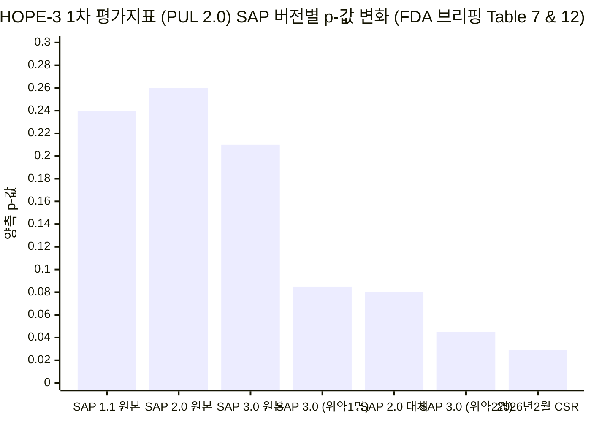
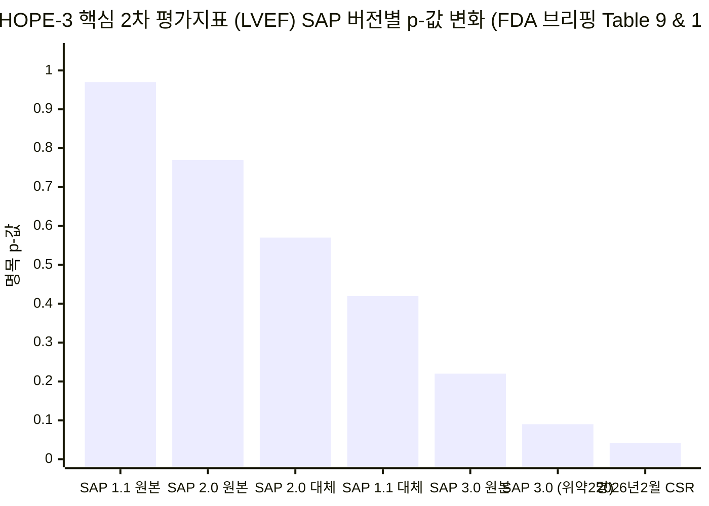
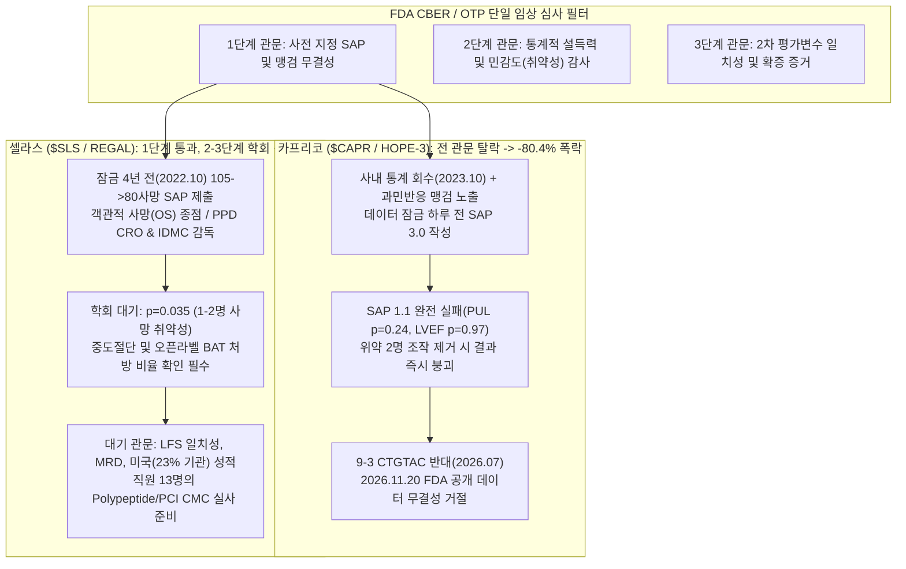

**2026년 11월 20일 금요일** 저녁, **카프리코 테라퓨틱스(`Capricor Therapeutics, Inc., NASDAQ: CAPR`)**는 뒤센 근이영양증(`DMD`) 세포치료제 **데라미오셀(`deramiocel`, `BLA 125842`)**의 `PDUFA` 심사 기한(11월 22일)을 이틀 앞두고 정규장을 **`$7.59` (`+0.80%`)**로 마감했다. 그러나 오후 6시 이후 시간외 거래에서 주가는 순식간에 바닥을 뚫고 **`-80.37%` (`-$6.10`)** 폭락한 **`$1.49`**까지 추락했다(발행주식 `5,814만 주` 기준 시가총액 `$4억 4,130만` → **`$8,660만`** 증발).

방아쇠는 **미국 식품의약국(`FDA`)**의 전례 없이 강경한 기습 불승인과 공개 성명(*"Statement on Deramiocel BLA for Duchenne Muscular Dystrophy — FDA determined that the available evidence does not meet the evidentiary standard required for approval"*, 2026년 11월 20일)이었다. 외신 보도 역시 핵심 임상시험에서 심각한 **데이터 무결성(`data integrity`) 문제**가 발견되어 승인 기준을 충족하지 못했다고 전했다.

성명 직후 바이오 공매도 투자자 **마틴 슈크렐리(`@MartinShkreli`)**는 미 서부시간 오후 4시 14분과 4시 20분(11월 20일) 연달아 X에 폭탄 발언을 던졌다.

> *"FDA의 `$CAPR` 성명은 전례가 거의 없는 수준이다. 명백한 개인적 이유 때문에 누구에게도 추천하고 싶지 않지만, 임상시험 데이터 조작은 바이오·생명과학 업계 최악의 범죄라는 메시지를 `@USDOJ`(미 법무부)를 통해 반드시 보내야 한다. cc `@linda_marban` `@AGToddBlanche`"* — `@MartinShkreli` (2026년 11월 20일)

> *"그나저나 `$SLS` = `$CAPR` 이다 (`$SLS = $CAPR by the way`)"* — `@MartinShkreli` (6분 뒤 게시, 당시 **셀라스 라이프사이언시스(`SLS`)**는 `-8.08%` 하락한 `$13.66` 기록)

슈크렐리의 발언은 1년 전 자신의 공매도 포지션을 박살 냈던 종목에 대한 복수전일까, 아니면 `SLS`에도 똑같은 규제의 칼날이 기다리고 있음을 알리는 날카로운 경고일까? [FDA 공식 `BLA 125842` 브리핑 문서](https://www.fda.gov/media/193839/download), [카프리코 스폰서 브리핑 문서](https://www.fda.gov/media/193840/download), [카프리코 2026년 3분기 `10-Q`](https://www.sec.gov/Archives/edgar/data/1133869/000110465926125355/capr-20260930x10q.htm), `ClinicalTrials.gov`(`NCT05126758`, `NCT03406780`, `NCT04229979`), 그리고 셀라스 공시를 대조해 진실을 가려본다.

> [!IMPORTANT]
> **포렌식 핵심 요약 (Forensic Thesis Summary):**
> 1. **`$CAPR`이 `-80.4%` 붕괴한 진짜 이유 (`FDA BLA 125842` 스모킹 건):** FDA는 사소한 서류 누락 때문에 거절한 것이 아니다. 공식 브리핑 감사에 따르면 **이중맹검 `HOPE-3` 3상(`NCT05126758`)은 사전 지정 통계계획서(`SAP 1.1`) 기준으로 두 평가변수 모두 완전히 실패**했다(상지 기능 `PUL 2.0` `p = 0.24`, 심장 `LVEF` **`p = 0.97`, 위약군 대비 `-0.041%`**). 이후 카프리코는 맹검 계획을 어기고 통계분석을 내부로 가져온 뒤 **`41.5%` vs. `15.4%` 과민반응**으로 사실상 맹검이 풀린(`functional unblinding`) 상태에서 **데이터 잠금·해제 하루 전(`2025년 11월 24일`)에 `SAP 3.0`을 새로 작성**했다. 단 **두 명의 위약군 환자**를 겨냥한 결측치 대체·데이터 삭제(`Months 6–12` 제거)와 맹검 해제 후 `SAP 3.0` 자체 규정까지 어긴 사후 조정으로 `p = 0.24`를 `p = 0.029`(`Lancet` 발표치)로 탈바꿈시킨 전모가 FDA 문서에 낱낱이 기록되어 있다.
> 2. **보유 현금 `$1억 9,760만`인데 시총 `$8,660만`(`$1.49`)이 싼 주식이 아닌 이유:** 2026년 9월 30일 기준 현금·유가증권은 `$1억 9,758만`(`주당 $3.40`)이지만, 승인 전 샌디에이고 생산시설(`cGMP`) 확장으로 **리스 부채가 `$9,223만`**(`2025년 말 $1,452만`에서 `6.3배` 폭증)에 달하고, 취소 불가 구매 약정 `$2,610만`, `9M 2026` 영업현금소진 **`$9,643만`(연 `~$1.29억` 속도)**, 그리고 닛폰 신야쿠 분쟁·메소블라스트 특허소송·집단소송이 산적해 있다.
> 3. **`"$SLS = $CAPR"` 검증 (맞는 경고 vs. 틀린 등식):** 슈크렐리는 2025년 말 `CAPR` 공매도로 큰 손실을 봤고 최근 `SLS` 3상 발표 때도 스퀴즈를 겪은 이해상충 당사자다. **그의 경고 중 맞는 부분:** 두 회사 모두 **동일한 `FDA CBER/OTP` 심사부서**에서 `p ≈ 0.03` 수준의 아슬아슬한 단일 임상(1~2명 취약성, 중간 `SAP` 수정, 세부 곡선 미공개)을 심사받는다는 점이다. **그러나 사기 등식이 틀린 이유:** 셀라스의 `REGAL` 평가지표는 주관적 점수나 변동성 큰 MRI가 아닌 객관적인 **전체 생존기간(사망 여부)**이며, `SAP` 수정(`105 → 80사망`)도 데이터 잠금 **4년 전(`2022년 10월`)**에 FDA·독립 CRO(`PPD`)·`IDMC` 체계 아래 제출되었고 `14.7개월`의 강건한 대조군을 `+9.3개월` 앞섰기 때문이다.

---

## 1. 금요일 밤의 폭락을 둘러싼 세 가지 서사

| 분석 차원 | 카프리코 & *Lancet* 방어 논리 (회사 측 주장) | FDA `CBER / OTP` 포렌식 감사 (`BLA 125842` 공식 기록) | 마틴 슈크렐리의 `"$SLS = $CAPR"` 전염 논리 |
| :--- | :--- | :--- | :--- |
| **핵심 주장** | `HOPE-3`에서 `PUL 2.0` 진행을 `54%` 늦췄고(`p = 0.029`, 2026년 7월 *The Lancet* 게재) `24개월 OLE`에서도 `76%` 감속(`+1.56점`)을 입증했다. | `HOPE-3`은 사전 지정 `SAP 1.1`에서 `PUL p = 0.24`, `LVEF p = 0.97`로 실패했다. 회사가 맹검 계획을 위반해 사내 통계를 장악하고 잠금 하루 전 `SAP 3.0`으로 `2명` 위약 환자를 조작·배제해 `p` 값을 만들었다. | 초기 세부 데이터 없이 `p ≈ 0.03` 보도자료로 공매도를 박살 낸 바이오주들은 `FDA CBER`가 원데이터를 열어보는 순간 `-80%` 폭락한다. |
| **규제·법적 리스크** | 2026년 7월 `BIMO` 실사(`Form 483`) 지적은 SOP·벤더 관리 절차 1건뿐이며 데이터 무결성과 무관하다; `SAP 1.1`은 구버전 초안이었다. | `SAP 2.0/3.0`은 `ICH E9` 위반, `LVEF` 분석에서 전체의 `22%` 제외, `2+1` MRI 합의 판독 포기(단일 판독 최대 `12.7%` 오차)에 해당해 11월 20일 공개 성명으로 거절했다. | `CAPR` 경영진에 `@USDOJ` 수사를 촉구하는 한편, `SLS`의 오픈라벨 `p = 0.035` 역시 같은 `CBER` 심판대에 설 것이라 경고. |
| **결정적 맹점** | 탈락한 투약군 `3명`은 `MAR`(약효 유지 가정)로 처리하면서 위약군 `2명`에게만 최악치 대체·데이터 삭제를 적용해 `p = 0.21 → 0.029`로 바뀐 사실을 회피함. | `CAPR` 통계 감사에 헛점은 없으나, FDA가 7월 `CTGTAC`에서 `PUL 2.0` 투표를 진행하지 않아 시장이 11월 20일 직전까지 희망 회로를 돌렸음. | **사후 인하우스 `SAP` 조작 및 맹검 위반이 입증된 `CAPR`**과 **객관적 사망 종점을 쓴 `SLS`**를 동일 선상에 놓는 과장된 유비 추론. |

---

## 2. FDA `BLA 125842` 감사 보고서 해부: 어떻게 `p = 0.24`와 `0.97`이 `0.029`와 `0.041`로 둔갑했는가

상황을 비유하자면 이렇다. 106명의 선수가 다트 경기를 끝내고 점수판에서 `24 대 97`로 완패한 뒤, **화살이 벽에 꽂힌 위치를 다 확인한 다음에야** 외부 심판을 내쫓고 점수 단위(인치 → 퍼센트)를 바꾸고, 상대편에서 잘 던진 화살 두 발을 규칙 위반으로 무효화하고, 우리 팀 기권자 3명은 잘 던진 것으로 추정해 준 뒤 점수 공개 전날 밤 우승을 선언한 셈이다.

과장이 아니다. 2026년 7월 29일 자문위원회(`9–3` 반대 투표) 당시 공개된 [FDA `BLA 125842` 브리핑 문서](https://www.fda.gov/media/193839/download)(8쪽 및 26~44쪽)에 적힌 그대로다.

### `SAP 1.1` → `SAP 2.0` → `SAP 3.0` → `2026년 2월 CSR`의 4단계 숫자 연금술

1. **독립 맹검 계획 파기 (`2023년 10월`):** 카프리코가 FDA에 승인받은 맹검 계획은 *"독립 CRO(Pentara Corporation)의 맹검 통계팀이 `SAP`를 작성한다"*고 명시했다. 그러나 `FDA BIMO` 감사 추적 결과 카프리코는 이를 어기고 2023년 10월 통계·프로그래밍 업무를 **사내 팀으로 회수**한 뒤 `SAP 2.0`과 `SAP 3.0`을 직접 작성했다(`FDA Briefing`, pp. 31–32).
2. **`SAP` 개정 전 사실상의 맹검 해제 (`2025년 6월 18일 이후`):** 이중맹검 `HOPE-3`(`106명`: 투약 `54명`, 위약 `52명`)는 `2025년 6월 18일` 종료되어 전원 공개연장(`HOPE-3-OLE`)으로 넘어갔다. 투약군 **`41.5%` (`22/53명`)**에서 과민반응이 발생한 반면 위약군은 **`15.4%` (`8/52명`)**였고, 1년 차에 아무 반응 없던 **위약군 `11명`**이 2년 차 공개연장 투약 직후 과민반응을 일으켜 사실상 투약 여부가 노출되었다(`FDA Briefing`, pp. 8, 36). 이 상태에서 9월과 11월에 `SAP`를 뜯어고친 것이다.
3. **위약군 딱 2명으로 뒤집은 `PUL 2.0` 1차 평가지표 (`Table 7 & 12`):**
   * 최초 설계·파워링 기준인 **`SAP 1.1` (`2022년 7월 19일`)**의 `PUL 2.0` 절대점수 변화량은 **`+0.66점` (`-1.73` vs. `-2.39`, `95% CI: -0.45~+1.77`, `p = 0.24`)**으로 명백히 **실패**했다.
   * 시험 종료 3개월 뒤인 **`SAP 2.0` (`2025년 9월 26일`)**에서 회사는 평가 방식을 **기준선 대비 백분율 변화(`percent change`)**로 바꾸고 이상반응(`AE`)으로 중도 탈락한 위약군 `1명`에게 **전체 시험 최악치**를 부여했다. 그래도 결과는 **원본 `p = 0.26` / 대체 후 `p = 0.08`**로 실패였다.
   * 데이터 잠금·맹검 해제 **단 하루 전인 `2025년 11월 24일` (`SAP 3.0`, FDA 미제출·미합의)**, 카프리코는 금지약물 복용을 사유로 **시험을 완주하고 `PUL 2.0`이 호전된 두 번째 위약군 환자의 `6·9·12개월` 관측 데이터를 통째로 삭제**하는 신규 규칙을 삽입했다(`FDA Briefing`, pp. 35, 39, 52). 반대로 투약군에서 동의 철회로 빠진 `3명`은 완주자와 동일 효과를 유지했다는 `MAR` 가정을 적용했다. 그래도 2명의 위약군 조작을 빼면 **`p = 0.21`**, 1명만 빼면 **`p = 0.085`**였고, **두 위약군 환자를 동시에 처리했을 때만 `p = 0.045`(`+4.16%`)**가 나왔다.
   * 끝으로 **맹검 해제 후인 `2026년 2월 3일 CSR`**에서는 투약군에 단 `1명`뿐이어서 `SAP 3.0` 자체 규칙상 제거해야 했던 `"slow progressor"` 변수를 임의로 남겨 **`p = 0.029` (`+4.55%`, `"54% 진행 지연"`)**를 만들었고, 이 숫자가 2026년 7월 *The Lancet*에 실렸다.
4. **심장 `LVEF` 통계와 MRI 단일 판독 위반 (`Table 4, 9 & 13`):**
   * **`SAP 1.1`** 기준 `LVEF` 차이는 **`-0.041%` (`p = 0.97`)**, **`SAP 2.0`**은 **`-0.37%` (`p = 0.77`)**였다.
   * **`SAP 3.0`**에서 카프리코는 `LVEF`를 **순위 변환(`ANCOVA on ranks`)**으로 바꾸면서 짝 데이터 없는 **`23명` (`전체 22%`)**을 분석에서 제외해 `ITT` 원칙을 깼지만 여전히 **`p = 0.09` (`미대체 시 p = 0.22`)**에 그쳤다. 그러다 맹검 해제 후 **`2월 CSR`**에서 문서화되지 않은 상호작용 항을 추가해 **`p = 0.041`**을 산출했다.
   * 더욱이 `Table 4` (`FDA Briefing`, pp. 26–27)에 따르면 영상 전송 설정 오류로 판독자 B가 `82명 중 62명`만 판독하자, 규정에 따른 **`2+1` 합의 판독을 폐기하고 판독자 A 단독 수치만 사용**했다(판독자 A·B 간 12개월 `LVEF` 평균 차이는 **`3.20%`**, 최대 **`9.88%`~`12.67%`**로 주장한 약효 자체보다 컸다).

| 분석 버전 및 작성일 | 1차 `PUL 2.0` 차이 (`95% CI`) 및 `p`-값 | 2차 `LVEF` 차이 (`95% CI`) 및 `p`-값 | FDA가 지적한 핵심 변경 및 무결성 쟁점 |
| :--- | :--- | :--- | :--- |
| **`SAP 1.1` (`2022.07.19`) — 사전 지정 (Pentara CRO)** | **`+0.66점`** `(-0.45, +1.77)` \| **`p = 0.24`** | **`-0.041%`** `(-2.58%, +2.49%)` \| **`p = 0.97`** | 임상 설계·파워링에 쓰인 원래의 `MMRM` 절대점수 변화 모델 (`MAR`). **두 지표 모두 실패.** |
| **`SAP 2.0` (`2025.09.26`) — 사내 사후 개정 (원본)** | `+2.38%` \| **`p = 0.26`** | `-0.37%` \| **`p = 0.77`** | `HOPE-3` 종료(`2025.06.18`) 후 **백분율 변화**로 전환; 결측 대체 없이는 두 지표 모두 실패. |
| **`SAP 2.0` (`2025.09.26`) — 위약 `1명` 최악치 대체** | `+3.74%` \| **`p = 0.08`** | `+0.74%` \| **`p = 0.57`** | 이상반응으로 탈락한 위약 `1명`에게 전체 시험 최악치를 부여했으나 **여전히 모두 실패.** |
| **`SAP 3.0` (`2025.11.24`) — 잠금 하루 전 (원본 / 위약 `1명`)** | 원본: `+2.53%` (**`p = 0.21`**); `1명`: `+3.34%` (**`p = 0.085`**) | 원본: `+6.88 순위` (**`p = 0.22`**); `1명`: `+7.76` (**`p = 0.17`**) | `LVEF`를 **순위(`rank`)**로 바꿔 **`23명(22%)` 배제**; 두 번째 위약 완주자 데이터를 안 지우면 여전히 실패. |
| **`SAP 3.0` (`2025.11.24`) — 위약 `2명` 규칙 모두 적용** | **`+4.16%`** `(0.09%, 8.23%)` \| **`p = 0.045`** | `+9.51 순위` `(-1.64, 20.65)` \| **`p = 0.09`** | 호전된 **2번째 위약 완주자**의 `6–12개월` 삭제 + AE 탈락자 대체; 투약 탈락 3명은 `MAR` 처리(FDA 미합의). |
| **수정 `SAP 3.0` (`2026.02.03 CSR`) — 맹검 해제 후** | **`+4.55%`** `(0.47%, 8.63%)` \| **`p = 0.029`** (*Lancet* 수치) | **`+11.65 순위`** `(0.47, 22.82)` \| **`p = 0.041`** | **맹검 해제 후** `SAP 3.0` 규정상 제외해야 할 `"slow progressor"`(`투약 1명`)를 남기고 미지정 `LVEF`/연령 상호작용 항을 추가. |

물론 [카프리코 스폰서 브리핑](https://www.fda.gov/media/193840/download)과 [Q3 10-Q](https://www.sec.gov/Archives/edgar/data/1133869/000110465926125355/capr-20260930x10q.htm)의 반론도 공정하게 짚어야 한다. 카프리코는 `SAP 1.1`이 샌디에이고 제조 전환(`Cohort B`) 이전의 초기 초안이었으며, `SAP 1.7·2.0`은 FDA에 사전 전달했고, `SAP 3.0`은 11월 25일 맹검 해제 전날인 11월 24일 확정되었으며, *The Lancet* 동료 심사와 `24개월 OLE` 위약 전환군(`76%` 감속, `+1.56점`)이 효과를 뒷받침한다고 항변했다. 그러나 단 두 명의 위약 환자에 대한 사후 처리만 되돌려도 `p` 값이 `0.21–0.24`(`PUL`)와 `0.22–0.97`(`LVEF`)로 붕괴하는 상황에서 FDA `ICH E9` 기준을 넘기기는 불가능했다.

---

## 3. 현금 `$1억 9,760만`인데 시총 `$8,660만`(`$1.49`)이 싼 주식이 아닌 이유

[2026년 3분기 Form 10-Q](https://www.sec.gov/Archives/edgar/data/1133869/000110465926125355/capr-20260930x10q.htm) 기준 카프리코의 현금 및 유가증권은 **`$1억 9,758만`**(발행주식 `5,814만 주`, **주당 `$3.40` 현금**)이다. 그런데도 주가가 **`$1.49` (시총 `$8,660만`)**까지 추락한 이유는 회사가 승인 전에 상업화 투자를 선집행한 **구조적 부채와 현금 소진** 때문이다.

| 재무 및 소송 항목 (`2026년 9월 30일 기준 10-Q`) | 공시 원문 수치 | `$1.49` 시간외 주가 기준 포렌식 의미 |
| :--- | :--- | :--- |
| **현금·현금성자산 및 단기유가증권** | **`$1억 9,758만`** (`현금 $4,428만` + `유가증권 $1억 5,330만`; 제한적 현금 포함 `$1억 9,850만`) | 주당 **`$3.40`**의 총현금을 보유해 겉보기엔 `현금 대비 0.44배`의 저평가 착시를 유발함. |
| **운용리스 부채 (샌디에이고 클린룸 확장)** | **`$9,223만`** (`유동 $152만` + `비유동 $9,071만`; **2025년 말 `$1,452만` 대비 `6.3배` 폭증**) | `FDA` 승인도 나기 전에 상업용 `cGMP` 시설 확장을 확정해 총현금의 거의 절반이 리스 부채로 묶임. |
| **취소 불가 구매약정 및 기타 부채** | **`$2,610만`** 취소 불가 발주(PO) + `$1,638만` 매입채무·미지급금 + `$1,200만` 선수수익 | 리스(`$9,223만`)·미지급금(`$1,638만`)·취소불가 약정(`$2,610만`)을 빼면 순가용 현금은 구조조정 비용 차감 전 기준 **`약 $6,290만(주당 $1.08)`**으로 축소됨. |
| **영업현금 소진 속도 (`9M 2026`)** | `9개월` 영업현금 유출 **`$9,643만`** (`순손실 $1억 1,733만`; 9월 `10%` 감원 이후에도 **연 `~$1.29억`** 속도) | 매달 약 **`$1,070만`**이 증발하므로, 대응이 지체될수록 분기당 주당 **`$0.50+`**의 현금이 사라짐. |
| **유통 파트너 분쟁 및 집단소송 (`Note 15`)** | **닛폰 신야쿠(`NS Pharma`)** 유통 분쟁, **메소블라스트** 특허 침해 소송, **증권 집단소송 2건**(`Nkamga` 7월 30일, `Novick` 9월 28일), 주주대표소송(`Rosen`), 전 직원 분쟁. | 오늘의 FDA 데이터 무결성 공개 성명은 `Rule 10b-5` 증권사기 소송과 파트너 계약 해지 리스크를 극대화함. |

---

## 4. 마틴 슈크렐리의 `"$SLS = $CAPR"` 검증: 유효한 경고 vs. 과장된 등식

우선 **슈크렐리의 이해상충**을 분명히 해야 한다. 그는 2025년 말 `$CAPR` 공매도로 수백만 달러의 숏 스퀴즈 손실을 입었다가 1년 만에 FDA 거절로 완벽한 설욕을 거뒀다. 동시에 그는 최근까지 **`$SLS` 공매도 진영의 선봉장**이었으며 11월 17일 `REGAL` 톱라인 발표(`24.0 vs. 14.7개월`, `HR = 0.59`, `p = 0.035`)로 주가가 `+156.4%` 폭등하자 다시 공개 저격을 이어가고 있다.

그의 **`"$SLS = $CAPR"`** 트윗은 *"원데이터를 공개하지 않은 채 `p ≈ 0.03` 보도자료로 주가를 띄운 바이오 기업이 `FDA CBER`의 현미경 아래 들어가면 똑같이 `-80%` 붕괴할 수 있다"*는 메시지다. 7가지 구조적 잣대로 이 주장을 냉정히 검증하자.

| 비교 항목 | 카프리코 `Deramiocel` (`HOPE-3`, `NCT05126758`) | 셀라스 `GPS` (`REGAL`, `NCT04229979`) | `"$SLS = $CAPR"` 성립 여부 |
| :--- | :--- | :--- | :--- |
| **1. FDA 동일 심사 부서** | **`FDA CBER / OTP`** (단일 3상 + `20명` `HOPE-2` 지지 임상). | **`FDA CBER / OTP`** (단일 3상 + `22명` CR1 / `10명` CR2 2상 지지 임상). | **성립 (중요한 공통점).** 똑같이 까다로운 `CBER` 단일 임상 기준 적용. |
| **2. 경계선 `p`-값 & 1~2명 취약성** | `p = 0.029–0.045`; **위약 `2명`에 따라 `p = 0.085–0.24`로 붕괴**. | `p = 0.035` (`추정 95% CI [0.36, 0.96]`); **사망 `1~2건` 이동 시 `0.0416`/`0.050` 붕괴**. | **성립 (중요한 공통점).** 둘 다 표본 여유가 1~2명에 불과함. |
| **3. 초기 세부 데이터 미공개** | 2025년 12월 보도자료에서 `SAP 1.1` 실패(`p = 0.24`, `0.97`)와 2명 데이터 조정을 숨김. | 2026년 11월 17일 보도자료에서 `LFS`, KM 곡선, 중도절단표, `BAT` 비율, 미국(`23.3%` 기관) 결과를 미공개. | **성립 (주의 요망).** `SLS`도 학회 데이터 전까지는 블랙박스 리스크 존재. |
| **4. 평가변수의 객관성** | **주관적 운동 척도(`PUL 2.0`)** + **변동성 큰 심장 MRI(`LVEF`)**를 백분율·순위로 사후 변형. | **객관적 전체생존기간(사망 여부 `OS`)**. 백분율 변화나 순위 변환 자체가 불가능. | **불성립 (핵심 차이).** 사망일은 MRI처럼 판독 오차가 나지 않음(단 중도절단 검증은 필수). |
| **5. `SAP` 수정 시점 및 맹검 거버넌스** | 외부 CRO(`Pentara`)를 배제하고 **사내에서(`2023.10`)** 통계를 장악한 뒤, 사실상 맹검 해제 상태의 **잠금 하루 전(`2025.11.24`)** FDA 합의 없이 `SAP 3.0`을 고치고 잠금 후에도 규칙 위반. | `105 → 80사망` `SAP` 개정을 **최종 잠금 4년 전(`2022년 10월`)**에 FDA에 제출했고, 독립 CRO(`PPD`) 및 `IDMC`(`2025.01` 중간 통과) 감독 하에 진행. | **불성립 (결정적 차이).** `4년 전 FDA 제출`과 `잠금 1일 전 사내 조작`은 차원이 다름. |
| **6. 대조군 성적과 약효 신호** | 사전 지정 `SAP 1.1` 기준 두 지표(`p=0.24`, `0.97`) 모두 무의미. | 역사적 기준(`5.4개월`)의 약 3배인 **`14.7개월`의 강한 대조군**을 `+9.3개월`(`24.0개월`) 앞섬. | **불성립 (핵심 차이).** 대조군 붕괴 착시가 아님. |
| **7. 기관 자금 및 재무 건전성** | 연 burn `~$1.29억`, 리스 부채 `$9,223만`, 이미 `CRL 1차` + `AdCom 9–3 반대` 경험. | **JP모건·TD 코웬**이 워런트 없이 **`$1억 7,250만` 보통주 발행** 완료(현금 `~$2.965억` vs. 연 burn `~$3,000만`). | **불성립 (핵심 차이).** 기관 자금 검증과 10년 치 현금 여력 보유. |

---

## 5. 포렌식 최종 판정: 조건부 시나리오와 확률 가중 결론

* **만약(`If`)** 카프리코가 **`$9,223만` 리스 부채**와 **`$2,610만` 구매약정**을 빠르게 정리하지 못하거나, `Rule 10b-5` 증권사기 소송에 더해 법무부/SEC 조사가 현실화된다면, **그때는(`Then`)** `$1.49`가 총현금(`$3.40`) 대비 싼 가격이라는 착시와 달리 현금 소진(`~$1.29억/년`)과 우발부채가 잔여 주주가치를 잠식할 것이다.
* **만약(`If`)** 셀라스의 학회 발표에서 **`LFS` 동반 개선, 군별 균등한 중도절단(`차이 <5%`), 그리고 미국(`23.3%` 기관) 및 적극치료 `BAT` 하위집단 일치성**이 확인된다면, **그때는(`Then`)** `"$SLS = $CAPR"`은 전형적인 **연좌제(성급한 유비 추론) 오류**로 판명 날 것이다—비록 금요일 밤 카프리코 사례가 보여주듯 `CBER`의 단일 임상 문턱이 극도로 높아졌다는 경고 자체는 유효하지만 말이다.

| 종목 및 시나리오 | 확률 | 2026–2028년 구조적 전개 경로 | 추정 주당 가치 | 기대가치 기여 |
| :--- | :---: | :--- | :---: | :---: |
| **`$CAPR` 기본 시나리오: 구조조정 및 프로그램 축소** | **`55%`** | 데라미오셀 미국 `BLA` 사실상 종료(신규 다년 3상 없이는 불가); 대규모 감원, 리스 축소 협상, `StealthX` 전환 또는 역합병 모색 속 현금 점진적 감소. | **`$1.10 / 주`** *(`$0.75 – $1.50`)* | **`$0.61 / 주`** |
| **`$CAPR` 하락 시나리오: 리스·소송 현금 함정** | **`30%`** | `$9,223만` 리스 + `$2,610만` PO + 닛폰 신야쿠/메소블라스트/집단소송 및 규제 조사 비용이 현금을 급속히 잠식. | **`$0.40 / 주`** *(`$0.15 – $0.65`)* | **`$0.12 / 주`** |
| **`$CAPR` 상승 시나리오: 리스 해지 및 해외/플랫폼 딜** | **`15%`** | 샌디에이고 리스 조기 합의로 순현금 `~$1억+` 방어 및 유럽·일본 또는 `StealthX` 라이선스 계약 성사. | **`$2.60 / 주`** *(`$2.00 – $3.25`)* | **`$0.39 / 주`** |
| **`$CAPR` 확률 가중 적정가치 (`vs. $1.49 시간외`)** | **`100%`** | **총현금 `$3.40/주`에서 리스·PO·미지급금(`~$2.32/주`)과 월 `$1,070만` 소진 차감** | **`$1.12 / 주`** *(`$1.49` 대비 `-24.8%`)* | **`$1.12 / 주`** |
| **`$SLS` 전염 리스크 판정 (`"$SLS = $CAPR"`?)** | *분리 평가* | **`CAPR`식 사후 `SAP` 조작/맹검 사기 가능성 `10%–15%`**; 단 `p = 0.035` 1~2명 취약성·오픈라벨 중도절단·미국외 편중·13명 `CMC` 등 **비사기성 `CRL`/추가임상 요구 가능성은 `~35%` 유지**. | **`$12.63 / 주`** *(vs. `$13.66`)* | *`REGAL` 전체 곡선 및 `LFS` 대기* |

### 최종 결론 (Bottom-Line Authorial Stance)

1. **`$CAPR`이 `-80.4%` 폭락한 이유:** 카프리코는 억울한 규제 변덕의 희생양이 아니다. 이중맹검 `HOPE-3`이 사전 지정 `SAP 1.1`(`PUL p=0.24`, `LVEF p=0.97`)에서 실패한 뒤, 맹검 계획을 어기고 사내에서 잠금 하루 전에 `SAP 3.0`을 고쳐 **위약 환자 2명**의 데이터 처리와 MRI 단일 판독으로 `p = 0.029` / `0.041`을 만들어낸 것이 `FDA CBER` 감사에 적발된 결과다. 시간외 **`$1.49` (`기대가치 ~$1.12/주`)**에서도 `$9,223만` 리스 부채와 연 `$1.29억` 소진, 소송 폭탄이 정리되기 전까지는 떨어지는 칼날을 잡을 이유가 없다.
2. **`"$SLS = $CAPR"`에 대한 냉정한 해석:** 슈크렐리의 등식을 문자 그대로 믿지 마라—**잠금 하루 전 사내 `SAP` 변경 후 실패를 뒤집은 `HOPE-3`**와 **잠금 4년 전 FDA에 수정 `SAP`를 제출해 객관적 사망 종점(`OS`)에서 `14.7개월` 대조군을 `+9.3개월` 앞섰고 JP모건·TD 코웬이 `$1.725억`을 조달해 준 `REGAL`**은 전혀 다른 케이스다. 그럼에도 **그 트윗이 주는 전략적 경고는 반드시 경청해야 한다:** 금요일 밤 `CBER`는 `p ≈ 0.03` 단일 임상 `BLA`에 무자비한 잣대를 들이대고 있음을 증명했다. `REGAL`의 카플란-마이어 곡선, `LFS`, 중도절단표, 미국 하위집단 데이터가 나오기 전까지 최선의 대응은 추측이 아닌 검증 대기다.

---

## 1차 사료 및 검증된 출처 목록

*(임상시험 정보는 [ClinicalTrials.gov](https://clinicaltrials.gov/) API에서 조회되었으며, 아래 모든 URL은 HTTP `200` 응답이 검증되었습니다.)*

1. **FDA `BLA 125842` 공식 심사 패키지 (`Deramiocel`, 2026.07.29 CTGTAC):** [FDA 자문위 공지](https://www.fda.gov/advisory-committees/advisory-committee-calendar/cellular-tissue-and-gene-therapies-advisory-committee-july-29-2026-meeting-announcement-updated) | [FDA 공식 브리핑 문서 PDF (`Table 4, 6, 7, 9, 12, 13`, `BIMO` 감사)](https://www.fda.gov/media/193839/download) | [카프리코 스폰서 브리핑 PDF](https://www.fda.gov/media/193840/download) | [FDA 투표 안건 PDF](https://www.fda.gov/media/193857/download) | [FDA 발표 슬라이드 PDF](https://www.fda.gov/media/193912/download)
2. **FDA 단일 임상 승인 기준 가이드라인:** [단일 적정·잘 통제된 임상시험 및 확증 증거 가이드라인 초안](https://www.fda.gov/regulatory-information/search-fda-guidance-documents/demonstrating-substantial-evidence-effectiveness-one-adequate-and-well-controlled-clinical)
3. **카프리코 테라퓨틱스 SEC 공시:** [2026년 3분기 `Form 10-Q` (`2026.11.10`)](https://www.sec.gov/Archives/edgar/data/1133869/000110465926125355/capr-20260930x10q.htm) | [2026.08.24 `Form 8-K` (`PDUFA 연장`)](https://www.sec.gov/Archives/edgar/data/1133869/000110465926100071/capr-20260824x8k.htm) | [2026.07.29 `Form 8-K` (`AdCom 9-3 반대`)](https://www.sec.gov/Archives/edgar/data/1133869/000110465926088667/capr-20260729x8k.htm)
4. **ClinicalTrials.gov 등록 정보:** [카프리코 `HOPE-3` (`NCT05126758`)](https://clinicaltrials.gov/study/NCT05126758) | [카프리코 `HOPE-2` (`NCT03406780`)](https://clinicaltrials.gov/study/NCT03406780) | [셀라스 `REGAL` (`NCT04229979`)](https://clinicaltrials.gov/study/NCT04229979)
5. **셀라스 라이프사이언시스 SEC 공시:** [2026.11.17 `REGAL` 8-K](https://www.sec.gov/Archives/edgar/data/1390478/000110465926128825/tm2629947d1_8k.htm) | [2026.11.19 `424B5` 투자설명서](https://www.sec.gov/Archives/edgar/data/1390478/000110465926130132/tm2629996d2_424b5.htm) | [2026.11.20 `8-K` 그린슈 전액 행사](https://www.sec.gov/Archives/edgar/data/1390478/000110465926130331/tm2630303d1_8k.htm) | [2022.11.15 `SAP` 개정 녹취록 (`8-K Ex. 99.1`)](https://www.sec.gov/Archives/edgar/data/1390478/000110465922119139/tm2230620d1_ex99-1.htm) | [2026년 3분기 `Form 10-Q`](https://www.sec.gov/Archives/edgar/data/1390478/000139047826000020/sls-20260930.htm)
