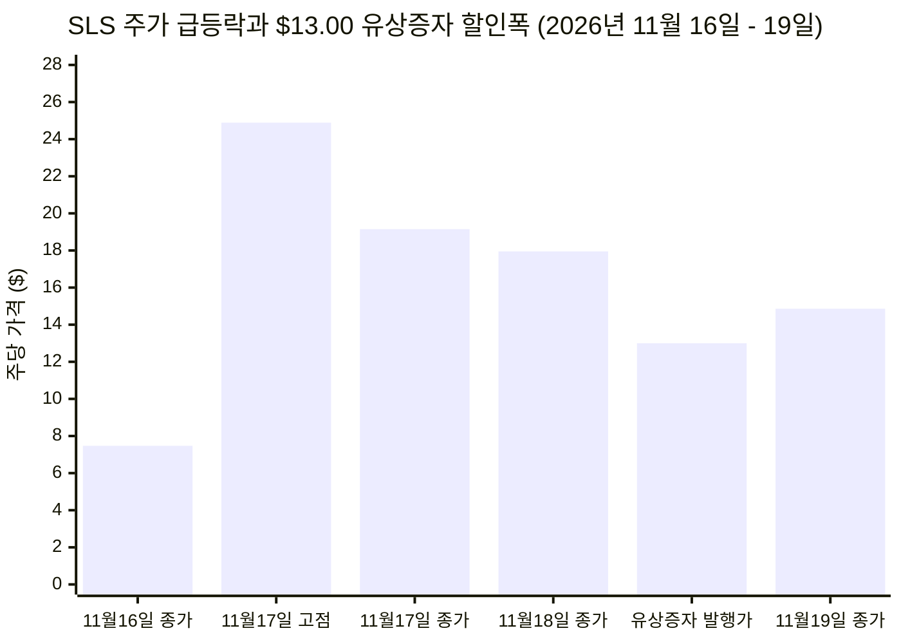
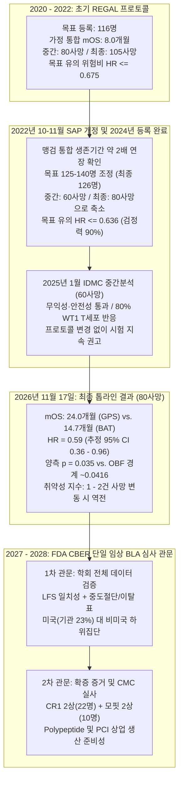
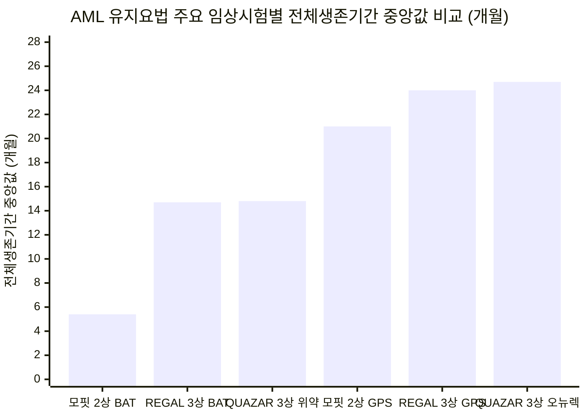

**2026년 11월 17일 화요일** 아침, **셀라스 라이프사이언시스 그룹(`SELLAS Life Sciences Group, Inc., NASDAQ: SLS`)**은 개인 바이오 투자자들이 4년간 기다려온 핵심 보도자료를 발표했다. 조혈모세포이식을 받을 수 없는 2차 이상 완전관해(`CR2`/`CRp2`) 급성골수성백혈병(`AML`) 환자를 대상으로 `WT1` 표적 항암 백신 **갈린페피무트-S(`galinpepimut-S, GPS`)**를 평가한 핵심 임상 3상 **REGAL** 시험(`NCT04229979`)이 1차 평가변수인 전체생존기간(`OS`)을 충족했다는 발표였다. `GPS` 투여군의 전체생존기간 중앙값은 **`24.0개월`**로, 연구자 선택 최적가용치료(`BAT`) 대조군의 **`14.7개월`**을 넘어섰으며 사망 위험을 **`41%` 감소**시켰다(`HR = 0.59`, 양측 검정 `p = 0.035`) ([REGAL 톱라인 보도자료](https://ir.sellaslifesciences.com/news/News-Details/2026/SELLAS-Life-Sciences-Announces-Positive-Pivotal-Phase-3-REGAL-Trial-Data-Showing-Immunotherapeutic-Cancer-Vaccine-Galinpepimut-S-GPS-Demonstrated-a-Statistically-Significant-and-Clinically-Meaningful-Improvement-in-Overall-Survival-in-Patients-with-A/default.aspx)).

주가는 즉각 폭발했다. 11월 16일 월요일 종가 **`$7.47`**이었던 `SLS`는 화요일 장중 **`$24.89`**까지 치솟으며(정규직원 13명 회사의 시가총액이 일시적으로 `$50.7억`에 육박) **`1억 2,130만 주`**의 거래량과 함께 `+156.4%` 급등한 **`$19.15`**로 마감했다.

그런데 **바로 그날**, 셀라스는 두 번째 충격탄을 투하했다. 2026년 9월 30일 기준 **`$1억 3,470만`의 현금**(2026년 9개월 누적 영업현금소진 `$2,240만` 기준 4년 이상 버틸 수 있는 자금)을 이미 보유하고 있었음에도, 회사는 **`$1억 5,000만` 규모의 공모 유상증자**를 기습 개시했다 ([유상증자 제안 보도자료](https://ir.sellaslifesciences.com/news/News-Details/2026/SELLAS-Life-Sciences-Announces-Proposed-150-0-Million-Underwritten-Public-Offering/default.aspx)). 11월 18일 수요일 장 마감 후 공동 대표주관사인 **JP모건(`J.P. Morgan`)**과 **TD 코웬(`TD Cowen`)**은 `11,538,462주`의 공모가를 **`$13.00`**으로 확정했다—이는 수요일 종가 `$17.95` 대비 **`27.6%` 할인**, 화요일 고점 대비 **`47.8%` 하락**한 가격이었다. 이어 11월 20일에는 초과배정옵션(그린슈) `1,730,769주`까지 전액 행사되어 **총 조달액 `$1억 7,250만`(순조달액 약 `$1억 6,180만`)**이 확정되었다 ([11월 19일 Form 424B5](https://www.sec.gov/Archives/edgar/data/1390478/000110465926130132/tm2629996d2_424b5.htm); [11월 20일 Form 8-K](https://www.sec.gov/Archives/edgar/data/1390478/000110465926130331/tm2630303d1_8k.htm)).

은행 계좌에 이미 4년 치 임대료가 들어 있는 작은 식당이 아침에 미쉐린 스타를 따낸 직후, 저녁 식사 전에 월가 은행들에게 지분 6%를 28% 헐값에 넘긴 셈이다. 이 역설의 양면은 모두 실제 벌어진 사실이며, 지금 바이오 시장과 온라인 커뮤니티가 `REGAL` 데이터를 두고 극심하게 갈라진 이유를 정확히 설명한다.

> [!IMPORTANT]
> **포렌식 핵심 요약 (Forensic Thesis Summary):**
> 1. **양 극단의 단순한 해석은 모두 틀렸다:** `REGAL`은 명백한 사기도 아니지만, 의심의 여지 없는 완승도 아니다. 무엇보다 대조군(`BAT`)의 생존기간 중앙값이 **`14.7개월`**에 달했다는 점에 주목해야 한다. 이는 셀라스가 과거 2상에서 기준으로 삼았던 `5.4개월`보다 **약 3배 길며**, 브리스톨마이어스스퀴브(`BMS`)의 황금표준 1차 완전관해(`CR1`) 유지요법 임상(`QUAZAR AML-001`) 위약군(`14.8개월`)과 거의 같다. 이처럼 튼튼한 `14.7개월` 대조군을 `+9.3개월` 차이(`24.0개월`)로 앞선 것은 쉽게 무시할 수 없는 실제 임상 신호다.
> 2. **그러나 80사망 기준 오픈라벨 임상의 `p = 0.035`는 통계적 면도날 위에 서 있다:** `HR = 0.59`와 `p = 0.035`를 역산하면 내재된 `95% 신뢰구간`은 **`[0.36, 0.96]`**이며, 표준오차(`0.2503`)는 단순 비층화 80사망 이론치(`0.2236`, 동일 HR 시 `p = 0.018`)보다 약 `12%` 넓다. 60사망 중간분석 이후 적용되는 표준 랜-드메츠 오브라이언-플레밍(`Lan-DeMets O'Brien-Fleming`) 최종 유의수준 경계(`alpha ≈ 0.0416`)를 기준으로 보면, `REGAL`은 **`ΔZ ≈ 0.071`** 차이로 턱걸이 통과했다—즉 **불과 1~2명의 사망 사건만 `GPS` 군으로 이동하거나 미집계 중도절단(`censoring`)에서 사망이 추가되어도 `p` 값은 `0.042`는 물론 `0.050`을 넘어 통계적 유의성을 상실한다**.
> 3. **보도자료가 빠뜨린 핵심 데이터의 무게:** 셀라스는 카플란-마이어(`Kaplan-Meier`) 생존곡선, 신뢰구간, 군별 사망자 수, 중도절단/동의철회 건수, 핵심 2차 평가변수인 **무백혈병생존기간(`LFS`)**, 미세잔존질환(`MRD`) 음전율, `BAT` 세부 처방 비율(경과관찰 vs. `HMA`/`베네토클락스`), 그리고 **미국 대 비미국 하위집단 성적**(`NCT04229979` 등록 73개 기관 중 미국 기관은 `17개`, `23.3%`뿐)을 일절 공개하지 않았다.
> 4. **`$13.00` 유상증자의 진짜 의미:** JP모건(`43%`)과 TD 코웬(`33%`)이 워런트(`신주인수권`) 없는 보통주 단일 발행으로 `$1억 7,250만`을 소화했다는 사실은 기관 자금이 이번 데이터를 진지하게 평가했음을 뜻한다. 그러나 동시에 `$13.00`이라는 할인 발행 가격(유증 후 `$13.00~$14.86` 기준 시가총액 `$28.2억~$32.2억`)은 기관 투자자들이 단일 임상 `FDA` 승인 불확실성, 13명 조직의 실행 공백, 그리고 연간 미국 내 적격 환자 `~1,500~2,500명` 수준의 틈새 `CR2 AML` 시장 규모에 대해 **막대한 리스크 할인**을 요구했음을 보여준다.

---

## 1. 두 가지 핵심 질문, 세 개의 시장 서사, 그리고 반증 기준

SEC 공시와 생존통계를 파헤치기 전에, 이번 논쟁의 두 가지 질문(사실 검증과 의사결정)을 명확히 구분한다.
* **사실 검증 질문 (Descriptive):** `REGAL`의 `HR = 0.59`(`p = 0.035`)는 `GPS`가 유도한 `WT1` 특이 T세포의 견고하고 재현 가능한 생물학적 생존 연장 효과를 반영하는가, 아니면 오픈라벨 설계의 비대칭성, 중도절단 편향, `GM-CSF` 면역보조제 자극, 혹은 80건 사건 수의 통계적 취약성이 만들어낸 결과인가?
* **의사결정 질문 (Prescriptive):** 증자 후 주당 `~$13.00~$14.86`(기본 시가총액 `~$28.2억~$32.2억`) 수준에서, 투자자와 규제기관은 향후 학회 전체 데이터 공개와 `FDA` pre-BLA 미팅을 앞두고 `GPS`의 허가 확률, 상업적 상한선, 그리고 후속 파이프라인 `SLS009`의 옵션 가치를 어떻게 평가해야 하는가?

보고서 시작 단계에서 **반증 가능성 기준(Falsifiability Criteria)**도 미리 못 박아 둔다.
* **회의론이 틀렸음을 입증할 증거:** 향후 학회에서 공개될 전체 데이터가 `LFS`(`HR ≤ 0.68`)와 `MRD` 음전율에서 `OS`와 일관된 개선을 보이고, 양 군 간 동의철회/중도절단 비율이 대칭적(`차이 < 5%`)이며, 미국과 유럽·아시아 기관에서 일관된 효과가 나타나고, `FDA`가 단일 임상 기반 생물학적제제 허가신청(`BLA`)을 수용하는 경우.
* **회의론이 옳았음을 입증할 증거:** `OS` 격차와 달리 `LFS`가 평탄하거나 유의성을 상실하고, `BAT` 또는 `GPS` 군에 조기 이탈·중도절단 불균형이 드러나며, 미국 하위집단의 위험비(`HR`)가 `1.0` 부근에 머문 채 소규모 해외 '경과관찰(`Observation`)' 기관이 전체 수치를 견인했거나, `FDA`가 확증 2차 임상을 요구하는 경우.

| 분석 차원 | 개인 투자자·강세론 서사 (회사 보도자료 기반) | 월크로스 기관 투자자 시각 (JP모건 / TD 코웬 유상증자) | 포렌식 회의론자 시각 (생물통계학자 & 공매도 진영) |
| :--- | :--- | :--- | :--- |
| **핵심 주장** | 치료 대안이 없는 CR2 AML에서 `GPS`가 `+9.3개월`(`24.0` vs. `14.7개월`, `p = 0.035`) 생존을 연장해 `WT1` 백신 검증과 2027년 상반기 `BLA` 제출을 열었다. | `14.7개월` 대조군 대비 확실한 `OS` 개선과 `SLS009` r/r AML 데이터를 근거로 `$1.725억` 자금 조달 가치는 충분하다—단 `$13.00`의 큰 할인이 필요하다. | 2022년 `SAP` 수정으로 필요 사망 수를 `105건`에서 `80건`으로 낮춘 오픈라벨 `N=126` 임상이 1~2건 차이로 `p = 0.035`를 통과하면서 `LFS`, `95% CI`, 중도절단표를 숨겼다. |
| **`$13.00` 유상증자의 해석** | 유증 후 현금 약 `$2.965억` 확보로 파산·`ATM` 오버행 위험을 제거하고 상업화 준비 자금을 완비했다. | 11월 18일 종가(`$17.95`) 대비 `27.6%`, 고점(`$24.89`) 대비 `47.8%` 할인해 기관에게 `FDA`·세부데이터 리스크 프리미엄을 지급했다. | 이미 `$1.347억`(4년 치 운영자금)을 쥔 경영진이 세부 곡선과 `FDA` 피드백 공개 전에 36시간 만에 `$1.725억` 주식을 쏟아냈다. |
| **가장 큰 취약점** | 2차 평가변수(`LFS`), 생존곡선, 미국 하위집단 데이터가 나오기 전까지 헤드라인 `OS` 숫자에만 의존한다. | 증자 후에도 시총 `$28억~$32억`(`미국 CR2 최대 매출의 ~8~15배`)이 형성되어 `CR1` 확장이나 `SLS009` 성공이 필수적이다. | `QUAZAR` 위약군과 맞먹는 `14.7개월`의 강건한 대조군을 상대로 `+9.3개월` 차이가 나온 실제 생물학적 신호를 과소평가할 위험이 있다. |

---

## 2. 보도자료 vs. SEC·임상등록부 원문: 강조된 것과 생략된 것의 대조표

1차 사료 교차검증을 위해 11월 17일 보도자료를 [ClinicalTrials.gov `NCT04229979`](https://clinicaltrials.gov/study/NCT04229979), [2022년 11월 15일 SAP 개정 컨퍼런스콜 녹취록(`Form 8-K Ex. 99.1`)](https://www.sec.gov/Archives/edgar/data/1390478/000110465922119139/tm2230620d1_ex99-1.htm), [2025년 1월 23일 IDMC 중간분석 8-K](https://www.sec.gov/Archives/edgar/data/1390478/000110465925005648/tm254291d1_ex99-1.htm), [2025년 연차보고서(`Form 10-K`)](https://www.sec.gov/Archives/edgar/data/1390478/000139047826000003/sls-20251231.htm), 그리고 [2026년 3분기 보고서(`Form 10-Q`)](https://www.sec.gov/Archives/edgar/data/1390478/000139047826000020/sls-20260930.htm)와 대조하면 여섯 가지 결정적 괴리가 드러난다.

| 검증 항목 | 11월 17일 보도자료의 헤드라인 강조 | SEC 공시 및 ClinicalTrials.gov 원문 실체 | 포렌식 시사점 |
| :--- | :--- | :--- | :--- |
| **표본 크기와 지역 편중** | 북미·유럽·아시아 약 95개 기관에서 *"글로벌 무작위 대조 핵심 임상 3상… 126명"* 등록 강조. | `NCT04229979` 등록 기관 73곳(등록 127명 기재) 중 **미국 기관은 단 `17곳(23.3%)`**이고 **`56곳(76.7%)`이 미국 외 지역**(그리스 10, 폴란드 10, 프랑스 9, 스페인 9, 인도 5, 대만 5, 독일 3, 헝가리 3, 세르비아 2)으로, 기관당 평균 환자 수가 **`~1.7명`**에 불과함. | `FDA`는 미국 내 환자 비중이 `25%` 미만이고 기관당 등록 수가 극소수인 단일 임상에 대해 지역별 표준치료 편차를 집중 심사한다. |
| **핵심 수치의 선택적 미공개** | `mOS 24.0 vs. 14.7개월`, `HR = 0.59`, `p = 0.035`만 발표하고 `LFS`, `MRD`, T세포 반응은 향후 학회로 연기. | `HR`의 `95% 신뢰구간`, 카플란-마이어 곡선, 군별 사망자 수, 중도절단/동의철회 건수, 그리고 **무백혈병생존기간(`LFS`) 결과 없이** 곧바로 `$1.725억` 유상증자를 진행함. | 오픈라벨 임상에서 `OS`는 후속 치료나 중도절단에 흔들릴 수 있으므로, **`LFS` 일치성과 중도절단표**가 진위 판별의 열쇠다. |
| **2022년 `SAP` 목표 사건 축소** | *"사전에 지정된 80건의 사건(사망) 도달 후"* 톱라인 분석을 수행했다고 서술. | 2022년 11월 `8-K` 녹취록에 따르면 당초 목표는 `116명`, 중간 `80사망`, **최종 `105사망`**(`HR ≤ 0.675`, 통합 예상 `OS 8.0개월`)이었으나, 2022년 10~11월 개정을 통해 목표 사건을 **최종 `80사망`**(중간 `60사망`, `HR ≤ 0.636`, 통합 `OS 12.5개월`)으로 축소해 시험 기간을 단축함. | 목표 사망 건수를 `105건`에서 `80건`으로 줄여 개발 기간은 앞당겼지만, 통계적 정밀도는 희생됨(`105사망`이었다면 `HR = 0.59`는 `p ≈ 0.007~0.015`를 기록했을 것). |
| **면역보조제(`GM-CSF`) 및 방문 비대칭** | `GPS`를 조사자 선택 `BAT` 대비 *"유지 단독요법(maintenance monotherapy)"*으로 묘사. | `NCT04229979` 프로토콜상 `GPS` 투여군은 매 접종 -2일 및 당일 **`70 µg` 사르그라모스팀(`GM-CSF`)**과 `Montanide` 보조제를 병용 투여하고 초기 10주간 **2주마다** 내원(대조군 `BAT`는 `GM-CSF` 미투여 및 52주까지 4주마다 내원). | 대조군에 `GM-CSF + 위약`이 매칭되지 않아, 과거 갈레나 바이오파마의 이중맹검 `NeuVax` 3상(`GM-CSF + 위약` 대조군에서 실패)과 구조적 차이를 보임. |
| **운영위원회 및 라이선서 이해관계** | `REGAL` 운영위원회 3인의 *"기념비적 데이터"*, *"통계적 유의성"* 찬사 인용. | 보도자료 하단 각주에 **메모리얼 슬론 케터링(`MSK`)**의 기관 재무적 이해관계와 발명자 `David A. Scheinberg` 박사 및 운영위원 **Javier Pinilla-Ibarz 박사(위원 3인 중 1인)**의 셀라스 관련 재무적 이해관계를 명시. | 외부 권위 인용에 직접적인 지분·로열티 이해관계가 얽혀 있으므로 독립 학회 동료 심사가 필수적이다. |
| **조직 규모 및 중국 중재 패소** | 2027년 상반기 `BLA` 제출 추진 및 상업화 잠재력 강조. | `2025년 10-K`상 **정규직 총 13명**(2026년 3월 1일 기준), 자체 생산시설 전무(원료 단독 `CMO` **Polypeptide Group**, 동결건조 단독 `CMO` **PCI Pharma Services**, `-20°C` 냉동 보관, 상업용 공급계약 미체결), 그리고 `2026년 7월 24일` **3D 메디신스와의 HKIAC 중국 중재 최종 패소**(`$100만` 상대측·중재 비용 지급). | 13명의 소수 인력으로 `CBER` 생물학적제제 현장실사(`PAI`), 콜드체인 상업 생산, 미국 영업망 구축까지 감당하려면 대규모 채용 또는 빅파마 제휴가 불가피함. |

### 의미 치환 테스트 (Semantic Substitution Test): 홍보 문구 vs. 규제 정의

동일한 단어도 투자자 보도자료와 `FDA` 심사 테이블 위에서는 전혀 다른 무게를 갖는다.

| 11월 17일 보도자료 문구 | 느슨한 / 마케팅적 해석 | 엄격한 생물통계 및 `FDA` 규제 기준 정의 | 치환 테스트 판정 |
| :--- | :--- | :--- | :--- |
| **"통계적으로 유의함 (`p = 0.035`)"** | 두 번의 3상 성공에 준하는 반박 불가한 확증적 통계 증거. | 60사망 중간분석 이후 적용되는 2단계 오브라이언-플레밍 최종 경계(`~0.0416`)를 `ΔZ ≈ 0.071` 차이로 통과. 사전 지정 1차 평가는 통과했으나, `FDA`가 단일 임상 승인 시 요구하는 *"통계적으로 설득력 있는(`statistically persuasive`, 통상 `p < 0.001~0.01`)"* 수준과는 거리가 있음. | 사전 지정 알파 기준은 통과했으나, 단독 `BLA` 승인을 위한 독립 설득력은 **취약**함. |
| **"임상적으로 의미 있음 (`+9.3개월`)"** | 모든 `CR2 AML` 환자에서 오직 `GPS` 펩타이드 효과만으로 생존이 거의 두 배 늘었음을 입증. | `24.0개월` vs. `14.7개월`은 `CR2 AML`에서 매우 큰 차이임이 분명하나, 중도절단 편향, 재발 후 후속 치료 격차, 또는 `BAT` 처방 구성(`경과관찰` vs. `HMA+베네토클락스`)의 교란이 없었을 때만 인과가 성립함. | 외형적 생존 격차는 매우 크나, 인과 확정은 전체 곡선·하위집단 공개 **보류** 상태. |
| **"잘 균형 잡힘 (Well Balanced)"** | 양 군의 기저 질환 위험도와 이후 모든 치료 경과가 동일했음. | 무작위배정 시 4개 층화요인(`CR2/CRp2`, 세포유전학, `MRD`, `CR1` 기간)과 조혈모세포이식(`allo-HSCT`) 이행 건수가 균형을 이뤘다는 뜻일 뿐, **`BAT` 내부 처방 비율**, 중도절단/동의철회 비율, 재발 후 구제요법 차이는 아직 밝히지 않음. | 무작위배정 균형은 확인되었으나, 오픈라벨 사후 편향 배제에는 **불충분**함. |
| **"가속 심사/신청 전략 (Accelerated Filing Strategy)"** | 신속승인(`Accelerated Approval`) 또는 우선심사(`Priority Review`)가 이미 보장됨. | 패스트트랙 및 희귀의약품 지정에 따른 순차 제출(`rolling review`)과 우선심사 신청 계획을 뜻할 뿐(`OS` 자체가 최종 임상 평가변수이므로 대리지표 가속승인 대상이 아님), `FDA`가 `N=126`, `p = 0.035` 단일 오픈라벨 임상으로 `BLA` 접수를 받아줄지는 미팅 후 결정됨. | `FDA` 확약이 아닌 **경영진의 희망 로드맵**임. |

---

## 3. `p = 0.035`의 수학 해부: 턱걸이 경계선과 1~2명의 취약성 지수(`Fragility Index`)

공개되지 않은 슬라이드를 기다리지 않고도, 우리는 `N = 126`, `80사망`, `HR = 0.59`, 양측 `p = 0.035`라는 네 개의 숫자만으로 `REGAL` 통계 모델의 내부 기하학을 역산할 수 있다.

먼저 `p = 0.035`를 정규분포 검정통계량 `|Z|`로 변환하면 내재 표준오차(`SE`)와 `95% 신뢰구간`이 도출된다.

$$|Z| = \Phi^{-1}\!\left(1 - \frac{0.035}{2}\right) \approx 2.1084 \implies \text{SE}(\ln \text{HR}) = \frac{|\ln(0.59)|}{2.1084} \approx 0.2503 \implies \text{95\% CI} \approx [0.36,\, 0.96]$$

여기서 두 가지 수치가 눈에 띈다.
1. **`95% 신뢰구간`의 넓은 폭 (`[0.36, 0.96]`):** 점추정치(`HR = 0.59`)는 사망 위험 `41%` 감소를 가리키지만, 95% 신뢰구간 상단은 **`0.96`**—즉 실제 효과가 `64%` 위험 감소일 수도 있지만 겨우 **`4%` 감소**에 그칠 수도 있으며 통계적 무효선(`1.00`) 바로 문턱까지 걸쳐 있다.
2. **표준오차 팽창 미스터리 (`0.2503` vs. `0.2236`):** 교과서적인 1:1 비층화 쇤펠트(`Schoenfeld`) 생존분석에서 사망 건수 `D = 80`일 때 표준오차 이론치는 `√(4/80) = 0.2236`이다. 만약 `REGAL`의 표준오차가 `0.2236`이었다면 `HR = 0.59`는 `|Z| = 2.360`, **`p = 0.0183`**을 기록했을 것이다. 실제 표준오차(`0.2503`)가 이론치보다 **`11.9%` 더 크다는 것**(유효 맨텔-헨젤 분산 `V_eff ≈ 15.96` vs. 이론치 `20.00`)은 다음 네 가지 중 하나 이상을 시사한다: **(a)** 126명·80사망을 **4개 이진 층화변수로 만든 `16개` 층화 셀(`2⁴`)**에 나누면서 희소 셀에서 정보가 손실되었거나, **(b)** 양 군 사망자 수 비율이 한쪽으로 쏠렸거나(`~30명` vs. `50명`), **(c)** 추적관찰·중도절단 비율이 비대칭이거나, **(d)** 면역항암제 특유의 지연 효과로 비례위험(`proportional hazards`) 가정이 흔들렸을 가능성이다.

둘째, `REGAL`은 `80사망`에서 단 한 번만 검정한 시험이 아니다. 2025년 1월 독립데이터모니터링위원회(`IDMC`)가 **`60사망(정보분율 t₁ = 60/80 = 0.75)`** 시점에 공식 중간 유효성·무익성 평가를 거쳤으므로, 전체 양측 유의수준 `α = 0.05`를 통제하는 표준 **랜-드메츠 오브라이언-플레밍(`Lan-DeMets O'Brien-Fleming`)** 알파 소비 경계는 다음과 같다.

$$\alpha_1 = 2\left[1 - \Phi\!\left(\frac{1.9600}{\sqrt{0.75}}\right)\right] \approx 0.02363 \;(|Z_1| \ge 2.2632) \implies \alpha_2 \approx 0.04161 \;(|Z_2| \ge 2.0374)$$

*(주: 무익성 경계의 구속력 여부나 세부 `SAP` 함수에 따라 최종 명목 알파는 `~0.0416~0.048` 사이에서 소폭 달라질 수 있다.)* 표준 오브라이언-플레밍 최종 경계(`0.0416`)를 기준으로, `REGAL`은 **`ΔZ = 0.071`**(`p` 값 차이 `0.0066`)이라는 아슬아슬한 간격으로 결승선을 넘었다.

비유하자면 42.195km 마라톤을 **발가락 끝 한 마디 차이**로 먼저 통과했는데, 아직 결승선 사진 판독 테이프가 공개되지 않은 상황이다. 유효 분산 `V_eff = 15.96`에서 관찰된 로그순위 초과 사건(`E_GPS − O_GPS`)은 **`8.42건`**이다. 단 **1~2명의 환자 결과**만 바뀌면 결론이 어떻게 뒤집히는지 계산해 보면 취약성이 선명해진다.

| 통계적 취약성 교란 시나리오 (`D = 80`, `V_eff = 15.96`) | 변환된 검정통계량 (`\|Z\|`) | 양측 `p` 값 | 내재 위험비 (`HR`) | `OBF` 최종경계(`p ≤ 0.0416`) 통과 여부 | 명목 `p ≤ 0.050` 통과 여부 |
| :--- | :---: | :---: | :---: | :---: | :---: |
| **발표된 톱라인 결과 (변동 없음)** | **`2.108`** | **`0.0350`** | **`0.590`** | **통과** | **통과** |
| **사망 `1건` 교환 (`BAT` 군 → `GPS` 군)** | `1.858` | `0.0632` | `0.628` | **실패 (탈락)** | **실패 (탈락)** |
| **사망 `2건` 교환 (`BAT` 군 → `GPS` 군)** | `1.608` | `0.1079` | `0.669` | **실패 (탈락)** | **실패 (탈락)** |
| **`GPS` 군 미집계/중도절단 사망 `+1건` 추가** | `1.957` | `0.0503` | `~0.612` | **실패 (탈락)** | **실패 (탈락)** |
| **`GPS` 군 미집계/중도절단 사망 `+2건` 추가** | `1.808` | `0.0706` | `~0.636` | **실패 (탈락)** | **실패 (탈락)** |

이 **1~2사건 수준의 취약성 지수(`Fragility Index`)** 때문에, 2023년 9월 `FDA`가 발표한 [단일 적정·잘 통제된 임상시험 및 확증 증거 가이드라인](https://www.fda.gov/regulatory-information/search-fda-guidance-documents/demonstrating-substantial-evidence-effectiveness-one-adequate-and-well-controlled-clinical)이 향후 최대 관문이 된다. 단일 임상으로 허가를 신청할 때 `FDA`는 **단일 임상의 통계적 설득력**과 **외부 확증 증거(`Confirmatory Evidence`)의 강도**를 맞교환한다. 이중맹검 `472명`으로 `p = 0.0009`를 찍은 `BMS`의 `QUAZAR`와 달리, `126명` 오픈라벨 임상에서 **`p = 0.035`(`취약성 지수 = 1`)**가 나온 경우 `CBER` 심사관들은 모든 중도절단 환자, 2차 평가변수(`LFS`, `MRD`), 그리고 셀라스가 제시할 확증 증거(`CR1` 22명 2상 [`PMC5812332`](https://pmc.ncbi.nlm.nih.gov/articles/PMC5812332/), 모핏 `CR2` 비무작위 10명 2상, 2025년 1월 발표된 `80%` `WT1` T세포 반응 데이터)를 현미경으로 검증하게 된다.

---

## 4. 대조군마저 예상보다 약 3배 오래 산 이유: 4중 인과관계 검증

여기서 **회의론자들이 너무 쉽게 간과하는 강세론의 핵심 근거**를 짚어야 한다. `REGAL` 설계 당시 모핏 2상에서 확인된 `CR2 AML` 표준치료 대조군의 생존기간은 **`5.4개월`**(`GPS`군은 `21.0개월`)이었다. 그런데 이번 `REGAL` 3상에서 대조군(`BAT`) 환자들은 중앙값 **`14.7개월`**을 생존했다—과거 기준치보다 **거의 3배** 길고, 상대적으로 상태가 양호한 *1차* 관해(`CR1`) 환자를 다룬 `BMS`의 `QUAZAR AML-001` 위약군(`14.8개월`)과 사실상 동일한 수치다.

즉, `GPS`는 허수아비처럼 힘없이 무너진 대조군을 이긴 것이 아니다. **`14.7개월`이나 생존한 튼튼한 대조군을 상대로도 `+9.3개월`을 더 끌어올려 `24.0개월`(`HR = 0.59`)을 기록했다는 점은 실제 약물 효능 신호일 가능성을 진지하게 뒷받침한다.**

그렇다면 왜 양 군 모두 과거 예측보다 오래 살았고, `24.0개월` 대 `14.7개월`의 격차는 무엇이 만들었는가? 네 가지 경쟁 가설을 동시에 검증한다.

| 인과 가설 | `REGAL` (`NCT04229979`) 검증 메커니즘 | 지지하는 근거 | 반박·추가 검증 포인트 |
| :--- | :--- | :--- | :--- |
| **1. 직접 인과 (`GPS` 백신 → `OS` 연장)** | 4종 `WT1` 펩타이드 백신이 `CD4+`/`CD8+` T세포를 활성화해 화학요법 후 남은 `WT1+` 백혈병 줄기세포(`LSC`)를 제거함. | 중간분석 표본에서 `GPS` 환자 **`80%`가 `WT1` 특이 T세포 면역반응** 획득(과거 2상 `64%` 상회); `24.0 vs. 14.7개월` 패턴이 `QUAZAR`(`24.7 vs. 14.8개월`)와 유사함. | **`LFS`와 `MRD` 음전율이 아직 미공개**. 만약 `GPS`가 재발을 직접 억제했다면 **`LFS` 역시 `OS`와 나란히 개선**되어야 함. |
| **2. 선택 편향 및 정보성 중도절단 (`Immortal Time` + 오픈라벨 이탈)** | 선정기준 8번이 **`CR2` 달성 후 최대 `6개월` 이내** 동의를 허용해 생물학적으로 예후가 좋은 생존자만 걸러짐(양 군 생존 급증 설명). 또한 오픈라벨 `BAT`(특히 경과관찰군)의 동의철회·이탈 불균형이 수치를 왜곡할 수 있음. | 2022년 통합 `OS` 2배 증가와 `BAT 14.7개월`의 핵심 배경을 완벽히 설명함. 군별 추적·중도절단 차이는 표준오차 `12%` 팽창의 유력 원인 중 하나임. | 학회에서 공개될 **군별 중도절단/동의철회 표** 및 **티핑포인트 민감도 분석**(`1~2건` 이동 시 `p > 0.05` 역전 여부 확인). |
| **3. 제3의 교란변수 (`GM-CSF`, `BAT` 구성, 최신 구제요법)** | (a) `GPS` 군만 투여받는 **`70 µg` `GM-CSF` × 2회** + `Montanide` 자극 효과; (b) 10개국(미국 외 `76.7%`)에 걸친 `BAT` 내 `경과관찰` vs. `HMA/베네토클락스` 비율 편차; (c) 2021~2024년 `베네토클락스` 기반 관해유도로 더 깊은 `CR2` 달성. | `GM-CSF` 단독으로도 골수·수지상세포 면역 자극이 발생하며, 비미국 기관의 단순 경과관찰 비중이 높다면 `HR`이 유리하게 벌어질 수 있음. | `GPS` 대 **`BAT` 적극치료군(`HMA/베네토클락스`)** 및 **`BAT` 경과관찰군** 비교 하위분석, 그리고 **미국 vs. 비미국** 포레스트 플롯. |
| **4. 상호 피드백 루프 (오픈라벨 내원 빈도 격차)** | 프로토콜상 `GPS` 환자는 초기 10주간 **2주마다**(여기에 -2일 `GM-CSF` 내원 추가) 병원을 방문하는 반면 `BAT` 군은 **4주마다** 내원해, 감염·혈구감소증·조기 재발 포착 및 구제치료 개입이 빨라졌을 가능성. | 오픈라벨 항암 유지요법 임상에서 빈번한 의료진 접촉은 지지요법과 후속 치료 전환 시점을 앞당기는 경향이 있음. | 양 군의 **다음 백혈병 치료 시작까지의 기간**, **재발 후 생존기간(`OS − LFS`)**, 및 입원·이상사례 관리 기록 대조. |

---

## 5. 암 백신의 무덤 — 그리고 셀라스의 전신(前身) 갤레나 바이오파마의 교훈

과거 실패 사례가 `GPS`의 실패를 자동 확정하는 것은 아니지만, 왜 기관 바이오 전문가들이 펩타이드 암 백신 데이터 앞에서 극도로 신중한지 설명해 준다. 특히 **셀라스의 현재 상장 껍데기를 제공한 전신 기업이 바로 `NeuVax` 3상 실패로 몰락한 갤레나 바이오파마(`Galena Biopharma`)**였다는 점은 아이러니한 역사다.

| 프로그램 / 개발사 | 표적 및 기전 | 임상 설계 및 규모 (`NCT`) | 결과 및 `REGAL`과의 결정적 대비 |
| :--- | :--- | :--- | :--- |
| **셀라스 `galinpepimut-S` (`GPS`)** (`REGAL`) | `WT1` 4종 펩타이드 + `Montanide` + `GM-CSF` | 오픈라벨 3상, `1:1` vs. `BAT`, `N = 126`, CR2 AML ([NCT04229979](https://clinicaltrials.gov/study/NCT04229979)) | **1차 `OS` 충족 (`24.0 vs. 14.7개월`, `HR = 0.59`, `p = 0.035`)**; 대조군 `GM-CSF` 미매칭; `LFS`·생존곡선 미공개. |
| **BMS `오뉴렉` (경구 아자시티딘)** (`QUAZAR AML-001`) | 경구용 저메틸화제 유지요법 | 이중맹검 위약대조 3상, `N = 472`, CR1 AML ([NCT01757535](https://clinicaltrials.gov/study/NCT01757535)) | **`FDA` 정식 승인 (2020년 9월):** `mOS 24.7 vs. 14.8개월` (`HR = 0.69`, `p = 0.0009`), 무재발생존(`10.2 vs. 4.8개월`) 동반 입증. |
| **갤레나 바이오파마 `NeuVax`** (`PRESENT`) — *셀라스의 전신* | `HER2` E75 펩타이드 + `GM-CSF` | 이중맹검 3상 vs. **`GM-CSF + 위약`**, `N = 758`, 유방암 ([NCT01479244](https://clinicaltrials.gov/study/NCT01479244)) | **무익성 조기 중단 (2016년 6월):** 2상에서 유망했으나 대조군에 `GM-CSF + 위약`을 맞춘 3상에서 70건 재발 시점 효과 소멸; 2017년 12월 셀라스와 합병. |
| **스미토모 파마 `DSP-7888`** (`WIZARD 201G`) | 다가 `WT1` 펩타이드 암 백신 | 무작위 3상(베바시주맙 병용 대 단독), `N = 221`, 재발성 교모세포종 ([NCT03149003](https://clinicaltrials.gov/study/NCT03149003)) | **무익성 조기 종료 (2021년 12월):** 2차 중간분석 후 `IDMC`가 `OS` 1차 평가지표 달성 확률 저조로 중단 권고. |

`PRESENT`(`NeuVax`)가 남긴 교훈은 `WT1`이 미세잔존질환(`MRD`) 상태의 `AML`에서도 통하지 않는다는 뜻이 아니다(실제 종양 부담이 거대한 교모세포종보다 미세잔존 백혈병이 면역학적으로 훨씬 유리하다). 핵심은 **`GM-CSF`를 병용하는 오픈라벨 펩타이드 백신은 소규모 비대조·비맹검 환경에서 극적으로 보이다가도, `GM-CSF` 매칭 및 맹검 통제가 들어가면 격차가 줄어든 사례가 반복되었다**는 점이다. 따라서 `REGAL`이 `Montanide + GM-CSF` 위약군 없이 진행되었기에, `FDA`는 단순 비특이적 자극이나 진료 집중 효과를 배제하기 위해 **객관적 백혈병 재발 지표(`LFS`, `MRD`)**를 철저히 요구할 것이다.

---

## 6. 돈의 흐름 추적: `$1.5억` (`$1.725억`) `$13.00` 유상증자, 현금 런웨이, 그리고 `CR2` 시장의 한계

11월 17~19일 개인 투자자들을 가장 혼란스럽게 만든 재무적 수수께끼를 해부해 보자. [2026년 3분기 10-Q](https://www.sec.gov/Archives/edgar/data/1390478/000139047826000020/sls-20260930.htm)에 이미 **`$1억 3,470만`의 현금**(제한적 현금 포함 `$1억 3,480만`)이 있고 연간 영업현금소진도 **`~$3,000만`**(`9M 2026` 기준 `$2,240만`)에 불과한데, 왜 셀라스는 굳이 11월 18일 종가(`$17.95`)보다 `27.6%` 싼 **`$13.00`**에 **`$1억 7,250만`(`순조달 $1억 6,180만`)**을 당겨 썼을까?

`SEC` 공시([11월 19일 Form 424B5](https://www.sec.gov/Archives/edgar/data/1390478/000110465926130132/tm2629996d2_424b5.htm), [11월 20일 Form 8-K](https://www.sec.gov/Archives/edgar/data/1390478/000110465926130331/tm2630303d1_8k.htm))는 양면의 논리를 모두 선명하게 보여준다.

| 재무 및 밸류에이션 지표 | 1차 공시 수치 (`3Q26 10-Q` / `424B5` / `Nov 20 8-K` / `FY25 10-K`) | 강세론 기관 시각 | 회의적 포렌식 시각 |
| :--- | :--- | :--- | :--- |
| **증자 전 현금 및 소진 속도** | **`$1억 3,470만` 현금**(`9월 30일`), 2026년 9개월간 워런트 `5,036만 주` 행사(평균 `$1.69`)로 `$8,510만` 유입; `9M26` 영업현금소진 **`$2,240만`**(`연 ~$3,000만`). | 2027~2028년 `BLA` 준비, 직원 13명에서의 상업 조직 확장, `CMC` 밸리데이션, `SLS009` 1차 `AML` 임상으로 비용이 `2~4배` 급증할 예정임. | 이미 **4년 이상 버틸 현금**과 **미사용 `$1.5억` TD 코웬 `ATM` 한도**가 있었음에도 발표 36시간 만에 `$13.00`에 서둘러 증자한 것은 전체 데이터 공개 전 자금 확보 심리를 드러냄. |
| **공모 구조 및 주간사** | **`13,269,231주`**(그린슈 `173만 주` 전액 행사 포함) @ **`$13.00`** = **총 `$1.725억` / 순 `$1.618억`**(수수료 `6.0%` = `$1,035만`); **JP모건(`43%`)**·**TD 코웬(`33%`)** 주도; **워런트 0주**. | 대형 투자은행 참여, 그린슈 완판, 워런트 없는 깔끔한 보통주 조달로 저가 워런트 투자자 중심에서 기관 주주층으로 체질을 개선함. | 11월 18일 종가(`$17.95`) 대비 **`27.6%`**, 고점(`$24.89`) 대비 **`47.8%` 할인** 발행으로 신규 매수자에 막대한 리스크 프리미엄 제공 및 주당 순유형자산희석 **`$11.74`**(조정 후 `NTBV $1.26`). |
| **증자 후 주식 수 및 잠재 물량** | 기본 주식 **`216,797,064주`**; 미행사 워런트 `812만 주`(평균 `$2.07`), 스톡옵션 `265만 주`(`$3.21`), `RSU` `331만 주` 포함 시 **완전희석 `2억 3,090만 주`**, 여기에 2026 플랜 예비 `1,896만 주` + 60일 락업 후 `$1.5억 ATM` 대기. | 기존 주식 대비 **`6.5%`의 제한적 희석**만으로 현금 약 **`$2억 9,650만`**(희석 주당 현금 **`~$1.28`**)의 방어력을 구축함. | `$13.00~$14.86` 주가 기준으로도 완전희석 시가총액이 **`$30.0억~$34.3억`**(`EV $27.0억~$31.3억`)에 달해 `CRL` 발생 시 하락 방어가 취약함. |
| **`CR2 AML` 상업적 시장 한계 (미국)** | 셀라스 `FY25 10-K` 기준 미국 연간 `AML` 신규 환자 `~20,050명` → 2차 치료 진입 `~7,500명` → `CR2` 도달 `~3,750명`(`미국+EU4+일본 합계 ~8,750명`). 이식 및 표적유지(`FLT3`/`IDH`) 제외 시 미국 `REGAL` 적격 환자는 **연 `~1,500~2,500명`**. | 점유율 `35%~50%` × 연 순약가 `$18만~$32만` 가정 시 미국 `CR2` 단독 최대 매출 **`$1억~$3.75억/년`**, 여기에 **`CR1` 적응증 확장**과 `SLS009`(`TP53` 변이 r/r AML `ORR 57%`, `mOS 8.8개월`) 업사이드가 붙음. | 미국 `CR2` 단독 연 매출 `~$1.5억~$3.0억`은 `$5억` 시총 바이오텍에 어울리는 규모이지, **`$30억+` 기업가치**는 `CR1` 확장이나 `SLS009` 성공까지 이미 선반영한 가격임(더 큰 `CR1` 시장을 가진 `BMS` `오뉴렉`조차 매출을 별도 공시하지 않을 정도로 규모가 작음). |

---

## 7. 누가 손해를 보고 무엇이 걸림돌인가: 놓치기 쉬운 실행 리스크

학회에서 발표될 `REGAL` 전체 데이터가 완벽히 깔끔하더라도, **임상 3상 보도자료에서 상업적 매출까지는 네 개의 실질적 함정**이 놓여 있다.

1. **직원 13명의 `CBER` 현장실사(`PAI`) 및 단일 위탁생산(`CMO`) 병목:** 2026년 3월 1일 기준 셀라스의 정규직 인력은 **단 13명**뿐이다 ([FY 2025 Form 10-K](https://www.sec.gov/Archives/edgar/data/1390478/000139047826000003/sls-20251231.htm)). `FDA` 생물의약품평가연구센터(`CBER`)의 `BLA` 심사는 제조품질관리(`CMC`)와 현장실사에서 깐깐하기로 악명이 높다. 셀라스는 원료 펩타이드 단독 `CMO`(**Polypeptide Group**)와 동결건조 완제품 단독 `CMO`(**PCI Pharma Services**)에 100% 의존하고 있으며 아직 상업용 장기공급계약을 체결하지 못했고, 현재 **`-20°C` 냉동 보관**(`2~8°C` 냉장 안정성 데이터는 수집 중) 및 외부 `Montanide`·`GM-CSF` 공급망까지 관리해야 한다. 중소 바이오텍들이 임상 성공 후에도 `CMC` 결함으로 6~12개월짜리 보완요구서한(`CRL`)을 받는 전형적인 구간이다.
2. **특허 만료(2034~2035년)와 `BPCIA` 12년 독점권 불확실성:** `MSK`로부터 도입한 `GPS` 물질특허는 **2034~2035년**에 만료되며(최대 5년 특허기간 연장 가능성 존재), `MSK`는 매출의 한 자릿수 중반 로열티와 최대 `$1,740만`의 마일스톤을 수취한다. 회사는 생물의약품 가격경쟁·혁신법(`BPCIA`)에 따른 **12년 시장 독점권**을 기대하지만, `10-K` 자체 리스크 공시에서도 규제당국의 참조생물약 인정 해석에 불확실성이 있음을 경고한다(차세대 7가 `GPS+`는 2040년 만료 특허가 있으나 아직 전임상 단계다).
3. **파탄 난 중화권 파트너십 (`3D 메디신스` 중재 패소):** 2026년 7월 24일 홍콩국제중재센터(`HKIAC`) 단독 중재인은 중화권 파트너 **3D 메디신스**를 상대로 셀라스가 제기한 마일스톤 지급 및 개발 의무 위반 청구를 **전부 기각**하고, 셀라스에게 **`$100만`**의 법무·중재 비용 부담을 명했다 ([3Q 2026 Form 10-Q](https://www.sec.gov/Archives/edgar/data/1390478/000139047826000020/sls-20260930.htm)). 과거 강세론 모델에 포함되던 중화권 로열티와 `$1.915억` 잔여 마일스톤은 깨진 계약 관계 속에 묶여 있다.
4. **단기 손실의 귀속:** 기관 투자자들은 락업 없이 **`$13.00`**에 `1,327만 주`를 받아 간 반면, 11월 17일 장중 **`$19.00~$24.89`** 구간에서 추격 매수한 개인 투자자들은 48시간 만에 **`-22%~-48%`**의 평가손실을 떠안았다.

---

## 8. 포렌식 최종 판정: 조건부 시나리오("If-Clauses")와 확률 가중 결론

*"무조건적인 100억 달러 블록버스터"*라는 열광과 *"오픈라벨 사기"*라는 냉소를 모두 배격하고, 향후 18개월간 셀라스의 운명을 가를 **조건부 시나리오**를 정리한다.

* **만약(`If`)** 다가올 주요 혈액학회(`ASH` 등)에서 공개될 `REGAL` 전체 데이터가 **일관된 `LFS` 개선(`HR ≤ 0.68`)**과 `MRD` 음전율 증가를 입증하고, **군별 중도절단·동의철회 불균형이 거의 없으며(`차이 < 5%`)**, **`HMA/베네토클락스` 적극 치료 대조군 및 미국 내 기관(`23.3%`)에서도 일관된 효과**를 보인다면, **그때는(`Then`)** `14.7개월` 대조군을 이긴 `+9.3개월` 생존 연장이 진정한 약효임이 확정되며 `FDA` 우선심사 접수와 함께 **글로벌 빅파마의 즉시 인수(`M&A`) 타깃**으로 격상된다.
* **만약(`If`)** 전체 데이터에서 **`LFS` 곡선이 겹치거나 유의성을 놓치고**, `BAT` 또는 `GPS` 군의 조기 이탈·중도절단 보정 시 단 `1~2건` 차이로 **`p > 0.042`**가 깨지거나, 미국 하위집단 효과가 미미하고 비미국 '경과관찰' 기관에만 의존한 것으로 드러난다면, **그때는(`Then`)** `CBER`가 단일 임상 가이드라인을 엄격히 적용해 **`CRL` 또는 확증 2차 임상 요구**를 내릴 것이며 주가는 현금(`~$2.965억`)과 `SLS009` 가치 수준으로 급락할 것이다.
* **만약(`If`)** 임상 데이터는 설득력이 있으나 13명 조직이 `-20°C` 안정성, 역가 시험(`potency assay`), `Polypeptide`·`PCI`의 `PAI` 실사 준비를 제때 마치지 못한다면, **그때는(`Then`)** 임상 성공과 무관하게 허가 일정이 `2027년`에서 `2028~2029년`으로 지연될 수 있다.

### 포렌식 최종 판정: 우리가 실제로 판단하는 결론

| 시나리오 | 인식론적 확률 | 임상·규제·상업 궤적 (`2026–2028`) | 적정 주가 추정 (`완전희석 2.309억 주`) | 기대가치 기여분 |
| :--- | :---: | :--- | :---: | :---: |
| **기본 시나리오 (`Base`): 자문위(`ODAC`) 검증 후 조건부·협소 `CR2` 승인 및 밸류에이션 정상화** | **`45%`** | `LFS`와 `MRD`가 방향성을 뒷받침(`HR ~0.62–0.70`)하고 중도절단 감사도 통과하지만, `N=126`, `p = 0.035`, 비미국 `76.7%` 구조 탓에 `ODAC` 자문위 소집 후 시판후 확증 임상을 조건으로 `2028년` 좁은 `CR2` 적응증만 승인(또는 소폭의 `CMC` 지연). 미국 `CR2` 최대 매출 `~$2~3억` + `SLS009` 가치는 현재의 열광적 기대치 대비 주가 압박 요인. | **`$12.50 / 주`** *(시총 `$23억–$35억` 범위)* | **`$5.63 / 주`** |
| **하락 시나리오 (`Bear`): `CRL` 수령 또는 2차 확증 임상 요구** | **`35%`** | 세부 데이터에서 `LFS` 불일치, `1~2건` 중도절단 민감도 붕괴(`p > 0.05`), 미국 하위집단 부진, 혹은 단일 `CMO` `CMC` 결함이 노출됨. `FDA`가 단일 임상 단독 승인을 거부하고 확증 임상을 요구하면서, 주가는 보유 현금 `~$2.96억`(`주당 ~$1.28`) + `SLS009` 옵션가치(`$4억–$7억`) 수준으로 재평가됨. | **`$4.00 / 주`** *(`$3.00 – $5.50 / 주`)* | **`$1.40 / 주`** |
| **상승 시나리오 (`Bull`): 무결점 전체 데이터 → 우선심사 `BLA` 및 빅파마 피인수** | **`20%`** | `LFS`+`MRD` 동반 개선, 미국 하위집단 일치(`HR ~0.55–0.62`), 무결점 중도절단 표가 확인됨. `FDA` 우선심사(`2027년` 승인)와 `CR1`·이식 후 유지요법 확장 가시성이 열리며, `SLS009`와 결합해 대형 혈액암 제약사에 프리미엄 인수됨. | **`$28.00 / 주`** *(`$24.00 – $35.00 / 주`)* | **`$5.60 / 주`** |
| **확률 가중 기대 적정주가** | **`100%`** | **11월 19일 종가(`$14.86`) 및 발행가(`$13.00`) 대비 기대수익** | **`$12.63 / 주`** *(`$14.86` 대비 `-15.0%`)* | **`$12.63 / 주`** |

### 최종 결론 (Bottom-Line Authorial Stance)

1. **양쪽의 타당한 신호를 모두 인정하라:** `REGAL`을 무조건 *"가짜"*라 치부하는 회의론자는 가장 강력한 반증—역사적 기준(`5.4개월`)보다 **3배 가까이** 길고 `QUAZAR` 위약군(`14.8개월`)과 동등한 **`14.7개월`의 강건한 대조군을 상대로 `GPS`가 `+9.3개월`을 더 살렸다**는 사실—을 외면하고 있다. 또한 **JP모건과 TD 코웬이 워런트 없이 `$1억 7,250만`의 보통주 공모를 성사**시켰다는 점은 기관 자금이 이번 데이터를 실질적 자산으로 평가했음을 보여준다.
2. **그러나 톱라인 보도자료를 무결점 `FDA` 승인으로 착각하지 마라:** `126명`·`80사망` 오픈라벨 시험의 양측 **`p = 0.035`**는 **1~2명 취약성 지수**를 가진 아슬아슬한 수치이며, **미국 외 기관 `76.7%`**, **직원 13명**, 그리고 **`LFS`·중도절단 데이터 미공개** 상태에서는 여전히 `CRL`·추가 임상 요구 위험(`35%`)이 높다. 게다가 `45%`의 기본 시나리오(`좁은 CR2 승인`) 아래에서도 이미 완전희석 **`$30억~$34억`의 시가총액은 단독 `CR2` 가치를 상당 부분 선반영**하고 있다.
3. **행동 원칙 (Actionable Verdict):** **중립 / 사진 판독 테이프 확인 후 대응 (`기대가치 ~$12.63/주` vs. `$14.86`).** `p = 0.035`의 오픈라벨 톱라인 발표와 학회 전체 데이터 공개 사이의 공백 구간에서 맹목적인 추격 매수도, 무리한 공매도도 위험하다. `SLS`의 방향을 `$28+` 또는 `$4`로 결정지을 진짜 촉매제는 단 세 가지다: **(1) 다가올 학회에서 공개될 `LFS`, `MRD`, 군별 중도절단표 및 미국/`BAT` 하위집단 슬라이드**, **(2) 단일 임상 `BLA` 수용 여부가 담긴 `FDA` pre-BLA 회의록**, 그리고 **(3) `Polypeptide`·`PCI Pharma`의 `CMC` 밸리데이션 일정**이다.

---

## 1차 사료 및 검증된 출처 목록

*(임상시험 프로토콜 및 기관 데이터는 [ClinicalTrials.gov](https://clinicaltrials.gov/) API에서 조회되었으며, 아래 모든 URL은 HTTP `200` 응답이 검증되었습니다.)*

1. **셀라스 라이프사이언시스 — 임상 3상 `REGAL` 톱라인 보도자료 (2026년 11월 17일):** [sellaslifesciences.com](https://ir.sellaslifesciences.com/news/News-Details/2026/SELLAS-Life-Sciences-Announces-Positive-Pivotal-Phase-3-REGAL-Trial-Data-Showing-Immunotherapeutic-Cancer-Vaccine-Galinpepimut-S-GPS-Demonstrated-a-Statistically-Significant-and-Clinically-Meaningful-Improvement-in-Overall-Survival-in-Patients-with-A/default.aspx) | [SEC Form 8-K (2026.11.17)](https://www.sec.gov/Archives/edgar/data/1390478/000110465926128825/tm2629947d1_8k.htm)
2. **셀라스 라이프사이언시스 — `$1.5억` 공모 제안, `$13.00` 발행가 확정 및 그린슈 전액 행사 (`2026.11.17–20`):** [공모 제안 보도자료](https://ir.sellaslifesciences.com/news/News-Details/2026/SELLAS-Life-Sciences-Announces-Proposed-150-0-Million-Underwritten-Public-Offering/default.aspx) | [11월 19일 Form 424B5 투자설명서](https://www.sec.gov/Archives/edgar/data/1390478/000110465926130132/tm2629996d2_424b5.htm) | [11월 20일 Form 8-K](https://www.sec.gov/Archives/edgar/data/1390478/000110465926130331/tm2630303d1_8k.htm) | [11월 20일 Form 8-K Ex. 99.1](https://www.sec.gov/Archives/edgar/data/1390478/000110465926130331/tm2630303d1_ex99-1.htm)
3. **셀라스 라이프사이언시스 — 2026년 3분기 `Form 10-Q` (`2026.11.12` 제출) 및 2025년 `Form 10-K` (`2026.03.19` 제출):** [Q3 2026 Form 10-Q](https://www.sec.gov/Archives/edgar/data/1390478/000139047826000020/sls-20260930.htm) | [FY 2025 Form 10-K](https://www.sec.gov/Archives/edgar/data/1390478/000139047826000003/sls-20251231.htm)
4. **셀라스 과거 `REGAL` SAP 개정 및 IDMC 중간분석 공시:** [2022년 11월 15일 SAP 개정 콜 녹취록 (`Form 8-K Ex. 99.1`)](https://www.sec.gov/Archives/edgar/data/1390478/000110465922119139/tm2230620d1_ex99-1.htm) | [2025년 1월 23일 IDMC 60사망 중간분석 (`Form 8-K Ex. 99.1`)](https://www.sec.gov/Archives/edgar/data/1390478/000110465925005648/tm254291d1_ex99-1.htm)
5. **ClinicalTrials.gov 등록 정보:** [REGAL 3상 `GPS` (`NCT04229979`)](https://clinicaltrials.gov/study/NCT04229979) | [QUAZAR AML-001 경구 아자시티딘 (`NCT01757535`)](https://clinicaltrials.gov/study/NCT01757535) | [갤레나 `NeuVax` `PRESENT` 3상 (`NCT01479244`)](https://clinicaltrials.gov/study/NCT01479244) | [스미토모 `DSP-7888` `WIZARD 201G` 3상 (`NCT03149003`)](https://clinicaltrials.gov/study/NCT03149003)
6. **학술 논문 및 `FDA` 규제 가이드라인:** [Maslak et al., *Blood Advances* (2018) `GPS` CR1 2상 (`PMC5812332`)](https://pmc.ncbi.nlm.nih.gov/articles/PMC5812332/) | [FDA 단일 적정·잘 통제된 임상시험 및 확증 증거 초안 가이드라인](https://www.fda.gov/regulatory-information/search-fda-guidance-documents/demonstrating-substantial-evidence-effectiveness-one-adequate-and-well-controlled-clinical)
