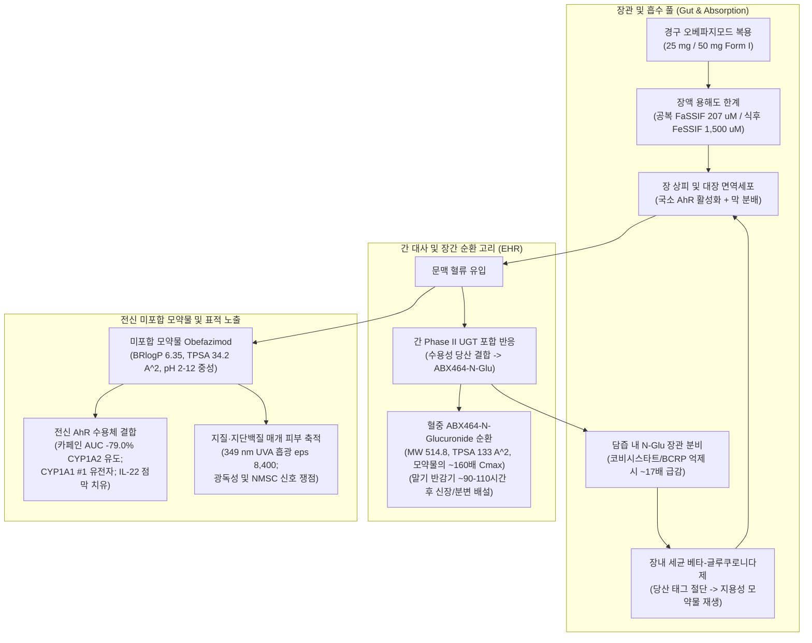
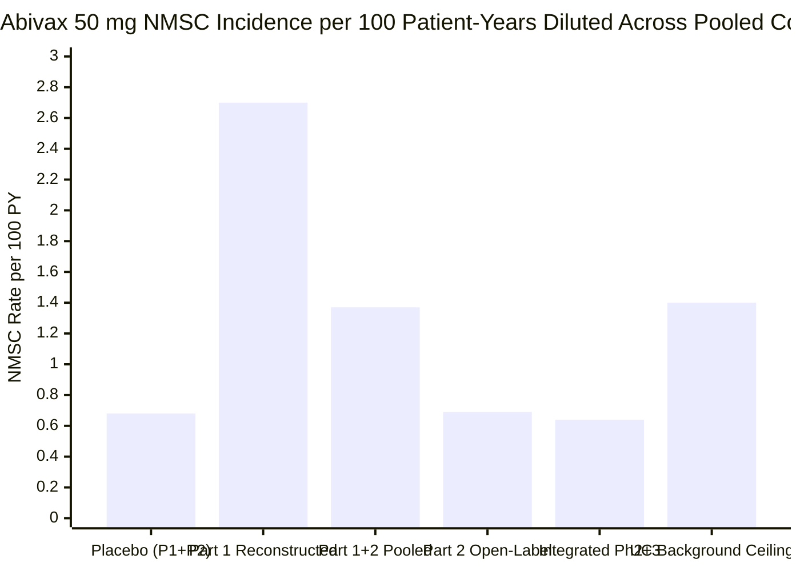
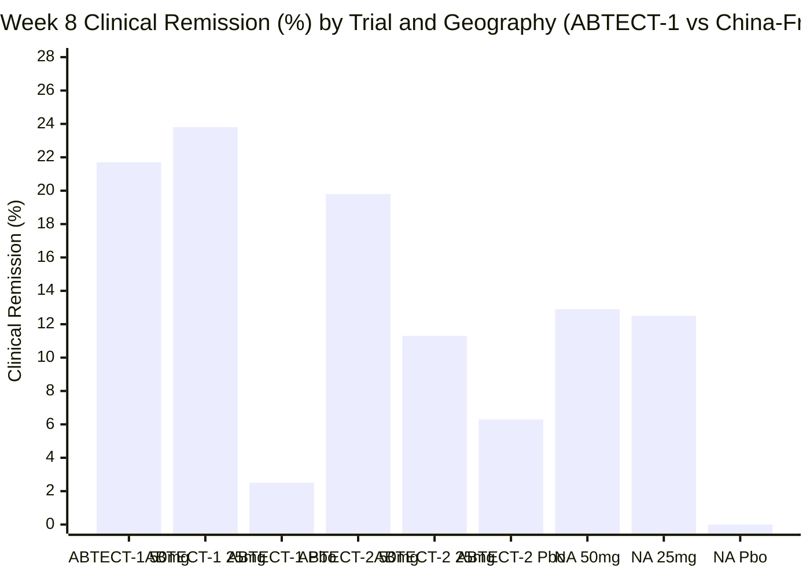

**2026년 11월 20일 금요일**, 행동주의 공매도 기관 **스콜피온 캐피털(`Scorpion Capital LLC`, 대표 구르키라트 "키르" 칼론)**이 프랑스 바이오 기업 **아비박스(`Abivax SA`, `NASDAQ / Euronext Paris: ABVX`)**를 *"시대를 대표하는 바이오 사기극(A Biotech Fraud For The Ages)"*이라 명명한 **297쪽 분량의 보고서**와 **외부 수탁연구기관(`CRO`) 실험 논문 4편**([메인 보고서](https://scorpionreports.s3.us-east-2.amazonaws.com/ABVX.pdf), [A1](https://scorpionreports.s3.us-east-2.amazonaws.com/A1.pdf), [A2](https://scorpionreports.s3.us-east-2.amazonaws.com/A2.pdf), [A3](https://scorpionreports.s3.us-east-2.amazonaws.com/A3.pdf), [A4](https://scorpionreports.s3.us-east-2.amazonaws.com/A4.pdf))을 전격 공개했다. 핵심 공격은 아비박스의 1일 1회 경구용 궤양성 대장염(`UC`) 신약 후보 **오베파지모드(`obefazimod`, `ABX464`)**가 *"DDT·다이옥신·잔류성 유기오염물질(`POPs`) 수준의 극단적 지용성 독성 물질"*이며 자외선(`UVA`) 유발 피부암 위험과 허구적 `miR-124` 기전을 숨기고 있다는 주장이다.

이날 나스닥 정규장에서 `ABVX`는 **`-9.24%` (`-$7.45`) 하락한 `$73.20`**으로 마감했다. 아비박스의 [2026년 7월 2일 `424B5` 공모 서류](https://www.sec.gov/Archives/edgar/data/1956827/000119312526294491/d111359d424b5.htm)상 유상증자 후 보통주(`87,054,535`주) 기준 시가총액은 **`$63.7억`**으로, 올해 7월 6일 `$9.2억` 유상증자 발행가(`$125.00/ADS`) 대비 **`-41.4%`** 하락했으며 2026년 초 시장을 달궜던 일라이 릴리(`Eli Lilly`)의 `€150억` (`$175억`) 인수설에서도 크게 멀어졌다.

아비박스 역시 즉각 반박 성명을 내고 *"스콜피온 캐피털이 직접 자금을 대고 의뢰한 연구를 포함해 수많은 사실 왜곡과 오도된 가정·결론이 담겨 있다"*고 일축했다. 회사는 3상 `ABTECT` 임상 프로그램의 무결성과 **2026년 말 미국 `FDA` 신약허가신청(`NDA`) 제출** 일정을 재확인하는 한편, 스콜피온이 보고서 공개 직후 숏 포지션 상당 부분을 환매수(`cover`)할 계획임을 스스로 명시했다는 점을 강조했다.

스콜피온의 폭로는 과거 *아바코판(`Tavneos`)* 사태처럼 FDA 심사 책상 위에서 터질 시한폭탄의 조기 경보일까, 아니면 실제 3상 성공 신약을 화학 공포 프레임으로 깎아내리는 공매도 전술일까? 답을 얻으려면 두 가지 질문을 분리해야 한다. 첫째는 약물의 화학적 물성·작용기전·피부암 통계·임상 수행의 **객관적 사실 검증**이고, 둘째는 그 사실이 **FDA 허가·라벨 경고·M&A 가치에 미치는 결정적 함의**다. PubChem 구조 데이터, SEC 공시, 미삭제 임상 프로토콜, 학술 원문을 모두 대조한 결과는 양쪽의 극단적 주장을 모두 뒤집는다.

> [!IMPORTANT]
> **포렌식 핵심 요약 (Forensic Thesis Summary):**
> 1. **스콜피온의 결정적 정타(기전 은폐, 공시 누락, 임상 지리 편차):** 아비박스의 자체 인간 `CYP1A2` 약물상호작용 임상(`NCT05121714`)에서 **카페인 `AUC`가 `-79.0%` (`7,420 → 1,560 h·ng/mL`) 급락**했다. 이는 순수한 `miR-124` 스플라이싱 이론이 아니라 **전신 아릴 탄화수소 수용체(`AhR`) 활성화**의 명백한 인체 증거다. 게다가 `FY2025 Form 20-F`는 2022년 2b상 프로토콜(`Prot_NCT04023396.pdf`)에 적혀 있던 **광독성(`phototoxicity`)**, **최기형성(`남녀 6개월 피임`)**, **마모셋 심근섬유화** 경고를 누락했고 3상 프로토콜(`Prot_NCT05507203.pdf`)에서는 해당 `AESI` 조항을 먹칠 삭제했다. 무작위 배정 `50 mg` 유지요법 `Part 1`의 재구성 비흑색종 피부암(`NMSC`) 발생률(`~2.70건/100인년`, 위약의 `4배`)과 중국이 빠진 `ABTECT-2`에서의 **`25 mg` 실패(`11.3%` vs. `6.3%`, `p = 0.165`)** 역시 실제 FDA 심사 리스크다.
> 2. **스콜피온의 명백한 과장("DDT" 및 "가짜 약효" 논리 붕괴):** 오베파지모드를 *"캡슐 속 DDT"*라 부르는 것은 인체 내 초고속 **N-글루쿠론산화(`N-glucuronidation`)**를 무시한 비약이다. 간 효소가 수용성 당산 꼬리를 붙여 만든 대사체 **`ABX464-N-glucuronide`(`TPSA 133 Ų`)**는 모약물 대비 혈중 `Cmax`가 **`~160배`** 높고 말기 반감기가 **`~90–110시간`(`약 4일`)**으로, `6–11년`씩 지방에 축적되는 DDT·다이옥신과 완전히 다르다. 더 결정적으로, **중국 임상기관이 단 1곳도 없던 `ABTECT-2`에서 `50 mg`은 위약을 확실히 이겼고(`19.8%` vs. `6.3%`, `p = 7.23 × 10⁻⁵`; 내시경 개선 `35.5%` vs. `10.1%`)** `ABTECT-Maintenance`도 압승(`51.3%` vs. `10.4%`, `p < 0.0001`)했다. 역설적이게도 스콜피온 자신이 증명한 **`AhR` 활성화(`AhR → IL-22` 장 점막 치유)**가 바로 왜 실제 약효가 나오는지 설명해 준다!
> 3. **재무 방어벽과 최종 현실:** 부실 바이오텍과 달리 아비박스는 **`€11억 6,950만` (`약 $13.3억`, 주당 `~$15.31`)**의 사실상 무차입 현금(`차입금 €120만`, 로열티 부담 `0`, **2029년 4분기까지 현금 런웨이**)을 보유하고 있으며 **2026년 7월 30일 FDA Pre-NDA 미팅도 긍정적으로 마쳤다**. `$73.20`(`시총 $63.7억`)의 진짜 위협은 도산이나 `$0` 사기가 아니라, **중국·`25 mg`에 대한 FDA `BIMO` 실사 마찰, `NDA` 지연, 그리고 라벨 경고문(최기형성·광과민/피부암·`CYP1A2` DDI)**으로 인해 `€150억` 빅파마 인수 기대감이 크게 깎이는 데 있다.

---

## 1. `$73.20` 주가를 둘러싼 세 가지 서사 충돌

세부 화학식과 통계표로 들어가기 전에 아비박스 경영진의 주장, 스콜피온의 기소장, 그리고 1차 원자료 감사 결과를 나란히 배치해 보자.

| 분석 차원 | 아비박스 경영진 서사 | 스콜피온 캐피털 공매도 논리 (`297쪽 + 실험 4편`) | 독립 1차 출처 포렌식 감사 |
| :--- | :--- | :--- | :--- |
| **작용기전 (`MOA`)** | 캡결합복합체(`CBC`)에 선택 결합해 항염증 마이크로RNA **`miR-124`**를 선택적으로 증폭하는 혁신 신약. | `miR-124`는 허상(`ddPCR`상 세포당 `0.00013` 카피); 실제로는 비특이적 지용성 **질량작용 세포막 독성/구충제**이자 **`AhR` 작용제**. | **스콜피온이 `AhR` 폭로에선 승리, '독성만의 착시' 주장에선 패배:** 인간 `CYP1A2` `-79.0%`와 `GSE116073` `CYP1A1` `#1` 유전자가 `AhR` 활성화를 입증—그러나 `AhR→IL-22`는 진짜 대장염 치유 기전이다. |
| **물성 및 체내 축적** | 활성 대사체 `ABX464-N-glucuronide`로 신속 대사되며 `4주` 내 항정상태 도달; 장기 경구 내약성 우수. | 비이온성 `BRlogP = 6.35`(지질 선호도 `220만:1`), 용해도 `0.16 µM`, `V/F = 1,228 L`, 장간 순환(`EHR`)—*"DDT·다이옥신과 동급."* | **극단적 모약물 지용성과 `EHR` 정황은 사실**이나, `~4일` 반감기의 수용성 글루쿠론산 포합체 배설 구조는 수년 단위 `DDT` 생물농축 논리를 반박한다. |
| **피부암 및 안전성** | 새로운 안전성 신호 없음; 2상+3상 통합 `1,704인년` `NMSC`(`0.59/100인년`)·비NMSC(`0.35/100인년`) 모두 `UC` 기저율 범위 내. | 전체 악성종양 `17건 중 16건`이 투약군; `349 nm` `UVA` 흡광 `ICH S10` 기준 `8.4배`; 미분류 피부병변 `64건`; 활성군 `NMSC 4건` 약물 연관 평가. | **양측 모두 분모 착시 활용:** `50 mg Part 1` 재구성 `NMSC`(`~2.70/100인년`)가 통합 풀링으로 희석됨. 한편 `20-F` 공시는 프로토콜상 광독성·최기형성을 누락함. |
| **3상 `ABTECT` 무결성** | `50 mg`·`25 mg` 모두 유도(`ABTECT-1/2`) 및 유지요법(`∆39.3%`, `∆40.3%`, `p < 0.0001`) 목표 달성; 연말 `NDA` 제출 순항. | `41개` 중국 기관(`PLA` 군병원 포함)·`15개` 우크라이나 기관 의존; 북미 위약 관해 `0/36`; 조직학 지표 `Robarts → Geboes` 교체. | **이분된 결론:** `50 mg`은 **중국 없는 `ABTECT-2`(`19.8%` vs `6.3%`, `p = 7.23 × 10⁻⁵`)**와 유지요법에서 명백히 성공; 반면 **`25 mg`은 `ABTECT-2`에서 실패(`p = 0.165`)**했고 북미(`0/36`)는 1명 차이다. |
| **재무 및 M&A 전망** | **2029년 4분기까지 `€11.7억` 현금**, 로열티 부채 제거, **2026년 7월 30일 긍정적 Pre-NDA 미팅**으로 상업화/전략 옵션 확보. | *"시대의 바이오 사기극"*; FDA 보완요구서한(`CRL`) 이상 위험; `아바코판($40억)`·`에트라시모드($70억)` 실패 후 빅파마가 비웃는 자산. | **단기 유동성 위기 없음(`주당 ~$15.31` 현금)**으로 급락 바닥은 단단하나, `AhR`·피임·광독성·중국 `BIMO` 리스크로 단기 `€150억` M&A 프리미엄은 훼손됨. |

---

## 2. '캡슐 속 DDT' vs 당분 코팅 대사: 화학 물성과 장간 순환 감사

화학 논쟁을 직관적으로 이해하려면 물컵에 엔진오일 한 방울을 떨어뜨리는 장면을 떠올리면 된다. 기름 방울은 물에 섞이지 않고 즉시 컵의 기름진 벽면이나 지방층에 들러붙는다. 이것이 **모약물(`parent drug`) 오베파지모드(`ABX464`)**의 성질이다.

미국 국립보건원 [PubChem (`CID 49846599`)](https://pubchem.ncbi.nlm.nih.gov/compound/49846599)에 등록된 오베파지모드(`MW 338.71`)는 계산 지용성 **`XLogP = 5.9`**, 극성 표면적 **`TPSA = 34.2 Ų`**의 작고 평평한 비전하 분자다. 스콜피온이 [논문 A1](https://scorpionreports.s3.us-east-2.amazonaws.com/A1.pdf)에서 수탁 측정한 값은 여기서 한 발 더 나간다.
- **실측 분배계수(`BRlogP`):** 3회 반복 측정 평균 **`6.35 ± 0.07`**(`6.31`, `6.32`, `6.43`)—물보다 기름(지질)을 **`220만 대 1`** 비율로 선호한다는 뜻이다.
- **이온화(`Sirius T3` 적정):** **`pH 2 ~ 12` 전 구간에서 측정 가능한 `pKa`가 없음**(전하를 띠지 않는 중성 분자). 아비박스 제형 특허의 녹는점(`120.5°C`)과 일반용해도방정식(`GSE`)을 결합한 순수 수용해도는 **`0.16 µM`**(`0.000054 mg/mL`)에 불과하다(아비박스 특허상 인공장액 용해도 `FaSSIF 207 µM`, `FeSSIF 1,500 µM`).
- **겉보기 분포용적(`V/F`):** 아비박스의 2017년 공복 `50 mg` 인체 약동학(`Scherrer 2017`) 수치로 역산하면 `CL/F = 966 L/h`, **`V/F ≈ 1,228 L`**로 체내 총수분(`42 L`)의 **`29배`**(생체이용률 `10%` 가정 시에도 `~123 L`)에 달해, 혈장을 빠져나와 세포막과 지방·지단백질로 강하게 분포함을 시사한다.

그렇다면 스콜피온 주장대로 오베파지모드는 정말 *"DDT나 다이옥신과 동급"*일까? **의미 치환 테스트(Substitution Test)**로 두 가지 엄격한 정의를 대입해 검증해 보자.

- **정의 A (엄격한 잔류성 유기오염물질 `POP` 기준):** 체내 효소로 대사되지 않는 할로겐 화합물이 지방에 갇혀 **`6–11년`의 생물학적 반감기**를 보이며 항정상태(`steady state`) 없이 무한 축적되는 물질. **오베파지모드는 정의 A에 해당하지 않는다.** 인체 간 효소가 모약물의 질소 원자에 음전하를 띤 수용성 글루쿠론산(당산) 꼬리를 빠르게 결합시키는 **N-글루쿠론산화(`N-glucuronidation`)** 때문이다. 이 주요 대사체 **`ABX464-N-glucuronide` ([PubChem `CID 122499702`](https://pubchem.ncbi.nlm.nih.gov/compound/122499702))**는 분자량 `514.8`, **`TPSA`가 모약물의 약 4배인 `133 Ų`**로 껑충 뛰고 혈중 `pH 7.4`에서 음이온으로 이온화되며, 혈중 최고농도(`Cmax`)가 모약물보다 **`~160배`** 높고 말기 반감기는 **`~90–110시간`(약 4일)**으로 **투약 4주 차에 항정상태에 도달**한다([2b상 프로토콜](https://cdn.clinicaltrials.gov/large-docs/96/NCT04023396/Prot_000.pdf)).
- **정의 B (장간 순환을 동반한 극단적 지용성 아웃라이어 기준):** 모약물이 세포막·지단백질에 강하게 분배되면서, 간이 수용성 `N-글루쿠론산 포합체`를 담즙으로 내보내면 식사 시 담낭이 장으로 방출하고 장내 세균(`β-glucuronidase`)이 다시 당 꼬리를 잘라 지용성 모약물을 재생해 재흡수시키는 **장간 순환(`EHR`)** 고리를 도는 약물. **오베파지모드는 정의 B에 부합할 개연성이 매우 높다.** 아비박스의 자체 인체 PK 기록에서 ① 식후 모약물 노출 `≥2.8배` 증가, ② 신장으로 수 시간 내 빠져야 할 포합체의 `~4일` 꼬리, ③ 디지털 재구성 곡선상 식사 연동 **`10–12시간` 대역 재상승 숄더(`p = 0.003`)**, ④ 담즙 수송체 `BCRP`를 억제하는 항레트로바이러스제 **코비시스타트(`cobicistat`) 병용 시 `N-Glu` `AUC`가 `~17배` 급감(반면 `Cmax`는 `~5배`만 감소)**한 현상 등 6개 독립 단서가 모두 `EHR`을 가리킨다.

PubChem 1차 화합물 DB 기준으로 금지 오염물질, 규제 철회/경고 고지용성 약물, 그리고 경쟁 궤양성 대장염(`UC`) 치료제와 비교한 성적표는 다음과 같다.

| 화합물 (`PubChem CID`) | 약물 분류 / 상태 | 분자량 (`MW`) | PubChem `XLogP` (실측 `BRlogP`) | `TPSA` (`Ų`) | 실제 임상·규제 사례 비교 |
| :--- | :--- | :--- | :--- | :--- | :--- |
| **오베파지모드 (`CID 49846599`)** | `UC` 3상 경구제 (모약물) | `338.71` | **`5.9`** (실측 `6.35`) | **`34.2`** | `pH 2–12` 중성; `V/F ~1,228 L`; 프로토콜상 엄격한 자외선 차단·피임 규정. |
| **`ABX464-N-glucuronide` (`CID 122499702`)** | 주 활성 인체 대사체 | `514.8` | `4.1` (중성기준, `pH 7.4` 이온화) | **`133.0`** | **모약물의 `~160배` `Cmax`**; 반감기 `~90–110시간`; 4주 항정상태; **동물모델 광독성**. |
| **`DDT` (`CID 3036`)** | 금지 유기염소계 살충제 | `354.5` | `6.9` | `0.0` | 비대사성 물질로 인체 지방 반감기 `6–11년`. (*오베파지모드와 대사·배설 구조 상이.*) |
| **`TCDD` / 다이옥신 (`CID 15625`)** | 잔류성 환경오염물질 (`POP`) | `322.0` | `6.4` | `18.5` | 비가역적 `AhR` 초강력 작용제; 반감기 `~7–11년`; 염소여드름·발암. |
| **아바코판 / `Tavneos` (`CID 49841217`)** | 혈관염 경구제 (`Amgen $40억` 인수) | `581.6` | `7.2` | `61.4` | 중성 고지용성 선례: **[2026년 4월 FDA CDER 승인 철회 제안](https://www.fda.gov/drugs/drug-alerts-and-statements/cder-proposes-withdraw-approval-tavneos)**(치명적 간손상 및 임상 조작). |
| **아시트레틴 (`CID 5284513`)** | 건선 경구 레티노이드 (승인) | `326.4` | `6.1` | `46.5` | 최기형성 **임신금기 Category X**; 투약 종료 후 **3년간 임신·헌혈 금지**. |
| **아미오다론 (`CID 2157`)** | 부정맥 치료제 (승인) | `645.3` | `7.6` | `42.7` | 대표적 조직 축적 약물; 반감기 `40–55일`; 폐·간 독성 박스 경고 및 광과민성. |
| **클로파지민 (`CID 2794`)** | 한센병 희귀약 (승인) | `473.4` | `7.1` | `40.0` | 위장관·지방 결정 침착, 피부 착색, 수개월 장기 조직 잔류. |
| **에트라시모드 / `Velsipity` (`CID 44623998`)** | `UC` 경구 `S1P` 조절제 (`Pfizer $67억`) | `457.5` | `6.4` | `62.3` | 산성기로 혈중 이온화(`logD` 저하); `UC` 승인 획득했으나 상업적 기대 하회. |
| **타피나로프 / `Vtama` (`CID 6439522`)** | 국소 도포 `AhR` 작용제 (승인) | `254.3` | `4.6` | `40.5` | **`AhR` 작용이 FDA 승인을 받은 정식 항염 기전**임을 증명(단, 전신 경구제가 아닌 외용제). |
| **우파다시티닙 (`CID 58557659`)** | `UC` 경구 `JAK1` 억제제 (`Rinvoq`) | `380.4` | **`2.7`** | `78.3` | 전형적인 친수성·균형 물성의 저분자 약물; `MACE`·악성종양 박스 경고 보유. |
| **토파시티닙 (`CID 9926791`)** | `UC` 경구 `JAK` 억제제 (`Xeljanz`) | `312.37` | **`1.5`** | `88.9` | 높은 수용성; `ORAL Surveillance` 이후 악성종양·심혈관 박스 경고 적용. |

---

## 3. 진짜 기전 스모킹 건: `-79%` 인간 카페인 급락이 `miR-124` 커튼 뒤 `AhR`을 폭로하다

홍보 브로슈어에는 "100% 무소음 전기 모터로 달리는 세단"이라고 적어 놓았는데, 정비사가 보닛을 열어 보니 배터리는 `0.00013`볼트 방전 상태이고 사실은 **디젤 엔진이 굉음을 내며 바퀴를 굴리고 있었다면** 어떨까?

스콜피온이 297쪽 보고서에서 가장 날카롭게 찔러 낸 대목이 바로 이 기전 역전이며, **가장 치명적인 증거는 스콜피온의 유료 실험실이 아니라 아비박스 본인이 미국 정부 임상등록 사이트에 올린 인체 데이터에서 나온다.**

### 결정적 증거 #1: 아비박스 자체 인간 `CYP1A2` 임상(`NCT05121714`)의 `-79.0%` 카페인 붕괴
2022~2023년 아비박스는 건강한 성인 `59명`을 대상으로 **카페인**을 이용한 1상 약물상호작용(`DDI`) 시험([`NCT05121714`](https://clinicaltrials.gov/study/NCT05121714))을 실시했다. 카페인은 간 대사 효소 **`CYP1A2`**의 활성도를 재는 표준 지표 약물이며, 인체에서 `CYP1A2`를 강력하게 켜는 핵심 스위치가 바로 **아릴 탄화수소 수용체(`AhR`)**다.

`ClinicalTrials.gov`에 공식 게시된 수치는 충격적이다.
- **1일 차 (카페인 단독):** 카페인 혈중 노출(`AUC`) 평균 **`7,420 ± 4,760 h·ng/mL`** (`Cmax = 931 ± 285 ng/mL`).
- **4일 차 (카페인 + `ABX464`):** 평균 `AUC` **`5,460 ± 2,740 h·ng/mL`** (`-26.4%`).
- **17일 차 (카페인 + 항정상태 `ABX464`):** 평균 `AUC` **`1,560 ± 719 h·ng/mL`** (`Cmax = 564 ± 242 ng/mL`)—**카페인 노출량이 `-79.0%` 증발했다!**

FDA DDI 가이드라인상 지표 약물 `AUC`를 `80% 이상` 떨어뜨리면 **"강력한(`strong`) 유도제"**로 분류된다. **`-79.0%`**는 아비박스가 임상 용량에서 **사람 간 `CYP1A2`와 전신 `AhR` 경로를 사실상 강력 유도제 수준으로 풀가동하고 있음**을 스스로 증명한 셈이다.

### 결정적 증거 #2: 독립 데이터와 아비박스 유전체가 일치 지목한 `AhR`
1. **아비박스·타지(Tazi) 팀 자체 인체 CD4 T세포 RNA-seq ([`GSE116073`](https://www.ncbi.nlm.nih.gov/geo/query/acc.cgi?acc=GSE116073)):** 스콜피온 재분석 결과 전체 `40,475개` 유전자 중 `AhR` 표적 유전자인 **`CYP1A1`이 비감염(`+9.93배`) 및 HIV 감염(`+14.39배`) 조건 모두에서 발현 증가 1위(`p = 1.6 × 10⁻⁴`)**를 차지했고, 6개 `AhR` 핵심 유전자(`CYP1A1, CYP1B1, CYP1A2, TIPARP, AHRR, NQO1`)가 일제히 상승했다.
2. **제3자 바이오텍 에퀼리움(`Equillium`, 2026년 5월 27일 웨비나):** 자체 경구용 `AhR` 조절제(`EQ504`) 연구 과정에서 `ABX464`를 대조군으로 검증한 결과, `ABX464`가 인간 `AhR PAS-B` 결정 구조(`PDB 7ZUB`) 결합 포켓에 정확히 도킹하고 **`EC50 = 404.2 nM`**(아비박스 표준 세포실험 농도 `5 µM`에서 **`92%` 최대 활성**, 반면 `N-Glu` 대사체는 비활성)을 나타냈으며, **`AhR` 길항제 `GNF-351`을 투여하자 아비박스식 RT-PCR에서 `7.7배` 뛰던 `"miR-124"` 신호가 `0.85배`로 완전히 사라졌다**.
3. **아비박스 자체 2017년 논문([Chebli et al., *Sci Rep* 2017](https://pmc.ncbi.nlm.nih.gov/articles/PMC5501810/)):** 이미 2017년에도 아비박스 연구진은 `ABX464`가 **`IL-22` 분비를 촉진해 장 염증을 억제**한다고 보고했는데, `IL-22`야말로 장 점막에서 **`AhR`이 만드는 대표적 치유 사이토카인**이다!

### 무너진 `miR-124` 서사의 허점과 스콜피온 주장의 자가당착
아비박스의 `miR-124` 단독 표적 주장이 왜 흔들리는지 보여주는 기록상의 모순도 선명하다.
- **같은 프로그램 내 `0.00013` vs. `8,517`의 괴리:** 2b상 유지요법([`NCT04023396`](https://clinicaltrials.gov/study/NCT04023396))에서 절대 정량 기법인 `ddPCR`은 혈액 내 `miR-124`를 **기저치 `0.00000 ± 0.00000 copies/cell`**, 24주 `0.00011`, **48주 `0.00013 copies/cell`**(약 `7,700개` 세포당 `1분자`)로 기록했다. 그런데 2b상 유도요법([`NCT03760003`](https://clinicaltrials.gov/study/NCT03760003))에는 동일한 **`copies number/cell`** 단위 아래 8주 차 혈액 값이 **`4,598`(`25 mg`), `8,517`(`50 mg`), `13,753`(`100 mg`)**으로 약 **`5,700만~6,900만 배`** 커진 정규화 배수([Apolit et al. 2023](https://pmc.ncbi.nlm.nih.gov/articles/PMC10132720/))가 기입되어 있다.
- **논문 철회와 원침전(`centrifugation`) 오차:** 공동창업자 자말 타지(Jamal Tazi) 교수의 2003년 대표 논문은 2023년 *Journal of Cell Biology*에서 이례적 **철회 후 재게재([`PMC10482727`](https://pmc.ncbi.nlm.nih.gov/articles/PMC10482727/))** 조치를 당했고, 아비박스 2023년 IR 자료의 `miR-124 → STAT3` 핵심 근거였던 중국 논문([Lin et al.](https://www.frontiersin.org/journals/oncology/articles/10.3389/fonc.2024.1506202/full))은 2024년 데이터 무결성 문제로 철회됐다. 또한 스콜피온이 의뢰한 [`A3.pdf`](https://scorpionreports.s3.us-east-2.amazonaws.com/A3.pdf)·[`A4.pdf`](https://scorpionreports.s3.us-east-2.amazonaws.com/A4.pdf) 재현 실험은 `CBC` 결합·세포독성 기준 논문([Campos 2015](https://pmc.ncbi.nlm.nih.gov/articles/PMC4422473/))에서 약물이 `0.16 µM` 이상에서 응집 침전해 **원심분리 펠릿으로 `84.9%`가 버려졌고 상등액엔 명목 농도의 `19.4%`만 남아 `"60 µM 이하 무독성"` 주장이 ~5배 이상 부풀려졌음**을 보였다.
- **스콜피온 논리의 치명적 자가당착:** 반면 스콜피온이 `ABX464`가 선충을 죽이는 구충제(`PMID:38134663`, [`PMC13270096`](https://pmc.ncbi.nlm.nih.gov/articles/PMC13270096/))와 비슷한 비특이적 세포막 독성 물질일 뿐이라고 주장한 대목은 **스콜피온 스스로 입증한 `AhR` 작용제 사실과 정면 충돌**한다. 소화기내과에서 **`AhR → IL-22` 활성화는 한약 성분 청대(*indigo naturalis*)나 FDA 승인 외용제 타피나로프, 에퀼리움 `EQ504`가 증명한 진짜 항염·점막 치유 기전**이기 때문이다. 아비박스가 포장지에 잘못된 기전(`miR-124`)을 적어 놓고 `CYP1A2` 부작용을 감췄을지언정, 약물이 대장염을 낫게 한 핵심 엔진(`AhR`) 자체는 실존한다.

---

## 4. 공시 분열 매트릭스: 임상 프로토콜과 SEC 연차보고서(`20-F`) 사이의 단절

바이오 기업을 감사할 때 가장 확실한 검증법은 **임상 의사들에게 배포한 비공개성 프로토콜**과 **월가 투자자들에게 제출한 `Form 20-F` 및 유상증자 증권신고서(`424B5`)**를 대조하는 것이다.

| 안전성·약리 항목 | 2022년 미삭제 2b상 프로토콜([`Prot_NCT04023396.pdf`](https://cdn.clinicaltrials.gov/large-docs/96/NCT04023396/Prot_000.pdf)) & `ClinicalTrials.gov` | 2025년 `Form 20-F` / `2026년 7월 424B5` & 먹칠 삭제된 3상 프로토콜([`Prot_NCT05507203.pdf`](https://cdn.clinicaltrials.gov/large-docs/03/NCT05507203/Prot_000.pdf)) | 규제·FDA 라벨링 시사점 |
| :--- | :--- | :--- | :--- |
| **비임상 광독성 및 일광 차단 수칙** | **39쪽 §8.2:** *"임상적으로 유의미한 노출 농도의 비임상 모델에서 **`ABX464-N-Glu` 경구 투여 시 광독성(`phototoxic`)이 확인**되었음을 동의서(`ICF`)로 고지한다."* 모자·**선글라스**·`SPF 15+`·자외선 회피, 병변 사진 촬영 및 중앙 피부과 판독 의무화. | `104만` 자 분량의 [`FY2025 Form 20-F`](https://www.sec.gov/Archives/edgar/data/1956827/000195682726000012/abvx-20251231.htm)와 7월 [`424B5` 공모서](https://www.sec.gov/Archives/edgar/data/1956827/000119312526294491/d111359d424b5.htm) 모두 **`phototox` 검색 `0건`**. 3상 프로토콜 `§8.1.2` `AESI` 문구는 **검게 마스킹(`redacted`) 처리**. | 향후 FDA 허가 라벨에 **강력한 자외선 차단·광과민 경고문**이 붙을 가능성과 유지요법 피부병변 `64건` 세부 내역 제출 요구 가능성 높음. |
| **최기형성 및 `6개월` 피임 규제** | **17~18쪽:** *"ABX464는 **최기형성(`teratogenic`) 활성**을 보이는 것으로 나타남."* 토끼 배아·태아 독성 `NOAEL < 1 mg/kg/일`. **가임기 여성 및 남성 파트너 모두 시험 종료 후 `180일(6개월)` 피임 + 정자 기증 금지** 규정. | `20-F` 및 `424B5` 모두 **`teratogen`·`embryo-fetal`·`contracep` 검색 `0건`**(`424B5`는 시험 중 임신 `2건`만 표기). 경쟁사 애브비(`AbbVie`) R&D 임원진이 공개 행사에서 이 과도한 피임 규정을 집중 비판한 바 있음. | `UC` 환자의 상당수가 가임기 젊은 층이라는 점에서 **임신 금기 박스 경고·REMS 상담 부담**은 상업적 최대 아킬레스건 중 하나. |
| **인체 강력 `CYP1A2` 유도 (`AhR`)** | [`NCT05121714`](https://clinicaltrials.gov/study/NCT05121714) 결과 **카페인 `AUC -79.0%` 급락**(`7,420 → 1,560 h·ng/mL`)—FDA '강력 유도제(`≥80%`)' 턱밑 수치. | `20-F` 및 `424B5`에서 **`CYP1A2` 검색 `0건`**. `AhR`은 `20-F` 내 병용요법 후보 탐색 목록(`a4b7, IL-23, PDE-4, ahR`)으로만 **단 1회** 언급. | 티자니딘·클로자핀·테오필린 등 `CYP1A2` 대사 약물 병용 주의·금기 라벨 불가피 및 `AhR` 작용제의 부인 불가 증거. |
| **원숭이 심근섬유화·미니피그 간독성** | 9개월 마모셋 `N-Glu` 고용량 심근섬유화 `2건`(*marmoset wasting syndrome* 추정) 및 미니피그 `≥10 mg/kg` 간세포 괴사(`NOAEL 5 mg/kg`)로 트로포닌·`NT-proBNP`·심초음파·`ICVSC` 감시 실시. | `20-F` 및 2026년 6월 `6-K` 유지요법 안전성 표에서 **임상 심근섬유화 `0건`**, 트로포닌/`NT-proBNP` 정상, `DILIsym` 무독성, `Hy's Law` 간독성 미발생 확인. | 인체 내 급성 심장·간 독성 신호가 전무하다는 점은 **`Tavneos` 사태와 결정적으로 차별화되는 긍정적 데이터**. |
| **시노몰구스 원숭이 면역억제** | 9개월 시노몰구스 원숭이 경구 투여 시험에서 면역억제 관찰 → `Grade ≥3` 중증·기회감염 `AESI` 추적. | 3상 유지요법에서 중증/기회감염 발생률이 위약 `1.0%`(`2명`), `25 mg 1.0%`(`2명`), **`50 mg 0.5%`(`1명`)**로 매우 낮음. | 항TNF 제제나 JAK 억제제 대비 **낮은 감염 부담은 확실한 임상적 강점**. |

---

## 5. 임상·통계 포렌식 감사: 양측의 '분모 마술'을 모두 잡아내다

### 5A. 비흑색종 피부암(`NMSC`)과 노출 보정 발생률(`EAIR`) 희석 해부

스콜피온의 가장 위협적인 안전성 공격은 **피부암과 악성종양**이다. 아비박스는 [2026년 6월 2일 `SEC 6-K`](https://www.sec.gov/Archives/edgar/data/1956827/000119312526252360/d98688dex991.htm)에서 `ABTECT-Maintenance Part 1`(`N = 580`, 44주 무작위 배정)의 압도적 약효를 발표하면서 동시에 **`50 mg` 투여군(`N = 195`)에서 총 `7건`의 악성종양/이형성증**을 보고했다(`25 mg` 1건, 위약 1건):
- **비흑색종 피부암(`NMSC`):** `50 mg` **`4건`**(기저세포암 `2`, 편평세포암 `2`), `25 mg` `1건`(편평세포암), 위약 `1건`(기저세포암).
- **비-NMSC 종양/이형성:** 전립선암 `1건`, 유방암 `1건`, 대장 이형성증 `1건`—**전부 `50 mg`군 발생**.

불과 **27일 뒤인 6월 29일**, 아비박스는 비반응자·재발자를 대상으로 한 오픈라벨 [유지요법 `Part 2` `SEC 6-K`](https://www.sec.gov/Archives/edgar/data/1956827/000119312526288752/d110874dex991.htm)를 공개하며 `NMSC 4건`(`25 mg 2`, `50 mg 2`)과 `비-NMSC 2건`(`50 mg`)을 추가하고 `100인년(PY)`당 발생률(`EAIR`) 표를 내놓았다. 그런데 아비박스가 6월 29일 공시한 숫자를 역산하면 **아비박스가 숨긴 `Part 1` 단독 `EAIR`**이 정확히 튀어나온다.
- `Part 1 + Part 2` 합산 `50 mg` `NMSC` `EAIR = 1.37` (`6건` → 총 **`~438.0 PY`**).
- `Part 2` 단독 `50 mg` `NMSC` `EAIR = 0.69` (`2건` → **`~289.9 PY`**).
- 차감하면 **무작위 대조 `Part 1`의 `50 mg` 노출량은 `~148.1 PY`**이며, 여기에 `4건`을 나누면 **`Part 1` `50 mg` `NMSC` 발생률은 `100인년당 ~2.70건`**—위약(`0.68/100인년`)의 **`~4.0배`**, 아비박스 자체 `UC` 기저율 상단(`1.40`)의 거의 **`2배`**에 달한다!

| 분석 코호트 (`2026-06-29 6-K` 및 역산) | 위약 `NMSC` (`100인년당`) | `25 mg` `NMSC` (`100인년당`) | `50 mg` `NMSC` (`100인년당`) | `50 mg` 비-NMSC (`100인년당`) | 제시된 `UC` 기저율 (`NMSC` / 비-NMSC) |
| :--- | :--- | :--- | :--- | :--- | :--- |
| **3상 유지 `Part 1` 단독 (`N = 580`, 역산)** | `1건` (`0.68`) | `1건` (`~0.70`) | **`4건` (`~2.70`)** *(포아송 95% CI: `0.74–6.91`)* | `2–3건` (`~1.35–2.03`) | `0.70–1.40` / `0.30–0.70` |
| **3상 유지 `Part 1 + Part 2` (공시)** | `1건` (`0.68`) | `3건` (`1.09`) | `6건` (`1.37`) | **`4건` (`0.91`)** | `0.70–1.40` / `0.30–0.70` |
| **3상 유지 `Part 2` 단독 (오픈라벨, 공시)** | `—` | `2건` (`1.52`) | `2건` (`0.69`) | `2건` (`0.69`) | `0.70–1.40` / `0.30–0.70` |
| **2상+3상 통합 `UC` (`활성군 1,704인년`)** | `0.46` | `0.53` | `0.64` | **`0.64`** (전체 활성 `0.35`) | `0.70–1.40` / `0.30–0.70` |

이 데이터에서 **양측 모두가 범한 통계적 편향**은 다음과 같다.
- **아비박스 측 왜곡:** 오픈라벨 `Part 2`(`0.69`)와 장기 2상 데이터를 합산해 `Part 1`의 높은 신호(`~2.70`)를 `1.37` → `0.64`로 희석했다. 그래도 `Part 1+2`의 `50 mg` 비-NMSC 발생률(`0.91/100인년`)은 여전히 자체 기준 상단(`0.70`)을 넘는다. 또한 7월 IR 자료에서 `68건`의 피부병변 중 `NMSC 4건` 외 **`64건`을 세부 분류 없이 `"모든 유형의 피부병변"`으로 뭉뚱그렸고**, 스콜피온 `A2.pdf`가 측정한 `349 nm` `UVA` 흡광계수(`ε = 8,400 M⁻¹cm⁻¹`)는 `ICH S10` 광안전성 선별 기준(`1,000`)의 **`8.4배`**를 넘으며 시험자 평가에서도 활성군 `NMSC 4건`이 약물 연관 가능성(`possibly`/`probably`)으로 분류됐다.
- **스콜피온 측 왜곡:** 전체 노출 인년의 **`85%` 이상이 활성 투여군(`1,704+ PY` vs. 위약 `~217 PY`)**이라는 사실을 뺀 채 *"암 `17건 중 16건`이 투약군"*이라고 헤드라인을 뽑는 것은 고전적인 **분모 누락(`missing denominator`)**이다. 더구나 `148인년` 중 `4건` 발생의 **정확한 포아송 `95% 신뢰구간`은 `100인년당 0.74 ~ 6.91건`**으로 넓어 우연과 기저율 범위(`0.70–1.40`)를 배제하지 못한다. `NMSC` 환자들의 평균 연령(`62세`)도 전체 평균(`42세`)보다 20세 높고 과거 티오퓨린·생물학제제·피부암 병력을 지녔으며, `A2.pdf` 각주 2번 스스로 인정했듯 스콜피온은 자외선 **흡광(`Step 1`)만 쟀을 뿐 활성산소(`ROS`) 생성이나 동물 광발암성은 측정하지 않았다**.

### 5B. `ABTECT-1` vs. `ABTECT-2`, 중국 `41개` 기관(인민해방군 병원 포함), 그리고 북미 `0/36` 절벽

스콜피온은 `ABTECT-1`이 **중국의 인민해방군(`PLA`) 제900병원과 동부전구 총병원을 포함한 `41개` 중국 기관**([`NCT05507203`](https://clinicaltrials.gov/study/NCT05507203)) 및 우크라이나 `15~16개` 기관에 의존해 가짜 효능을 만들었다고 몰아세운다. 정말 중국 데이터가 빠지면 약효가 사라질까? `ClinicalTrials.gov`와 SEC `6-K` 원데이터를 나란히 놓아 보자.

| 임상 시험 / 하위군 (`1차 출처`) | 중국 기관 유무 | 위약 관해 (`n/N`, `%`) | `25 mg` 관해 (`n/N`, `%`) | `50 mg` 관해 (`n/N`, `%`) | 내시경 개선 (`50 mg` vs. 위약) | 포렌식 진단 |
| :--- | :--- | :--- | :--- | :--- | :--- | :--- |
| **`ABTECT-1` 8주 유도 (`NCT05507203`)** | **있음 (`41곳`, `PLA 2곳` 포함)** | `4/158` (**`2.5%`**) | `38/160` (**`23.8%`**, `p = 7.5 × 10⁻⁹`) | `69/318` (**`21.7%`**, `p = 1.9 × 10⁻⁹`) | **`33.3%` vs. `5.7%`** (`HEMI`: `23.0%` vs `3.2%`) | 비정상적으로 낮은 위약(`2.5%`); 용량 반응 역전(`25 mg > 50 mg`). |
| **`ABTECT-2` 8주 유도 (`NCT05507216`)** | **없음 (`0곳`; 일본 `49`, 미국 `46`)** | `10/159` (**`6.3%`**) | `18/159` (**`11.3%`**, **`p = 0.165` 실패**) | `63/318` (**`19.8%`**, **`p = 7.2 × 10⁻⁵` 성공**) | **`35.5%` vs. `10.1%`** (`HEMI`: `23.9%` vs `7.5%`) | **`50 mg`은 중국 없이도 완승(사기론 반박)**, 그러나 **`25 mg`은 붕괴(`ABTECT-1` 대비 `p = 0.0049`)!** |
| **`ABTECT-Maintenance` 44주 (`2026-06-02 6-K`)** | `20곳` (`413곳` 중 `4.8%`) | `20/192` (**`10.4%`**) | `98/193` (**`50.8%`**, `∆39.3%`, `p < 0.0001`) | `100/195` (**`51.3%`**, `∆40.3%`, `p < 0.0001`) | **`64.1%` vs. `12.5%`** (`MES=0`: `47.7%` vs `9.9%`) | 중앙 판독 내시경 관해(`47.7%`) 및 조직-내시경 개선(`HEMI 57.4%`) 압도적. |
| **북미 8주 하위군 (`ECCO 2026.02`, `N = 122`)** | **없음 (미국·캐나다)** | **`0/36` (`0.0%`)** | `3/24` (`12.5%`, Fisher `p = 0.059`) | `8/62` (`12.9%`, Fisher `p = 0.025`) | 객관 지표 내시경 개선: **`p = 0.08` (`50 mg`), `p = 0.15` (`25 mg`) — 미달** | **극도로 취약:** 위약 관해 **단 1명(`1/36`)만 나왔어도 `50 mg` `p = 0.148`**로 무산! |

이 표가 말해 주는 팩트는 두 갈래로 명확하다.
1. **스콜피온의 "중국발 가짜 약효" 프레임은 `50 mg`에서 깨진다:** 중국 기관이 **단 한 곳도 없던 `ABTECT-2`**(일본 `49`, 미국 `46`)에서 `50 mg`은 `19.8%` vs. `6.3%`(`p = 7.23 × 10⁻⁵`)로 확실히 이겼고 내시경 개선(`35.5%` vs. `10.1%`)도 `ABTECT-1`(`33.3%`)보다 오히려 높았다. 중국이 빠진 유럽 2b상 96주 연장(`PMID:40417999`) 역시 `75.6%`(`164/217`) 유지율을 기록했다.
2. **그러나 스콜피온이 짚어낸 두 개의 FDA 규제 뇌관은 실재한다:** 첫째, **`25 mg` 유도요법이 중국 없는 `ABTECT-2`에서 `p = 0.165`로 실패**해 `ABTECT-1`(`23.8%`)과 통계적으로 유의미한 괴리(`p = 0.0049`)를 보였고, 둘째 **북미 하위군(`N = 122`)은 위약 관해 `0/36`이 단 1명(`1/36`)으로만 바뀌어도 통계적 유의성이 증발(`p = 0.148`)**하며 객관적 내시경 개선(`p = 0.08`)에 실패했다. 2b상에서 `50 mg`이 실패한 `Robarts` 조직 지표(`p = 0.187`)를 빼고 3상에서 `Geboes` 단일 지표만 남긴 점과 `PLA` 병원 포함 여부까지 겹쳐 FDA `BIMO` 현장 실사 강도는 매우 높을 것이다.

---

## 6. 4방향 인과 감사, 시장의 무덤 선례, `$13.3억` 현금 방패, 그리고 공매도 검증

왜 이 약물에서는 **확실한 `50 mg` 대장 내시경 치유**와 **카페인 `-79%` 붕괴·`Part 1` `50 mg` 피부암 편중·`25 mg` 지역 편차**가 동시에 나타나는가? 4방향 인과 감사로 교란 요인을 분리해 보자.

| 인과 가설 | 검증 메커니즘 | 부합하는 증거 | 설명하지 못하는 한계 | 종합 판정 |
| :--- | :--- | :--- | :--- | :--- |
| **1. 직접 약물 효과 (`AhR` 작용 + 지용성/UVA)** | `AhR` 활성화(`IL-22`, `CYP1A1/2`)가 장 점막을 치유하는 한편, 지용성 모약물·`349 nm UVA` 흡광·만성 `AhR`이 광독성 및 `NMSC` 촉진 위험 유발. | `-79.0%` 카페인 `AUC`, 중국 없는 `ABTECT-2 50 mg` 내시경 치유, `50 mg` 용량의존 `NMSC`/종양 편중 설명. | 왜 `ABTECT-1`에서 `25 mg`(`23.8%`)이 `ABTECT-2` `25 mg`(`11.3%`)보다 2배 이상 높았는지 설명 불가. | **핵심 생물학적 주원인** (진짜 약효와 진짜 독성 위험 공존). |
| **2. 역인과·환자군 선택 편향 (`고위험 난치 UC`)** | 평균보다 20세 많은 환자(`62세`)와 과거 티오퓨린·생물학제제 실패 이력이 높은 `NMSC` 기저 위험과 낮은 `4.4%` 위약률 유발. | 전체 환자의 `45–49%`가 선행 고급치료 불응군이며, `NMSC` 환자들이 고령·피부암 기왕력 보유. | 무작위 배정 `Part 1`에서는 연령과 과거력이 `50 mg`·위약 간 균형을 이루므로 `50 mg`의 `4배` 격차를 단독 설명 못 함. | **부분 기여 요인** (절대 기저율은 설명하나 투약군 편중 설명 한계). |
| **3. 제3의 교란 변수 (`지역 기관 구성 & 코호트 풀링`)** | `ABTECT-1`(`중국 41곳`·`동유럽 38%`) vs `ABTECT-2`(`중국 0곳`)의 지리 차이와 `Part 2`/2상 통합 풀링이 숫자 왜곡을 낳음. | `25 mg`의 `ABTECT-1/2` 괴리(`p = 0.0049`)와 `Part 1` `2.70 → 0.64` `NMSC` 희석을 정확히 설명. | 글로벌 `ABTECT-2 50 mg`의 내시경 개선(`35.5%`) 및 유지요법(`51.3%`)의 압도적 격차는 설명 못 함. | **중대한 방법론적 교란** (`25 mg` 편차와 `NMSC` 희석의 주범). |
| **4. 상호 피드백 루프 (`EHR` + `UVA` + 잠재 병변)** | 장간 순환(`EHR`)으로 모약물 조직 노출이 연장되고, 피부에 축적된 발색단이 `UVA`로 반복 여기되며 만성 `AhR`이 전암 병변 성장 촉진. | `EHR` PK(`10–12h` 숄더, 코비시스타트 `17배`), `349 nm` 흡광, 40세 이상 성인의 잠재 피부 전암 병변 생물학을 통합 설명. | `44주` 임상의 절대 건수(`50 mg 6건` vs 위약 `1건`)가 작아 인체 장기 인과 확증엔 데이터 부족. | **장기 추적 필수 가설** (`2년` 설치류 발암성·Tier-2 광안전성 심사 핵심). |

### 누가 손실을 입는가, 빅파마 무덤 선례, 그리고 아비박스의 재무 방어벽

- **숨겨진 비용의 부담자:** 만약 `180일` 최기형성 피임 규제가 라벨에 박히면 **가임기 젊은 `UC` 환자**의 복약 순응도가 꺾이고, `CYP1A2` 기질 약물 복용자는 약물상호작용 위험을 떠안는다. **2026년 7월 `$125/ADS` 공모주 매수자(`-41.4%`)**와 빅파마 M&A 기대주 투자자들도 마찬가지다. 빅파마는 이미 `2026년 4월 27일` FDA가 치명적 간손상(`VBDS`)과 사후 데이터 조작으로 승인 철회를 제안한 [**암젠의 `$40억` 아바코판(`Tavneos`) 사태**](https://www.fda.gov/drugs/drug-alerts-and-statements/cder-proposes-withdraw-approval-tavneos)와 **화이자의 `$67억` 에트라시모드(`Velsipity`) 손상차손**을 목격한 직후라 안전성·데이터 무결성 흠집에 극도로 민감하다.
- **아비박스가 쉽게 무너지지 않는 재무 이유:** [2026년 9월 21일 반기 실적 `6-K`](https://www.sec.gov/Archives/edgar/data/1956827/000195682726000027/a6-kpressreleaseq22026fina.htm) 기준 아비박스는 6월 말 현금 `€4억 240만`에 7월 유상증자 순유입액 `€7억 6,710만`(`$8억 7,410만`)을 더해 **가용 현금 `€11억 6,950만`(약 `$13.3억`, 주당 `~$15.31`)**을 보유한 반면 차입금은 **`€120만`**뿐이고 5월 `$9,000만` 로열티 인증서 매입 소각으로 향후 로열티 부담도 `0`이다. 반기 영업현금소진 `€1억 250만`(연 `~€2.05억`) 기준 **2029년 4분기까지 현금 런웨이**가 확보되어 있으며, **2026년 7월 30일 FDA Pre-NDA 미팅**을 마치고 상업화 임원(`Chris Rabbat`, `Tim Kelly`)까지 영입했다.

### 공매도 주체 스콜피온 캐피털의 이해상충과 과거 전적 감사

| 바이오텍 공매도 캠페인 | 스콜피온 주요 주장 및 행동 | 실제 규제·주가 결말 | `ABVX` 분석 시사점 |
| :--- | :--- | :--- | :--- |
| **알라코스 (`ALLK`, 2021)** | 위장관 염증 기전·임상 데이터 신뢰성 공격. | 핵심 임상 실패로 주가 **`-99%` 폭락**. | 취약한 염증 바이오마커·기전을 짚어내는 안목은 과소평가 불가. |
| **하모니 바이오사이언시스 (`HRMY`, 2023.03)** | `WAKIX` 안전성·효능 비판 366쪽 보고서 및 **FDA 시민청원(승인 철회 요구)** 제출. | **2024년 6월 25일 FDA가 스콜피온 청원을 공식 기각(`DENIED`)**하고 소아 기면증 적응증 확대 승인. | 대조 임상 효능이 뒷받침되면 공매도 실험 보고서가 FDA 결정을 뒤집지 못함. |
| **트랜스메딕스 (`TMDX`, 2025.01)** | 마피아식 청구·장기 매매 의혹 제기 및 **목표주가 `$0` 제시**(`-13%` 급락). | 회사 반박 및 상업적 성장 지속. | 자극적 수사(`$0`, 사기극)는 실제 기업 존속과 괴리되는 경우가 많음. |
| **솔레노 (`SLNO`, 2025.08)** | 승인 신약 `VYKAT XR` 안전성·임상 공세(`-8~12%` 하락). | 승인 유지, 단 시판 후 이상사례 변동성과 집단소송 촉발. | 승인 이후에도 안전성·라벨 부담은 멀티플을 짓누르는 악재로 작용. |
| **아비박스 (`ABVX`, 2026.11.20)** | 297쪽 보고서 + 수탁 실험 4편; **2쪽 면책조항에 공개 직후 *"숏 포지션 상당 부분 커버 시작"* 명시**, 익명 유료 전직 직원 인용. | **주가 `-9.24%` (`$73.20`, 시총 `$63.7억`)**; 회사 Q4 `NDA` 제출 재확인. | 자극적 레토릭과 커버 타이밍 이해상충은 걸러내되, **1차 근거(`NCT05121714`, `20-F` 누락, `ABTECT-2 25 mg`)는 냉정히 반영**해야 함. |

---

## 7. 회색 지대 종합과 '포렌식 최종 판정: 우리의 실제 판단'

*"`€150억` M&A 직행의 완벽한 `miR-124` 기적"*이라는 장밋빛 서사도, *"`DDT` 캡슐과 가짜 효능으로 만든 `$0` 사기극"*이라는 종말론도 1차 자료 앞에서는 버티지 못한다. 향후 12~18개월의 향방은 네 가지 구체적인 **조건부 명제(`If-Clauses`)**에 달려 있다.

- **만약(`If`)** 비공개 `NDA` 서류에 포함된 **2년 설치류 발암성(`Tg.rasH2`/랫드)** 및 **2단계 기능적 광안전성(`ROS`/생체 광독성) 시험**이 깨끗하게 통과된다면, **그때(`Then`)** `349 nm` 흡광과 `Part 1` `NMSC 2.70` 신호는 승인 거절 사유가 아니라 관리 가능한 **자외선 주의 라벨** 수준에 그친다.
- **만약(`If`)** FDA `BIMO` 실사에서 `ABTECT-1`의 중국 `41개` 기관(인민해방군 병원 2곳 포함)이나 우크라이나 `15~16개` 기관의 데이터 결함이 적발된다면, **그때(`Then`)** 중국 없는 `ABTECT-2`에서의 **`25 mg` 실패(`p = 0.165`)**와 북미 **`0/36` 위약 절벽**이 맞물려 **보완요구서한(`CRL`)**이나 서구 추가 확증 임상 요구로 직결된다.
- **만약(`If`)** FDA가 **`50 mg` 단독 허가**를 중심으로 중국 없는 `ABTECT-2`(`p = 7.23 × 10⁻⁵`), `ABTECT-Maintenance`(`∆40.3%`, `p < 0.0001`), 7년 연장 안전성으로 심사한다면, **그때(`Then`)** `miR-124` 표기 대신 **`AhR` / 강력 `CYP1A2` 유도 경고**로 기전이 교체되더라도 **`50 mg`의 임상적 유효성은 승인 법적 기준을 충족**한다.
- **만약(`If`)** 최종 라벨에 **최기형성/`6개월` 피임, 광과민/`NMSC` 모니터링, `CYP1A2` `DDI` 경고**가 함께 실린다면, **그때(`Then`)** *타브네오스*·*벨시피티* 악몽을 겪은 빅파마들은 `€150억` 선인수 대신 시판 후 처방 검증이나 대폭 할인된 딜을 요구할 것이다.

### 확률 가중 시나리오 (`$73.20` 기준 `12~18개월` 전망)

| 시나리오 (`부여 확률`) | 핵심 촉발 사건 | 예상 규제·상업적 결과 | 적정 가치 범위 |
| :--- | :--- | :--- | :--- |
| **기본 시나리오 (`50%`): 라벨 부담·심사 마찰 동반 승인** | 2026년 4분기 `NDA` 접수 후 `BIMO` 경미한 지적 / `PDUFA` 3개월 연장 또는 `25 mg` 불승인 후 **`50 mg` 중심 허가**. | 경구 `UC` 신약 승인 성공, 단 **최기형성·피임·자외선/피부암·`CYP1A2` `DDI` 경고문**으로 점유율 및 빅파마 인수 프리미엄 제약. | **`$40 – $85 / 주`** |
| **비관 시나리오 (`30%`): 중대 `CRL`, `AdCom` 제동, 안전성 보류** | 중국/동유럽 `BIMO` 신뢰성 훼손, 2년 발암성·광안전성 결함 발견, 또는 `AdCom`이 `0/36` 북미 위약·`50 mg` 암 지표(`0.91`/`2.70`) 문제 삼아 거절. | 다년간 허가 지연 및 추가 임상 요구; 주가는 크론병(`ENHANCE-CD`, 2027년 중반) 옵션 가치 + **`~$15.31` 현금 바닥**으로 회귀. | **`$15 – $35 / 주`** |
| **낙관 시나리오 (`20%`): `50 mg`(또는 전 용량) 순조로운 첫 심사 승인 & M&A** | `NDA` 내 2년 발암성·광안전성 완벽 통과, 서구·일본 `ABTECT-2`·유지요법 `BIMO` 무결점 통과, 일상적 `IBD` 클래스 수준 라벨 획득. | `44주` 관해율 `51.3%`, 내시경 관해 `47.7%`, 낮은 중증 감염(`0.5%`)의 압도적 경구제 포지션으로 빅파마 인수전 재점화. | **`$100 – $145+ / 주`** |

### 포렌식 최종 판정: 우리의 실제 판단

1. **약리·공시 정직성 감사에서는 스콜피온이 확실한 우위를 점했다:** 아비박스가 직접 올린 **인체 카페인 `AUC -79.0%` 추락(`NCT05121714`)**과 **`CYP1A1` 발현 1위(`GSE116073`)**는 오베파지모드가 전신 **`AhR` 작용제**임을 부인할 수 없게 만들며, `miR-124` 단독 기전 서사(`ddPCR`상 `0.00013` 카피/세포)는 심하게 과장됐다. 또한 2b상 프로토콜에 있던 **광독성·최기형성(6개월 피임)**과 `CYP1A2` 유발을 `Form 20-F`에서 누락하고 3상 프로토콜 `§8.1.2`를 먹칠한 것은 시장의 신뢰를 깎아내린 명백한 지배구조 실책이다.
2. **급성 독극물·임상 허구론에서는 아비박스의 1차 임상 데이터가 스콜피온을 반박한다:** **중국이 0곳인 `ABTECT-2`에서 `50 mg`이 `19.8%` vs. `6.3%` (`p = 7.23 × 10⁻⁵`)와 내시경 개선 `35.5%` vs. `10.1%`를 달성하고, 44주 유지요법에서 `51.3%` vs. `10.4%` (`p < 0.0001`)**, 유럽 2b상 `75.6%` 2년 유지율을 기록한 약물은 결코 *"DDT식 장 독성 착시"*가 아니다. `ABX464-N-glucuronide`의 `4일` 대사 배설과 실제 `AhR → IL-22` 점막 치유가 작동한 결과다.
3. **최종 행동 지침:** **`$73.20`(`$63.7억`)** 주가에서 *"문제없는 `€150억` 릴리 인수"*라는 장밋빛 강세론은 깨졌다. 동시에 **`$13.3억`(`주당 $15.31`) 무차입 현금**과 중국 독립적 `50 mg` 약효 때문에 *카프리코(`CAPR`)*처럼 즉각 `$0`을 향해 붕괴하는 사기주라 단정할 수도 없다. 아비박스가 ① **2년 발암성·Tier-2 광안전성 전체 결과**, ② **미분류 유지요법 피부병변 `64건`의 상세 내역**, ③ **중국/`PLA` 제외 `ABTECT` 민감도 분석**, ④ **최기형성·`CYP1A2` 라벨 대응 전략**을 공개할 때까지, `ABVX`는 무위험 M&A 저가 매수주가 아니라 철저한 검증이 필요한 고위험 규제 실행 종목으로 대우해야 한다.

---

## 8. 1차 출처 검증 원장 (`HTTP 200` 확인 완료)

- **스콜피온 캐피털 보고서 및 수탁 논문 (2026.11.20):** [메인 보고서 (`ABVX.pdf`, 297쪽)](https://scorpionreports.s3.us-east-2.amazonaws.com/ABVX.pdf) | [A1: `logP`/`pKa` & Meyer-Overton](https://scorpionreports.s3.us-east-2.amazonaws.com/A1.pdf) | [A2: `UVA` 광독성 (`349 nm`)](https://scorpionreports.s3.us-east-2.amazonaws.com/A2.pdf) | [A3: `DLS` 응집·자가형광](https://scorpionreports.s3.us-east-2.amazonaws.com/A3.pdf) | [A4: `LC-MS/MS` Campos 재분석](https://scorpionreports.s3.us-east-2.amazonaws.com/A4.pdf) | [스콜피온 캐피털 공식 사이트](https://scorpioncapital.com/)
- **SEC EDGAR 공시 (`Abivax SA, CIK 0001956827`):** [FY2025 Form 20-F (`abvx-20251231.htm`)](https://www.sec.gov/Archives/edgar/data/1956827/000195682726000012/abvx-20251231.htm) | [2026-06-02 `6-K` (`ABTECT` 유지 Part 1)](https://www.sec.gov/Archives/edgar/data/1956827/000119312526252360/d98688dex991.htm) | [2026-06-29 `6-K` (`Part 2` & `EAIR` 표)](https://www.sec.gov/Archives/edgar/data/1956827/000119312526288752/d110874dex991.htm) | [2026-07-02 `424B5` 공모서 (`$9.2억` / `8,705만` 주)](https://www.sec.gov/Archives/edgar/data/1956827/000119312526294491/d111359d424b5.htm) | [2026-09-21 `6-K` (상반기 현금·경영진 변동)](https://www.sec.gov/Archives/edgar/data/1956827/000195682726000027/a6-kpressreleaseq22026fina.htm)
- **ClinicalTrials.gov 임상 기록 및 프로토콜:** [`ABTECT-1` (`NCT05507203`)](https://clinicaltrials.gov/study/NCT05507203) | [`ABTECT-2` (`NCT05507216`)](https://clinicaltrials.gov/study/NCT05507216) | [`ABTECT-Maintenance` (`NCT05535946`)](https://clinicaltrials.gov/study/NCT05535946) | [`CYP1A2` DDI (`NCT05121714`)](https://clinicaltrials.gov/study/NCT05121714) | [2b상 유도 (`NCT03760003`)](https://clinicaltrials.gov/study/NCT03760003) | [2b상 유지 (`NCT04023396`)](https://clinicaltrials.gov/study/NCT04023396) | [2022 2b상 미삭제 프로토콜 (`Prot_000.pdf`)](https://cdn.clinicaltrials.gov/large-docs/96/NCT04023396/Prot_000.pdf) | [2024 3상 `ABTECT-1` 프로토콜 (`Prot_000.pdf`)](https://cdn.clinicaltrials.gov/large-docs/03/NCT05507203/Prot_000.pdf)
- **PubChem, GEO, 철회 공지 및 FDA 선례:** [PubChem: 오베파지모드 (`CID 49846599`)](https://pubchem.ncbi.nlm.nih.gov/compound/49846599) | [PubChem: `ABX464-N-glucuronide` (`CID 122499702`)](https://pubchem.ncbi.nlm.nih.gov/compound/122499702) | [NCBI `GEO GSE116073`](https://www.ncbi.nlm.nih.gov/geo/query/acc.cgi?acc=GSE116073) | [Campos et al. 2015 (`PMC4422473`)](https://pmc.ncbi.nlm.nih.gov/articles/PMC4422473/) | [Chebli et al. 2017 `IL-22` (`PMC5501810`)](https://pmc.ncbi.nlm.nih.gov/articles/PMC5501810/) | [Vautrin et al. 2019 (`PMC6349857`)](https://pmc.ncbi.nlm.nih.gov/articles/PMC6349857/) | [Apolit et al. 2023 (`PMC10132720`)](https://pmc.ncbi.nlm.nih.gov/articles/PMC10132720/) | [JCB 2023 Tazi 철회·교체 (`PMC10482727`)](https://pmc.ncbi.nlm.nih.gov/articles/PMC10482727/) | [2026 양/선충 생물변환 (`PMC13270096`)](https://pmc.ncbi.nlm.nih.gov/articles/PMC13270096/) | [Frontiers 2024 Lin 논문 철회](https://www.frontiersin.org/journals/oncology/articles/10.3389/fonc.2024.1506202/full) | [FDA CDER `Tavneos` 승인 철회 제안 (2026.04.27)](https://www.fda.gov/drugs/drug-alerts-and-statements/cder-proposes-withdraw-approval-tavneos)
