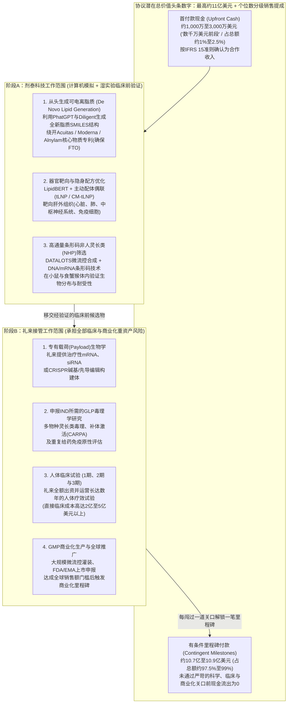
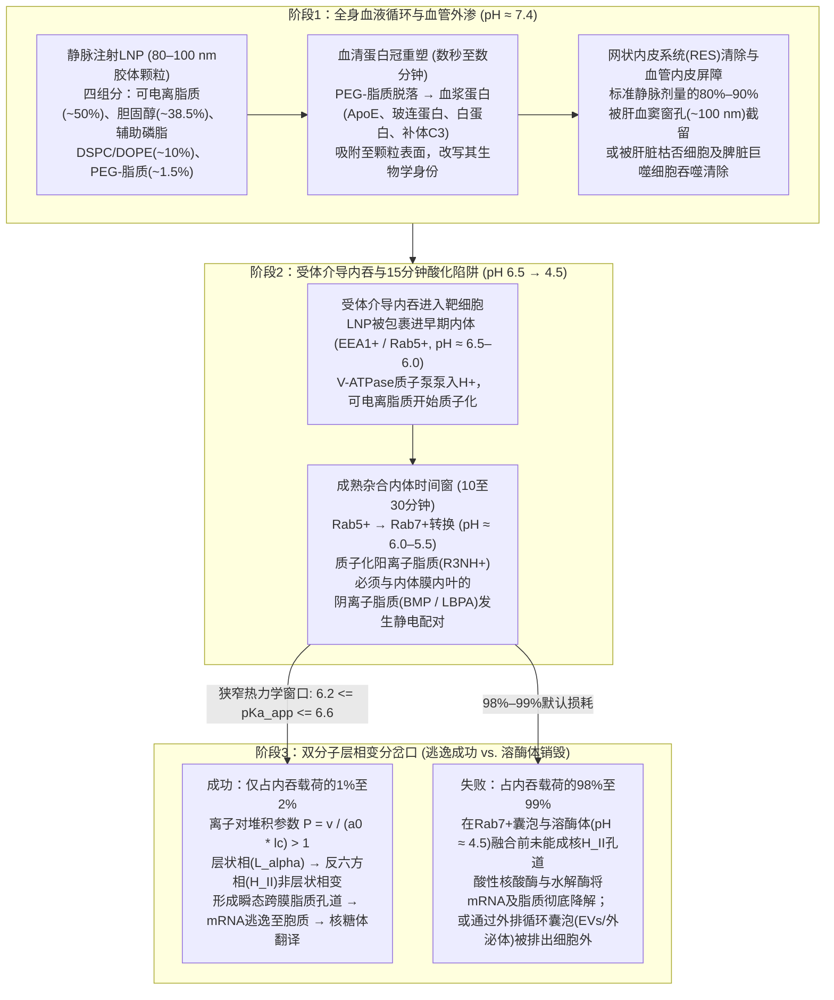
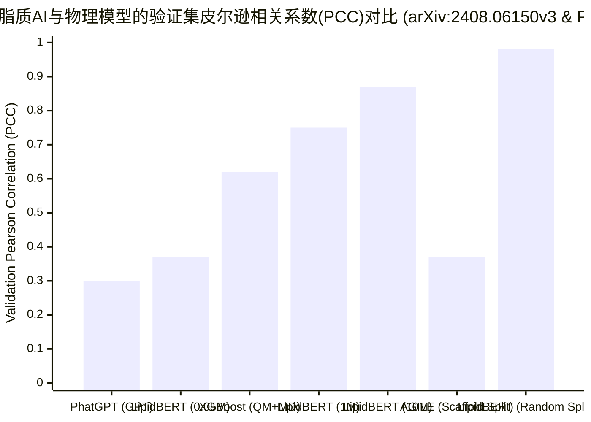

2026年10月19日，五个月前刚刚在香港交易所（HKEX）挂牌上市、号称要成为*“制药界SpaceX”*的**剂泰科技（METiS TechBio Co., Ltd., `7666.HK`）**宣布与全球市值第一的制药巨头**礼来公司（Eli Lilly and Company, `NYSE: LLY`）**达成轰动业界的战略合作：

> *“根据协议条款，剂泰科技将有权获得数千万美元前段的预付款（upfront payment in the low double-digit millions of U.S. dollars），以及最高约11亿美元的研发、监管和商业化里程碑付款。此外，剂泰科技还将有权根据合作产品的年度净销售额获得个位数分级特许权使用费（single-digit tiered royalties）。”*
> — **[剂泰科技官方新闻稿](https://metistechbio.com/en/qyxw/253.html)** 及 **[BioSpace报道](https://www.biospace.com/deals/lilly-puts-1-1b-on-the-line-for-hong-kong-biotechs-ai-drug-delivery-platform)**，2026年10月19日

当一家AI驱动的生物技术公司宣布与全球最大的制药巨头签下**11亿美元**合作大单时，一位审慎的观察者自然会提出六个苏格拉底式的核心问题：
1. **礼来究竟是在为哪一部分工作支付这11亿美元？**
2. **在脂质纳米颗粒（LNP）递送全流程中，技术上最难的环节是什么？**
3. **AI模型架构本身难道不是最难的部分吗？**
4. **生物学中的AI是不是只是把“容易”的组合筛选部分加速了，而在体内（in vivo）物理壁垒面前依然碰壁？**
5. **目前有任何人体临床证据（proof）证明AI设计的LNP在患者体内有效吗？**
6. **在最核心的20%原创突破中，究竟是AI更重要，还是“物理生物学（Physical Biology）”更重要？**

这六个问题构成了本篇深度调查的精确脊梁。主流行业评论在宏观直觉上是准确的：生物医药授权交易中“11亿美元”的头条数字有97%至99%是远期有条件兑付的“生物支票（bio-bucks）”；**内体逃逸（endosomal escape）**（高达98%至99%被细胞内吞的RNA载荷在酸化的溶酶体中被彻底降解）是最高级别的生物物理瓶颈；而软凝聚态物理学（“物理生物学”）决定了归纳偏置（inductive bias），通用深度学习工程师只是将其代码化。

然而，当我们超越宏观直觉，深入一手原始文献（Primary Sources）进行取证挖掘——交叉审计剂泰科技的**[港交所第18C章2026年中期业绩公告（2026年8月25日）](https://metistechbio.com/en/uploads/ueditor/20260825/e9df709ecbe3eb62c7c5916f62af97c1.pdf)**、**[官方研发管线进度条（`ywgx.html`）](https://metistechbio.com/en/ywgx.html)**、核心算法预印本**[《LipidBERT / PhatGPT》（`arXiv:2408.06150v3`）](https://arxiv.org/html/2408.06150v3)**、礼来在`VERVE-101`（[`NCT05398029`](https://clinicaltrials.gov/study/NCT05398029)）因LNP毒性暂停1b期临床后斥资**13亿美元收购Verve Therapeutics**的始末，以及同行评审基准文献（[`AGILE`, *Nature Communications* 2024](https://pmc.ncbi.nlm.nih.gov/articles/PMC11282250/)）——一个远比表面叙事更加惊人的财务、数学与生物物理真相浮出水面。

**礼来 – 剂泰科技（11亿美元）与AI-LNP真相：取证审计记分卡**

| 苏格拉底式问题 | 表面叙事 / 行业常规直觉 | 一手文献取证真相（截至2026年10月） |
| :--- | :--- | :--- |
| **1. 礼来花11亿美元到底买什么？** | 礼来仅支付约1,000万–3,000万美元预付款购买`AiLNP`肝外递送载体设计，将约10.8亿美元锁在临床与商业化里程碑之后。 | **属实，且背后隐藏着港交所18C章保壳动机与Verve心脏基因编辑动机：** 礼来在`VERVE-101`的LNP引发3级肝毒性与血小板减少症后于2025年7月以最高13亿美元收购Verve，并在剂泰科技于CRS 2026年会上发布**全身给药心肌细胞mRNA转染率>95%（`CM-tLNP`）**仅3个月后签下此单（[新闻稿246](https://metistechbio.com/en/qyxw/246.html)）。与此同时，剂泰科技是[港交所上市规则第18C.19(5)条](https://metistechbio.com/en/uploads/ueditor/20260825/e9df709ecbe3eb62c7c5916f62af97c1.pdf)界定的**未商业化特专科技公司**，必须在2027年达到**2.5亿港元年收入门槛（第18C.03(4)条）**才能避免退市风险，因此迫切需要BD预付款确认收入。 |
| **2. 剂泰科技目前的临床管线与收入构成究竟是什么？** | 剂泰科技是拥有3期及多项临床资产验证其平台的“AI驱动mRNA/LNP递送独角兽”。 | **剂泰科技1–3期临床资产（`MTS-004`、`MTS-201`）100%是小分子化药，而非LNP：** 据剂泰科技[港交所中期报告](https://metistechbio.com/en/uploads/ueditor/20260825/e9df709ecbe3eb62c7c5916f62af97c1.pdf)，其2025年全年收入（1.05亿元人民币）中约95%（1亿元）来自对外授权`MTS-004`——仿制药*Nuedexta*（右美沙芬/奎尼丁）的**口腔崩解片（ODT）改剂型小分子药**。2026年上半年收入（1.5429亿元）中高达**89.35%（1.3786亿元 / 2,000万美元）**来自报告期最后一天（**2026年6月30日**）签署的单一交易（向`Boulevard Bio`授权临床前重组三特异性抗体蛋白`MTS-128`，**并非LNP**），且期末**88.35%的收入（1.3631亿元）挂在应收账款上尚未收回现金**，而公司半年湿实验材料消耗仅**848万元人民币（约118万美元）**！ |
| **3. 递送管线中技术上最难的是哪一步？** | **内体逃逸（Endosomal Escape）：** 95%–99%进入细胞的LNP载荷在溶酶体中被销毁；必须在`6.2 ≤ pKa_app ≤ 6.6`窄窗内触发`Lα → HII`相变。 | **定量电镜与单囊泡活细胞成像证实：** Gilleron等（*Nature Biotech* 2013）证明仅**1%–2%**的LNP-siRNA能在早期内体向晚期内体成熟的杂合`EEA1+/Rab5+/Rab7+`囊泡中、在10–15分钟时间窗内逃逸至细胞质（[Wittrup et al., `PMC4663660`](https://pmc.ncbi.nlm.nih.gov/articles/PMC4663660/)）。逃逸要求质子化叔胺与内体膜内叶阴离子脂质（`BMP/LBPA`）形成离子对，驱动Israelachvili堆积参数`P = v / (a₀ · lc) > 1`。 |
| **4. 为什么AI模型架构不是最难的部分？** | GNN、BERT/GPT与贝叶斯优化已是标准化工具；真正瓶颈是混杂的湿实验代理标签与难以模拟的多尺度非平衡物理。 | **在剂泰科技自己的`LipidBERT`论文（[`arXiv:2408.06150v3`](https://arxiv.org/html/2408.06150v3)）中得到直接证实：** `LipidBERT`是在1,000万虚拟SMILES上预训练的标准12层`BERT-base`（768维）。剂泰自研生成模型`PhatGPT`在性质回归中相关系数崩溃至`PCC ≈ 0.30`，而基于自动化量子力学(QM)+分子动力学(MD)双分子层描述符训练的`XGBoost`也仅达到`PCC = 0.62`。更关键的是，`LipidBERT`在`AGILE`数据集上宣称的`0.98 / 0.78` PCC依赖于组合类似物上的**随机80/10/10划分**，而在`AGILE`原论文严格的**Murcko化学骨架划分**（[`PMC11282250`](https://pmc.ncbi.nlm.nih.gov/articles/PMC11282250/)）下，相关性骤降至`0.37 / 0.23`！ |
| **5. AI设计的LNP有人体临床证据吗？** | AI从头设计的LNP在人体2/3期临床中的有效性证据为零；动物GFP/荧光素酶表达不能证明人体疗效或重复给药安全性。 | **ClinicalTrials.gov全库核查证实：** 剂泰进度最快的LNP资产（`MTS-105`，[`NCT06689540`](https://clinicaltrials.gov/study/NCT06689540)）处于`22.72%`进度（`IIT/IND` 1期剂量爬坡），且靶向的是LNP天然被动富集的**肝癌（`HCC`）**！剂泰管线中所有肝外靶向`AiLNP`资产（`MTS-107`、`108`、`110`、`111`、`112`、`118`）全部处于**临床前（`PCC`，11.7%–16.7%）**阶段。目前全球唯一取得人体1b期临床概念验证（PoC）的肝外LNP（`RCT1100`，[`NCT05737485`](https://clinicaltrials.gov/study/NCT05737485)）是**ReCode公司非AI理性设计的五组分SORT平台**（[`PMC7735425`](https://pmc.ncbi.nlm.nih.gov/articles/PMC7735425/)）。 |
| **6. 在20%的核心原创工作中，AI与物理生物学谁更关键？** | 物理生物学（软凝聚态生物物理与制剂工程）远比纯机器学习架构重要。 | **创始人履历与问题建模方式直接证明：** 剂泰科技三位联合创始人——赖才达博士（MIT化工博士）、陈红明博士（MIT罗伯特·兰格实验室化工博士、美国国家工程院院士、前Kala首席科学官及Transform Pharma核心科学家）、王文首博士（MIT兰格实验室高分子化学家）——全都是MIT出身的**化学工程、高分子与软物质制剂物理学家**，而非NLP计算机科学家（[高管披露](https://metistechbio.com/en/gsgl.html)）。 |

在本篇深度调查中，我们运用布朗与基利（Browne & Keeley）的八阶段**“淘金式（Panning for Gold）”**批判性思维框架，对AI辅助药物递送的财务工程、分子生物物理学、机器学习架构以及临床转化壁垒进行严格审计。

---

## 第一阶段：问题分类（Issue Classification）与可证伪性标准

我们将调查拆分为两个明确、可检验的维度：

1. **描述性问题（Descriptive Issue — 生物物理与计算科学）：** 为什么现有的机器学习架构（`LipidBERT`、`PhatGPT`、`Diligent`、`AGILE`）与分子动力学（MD）引擎难以在全新化学骨架上预测体内（in vivo）肝外递送与**内体逃逸**？截至2026年10月，剂泰科技经审计的临床与财务足迹究竟展示了什么？
2. **规范性问题（Prescriptive Issue — 研发战略与资本配置）：** 制药研发负责人、生物科技投资者与机器学习工程师应当如何在**计算机模拟（in silico）生成式AI算力扩张**与**湿实验（wet-lab）生物物理检测工程及软物质制剂设计**之间分配资本与人才？

### 可证伪性标准（Falsifiability Criteria）
为确保我们的结论具备科学可证伪性而非教条式的怀疑主义，我们设定三个具体的实证阈值——在2026年至2030年间，若出现以下任一结果，即可**推翻（disconfirm）**我们的批评：
- **计算泛化证伪标准：** 如果一个预训练脂质语言模型或图扩散模型（`LipidBERT`、`Diligent`或`AGILE`）在与训练集没有任何胺基头基或连接子子结构重叠的**严格留出（held-out）Murcko化学骨架**盲测集上，预测**非人灵长类（NHP）体内功能性mRNA递送效率**达到皮尔逊相关系数 `PCC ≥ 0.75`。
- **生物物理模拟证伪标准：** 如果无需经验性湿实验校准，全自动粗粒化或恒定pH分子动力学（`CpHMD`）流水线能够对100种不同四组分LNP配方直接预测实验表观`pKa`（误差在`±0.15` pH单位以内）以及层状向反六方相（`Lα → HII`）相变温度/pH。
- **临床转化证伪标准：** 如果一个由AI从头（*de novo*）生成的可电离脂质LNP包裹治疗性mRNA或CRISPR基因编辑器，在针对**全身给药肝外适应症**（如静脉注射靶向心肌细胞、肺或中枢神经系统）的人体2期临床试验中获得成功，同时证明持久的临床疗效且不出现剂量限制性补体激活（`CARPA`）、肝毒性（`ALT/AST` 3级以上升高）或血小板减少症。

---

## 第二阶段：一手文献挖掘、“11亿美元”生物支票解剖与港交所第18C章财务取证

### 1. 一手文献溯源矩阵（Primary Source Traceability Matrix）

本报告引用的所有财务数据、临床试验阶段与算法指标均直接溯源至2026年10月在线验证的权威监管披露文件、临床注册库与同行评审论文：

| 文献类别 | 一手文件 / 原始档案 | 发布机构 / 作者 | 提取并核实的核心事实 |
| :--- | :--- | :--- | :--- |
| **合作官方公告** | [与礼来达成战略合作官方新闻稿 (2026.10.19)](https://metistechbio.com/en/qyxw/253.html) 及 [BioSpace报道](https://www.biospace.com/deals/lilly-puts-1-1b-on-the-line-for-hong-kong-biotechs-ai-drug-delivery-platform) | 剂泰科技(`7666.HK`) & 礼来(`LLY`) | 数千万美元前段(low double-digit millions)预付款 + 最高约11亿美元研发、监管与商业化里程碑付款 + 个位数分级销售提成。 |
| **港交所(HKEX)审阅财务报表** | [2026年中期业绩公告 (截至2026年6月30日止六个月)](https://metistechbio.com/en/uploads/ueditor/20260825/e9df709ecbe3eb62c7c5916f62af97c1.pdf) | 剂泰科技 (`7666.HK`，普华永道审阅) | 2026上半年收入1.5429亿元人民币(单一客户占89.35%，应收账款未收回1.3631亿元)；研发支出1.7237亿元；湿实验材料消耗仅848万元；港交所第18C.19(5)条未商业化公司警示声明。 |
| **官方管线与进度条** | [剂泰科技官方研发管线 (`ywgx.html`)](https://metistechbio.com/en/ywgx.html) 及 [港交所IPO新闻稿 (`244.html`)](https://metistechbio.com/en/qyxw/244.html) | 剂泰科技 (`7666.HK`) | 证实3期资产`MTS-004`(`71.72%`)与1期资产`MTS-201`(`37.72%`)均为小分子药；所有肝外LNP生物药(`MTS-107`至`MTS-118`)均处于`11.72%–16.72%`(`PCC`临床前阶段)。 |
| **心脏靶向LNP突破** | [CRS 2026杰出研究者奖 (`246.html`)](https://metistechbio.com/en/qyxw/246.html) 及 [Late-Breaking摘要 (`240.html`)](https://metistechbio.com/en/qyxw/240.html) | 刘安东博士 (剂泰科技副总裁兼技术平台负责人) | 全身给药心脏选择性`CM-tLNP`在小鼠体内实现>95%心肌细胞mRNA转染与>50% CRISPR基因编辑，且肝脏脱靶编辑极低。 |
| **剂泰AI架构预印本** | [*LipidBERT: A Lipid Language Model Pre-trained on METiS de novo Lipid Library* (`arXiv:2408.06150v3`)](https://arxiv.org/html/2408.06150v3) | Tianhao Yu, Cai Yao, Wenshou Wang, Chris Lai, Kai Wang等 (剂泰科技) | 披露1,000万虚拟脂质库、`LipidBERT`(BERT-base)、`PhatGPT`(`PCC ≈ 0.30`)、`Diligent`(DiT)、固定摩尔比局限、新骨架预测退化声明，并致谢礼来科学家Michelle Lynn Hall。 |
| **基准对比论文** | [*AGILE platform: a deep learning powered approach to accelerate LNP development for mRNA delivery* (*Nature Comms*, 2024, `PMC11282250`)](https://pmc.ncbi.nlm.nih.gov/articles/PMC11282250/) | Yue Xu, Shihao Ma, Haotian Cui, Bo Wang, Bowen Li等 (多伦多大学) | 1,200种组合脂质数据集([GitHub](https://github.com/bowang-lab/AGILE))在严格的**Murcko化学骨架80/10/10划分**下评测得`PCC = 0.37`(HeLa)与`0.23`(RAW 264.7)。 |
| **内体逃逸生物物理学** | [Wittrup et al. (*Nature Biotech* 2015, `PMC4663660`)](https://pmc.ncbi.nlm.nih.gov/articles/PMC4663660/), [Maugeri et al. (*Nature Comms* 2019, `PMC6760118`)](https://pmc.ncbi.nlm.nih.gov/articles/PMC6760118/), [Chatterjee et al. (*PNAS* 2024, `PMC10945858`)](https://pmc.ncbi.nlm.nih.gov/articles/PMC10945858/) | Lieberman/Anderson/Langer实验室; 阿斯利康; Siegwart实验室 | 定量证实1%–2%胞质逃逸瓶颈、单囊泡Galectin-8/9破裂动力学，以及缺乏高通量实时直接逃逸检测手段。 |
| **表观`pKa`与SORT LNP** | [Jayaraman et al. (*Angew. Chem.* 2012, `PMC3470698`)](https://pmc.ncbi.nlm.nih.gov/articles/PMC3470698/), [Hassett et al. (*Mol. Ther. Nucleic Acids* 2019, `PMC6383180`)](https://pmc.ncbi.nlm.nih.gov/articles/PMC6383180/), [Cheng et al. (*Nature Nanotech* 2020, `PMC7735425`)](https://pmc.ncbi.nlm.nih.gov/articles/PMC7735425/) | Alnylam/Cullis; Moderna; 德州大学西南医学中心 (Siegwart) | 确立静脉肝靶向(`6.2–6.5`)与肌注疫苗(`6.6–6.9`)的`pKa_app`窗口及五组分SORT器官靶向规则。 |
| **临床试验注册库** | [`NCT06689540` (`MTS-105`)](https://clinicaltrials.gov/study/NCT06689540), [`NCT05398029` (`VERVE-101`)](https://clinicaltrials.gov/study/NCT05398029), [`NCT06164730` (`VERVE-102`)](https://clinicaltrials.gov/study/NCT06164730), [`NCT05737485` (`RCT1100`)](https://clinicaltrials.gov/study/NCT05737485) | ClinicalTrials.gov (剂泰, Verve/礼来, ReCode) | 核实人体临床阶段、严重不良事件(`VERVE-101` 3级ALT升高与血小板减少)及给药途径。 |

---

### 2. 拆解问题1：礼来究竟在为哪部分工作支付“11亿美元”？

在生物医药商务拓展（BD）中，“11亿美元”的头条交易绝非一次性电汇转账，而是一座**非对称看涨期权阶梯（“生物支票 / bio-bucks”）**。让我们绘制2026年10月19日礼来–剂泰科技协议的精确财务与运营分工图：

#### 隐藏的战略触发点：为什么礼来在13亿美元收购Verve之后迫切需要剂泰科技？
为什么礼来偏偏在2026年10月选中剂泰科技？答案隐藏在2024年4月至2026年7月间发生的两起一手历史事件中：

1. **`VERVE-101` LNP毒性暂停事件的警钟（2024年4月 – 2025年7月）：**
   2024年4月，礼来的心血管基因编辑合作伙伴**Verve Therapeutics**被迫暂停其`VERVE-101`（靶向`PCSK9`以永久降低LDL胆固醇的体内腺嘌呤碱基编辑器）的1b期临床试验（`Heart-1`，[`NCT05398029`](https://clinicaltrials.gov/study/NCT05398029)），原因是第6名接受`0.45 mg/kg`剂量的患者在输注后4天内出现了**3级短暂性丙氨酸氨基转移酶（`ALT`）肝酶升高**和**3级血小板减少症（严重血小板骤降）**。独立安全监测委员会调查认定，该毒性**并非由CRISPR碱基编辑器mRNA或向导RNA载荷引起，而是由授权引进的第一代可电离脂质LNP外壳所致**。Verve随后紧急转向**`VERVE-102`**（[`NCT06164730`](https://clinicaltrials.gov/study/NCT06164730)），将完全相同的`PCSK9`碱基编辑载荷装入**含有另一种可电离脂质并偶联`GalNAc`靶向配体的定制LNP**中，在1b期临床中实现了良好的安全性以及高达**88%的PCSK9降幅和62%的LDL-C降幅**，促使礼来在2025年6–7月以**10亿至13亿美元**收购了Verve。
2. **心肌细胞（Cardiomyocyte）递送高墙与剂泰科技2026年7月CRS突破：**
   即便收购了Verve，礼来依然面临一道坚硬的解剖学天花板：`VERVE-102`只能编辑**肝脏中的肝细胞**来降低血液循环脂质，却无法将RNA或基因编辑器递送进**心肌细胞（心脏肌肉细胞）**——后者具有致密的肌节结构、持续的机械收缩、连续的微血管内皮屏障以及极低的基础内吞活性。
   就在2026年5–7月，剂泰科技副总裁**刘安东博士（Dr. Andong Liu）**在葡萄牙里斯本举行的**2026年国际控释协会（CRS）年会**上作了一项题为*《用于高效体内递送与心肌细胞基因编辑的全身给药心脏选择性脂质纳米颗粒（Systemic Heart-Selective Lipid Nanoparticles for High-Efficiency In Vivo Delivery and Cardiomyocyte Gene Editing）》*的Late-Breaking口头报告（[剂泰新闻稿240](https://metistechbio.com/en/qyxw/240.html)；[新闻稿246](https://metistechbio.com/en/qyxw/246.html)；[2026中期报告第11页](https://metistechbio.com/en/uploads/ueditor/20260825/e9df709ecbe3eb62c7c5916f62af97c1.pdf)）。利用其主动靶向**`CM-tLNP`**平台，剂泰科技报告在小鼠静脉注射后实现了**>95%的心肌细胞mRNA转染率**和**>50%的体内心肌细胞CRISPR基因编辑效率**，同时肝脏和脾脏的脱靶编辑极低。此外，查阅剂泰科技`LipidBERT`论文（[`arXiv:2408.06150v3`](https://arxiv.org/html/2408.06150v3)）的致谢部分可以发现，礼来的计算科学家**Michelle Lynn Hall博士**早在2024年就已就LNP研究中的AI、量子力学与分子动力学向剂泰科技提供顾问指导。

对礼来而言，支付约1,500万–2,500万美元的首付款（不到礼来年度研发预算的0.25%）来测试剂泰科技的`AiLNP`和`CM-tLNP`载体能否将礼来的基因编辑载荷递送至心脏、中枢神经系统或肺部，是一张极其便宜且赔率高度非对称的看涨期权。

---

### 3. 港交所第18C章财务取证发现：为什么剂泰科技迫切需要首付款确认收入？

礼来的经济账一清二楚，那么剂泰科技呢？当我们审阅剂泰科技**[《截至2026年6月30日止六个月之中期业绩公告》（`7666.HK`，2026年8月25日）](https://metistechbio.com/en/uploads/ueditor/20260825/e9df709ecbe3eb62c7c5916f62af97c1.pdf)**时，发现了一个此前没有任何生物医药媒体报道过的核心监管与会计机制。

请翻到剂泰科技2026年中期报告**第25页**：

> **“根据上市规则第18C.19(5)条作出的警示声明（Cautionary Statement under Rule 18C.19(5) of the Listing Rules）：** *本公司为一家特专科技公司（定义见上市规则第18C章）。此外，本公司为一家未商业化公司（Pre-Commercial Company，定义见上市规则第18C章），即尚未符合上市规则第18C.03(4)条所载收益规定的特专科技公司。我们最终可能无法符合上市规则第18C.03(4)条所载的收益规定……本公司预期将于2027年符合上市规则第18C.03(4)条项下的收益规定。”*

根据香港交易所**《主板上市规则》第18C章（特专科技公司）**，经审计年收入低于**2.5亿港元（约2.3亿元人民币 / 约3,200万美元）**的上市企业被界定为**未商业化公司（Pre-Commercial Company）**，面临严格的监管限制与强制退市倒计时，除非它能跨过**第18C.03(4)条**规定的**2.5亿港元年度收入门槛**。

现在，让我们看看剂泰科技在2024财年、2025财年以及2026年上半年是如何通过财务工程构建其IFRS 15账面收入，以冲刺这2.5亿港元红线的：

**剂泰科技（`7666.HK`）收入、现金流与管线取证拆解表（2024年 – 2026年上半年）**

| 财务 / 运营指标 | 2024财年 (经审计) | 2025财年 (经审计) | 2026年上半年 (截至2026.06.30止6个月) | 一手财报取证审计注释 ([2026中期报告](https://metistechbio.com/en/uploads/ueditor/20260825/e9df709ecbe3eb62c7c5916f62af97c1.pdf)) |
| :--- | :--- | :--- | :--- | :--- |
| **IFRS 15总收入** | 150万元人民币 (~$0.21M) | 1.05亿元人民币 (~$14.5M) | **1.5429亿元人民币** (~$21.3M) | 官方通稿高调宣传2026上半年收入同比（较2025上半年114万元）**“暴涨+13,399%”**。 |
| **时点确认(Point-in-Time)授权收入 vs. 期内确认(Over-Time)服务收入** | — | ~1.00亿元 (~95.2%) | **1.5361亿元 (`99.56%`)** 时点确认 vs. **68.4万元 (`0.44%`)** 期内确认 | **2026上半年99.56%的收入**是在授权移交的单一时间点一次性确认的；持续性湿实验研发服务在6个月内仅产生**68.4万元人民币（约9.5万美元）**收入（附注3，第36页）。 |
| **单一客户集中度 (`客户A`)** | — | ~95.2% (`浙江引案`，`MTS-004`授权) | **`89.35%` (1.3786亿元 / 2,000万美元)** 来自单一客户`客户A`(`Boulevard Bio`) | 该交易签署于**2026年6月30日**——即2026上半年报告期的最后一天（[新闻稿245](https://metistechbio.com/en/qyxw/245.html)），标的资产为`MTS-128`（临床前重组三特异性抗体蛋白，**并非LNP**）。 |
| **资产负债表未收回贸易应收账款 (Trade Receivables)** | — | 18.1万元 (截至2025.12.31) | **1.3631亿元 (占上半年总收入的`88.35%`)** | 由于2,000万美元Boulevard Bio交易在6月30日压线入账，**截至期末该交易几乎没有收回任何现金**；应收账款从18.1万元暴增**753倍**至1.3631亿元（附注9，第40页）。 |
| **经营活动现金流量净额 (`Net Cash Used in Operating Activities`)** | — | — | **-1.6220亿元人民币** (2025上半年为-9,631万元) | 尽管账面会计收入“暴增+13,399%”，公司经营性现金流净流出（烧钱速度）同比反而**恶化了68.4%**（现金流量表，第34页）。 |
| **研发总支出 vs. 实际湿实验材料消耗费** | — | 研发2.698亿元 | **研发支出1.7237亿元**，但湿实验**材料消耗(Material Consumption)仅848万元(`$1.18M`)** | 上半年2.9098亿元总开支中，**1.5174亿元（52.1%）**为员工薪酬（含**9,120万元**股份支付开支），**8,396万元**为外部CRO服务费，而内部湿实验耗材仅**848万元**（附注5，第37页）。 |

---

### 4. 双列声明裂痕矩阵（Claim Schism Matrix）：公关“AI纳米火箭独角兽”叙事 vs. 监管文件与预印本真相

将剂泰科技的公关宣传稿与其港交所财报附注、官网管线进度条以及`arXiv`技术预印本进行交叉比对，可以清晰地看到五处巨大裂痕：

| 审计维度 | 公关营销与上市宣传叙事 | 港交所财报、管线代码与预印本深处的真实情况 |
| :--- | :--- | :--- |
| **1. AI设计LNP (`AiLNP`) 的临床成熟度** | *“全球首家上市的AI驱动药物递送公司剂泰科技……实现了跨越人体八大主要器官和组织的突破性靶向递送。”* ([港交所IPO新闻稿244](https://metistechbio.com/en/qyxw/244.html)) | **进入人体临床试验的肝外(Extrahepatic) LNP数量为0：** 在剂泰[官方管线表(`ywgx.html`)](https://metistechbio.com/en/ywgx.html)中，唯一的3期/Pre-NDA资产（**`MTS-004`**，`data-line = 71.72%`）是仿制药*Nuedexta*（右美沙芬+奎尼丁）的**口腔崩解片（ODT）小分子改剂型药**（`AiTEM`）。唯一的1期资产（**`MTS-201`**，`37.72%`）是口服小分子`TGR5`激动剂。两项`IIT/IND`阶段生物药（`MTS-105`进度`22.72%`针对肝癌，`MTS-109`进度`27.72%`）靶向的是肝脏和淋巴器官；而**全部6项肝外/实体瘤生物药（`MTS-107`、`108`、`110`、`111`、`112`、`118`）进度条均停留在`11.72%–16.72%`（`PCC`临床前阶段）**。 |
| **2. 商业化收入(`+13,399% YoY`)的真实来源** | *“剂泰科技2026年中期收入超越2025全年收入47%，实现突破性增长，引领AI for Science商业化。”* ([新闻稿251](https://metistechbio.com/en/qyxw/251.html)) | **2025年至2026上半年累计收入的94%来自非LNP资产：** 2025年的1亿元来自向浙江引案授权小分子口腔崩解片`MTS-004`；2026上半年的1.3786亿元来自6月30日向Boulevard Bio授权临床前重组三特异性抗体蛋白`MTS-128`（`BLVD201`）（[2026中期报告第12、15、36页](https://metistechbio.com/en/uploads/ueditor/20260825/e9df709ecbe3eb62c7c5916f62af97c1.pdf)）。真正来自LNP期权交易（BioThunder AG）的收入仅**1,500万元（约210万美元）**！ |
| **3. `LipidBERT`真正的从头(De Novo)泛化能力** | *“AiLNP的核心在于利用专有脂质库、脂质语言模型和生成算法，特别是在尚无已知阳性可电离脂质的未知领域设计最优候选脂质。”* ([技术平台页](https://metistechbio.com/en/jsyyf.html)) | **预印本中明确承认骨架内插(Interpolation)局限：** 在[`arXiv:2408.06150v3`](https://arxiv.org/html/2408.06150v3)第2.4.1节中，作者坦承：*“需要指出的是，LipidBERT在实验集中有良好代表性骨架的可电离脂质上表现尤为出色；**但对于具有全新骨架（entirely novel scaffolds）的化合物，其预测准确性可能会下降。**”* |
| **4. 四组分配方优化 vs. 单一脂质SMILES输入** | *“该平台能够对LNP各组分（包括可电离脂质、辅助脂质、胆固醇和PEG脂质）及其比例进行系统设计与优化。”* ([技术平台页](https://metistechbio.com/en/jsyyf.html)) | **`LipidBERT`研究采用固定组分比例(Fixed Component Ratios)：** [`arXiv:2408.06150v3`](https://arxiv.org/html/2408.06150v3)第2.4.1节披露：*“本研究中的所有数据均是在LNP配方采用**固定组分比例**的条件下生成的。”* `LipidBERT`仅接收可电离脂质的1D SMILES字符串（填充至128字符），并不建模摩尔比变化或辅助脂质替换。 |
| **5. 被动脂质靶向 vs. 主动抗体偶联 (`tLNP`)** | 公关稿暗示仅靠AI设计的可电离脂质化学结构本身就能像巡航导弹一样将LNP精准导向任意器官（心脏、T细胞、肺）。 | **转向主动抗体/配体偶联 (`tLNP` / `CM-tLNP`)：** [2026中期报告](https://metistechbio.com/en/uploads/ueditor/20260825/e9df709ecbe3eb62c7c5916f62af97c1.pdf)第5、10、11页披露，剂泰在T细胞（`in vivo CAR-T tLNP`）和心肌细胞（`CM-tLNP`）递送上的突破，实际上依赖于**先设计生理上“隐身（stealth，即惰性不吸附肝蛋白）”的可电离脂质**，然后在LNP表面**化学偶联主动靶向抗体或配体**！ |

> [!IMPORTANT]
> **请特别注意裂痕 #5：** 当仅靠AI设计的可电离脂质无法克服肝脏被动ApoE吸附汇（sink）以实现选择性T细胞或心肌细胞归巢时，剂泰科技在其2026年中期报告（第5、10–11页）中转向了**“隐身（stealth）”可电离脂质**（经工程化改造*不*与肝脏蛋白结合的惰性脂质）配合由其`AiProtein`平台设计的**定点偶联抗体（`tLNPs`与`CM-tLNPs`）**。换言之，器官特异性越来越依赖于**表面抗体/配体与受体的结合**，而可电离脂质的核心任务则回归到：在血液循环中保持低毒稳定，并在抗体偶联颗粒被细胞内吞后高效执行**内体逃逸（endosomal escape）**！

---

## 第三阶段：语义精确性、歧义替换测试与LNP递送四级成熟度阶梯

为了防止营销词汇掩盖工程现实，我们用布朗与基利的**歧义替换测试（Ambiguity Substitution Test）**对AI药物递送话语体系中的四个高频词进行严格界定。

### 1. 歧义替换测试（Ambiguity Substitution Test）

- **术语 1：“AI从头设计的可电离脂质（De Novo AI-Designed Ionizable Lipid）”**
  - *宽泛 / 营销定义：* 深度生成神经网络从第一性原理出发，发现未知的膜融合机制并发明出的全新化学物质原型。
  - *严格 / 操作定义（按[`arXiv:2408.06150v3`](https://arxiv.org/html/2408.06150v3)实际实现）：* 将已知专利/文献中的可电离脂质切分为`7–12`个子片段（胺基头基、酯/酰胺/氨基甲酸酯连接子、支链烃尾），通过基于规则的强化学习（`PhatGPT` / `Diligent`）重新拼接这些片段，再用内部湿实验骨架训练出的`BERT-base`回归器（`LipidBERT`）筛选类似物。
  - *替换判定：* 重新拼接已知的头基-连接子-尾链片段属于**自动化组合骨架跃迁（combinatorial scaffold hopping）**——这对于绕开第三方物质组成专利（如`Acuitas ALC-0315`、`Moderna SM-102`、`Alnylam MC3`）极具商业价值，但在数学上与外推至未知物理化学空间截然不同。
- **术语 2：“器官靶向 / 肝外递送（Organ-Targeted / Extrahepatic Delivery）”**
  - *宽泛 / 营销定义：* 静脉注射后，超过80%的LNP注射剂量专一地富集在目标器官（如肺、心脏或大脑），而肝脏接收量接近0%。
  - *严格 / 操作定义：* 要么指（a）**发光/荧光蛋白表达比值**（`I_organ / I_liver`），即哪怕60%–80%的物理脂质质量仍被肝脏枯否（Kupffer）巨噬细胞吞噬降解，目标器官在IVIS成像仪上依然发亮；要么指（b）**主动配体/抗体偶联`tLNPs`**或**局部给药**（肺部雾化吸入、中枢神经系统鞘内注射、卵巢癌腹腔注射）。
  - *替换判定：* 将*蛋白表达比值*（目标组织中的mRNA翻译）与*物理质量生物分布*混为一谈，掩盖了全身给药LNP剂量限制性毒性的根源：即便mRNA加入了器官特异性非翻译区（`UTR`）或microRNA靶点（如抑制肝细胞翻译的`miR-122`），**物理脂质外壳依然会大量涌入肝脏和脾脏**，触发补体激活与转氨酶飙升！
- **术语 3：“内体逃逸效率（Endosomal Escape Efficiency）”**
  - *宽泛 / 营销定义：* 给药24小时后测得的高萤火虫荧光素酶（`Fluc`）生物发光或`eGFP`荧光蛋白读数。
  - *严格 / 操作定义：* 被细胞内吞的核酸载荷分子中，在被溶酶体水解酶降解之前，物理穿过内体界膜脂质双分子层进入细胞质的精确摩尔分数（`N_cytosol / N_endocytosed`，标准LNP仅为`约1%至2%`）。
- **术语 4：“物理生物学（Physical Biology / 软凝聚态生物物理学）”**
  - *操作定义：* 不将生物结构视为抽象符号串（`A, C, G, T`或`SMILES`词元），而是将其作为受自由能地貌（`ΔG`）、膜曲率弹性（`Helfrich哈密顿量`）、胶体DLVO力、非平衡相图（`Lα ↔ HII`）及剪切流变学支配的**连续热力学、力学与电动学系统**进行定量建模的学科。

---

### 2. 核酸LNP递送四级成熟度阶梯（4-Tier Maturity Hierarchy）

为了将剂泰科技的`AiLNP`、多伦多大学的`AGILE`、ReCode的`SORT`以及Alnylam/Moderna/Acuitas的临床平台放在同一客观标尺上衡量，我们建立如下四级成熟度阶梯：

**核酸LNP递送四级成熟度阶梯（截至2026年10月）**

| 成熟度等级 | 物理与生物学机制 | 代表平台与脂质 | 人体临床验证状态（2026年10月） |
| :--- | :--- | :--- | :--- |
| **Tier 1：被动肝靶向与局部肌注(IM)疫苗LNP** | 四组分LNP在血液中吸附`ApoE` → 结合肝细胞`LDLR`(静脉)或局部树突状/肌肉细胞(肌注)；`1%–3%`内体逃逸。 | **Alnylam/Cullis** (`DLin-MC3-DMA`)、**Acuitas/辉瑞** (`ALC-0315`)、**Moderna** (`SM-102`)、**Intellia** (`NTLA-2001/2002`) | **商业化上市 / 3期临床证实：** *Onpattro*(2018)、*Comirnaty*、*Spikevax*、*mRESVIA*获FDA批准；3期体内CRISPR基因编辑试验进行中。 |
| **Tier 2：配体偶联肝靶向与理性设计五组分SORT LNP** | 加入第5种`SORT`脂质（靶向肺的阳离子`DOTAP`、靶向脾的阴离子`18PA`）或`GalNAc`配体（供LDLR缺陷患者通过`ASGPR`摄取）。 | **Verve/礼来** (`VERVE-102` GalNAc-LNP)、**ReCode Therapeutics** (`RCT1100` & `RCT2100`雾化吸入SORT LNP) | **人体1b / 2期临床概念验证(PoC)：** `VERVE-102`([`NCT06164730`](https://clinicaltrials.gov/study/NCT06164730))安全实现88% PCSK9敲降；`RCT1100`([`NCT05737485`](https://clinicaltrials.gov/study/NCT05737485))在57%的原发性纤毛运动障碍(PCD)患者中改善黏液纤毛清除功能(2026年5月)。**非AI理性生物物理设计。** |
| **Tier 3：AI内插组合型与主动靶向(`tLNP`)载体** | 基于片段的强化学习 + SMILES/图神经网络筛选器(`LipidBERT`、`AGILE`)，配合高通量条形码小鼠/猴筛选及抗体偶联(`CM-tLNP`)。 | **剂泰科技** (`AiLNP`、`CM-tLNP`、`MTS-105`)、**Bowen Li实验室** (`AGILE`, [`PMC11282250`](https://pmc.ncbi.nlm.nih.gov/articles/PMC11282250/)) | **仅限临床前 / 早期1期IIT：** `MTS-105`([`NCT06689540`](https://clinicaltrials.gov/study/NCT06689540))正开展针对**肝癌**的1期IIT；所有肝外AI设计LNP(`CM-tLNP`、`MTS-108`)迄今**人体临床有效性数据为0**。 |
| **Tier 4：第一性原理多尺度生物物理模拟器与零样本从头LNP引擎** | 耦合恒定pH量子/粗粒化动力学，无需湿实验骨架训练即可零样本预测蛋白冠形成、内皮转胞吞及`Lα → HII`内体逃逸。 | 下一代多尺度AI + CpHMD平台的终极目标 | **尚未建成(Unbuilt)：** 目前MD + QM描述符仅达到`PCC = 0.62`([`arXiv:2408.06150v3` Fig. 11](https://arxiv.org/html/2408.06150v3))，跨骨架(out-of-scaffold)机器学习预测力跌至`PCC = 0.23–0.37`。 |

---

## 第四阶段：瓶颈的生物物理学（内体逃逸）与四向因果审计

为什么在Gemini对话中，**内体逃逸（endosomal escape）**被准确认定为整个核酸递送管线中技术上最困难的问题？为什么即便纳米颗粒成功抵达目标器官并被靶细胞内吞，仍有高达95%至99%的RNA分子在靶细胞内部死于非命？

让我们完整追踪LNP从静脉注射到细胞质核糖体翻译所经历的生物物理闯关过程，并推导解释为何有机化学家与深度学习模型在此双双碰壁的三个核心物理控制方程。

### 1. 98%–99%内体坟场的定量实验铁证
在两项直接在细胞内物理计数单个核酸分子的里程碑式实验研究中：
- **Gilleron, Zerial等（*Nature Biotechnology*, 2013, `PMID: 23792630`）**将胶体金纳米颗粒（`6 nm`）偶联到`DLin-MC3-DMA` / `LNP01`脂质纳米颗粒内部的siRNA上，在HeLa细胞与小鼠体内肝细胞中结合定量电子显微镜（EM）与全自动高分辨率荧光显微镜进行追踪。他们严格证明：**被内吞的siRNA分子中仅有1%至2%能够逃逸进入细胞质**（每个细胞约`2,000至4,000`个siRNA分子），且逃逸仅发生在早期内体向多泡晚期内体成熟的狭窄演进阶段。
- **Wittrup, Lieberman, Anderson, Langer等（*Nature Biotechnology*, 2015, [`PMC4663660`](https://pmc.ncbi.nlm.nih.gov/articles/PMC4663660/)）**利用实时单囊泡荧光显微镜和细胞质膜损伤传感器**半乳糖凝集素-8 / -9（`Gal8/Gal9`）**招募追踪技术，在活细胞中直接观察单个含LNP内体的破裂过程。他们发现内体逃逸是一种发生在**内吞后5至15分钟**、在成熟中的`EEA1+/Rab5+/Rab7+`杂合内体中突发的随机（stochastic）瞬时爆裂事件，在膜重新封闭或被自噬体（`LC3`）隔离之前，仅释放出囊泡内极小一部分RNA载荷。
- **Maugeri等（*Nature Communications*, 2019, [`PMC6760118`](https://pmc.ncbi.nlm.nih.gov/articles/PMC6760118/)）**进一步证明，未被溶酶体降解的很大一部分内吞LNP-mRNA和可电离脂质会被分选进入腔内囊泡，并**包裹在细胞外囊泡（`EVs` / 外泌体）中被反向排出细胞外**。

---

### 2. 推导1：Israelachvili分子堆积参数（`P`）与层状向反六方相（`Lα → HII`）相变

为什么设计一种在`pH 5.8`下刺穿内体膜、同时在`pH 7.4`血液中绝不溶解红细胞（溶血，`hemolysis`）的脂质如此困难？因为该脂质必须在仅仅`1.0`个pH单位的跨度内，动态翻转其**超分子几何构型（supramolecular geometry）**。

在软凝聚态物理学（由Jacob Israelachvili在《Intermolecular and Surface Forces》中形式化，并结合Pieter Cullis的膜融合多晶型相变理论）中，两亲性脂质的自组装相态由无量纲的**分子堆积参数（`P`, Molecular Packing Parameter）**决定：

$$P = \frac{v}{a_0 \cdot l_c}$$

其中：
- `v` 为烃基尾链的有效疏水体积（nm³），
- `a₀` 为脂-水界面处极性头基的最优横截面积（nm²），
- `lc` 为酰基链的临界最大伸展长度（nm）。

`P` 的数值通过**Helfrich膜弯曲弹性能**决定了脂质聚集体的自发曲率 `C₀` 与热力学相态：

$$E_{\text{bend}} = \int_{\text{membrane}} \left[ \frac{\kappa}{2} (2H - C_0)^2 + \bar{\kappa} K_G \right] dA$$

其中 `κ` 为弯曲刚度模量，`κ̄` 为高斯鞍形展开（saddle-splay）模量，`H = ½(c₁ + c₂)` 为平均曲率，`K_G = c₁·c₂` 为高斯曲率：

1. **在全身血液循环中（`pH = 7.4`）：** 可电离脂质的叔胺头基（`R₃N`）处于**不带电的中性状态**。与辅助磷脂（`DSPC`）和胆固醇共同组装时，有效堆积参数满足 `½ < P ≤ 1`（`C₀ ≈ 0`）。脂质分子呈圆柱形紧密排列，形成稳定且无溶血毒性的**平面层状双分子层（`Lα`相）**，包裹着内部由胆固醇和油相中性脂质液滴及RNA组成的无定形疏水核心。
2. **在酸化的内体腔内部（`pH = 6.0 → 5.5`）：** V-ATPase质子泵向内体腔泵入 `H⁺` 离子，叔胺头基质子化变为带正电的铵根阳离子（`R₃NH⁺`）。与此同时，成熟/晚期内体的膜内叶（inner leaflet）特异性地高度富集（高达`15–20 mol%`）呈锥形的阴离子磷脂——**双(单酰基甘油)磷酸盐（`BMP`，又称溶血双磷脂酸 `LBPA`）**。
3. **离子对几何构型翻转（`P_pair > 1`）：** 当LNP外叶中质子化的阳离子脂质 `R₃NH⁺` 与内体膜内叶中的阴离子脂质 `BMP⁻` 发生静电接触时，它们会排出水化水分子并结合成**紧密的中性离子对（tight neutral ion pair）**，使其合并后的极性头基横截面积骤缩至 `a_pair ≪ a_cation + a_anion`，而它们张开的四条支链烃尾则叠加成一个巨大的疏水圆锥体积 `v_pair = v_LNP + v_BMP`：

$$P_{\text{pair}} = \frac{v_{\text{LNP}} + v_{\text{BMP}}}{a_{\text{pair}}(\text{pH}, I) \cdot l_c} > 1 \implies C_0 < 0 \quad (\text{L}_\alpha \longrightarrow \text{H}_{\text{II}} \text{ Phase Inversion})$$

当 `P_pair > 1` 且高斯鞍形展开能 `κ̄·K_G` 倾向于负高斯曲率（`K_G < 0`，即鞍形融合柄与跨膜孔道的拓扑几何）时，平面双分子层失稳并相变为**反六方（`HII`, inverted hexagonal）非层状相**，在膜上撕开一个瞬态脂质孔道——长达4,000个核苷酸的mRNA大分子（分子量约`1.3 MDa`，流体力学直径`~30–50 nm`）正是要从这个瞬态孔道中挤进细胞质！

这也从物理原理上完美解释了为什么**支链多尾（branched multi-tail）可电离脂质**（例如带有可生物降解支链酯尾的Acuitas `ALC-0315`和Moderna `SM-102`，或剂泰`LipidBERT`预训练任务#2中带有`3至6`条尾链的树枝状/多尾脂质）远比单链或线性饱和脂质有效：在保持链长 `lc` 不变的前提下，尾链支化能显著增大疏水横截体积 `v`，从而在内体质子化瞬间将 `P_pair` 推向极致！

---

### 3. 推导2：表观 `pKa` 悖论（Apparent `pKa` Paradox）与Born-Gouy-Chapman偏移方程

在Gemini对话的第三点中，重点指出了**“表观 `pKa` 悖论”**：为什么一个脂质单体在水中的理论 `pKa`（`pKa_wat ≈ 8.5–9.5`）完全不能反映它在组装好的纳米颗粒内部的实际工作 `pKa`（`pKa_app ≈ 6.2–6.6`）？

让我们写出支配这一偏移的精确物理化学方程。当叔胺基团嵌在自组装四组分LNP拥挤且低介电常数的表面时，其质子化自由能会受到两项巨大的静电惩罚：
1. **玻恩（Born）介电自能惩罚（`ΔG_Born`）：** 将一个离子半径为 `r₀` 的点电荷 `+e` 从本体水相（25°C下相对介电常数 `ε_w ≈ 78.5`）移入疏水的脂质-胆固醇界面（有效局域介电常数 `ε_r ≈ 5至20`），需要付出高昂的静电溶剂化能代价，这会强烈偏向**不带电的中性态**（`R₃N`），从而将 `pKa` 大幅向下压低。
2. **古伊-恰普曼（Gouy-Chapman）表面电势惩罚（`e·ψ₀`）：** 随着LNP表面第一批比例为 `α` 的胺基被质子化（`R₃NH⁺`），纳米颗粒表面带上正电荷密度 `σ(α)`，产生正的静电表面电势 `ψ₀ > 0`，从而在静电上排斥周围缓冲液中继续靠近的 `H⁺` 离子！

将这两项热力学势能合并，即可导出**纳米颗粒表观 `pKa` 方程（Apparent Nanoparticle `pKa` Equation）**：

$$\text{p}K_a^{\text{app}}(\alpha) = \text{p}K_a^{\text{wat}} - \underbrace{\frac{e^2}{2.303 \, k_B T \cdot 8\pi \varepsilon_0 r_0}\left(\frac{1}{\varepsilon_r(x_{\text{chol}}, x_{\text{helper}})} - \frac{1}{\varepsilon_w}\right)}_{\text{Born Dielectric Shift } (\approx 1.0 \text{ to } 2.0 \text{ pH units})} - \underbrace{\frac{e \, \psi_0(\sigma, I_{\text{salt}})}{2.303 \, k_B T}}_{\text{Coulombic Crowding Shift } (\approx 0.5 \text{ to } 1.0 \text{ pH units})}$$

请看这个方程证明了什么：
- `pKa_app` **根本不是孤立SMILES字符串的单分子属性！** 它是整个四组分组装体的**涌现胶体属性（emergent colloidal property）**，因为局域介电常数 `ε_r` 和表面电荷间距 `σ` 非线性地取决于**胆固醇摩尔分数（`x_chol`）**、**辅助脂质头基（`x_helper`：两性离子`DSPC` vs. `DOPE` vs. 阴/阳离子`SORT`脂质）**以及**N/P电荷比**（氮磷比）！
- 正如**Jayaraman, Cullis, Hope等（*Angewandte Chemie*, 2012, [`PMC3470698`](https://pmc.ncbi.nlm.nih.gov/articles/PMC3470698/)）**在小鼠体内筛选56种定制氨基脂质所证明的那样，肝脏siRNA基因沉默效价遵循一条以 **`6.2 ≤ pKa_app ≤ 6.5`** 为中心的刀锋般狭窄的钟形曲线（其中`DLin-MC3-DMA`位于 `pKa_app = 6.44`，实现了 `0.005 mg/kg` 的极低 `ED50`）。只要 `pKa_app` 偏离该窗口区区 `0.5` 个单位（低于`6.0`或高于`7.0`），体内药效就会**暴跌100倍至1,000倍**！
- 同样，Moderna公司的**Hassett等（*Molecular Therapy - Nucleic Acids*, 2019, [`PMC6383180`](https://pmc.ncbi.nlm.nih.gov/articles/PMC6383180/)）**筛选了30种新型可生物降解可电离脂质（从中诞生了`SM-102`），证明肌肉注射（IM）mRNA疫苗的免疫原性需要一个略微上移的窗口：**`6.6 ≤ pKa_app ≤ 6.9`**。

---

### 4. 推导3：混杂的代理损失函数（为什么标准AI是在被污染的梯度上训练）

为什么深度学习难以单独优化内体逃逸？因为在目前的高通量湿实验筛选中——无论是`AGILE`的1,200种脂质体外生物发光筛选（[`PMC11282250`](https://pmc.ncbi.nlm.nih.gov/articles/PMC11282250/)），还是剂泰科技的小鼠离体器官荧光筛选（[`arXiv:2408.06150v3`第2.4.1节](https://arxiv.org/html/2408.06150v3)）——神经网络的回归目标 `Y_obs` 都是**给药24小时后的下游蛋白质表达标量**（萤火虫荧光素酶发光值 `Fluc` 或荧光蛋白强度 `FI`）。

从数学上看，注射剂量为 `D₀` 的第 `i` 种LNP配方后观测到的荧光强度 `I_obs`，实际上是**六个连续、非平稳生物学效率的乘积**：

$$I_{\text{obs}}(i) = D_0 \cdot \eta_{\text{stability}}(i) \cdot \eta_{\text{corona\_homing}}(i) \cdot \eta_{\text{extravasation}}(i) \cdot \eta_{\text{endocytosis}}(i) \cdot \eta_{\text{escape}}(i) \cdot \eta_{\text{translation}}(i) \cdot V_{\text{cell}}(i)$$

当机器学习工程师对其取对数变换，在均方误差（MSE）损失函数下训练神经网络回归器 `f_θ(SMILES_i)` 时：

$$Y_{\text{obs}}(i) = \log I_{\text{obs}}(i) = \log D_0 + \sum_{k=1}^{6} \log \eta_k(i) + \log V_{\text{cell}}(i) + \epsilon_i$$

这是一个**严重欠定的逆问题（underdetermined inverse problem）**：单一标量监督标签 `Y_obs(i)` 是七个未测量的隐变量（latent variables）之和！
- 假设候选脂质A的**真实内体逃逸效率（`η_escape`）比候选脂质B高出5倍**，但它引起的轻微膜应力触发了整合应激反应（`ISR` / `eIF2α`磷酸化）或天然免疫`TLR7/8`感知，导致核糖体翻译效率 `η_translation` 和细胞活力 `V_cell` 下降了10倍。在24小时荧光素酶检测中，脂质A的读数接近于零（被判定为“失败”，`Y_obs ≈ 0`），于是AI模型在反向传播时更新权重 `θ`，*彻底排斥并惩罚*了脂质A优异的成孔化学结构！
- 反过来，在第一代**DNA条形码LNP高通量筛选**（研究人员直接对全器官匀浆提取的裸DNA条形码进行测序）中，读数仅仅测量了 `η_corona_homing · η_extravasation`——把**98%死在枯否巨噬细胞溶酶体里或卡在血管内皮壁上的LNP**全部算作了“命中（hits）”！正如佐治亚理工学院**Sago, Dahlman等（*PNAS*, 2018, [`PMC6196543`](https://pmc.ncbi.nlm.nih.gov/articles/PMC6196543/)）**在开发**`FIND`**系统（*Functional In Vivo Delivery*，在`Lox-Stop-Lox-tdTomato`小鼠体内将`Cre`重组酶mRNA与DNA条形码共同包裹，并仅通过FACS分选出细胞核被成功编辑而发出`tdTomato+`红光的活细胞进行测序）时所证明的那样：单纯的生物分布DNA条形码计数与真正的细胞质功能性mRNA递送相关性极差！

---

### 5. 四向因果审计（4-Way Causal Audit）：究竟是什么在驱动肝外LNP突破？

为了检验*“AI基础模型（`LipidBERT`、`PhatGPT`、`AGILE`）是实现肝外器官靶向的首要因果驱动力”*这一核心宣称，我们执行强制性的**四向因果审计**：

**四向因果审计：肝外递送中的AI基础模型 vs. 制剂与配体生物物理学**

| 因果假说 | 机制证据与实证检验 | 一手文献裁定结论 |
| :--- | :--- | :--- |
| **1. 正向直接因果 (`AI模型 → 肝外递送`)** | `LipidBERT`（`1,000万`虚拟SMILES）与`AGILE`（`6万`组合脂质）加速了已知骨架内可电离脂质类似物的虚拟筛选，找出在肌肉/巨噬细胞（`AGILE` `H9`/`R6`）或脾/肝（`LipidBERT` `PCC = 0.87`）中报告基因表达更高的候选分子。 | **部分成立 / 仅限骨架内插(Interpolation)：** 能加快已知化学家族内部的类似物初筛，但无法零样本外推至全新化学骨架（在[`PMC11282250`](https://pmc.ncbi.nlm.nih.gov/articles/PMC11282250/)的Murcko骨架划分下`PCC = 0.23–0.37`）。 |
| **2. 反向因果 (`湿实验条形码通量 → AI精度`)** | 如[`arXiv:2408.06150v3` Fig. 10](https://arxiv.org/html/2408.06150v3)及`2026中期报告`（第10页）所示，模型的相关性完全是高通量湿实验机器人合成（`DATALOTS`，`>100,000`数据点）与条形码灵长类筛选的下游产物。没有湿实验骨架覆盖，语言模型如同盲人摸象（`PhatGPT` `PCC ≈ 0.30`）。 | **强因果 (STRONG)：** 高通量自动化微流控制剂 + 体内条形码实验先筛选出活性分子，AI模型只是事后对湿实验筛选数据进行拟合总结。 |
| **3. 潜伏第三变量混杂 (`Z`：主动抗体偶联`tLNP`、第5组分`SORT`脂质及给药途径)** | 为什么剂泰的`CM-tLNP`能转染>95%心肌细胞（[中期报告第11页](https://metistechbio.com/en/uploads/ueditor/20260825/e9df709ecbe3eb62c7c5916f62af97c1.pdf)）、`in vivo CAR-T tLNP`能靶向T细胞？因为剂泰在“隐身”LNP表面**化学偶联了主动靶向抗体/配体（`tLNPs`）**！同理，ReCode的肺递送（`RCT1100`）依赖**第5组分阳离子`SORT`脂质 + 雾化吸入**，而剂泰的CNS专利（`WO2024156083A1`）采用**鞘内注射**。 | **主导性混杂变量 (DOMINANT CONFOUNDER)：** 将`tLNP`抗体介导的受体靶向或鞘内/雾化局部给药的功劳归因于“AI可电离脂质发现”，是典型的第三变量混杂谬误。 |
| **4. 双向反馈闭环 (`主动学习干湿闭环`)** | 湿实验中关于毒性（`ALT/AST`、`CARPA`）和生物分布的失败数据反馈给`LipidBERT`的QSAR过滤器，在下一轮合成前剪枝掉毒性化学型。 | **有效的工程飞轮：** 迭代式实验设计（`DoE`）+ 贝叶斯主动学习闭环确实能在3–5轮循环中减少湿实验合成浪费。 |

---

## 第五阶段：定量与统计审计 —— 深度拆解 `LipidBERT`（`arXiv:2408.06150v3`）vs. `AGILE`（`PMC11282250`）

现在，让我们直接调取剂泰科技旗舰技术论文***[《LipidBERT: A Lipid Language Model Pre-trained on METiS de novo Lipid Library》（`arXiv:2408.06150v3`，2025年5月3日修订版）](https://arxiv.org/html/2408.06150v3)***中的硬核数据，并与多伦多大学发表于《自然·通讯》的***[`AGILE`（*Nature Communications*, 2024年7月, `PMC11282250`）](https://pmc.ncbi.nlm.nih.gov/articles/PMC11282250/)***进行正面对照，用精确统计数字回答Gemini对话中的问题3和问题4。

### 1. 剖析剂泰科技的计算引擎（`LipidBERT`、`PhatGPT`、`Diligent` 与 `XGBoost-QM/MD`）

在 `arXiv:2408.06150v3` 中，剂泰科技研究人员公开了 `AiLNP` 背后的完整计算架构：
- **1,000万虚拟脂质语料库：** 由于公开专利和文献中的可电离脂质结构不足数万个，剂泰开发了一套自动切分算法，将已知可电离脂质切分为`7至12`个片段，训练带有片段化学奖励规则的强化学习（RL）智能体生成新砌块，再重新连接成包含**1,000万条虚拟可电离脂质SMILES字符串**的滚动数据库。
- **模型 1 — `LipidBERT`（`BERT-base`架构）：** 标准的12层双向Transformer编码器（`12个注意力头`、`768隐藏层维度`、`3,072前馈网络维度`、填充至`128`词元的字符级SMILES分词器，使用学习率为`5e-5`的`AdamW`训练`10个epoch`）。除标准的掩码语言建模（`MLM`，随机遮盖15%的SMILES字符）外，`LipidBERT`还在**五个结构辅助任务**上进行预训练：
  1. *疏水尾链数量预测*（`2、3、4、5或6`条尾链），
  2. *连接原子序列分类*，
  3. *连接原子词元分类*，
  4. *头基与尾链词元分类*，
  5. *重排等价SMILES与诱饵（decoy）SMILES二分类*（替代BERT的下一句预测`NSP`）。
- **模型 2 — `PhatGPT`（*Precision High-throughput AI-driven Targeting using Generative Pre-trained Transformer*）：** 在同一1,000万虚拟脂质语料库上训练的自回归GPT风格SMILES生成模型。
- **模型 3 — `Diligent`（*Diffusion-based Lipid Generation Technology*）：** 在SMILES词元与分子图上运行的扩散Transformer（`DiT`）。
- **模型 4 — 全自动高通量物理模拟基线（基于`RDKit + QM + MD双分子层描述符`的`XGBoost`）：** 剂泰搭建了一套全自动高通量模拟流水线：输入脂质SMILES后，自动对单分子运行**量子力学（`QM`）**计算，构建3D多组分脂质双分子层并运行**分子动力学（`MD`）**轨迹模拟，最后将合并的 `RDKit + QM + MD` 描述符输入 `XGBoost`。

### 2. `arXiv:2408.06150v3` 内部的定量评测结果（图9、10、11与12）

当剂泰科技将上述所有模型用于预测小鼠离体器官荧光强度（`FI`，涵盖肝、脾、肺、心脏、肾脏），并在 `AGILE` 公开的1,200种脂质数据集（`HeLa` 与 `RAW 264.7` 细胞）上进行基准测试时，请看论文报告的精确皮尔逊相关系数（`PCC`）：

**`LIPIDBERT`、`PHATGPT`、`XGBOOST-QM/MD` 与 `AGILE` 基准定量审计表**

| 模型 / 基准配置 | 预训练语料库规模 | 评测数据集与划分(Split)方法 | 报告的验证集 `PCC` | 取证统计与生物物理解释 |
| :--- | :--- | :--- | :--- | :--- |
| **`PhatGPT` (自回归GPT)** | 10,000,000虚拟脂质 | 剂泰内部湿实验器官 `FI` | **`~0.30`** | 从左到右生成的自回归SMILES模型无法学习性质回归所需的双向3D两亲几何构型（[`arXiv:2408.06150v3` §2.4.1](https://arxiv.org/html/2408.06150v3)）。 |
| **`XGBoost (RDKit + QM + 自动MD双分子层)`** | 不适用 (物理 + 化学信息学) | 剂泰内部湿实验总体 `FI` | **`0.62`** (QM+RDKit最高；加入MD描述符反而更低) | **物理模拟高墙的铁证：** 短时间尺度的平衡态MD双分子层模拟无法刻画血清蛋白冠交换、`pKa`偏移或非平衡态 `Lα → HII` 内体逃逸！ |
| **`LipidBERT` 规模扩展 (`0.05M → 0.25M → 1M → 5M → 10M`)** | `5万`至`1,000万`虚拟脂质 | 剂泰内部离体肝脏与脾脏 `FI` (固定四组分比例) | **肝脏：** `0.37 → 0.64 → 0.75 → 0.80 → 0.87` **脾脏：** `0.31 → 0.30 → 0.67 → 0.87` | 在肝/脾**已有代表性骨架**上内插能力强（`0.87`），但*“肺部FI曲线波动巨大”*，且全新骨架预测退化（[§2.4.1](https://arxiv.org/html/2408.06150v3)）。 |
| **`AGILE` GNN (`PMC11282250` 官方基准)** | 60,000虚拟组合脂质 | 1,200种组合脂质 (`HeLa` & `RAW 264.7`) — **严格Murcko化学骨架划分 (80/10/10)** | **HeLa：** `0.37` **RAW 264.7：** `0.23` | 当强制模型对**未见过的全新化学核心骨架**外推预测效价时，真实的分布外（OOD）泛化水平（[`PMC11282250`](https://pmc.ncbi.nlm.nih.gov/articles/PMC11282250/)）。 |
| **`LipidBERT` 在 `AGILE` 数据集上的评测 ([`arXiv:2408.06150v3` Fig. 12](https://arxiv.org/html/2408.06150v3))** | 10,000,000虚拟脂质 | 1,200种组合脂质 (`HeLa` & `RAW 264.7`) — **80/10/10划分** | **HeLa：** `0.98` **RAW 264.7：** `0.78` | **组合划分陷阱 (Combinatorial Split Trap)：** 由于`AGILE`的1,200种脂质是按组合网格（`20种头基 × 12种尾链 × 5种连接子`）合成的，任何不严格隔离头基/尾链家族的划分都会让高容量Transformer直接死记硬背共享的组合砌块！ |

---

### 3. 为什么 `XGBoost + 分子动力学(MD)` 卡在 `PCC = 0.62`：横亘9个数量级的物理学鸿沟

请仔细审视上表**第2行**（[`arXiv:2408.06150v3`](https://arxiv.org/html/2408.06150v3) 图11中基于自动化高通量脂质双分子层分子动力学 + 量子力学 + RDKit描述符训练的 `XGBoost`）。为什么全自动物理模拟的相关性只有 **`0.62`**，甚至加入MD双分子层描述符后还不如单纯的 `QM + RDKit` 描述符？

因为模拟一颗LNP从注射器针尖到核糖体的旅程，会迎头撞上**三座计算物理学高墙**：
1. **空间尺度高墙（`约3,000万个原子`）：** 一颗直径`80–100 nm`的LNP包含约**10万至30万个脂质分子**（`~50%`可电离脂质、`~38.5%`胆固醇、`~10%`辅助磷脂、`~1.5%` PEG-脂质）、`1至10`条长达`4,000-nt`的mRNA分子，以及数百万个显式水分子和抗衡离子——总计高达**`2,000万至5,000万个原子`**。因此，剂泰的自动化高通量MD平台只能模拟包含几百个脂质分子的**微小周期性平面双分子层切片（flat bilayer patch）**，完全忽略了纳米颗粒曲率、内部反胶束RNA水池以及PEG脱落动力学！
2. **时间尺度高墙（`10⁻⁶秒` vs. `10³秒` —— 整整9个数量级的鸿沟）：** 全原子MD采用飞秒级积分步长（`Δt = 1–2 × 10⁻¹⁵ s`），在高通量筛选中每个候选脂质最多只能模拟 `100 ns至1 µs`（`10⁻⁷至10⁻⁶ s`）。然而，体内的血清蛋白冠重塑、V-ATPase内体酸化（`pH 7.4 → 5.5`）以及非层状 `Lα → HII` 跨膜孔道成核发生在**数秒至30分钟（`10⁰至10³ s`）**的时间尺度上！
3. **固定电荷力场崩溃与恒定pH难题：** 标准全原子和粗粒化（`Martini 3`）力场在模拟开始时为原子分配**静态、固定的部分电荷**。但内体逃逸是由**动态质子化-去质子化平衡**驱动的——胺基的电荷状态随局域水分子渗透、膜电势 `ψ₀` 以及与阴离子 `BMP/LBPA` 头基的距离每皮秒都在剧烈涨落！在数千万原子的LNP-内体融合界面上跨毫秒时间尺度运行真正的量子力学/分子力学（**QM/MM**）或**恒定pH分子动力学（`CpHMD`）**，在2026年地球上的任何超级计算机上都是彻底不可计算的。

---

## 第六阶段：“负面视角（Negative View）”、临床转化坟场，以及为何物理生物学完胜纯AI

### 1. 问题5审计：为什么对“零人体临床证据”的质疑100%成立？

在用户的对话中，怀疑论者反驳道：*“但目前还没有任何证据（proof）证明它真的管用。”*
让我们审计截至2026年10月全球所有LNP技术路线的真实临床证据状态：

**临床转化审计：传统LNP vs. 理性设计SORT LNP vs. AI设计LNP（截至2026年10月）**

| 平台类别 | 代表性临床资产 | 递送载体设计方法 | 靶向器官与给药途径 | 人体临床阶段与安全性/有效性证据状态（2026年10月） |
| :--- | :--- | :--- | :--- | :--- |
| **1. 第一代肝靶向与肌注(IM)疫苗LNP** | *Onpattro* (`DLin-MC3-DMA`)、*Comirnaty* (`ALC-0315`)、*Spikevax* (`SM-102`)、`NTLA-2001/2002` | 经验性药物化学与 `pKa_app` 筛选 (非AI) | 肝脏(静脉IV) 或 局部肌肉/淋巴结(肌注IM) | **在数亿人体内得到证实：** FDA批准上市药物及3期CRISPR临床试验；静脉肝递送配合类固醇/抗组胺预处理的安全方案已确立。 |
| **2. 第一代碱基编辑肝靶向LNP (临床折戟案例)** | **Verve `VERVE-101`** ([`NCT05398029`](https://clinicaltrials.gov/study/NCT05398029)) | 授权引进Acuitas可电离脂质LNP (非AI) | 肝脏肝细胞 (静脉IV) | **1b期临床暂停 (2024年4月)：** 在`0.45 mg/kg`剂量下引发直接归因于LNP配方的**3级ALT肝酶升高与3级血小板减少症**。 |
| **3. 配体靶向肝脏LNP (起死回生案例)** | **Verve / 礼来 `VERVE-102`** ([`NCT06164730`](https://clinicaltrials.gov/study/NCT06164730)) | 定制可电离脂质 + **`GalNAc` `ASGPR`靶向配体** (非AI) | 肝脏肝细胞 (静脉IV) | **1b期临床成功 (2025–2026)：** 安全性干净（无3级ALT升高或血小板骤降）；实现最高**88% PCSK9与62% LDL-C降低**；支撑礼来13亿美元收购。 |
| **4. 理性设计五组分 `SORT` LNP** | **ReCode `RCT1100`** ([`NCT05737485`](https://clinicaltrials.gov/study/NCT05737485)) & **`RCT2100`** ([`NCT06237335`](https://clinicaltrials.gov/study/NCT06237335)) | Siegwart实验室**五组分`SORT`生物物理学** ([`PMC7735425`](https://pmc.ncbi.nlm.nih.gov/articles/PMC7735425/), 非AI) | 肺部纤毛上皮 (**雾化吸入给药**) | **全球首个肝外mRNA人体临床概念验证 (2026年5月)：** `RCT1100` 1b期临床在12周时使**57%的PCD患者黏液纤毛清除功能改善**；`RCT2100` 2a期完成入组（预计2026年Q4读出数据）。 |
| **5. AI设计肝靶向LNP (`AiLNP`)** | **剂泰科技 `MTS-105`** ([`NCT06689540`](https://clinicaltrials.gov/study/NCT06689540)) | `AiLNP` + 编码`GPC3×CD3`双抗TCE的`AiRNA` mRNA | **肝脏** (`HCC`肝细胞癌，静脉IV) | **早期1期 / IIT剂量爬坡 (`22.72%`进度条)：** 靶向的是LNP天然被动富集的**肝脏**；尚无已发表的人体2期临床有效性数据。 |
| **6. AI设计全身给药肝外(Extrahepatic) LNP** | **剂泰 `CM-tLNP`** (心脏)、**`MTS-108`** (小细胞肺癌)、**Bowen Li `AGILE`** (`H9`/`R6`) | `LipidBERT` / `PhatGPT` / `AGILE` + 主动抗体偶联 | 心脏、肺、脾、实体瘤 (静脉IV) | **人体临床证据为0 (100%处于临床前)：** 仅在小鼠和食蟹猴体内验证，从未在人体检验过疗效或重复给药安全性。 |

请看这份临床审计揭示的两大铁律：
1. **截至2026年10月，地球上所有靶向肝外器官的AI设计LNP全部停留在临床前阶段。** 即便是剂泰科技在 [`NCT06689540`](https://clinicaltrials.gov/study/NCT06689540) 中唯一进入临床阶段的mRNA-LNP（`MTS-105`，以及处于医院IIT阶段的淋巴靶向`MTS-109`），靶向的也是**肝脏中的肝细胞癌（HCC）**——利用的恰恰是几乎所有静脉注射LNP天然具备的被动肝脏富集效应！
2. **从“小鼠近100%转染”到人体1/2期临床的转化陷阱极其残酷：** 为什么在小鼠体内表现惊艳的纳米颗粒在人体临床中屡屡折戟？
   - **物种特异性的血清蛋白冠分歧：** 血浆载脂蛋白（`ApoE`、`ApoA-I`、`ApoB`）、玻连蛋白（vitronectin）、纤维蛋白原和免疫球蛋白的组成在近交系实验小鼠、食蟹猴和人类患者之间存在巨大差异。一种靠表面电荷招募玻连蛋白从而归巢至小鼠肺内皮的脂质，进入人体血液后可能反而招来人类补体 `C3b` 和 `IgM` 的调理吞噬！
   - **补体激活相关假性过敏（`CARPA`）与反应原性：** 人类对脂质诱导的补体激活、天然免疫 `TLR4/TLR7/TLR8` 刺激以及 `IL-1β / IL-6` 细胞因子风暴的敏感度比啮齿类动物高出数个数量级（按 `mg/kg` 折算的小鼠最大耐受剂量往往高估人体安全剂量10倍至50倍）。
   - **抗PEG免疫与加速血液清除（`ABC`效应）：** 与无菌笼中长大的实验小鼠不同，2026年绝大多数人类群体体内都预存有**抗PEG `IgM` 和 `IgG` 抗体**（源于日化品及既往mRNA新冠疫苗接种）。在针对慢性遗传病或自身免疫病进行重复静脉给药时，抗PEG抗体会结合LNP隐身涂层，触发肝脏巨噬细胞的加速血液清除（`ABC`），并可能引发严重输注反应或血小板减少症（如`VERVE-101`事件）。

---

### 2. 问题6与问题7审计：为什么在20%的原创核心中“物理生物学”完胜纯AI？

为什么Gemini对话最终得出结论：在20%的原创架构设计工作中，**物理生物学（physical biology）与物理化学**远比纯深度学习重要？

让我们看两项无可辩驳的一手证据：

#### 证据A：剂泰科技三位联合创始人的学科背景（`7666.HK` 高管披露文件）
请查阅[公司管理层披露页（`gsgl.html`）](https://metistechbio.com/en/gsgl.html)与[2026年中期报告](https://metistechbio.com/en/uploads/ueditor/20260825/e9df709ecbe3eb62c7c5916f62af97c1.pdf)第50页中剂泰科技三位联合创始人的官方履历：
1. **赖才达博士（Dr. Tsai-Ta Chris Lai，36岁 —— 联合创始人、董事长兼CEO）：** 台湾大学化学工程学士（2011）；在诺华–MIT中心专注于连续结晶（continuous crystallization）与过程建模，获**麻省理工学院（MIT）化学工程硕士（2014）及博士（2016）**；曾兼任量子物理晶型预测公司**晶泰科技（XtalPi, `2228.HK`）**战略负责人。
2. **陈红明博士（Dr. Hongming Chen，54岁 —— 联合创始人、执行董事兼首席研发官CSO）：** **美国国家工程院（NAE）院士**；师从**MIT罗伯特·兰格（Robert Langer）教授获化学工程博士学位**；拥有29年工业界制剂研发经验，曾任教/任职于**默沙东（Merck）**、**阿斯利康（AstraZeneca）**、**Transform Pharmaceuticals**（2000–2009，高通量晶型与制剂工程公司，后被强生收购），并于2010–2021年担任**Kala Pharmaceuticals（`NASDAQ: KALA`）首席科学官（CSO）**，开发了黏液穿透纳米颗粒（`MPP`）药物递送制剂，推动两款眼科新药（*Inveltys*和*Eysuvis*）获FDA批准上市。
3. **王文首博士（Dr. Wenshou Wang —— 联合创始人、执行董事兼COO）：** 高分子化学博士，**MIT兰格实验室（Langer Lab）**博士后，专注于高分子纳米材料与高通量制剂合成。

看到规律了吗？**全球第一家上市的“AI药物递送独角兽”的三位创始人中，没有一位是NLP或计算机视觉出身的AI学者。** 三人全都是MIT培养的**化学工程师、高分子化学家与软物质制剂科学家**！事实上，剂泰科技唯一进入3期临床的成功资产（`MTS-004`）及其与恒瑞医药达成的平台合作（`AiTEM`，[新闻稿247](https://metistechbio.com/en/qyxw/247.html)），直接源自陈红明博士在*Transform Pharmaceuticals / Kala*时期的经典看家本领：**固态小分子辅料制剂与溶出物理学**！

#### 证据B：物理生物学与机器学习之间的智力分工结构

为什么一位缺乏生物物理训练的顶尖大语言模型（LLM）研究员无法凭空发明出突破性的LNP递送平台？因为在药物递送领域，**神经网络架构已是标准化的商品（commodity），而物理表征与实验损失函数的设计才是一切**：

**结构对比：药物递送中的传统分子生物学 vs. 纯生成式AI vs. 物理生物学**

| 分析维度 | 传统分子生物学 | 纯生成式AI / 深度学习 (`NLP / GNN`) | 物理生物学 (软凝聚态生物物理学) |
| :--- | :--- | :--- | :--- |
| **核心数学抽象** | 中心法则（`DNA → mRNA → 蛋白质`）、锁钥受体通路、基因本体论。 | 一维字符串（`LipidBERT`中的`SMILES`词元）或静态2D/3D共价分子图（`AGILE`）。 | **超分子自由能地貌（`ΔG`）**、Israelachvili堆积参数 `P = v/(a₀·lc)`、Helfrich曲率弹性 `κ`、DLVO胶体静电势 `ψ₀`。 |
| **它眼中的LNP是什么** | 基因载荷（`mRNA`序列、`UTR`基序、`CRISPR`向导RNA）与靶细胞受体（`LDLR`、`CD8`）。 | 映射为768维`[CLS]`嵌入向量的一串128字符文本（`CCCCC(CC)COC(=O)...`）。 | 包含`10⁵`个脂质分子、正在经历pH驱动相变（`Lα → HII`）与血清蛋白交换的动态多组分液晶胶体。 |
| **单打独斗为何失败** | 设计出活性极高的`CRISPR`编辑器或`mRNA`，却有99%在肝脏枯否细胞或靶细胞溶酶体中被销毁。 | 死记硬背训练骨架（随机划分`PCC = 0.98`），但在新骨架上崩溃（`PCC = 0.23–0.37`），因为1D SMILES不包含胶体相变物理。 | 如果没有计算代理模型，无法靠人工在 `10⁶⁰` 种化学结构或 `10⁷` 种多组分摩尔比中完成搜索。 |
| **对“20%原创核心”的贡献** | 设计组织特异性`UTR`、`IRES`元件（`AiRNA`中`>20,000`条序列）及抗体弹头（`tLNP`）。 | 在PyTorch中实现标准的`BERT`、`DiT`（`Diligent`）、`SE(3)-GNN`或多目标贝叶斯优化循环。 | **定义归纳偏置与解耦实验：** 设计头/尾切分规则、`pKa_app` TNS滴定门控、`BMP/LBPA`膜融合脂质体FRET检测及`SORT`电荷规则。 |

---

## 第七阶段：灰度思考（“If-Clauses”）与取证终局裁定

我们既拒绝*“AI已经攻克肝外药物递送”*的浮夸炒作，也拒绝*“计算脂质设计毫无用处”*的极端犬儒主义，将全部调查证据综合为三条有条件的**如果-那么（If-Clauses）判断**，并给出明确的概率加权**取证终局裁定（Forensic Verdict）**。

### 1. 条件综合判断（“If-Clauses”）

- **IF（如果）** 一家制药巨头的目标是**知识产权（IP）突围导航与局部/配体辅助优化**——即生成能够避开第三方专利网、同时效价匹敌或超越 `ALC-0315` / `SM-102` 的可专利化可电离脂质类似物，或者将“隐身”可电离脂质与主动抗体/配体偶联物（`GalNAc`、`CD8 tLNP`、`CM-tLNP`）相结合——**THEN（那么）** 剂泰科技的 `AiLNP`（`LipidBERT` + `DATALOTS`高通量条形码非人灵长类筛选）确实是一台极具工业价值的研发引擎，完全配得上一张**1,000万至3,000万美元的首付款期权支票**。
- **IF（如果）** 相反，投资者或高管误以为仅凭在**1,000万条虚拟1D SMILES字符串**上预训练一个 `BERT` 或 `GPT` 语言模型（`LipidBERT` / `PhatGPT`），就能解决**98%的内体逃逸瓶颈**，或者在无需主动靶向配体及湿实验重训练的情况下实现未知化学骨架上的零样本全身肝外靶向——**THEN（那么）** 他们必将一头撞上**Murcko化学骨架泛化悬崖（`PCC = 0.23–0.37`）**以及人体临床安全性高墙（`CARPA`、抗PEG免疫及`ALT`/血小板毒性）。
- **IF（如果）** 药物递送AI领域希望从**Tier 3（骨架内插）**跃迁至**Tier 4（第一性原理生物物理预测）**，**THEN（那么）** 研发团队必须停止仅在固定摩尔比、混杂的24小时复合荧光素酶/GFP读数（`Y_obs`）上训练模型，转而生成**解耦的、分阶段的生物物理训练标签**：
  1. 在pH `7.4 → 5.0` 区间内直接测量的高通量**TNS表观 `pKa_app` 曲线**与**阴离子 `BMP/LBPA` 内体模拟脂质体FRET膜融合动力学**，
  2. 在**人类血浆（human plasma）**（而非仅在小鼠血清）中测定的定量**质谱血清蛋白冠图谱**，以及
  3. 与下游翻译解耦的直接胞质逃逸传感器（**split-NanoBiT / HiBiT互补检测**或**Galectin-8/9招募定量**）。

---

### 2. 取证终局裁定（The Forensic Verdict）

1. **礼来的11亿美元剂泰合作是一笔精明、低风险的心肺与肝外递送看涨期权，而非宣告AI已攻克递送难题：**
   在2025年斥资最高13亿美元收购Verve Therapeutics之前，礼来亲眼目睹了 `VERVE-101` 因第一代LNP的肝毒性和血小板减少症而停摆、随后靠 `VERVE-102` 的GalNAc-LNP起死回生的全过程。礼来比地球上任何一家公司都清楚，基因药物的生死取决于其脂质外壳。在剂泰科技于CRS 2026年会上展示**>95%全身心肌细胞转染（`CM-tLNP`）**仅三个月后，礼来支付约1,500万–2,500万美元首付款（占11亿美元头条数字的1%至2%），是教科书级的大型药企风险管理：礼来花小钱买下了1,000万脂质IP库与灵长类筛选引擎的入场券，同时将98%的付款押在极难通关的临床与商业化里程碑之后。
2. **剂泰科技（`7666.HK`）的财务报表是围绕预付款BD交易精心构建的，旨在跨过港交所第18C.03(4)条的保壳红线：**
   把 `7666.HK` 当作“AI mRNA/LNP独角兽”买入的二级市场投资者，必须认真阅读其财报附注（[2026年中期报告](https://metistechbio.com/en/uploads/ueditor/20260825/e9df709ecbe3eb62c7c5916f62af97c1.pdf)）。**剂泰科技2025年及2026年上半年累计收入的94%以上**来自两项非LNP资产：对外授权仿制药*Nuedexta*的小分子口腔崩解片改剂型药 **`MTS-004`**，以及在2026年6月30日压线签署的临床前重组三特异性抗体蛋白 **`MTS-128`**——且截至6月30日，**上半年收入的88.35%（1.3631亿元人民币）挂在贸易应收账款上尚未收到现金**，同期经营活动现金净流出达**-1.6220亿元**，内部湿实验材料消耗仅**848万元（约118万美元）**。作为一家未商业化的第18C章特专科技公司（[上市规则第18C.19(5)条，第25页](https://metistechbio.com/en/uploads/ueditor/20260825/e9df709ecbe3eb62c7c5916f62af97c1.pdf)），剂泰科技在2026–2027年*必须*密集堆叠BD首付款合同，才能跨过**2.5亿港元年度收入门槛（第18C.03(4)条）**。
3. **物理生物学是总建筑师（Architect），AI是高维搜索助手（Assistant）：**
   核酸药物领域最难的未解之谜依然是**内体逃逸**——即工程化构建一种超分子组装体，使其质子化平衡（`pKa_app ∈ [6.2, 6.6]`）及与内体 `BMP/LBPA` 的离子配对能够在15分钟内将Israelachvili堆积参数从 `P ≤ 1`（`Lα`双分子层）翻转为 `P > 1`（`HII`反六方相），同时不触发全身补体激活或肝损伤。在1D SMILES字符串上训练标准的 `BERT` 或 `DiT` 只是占80%的常规工程层；真正占20%的原创突破属于那些设计隐身脂质、主动抗体偶联物（`tLNPs`）以及解耦生物物理检测方法、从而将充满噪声的生物学黑箱转化为可学习自由能地貌的**物理生物学家与软物质化学工程师**。

#### 概率加权五年期展望情景（2026–2031）

| 情景 | 认知概率 | 五年期实证与临床结果（截至2031年） |
| :--- | :--- | :--- |
| **基准情景 (Base Case)：主动靶向(`tLNP`)与专利突围价值兑现，远期里程碑高淘汰率** | **55%** | 剂泰科技成功利用来自礼来、Boulevard Bio及国内药企合作伙伴的首付款收入，**在2027年跨过港交所第18C.03(4)条的2.5亿港元收入红线**，且其小分子口腔崩解片`MTS-004`在中国获批NDA上市。在礼来合作中，`AiLNP`提供具有自由实施权（FTO）的“隐身”可电离脂质并配合礼来的主动靶向配体（`GalNAc`、抗体/多肽），推动`1至2`个候选物进入1期临床（解锁约3,000万–8,000万美元早期里程碑），但11亿美元头条生物支票中超过85%的金额仍未兑现或遥遥无期。 |
| **悲观情景 (Bear Case)：撞上从动物到人体的肝外毒性与转化高墙** | **30%** | 在小鼠体内显示>90%转染率的全身静脉注射肝外LNP（靶向心脏的`CM-tLNP`、靶向实体瘤的`tLNP`）在食蟹猴GLP毒理或人体1期临床中折戟，原因包括人类特异性血清蛋白冠将其劫持至肝脏枯否细胞、剂量限制性`ALT/AST`升高、`CARPA`或重复给药引发抗PEG/抗药抗体（重演`VERVE-101`暂停事件）。礼来在临床前/1期关口后终止或缩减合作。 |
| **乐观情景 (Bull Case)：闭环生物物理AI打通全身给药肝外基因编辑临床概念验证** | **15%** | 通过将分阶段生物物理检测（直接`BMP`膜融合FRET、人血浆蛋白冠组学、split-NanoBiT胞质逃逸传感器）与主动靶向`CM-tLNP` / `tLNP`设计深度融合，礼来与剂泰科技在2030年前推动全球首创（first-in-class）**全身静脉注射心肌细胞或中枢神经系统基因药物**完成人体2期临床概念验证（PoC），解锁超过3亿美元里程碑并在临床上验证AI引导的软物质工程。 |

---

## 第八阶段：一手文献归档与验证链接

本报告引用的所有外部文献链接均已于2026年10月21日通过编程方式核验返回 HTTP `200` 状态码：

1. **剂泰科技（`7666.HK`）与礼来官方合作公告 (2026.10.19)：** [*METiS TechBio Announces Strategic Collaboration with Lilly to Advance Next-Generation Tissue-Specific LNP Delivery Technologies*](https://metistechbio.com/en/qyxw/253.html) 及 [*BioSpace Deal Report*](https://www.biospace.com/deals/lilly-puts-1-1b-on-the-line-for-hong-kong-biotechs-ai-drug-delivery-platform)
2. **剂泰科技港交所2026年中期财务报告 (2026.08.25)：** [*Interim Results Announcement for the Six Months Ended June 30, 2026 (Stock Code: 7666, Reviewed by PwC)*](https://metistechbio.com/en/uploads/ueditor/20260825/e9df709ecbe3eb62c7c5916f62af97c1.pdf) 及 [*2026年上半年业绩摘要新闻稿 (`251.html`)*](https://metistechbio.com/en/qyxw/251.html)
3. **剂泰科技管线、平台、管理层及IPO披露：** [*官方管线进度表 (`ywgx.html`)*](https://metistechbio.com/en/ywgx.html)、[*NanoForge技术平台 (`jsyyf.html`)*](https://metistechbio.com/en/jsyyf.html)、[*董事会与创始人履历 (`gsgl.html`)*](https://metistechbio.com/en/gsgl.html)、[*港交所IPO上市新闻稿 (`244.html`)*](https://metistechbio.com/en/qyxw/244.html)、[*Boulevard Bio 16亿美元授权 (`245.html`)*](https://metistechbio.com/en/qyxw/245.html)、[*恒瑞医药 `AiTEM` 部署 (`247.html`)*](https://metistechbio.com/en/qyxw/247.html) 及 [*绿叶制药合作 (`252.html`)*](https://metistechbio.com/en/qyxw/252.html)
4. **剂泰科技心脏选择性心肌细胞（`CM-tLNP`）CRS 2026报告：** [*CRS 2026杰出研究者奖 (`246.html`, 2026.07.09)*](https://metistechbio.com/en/qyxw/246.html) 及 [*CRS Late-Breaking心肌细胞摘要 (`240.html`, 2026.05.20)*](https://metistechbio.com/en/qyxw/240.html)
5. **Yu, Yao, Wang, Lai等 (`arXiv:2408.06150v3`, 2025.05.03修订)：** [*LipidBERT: A Lipid Language Model Pre-trained on METiS de novo Lipid Library* (摘要)](https://arxiv.org/abs/2408.06150) 及 [*全文HTML版 (`arXiv:2408.06150v3`)*](https://arxiv.org/html/2408.06150v3)
6. **Xu, Ma, Cui, Wang, Li等 (*Nature Communications*, 2024年7月)：** [*AGILE platform: a deep learning powered approach to accelerate LNP development for mRNA delivery* (`PMC11282250`)](https://pmc.ncbi.nlm.nih.gov/articles/PMC11282250/) 及 [*官方 `bowang-lab/AGILE` GitHub代码库*](https://github.com/bowang-lab/AGILE)
7. **内体逃逸生物物理学与单囊泡追踪：** [*Chatterjee et al., PNAS 2024: Endosomal escape: A bottleneck for LNP-mediated therapeutics (`PMC10945858`)*](https://pmc.ncbi.nlm.nih.gov/articles/PMC10945858/)、[*Wittrup et al., Nature Biotechnology 2015: Visualizing lipid-formulated siRNA release from endosomes (`PMC4663660`)*](https://pmc.ncbi.nlm.nih.gov/articles/PMC4663660/) 及 [*Maugeri et al., Nature Communications 2019: Linkage between endosomal escape of LNP-mRNA and loading into EVs (`PMC6760118`)*](https://pmc.ncbi.nlm.nih.gov/articles/PMC6760118/)
8. **表观 `pKa`、功能性条形码（`FIND`）与 `SORT` 器官靶向：** [*Jayaraman et al., Angewandte Chemie 2012: Maximizing the potency of siRNA lipid nanoparticles for hepatic gene silencing in vivo (`PMC3470698`)*](https://pmc.ncbi.nlm.nih.gov/articles/PMC3470698/)、[*Hassett et al., Molecular Therapy - Nucleic Acids 2019: Optimization of LNPs for IM mRNA Vaccines (`PMC6383180`)*](https://pmc.ncbi.nlm.nih.gov/articles/PMC6383180/)、[*Cheng et al., Nature Nanotechnology 2020: Selective organ targeting (SORT) nanoparticles (`PMC7735425`)*](https://pmc.ncbi.nlm.nih.gov/articles/PMC7735425/) 及 [*Sago et al., PNAS 2018: High-throughput in vivo screen of functional mRNA delivery (`PMC6196543`)*](https://pmc.ncbi.nlm.nih.gov/articles/PMC6196543/)
9. **临床试验注册库 (ClinicalTrials.gov)：** [*剂泰 `MTS-105` 晚期肝癌1期临床 (`NCT06689540`)*](https://clinicaltrials.gov/study/NCT06689540)、[*Verve `VERVE-101` Heart-1临床 (`NCT05398029`)*](https://clinicaltrials.gov/study/NCT05398029)、[*Verve/礼来 `VERVE-102` Heart-2临床 (`NCT06164730`)*](https://clinicaltrials.gov/study/NCT06164730)、[*ReCode `RCT1100` PCD临床 (`NCT05737485`)*](https://clinicaltrials.gov/study/NCT05737485) 及 [*ReCode `RCT2100` 囊性纤维化临床 (`NCT06237335`)*](https://clinicaltrials.gov/study/NCT06237335)
