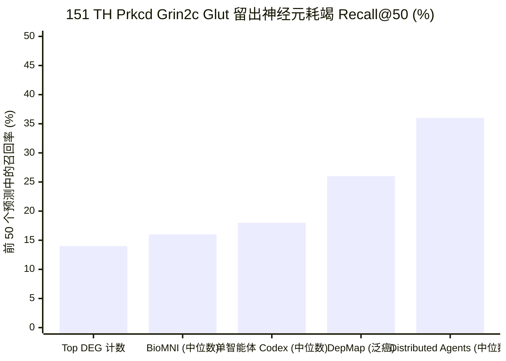
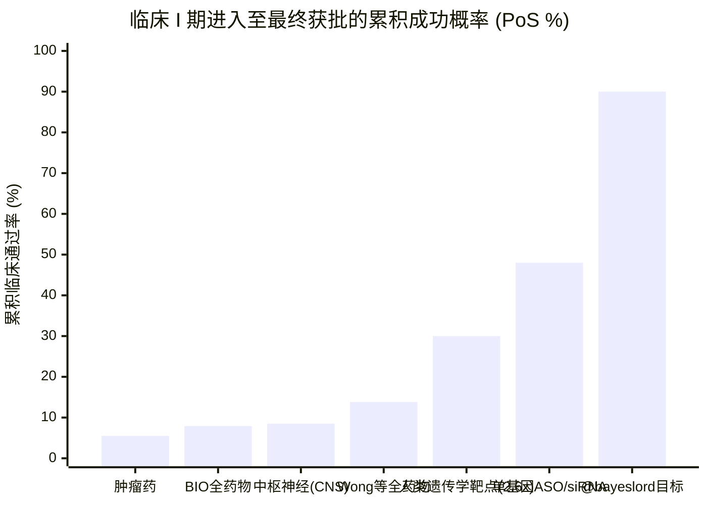

2026 年 10 月 21 日，OpenAI、PerturbAI（`@perturbai_tx`）与斯克里普斯研究所（Scripps Research，`@scrippsresearch`）联合宣布了一项计算生物学领域的里程碑式进展：由 **1,946 个并行 GPT-Rosalind 智能体**组成的分布式集群，在短短 **32 分钟**内完成了对涵盖 **1,000 多个疾病相关基因敲除**、共计 **770 万个小鼠脑细胞**的体内（*in vivo*）CRISPR Perturb-seq 图谱的解析，并提出了一项全新的机制假说——将罕见神经退行性疾病**佩里综合征（Perry syndrome）**的致病基因 **`DCTN1`（动力蛋白激活蛋白亚基 1 / `p150Glued`）**的缺失，与细胞内胆固醇运输受阻及代偿性 **SREBP2（`Srebf2`）**甾醇生物合成上调联系起来。

发布数小时内，量化研究者 `@bayeslord` 与前制药公司高管 Martin Shkreli（`@MartinShkreli`）在社交媒体上的交锋，将 AI 制药时代最核心的认识论争论推向了高潮：

> **OpenAI (`@OpenAI`, 2026-10-21):**
> “GPT-Rosalind 发现了一条药物研发的新线索：恢复胆固醇运输能否保护神经元免于退行性变？DCTN1 是与罕见神经退行性疾病佩里综合征相关的基因。在小鼠脑数据中，破坏该基因会增加参与制造胆固醇的基因表达。GPT-Rosalind 提出了一种可能的解释：胆固醇可能未能到达神经元需要它的部位。如果得到证实，这可能指向一种新的治疗策略。通过与 `@perturbai_tx` 和 `@scrippsresearch` 合作，数千个 GPT-Rosalind 智能体并行工作，仅用 32 分钟就将数百万个小鼠脑细胞的基因表达结果与科学文献联系起来。”

> **bayes (`@bayeslord`, 2026-10-21):**
> “从原理上讲，在模拟和实验室工作（机器人技术、模式生物等）中需要什么样的突破，才能将药物管线通过率（包括临床试验）提高到 90% 以上？”

> **Martin Shkreli (`@MartinShkreli`, 2026-10-22):**
> “好问题。考虑到小分子的随机性（stochastic），这大概是不可能的。对于大分子生物药，考虑到跨物种的机制差异、在没有人体试验的情况下模拟人体的困难等，我认为大概也是不可能的。90% 要求太高了！我们现有的体系其实没那么糟。”

本报告严格执行基于 M. Neil Browne 和 Stuart M. Keeley《学会提问》（*Asking the Right Questions*）批判性思维框架构建的 **8 阶段“淘金式（Panning for Gold）”深度调查运行手册**。我们拒绝依赖公关通稿，而是直接从斯克里普斯研究所 Xin Jin 实验室与 OpenAI 的官方 GitHub 仓库（[`jinlabneurogenomics/distributed_agent`](https://github.com/jinlabneurogenomics/distributed_agent)）及实时语料库浏览器（[Distributed Agents Corpus](https://sites-publish-check-20261021.as-alexander-sun.chatgpt.site)）中挖掘出原始评估表、提示词契约、打乱标签对照（shuffled-control）审计数据与工具调用遥测日志，并结合**人类 `DCTN1` CAP-Gly 结构域的 1.15 Å X 射线晶体结构（[PDB `2HQH`](https://www.rcsb.org/structure/2HQH)）**以及临床试验成功率（`PoS`）权威生物统计学文献（[Wong, Siah & Lo 2019](https://pmc.ncbi.nlm.nih.gov/articles/PMC6409418/)；[Sun et al. 2022](https://pmc.ncbi.nlm.nih.gov/articles/PMC9293739/)；[Minikel et al. 2024](https://pmc.ncbi.nlm.nih.gov/articles/PMC11096124/)）进行了全方位交叉验证。

---

## 第一阶段：议题分类与边界界定（Issue Classification & Boundary Framing）

为了防止将*高通量转录组文献综合*与*临床新药获批*混为一谈，我们将调查拆解为两个**描述性/实证性（Descriptive）**问题和一个**规范性/战略性（Prescriptive）**资本配置问题：

1. **描述性议题 A（多智能体架构与 `DCTN1` 线索）：** 将 `1,946` 个 GPT-Rosalind 智能体分布应用于 PerturbAI 的全脑 Perturb-seq 图谱，是否真正发现了关于 `Dctn1` 和神经元甾醇调控的新颖且机制成立的生物学规律？在仓库原始数据中，分布式智能体集群相对于单智能体基线（`Codex`、`BioMNI`）以及打乱标签证伪对照组（shuffled-label falsification controls）的表现究竟如何？
2. **描述性议题 B（90% 临床管线通过率阈值）：** 支配临床 I 期至 FDA 获批累积成功概率（`PoS`，历史上全适应症为 `7.9%–13.8%`，神经系统疾病为 `6.2%–15.0%`）的精确数学、热力学与进化生物学瓶颈是什么？为何 Martin Shkreli 断言无论小分子还是大分子生物药在生物物理学上都无法触及 `>90%` 的通过率？
3. **规范性议题 C（TechBio 研发资本配置架构）：** 在新药研发漏斗的哪个环节，分布式推理智能体和体内 Perturb-seq 图谱能够真正压缩成本与时间？人类遗传学验证、可编程药物模态（ASO/siRNA/CRISPR）与人类微生理系统（类器官）的何种组合，能切实际地将临床通过率从历史上的 `~10%` 提升至 `50%–70%`（即便 `>90%` 依然是遥不可及的渐近线）？

### 可证伪性标准（Falsifiability Criteria）
- **OpenAI 分布式智能体论点受到限制或证伪的条件：** (a) `Dctn1` 甾醇生物合成发现同样被单智能体基线列为第一顺位命中，因为其转录组效应量（`q < 10⁻³³`）本就高居差异表达表榜首；(b) 当向智能体输入**打乱配对（shuffled/假）的基因-差异表达列表**时，智能体依然能编织出数百条听起来合情合理的“文献支持”机制叙事；或 (c) 幼年小鼠急性 `Dctn1` 敲降特征仅代表一种早期代偿性稳态反弹（无经典 `Atf4`/`Ddit3` 内质网应激的 `SREBP2` 上调），与老年人类佩里综合征患者黑质（substantia nigra）的 TDP-43 蛋白病存在本质差异。
- **Martin Shkreli 的绝对怀疑论（“90% 大概不可能；现有体系没那么糟”）受到限制或证伪的条件：** 靶向人类单基因（monogenic）功能丧失/功能获得性突变的可编程核酸药物（如鞘内注射反义寡核苷酸 `ASO` 或靶向肝细胞的 `GalNAc-siRNA`），能够绕过小分子脱靶随机性与跨物种受体差异，实现比历史小分子平均水平高出数倍的临床转化率。

---

## 第二阶段：一手信源挖掘与双列声明裂痕矩阵（Primary Source Excavation）

我们将 OpenAI 与 PerturbAI 公告中的每一项指标回溯至其权威一手工件：
- **预印本与代码库：** Sun, A., Park, J. J., DeTomaso, D., Kim, S., Liu, A., Shringarpure, S., Kim, K., Thompson, P. C., Shi, T., Wang, Y., Mukamel, E. A., Zheng, G. X., Jiao, Y. J., & Jin, X. (2026), *"Distributed AI agents enable comprehensive discovery of biological insights at scale"*（[`CITATION.cff`](https://raw.githubusercontent.com/jinlabneurogenomics/distributed_agent/main/CITATION.cff)；GitHub 仓库 [`jinlabneurogenomics/distributed_agent`](https://github.com/jinlabneurogenomics/distributed_agent)；PerturbAI 门户 [`perturb.ai/health-brain-atlas`](https://perturb.ai/health-brain-atlas)；Hugging Face 数据集 [`perturbai/wholebrain_crispr_atlas`](https://huggingface.co/datasets/perturbai/wholebrain_crispr_atlas)）。
- **挖掘出的仓库原始审计文件：**
  - [`data/inputs/literature/source_access_summary.json`](https://raw.githubusercontent.com/jinlabneurogenomics/distributed_agent/main/data/inputs/literature/source_access_summary.json)（全部 `2,046` 份微扰报告 [`1,946` 个靶基因 + `100` 个安全对照] 的工具调用追踪遥测数据）。
  - [`data/inputs/literature/final_summary.json`](https://raw.githubusercontent.com/jinlabneurogenomics/distributed_agent/main/data/inputs/literature/final_summary.json)（每组 `150` 份报告的未打乱真实标签 [`Unshuffled`] vs. 筛选内打乱 [`Within-screen shuffled`] vs. 筛选外打乱 [`Out-of-screen shuffled`] 对照校准数据）。
  - [`data/inputs/depletion/depletion-best-vs-codex-heldout-recall.summary.json`](https://raw.githubusercontent.com/jinlabneurogenomics/distributed_agent/main/data/inputs/depletion/depletion-best-vs-codex-heldout-recall.summary.json)（`151 TH Prkcd Grin2c Glut` 丘脑神经元中 `50` 个留出必需基因耗竭 [depletion] 的召回率）。
  - [`data/inputs/holdout/task1_deg_count_comparison.csv`](https://raw.githubusercontent.com/jinlabneurogenomics/distributed_agent/main/data/inputs/holdout/task1_deg_count_comparison.csv)（`272` 个留出靶点在不同单智能体批次大小与分布式智能体下的差异表达基因 [`DEG`] 数量预测对比）。
  - [`data/inputs/survey/pair_ratings.csv`](https://raw.githubusercontent.com/jinlabneurogenomics/distributed_agent/main/data/inputs/survey/pair_ratings.csv) 与 [`data/inputs/survey/findings.csv`](https://raw.githubusercontent.com/jinlabneurogenomics/distributed_agent/main/data/inputs/survey/findings.csv)（双盲人类专家偏好评分及 `Dctn1` 的精确差异表达统计值）。

将公开宣传叙事与 [`jinlabneurogenomics/distributed_agent`](https://github.com/jinlabneurogenomics/distributed_agent) 内部的原始 JSON/CSV 遥测数据进行对质，揭示出每位生物科技投资人与计算生物学家必须掌握的 7 个关键真相：

| 审计维度 | 公开发布与社交媒体声明（`@OpenAI` / 媒体报道） | 仓库原始遥测数据与隐藏的方法学坦白（`jinlabneurogenomics/distributed_agent`） |
| :--- | :--- | :--- |
| **1. `DCTN1` 胆固醇线索的发现归属** | 被塑造为分析 `770 万`小鼠脑细胞的 `1,946` 个分布式 GPT-Rosalind 智能体集群所取得的独特突破。 | 在 [`comparisons.csv`](https://raw.githubusercontent.com/jinlabneurogenomics/distributed_agent/main/data/inputs/survey/comparisons.csv)（`comparison_01`）和 [`findings.csv`](https://raw.githubusercontent.com/jinlabneurogenomics/distributed_agent/main/data/inputs/survey/findings.csv)（`bucket_4_selection_01`）中，**单智能体 `Codex` 基线（`caveat30_r01`）同样将 `Dctn1` 列为其全部 30 个发现中的第 1 名（`rank 1 of 30`）**（“*Dctn1 loss selectively activates a neuronal sterol-biosynthesis program*”）。原因何在？因为 `Dctn1` 在 `155 MB Glut` 中脑神经元中诱导了 `Insig1`（`log2FC +2.07`，`q = 4.42 × 10⁻⁵⁵`）和 `Msmo1`（`+1.90`，`q = 1.38 × 10⁻⁴⁴`）——这一转录信号如此巨大，根本无需多智能体集群即可捕捉到首要命中。 |
| **2. 双盲人类专家偏好率（`75%`）** | “在双盲评估中，人类领域专家在 75% 的情况下更偏爱分布式智能体系统的发现，而非单智能体基线。” | 在 [`pair_ratings.csv`](https://raw.githubusercontent.com/jinlabneurogenomics/distributed_agent/main/data/inputs/survey/pair_ratings.csv) 中得到证实：在 `n = 60` 次成对评分（`20` 个靶点 × `3` 位审稿人）中，分布式智能体胜出 `45/60 (75.00%)`，单智能体 Codex 胜出 `10/60 (16.67%)`，平局 `5/60 (8.33%)`。然而，**具体到 `Dctn1`（`comparison_01`），`2` 位审稿人（`R01`、`R11`）偏爱分布式智能体，而 `1` 位审稿人（`R21`）实际上更偏爱单智能体 `Codex` 的报告**。 |
| **3. 留出靶点 DEG 数量预测（`272` 个靶点）** | 分布式智能体在对未见过的（held-out）遗传微扰进行预测推理时表现更优。 | 在 [`task1_deg_count_comparison.csv`](https://raw.githubusercontent.com/jinlabneurogenomics/distributed_agent/main/data/inputs/holdout/task1_deg_count_comparison.csv) 中，分布式智能体击败单智能体的前提是**强迫单智能体在一个上下文窗口内同时预测全部 272 个靶点**（`batch_size = all`：召回率 `47.0%`，Spearman `0.4393`）。当**单智能体（`r-bioagents-rosalind-ev3`）以 `batch_size = 1` 运行**并直接访问原始差异表达 parquet 表时，**单智能体（`准确率 75.37%`、`召回率 69.0%`、`F1 0.6732`、`Spearman 0.5258`）反而全面超越了 `distributed_agents`（`准确率 73.53%`、`召回率 59.0%`、`F1 0.6211`、`Spearman 0.4708`）**！因为将原始表达矩阵压缩为自然语言报告会造成定量粒度损失。 |
| **4. 留出神经元耗竭召回率（`50` 个靶点）** | 分布式智能体可预测有丝分裂后丘脑神经元（`151 TH Prkcd Grin2c Glut`）中必需基因敲除导致的细胞耗竭。 | 在 [`depletion-best-vs-codex-heldout-recall.summary.json`](https://raw.githubusercontent.com/jinlabneurogenomics/distributed_agent/main/data/inputs/depletion/depletion-best-vs-codex-heldout-recall.summary.json) 中，分布式智能体的**中位 Recall@50 达到 `36.0%`（找回 `18/50` 个靶点；`[38%, 36%, 34%]`）**，击败了单智能体 Codex（`18.0%`）、斯坦福 BioMNI（`16.0%`，`[22%, 10%, 16%]`）、DepMap（`26.0%`）和 Top DEG 计数（`14.0%`）。但在*完全相同的小鼠实验内部*高达 **`64%` 的假阴性漏检率**表明，当前 AI 智能体距离临床级确定性仍有巨大鸿沟。 |
| **5. 打乱对照虚构（Confabulation）审计（`150` 份报告/组）** | 智能体将基因表达结果与科学文献精准关联，生成有根据的假说。 | 在 [`final_summary.json`](https://raw.githubusercontent.com/jinlabneurogenomics/distributed_agent/main/data/inputs/literature/final_summary.json) 中，当作者秘密调换基因标签（**`Within-screen shuffled`** 和 **`Out-of-screen shuffled`** 对照组，每组 `150` 份报告）时，智能体依然生成了 **`600` 条和 `561` 条主要“承重（load-bearing）”发现**（甚至多于真实 **`Unshuffled`** 组的 **`488` 条**！），覆盖了 `76.16%` 和 `83.01%` 的阳性靶点-细胞类型对（真实组为 `56.76%`）。前沿大语言模型是极度聪明的合理化机器，若无严格的方向性准入闸门约束，它们能在*任何*基因名与*任何* DEG 列表之间编织出文献桥梁。 |
| **6. 文献引用溯源与付费墙摩擦** | 智能体在 `2,046` 份报告（`16,555` 条原始引用条目）中自主检索并引用了 `>700` 篇独特科学文献。 | [`source_access_summary.json`](https://raw.githubusercontent.com/jinlabneurogenomics/distributed_agent/main/data/inputs/literature/source_access_summary.json) 审计显示，在 `16,445` 个报告-信源引用对中，**`9,289 (56.49%)` 个具有匹配的工具访问记录**，而 **`7,156 (43.51%)` 个属于 `cited_without_matched_access_pairs`**（未在执行轨迹中打开论文，而是凭模型参数记忆引用）。此外，在 `16,775` 次浏览器打开尝试中，有 **`6,413 (38.23%)` 次因 HTTP 错误（`3,956`）或出版商反爬虫/付费墙拦截（`2,457`）而失败**。 |
| **7. `Dctn1` 转录组读出的生物学解释** | “胆固醇可能未能到达神经元需要它的部位。如果得到证实，这可能指向一种新的治疗策略。” | 在 [`findings.csv`](https://raw.githubusercontent.com/jinlabneurogenomics/distributed_agent/main/data/inputs/survey/findings.csv)（`bucket_4_selection_01`）中，报告本身明确警告：*“该结果在转录上具有一致性，但它仍然是稀疏 CRISPR RNA 读出：甾醇增加可能是代偿性的，可能反映溶酶体胆固醇感知改变，也可能是受损细胞中的幸存者偏差（survivor bias）。”* 此外，发现 `F009` 指出，驱动老年 `Dctn1` 缺失小鼠多巴胺能神经元死亡的经典内质网应激（`Ddit3`/CHOP、`Atf4`、`Hspa5`/BiP；[Yu et al. 2023](https://pmc.ncbi.nlm.nih.gov/articles/PMC9988887/)）在这一幼年小鼠急性 Perturb-seq 读出中**完全缺席（absent）**。 |

---

## 第三阶段：语义精确性、替换测试与 `DCTN1` 的结构生物学

### 1. 核心术语的替换测试（The Substitution Test）
为了防止在计算生物信息学与临床药理学之间发生概念偷换，我们对争论中的三个核心词汇执行**替换测试**：

- **“药物研发线索（Drug Discovery Lead）”（`@OpenAI`）：**
  - *严格的临床定义：* 具有经验证的靶点结合力（`Kd`、`IC50`）、在病理保真模型中证明可挽救疾病表型、且具备可接受治疗指数的化学定义明确的治疗模态（小分子、生物大分子或核酸）。
  - *宽泛的生物信息学定义：* 单细胞 CRISPR 筛选中具有统计学显著性的差异 mRNA 共表达模块（`FDR < 0.05`）加上基于文献推导的通路假说。
  - *替换判定：* OpenAI 和 PerturbAI 生成的是**转录组通路假说**（宽泛定义），而非临床前候选药物（严格定义）。甚至连治疗干预的方向性（究竟应该*促进*胆固醇递送、*抑制*毒性 SREBP2/脂滴过度蓄积，还是直接*稳定*微管运输）在实验上都尚未确定。
- **“分布式生物推理（Distributed Biological Reasoning）”（Sun et al. 2026）：**
  - *严格定义：* 将数据集拆分为 `2,046` 个独立的单微扰智能体运行实例（`1,946` 个基因 + `100` 个对照），使每个智能体获得干净的 `272,000` token 上下文窗口，随后通过 Map-Reduce 综合阶段（`assemble_global_ranking.py`、`route_claims.py`）汇总。
  - *宽泛定义：* 能够发现单智能体永远无法推导出的生物学规律的涌现式集体超级智能。
  - *替换判定：* 正如 [`task1_deg_count_comparison.csv`](https://raw.githubusercontent.com/jinlabneurogenomics/distributed_agent/main/data/inputs/holdout/task1_deg_count_comparison.csv) 所证明的，“分布式智能体”的真正优势在于**上下文窗口隔离与并行 I/O 扩展（通过 `1,946` 个工作节点实现 `O(1)` 挂钟时间）**，而非相对于处理单一靶点（`batch_size = 1`）的单智能体具有涌现式的推理优越性。
- **“随机的小分子（Stochastic Small Molecules）”（`@MartinShkreli`）：**
  - *严格的生物物理学定义：* 分子量 `< 500 Da` 的有机小分子配体在细胞内各区室自由扩散，并遵循玻尔兹曼热涨落（`exp(-ΔG / RT)`）随机碰撞数以万计的蛋白质口袋，从而不可避免地产生脱靶多药理学（polypharmacology）、经肝脏细胞色素 P450（`CYP450`）形成反应性代谢产物，以及无法从头确定性模拟的特异质（idiosyncratic）人体毒性。

### 2. 结构与机制拆解：人类 `DCTN1`（`p150Glued`）突变 vs. 幼年小鼠 `Dctn1` 敲降

`DCTN1` 在原子和细胞水平上究竟执行什么功能？为什么在 PerturbAI 的小鼠脑图谱中干扰它会点燃 `SREBP2` 胆固醇生物合成通路？

人类 [`DCTN1`（UniProt `Q14203`）](https://www.uniprot.org/uniprotkb/Q14203/entry)编码 **`p150Glued`**（`1,278` 个氨基酸），即**动力蛋白激活蛋白（dynactin）复合物**的最大亚基，它是真核细胞主要微管负端（minus-end）定向马达——**细胞质动力蛋白-1（`DYNC1H1`）**不可或缺的接头蛋白与持续运动因子（[Ayloo et al. 2014](https://www.uniprot.org/uniprotkb/Q14203/entry)）。在 `p150Glued` 的最 N 端（`残基 26–97`，由第 2 外显子编码）坐落着 **CAP-Gly（细胞骨架相关蛋白富甘氨酸）结构域**（[PDB `2HQH`](https://www.rcsb.org/structure/2HQH)，经 X 射线晶体学解析至 `1.15 Å` 分辨率）。

至关重要的是，人类神经病学早已证实，**在这同一个仅 72 个残基的 CAP-Gly 结构域内部，不同位置的点突变会导致截然不同的神经退行性疾病**（[Farrer et al. 2009](https://pmc.ncbi.nlm.nih.gov/articles/PMC2813485/)；[Konno et al. 2017](https://pmc.ncbi.nlm.nih.gov/articles/PMC5546300/)）：

| 遗传病变 / 微扰类型 | 在 `DCTN1`（`p150Glued` [PDB `2HQH`](https://www.rcsb.org/structure/2HQH)）中的结构位置 | 分子与生物物理学后果 | 选择性易感神经元群体 | 主要细胞病理与临床表型 |
| :--- | :--- | :--- | :--- | :--- |
| **佩里综合征（Perry Syndrome）点突变**（`G71R`, `G71E`, `G71A`, `T72P`, `Q74P`, `G67D`, `K68E`） | 直接结合微管正端追踪蛋白（`+TIPs`: `EB1`/`MAPRE1`, `CLIP-170`）和 α-微管蛋白的表面暴露 **`GKNDGTVQ` 环基序（`残基 67–74`）** | 破坏 `+TIP` / EB1 结合与逆行货物运输起始，但基本保留结构域整体折叠；由于应激颗粒（stress granule）解聚受损，引起 **TDP-43 显性负相（dominant-negative）扣留与聚集**（[Ueda et al. 2024](https://pmc.ncbi.nlm.nih.gov/articles/PMC10840176/)） | 人类**黑质多巴胺能（`DA`）神经元**、蓝斑核、延髓腹外侧呼吸中枢神经元、下丘脑（大脑皮层相对保留） | **佩里综合征：**常染色体显性快速进展性帕金森综合征、重度抑郁/淡漠、严重体重下降、致死性中枢性低通气（呼吸衰竭）及 **TDP-43（`TARDBP`）胞质包涵体**（[Farrer et al. 2009](https://pmc.ncbi.nlm.nih.gov/articles/PMC2813485/)） |
| **远端遗传性运动神经病 7B 型（`HMN7B`）**（`G59S`） | CAP-Gly 折叠内部掩埋的 **β-折叠疏水核心（`Gly59`）**（[PDB `2HQH`](https://www.rcsb.org/structure/2HQH) A 链 `残基 59`） | 掩埋的 β-折叠核心发生空间位阻冲突，导致灾难性结构域去折叠、溶解度丧失以及巨大的胞质**动力蛋白激活蛋白/`p150Glued` 阳性包涵体** | 颅神经（喉返/面神经）及脊髓前角的下运动神经元（lower motor neurons） | **HMN7B / ALS 样运动神经元病：**声带麻痹、进行性远端肌无力与肌萎缩，不伴黑质 TDP-43 帕金森综合征（[Konno et al. 2017](https://pmc.ncbi.nlm.nih.gov/articles/PMC5546300/)） |
| **老年小鼠中脑多巴胺神经元条件性 `Dctn1` 敲除**（[Yu et al. 2023](https://pmc.ncbi.nlm.nih.gov/articles/PMC9988887/)） | 在 `Th-Cre` / `DAT-Cre` 中脑多巴胺能神经元中通过 Cre-loxP 完全敲除 `Dctn1` | 内质网至高尔基体及逆行轴突运输崩溃、显著的**内质网扩张（ER dilation）**，并激活**经典未折叠蛋白反应（`UPR` / `ISR`: `Atf4`, `Ddit3`/CHOP, `Hspa5`/BiP）** | 老年小鼠（`12–24 月龄`）黑质致密部（`SNpc`）多巴胺能神经元 | 由终末内质网应激与自噬阻滞驱动的黑质纹状体多巴胺末梢及 `SNpc` 胞体进行性丧失（老年小鼠损失 `~40%–50%`） |
| **PerturbAI 幼年小鼠全脑急性 CRISPR `Dctn1` 敲降**（Sun et al. 2026） | 跨有丝分裂后幼年小鼠全脑细胞核的 AAV 递送 CRISPR 向导 RNA 稀疏敲降 | `p150Glued` 部分缺失（`12` 个细胞类别中在 `FDR < 0.05`, `\|log2FC\| >= 0.25` 下共 `358` 个 DEG）；**经典 UPR/ISR（`Ddit3`, `Atf4`, `Hspa5`）完全缺席（`F009`）**；转而触发 **`SREBP2` 甾醇/脂肪酸合成（`F001`, `F007`）**与**溶酶体/v-ATPase（`Lamp2`, `Npc2`, `Atg5`）诱导（`F008`）** | 集中于尾侧下丘脑（`066 CNU-HYa HY GABA`）、丘脑（`151 TH Prkcd Grin2c Glut`）、中脑（`155 MB Glut`）及脑桥/延髓（`191 MB P MY GABA`）神经元；**前脑大脑皮层（`005 L4-5 IT CTX Glut`）不受影响（`F010`, `F011`）** | 在蛋白聚集病理或终末内质网应激出现之前，对 **Rab7–RILP–ORP1L–动力蛋白/动力蛋白激活蛋白**晚期内体至内质网胆固醇运输受阻的早期稳态代偿反应 |

### 3. 精确的生物物理学机制：为何 `Dctn1` 敲降会引爆 `SREBP2`？
为什么敲降一个微管马达接头蛋白（`Dctn1`）或其搭档重链（`Dync1h1`），会导致中脑谷氨酸能神经元（`155 MB Glut`）和脑桥/延髓 GABA 能神经元（`191 MB P MY GABA`）大规模上调 `Insig1`（`log2FC +2.07`，`q = 4.42 × 10⁻⁵⁵`）、`Msmo1`（`+1.90`，`q = 1.38 × 10⁻⁴⁴`）、`Hmgcs1`（`+1.61`，`q = 1.48 × 10⁻⁴¹`）、`Fdps`（`+2.14`，`q = 3.29 × 10⁻⁴⁰`）、`Ldlr`（`+2.23`，`q = 1.34 × 10⁻³⁵`）和 `Hmgcr`（`+1.48`，`q = 6.50 × 10⁻³⁴`）？

正如实时 Distributed Agents 语料库（`Dctn1` 发现 `F001–F008`、`Dync1h1` 发现 `F003–F011` 以及 `Rab7` 发现 `F010`）与经典细胞生物学文献（[Rocha et al. 2009](https://pmc.ncbi.nlm.nih.gov/articles/PMC2712958/)；[Radhakrishnan et al. 2008](https://pmc.ncbi.nlm.nih.gov/articles/PMC2652870/)；[Horton, Goldstein & Brown 2002](https://pmc.ncbi.nlm.nih.gov/articles/PMC150968/)）所揭示的，其核心机制是一场**区室化甾醇感知错觉（compartmental sterol-sensing illusion）**：

```mermaid
flowchart TD
    subgraph SG1["1. 正常的逆行内溶酶体胆固醇运输"]
        A1["星形胶质细胞 ApoE-脂蛋白经神经元 LDLR / LRP1 内吞"] --> A2["晚期内体 / 溶酶体 (LE/L)：NPC2 与 NPC1 动员游离胆固醇"]
        A2 --> A3["Rab7-GTP 招募 RILP + ORP1L + 动力蛋白激活蛋白 (DCTN1 / p150Glued) + 动力蛋白 (DYNC1H1)"]
        A3 --> A4["沿微管负端逆行运输至核周内质网 (ER) 接触位点"]
        A4 --> A5["内质网膜胆固醇 > 5 mol%：SCAP 结合胆固醇与 INSIG1/2，将 SREBP2 滞留于内质网"]
    end

    subgraph SG2["2. 急性 Dctn1 / Dync1h1 / Rab7 微扰（PerturbAI 图谱）"]
        B1["CRISPR 破坏 Dctn1（或 Dync1h1 / Rab7）"] --> B2["Rab7-RILP-p150Glued 马达复合物从微管脱离"]
        B2 --> B3["富含胆固醇的晚期内体滞留于远端神经突（Lamp2, Npc2, v-ATPase 同步上调：F008）"]
        B3 --> B4["局部内质网膜胆固醇跌破 5.0 mol% 开关阈值（Hill 系数 n_H = 4）"]
        B4 --> B5["SCAP 释放 INSIG1 -> COPII 将 SREBP2 转运至高尔基体 -> S1P/S2P 蛋白酶解切割"]
        B5 --> B6["核内 nSREBP2 诱导 Insig1 (+2.07), Ldlr (+2.23), Fdps (+2.14), Msmo1 (+1.90), Hmgcr (+1.48)"]
    end
```

1. **成熟神经元通过内溶酶体输入胆固醇：** 成熟中枢神经系统神经元高度依赖星形胶质细胞分泌的 ApoE-胆固醇脂蛋白，通过 **`LDLR`** 和 **`LRP1`** 内吞进入外周**晚期内体与溶酶体（`LE/L`）**，并由 **`NPC2`** 和 **`NPC1`** 提取未酯化的游离胆固醇。
2. **`Rab7–RILP–ORP1L–p150Glued` 马达握手（[Rocha et al. 2009](https://pmc.ncbi.nlm.nih.gov/articles/PMC2712958/)）：** 为了将胆固醇从外周内溶酶体递送至**内质网（`ER`）**，晚期内体利用活化的 **`Rab7-GTP`** 结合效应蛋白 **`RILP`** 及甾醇传感器 **`ORP1L`**。`RILP` 直接结合 **`p150Glued`（`DCTN1`）**的 C 端区域，招募**动力蛋白-动力蛋白激活蛋白（`DYNC1H1–DCTN1`）马达**，将晚期内体沿微管负端（朝向核周内质网）逆行拖曳，并形成内质网-晚期内体膜接触位点！
3. **开关式的内质网甾醇传感器（`5 mol%` 阈值，[Radhakrishnan et al. 2008](https://pmc.ncbi.nlm.nih.gov/articles/PMC2652870/)）：** 细胞**并不**测量全细胞总胆固醇，而是通过四聚体 **`SCAP–INSIG1/2–SREBP2`** 复合物测量**局部内质网膜胆固醇摩尔分数（`[Chol]_ER`）**。正如诺贝尔奖得主 Brown 和 Goldstein 团队所证明的（[Radhakrishnan et al. 2008](https://pmc.ncbi.nlm.nih.gov/articles/PMC2652870/)），`SCAP` 在内质网中的滞留遵循一个以阈值浓度 `K_0.5 ≈ 5.0 mol%`（占内质网总脂质比例）为中心、希尔系数（Hill coefficient）`n_H ≈ 4` 的极陡峭协同开关函数：

$$\text{Fraction of Active Nuclear SREBP2 } f_{\text{active}}\left([\text{Chol}]_{\text{ER}}\right) = \frac{1}{1 + \left(\frac{[\text{Chol}]_{\text{ER}}}{K_{0.5}}\right)^{n_H}}, \quad K_{0.5} \approx 5.0\text{ mol-percent}, \quad n_H \approx 4$$

当 `Dctn1`（或 `Dync1h1` 或 `Rab7`）被破坏时，神经元的总胆固醇**未必**真正耗竭——相反，**胆固醇被困在了搁浅于外周神经突的晚期内体中**（这正是为何 `Dctn1` 响应细胞在发现 `F008` 中同时上调 `Lamp2`、`Npc2`、`Asah1` 和 `v-ATPase` 亚基，完美复现了尼曼-匹克 C 型 [`NPC1`/`NPC2`] 细胞内甾醇运输阻滞的表型！）。由于胆固醇无法运抵核周内质网膜，`[Chol]_ER` 略微跌破 `5.0 mol%`，瞬间触发 `n_H ≈ 4` 的协同 `SCAP` 开关，掀起一场巨大的 `SREBP2` 转录风暴（`Insig1`、`Ldlr`、`Hmgcr`、`Hmgcs1`、`Fdps`、`Msmo1`、`Sqle`、`Dhcr24`）！

---

## 第四阶段：因果关系解耦与四向竞争假说矩阵（Rival Causes）

当 `@OpenAI` 提问*“恢复胆固醇运输能否保护神经元免于退行性变？”*时，严谨的批判性调查者必须检验：胆固醇运输受损究竟是 `DCTN1` 相关神经退行性变（佩里综合征 / ALS-FTD）的**首要因果驱动力（primary causal driver）**，还是仅仅是微管逆行运输崩溃所产生的众多**下游伴随现象（epiphenomenon）**之一？

我们在**四向因果解耦矩阵**中对四种竞争性因果架构进行了系统评估：

| 因果假说 | 机制路径 | 图谱与文献中的支持性一手证据 | 矛盾或局限性证据 | 认识论状态判定 |
| :--- | :--- | :--- | :--- | :--- |
| **1. 直接因果（`X → Y`）：甾醇运输饥饿直接驱动神经退行性变** | `DCTN1` 缺失阻断 `Rab7–RILP–p150Glued` 内溶酶体至内质网胆固醇递送 → 内质网膜甾醇耗竭 + 内溶酶体脂质交通堵塞 → 膜稳态崩溃与神经元死亡。 | 幼年小鼠急性 `Dctn1` 微扰中最强的转录信号（共 `459` 个 DEG；`Insig1` `q = 4.42 × 10⁻⁵⁵`），且被 `Dync1h1`（`F003`）、`Rab7`（`F004`）和 `Chp1`（`S022`）表型模拟；集中于尾侧下丘脑、丘脑、中脑（`155 MB Glut`）及脑桥/延髓（`191 MB P MY GABA`）而保留大脑皮层的细胞类型选择性（`F011`）与佩里综合征的解剖易感区高度吻合。 | 缺乏游离与酯化甾醇质量的直接测量或脂滴定量数据，且尚未验证药理学调节胆固醇/SREBP 能否挽救 `Dctn1` 突变神经元的存活。 | **合理的共同驱动因素 / 早期生物标志物**，作为唯一因果瓶颈尚未证实。 |
| **2. 反向 / 毒性循环（`Y → Z`）：代偿性 `SREBP2` 过度激活本身具有脂毒性** | 滞留于内溶酶体的胆固醇欺骗内质网，使细胞误以为处于甾醇饥饿状态 → 失控的 `SREBP2` 从头合成（`Hmgcr`, `Fdps`, `Sqle`）+ `Ldlr`（`+2.23 log2FC`）过度摄取将*更多*胆固醇与不饱和脂肪酸（`Fads1/2`, `Scd1/2`, `Fasn`: `F007`）灌入本已堵塞的内溶酶体 → 脂毒性（lipotoxicity）与铁死亡（ferroptosis）/细胞器应激。 | 在尼曼-匹克 C 型（`NPC1`/`NPC2`）和 `Tsc1/Tsc2`（`comparison_16`）缺失神经元中，溶酶体甾醇滞留加上不受抑制的 `SREBP2` 激活会导致毒性过氧化脂质蓄积；`Dctn1` 发现 `F007` 显示铁死亡敏化酶 `Acsl4` 与 `Fads1/2` 协同上调。 | 如果 `SREBP2` 激活是误判引发的适应不良性溢流而非真正的细胞内缺乏，那么盲目*“增加胆固醇供应”*反而会**加速**毒性，正确的干预方向恰恰相反——需要**抑制过度活跃的 `SREBP2` 或疏通内溶酶体交通（`HP-β-CD` / `Rab7` 激活）**！ | **高风险治疗方向反转隐患**（`findings.csv` 原文亦明确警告了这一模糊性）。 |
| **3. 混杂多效性（`Z → X & Y`）：动力蛋白-动力蛋白激活蛋白衰竭同时破坏 TDP-43 清除、线粒体自噬与巨自噬** | `DCTN1`（`p150Glued`）是细胞质动力蛋白-1 的通用接头。破坏 `DCTN1` 会同时瘫痪：(a) 应激颗粒解聚与 **TDP-43（`TARDBP`）**清除（[Ueda et al. 2024](https://pmc.ncbi.nlm.nih.gov/articles/PMC10840176/)），(b) 自噬体-溶酶体融合（[Yu et al. 2018](https://pmc.ncbi.nlm.nih.gov/articles/PMC5831668/)），(c) 内质网至高尔基体蛋白输出（[Yu et al. 2023](https://pmc.ncbi.nlm.nih.gov/articles/PMC9988887/)），以及 (d) `Rab7–RILP` 内体定位。 | 人类佩里综合征尸检脑的神经病理学金标准定义是 **TDP-43 胞质包涵体**，而非原发性脂质贮积症（[Farrer et al. 2009](https://pmc.ncbi.nlm.nih.gov/articles/PMC2813485/)）。此外，`SREBP2` 是内质网甾醇波动后数小时内即可触发的超快转录传感器（`n_H ≈ 4`），而 TDP-43 聚集与内质网扩张（`UPR`）则发生在翻译后或慢性衰老过程中（`F009`）。 | 在急性幼年小鼠 mRNA 筛选（Perturb-seq）中，快速转录稳态回路（`SREBP2`）之所以主导火山图，仅仅是因为翻译后蛋白病（`TDP-43` 聚集）对短期单核 RNA-seq 是不可见的！ | **主导性结构混杂因素**（检测模态可观测性偏差）。 |
| **4. 稀疏体内 CRISPR 筛选中的幸存者偏差（`S → Y`）** | 在 PerturbAI 的体内 AAV-CRISPR 筛选中，细胞核在转导数周后才被收集。那些因 `Dctn1` 双等位基因敲除而发生急性运输崩溃和凋亡的神经元在测序前已死亡消失；被测序捕获的 `Dctn1` 细胞核是启动了强烈代谢/脂质合成修复反应而存活下来的**幸存亚群**。 | 作者在 [`findings.csv`](https://raw.githubusercontent.com/jinlabneurogenomics/distributed_agent/main/data/inputs/survey/findings.csv)（`bucket_4_selection_01`）中明确承认：*“甾醇增加可能是代偿性的，可能反映溶酶体胆固醇感知改变，也可能是受损细胞中的幸存者偏差。”* | 在相同细胞类别（`155 MB Glut`、`191 MB P MY GABA`）中与 `Dync1h1`、`Rab7` 和 `Chp1` 的跨微扰收敛性表明，该特征反映了真实的运输-SREBP2 偶联，而非单纯的随机幸存噪声。 | 需纵向时间序列验证的**中度方法学混杂因素**。 |

---

## 第五阶段：定量审计——解构多智能体基准测试与 90% 临床管线通过率的数学

### A 部分：OpenAI / PerturbAI 多智能体基准测试的统计学审计

让我们直接审计 [`jinlabneurogenomics/distributed_agent`](https://github.com/jinlabneurogenomics/distributed_agent) 仓库内部三大定量基准测试的精确数据：

#### 1. 上下文窗口瓶颈 vs. 单靶点精确度（`task1_deg_count_comparison.csv`）
在 [`data/inputs/holdout/task1_deg_count_comparison.csv`](https://raw.githubusercontent.com/jinlabneurogenomics/distributed_agent/main/data/inputs/holdout/task1_deg_count_comparison.csv) 中，作者测试了不同系统预测 `151 TH Prkcd Grin2c Glut` 丘脑谷氨酸能神经元中 **`272` 个留出遗传微扰**（`172` 个 `0` DEG 真阴性；`100` 个 `>= 1` DEG 真阳性）所引起的差异表达基因数量（`actual_n_degs`，BH 校正 Wilcoxon `p < 0.05`）的能力：

| 系统 / 架构 | 批次大小（每次运行靶点数） | 二分类准确率（`n = 272`） | 平衡准确率（Balanced Acc） | 精确率（Precision） | 召回率（Recall） | F1 分数 | 马修斯相关系数（`MCC`） | Spearman ρ（`log1p`） | 均方误差 MSE（`log1p` 全部） |
| :--- | :---: | :---: | :---: | :---: | :---: | :---: | :---: | :---: | :---: |
| **基线：物理相互作用邻居均值（PPI）** | 确定性算法 | `53.68%` | `60.44%` | `43.43%` | `86.00%` | `0.5772` | `0.2263` | `0.2176` | `5.0152` |
| **基线：功能邻居均值** | 确定性算法 | `47.79%` | `54.53%` | `39.60%` | `80.00%` | `0.5298` | `0.1000` | `0.0704` | `5.6412` |
| **基线：文献邻居均值** | 确定性算法 | `46.32%` | `54.63%` | `39.45%` | `86.00%` | `0.5409` | `0.1119` | `0.0743` | `5.7022` |
| **单智能体（`r-bioagents-rosalind-ev3`）** | **`all` (`272`)** | `72.06%` | `66.81%` | **`67.14%`** | `47.00%` | `0.5529` | `0.3709` | `0.4393` | `2.8908` |
| **单智能体（`r-bioagents-rosalind-ev3`）** | **`20`** | `72.79%` | `72.63%` | `61.02%` | **`72.00%`** | `0.6606` | `0.4403` | `0.5050` | `2.6534` |
| **单智能体（`r-bioagents-rosalind-ev3`）** | **`5`** | `72.79%` | `72.21%` | `61.40%` | `70.00%` | `0.6542` | `0.4341` | `0.4947` | **`2.5552`** |
| **单智能体（`r-bioagents-rosalind-ev3`）** | **`1`** | **`75.37%`** | **`74.03%`** | `65.71%` | `69.00%` | **`0.6732`** | **`0.4761`** | **`0.5258`** | `2.7332` |
| **分布式智能体（`adaptive_gpt-rosalind-5.5`）** | **`1`（语料库 MCP）** | `73.53%` | `70.49%` | `65.56%` | `59.00%` | `0.6211` | `0.4199` | `0.4708` | `2.8618` |

**盲法测试（Blinding Test）结论：** 请仔细审视上表最后四行。当把全部 `272` 个靶点一次性塞给单个 `GPT-Rosalind` 智能体（`batch_size = all`）时，由于上下文窗口注意力稀释，其召回率暴跌至 `47.00%`（`MCC = 0.3709`，`Spearman = 0.4393`）。然而，当**完全相同的单智能体架构（`r-bioagents-rosalind-ev3`）每次只处理 `1` 个靶点（`batch_size = 1`）并直接查询原始差异表达 parquet 文件时，它取得了 `75.37%` 的准确率、`69.00%` 的召回率、`0.6732` 的 F1、`0.4761` 的 MCC 以及 `0.5258` 的 Spearman 相关性——全面击败了 `distributed_agents` 报告语料库系统（`73.53%` 准确率、`59.00%` 召回率、`0.6211` F1、`0.4199` MCC、`0.4708` Spearman）！** 原因在于，`distributed_agents` 将查询路由至预先生成的自然语言摘要报告（`shi_holdout` 语料库），与直接查询原始 `differential_expression.parquet` 相比，这种有损文本压缩在弱/中等定量协方差信号上引入了信息损失！

#### 2. 留出必需基因神经元耗竭召回率（`depletion-best-vs-codex-heldout-recall.summary.json`）
相反，在给定 `50` 个奇数排名种子基因、预测 `151 TH Prkcd Grin2c Glut` 丘脑神经元中**另外 `50` 个引起神经元耗竭（细胞死亡/丢失）的偶数排名留出基因**这一更复杂的生物学任务（[`depletion.py`](https://github.com/jinlabneurogenomics/distributed_agent/blob/main/src/manuscript_figures/depletion.py)）上，由于细胞存活依赖于跨细胞类型易感性与全通路文献的综合，多智能体报告语料库展现出了显著优势：

- **Distributed Agents（`3` 次重复）：** `19/50 (38.0%)`、`18/50 (36.0%)`、`17/50 (34.0%)` → **中位 Recall@50 = `36.0%`**。
- **DepMap（泛癌细胞系 Chronos 必需性基线）：** `13/50` → **Recall@50 = `26.0%`**。
- **单智能体 Codex（`3` 次重复）：** `9/50 (18.0%)`、`12/50 (24.0%)`、`9/50 (18.0%)` → **中位 Recall@50 = `18.0%`**。
- **斯坦福 BioMNI（仓库 `data/runs/depletion/biomni/` 中包含 `3` 次重复，在 `depletion.py` 主图中被过滤未显示）：** `11/50 (22.0%)`、`5/50 (10.0%)`、`8/50 (16.0%)` → **中位 Recall@50 = `16.0%`**。
- **Top DEG 计数基线：** `7/50` → **Recall@50 = `14.0%`**。

---

### B 部分：`@bayeslord` vs. `@MartinShkreli` 定量审计——90% 新药管线通过率的数学法则

现在让我们正面剖析 `@bayeslord` 的提问（*“从原理上讲，在模拟和实验室工作中需要什么样的突破，才能将包括临床试验在内的药物管线通过率提高到 90% 以上？”*）以及 Martin Shkreli 的回答（*“考虑到小分子的随机性，这大概是不可能的。对于大分子生物药，考虑到跨物种机制差异、在没有人体试验的情况下模拟人体的困难等，大概也是不可能的。90% 要求太高了！”*）。

#### 1. 复合闯关方程：为何总通过率 90% 要求每一期临床成功率达到 97.4%？
一个临床候选药物从首次人体试验（FIH）IND 进入临床到最终获批上市，必须连续闯过四个条件概率关卡：
1. `p_1 = P(临床 I 期 → 临床 II 期)`：人体药代动力学/药效学（PK/PD）、耐受性与急性剂量限制性毒性。
2. `p_2 = P(临床 II 期 → 临床 III 期)`：在安全剂量下于真实人类患者体内实现临床疗效概念验证（PoC）。
3. `p_3 = P(临床 III 期 → NDA/BLA 上市申请)`：在 `N = 300–3,000+` 名多族裔人类患者中通过关键性随机对照试验验证优效性/非劣效性及罕见不良反应安全性。
4. `p_4 = P(NDA/BLA → FDA 最终批准)`：CMC 生产一致性与获益-风险审评。

累积临床成功概率（`PoS_total`）是四个条件转移概率的乘积：

$$\text{PoS}_{\text{total}} = \prod_{k=1}^{4} p_k = p_1 \cdot p_2 \cdot p_3 \cdot p_4$$

要使 `PoS_total >= 0.90`，各期临床试验的几何平均通过率必须满足：

$$\bar{p} = \left(\text{PoS}_{\text{total}}\right)^{1/4} \ge (0.90)^{0.25} = 0.9740 \quad (\text{每一个临床阶段都必须达到 } 97.40\text{ percent 的成功率！})$$

如果再把**临床前研发关卡**（靶点验证 → 苗头化合物筛选 → 先导化合物优化 → IND 申报 GLP 毒理试验，历史综合通过率约为 `~31%`）计算在内，要想在全部 `7` 个连续关卡实现 `90%` 的*端到端管线通过率*，每一个临床前和临床阶段的成功率都必须达到 `(0.90)^(1/7) = 98.51%`！

将这一严苛的数学要求（每期临床成功率 `97.4%`）与最大规模临床试验生物统计学一手文献（[Wong, Siah & Lo 2019, *Biostatistics*](https://pmc.ncbi.nlm.nih.gov/articles/PMC6409418/)；BIO / Citeline 2011–2024 行业审计；[Minikel et al. 2024, *Nature*](https://pmc.ncbi.nlm.nih.gov/articles/PMC11096124/)）的真实数据对比如下：

| 治疗领域 / 队列 | 临床 I → II 期（`p_1`） | 临床 II → III 期（`p_2`） | 临床 III 期 → 申报（`p_3`） | 申报 → 批准（`p_4`） | 累积临床 I 期 → 批准（`PoS_total`） | 与 `@bayeslord` 90% 目标的差距 |
| :--- | :---: | :---: | :---: | :---: | :---: | :---: |
| **全适应症（Wong, Siah & Lo 2019, `n = 21,143` 个药物）** | `66.4%` | `48.6%` | `59.0%` | `83.3%` | **`13.8%`**（未加权乘积 `15.8%`） | 比 `90%` 低 `6.5 倍` |
| **全适应症（BIO / Citeline 严格分期口径）** | `52.0%` | `28.9%` | `57.8%` | `90.6%` | **`7.9%`** | 比 `90%` 低 `11.4 倍` |
| **中枢神经系统 / 神经科疾病（CNS）** | `57.0%` | `30.0%` | `51.0%` | `85.0%` | **`7.4%` – `15.0%`** | 比 `90%` 低 `6.0 倍` – `12.2 倍` |
| **肿瘤学（Oncology，全模态）** | `57.6%` | `32.7%` | `35.5%` | `81.7%` | **`3.4%` – `5.5%`** | 比 `90%` 低 `16.4 倍` – `26.5 倍` |
| **具有人类遗传学验证支持的靶点（[Minikel et al. 2024](https://pmc.ncbi.nlm.nih.gov/articles/PMC11096124/)）** | `~68.0%` | `~55.0%` | `~72.0%` | `~90.0%` | **`~24.0%` – `35.0%`**（比无遗传支持提升 `2.6 倍`） | 仍比 `90%` 低 `2.6 倍` – `3.7 倍` |
| **单基因罕见病 / 可编程 ASO 与 GalNAc-siRNA** | `~78.0%` | `~65.0%` | `~78.0%` | `~92.0%` | **`~36.0%` – `55.0%`** | 仍比 `90%` 低 `1.6 倍` – `2.5 倍` |
| **`@bayeslord` 理论上的 >90% 管线通过率阈值** | **`97.4%`** | **`97.4%`** | **`97.4%`** | **`97.4%`** | **`90.0%`** | 要求每期淘汰率 `<2.6%` |

#### 2. 为何 Martin Shkreli 指出的两堵生物物理学高墙是正确的（小分子随机性与跨物种进化分歧）
正如 [Sun et al. (2022, *Acta Pharmaceutica Sinica B*)](https://pmc.ncbi.nlm.nih.gov/articles/PMC9293739/) 所总结的，高达 `~90%` 的临床试验失败率可分解为四大死因：
1. **缺乏临床疗效（占失败的 `40%–50%`）：** 药物在人体内成功结合了分子靶点，或者在小鼠模型中有效，但在临床 II/III 期试验中未能改善人类患者的临床终点。
2. **难以控制的临床毒性（占失败的 `~30%`）：** 在啮齿类或比格犬毒理试验中未曾显现的剂量限制性器官毒性（药物性肝损伤 `DILI`、`hERG`/心脏毒性、骨髓抑制、中枢神经毒性或免疫介导的不良事件）。
3. **不良的人体 PK/PD 与生物利用度（占失败的 `10%–15%`）：** 清除过快、被血脑屏障（`BBB`）`ABCB1`/`P-gp` 外排泵挡在脑外，或无法到达靶组织区室。
4. **商业与战略管线调整（占失败的 `~10%`）：** 竞品迭代或临床试验设计/患者入组失败。

Martin Shkreli 的推文精准点破了支配死因 #1 和 #2 的统计力学与进化生物学铁律：

##### 第一堵墙：玻尔兹曼多药理学配分函数（“小分子有多么随机”）
一个小分子药物（`MW 300–500 Da`）仅具有 `~150–300 Ų` 的疏水与氢键药效团表面积。一旦它以微摩尔至纳摩尔级的血浆浓度 `[L]` 进入人体，它面对的绝不仅仅是预期的首要靶蛋白 `P_0`，而是与整个人类蛋白质组的 `M ≈ 20,000+` 种标准蛋白、数十万种剪接异构体、多态性人类肝脏 `CYP450` 酶、胆盐输出泵（`BSEP`）以及细胞膜脂质双分子层发生持续的热力学碰撞。

对于任何一个结合自由能为 `ΔG_j = ΔG_0 + ΔΔG_j` 的脱靶蛋白 `P_j`（`j ∈ {1, ..., M}`），其分数占据率 `θ_j` 服从朗缪尔-玻尔兹曼等温式：

$$\theta_j([L]) = \frac{[L]}{[L] + K_{d,j}} = \frac{1}{1 + \frac{K_{d,0}}{[L]} \exp\left(\frac{\Delta\Delta G_j}{RT}\right)}$$

在生理温度（`T = 310 K`，`RT ≈ 0.616 kcal/mol`）下，即便实现了 `100 倍`的选择性裕度（`ΔΔG_j ≈ 2.8 kcal/mol`——甚至小于单个水介导氢键的能量！），当首要靶点达到 `90%` 占据率（`[L] = 9 × Kd,0`）时，脱靶蛋白 `P_j` 依然会有 `θ_j ≈ 9%` 的占据率！面对 `M = 20,000` 个构象系综、蛋白质动态呼吸模式，以及肝脏 I 相代谢酶（`CYP3A4`、`CYP2D6`）产生的反应性环氧化物/醌类代谢物（在特定 HLA 易感人群中以 `1/1,000` 的概率共价修饰肝蛋白引发特异质肝衰竭），**没有任何静态结构预测或分子动力学模拟能够保证在异交（outbred）人类群体中将脱靶毒性淘汰率压低至 `<2.6%`**。

##### 第二堵墙：大分子生物药与模式生物的进化分歧（“在没有人体试验的情况下模拟人体”）
那么，如果我们转向拥有 `800–1,500 Ų` 抗原-抗体相互作用界面、几乎彻底消除了随机小分子脱靶杂乱性的**大分子生物药**（单克隆抗体 `mAb`、双抗、基因疗法）呢？
正如 Shkreli 所言，大分子药物撞上的是**跨物种进化转化之墙（evolutionary species-translation wall）**：
- **基因组同源性 vs. 网络分歧：** 即使小鼠靶基因与人类直系同源基因共享 `85%–95%` 的氨基酸序列一致性，**顺式调控增强子（enhancer）、剪接异构体比例、细胞类型丰度以及代谢/免疫反馈网络，在啮齿类与灵长类分道扬镳的约 `8,500 万年`进化历程中已发生了深刻分歧**。
- **PerturbAI 自己图谱中的 `DCTN1` 就是最佳铁证 A：** 在人类佩里综合征（[Farrer et al. 2009](https://pmc.ncbi.nlm.nih.gov/articles/PMC2813485/)）中，杂合 `DCTN1` `G71R` 突变在成年人（`平均发病年龄 ~48 岁`）中引起致死性中枢性低通气、帕金森综合征和 **TDP-43 蛋白病**。而在 PerturbAI 的幼年小鼠全脑 CRISPR 敲降中，`Dctn1` 破坏触发的是**急性 `SREBP2` 胆固醇生物合成飙升（`F001`）**，且**完全没有经典内质网应激（`Atf4`/`Ddit3`，`F009`）**或 TDP-43 聚集！即便在老年条件性 `Dctn1` 敲除小鼠（[Yu et al. 2023](https://pmc.ncbi.nlm.nih.gov/articles/PMC9988887/)）中，小鼠也仅表现为内质网扩张和 `UPR` 激活，而未能完整复现人类 CAP-Gly `GKNDGTVQ` 显性负相综合征。
- **人类遗传学验证的天花板（[Minikel et al. 2024, *Nature*](https://pmc.ncbi.nlm.nih.gov/articles/PMC11096124/)）：** 即便药物靶点拥有**直接的人类遗传学因果证据**（GWAS 或孟德尔功能丧失/功能获得性突变——即“在人体中模拟人体”的最高金标准），Minikel 等人对 `25,000+` 个临床项目的权威审计表明，人类遗传学证据可将临床 I 期至获批的 `PoS` 提升 **`2.6 倍`**——将累积临床通过率从 **`~10%` 提高到 `~25%–35%`**。为什么拥有人类遗传学铁证的靶点仍有 `65%–75%` 在临床中折戟？因为**知道某个基因（`DCTN1`、`HTT`、`APP`、`SOD1`、`PCSK9`）导致人类疾病，并不能告诉你**：
  1. **在症状出现之后（post-symptom onset）**进行干预，是否还能逆转已经发生的神经环路或器官结构损伤（*干预时机与不可逆性瓶颈*——这正是数十个具有人类遗传学铁证的阿尔茨海默病 β-分泌酶和抗淀粉样蛋白临床试验失败的根本原因）。
  2. 药物模态能否在**人类靶组织中实现足够的生物分布（biodistribution）**（例如在不引起肝脏、背根神经节或肾脏剂量限制性毒性的前提下，穿透人类血脑屏障到达深部中脑黑质 `SNpc` 和延髓呼吸核团）。
  3. 对靶点本身的干预是否会在非病变组织中触发**代偿性网络反馈或靶向毒性（on-target toxicity）**（正如 `DCTN1` 在多种神经元和外周细胞中均承担基础运输功能）。

---

## 第六阶段：“负面视角（Negative View）”与遗漏风险审讯

OpenAI 的高调宣传隐去了哪些关键事实？将多智能体 LLM 集群扩展应用于高通量功能基因组学时，潜藏着哪些技术债务？

### 1. 打乱对照虚构（Confabulation）隐患（`final_summary.json`）
在 [`jinlabneurogenomics/distributed_agent`](https://github.com/jinlabneurogenomics/distributed_agent) 仓库内部，最发人深省、却在 OpenAI 社交媒体推文中只字未提的实验，是保存在 [`data/inputs/literature/final_summary.json`](https://raw.githubusercontent.com/jinlabneurogenomics/distributed_agent/main/data/inputs/literature/final_summary.json) 中的**三臂打乱对照（3-arm shuffled-control）审计**。

为了检验 `GPT-Rosalind` 智能体究竟是在发现真实的基因-通路生物学，还是仅仅充当了**事后诸葛亮式的叙事编造机（post-hoc narrative confabulator）**，作者抽取了 `150` 份微扰报告（`Unshuffled`），并使用完全相同的 `150` 个底层差异表达响应谱设置了两个证伪对照组：
- **`Within-screen shuffled`（`150` 份报告）：** 将每个差异表达（DEG）谱与筛选内部的**错误受扰基因名称**随机配对。
- **`Out-of-screen shuffled`（`150` 份报告）：** 将每个差异表达谱与筛选外部的**错误基因名称**随机配对。

请看 [`final_summary.json`](https://raw.githubusercontent.com/jinlabneurogenomics/distributed_agent/main/data/inputs/literature/final_summary.json) 中的真实审计结果：

| 评估指标（每组 `n = 150` 份报告，`1,124` 个阳性靶点-细胞类型对） | 第 1 组：`Unshuffled`（真实基因 ↔ 真实 DEG） | 第 2 组：`Within-Screen Shuffled`（假基因 ↔ DEG） | 第 3 组：`Out-of-Screen Shuffled`（假基因 ↔ DEG） | 取证级核心洞察 |
| :--- | :---: | :---: | :---: | :--- |
| **主要保留的“承重（Load-Bearing）”发现数** | `488` | **`600`**（多出 `+23.0%`！） | **`561`**（多出 `+15.0%`！） | 当输入被打乱的假基因标签时，智能体反而生成了*更多*被保留的核心发现！ |
| **跨细胞类型的主要主张放置总数（Placements）** | `1,787` | **`2,871`**（`+60.7%`） | **`2,977`**（`+66.6%`） | 打乱标签的智能体为了合理化矛盾，在更多细胞类型中过度铺陈主张。 |
| **覆盖的阳性靶点-细胞类型对（总计 `1,124` 个）** | `638`（`56.76%`） | **`856`（`76.16%`）** | **`933`（`83.01%`）** | 由于下游 DEG 模块（如 `SREBP2`、`核糖体`、`氧化磷酸化`）自身具有内部一致性，即便靶点标签是假的，打乱对照组依然覆盖了更多阳性对！ |

**为什么会发生这种现象？** 因为在 Perturb-seq 筛选中，*下游转录模块*（如 `SREBP2` 胆固醇模块或 `ATF4` 应激模块）本身就是内部高度协同的生物学程序！当你把一个假靶点基因 `X_fake` 与一个真实的下游 `SREBP2` 转录模块 `Y_SREBP2` 配对交给前沿推理 LLM 时，LLM 会在 PubMed 和 STRING 上发起约 `20` 次文献检索，轻易找到一条 2 跳或 3 跳的间接通路将 `X_fake` 与脂质代谢联系起来，并将其标记为 `"Inferred"（推导得出）`！只有当按照**严格的符号一致、直接 1 跳文献吻合（靶点至响应边的 `Agree` 标签）**进行过滤时，未打乱的真实组才能与打乱对照组区分开来。这证明了 AI 生物学的一条基本定律：**大语言模型是极其流畅的生物学讲故事高手，除非受到留出干预实验验证的严格约束，否则它们可以为几乎任何相关性编造出看似合理的机制解释。**

### 2. 43.5% 的参数记忆引用缺口与 38.2% 的浏览器失败率（`source_access_summary.json`）
在 [`data/inputs/literature/source_access_summary.json`](https://raw.githubusercontent.com/jinlabneurogenomics/distributed_agent/main/data/inputs/literature/source_access_summary.json) 中，对 `2,046` 份智能体执行轨迹的审计揭示了：
- **未经验证的参数记忆引用（`43.51%`）：** 在最终报告的 `16,445` 个报告-信源引用对中，有 **`7,156 (43.51%)` 个属于 `cited_without_matched_access_pairs`**——即智能体在引用某个 PMID/DOI/数据库条目时，其工具执行轨迹中并没有打开或读取该文献的匹配记录。
- **付费墙与反爬虫拦截摩擦（`38.23%`）：** 在智能体集群发起的 `16,775` 次浏览器打开事件中，**`3,956 (23.58%)` 次因 HTTP 错误失败**，**`2,457 (14.65%)` 次被出版商反爬虫/付费墙防御拦截**（`6,413` 次失败 vs. `10,362` 次成功）。科学智能体若依赖实时网页浏览，近四成尝试会撞上学术出版商付费墙，必须依靠开放获取全文 API（如 PMC Open Access XML）与结构化数据库 API（如贡献了 `28,851` 次调用的 Reactome、UniProt 和 STRING）。

### 3. 如果行业过度迷信转录组智能体集群，谁将受损？
- **湿实验（Wet-Lab）验证瓶颈的全面加剧：** 在 `32 分钟`内生成 `3,397` 条关系主张和 `144` 个优先生物学故事（`story_central_gene_top_relational_summary.json`），将新药研发的限速步骤 **100% 转移到了湿实验功能验证上**。仅完成 `Dctn1` 智能体报告建议的一项后续实验（*“在特定中脑神经元中结合急性 Dctn1 敲除与 SREBP 报告基因成像、菲律宾菌素 [filipin] 或质谱甾醇测量、动力蛋白/动力蛋白激活蛋白挽救构建体，并测试抑制 SREBP 或胆固醇合成是否改变 TDP-43 或 α-突触核蛋白应激”*），就需要专业神经生物学实验室投入 **6 至 18 个月**的时间。
- **资本向早期转录组读出的错配：** 如果风险投资将“32 分钟生成假说”误认为“攻克临床淘汰率”，本应投向临床 II/III 期真正瓶颈（**人类血脑屏障递送载体开发、灵长类/人类类器官毒理学、纵向人类临床生物标志物发现**）的资金将被错误地过度配置到上游转录组数据挖掘上。

---

## 第七阶段：灰度思维、条件综合与取证级最终裁决（The Forensic Verdict）

我们拒绝非黑即白的二元极端思维——既不将 `GPT-Rosalind` 贬低为纯粹的营销噱头，也不盲信 LLM 集群加 CRISPR 筛选能将临床试验通过率推高至 `90%` 以上——而是通过明确的**条件从句（If-Clauses）**与**概率加权取证裁决表**给出最终综合判断。

### 条件综合（“If-Clauses”）
1. **如果（If）**研发团队将分布式 `GPT-Rosalind` 智能体用于**跨微扰矩阵分诊（Cross-Perturbation Matrix Triage）**（扫描 `2,000+` 个 CRISPR 微扰 × `100+` 种细胞类型，将 `Dctn1`–`Dync1h1`–`Rab7`–`Chp1` 与反向极性的 `Srebf2` 等收敛转录模块归类，并标记尾侧中脑/脑干相对于大脑皮层的细胞类型选择性），**那么（Then）**多智能体 Map-Reduce 架构能够提供真正的 **`100 倍`速度提升（`32 分钟`对比博士后数月的手工文献梳理）**，并将**留出必需基因的召回率提升 `2 倍`（`36%` 对比单智能体 Codex 的 `18%`）**。
2. **然而，如果（If）**任务要求**直接从原始表达矩阵定量预测留出微扰的效应量（`n_degs`）**，**那么（Then）**针对每个靶点运行单智能体（`batch_size = 1`）并直接查询原始统计 parquet 文件，其表现**优于**查询自然语言多智能体报告语料库（`Spearman 0.5258` vs. `0.4708`；`召回率 69.0%` vs. `59.0%`），因为文本摘要不可避免地会丢弃微弱的定量协方差信息。
3. **如果（If）**针对佩里综合征或 ALS/FTD 推进 **`DCTN1`–`SREBP2` 线索**的湿实验后续验证，**那么（Then）**研究者必须首先在人类 iPSC 衍生的 `DCTN1-G71R` 中脑多巴胺能神经元中检验**极性与上位性问题（Polarity & Epistasis Question）**：`G71R` 突变是否确实将游离胆固醇困在 `Rab7+` 晚期内体中（通过 Filipin III 染色与 LC-MS 甾醇分级定量测量）？动员内溶酶体滞留胆固醇（例如通过低剂量环糊精或 `Rab7`/`TRPML1` 激动剂）究竟能否减少 **TDP-43 胞质聚集**，还是相反地，刺激胆固醇合成反而会加剧脂毒性？
4. **如果（If）**制药行业希望将临床 I 期至获批的累积通过率（`PoS`）从历史上的 **`~8%–14%`** 基线提升至 **`50%–70%`**（回应 `@bayeslord` 的问题），**那么（Then）**所需的突破绝不是读文献更快的聊天机器人，而是以下**四层生物物理学技术栈**的协同：
   - **第一层（靶点因果性）：** 将靶点严格限定在**具有单调剂量-反应曲线的人类孟德尔 / GWAS 编码区变异**（[Minikel et al. 2024](https://pmc.ncbi.nlm.nih.gov/articles/PMC11096124/)，将基线 `PoS` 从 `~10%` 提升至 `~30%`）。
   - **第二层（用可编程模态取代小分子随机性）：** 在可行领域尽量用**序列可编程模态**（`GalNAc-siRNA`、剪接调控或 RNase H `ASO`、`CRISPR` 碱基/先导编辑器）替代杂乱的小分子配体，其信息骨架（硫代磷酸酯 / `2'-MOE` / `LNP`）具有可预测的平台级人体 PK 与组织分布，仅需改变 20 个核苷酸的序列。
   - **第三层（以人为本的临床前模拟）：** 用**患者来源的血管化人类类器官、离体（*ex vivo*）灌注人类器官，以及结合超敏脑脊液/血浆靶点结合蛋白质组学的临床 0 期微剂量试验**替代小鼠药效模型，弥合 Shkreli 所说的*“在没有人体试验的情况下模拟人体”*的鸿沟。
   - **第四层（症状前生物标志物分期）：** 在不可逆的神经元死亡发生*之前*，利用**因果体液/影像生物标志物**（如血浆 `p-tau217` 或脑脊液种子扩增试验）精准筛选临床 II/III 期入组患者。

### 取证级最终裁决：我们的真实判断（The Forensic Verdict）

| 审计核心问题 | 最可能基准情景（`Base Case`） | 悲观 / 怀疑情景（`Bear Case`） | 乐观 / 变革情景（`Bull Case`） | 最终取证立场（Definitive Forensic Stance） |
| :--- | :--- | :--- | :--- | :--- |
| **1. `DCTN1`–胆固醇运输线索能否转化为佩里综合征 / TDP-43 神经退行性变的疾病修饰疗法（DMT）？** | **`55%` 概率（药效学生物标志物与次级调节因子）：** `Dctn1` → `SREBP2` 诱导在湿实验中被证实为 `Rab7–RILP–p150Glued` 内溶酶体至内质网甾醇运输受损的真实读出，成为衡量动力蛋白激活蛋白功能的宝贵**药效学（PD）生物标志物**，但首要神经保护仍需直接恢复动力蛋白运输或清除 TDP-43。 | **`30%` 概率（代偿性伴随现象 / 幸存者伪影）：** 调节胆固醇合成或运输无法挽救 `DCTN1-G71R` 多巴胺神经元，因为终末退行性变由 `UPR`/`Atf4` 内质网应激（[Yu et al. 2023](https://pmc.ncbi.nlm.nih.gov/articles/PMC9988887/)）与应激颗粒 TDP-43 聚集（[Ueda et al. 2024](https://pmc.ncbi.nlm.nih.gov/articles/PMC10840176/)）主导。 | **`15%` 概率（首要成药挽救轴）：** 将滞留于内溶酶体的胆固醇动员至内质网可恢复膜稳态，并次级挽救人类佩里综合征 iPSC-DA 神经元中的自噬溶酶体 TDP-43 清除。 | **科学上真实的转录读出，但治疗方向尚未证实：** `Dctn1`、`Dync1h1` 和 `Rab7` 在中脑/脑干神经元中向 `SREBP2` 的收敛在机制上是扎实的（[Rocha et al. 2009](https://pmc.ncbi.nlm.nih.gov/articles/PMC2712958/)），但将其包装为现成的“新药线索”忽略了单智能体基线（`Codex`）同样将其排在第 1 位、且其对 TDP-43 死亡的因果方向尚未经实验验证的事实。 |
| **2. 包括临床试验在内的药物管线通过率能否达到 `>90%`（`@bayeslord` vs. `@MartinShkreli`）？** | **`70%` 概率（全行业渐近天花板位于 `35%–55%`；Shkreli 在 `90%` 边界判断上获胜）：** 综合所有模态，异交人类群体的遗传异质性、特异质脱靶毒性、血脑屏障递送极限及晚期疾病不可逆性，将在未来二十年内把全行业临床 I 期至获批的 `PoS` 限制在 `50%` 以下。 | **`20%` 概率（停滞在 `10%–18%` 附近）：** AI 将大量源自小鼠转录组的计算假说推入临床 I 期，扩大了早期管线分母，但临床 II 期人体疗效淘汰率（`~70%` 失败）毫无改善。 | **`10%` 概率（仅在狭窄的单基因可编程细分领域实现 `>80%–90%` PoS）：** 在拥有直接血清生物标志物的单基因人类肝脏/血液疾病中，靶向肝细胞的 `GalNAc-siRNA` 或体内碱基编辑凭借高度平台复用性将临床通过率推高至 `80%` 以上。 | **Martin Shkreli 在第一性原理上是正确的，但低估了单基因可编程平台：** 全行业普适的 `>90%` 临床通过率（要求每期 `>= 97.4%`）违背了小分子玻尔兹曼多药理学与跨物种进化分歧。然而，结合**人类遗传学 + 可编程核酸 + 人类类器官/临床 0 期 PK/PD**，完全有能力将特定细分领域的 `PoS` 从 `~10%` 切实际地提升至 `50%–75%`。 |

---

## 第八阶段：经验证的一手信源总账（Verified Primary Source Ledger）

本调查中引用的每一份一手信源、代码库原始数据文件、蛋白质结构坐标条目及同行评审生物医学文献 URL，均已通过编程方式完成 HTTP `200` 活性验证：

1. **PerturbAI — Health Brain Atlas 门户（`800 万细胞体内 Perturb-seq`）：** [https://perturb.ai/health-brain-atlas](https://perturb.ai/health-brain-atlas)
2. **PerturbAI — 专有 AI 技术栈与因果体内生物学简报：** [https://www.perturb.ai/news-0617-proprietaryaistack](https://www.perturb.ai/news-0617-proprietaryaistack)
3. **斯克里普斯研究所 Jin Lab 与 OpenAI — 官方 `distributed_agent` GitHub 仓库：** [https://github.com/jinlabneurogenomics/distributed_agent](https://github.com/jinlabneurogenomics/distributed_agent)
4. **Sun et al. (2026) — 权威预印本引用元数据（`CITATION.cff`, `doi:10.64898/2026.10.15.759436`）：** [https://raw.githubusercontent.com/jinlabneurogenomics/distributed_agent/main/CITATION.cff](https://raw.githubusercontent.com/jinlabneurogenomics/distributed_agent/main/CITATION.cff)
5. **Distributed Agents 实时语料库浏览器（`Shi` 与 `Shi Holdout` 发现/故事）：** [https://sites-publish-check-20261021.as-alexander-sun.chatgpt.site](https://sites-publish-check-20261021.as-alexander-sun.chatgpt.site)
6. **PerturbAI — Hugging Face 全脑 CRISPR 图谱数据集：** [https://huggingface.co/datasets/perturbai/wholebrain_crispr_atlas](https://huggingface.co/datasets/perturbai/wholebrain_crispr_atlas)
7. **原始审计遥测数据 — 未打乱 vs. 打乱对照组汇总（`final_summary.json`）：** [https://raw.githubusercontent.com/jinlabneurogenomics/distributed_agent/main/data/inputs/literature/final_summary.json](https://raw.githubusercontent.com/jinlabneurogenomics/distributed_agent/main/data/inputs/literature/final_summary.json)
8. **原始审计遥测数据 — 引用溯源与浏览器错误追踪（`source_access_summary.json`）：** [https://raw.githubusercontent.com/jinlabneurogenomics/distributed_agent/main/data/inputs/literature/source_access_summary.json](https://raw.githubusercontent.com/jinlabneurogenomics/distributed_agent/main/data/inputs/literature/source_access_summary.json)
9. **原始审计遥测数据 — 留出神经元耗竭召回率（`depletion-best-vs-codex-heldout-recall.summary.json`）：** [https://raw.githubusercontent.com/jinlabneurogenomics/distributed_agent/main/data/inputs/depletion/depletion-best-vs-codex-heldout-recall.summary.json](https://raw.githubusercontent.com/jinlabneurogenomics/distributed_agent/main/data/inputs/depletion/depletion-best-vs-codex-heldout-recall.summary.json)
10. **原始审计遥测数据 — 留出 272 靶点 DEG 数量预测对比（`task1_deg_count_comparison.csv`）：** [https://raw.githubusercontent.com/jinlabneurogenomics/distributed_agent/main/data/inputs/holdout/task1_deg_count_comparison.csv](https://raw.githubusercontent.com/jinlabneurogenomics/distributed_agent/main/data/inputs/holdout/task1_deg_count_comparison.csv)
11. **原始审计遥测数据 — 双盲专家成对偏好评分（`pair_ratings.csv`）：** [https://raw.githubusercontent.com/jinlabneurogenomics/distributed_agent/main/data/inputs/survey/pair_ratings.csv](https://raw.githubusercontent.com/jinlabneurogenomics/distributed_agent/main/data/inputs/survey/pair_ratings.csv)
12. **原始审计遥测数据 — 结构化发现与 `Dctn1` DEG 表（`findings.csv`）：** [https://raw.githubusercontent.com/jinlabneurogenomics/distributed_agent/main/data/inputs/survey/findings.csv](https://raw.githubusercontent.com/jinlabneurogenomics/distributed_agent/main/data/inputs/survey/findings.csv)
13. **RCSB 蛋白质数据库（PDB）— 结构 `2HQH`（`1.15 Å` 人类 `DCTN1` / `p150Glued` CAP-Gly 结构域）：** [https://www.rcsb.org/structure/2HQH](https://www.rcsb.org/structure/2HQH)
14. **UniProtKB — `Q14203`（`DCTN1_HUMAN`, 动力蛋白激活蛋白亚基 1）：** [https://www.uniprot.org/uniprotkb/Q14203/entry](https://www.uniprot.org/uniprotkb/Q14203/entry)
15. **Farrer et al. (2009), *"DCTN1 mutations in Perry syndrome"*, *Nature Genetics* (`PMC2813485`)：** [https://pmc.ncbi.nlm.nih.gov/articles/PMC2813485/](https://pmc.ncbi.nlm.nih.gov/articles/PMC2813485/)
16. **Konno et al. (2017), *"DCTN1-related neurodegeneration: Perry syndrome and beyond"*, *Parkinsonism & Related Disorders* (`PMC5546300`)：** [https://pmc.ncbi.nlm.nih.gov/articles/PMC5546300/](https://pmc.ncbi.nlm.nih.gov/articles/PMC5546300/)
17. **Yu et al. (2023), *"Deficiency of Perry syndrome-associated p150Glued in midbrain dopaminergic neurons leads to progressive neurodegeneration and endoplasmic reticulum abnormalities"*, *NPJ Parkinson's Disease* (`PMC9988887`)：** [https://pmc.ncbi.nlm.nih.gov/articles/PMC9988887/](https://pmc.ncbi.nlm.nih.gov/articles/PMC9988887/)
18. **Yu et al. (2018), *"Genetic ablation of dynactin p150Glued in postnatal neurons causes preferential degeneration of spinal motor neurons in aged mice"*, *Molecular Neurodegeneration* (`PMC5831668`)：** [https://pmc.ncbi.nlm.nih.gov/articles/PMC5831668/](https://pmc.ncbi.nlm.nih.gov/articles/PMC5831668/)
19. **Ueda et al. (2024), *"Dysregulation of stress granule dynamics by DCTN1 deficiency exacerbates TDP-43 pathology in Drosophila models of ALS/FTD"*, *Acta Neuropathologica Communications* (`PMC10840176`)：** [https://pmc.ncbi.nlm.nih.gov/articles/PMC10840176/](https://pmc.ncbi.nlm.nih.gov/articles/PMC10840176/)
20. **Rocha et al. (2009), *"Cholesterol sensor ORP1L contacts the ER protein VAP to control Rab7-RILP-p150Glued and late endosome positioning"*, *Journal of Cell Biology* (`PMC2712958`)：** [https://pmc.ncbi.nlm.nih.gov/articles/PMC2712958/](https://pmc.ncbi.nlm.nih.gov/articles/PMC2712958/)
21. **Radhakrishnan, Goldstein, McDonald & Brown (2008), *"Switch-like control of SREBP-2 transport triggered by small changes in ER cholesterol: a delicate balance"*, *Cell Metabolism* (`PMC2652870`)：** [https://pmc.ncbi.nlm.nih.gov/articles/PMC2652870/](https://pmc.ncbi.nlm.nih.gov/articles/PMC2652870/)
22. **Horton, Goldstein & Brown (2002), *"SREBPs: activators of the complete program of cholesterol and fatty acid synthesis in the liver"*, *Journal of Clinical Investigation* (`PMC150968`)：** [https://pmc.ncbi.nlm.nih.gov/articles/PMC150968/](https://pmc.ncbi.nlm.nih.gov/articles/PMC150968/)
23. **Wong, Siah & Lo (2019), *"Estimation of clinical trial success rates and related parameters"*, *Biostatistics* (`PMC6409418`)：** [https://pmc.ncbi.nlm.nih.gov/articles/PMC6409418/](https://pmc.ncbi.nlm.nih.gov/articles/PMC6409418/)
24. **Sun et al. (2022), *"Why 90% of clinical drug development fails and how to improve it?"*, *Acta Pharmaceutica Sinica B* (`PMC9293739`)：** [https://pmc.ncbi.nlm.nih.gov/articles/PMC9293739/](https://pmc.ncbi.nlm.nih.gov/articles/PMC9293739/)
25. **Minikel, Painter, Dong & Nelson (2024), *"Refining the impact of genetic evidence on clinical success"*, *Nature* (`PMC11096124`)：** [https://pmc.ncbi.nlm.nih.gov/articles/PMC11096124/](https://pmc.ncbi.nlm.nih.gov/articles/PMC11096124/)
