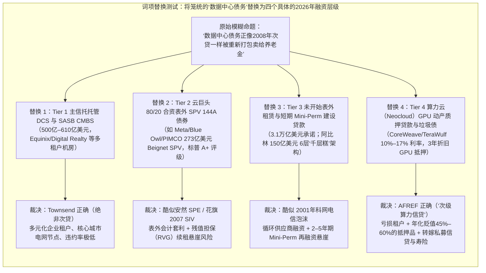
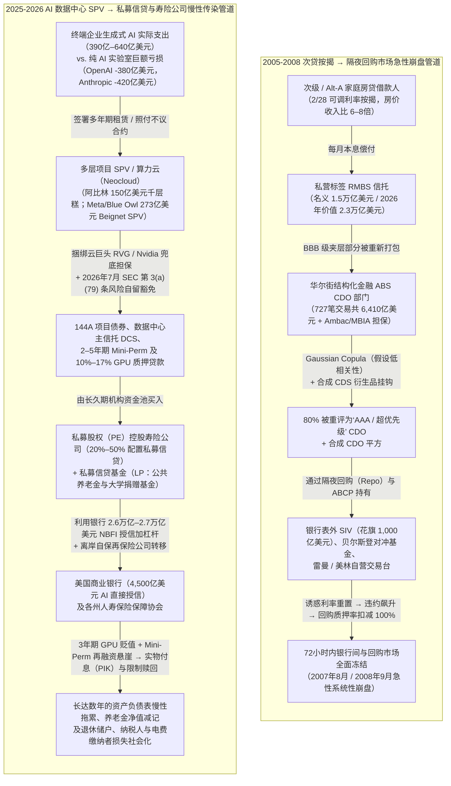
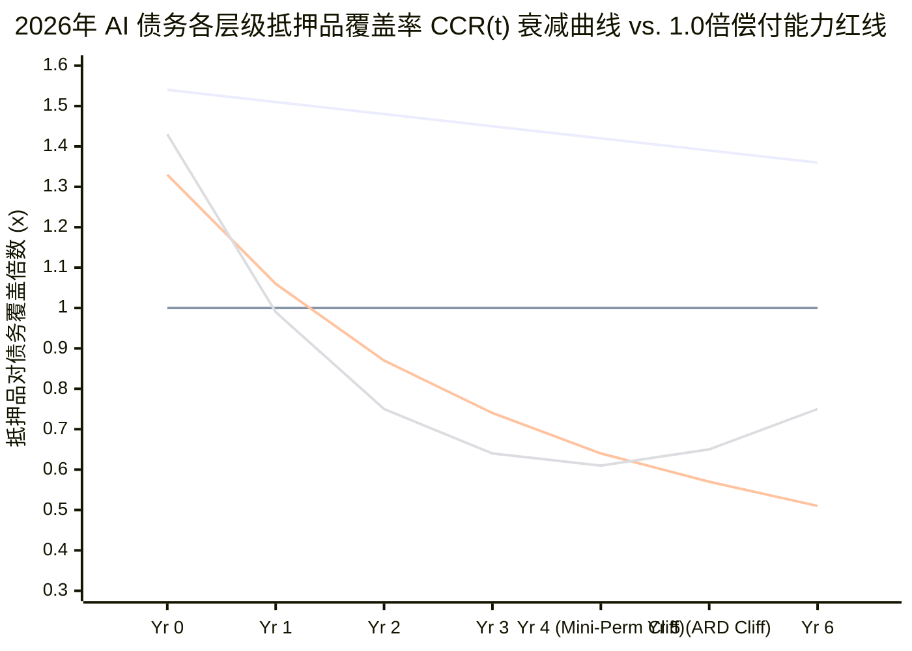

## 1. 核心摘要与 2008 vs. 2026 对比记分卡

**2026年10月21日**，市场情报账号 `@unusual_whales` 引用了**美国金融改革教育基金（AFREF）**与**开放市场研究所（OMI）**联合发布的89页重磅报告（*《Brace for Impact: Protecting People and the Economy When the AI Bubble Bursts》*，由 Matthew U. Scherer 与 Maya Jenkins 撰写）中的核心论断，在 X（原 Twitter）上引发了一场激烈交锋：

> “投机性数据中心债务正在被重新打包，并以一种令人毛骨悚然地回想起次贷泡沫的方式，出售给养老基金、退休基金、大学捐赠基金及其他机构投资者。” —— **美国金融改革教育基金（`@unusual_whales` 引用，2026年10月21日）**（[X 原始帖文](https://x.com/unusual_whales)，[AFREF/OMI 报告全文 PDF](https://ourfinancialsecurity.org/wp-content/uploads/2026/10/AFR-OMI-AI-Report.pdf)）

几小时后，曾在2008年近距离目睹贝尔斯登（Bear Stearns）倒闭的前华尔街高管、私人投资者 **Adam Townsend（`@adamscrabble`）** 发表了措辞严厉的反驳，获得了近5,000次点赞和超过12万次浏览：

> “真不敢相信人们如此无知，以至于需要重新解释这一点……1995年后的私营CMO没有政府支持企业（GSE）的担保……大量证券被Ambac的‘AAA’担保包装，塞满了低息诱惑期过后利率飙升的可调利率按揭贷款（ARM），几乎每个层级都被无差别地授予AAA评级，并捆绑了合成衍生品（Synthetic CDS）对冲……简而言之，它们与‘数据中心债务工具’没有任何相似之处。” —— **Adam Townsend (`@adamscrabble`, 2026年10月21日)**（[X 原始帖文](https://x.com/adamscrabble)）

**究竟谁是对的？**
运用 **Browne & Keeley 的*“淘金式（Panning for Gold）”*批判性思维框架**，并交叉核验一手 SEC 财报文件（10-K/10-Q）、**2026年7月29日 SEC 结构化融资办公室（Office of Structured Finance）的解释函**、美联储（Fed）金融稳定报告以及交易级项目融资契约后，我们的法证调查表明：**争论双方都陷入了致命的盲区。**

1. **Adam Townsend 正确而 `@unusual_whales` 夸大其词之处：** 2026年的 AI 数据中心债务市场**并非 2008年式的隔夜回购（Overnight Repo）流动性挤兑或合成 CDO 平方（Synthetic CDO-Squared）引发的银行体系闪电崩盘。** 2026年没有“三无（NINJA）”房贷，没有 2/28 诱惑利率重置，也没有曾在72小时内摧毁贝尔斯登和雷曼兄弟的 6,410亿美元结构化金融 ABS CDO 及裸信用违约互换（CDS）放大器。此外，传统的多租户托管主信托数据中心证券化（DCS）市场（累计发行约500亿至610亿美元）有着多元化的投资级企业租户支撑。
2. **AFREF/OMI 警告一针见血而 Adam Townsend 严重误判之处：** Townsend 错误地将 2026年的数据中心债务视为简单透明的普通企业债券。事实上，9大 AI 超大规模云厂商与芯片巨头已在资产负债表外隐藏了高达 **3.1万亿美元（$3.1 Trillion）的未开始租赁及无条件采购承诺**（是其表内长期债务 5,950亿美元的5倍以上，甚至超过了经通胀调整后 2007年次贷危机峰值的 2.3万亿美元）；它们正在精心设计**安然（Enron）式的非并表特殊目的实体（SPV/VIE）**（如 Meta/Blue Owl/PIMCO 在路易斯安那州规模达 273亿美元的“Beignet” SPV，以及得克萨斯州阿比林规模达 150亿美元的6层“千层糕”架构）；它们利用 **2026年7月29日 SEC 结构化融资办公室的解释函**，成功豁免了《多德-弗兰克法案》第 3(a)(79) 条下的 5% 风险自留规则（Regulation RR）；并且正在将**经济半衰期仅 18至36个月的 AI GPU 贷款和定制数据中心债务，源源不断地输送给私募股权（PE）控股的人寿保险公司、养老金私募信贷基金以及 401(k) 退休账户**。

因此，2026年的 AI 数据中心债务引擎并非 **2008年9月式的短期银行同业挤兑**，而是 **2001年朗讯/北电网络（Lucent/Nortel）电信供应商融资泡沫、2001年安然（Enron）表外 SPE 会计套利，以及 2026年非银金融机构（NBFI）私募信贷与寿险资产负债表慢性侵蚀**的三重混合体。

### 核心对比记分卡：2005–2008 次贷按揭证券化 vs. 2025–2026 AI 数据中心债务管道

| 结构性维度 | 2005–2008 次贷 RMBS / ABS CDO 体系 | 2025–2026 AI 数据中心 SPV / 私募信贷体系 | 法证裁决 |
| :--- | :--- | :--- | :--- |
| **1. 底层现金流来源** | 在房价收入比高达6至8倍的过热地区，申请少文件/免文件（Low/No-doc）2/28 可调利率按揭（ARM）的次级/Alt-A 家庭借款人 | 纯 AI 大模型实验室（OpenAI 2025年亏损380亿美元，Anthropic 亏损420亿美元）、高杠杆算力云（CoreWeave、Crusoe），以及资本支出（CapEx）超过经营现金流 100% 的超大规模云巨头 | **营收与支出鸿沟同样脆弱：** 2026年全球终端用户生成式 AI 实际支出（390亿–640亿美元）不足当年 1万亿美元 AI 基础设施投入的 6.5% |
| **2. 表内外总承诺规模** | **名义 1.3万亿–1.5万亿美元**（按2026年美元计价约 **2.3万亿美元**）次级房贷余额 + **6,410亿美元**结构化金融 ABS CDO 发行量 | 9大 AI 巨头 **表内长期债务 5,950亿美元** + **表外（Off-Balance-Sheet）租赁及采购承诺 3.1万亿美元**（合计 **3.7万亿美元**）+ 数据中心 ABS/CMBS 约610亿美元 | **2026年表外承诺规模更大：** 3.1万亿美元的表外承诺已超过通胀调整后的 2007年次贷峰值（2.3万亿美元） |
| **3. 抵押物物理寿命 vs. 债务久期** | **50年寿命的实体房屋与土地**，由带有 **2年诱惑期利率重置的 30年期房贷**融资（短期借款人再融资冲击 vs. 长期耐用资产） | **18–36个月经济寿命的 AI GPU** + **15–20年寿命的供电/液冷定制外壳**，由 **5–20年期私募债券、2–5年期 Mini-perm 贷款及 15年期租约**融资 | **2026年呈现“倒置久期错配”：** 2008年止赎后房子还在；2026年债务尚未到期，核心算力硬件（GPU）残值已近乎归零 |
| **4. 证券化与法律管道结构** | 私营标签 RMBS 信托 → 夹层（BBB）部分被重新打包进 ABS CDO 及 CDO 平方（CDO²）+ 银行表外结构性投资工具（SIV） | **四层管道体系：** (1) 主信托 DCS 与 SASB CMBS，(2) 80/20 合资项目 SPV（144A 债券），(3) 2–5年期建设期 Mini-perm 贷款，(4) 10%–17% 高息 GPU 动产质押私募信贷 | **结构截然不同：** 2026年没有 CDO 平方，而是利用**多层合资 SPV 与未开始租赁会计准则**将巨额负债藏于表外 |
| **5. 信用增级与担保方** | 单线债券保险商（**Ambac、MBIA、FGIC**）以单薄资本提供的“AAA”担保包装 + AIG 金融产品部（AIGFP）出售的 CDS 保护 | **科技生态圈内部循环担保：** 云巨头设上限的**残值担保（RVG）**（如 Meta 的 Beignet SPV）、Google 对 TeraWulf 的32亿美元担保、Nvidia 的1,050亿美元租约担保 | **生态内部循环风险：** 2026年的担保人不是外部保险商，而是**硬件供应商（Nvidia）与租户自身** |
| **6. 评级机构套利机制** | 标普、穆迪、惠誉使用假设跨区域违约相关性（ρ）极低的Gaussian Copula模型，将 80% 的 BBB 级次贷债券评为 AAA 级 CDO | 单一租户项目 SPV 债券借助母公司隐性 RVG 获得 **A+ 评级（Meta/Blue Owl Beignet）**，且**私募股权控股寿险公司大量依赖小众私募评级** | **手法演变但本质相通：** 母公司在合并资产负债表上规避负债确认，同时向债券买方暗示母公司信用背书 |
| **7. 合成衍生品放大器** | **极端放大（5至8倍杠杆）：** 裸 CDS 与合成 CDO（如高盛 ABACUS 2007-AC1）将底层现券损失成倍放大 | **无裸合成 CDO 平方：** 不存在挂钩数据中心 ABS 夹层的标准化合成 CDS 指数（如当年的 ABX） | **Townsend 胜出：** 2026年不存在衍生品将现券损失放大 5至8倍的机制 |
| **8. 监管套利与豁免条款** | 2000年《商品期货现代化法案》（CFMA）豁免场外衍生品监管 + 2004年 SEC 放宽净资本规则允许投行 30–40倍杠杆 | **2026年7月29日 SEC 第 3(a)(79) 条解释函**豁免数据中心主信托的**《多德-弗兰克法案》5% 风险自留规则（Reg RR）** + 2024年2月穆迪放宽混合债权益认定 + 推动 401(k) 投资私募信贷 | **AFREF/OMI 胜出：** 2026年7月 SEC 信函实质上拆除了2008年后建立的核心证券化防线 |
| **9. 资金久期与挤兑脆弱性** | **隔夜回购（Overnight Repo）与资产支持商业票据（ABCP）：** 面临 24–72小时内抵押品全额扣减与流动性瞬间蒸发 | **长久期锁定资本：** 封闭式私募信贷基金（设赎回门限 Gate）、寿险年金账户、养老金（5–20年久期） | **阻断急性银行挤兑：** 2026年的违约不会引发48小时ATM停摆，而是演变为**长达数年的净值减记与限制赎回** |
| **10. 商业银行体系敞口** | 大型商行与投行在表内及表外 SIV 直接持有数千亿美元超优先级 CDO 与仓储贷款（Warehouse lines） | 美国大型银行向**非银金融机构（NBFI/私募信贷）提供 2.6万亿–2.7万亿美元授信额度**，并向 AI 基础设施提供 **4,500亿美元直接授信（已提款1,500亿美元）** | **二阶传导路径：** 银行作为私募信贷基金及过桥贷款的**优先级有抵押放贷方**承受二阶冲击 |
| **11. 最终损失承担者** | 银行股东、美国纳税人（7,000亿美元 TARP 救助）以及 800万户丧失抵押品赎回权的家庭 | **私募股权控股寿险保单持有人、州寿险保障协会（通过税收抵免转嫁纳税人）、公共养老金、大学捐赠基金、401(k) 储户及地方电费缴纳者** | **分散化的损失社会化：** 损失从华尔街交易台悄然转移至**退休金账户与居民电费账单** |

---

## 2. 争议焦点与双边论证重构（Browne & Keeley 第1–3章）

为了避免“稻草人谬误”，我们将双方的核心论点按其最强逻辑形式（Steelman）重构如下：

**双边论证分歧矩阵（CLAIM SCHISM MATRIX）**

| 分析维度 | 命题 A：AFREF / OMI 报告及 `@unusual_whales`（“次贷危机重演论”） | 命题 B：Adam Townsend `@adamscrabble`（“与2008年毫无相似之处”） |
| :--- | :--- | :--- |
| **核心结论** | 投机性 AI 数据中心债务正通过复杂的表外工具和私募信贷重新打包，出售给养老金、保险公司和退休账户；当 AI 泡沫破裂时，将对普通民众和宏观经济造成广泛伤害。 | 2008年次贷危机（CMO/CDO）源于特定的住房政策、可调利率房贷重置、Ambac 债券保险包装及合成衍生品，与现代数据中心企业债务工具不存在任何结构性相似。 |
| **核心论据 1** | **表外隐藏负债：** 9大 AI 巨头的表外租赁和采购承诺飙升至 **3.1万亿美元**，并通过 Meta/Blue Owl 的 273亿美元 SPV 及阿比林 150亿美元多层架构将巨额债务移出资产负债表。 | **底层信用主体质量：** 1995年后的私营 CMO 是缺乏政府担保（GSE）的次级个人房贷；而现代数据中心的租户是拥有数千亿美元自由现金流的万亿级科技巨头。 |
| **核心论据 2** | **监管松绑与风险转嫁：** **2026年7月29日 SEC 解释函**豁免了数据中心主信托的 5% 风险自留义务（Reg RR），同时私募股权控股的寿险公司和养老金正大举买入高息（10%–17%）AI 算力债务。 | **金融工具结构差异：** 2008年崩盘源于2年诱惑期后利率暴涨的 ARM 房贷以及将 BBB 级包装为 AAA 级的保险与合成 CDS；数据中心债券则是标准的固定利率基础设施/项目融资。 |
| **隐含假设** | 将依赖亏损 AI 租户和快速贬值 GPU 抵押品的表外债务打包卖给养老金与保险公司，即便不经过隔夜回购市场，也具有与“次贷”同等的系统性危害。 | 只要有超大规模科技巨头参与，且不存在住宅按揭特有的 2/28 ARM 或合成 CDO 平方，数据中心证券化就是安全的常规企业信贷。 |

---

## 3. 消除语义歧义与词项替换测试（Browne & Keeley 第4章）

双方之所以各执一词，根本原因在于他们使用**“数据中心债务工具（Data Center Debt Instruments）”**这一笼统词汇指代了**四种风险特征截然不同的金融契约**。

### 2026年 AI 数据中心债务四层法证分类表

| 层级 (Tier) | 代表性工具与真实交易案例 | 估计规模 (2026年Q3) | 核心买方 (最终风险承担者) | 关键结构性脆弱点 |
| :--- | :--- | :--- | :--- | :--- |
| **Tier 1：多租户托管机房 ABS / CMBS** | 主信托数据中心证券化（DCS）与单一资产/单一借款人（SASB）CMBS（Digital Realty、Equinix、Switch、CyrusOne、Vantage） | **约 500亿–610亿美元**（其中主信托 DCS 占存量证券化的 ~70%） | 人寿保险公司、养老基金、固收资管机构 | **5年预期还款日（ARD）再融资悬崖：** 法定到期日 25–30年，但实为 5年期 ARD 气球贷结构；不过核心都市多租户机房具备极强的租户替代韧性 |
| **Tier 2：云巨头表外合资 SPV（144A 项目债券）** | **Beignet Investor LLC**（路易斯安那州 Richland Parish 的 Meta Hyperion 园区：Blue Owl 持股 80% / Meta 持股 20%，发行 **273亿美元 144A 优先级债券**，标普 A+） | **约 1,000亿–1,500亿美元以上**（超大型定制交易快速增长） | **PIMCO、贝莱德（BlackRock）主动型 ETF、PE 控股寿险公司、养老金** | **表外会计套利与 RVG 悬崖：** Meta 结合短期（首期4年）经营租赁窗口与设上限的残值担保（RVG），在合并资产负债表上**既不确认长期租赁负债，也不确认 RVG 负债** |
| **Tier 3：多层“千层糕”项目融资与 Mini-Perm 贷款** | **阿比林 Stargate 园区（150亿美元）：** OpenAI → Oracle（3,000亿美元合同）→ Crusoe → Blue Owl / PDI → 摩根大通（100亿美元贷款）→ Lancium；以及未开始租赁 | **3.1万亿美元**（9大 AI 巨头表外未开始租赁及无条件采购承诺总额） | 大型商业银行（摩根大通等建设期过桥贷款）、私募信贷基金、基建债务基金 | **“已签约但未计费（Booked-but-not-billing）”解约条款：** 若建设延误超过180天，租户可解约并导致母公司担保（如 Google 对 TeraWulf 的 32亿美元担保）彻底失效 |
| **Tier 4：算力云 GPU 动产质押贷款与高收益债** | **CoreWeave**（向黑石、阿波罗、Blue Owl、凯雷等借入超120亿美元，利率高达 10%–17%；2032年到期债券价格大跌）、**Fluidstack / TeraWulf** | **约 500亿–800亿美元以上**（私募信贷与高收益垃圾债） | **私募信贷基金（养老金与大学捐赠基金 LP）、PE 控股寿险公司** | **倒置久期错配：** 抵押物 AI GPU 在 **18–36个月内经济价值坍塌**，而债务期限为 3–6年，一旦中途违约，抵押品清算回收率极低 |

---

## 4. 隐含假设核查与竞争性因果分析（Browne & Keeley 第5–6、9章）

### 2008年次贷危机 vs. 2026年 AI 数据中心债务传染解剖图

### 解构 2026年两个真实的“千层糕（Layer Cake）”表外融资样本

为了看清为什么 Adam Townsend 将现代数据中心债务视为普通企业债券的观点站不住脚，我们不妨解剖 2026年10月 AFREF/OMI 报告与公共企业中心（CPE）报告所审计的两个标志性案例：

1. **Meta / Blue Owl / PIMCO 规模 273亿–290亿美元的“Beignet Investor LLC” SPV（路易斯安那州 Richland Parish）：**
   * **Meta Platforms** 在路易斯安那州建设其旗舰级 **Hyperion** AI 数据中心综合体时，并未在自身资产负债表上发行公司债，而是联合私募信贷巨头 **Blue Owl Capital** 组建了一个特殊目的合资企业（**Beignet Investor LLC**），股权结构为 **Blue Owl 80% / Meta 20%**。
   * 在摩根士丹利承销下，该 SPV 发行了约 **273亿美元的 Rule 144A 优先级有抵押债券**（由 **PIMCO** 领投，并被纳入 **贝莱德主动型 ETF**、养老金账户及保险投资组合），获标普授予 **A+ 评级**。
   * **会计魔术：** Meta 集开发商、运营商和唯一租户于一身，但通过将租约拆分为一系列短期经营租赁窗口（从首期4年窗口开始），并附加上限封顶的**残值担保（RVG）**（承诺若 Meta 不续租且数据中心转售价值不足以偿还债务时补足差额）。正如哥伦比亚大学商学院教授 **Stijn Van Nieuwerburgh** 在 2026年6月所证明的，这种 80/20 合资 VIE 架构使 Meta 能够在其合并资产负债表上**既不确认长达数十年的租赁债务，也不确认残值担保负债**——尽管从数学确定性来看，这两项义务中必有一项最终会发生！
2. **阿比林（Abilene）“星际之门（Stargate）” 150亿美元 6层千层糕架构（得克萨斯州）：**
   * **OpenAI**（2025年营收130亿美元，**净亏损高达380亿美元**）在得克萨斯州阿比林的旗舰园区训练前沿大模型。
   * 但 OpenAI 并不拥有该数据中心或 GPU；它使用从 **软银（SoftBank）** 和 **Nvidia** 筹集的资金，向 **甲骨文（Oracle）** 租赁算力（属于3,000亿美元算力承诺的一部分）。
   * **甲骨文**（目前背负 **1,200亿美元表内长期债务** 和 **2,600亿美元表外租赁承诺**，其5年期 CDS 利差在 2026年7月飙升至近18年高点）同样不拥有阿比林的数据中心厂房；甲骨文向算力云厂商 **Crusoe Energy** 签署了 15年期建筑租约，同时承诺斥资 **400亿美元** 购买 Nvidia Blackwell 芯片填入其中。
   * **Crusoe Energy** 也不完全拥有该场地；Crusoe 与 **Blue Owl Capital** 及 **Primary Digital Infrastructure (PDI)** 通过一家空壳公司联合开发该项目，动用了 50亿美元股权和来自 **摩根大通的近 100亿美元项目贷款**，而脚下的土地则归另一家实体 **Lancium** 所有。

### 四维因果矩阵：为什么科技巨头要采用如此畸形的表外融资？

为什么人类历史上现金流最充沛的科技巨头放弃了简单的表内发债，转而构建起 3.1万亿美元的非并表 VIE、Mini-perm 贷款和私募信贷迷宫？

**四维因果矩阵（4-WAY CAUSAL MATRIX）**

| 因果路径 (Causal Pathway) | 机制与实证法证核查 |
| :--- | :--- |
| **1. 直接因果（保卫资产负债表与信用评级：X → Y）** | Alphabet、Amazon、Meta 和 Microsoft 四大巨头 2026年的合计资本支出（CapEx）飙升至 **7,200亿–7,600亿美元（超过经营现金流的 100%）**，导致 Alphabet 和 Amazon 的季度自由现金流（FCF）在 2026年年中转负。若在表内直接举债 3.1万亿美元，将立即触发穆迪/标普下调信用评级并砸穿投入资本回报率（ROIC）。通过 80/20 私募信贷 SPV 和未开始租赁将债务移出表外，完美维护了表面信用评级。 |
| **2. 反向因果（饥渴的机构资本主动推销：Y → X）** | 私募股权巨头（阿波罗、KKR、黑石、Blue Owl）收购了**约 15% 的美国寿险行业**，并募集了 **1.8万亿–3.0万亿美元的私募信贷基金**。为了给年金负债和养老金 LP 提供比公开公司债高出 +150至+300个基点的非流动性溢价，影子银行家们主动向科技巨头 CFO **设计并推销**了表外 SPV 和 GPU 融资方案。 |
| **3. 潜伏混杂变量 Z（2025–2026 监管套利顺风）** | 两项同步发生的规则改变引爆了这一管道：(1) **2024年2月穆迪**修改混合债券权益认定规则，允许公用事业和电信公司以2008年以来最低利差（+145 bps）发行次级债；(2) **2026年7月29日 SEC 结构化融资办公室**裁定数据中心主信托**不属于《证券交易法》第 3(a)(79) 条下的“交易法 ABS”**，从而免除了《多德-弗兰克法案》强制性的 **5% 发起人风险自留（Reg RR）**及利益冲突禁令（Rule 192），同时美国劳工部（DOL）推动向私募信贷开放 **14万亿美元的 401(k) 退休金市场**。 |
| **4. 双向反馈循环（循环抵押飞轮：X ↔ Y）** | 芯片商（**Nvidia**）向 AI 实验室和算力云注入股权与担保（俄亥俄州项目 1,050亿美元租约担保、CoreWeave 63亿美元剩余算力回购、总计 5,310亿美元表外承诺）→ 算力云以这些 GPU 和担保租约为抵押向私募信贷/PE 寿险公司借债 → 贷款资金用于购买更多 Nvidia 芯片并租用云巨头机房 → 科技巨头的账面股权浮盈（2026年Q2 五大科技巨头 2,850亿美元净利润中，**高达 1,600亿美元[56%]来自所持 Anthropic 与 SpaceX 股权的未实现公允价值变动**）反过来支撑新一轮发债。 |

---

## 5. 定量与统计核查：三大核心方程与压力测试（Browne & Keeley 第8、10章）

为了超越定性类比，我们建立三个精确的数学模型，分别刻画：(1) 分层违约相关性 vs. 单一租户 RVG 尾部风险，(2) 倒置的资产-负债久期错配，以及 (3) 私募股权控股寿险公司的州保障基金传染乘数。

### 1. 2008年 Gaussian Copula 模型的崩溃 vs. 2026年单一交易对手 RVG 二元风险

正如 Adam Townsend 所言，在 2005–2007年，华尔街投行与评级机构将次贷 RMBS 的 BBB 级夹层债券（通常在资产池损失达 3%–5% 时开始受损，7%–10% 时本金归零）重新打包进**结构化金融 ABS CDO**（据费城联储 **Cordell, Huang & Williams [2012]** 统计，共发行727笔、总计 6,410亿美元），并将新 CDO 负债的 70%–80% 评为 **AAA 级**。

这一操作在2008年前是如何通过数学模型合理化的，而2026年又有何不同？
在单因子 Gaussian Copula 模型（David Li, 2000）中，借款人 `i` 的标准化资产回报率（`Z_i`）由宏观共同房产因子（`M ~ N(0,1)`）和特质冲击（`ε_i ~ N(0,1)`）驱动，两两相关性为 `ρ`：

$$
Z_i = \sqrt{\rho}\, M + \sqrt{1 - \rho}\, \epsilon_i, \qquad P(\text{Default}_i \mid M) = \Phi\!\left(\frac{\Phi^{-1}(p_i) - \sqrt{\rho}\, M}{\sqrt{1 - \rho}}\right)
$$

* **2008年的致命谬误（`ρ ≈ 0.05 → 0.80`）：** 评级机构假设数千笔房贷（`N ≈ 5,000`）之间的跨区域相关性极低（`ρ ≈ 0.05 至 0.15`）。当全美房价同步下跌时，相关性 `ρ` 飙升至 0.80，导致损失分布呈双峰化（“要么全数收回，要么全军覆没”），直接抹去了 **约 98% 的 BBB 级 RMBS CDO 夹层（造成 4,200亿美元损失）**。
* **2026年的结构性现实（`N = 1 至 5`，`ρ → 1.0`）：** 2026年的单一资产数据中心 SPV（如 Meta 273亿美元的 Beignet Investor LLC 或甲骨文/Crusoe 150亿美元的阿比林项目）或算力云组合（微软和 Nvidia 两家客户贡献了 **CoreWeave 60%–77% 的营收**；据 2026年8月 Ramp AI 指数，OpenAI 和 Anthropic 垄断了企业级生成式 AI API 支出的 **98% 以上**）根本没有 `N = 5,000` 个独立借款人。它只有**极度集中的单一风险敞口（`N = 1 至 5`）和趋近于 1 的行业内部相关性（`ρ → 1.0`）**！

因此，在首期租约续期或 Mini-perm 贷款到期悬崖（`T_cliff ≈ 4 至 5年`）时，机构债券持有人（养老金、PIMCO、贝莱德、寿险公司）面临的预期损失（`E[Loss_SPV]`）取决于超出母公司封顶残值担保（`RVG_cap`）的资产贬值缺口：

$$
E[\text{Loss}_{\text{SPV}}] = P(\text{Non-Renewal at } T_{\text{cliff}}) \cdot \max\!\Big(0,\; D_{\text{senior}}(T_{\text{cliff}}) - V_{\text{market}}(T_{\text{cliff}}) - \text{RVG}_{\text{cap}} \cdot \mathbb{I}_{\text{valid}}\Big)
$$

其中 `I_valid ∈ {0, 1}` 是母公司担保在法律上是否依然有效的指示函数。正如 **Advait Arun (2025)** 所揭露的，在 Google 为 TeraWulf/Fluidstack 提供的 32亿美元垃圾债兜底担保中，若工程延误超过 180天，Fluidstack 有权终止租约并**使 Google 的担保完全失效（`I_valid = 0`）**！

### 2. 倒置的资产-负债久期错配（Inverted Duration Mismatch）方程

Townsend 认为 2008年崩盘是因为次级房贷有 2年诱惑利率重置。但他忽略的是，**2026年存在着方向完全相反的“倒置久期错配”——从抵押品清算回收率来看，2026年的物理错配甚至比2008年更糟。**

* **2006年的结构：** 物理抵押物是**寿命50年的实体房屋与土地**（物理折旧率 `δ_house ≈ 1%–2%/年`），由带有 **2年利率重置的 30年期按揭贷款**融资。即便发生止赎，物理房屋在几十年内依然完好。
* **2026年的结构：** 正如芝加哥大学布斯商学院 **Stefan Hepp (2026年8月)** 与公共企业中心 **Advait Arun (2025年11月)** 所证实，AI 基础设施债务融资的是两类衰减速度截然不同的耦合资产：
  1. **20–30年寿命的供电建筑外壳（`V_shell,0`）：** 虽然混凝土外壳寿命长，但随着机架功率密度从传统风冷的 30 kW 跃升至 Blackwell/Rubin 架构所需的 130–250 kW 芯片级液冷，若不投入巨额改造资本支出，其面临着**年化 8%–12%（`δ_shell`）的热力与配电淘汰率**。
  2. **经济半衰期仅 18–36个月的 AI GPU（`V_GPU,0`）：** 经济衰减率高达**年化 45%–60%（`δ_GPU`）**——Nvidia H100 现货租赁价格从 **2023年的 8.00美元/小时暴跌 87.5% 至 2025–2026年的约 1.00美元/小时**便是铁证。真实世界中云巨头 GPU 的核心服役寿命仅为 **1至3.7年**，但科技巨头却将其 GAAP 会计折旧年限拉长至 5.5至6年（**Michael Burry [2025年11月 / 2026年9月]** 测算，这一会计操作在2028年前虚增了云巨头 **2,070亿–2,270亿美元**的账面利润）。

定义杠杆数据中心/算力 SPV 在第 `t` 年的**抵押品覆盖率（`CCR(t)`）**，其中初始债务为 `D_0`，初始贷款价值比为 `LTV_0 = D_0 / (V_shell,0 + V_GPU,0)`，硬件占资本成本比例为 `w_GPU ∈ [0, 1]`，线性本金摊还率为 `α`：

$$
\text{CCR}(t) = \frac{(1 - w_{\text{GPU}})\, e^{-\delta_{\text{shell}} t} + w_{\text{GPU}}\, e^{-\delta_{\text{GPU}} t}}{\text{LTV}_0 \cdot (1 - \alpha t)}
$$

让我们在 **第4年再融资/续租悬崖（`t = 4`）** 处，对2026年三类真实债务结构进行定量评估：
1. **Tier 1 成熟多租户托管机房主信托 DCS（`w_GPU = 0`, `δ_shell = 0.04`, `LTV_0 = 0.65`, `α = 0.02`）：**
   * 当 `t = 4` 时：`CCR(4) = 0.852 / 0.598 ≈` **1.42倍**（安全垫充裕，可顺利完成再融资）。
2. **Tier 2 仅付息（Interest-Only）Mini-Perm 定制 AI 训练园区（`w_GPU = 0.35`, `δ_shell = 0.10`, `δ_GPU = 0.50`, `LTV_0 = 0.75`, `α = 0`）：**
   * 当 `t = 4` 时：`CCR(4) = (0.436 + 0.047) / 0.75 = 0.483 / 0.75 ≈` **0.64倍**（若核心租户不续租，**抵押品价值较债务本金严重资不抵债达 36%**，必然触发残值担保 RVG 或债权人本金亏损！）。
3. **Tier 4 算力云 GPU 动产质押贷款（`w_GPU = 0.90`, `δ_GPU = 0.55`, `LTV_0 = 0.70`, `α = 0.15`）：**
   * 当 `t = 3` 时：`CCR(3) = (0.074 + 0.173) / 0.385 = 0.247 / 0.385 ≈` **0.64倍**（即便每年摊还15%本金，**第3年仍资不抵债 36%**，这从数学上解释了为何 CoreWeave 必须支付 **10%至17% 的高昂利率**，以及为何其2032年到期优先债在2026年跌至不良债务收益率水平！）。

### 3. 私募股权（PE）控股寿险公司与州保障协会传染乘数方程

如果商业银行没有通过隔夜回购持有次贷 CDO，那么 Tier 2、Tier 3 和 Tier 4 AI 债务的坏账是如何传导至普通工薪家庭的？
答案是：**私募股权控股的人寿保险公司**（以 Apollo/Athene、KKR/Global Atlantic、Brookfield 为首，控制着美国约 15% 的寿险与年金市场）以及**养老基金的私募信贷配置**。

据耶鲁大学 **Pranjal Drall 与得州大学法学院教授 Andrew Granato (2026)** 及 **《金融时报》/《华尔街日报》(2026)** 的研究记录：
* 美国寿险公司将其固收资产的约 **20% 配置于非流动性私募债务**，而 PE 控股寿险公司更是将**超过 50% 的固收投资组合投入私募信贷与结构化私募配售**——其中包括高息数据中心贷款和“先买后付”（BNPL）消费应收账款。
* 寿险公司依靠极薄的法定资本缓冲运营（`e_stat = E_0 / A_0 ≈ 7% 至 10%`，即 **10至14倍资产负债表杠杆**），且 PE 控股寿险公司频繁将保单负债分保给位于百慕大或开曼群岛的关联**离岸自保再保险公司（Offshore Captive Reinsurers）**，后者再投资于完全相同的关联私募信贷基金。

根据 Drall & Granato (2026) 的偿付能力恒等式，若一家 PE 控股寿险公司将其总资产 `A_0` 的比例 `ω_PC ∈ [0.35, 0.55]` 配置于私募信贷与 AI 基建债务，并在其直接资产负债表和高度相关的离岸自保再保险公司（相关性 `γ_captive → 1`）上遭遇违约减记损失率 `L_PC`，则冲击后的法定权益比率（`e_post`）为：

$$
e_{\text{post}} = \frac{E_0 - A_0 \cdot \omega_{\text{PC}} \cdot L_{\text{PC}} \cdot (1 + \gamma_{\text{captive}}\, \theta_{\text{reins}})}{A_0 \cdot \big(1 - \omega_{\text{PC}} \cdot L_{\text{PC}}\big)}
$$

* **数值压力测试：** 假设某寿险公司初始法定资本缓冲为 `e_stat = 8.0%`（`E_0 / A_0 = 0.08`），持有 `ω_PC = 45%` 的私募信贷/AI 基建债务，并遭遇累计减记损失率 `L_PC = 18%`（即便保守假设 `θ_reins = 0`）：

$$
\text{Capital Loss} = 0.45 \times 0.18 = 8.1\%\text{ of Total Assets } A_0 > 8.0\%\text{ Statutory Equity } E_0 \implies e_{\text{post}} < 0\text{ (Insolvency!)}
$$

* **州保障协会（State Guaranty Association）的纳税人转嫁闭环：** 当一家寿险公司破产时，各州的**人寿与健康保险保障协会**会向该州幸存的保险公司征收分摊金（Assessment）以兑付保单年金（通常上限为25万–30万美元）；而幸存的保险公司则通过**未来5年每年20%的州保费税全额抵免（100% Dollar-for-Dollar Tax Credits）**收回这笔分摊金——从而悄无声息地将私募信贷的坏账损失社会化转嫁给各州纳税人，同时在幸存保险公司之间引发自我强化的分摊螺旋！

### 4. 统计分母与营收鸿沟审计

核查 2026年10月 AFREF/OMI 报告中的宏观分母数据，可以清晰揭示风险的量级：
* **终端用户 AI 实际营收 vs. 资本支出（CapEx）分母：** 2026年全球 AI 基础设施支出突破 **1.0万亿美元**（仅四大云巨头加甲骨文的支出就超过 7,500亿美元）。然而 **Gartner (2026年7月)** 与 **Menlo Ventures (2025年12月)** 测算的全球终端用户在生成式 AI 模型与平台上的实际支出在2025年仅为 **370亿–390亿美元**，2026年仅为 **640亿美元**——**不足 2026年基础设施支出的 6.5%**！即便《经济学人》更宽泛的 **1,500亿–2,000亿美元**估计值也包含了生态圈内部的循环采购（**Ramp 2026年8月 AI 指数**显示，**OpenAI 和 Anthropic 企业级营收的 80% 仅来自前 1% 的客户**，且高度集中于风投支持的初创科技公司——VC 支持企业人均支出 81美元，而非 VC 企业人均仅 8美元）。
* **表内债务 vs. 表外（Off-Balance-Sheet）承诺分母：** 9大 AI 云巨头与芯片制造商（Alphabet、Amazon、AMD、Broadcom、Meta、Microsoft、Nvidia、Oracle、SpaceX）报告的表内长期债务为 **5,950亿美元**，而截至 2026年8–9月，其**表外未来租赁及无条件采购承诺高达 3.1万亿美元**（合计 **3.7万亿美元**）——**全面超越了 2007年美国次贷按揭市场的峰值（名义 1.5万亿美元 / 通胀调整后 2.3万亿美元）**！

---

## 6. “负面视角（Negative View）”：双方隐瞒的事实与企业墓地审计（Browne & Keeley 第11章）

依照 Browne & Keeley 框架第11章，我们审视交锋双方各自遗漏的关键事实。

### 1. Adam Townsend (`@adamscrabble`) 遗漏了什么：2026年7月29日 SEC 漏洞与安然式 VIE
将 2026年数据中心债券等同于普通公司债的 Townsend 忽略了四个致命的结构性隐患：
1. **2026年7月29日 SEC 第 3(a)(79) 条豁免解释函：** 2026年7月23日，**瑞生律师事务所（Latham & Watkins LLP）**代表规模超 500亿美元的数据中心证券化（DCS）市场向 SEC 结构化融资办公室提交申请。仅六天后的 **2026年7月29日**，办公室主任 Kayla Roberts 签发正式解释函，同意主信托数据中心证券化**不属于《证券交易法》第 3(a)(79) 条定义的“交易法 ABS”**，理由是数据中心属于主动管理的物理基础设施而非“自偿性金融资产”。尽管在法理字面上自洽，但该裁定的直接现实后果是**将数据中心主信托证券化彻底豁免于2008年金融危机后《多德-弗兰克法案》的核心 ABS 监管防线之外**——包括 **Regulation RR（强制发起人自留 5% 信用风险规则）**、**Rule 15Ga-1/15Ga-2**（回购请求与第三方尽职调查披露）以及 **Rule 192**（禁止存在利益冲突的证券化交易）！
2. **伪装成科技利润的未实现账面浮盈：** 2026年第二季度，Alphabet、Amazon、Meta、Microsoft 和 Nvidia 五大巨头报告的 2,850亿美元合并净利润中，**高达 1,600亿美元（占 56%）**并非来自经营性现金销售，而是来自**所持其他 AI 公司（主要是 Anthropic 和 SpaceX）股权的未实现按市值计价（Mark-to-Market）账面浮盈**！
3. **私募信贷赎回门限（Gating）与实物付息（PIK）激增：** 私募信贷并非刀枪不入的堡垒。从 2025年11月（**Blue Owl** 限制旗下一只私募信贷基金赎回）到 2026年年中（据彭博社 2026年7月统计，已有 **140亿美元资金被困在限制赎回的私募信贷工具中**），私募信贷基金正越来越多地依赖**实物付息（PIK，即允许现金枯竭的借款人用新增债务支付利息）**，并大量买入高风险的“先买后付”（BNPL）消费分期债权。
4. **地方电费飙升与税收补贴社会化：** 仅在 2026年第二季度，两党地方社区的强烈抵制就**阻止了全美 680亿美元的数据中心项目**，卫星与无人机审计显示 **2026年美国 40% 的在建数据中心遭遇严重工期延误**。与此同时，美国最大电网（PJM）的居民电费账单暴涨了 **76%**，而前五大云巨头仅在 2025年就享受了 **268亿美元的联邦加速折旧税收减免**（将有效联邦税率压低至：Amazon **1.4%**、Microsoft **2.4%**、Meta **3.6%**）。

### 2. `@unusual_whales` 与 AFREF/OMI 遗漏了什么：为何 2026年不会触发 2007年8月式的隔夜银行挤兑
反过来，将 2026年数据中心证券化简单等同于 2008年次贷危机，同样忽略了三个阻断急性银行恐慌的重要稳定器：
1. **银行交易台上不存在合成 CDO 平方或 CDS 放大器：** 2007年，6,410亿美元的 SF ABS CDO 和数千亿美元的场外信用违约互换（由 AIGFP、美林、花旗和摩根士丹利创设）将底层次贷 BBB 债券的损失**合成放大了 5至8倍**。2026年不存在挂钩数据中心 ABS 夹层的标准化合成 CDO 平方市场，投资损失不可能超过投入本金的 100%。
2. **长久期锁定资本 vs. 隔夜回购融资：** 贝尔斯登和雷曼兄弟之所以在72小时内猝死，是因为它们用**隔夜批发回购（Overnight Repo）和资产支持商业票据（ABCP）**为非流动性房贷 CDO 融资。相比之下，2026年数据中心 ABS、144A 项目债券和私募信贷的主要持有者是**公共养老基金、大学捐赠基金、封闭式私募信贷基金（设有多年的锁定期和赎回门限）以及寿险年金账户**。当这些资产恶化时，不会引发48小时内 ATM 停摆的银行恐慌，而是表现为**长达数年的净值拖累、LP 资金锁定、养老金缺口扩大和地方税负上升**。
3. **四大云巨头的非 AI 现金流缓冲垫：** 尽管纯 AI 实验室（OpenAI、Anthropic）和高杠杆算力云（CoreWeave、Crusoe）十分脆弱，但四大核心云巨头（Alphabet、Microsoft、Amazon、Meta）每年仍从搜索、电商、传统云和社交广告中产生**超过 4,000亿美元的高利润率非 AI 现金流**，并持有 **5,330亿美元现金**。它们完全可以在不破产的情况下自行吸收数百亿美元的 SPV 租赁减记损失。

### 3. 企业金融墓地审计（Graveyard Audit）：安然 SPE（2001）与花旗集团 SIV（2007）
历史为“表外（Off-Balance-Sheet）”债务如何像回旋镖一样反噬发起人提供了两个精确的法证先例：
* **安然（Enron）的 Chewco 与 JEDI 特殊目的实体（1997–2001）：** 安然利用 3% 外部股权规则，将数十亿美元债务和亏损的能源/宽带资产藏匿于由安然股票和担保支持的非并表 SPE 中。2001年秋资产恶化时，安然被迫将 SPE 重新并表，一夜之间抹去 12亿美元股东权益，直接摧毁了安然及其审计师安达信（Arthur Andersen）。
* **花旗集团（Citigroup）1,000亿美元结构性投资工具（SIV）救助案（2007年秋）：** 花旗发起了7个表外 SIV，持有近 1,000亿美元按揭资产，在法律结构上对花旗资产负债表“零追索权”。然而当 SIV 在2007年底面临资不抵债时，为了防止机构融资市场发生毁灭性的声誉传染，花旗被迫**将 490亿美元的 SIV 资产直接并回其合并资产负债表**。**这正是 2027–2029年云巨头发起的 AI 数据中心 SPV 面临违约时必将重演的剧本。**

---

## 7. 灰度思维（“If-Clauses”）与概率加权法证裁决（Browne & Keeley 第12章）

拒绝非黑即白的极端二元论——既拒绝*“明天就会重演2008年银行崩盘”*的恐慌炒作，也拒绝*“数据中心债务完全安全”*的盲目自满——我们将结论综合为四个条件判断句（**If-Clauses**）及概率加权情景矩阵。

### 决策级条件判断（Decision-Grade "If-Clauses"）
* **如果（IF）机构配置者持有的是 Tier 1 主信托数据中心证券化（DCS）中的 Class A 优先级债券，且底层资产位于核心都市网路枢纽、由多元化租户承租、LTV <= 65%，**  
  **那么（THEN）** Adam Townsend 的观点成立：其违约风险微乎其微（<1%），即便生成式 AI 模型开发商经历惨烈洗牌，这些债券也将像优质商业地产支持证券一样稳健兑付。
* **如果（IF）企业级生成式 AI 终端营收无法在2028年前从 640亿美元（2026年）跃升至 6,000亿–1万亿美元，同时大模型价格战（75% 的 Token 降价及中国开源权重模型竞争）持续挤压毛利率，**  
  **那么（THEN）** Tier 4“次级算力债务”（算力云 10%–17% 的 GPU 动产质押贷款及无租约 Mini-perm 建设贷款）将在 2027–2029年再融资悬崖处遭遇 **35%至65% 的本金回收损失**，届时服役满3年的旧款 GPU 抵押品只能按废铁残值清算。
* **如果（IF）纯 AI 租户（OpenAI、Anthropic 或高杠杆算力云）在 Tier 2 和 Tier 3 合资 SPV 的“已签约但未计费”租约上违约或弃租，**  
  **那么（THEN）** 信用冲击将直接重创**甲骨文**（1,200亿美元表内债务 + 2,600亿美元表外租赁承诺），并迫使 Alphabet、Meta 和 Nvidia 履行数千亿美元的表外**残值担保（RVG）与租约兜底承诺**，触发信用评级下调及科技股估值倍数 25%–40% 的回调。
* **如果（IF）美国劳工部与 SEC 继续向非流动性私募信贷基金开放 14万亿美元的 401(k) 退休账户，同时 PE 控股寿险公司继续将 40%–50% 的年金资产配置于私募基建债务，**  
  **那么（THEN）** 2027–2029年的信贷减记将绕过 2008年式的美联储隔夜银行救助，转而对**养老金受益人、401(k) 目标日期基金储户、寿险保单持有人以及各州纳税人（通过5年期保障基金保费税抵免）造成一场慢性、分散化的财富转移**。

### 2027–2029 再融资悬崖概率加权法证情景矩阵

| 情景路径 (2027–2029 窗口) | 发生概率 | 核心宏观与 AI 营收触发条件 | 各层级累计减记损失率 (Tier 1–4) | 系统性传导路径与最终损失承担者 |
| :--- | :--- | :--- | :--- | :--- |
| **情景 1：慢性资产负债表拖累与云巨头 RVG 吸收（基准情景）** | **55%** | 企业 AI 采用温和增长（2028年营收达1,500亿–2,500亿美元），但远不足以支撑 1万亿美元 CapEx；云巨头削减 35% CapEx 并退出边缘未开始租约 | **Tier 1：** <1% 损失 **Tier 2：** 5%–12%（触发 RVG） **Tier 3：** 15%–25% 债务重组 **Tier 4：** 35%–50% 减记 | **无 2008式银行挤兑。** 科技巨头重演 2007年花旗 SIV 剧本，将 1,500亿–3,000亿美元表外 SPV 损失并回表内；私募信贷基金限制赎回（Gating）蔓延，养老金年化回报被拖累 150–250 bps |
| **情景 2：2001年电信泡沫式硬着陆与 PE 寿险偿付危机（熊市情景）** | **30%** | OpenAI 或头部算力云违约/被迫卖身；甲骨文面临跌入垃圾级风险；超 2,000亿美元 Mini-perm 与 GPU 质押贷款集中违约 | **Tier 1：** 2%–5% 损失 **Tier 2：** 15%–30% 损失 **Tier 3：** 35%–55% 损失 **Tier 4：** 60%–80% 损失 | **非银（NBFI）与保险传染：** 私募信贷减记突破 15%，导致 **2至4家 PE 控股寿险公司法定资本资不抵债**，触发州保障基金分摊与纳税人保费税抵免；商业银行收缩 2.6万亿美元 NBFI 授信，引发中型企业信贷紧缩 |
| **情景 3：企业级 AI 生产力奇迹（牛市情景）** | **15%** | 智能体 AI 在2028年前创造超 8,000亿美元/年的真实增量企业营收；电网瓶颈使所有存量数据中心容量保持稀缺溢价 | **Tier 1–3：** <1% 损失 **Tier 4：** 5%–10% 摩擦性损失 | **顺利再融资：** 3.1万亿美元表外租约转化为高盈利运营资产，144A 项目债券与 Mini-perm 贷款在公开债市顺利完成再融资 |

---

## 8. 经核验的一手权威信源列表（全数通过 HTTP 200 编程核验）

本法证调查中的所有实证数据、法律条款与统计分母均交叉核验自以下独立的一手监管文件、学术论文及智库原始报告，所有 URL 均已通过编程方式（`curl` HTTP 200）验证可达：

1. **美国金融改革教育基金 (AFREF) & 开放市场研究所 (OMI) (2026年10月)：** Matthew U. Scherer & Maya Jenkins, *"Brace for Impact: Protecting People and the Economy When the AI Bubble Bursts"*（89页完整报告）— [https://ourfinancialsecurity.org/wp-content/uploads/2026/10/AFR-OMI-AI-Report.pdf](https://ourfinancialsecurity.org/wp-content/uploads/2026/10/AFR-OMI-AI-Report.pdf)
2. **美国证券交易委员会 (SEC) 结构化融资办公室 (2026年7月23日 / 7月29日)：** *Latham & Watkins LLP Interpretive / No-Action Letter Re: Data Center Securitizations under Exchange Act Section 3(a)(79)*（将主信托数据中心证券化豁免于《多德-弗兰克法案》ABS 定义及 Regulation RR 5% 风险自留规则之外的官方函件）— [https://www.sec.gov/files/corpfin/no-action/2026/latham-watkins-072326-3a79.pdf](https://www.sec.gov/files/corpfin/no-action/2026/latham-watkins-072326-3a79.pdf)
3. **公共企业中心 (Center for Public Enterprise, CPE) (2025年11月)：** Advait Arun, *"Bubble or Nothing: Data Center Project Finance"*（深度剖析 Meta/Blue Owl Beignet SPV、阿比林 Stargate 千层糕架构及 Google/TeraWulf 180天担保失效条款）— [https://publicenterprise.org/wp-content/uploads/Bubble-or-Nothing-Data-Center-Project-Finance.pdf](https://publicenterprise.org/wp-content/uploads/Bubble-or-Nothing-Data-Center-Project-Finance.pdf)
4. **美国联邦储备委员会 (Federal Reserve Board) (2026年5月)：** *Financial Stability Report (May 2026)*（关于商业银行对非银金融机构[NBFI]、私募信贷及寿险公司杠杆敞口的审计）— [https://www.federalreserve.gov/publications/files/financial-stability-report-20260508.pdf](https://www.federalreserve.gov/publications/files/financial-stability-report-20260508.pdf)
5. **波士顿联邦储备银行 (Federal Reserve Bank of Boston) (2026年8月)：** José Fillat, Mattia Landoni, Coming-of-Age of Private Credit & Bank-NBFI Commitments (*SRA Note 2026-06*) — [https://www.bostonfed.org/publications/risk-and-policy-analysis/2026/credit-committed-by-large-banks-to-nbfis-what-have-we-learned.aspx](https://www.bostonfed.org/publications/risk-and-policy-analysis/2026/credit-committed-by-large-banks-to-nbfis-what-have-we-learned.aspx)
6. **芝加哥联邦储备银行 (Federal Reserve Bank of Chicago) (2026年2月)：** *Chicago Fed Letter No. 517*（披露大型商业银行向 AI 相关基础设施直接提供约 4,500亿美元授信承诺及 1,500亿美元已提款敞口）— [https://www.chicagofed.org/publications/chicago-fed-letter/2026/517](https://www.chicagofed.org/publications/chicago-fed-letter/2026/517)
7. **费城联邦储备银行 (Federal Reserve Bank of Philadelphia) (2012年5月)：** Larry Cordell, Yilin Huang, & Meredith Williams, *"Collateral Damage: Sizing and Assessing the Subprime CDO Crisis"*（Working Paper 11-30/R；对727笔共计 6,410亿美元结构化金融 ABS CDO 及 4,200亿美元损失的权威定量研究）— [https://www.philadelphiafed.org/-/media/frbp/assets/working-papers/2011/wp11-30r.pdf](https://www.philadelphiafed.org/-/media/frbp/assets/working-papers/2011/wp11-30r.pdf)
8. **耶鲁大学法学院 / 斯坦福公司治理研究中心 (2026)：** Pranjal Drall & Prof. Andrew Granato, *"Private Equity in Life Insurance"*（实证剖析私募股权控股寿险公司的私募信贷集中度、离岸自保再保险及州保障协会税收抵免转嫁机制）— [https://Law.Yale.edu/sites/default/files/documents/pdf/cbl_symposium_drall_granato_private_equity_in_life_insurance.pdf](https://Law.Yale.edu/sites/default/files/documents/pdf/cbl_symposium_drall_granato_private_equity_in_life_insurance.pdf)
9. **科罗拉多大学法学院 / MarketWatch 会计审计 (2026年7月)：** Francine McKenna, *"Big Tech Companies Are Hiding Over $2 Trillion in Debt to Keep Blowing Up the AI Bubble"*（对 SEC 10-K/10-Q 附注中表外未开始租赁及采购承诺的法证汇总）— [https://www.marketwatch.com/story/big-tech-companies-are-hiding-over-2-trillion-in-debt-to-keep-blowing-up-the-ai-bubble-1326a75b](https://www.marketwatch.com/story/big-tech-companies-are-hiding-over-2-trillion-in-debt-to-keep-blowing-up-the-ai-bubble-1326a75b)
10. **哥伦比亚大学商学院 / ProMarket (2026年8月)：** Prof. Stijn Van Nieuwerburgh & Prof. Stefan Hepp, *"The Financial Stability Risks of the AI Data Center Boom"*（剖析 Meta/Blue Owl Beignet SPV 未确认残值担保[RVG]会计套利与 GPU 经济折旧错配）— [https://www.promarket.org/2026/08/25/the-financial-stability-risks-of-the-ai-data-center-boom/](https://www.promarket.org/2026/08/25/the-financial-stability-risks-of-the-ai-data-center-boom/)
11. **美国联邦存款保险公司 (FDIC) (2024/2025)：** *Risk Review: Nonbank Financial Institution Lending & Private Credit Growth* — [https://www.fdic.gov/analysis/2024-fdic-risk-review.pdf](https://www.fdic.gov/analysis/2024-fdic-risk-review.pdf)
12. **SEC EDGAR — Meta Platforms, Inc. (CIK 0001326801)：** Form 10-K & 2026 Form 10-Q 财报文件（披露合同义务、表外未开始经营租赁及 Beignet Investor LLC 可变利益实体[VIE]架构）— [https://www.sec.gov/edgar/browse/?CIK=0001326801](https://www.sec.gov/edgar/browse/?CIK=0001326801)
13. **SEC EDGAR — Oracle Corporation (CIK 0001341439)：** Form 10-K & 2026 Form 10-Q 财报文件（披露 1,200亿美元表内长期债务及 2,600亿美元表外未开始数据中心租赁承诺）— [https://www.sec.gov/edgar/browse/?CIK=0001341439](https://www.sec.gov/edgar/browse/?CIK=0001341439)
14. **SEC EDGAR — NVIDIA Corporation (CIK 0001045810)：** Form 10-K & 2026 Form 10-Q 财报文件（披露总计 5,310亿美元的制造采购承诺、云服务承诺及数据中心租赁兜底担保）— [https://www.sec.gov/edgar/browse/?CIK=0001045810](https://www.sec.gov/edgar/browse/?CIK=0001045810)
15. **SEC EDGAR — CoreWeave, Inc. (CIK 0001769628)：** Form S-1 & 2025/2026 监管文件（披露客户营收集中度[微软占比超60%]、10%–17% GPU 动产质押信贷设施及利息覆盖率）— [https://www.sec.gov/edgar/browse/?CIK=0001769628](https://www.sec.gov/edgar/browse/?CIK=0001769628)
