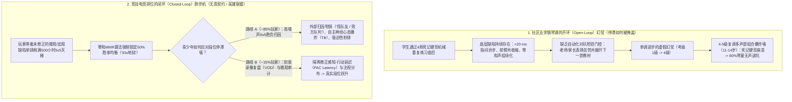
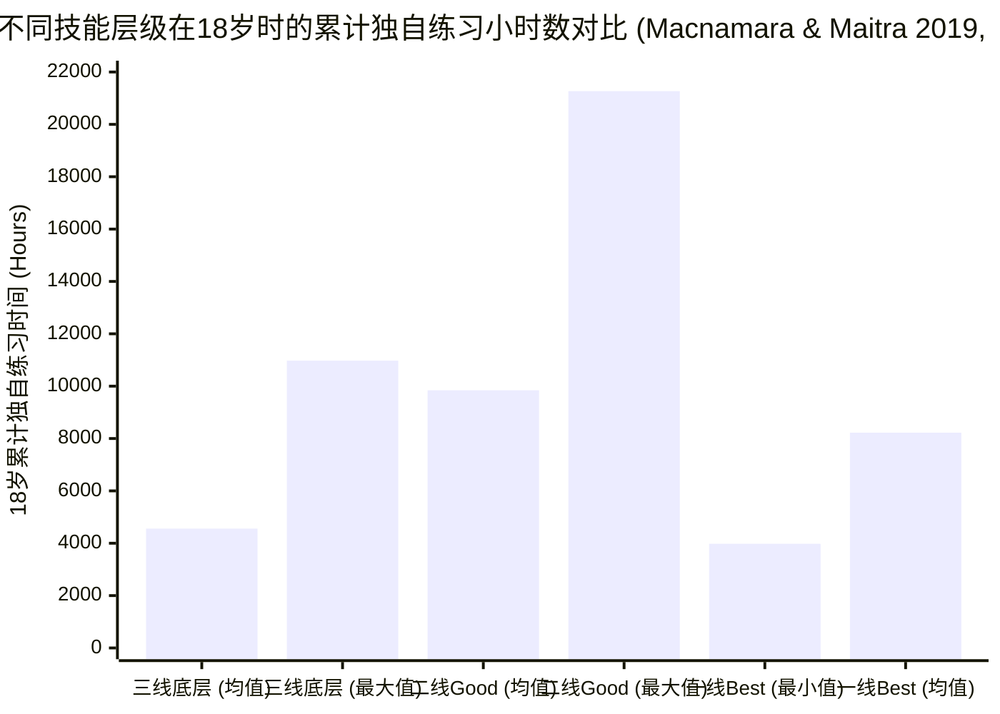
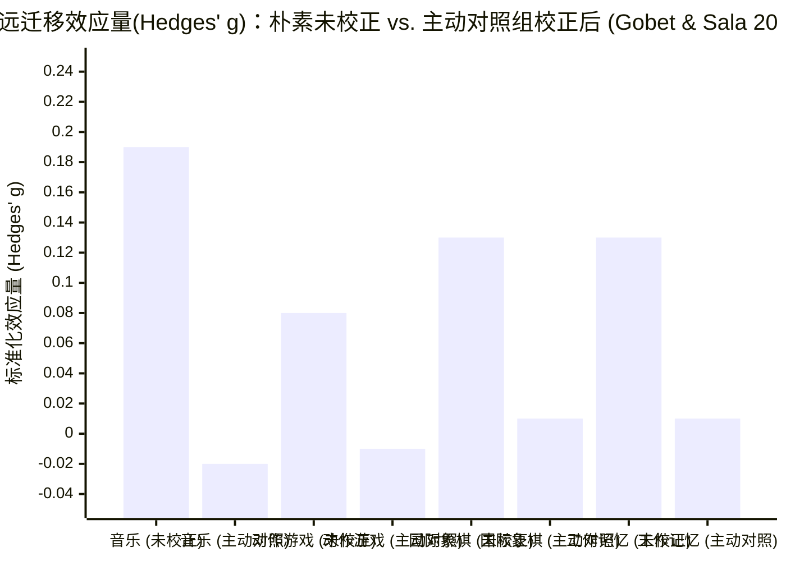

2026年10月18日，量化评论员 `alz`（`@alz_zyd_`）在 X 平台上发布了一条极具挑衅性的推文串（`67.8万`次浏览，`501`个赞，`136`次收藏），正面炮轰儿童教育中最神圣不可侵犯的传统项目——**古典钢琴**，并声称像***《无畏契约》（Valorant）***或***《英雄联盟》（League of Legends）***这样的竞技类多人电子游戏，才是更接近“真实生活（real life）”的训练场：

> **alz (`@alz_zyd_`, 2026年10月18日):**
> “古典钢琴对孩子来说是一种极其糟糕的活动，因为它太容易了。你根本不会真正卡住（get stuck）。只要你投入时间，就能取得相当稳定的进步。但真实生活根本不是这样运作的。”
> ("Classical piano is a uniquely bad activity for kids because it is too easy. you can't really get stuck. as long as you put the hours in, you will make reasonably consistent progress. this is not how real life works")

> **alz (`@alz_zyd_`, 2026年10月18日):**
> “像《无畏契约》或《英雄联盟》这样的电子游戏更接近真实生活。你会困在‘Elo地狱（Elo hell）’里。当然，这是技术问题（skill issue）；你投入了大量时间，却毫无长进，因为你有一些根本性的弱点没有去修正，所以你的Elo分数不会变。”
> ("videogames, like valorant or league of legends, are closer to real life. you can get stuck in elo hell. of course, this is a skill issue; you are putting the hours in, but you are not improving, you have some fundamental weaknesses you're not fixing, so your elo doesn't change")

> **alz (`@alz_zyd_`, 2026年10月18日):**
> “古典钢琴里没有Elo地狱。它是一个单人游戏，而且是一个相对简单的单人游戏。你花几个星期学会一首曲子，然后接着练下一首。随着时间推移，你学习更难的曲子，学得稍微快一点，但你永远不会真正卡住。”
> ("there is no elo hell in classical piano. it is a one-player game, and a comparatively easy one. you spend a few weeks, you learn a piece. you move on to the next one. as time passes you learn harder pieces and learn them slightly faster. but you never really get stuck")

> **Anatoly Karp (`@akarp`, 2026年10月18日):**
> “不就是在正确的时间按下正确的琴键嘛！”
> ("it's just pressing the right keys at the right time!")

> **alz (`@alz_zyd_`, 2026年10月18日):**
> “那还不如直接去玩《节奏光剑》（Beat Saber）。”
> ("might as well just play beat saber")

初看之下，很容易把 `@alz_zyd_` 的言论当成针对音乐学院师生和中产家长的“引战帖（rage-bait）”一笑了之。任何尝试弹奏过贝多芬《槌子键琴奏鸣曲》（Op. 106）、肖邦《升g小调练习曲》（Op. 25, No. 6，“双三度”）或拉威尔《夜之幽灵》的人都知道，把古典钢琴曲目称为“太容易”或等同于《节奏光剑》，完全违背了生物力学常识。

然而，如果仅仅停留在情绪化的反驳，就会错失 `@alz_zyd_` 批判背后隐藏的一个极其犀利的**结构性诊断**：**向90%琴童传授的业余古典钢琴教育，确实缺乏一个客观、对抗性的闭环反馈机制（adversarial feedback loop）**。在《无畏契约》、《英雄联盟》或国际棋联（FIDE）等级分象棋中，如果一名玩家带着错误的习惯盲目刷上500个小时，匹配等级分算法（`Elo` / `Glicko-2` / `MMR`）会无情地将其钉死在胜率 `50%` 的白银二段位（“Elo地狱”），绝不允许其晋级。相反，在社区儿童钢琴课上，一个孩子可以用僵硬的手腕、混乱的声部进行和错误的踏板把一首三级曲目磕磕绊绊地弹上四周，在汇报演出上收获礼貌的掌声，然后下周二照样翻开四级教材“往下学新曲子”——这种**翻书式的线性进度幻觉**，掩盖了深层的神经运动与音乐认知停滞。

为了将真正的认知科学与博眼球的逆向夸张严格区分开来，本文执行我们的**8阶段“淘金式（Panning for Gold）”深度调查运行手册**（将 M. Neil Browne 与 Stuart M. Keeley 的《学会提问》批判性思维框架操作化）。我们将 `@alz_zyd_` 的论断与神经运动生物力学（[Kuromiya, Kobayashi, Hirano & Furuya 2025, *PNAS*](https://pmc.ncbi.nlm.nih.gov/articles/PMC12501180/)；[Kimoto, Hirano & Furuya 2025, *Communications Biology*](https://pmc.ncbi.nlm.nih.gov/articles/PMC11761348/)；[Hirano, Kimoto, Shiotani & Furuya 2025, *Journal of Neuroscience*](https://pmc.ncbi.nlm.nih.gov/articles/PMC11841757/)）、双盲刻意练习重复验证研究（[Macnamara & Maitra 2019, *Royal Society Open Science*](https://pmc.ncbi.nlm.nih.gov/articles/PMC6731745/)）、大规模双胞胎遗传度模型（[Mosing, Verweij, Hambrick, Pedersen & Ullén 2024](https://pmc.ncbi.nlm.nih.gov/articles/PMC11433073/)；[Wesseldijk, Mosing & Ullén 2024](https://pmc.ncbi.nlm.nih.gov/articles/PMC11292230/)）、竞技电竞遥测数据（[Thompson, Blair, Chen & Henrey 2013, *PLOS ONE*](https://pmc.ncbi.nlm.nih.gov/articles/PMC3776738/)；[Jeong, Kudo, Kaneko & Nakazawa 2024, *PLOS ONE*](https://pmc.ncbi.nlm.nih.gov/articles/PMC10760684/)；[Lachowicz et al. 2026](https://pmc.ncbi.nlm.nih.gov/articles/PMC13413716/)）以及二阶认知远迁移元分析（[Sala & Gobet 2020](https://pmc.ncbi.nlm.nih.gov/articles/PMC7683441/)；[Gobet & Sala 2023](https://pmc.ncbi.nlm.nih.gov/articles/PMC9903001/)）的一手实证数据进行交叉审视。

---

## 第一阶段：议题分类与边界界定 (Phase 1: Issue Classification & Boundary Framing)

为了避免将*业余琴童汇报演出*与*专家级感觉运动控制*混为一谈，或将*排位赛段位停滞*等同于*真实世界问题解决能力*，我们将 `@alz_zyd_` 的命题拆解为两个**描述性（Descriptive：机制与实证事实）**问题和一个**规范性（Prescriptive：教育与训练架构设计）**问题：

1. **描述性议题 A（古典钢琴的神经运动物理学与平台期结构）：** 在古典音乐中堆积练习小时数是否真的能保证单调递增的技能进步（`∂Skill / ∂Hours > 0`），还是学习者会撞上坚硬的**神经运动技能天花板（expertise ceiling）**、遗传极限墙以及适应不良的皮层可塑性瓶颈（包括音乐家局灶性肌张力障碍）？此外，原声钢琴的触键（touch）在物理上能否简化为二进制按键计时（《节奏光剑》）？
2. **描述性议题 B（竞技电竞“Elo地狱”的认识论 vs. “真实生活”）：** 为什么竞技多人天梯（《无畏契约》、《英雄联盟》、《星际争霸 II》）会产生显性的段位停滞（“Elo地狱”）？盲目单排5v5天梯是否真能教会孩子诊断并修正自身根本弱点？古典钢琴或竞技电子游戏中的任何一个，能否产生向一般流体智力（`Gf`）或现实执行功能的远迁移（far transfer）？
3. **规范性议题 C（青少年技能习得组合架构）：** 鉴于封闭式技能（closed-skill）乐谱复现与可变比率强化（variable-ratio）电竞天梯各自的实证局限，家长和教育者应如何构建儿童技能训练体系，使孩子既能掌握深度的感觉运动精度，又能培养不确定性下的适应性决策能力？

### 可证伪性标准 (Falsifiability Criteria)
- **`@alz_zyd_` 的逆向命题（“古典钢琴没有Elo地狱；投入时间就能稳定进步；钢琴就像《节奏光剑》一样只是按时按键；《无畏契约》/《英雄联盟》更能教会孩子真实生活如何运作”）在以下条件下被证伪：**
  1. 受控实验室实验证明，即便受过长期训练的熟练钢琴家，如果只是单纯“投入时间重复练习（repetition training）”，也会撞上错误率毫无显著下降的**技能天花板（`P > 0.05`）**，唯有引入亚10毫秒（`<10 ms`）精度的生物力学动作分解与误差视觉反馈才能打破该天花板（[Kimoto, Hirano & Furuya 2025](https://pmc.ncbi.nlm.nih.gov/articles/PMC11761348/)）。
  2. 双盲音乐学院重复实验与双胞胎登记队列（`N = 6,471`名双胞胎）证明，累计练习时间仅能解释 **`21%–26%` 的演奏表现方差**，二线（“Good”）演奏者累计投入的练习时间（18岁前高达 `21,268小时`）反而经常多于顶级独奏家（“Best”，低至 `3,978小时`），且随着练习时间增加，遗传度（`h² ≈ 50%`）不仅不会消失，反而**单调上升**（[Macnamara & Maitra 2019](https://pmc.ncbi.nlm.nih.gov/articles/PMC6731745/)；[Mosing et al. 2024](https://pmc.ncbi.nlm.nih.gov/articles/PMC11433073/)）。
  3. 高速（`1,000 Hz`）非接触式光学传感实验证明，钢琴音色受多关节加速度、擒纵（escapement）速度与释键轨迹等连续运动学特征控制，且音乐家与非音乐家听众均能显著分辨这些音色差异（[Kuromiya et al. 2025](https://pmc.ncbi.nlm.nih.gov/articles/PMC12501180/)）。
  4. 涵盖超过 `20,000名` 受试者的二阶元分析证明，与主动对照组（active control）相比，**动作电子游戏训练（`g = -0.01`）**与**音乐训练（`g = -0.02`）**对一般认知能力的**远迁移效应均为零（`g = 0.00, σ² = 0`）**（[Gobet & Sala 2023](https://pmc.ncbi.nlm.nih.gov/articles/PMC9903001/)）。
- **传统的“虎妈/虎爸”钢琴教条（“每天逼孩子练2小时古典钢琴能提高智商、数学成绩与人生竞争力”）在以下条件下被证伪：**
  1. 随机分配且含主动对照组的多水平元分析（`m = 54`项研究，`N = 6,984`名儿童）显示，儿童音乐训练对数学、读写、流体智力和工作记忆的远迁移效应完全为零（`g = -0.021, p = 0.558, BF_g = 0.063`）（[Sala & Gobet 2020](https://pmc.ncbi.nlm.nih.gov/articles/PMC7683441/)）。
  2. 传统照谱宣科式的钢琴教学作为一种**封闭式、静态、无对抗反馈的环境**运作，翻换考级教材与客观的误差诊断、视奏流畅度或即兴创编能力完全脱节。

---

## 第二阶段：一手文献发掘与双栏主张裂痕矩阵 (Phase 2: Primary Source Excavation & The 2-Column Claim Schism Matrix)

我们将 `@alz_zyd_` 和 `@akarp` 的病毒式论断与涵盖运动神经科学、心理测量学、行为遗传学及电竞遥测领域的17篇同行评审一手文献进行了全面核对。以下的**双栏主张裂痕矩阵（2-Column Claim Schism Matrix）**揭示了社交媒体直觉与实验室实证现实之间的七处直接事实反转：

| 审计维度 | 社交媒体病毒式主张 (`@alz_zyd_` & `@akarp`, 2026-10-18) | 一手实证与生物物理现实 (同行评审学术文献) |
| :--- | :--- | :--- |
| **1. 时间投入与技能进步的线性关系（“只要投入时间就能稳定进步”）** | *“只要你投入时间，就能取得相当稳定的进步……你永远不会真正卡住。”* | 在 **Macnamara & Maitra (2019, [`PMC6731745`](https://pmc.ncbi.nlm.nih.gov/articles/PMC6731745/))** 对 Ericsson et al. (1993) 的双盲重复研究中，18岁前的累计独自练习时间仅能解释 **`26%` 的表现方差（`η² = 0.26`）**。关键在于，**二线（“Good”）演奏者的累计练习时间（均值 `M = 9,844小时`，范围 `3,120–21,268小时`；当前每周 `30.65小时`）反而高于一线（“Best”）顶级独奏家（均值 `M = 8,224小时`，范围 `3,978–14,664小时`；当前每周 `22.69小时`，`p = 0.024, d = -1.03`）**，且最低档（“Less accomplished”）学生中有人练满 **`10,972小时`** 仍滞留在底层。 |
| **2. 古典钢琴是否存在“Elo地狱” / 技能天花板** | *“古典钢琴里没有Elo地狱。它是一个单人游戏，而且是一个相对简单的单人游戏。”* | 在 **Kimoto, Hirano & Furuya (2025, *Communications Biology*, [`PMC11761348`](https://pmc.ncbi.nlm.nih.gov/articles/PMC11761348/))** 中，研究者测试了 `N = 60` 名自幼受训的熟练钢琴家演奏肖邦练习曲 Op. 25, No. 6（“双三度”）。**传统重复练习组（`n = 12`）撞上了坚硬的技能天花板，前后测按键错误率无显著下降（`GLME χ² = 3.1, P = 0.08`）**。甚至**无毫秒级视觉反馈的分解练习组（`no-FB`, `n = 12`）也毫无进步**。唯有同时接受**动作分解 + `<10 ms` 视觉时序误差反馈的熟练组（`skilled FB`, `n = 12`）**成功突破了天花板（`χ² = 6.8, P = 0.03; z = -2.7, P < 0.01`）。 |
| **3. 将钢琴触键简化为二进制按键计时（“还不如玩《节奏光剑》”）** | `@akarp`：*“不就是在正确的时间按下正确的琴键嘛！”* / `@alz_zyd_`：*“还不如直接去玩《节奏光剑》。”* | 在 **Kuromiya, Kobayashi, Hirano & Furuya (2025, *PNAS*, [`PMC12501180`](https://pmc.ncbi.nlm.nih.gov/articles/PMC12501180/))** 中，`1,000 Hz` 非接触式光学传感证明钢琴家通过调控 **5项连续触键运动学特征**（`vel_escapement`、`acc_escapement`、`acc_mute`、`overlap`、`IKI`）来塑造感知音色的三大正交维度：**重量感（Weight: `χ²(2) = 26.58, P = 1.70 × 10⁻⁶`）**、**清晰度（Clarity: `χ²(2) = 15.51, P = 4.29 × 10⁻⁴`）**与**明亮度（Brightness: `χ²(2) = 12.97, P = 0.002`）**，且钢琴家与非音乐家听众均能可靠辨别（`P < 0.0001`）。 |
| **4. 高强度练习下的遗传天花板与遗传度演变** | 默认古典钢琴是纯粹的机械堆时间，练习时长可以抹平先天差异。 | 在 **Mosing, Verweij, Hambrick, Pedersen & Ullén (2024, [`PMC11433073`](https://pmc.ncbi.nlm.nih.gov/articles/PMC11433073/))**（`N = 6,471`名瑞典双胞胎，含 `1,302`对完整双胞胎）中，遗传因素解释了音乐专长方差的 **`50%`（`95% CI [35%, 67%]`）**。随着终身练习时间增加（高达 `23,920小时`），残差环境方差（`E`）显著缩小（`Δχ² = 7.54, p = 0.02`），而绝对遗传方差（`A`）保持稳定——这意味着**练习时间越长，相对遗传度（`h²`）反而越高**。此外，**Wesseldijk, Mosing & Ullén (2024, [`PMC11292230`](https://pmc.ncbi.nlm.nih.gov/articles/PMC11292230/))**（`N ≈ 3,800`）证实了显著的**基因 × 环境（`G × E`）交互作用**，即认知多基因评分（`PGScp`）越高的人，单位练习时间的技能收益越大。 |
| **5. 为什么琴童看似“每隔几周就能学会一首新曲子”** | *“你花几个星期学会一首曲子，然后接着练下一首……你永远不会真正卡住。”* | 将**教材翻页进度（curriculum advance）**与**真实技能习得（skill acquisition）**混为一谈。由于业余钢琴课没有自动化的排位守门算法，即便学生存在 `>20 ms` 的手指异步误差、毫无和声分析能力，且其死记硬背的运动组块在组块边界（chunk junctions）极易受感官干扰而崩溃（[Shih, Hirano & Furuya 2026, *iScience*, `PMC12816802`](https://pmc.ncbi.nlm.nih.gov/articles/PMC12816802/)），老师依然会允许他“换下一首新曲子”。一旦到了英皇（ABRSM）4–5级（`11–14岁`）的多声部复调阶段，死记硬背撞上组合爆炸墙，`70%–85%` 的琴童便在无声的“Elo地狱”中弃琴。 |
| **6. 竞技电竞（“无畏契约 / 英雄联盟 Elo地狱”）作为“真实生活”的镜像** | *“像《无畏契约》或《英雄联盟》这样的电子游戏更接近真实生活。你会困在Elo地狱里……因为你有根本弱点没修正。”* | 尽管 **Thompson et al. (2013, *PLOS ONE*, [`PMC3776738`](https://pmc.ncbi.nlm.nih.gov/articles/PMC3776738/))**（横跨7个联赛的 `N = 3,360`名玩家）与 **Jeong et al. (2024, *PLOS ONE*, [`PMC10760684`](https://pmc.ncbi.nlm.nih.gov/articles/PMC10760684/))** 证实攀登电竞天梯需要非单调地切换认知-运动优先级（从青铜段的快捷键习惯转向白金/大师段的感知-行动周期延迟 `Action Latency` 及《英雄联盟》中的宽水平注视分布），但 **Lachowicz et al. (2026, [`PMC13413716`](https://pmc.ncbi.nlm.nih.gov/articles/PMC13413716/))**（涵盖 `48`项研究）表明，5v5排位天梯会引发慢性认知过载、自主神经应激、“心态爆炸（tilt）”以及因9名其他玩家干扰胜负归因而产生的甩锅心理。 |
| **7. 向“真实生活”认知能力（`Gf`、学业与执行功能）的远迁移** | 预设竞技电子游戏比古典钢琴更能训练适应真实生活的解决问题能力。 | **两项活动均未能通过远迁移（Far Transfer）检验。** 在 **Sala & Gobet (2020, [`PMC7683441`](https://pmc.ncbi.nlm.nih.gov/articles/PMC7683441/))** 的多水平元分析（`m = 54`项研究，`N = 6,984`名儿童）中，音乐训练对比主动对照组的效应量为 **`g = -0.021`（`95% CI [-0.109, 0.068], p = 0.558, I² = 0%, BF_g = 0.063`）**。在 **Gobet & Sala (2023, [`PMC9903001`](https://pmc.ncbi.nlm.nih.gov/articles/PMC9903001/))** 涵盖所有认知训练领域的二阶元分析中，**动作电子游戏（`k = 34`, `g = -0.01`）**与**音乐（`k = 17`, `g = -0.02`）**一致收敛于 **二阶总均值 `g = 0.00`（`σ² = 0`）**。 |

---

## 第三阶段：语义精确性、替换测试与88键钢琴 vs.《节奏光剑》的生物力学 (Phase 3: Semantic Precision, The Substitution Test & Biomechanics)

### 1. 对核心歧义词的替换测试 (The Substitution Test)
运用 Browne 与 Keeley 的**替换测试（Substitution Test）**（《学会提问》第4章），可以清晰地看到 `@alz_zyd_` 的论证建立在三个概念偷换（equivocation）之上：

1. **概念偷换 1：“学会一首曲子 / 取得进步”（死记硬背的按键复现 vs. 结构性与生物力学精通）**
   - *定义 A（宽松标准 / 社区儿童汇报演出标准）：* 靠死记硬背把一首2分钟曲子的按键顺序背下来，以原速70%的速度、不稳的节奏和浑浊的踏板磕磕绊绊弹完，完全不具备移调、视奏或忘谱后从中途接上的能力。
   - *定义 B（严格标准 / 心理运动与音乐学标准）：* 在原速下以 `<10 ms` 的指间同步精度执行多声部复调（[Kimoto et al. 2025](https://pmc.ncbi.nlm.nih.gov/articles/PMC11761348/)），通过差异化擒纵速度实现声部间的音色分层（[Kuromiya et al. 2025](https://pmc.ncbi.nlm.nih.gov/articles/PMC12501180/)），最小化前臂外在屈肌/伸肌的共收缩（[Furuya & Altenmüller 2013](https://pmc.ncbi.nlm.nih.gov/articles/PMC3712142/)），并建立起在组块边界遭受感官干扰时仍不会崩溃的深层和声结构编码（[Shih, Hirano & Furuya 2026](https://pmc.ncbi.nlm.nih.gov/articles/PMC12816802/)）。
   - *替换测试裁决：* `@alz_zyd_` 所谓*“花几个星期学会一首曲子，然后接着练下一首”*的说法**仅在定义 A 下成立**——这完全等价于一名《英雄联盟》玩家从不打排位赛，只是每周换一个新英雄在“人机对战（入门难度）”里按了两周技能，就宣布自己“学会了这个英雄并开始练下一个”！
2. **概念偷换 2：“卡住 / Elo地狱”（显性算法积分停滞 vs. 隐性能力渐近线）**
   - *定义 A（显性算法积分停滞）：* 零和服务器分配的数值化匹配积分（`MMR` / `Elo`）在投入 `N` 小时后不再上升。
   - *定义 B（底层神经运动或认知渐近线）：* 进入额外投入练习时间不再带来错误率显著下降或执行复杂度提升的平台期（`∂Performance / ∂Hours ≈ 0`）。
   - *替换测试裁决：* 周二下午的钢琴琴房里没有一台实时计算*定义 A* 的中央服务器，这让 `@alz_zyd_` 误以为钢琴里根本不存在*定义 B*。然而当通过实验室光学遥测（[Kimoto et al. 2025](https://pmc.ncbi.nlm.nih.gov/articles/PMC11761348/)）或音乐学院双盲评审（[Macnamara & Maitra 2019](https://pmc.ncbi.nlm.nih.gov/articles/PMC6731745/)）进行客观测量时，钢琴领域的*定义 B* 平台期无处不在且极其残酷。
3. **概念偷换 3：“真实生活是如何运作的”（零和匹配游戏 vs. 险恶的开放式环境）**
   - 根据心理学家 Robin Hogarth (2001) 以及 **Daniel Kahneman 与 Gary Klein (2009, *American Psychologist*, `PMID: 19739881`)** 著名的对抗性合作研究，学习环境分布在从**友善环境（Kind Environment：高有效性、规则恒定、反馈迅速且明确）**到**险恶环境（Wicked Environment：低有效性、非平稳规则、反馈延迟/充满噪声）**的光谱上。
   - 讽刺的是，与成年人的“真实生活”（创业、科学研究、宏观投资、组织管理）相比，**古典钢琴与《无畏契约》/《英雄联盟》都属于人为划定边界、规则高度固定的游戏**。在《无畏契约》中，地图几何结构、枪械后坐力模型、受击判定框以及13回合获胜条件均由拳头游戏（Riot Games）锁死，每35分钟就会弹出一个非黑即白的 `胜利 / 失败` 结算界面。而在真实生活中，没有裁判，没有保证50%胜率的匹配平衡器，甚至往往连续数年都没有任何反馈告诉你是不是选错了赛道。

### 2. 生物力学与信息论审计：为什么钢琴绝不是《节奏光剑》
当 `@akarp` 调侃*“不就是在正确的时间按下正确的琴键嘛！”*而 `@alz_zyd_` 附和*“还不如直接去玩《节奏光剑》”*时，他们重蹈了19世纪还原论谬误的覆辙，而这一谬误早已被现代神经运动生理学彻底推翻。

让我们对**音乐会古典钢琴**、***《节奏光剑》（Expert+ 模式）***以及***《无畏契约》/《英雄联盟》***的物理、生物力学与信息论自由度（Degrees of Freedom, `DOF`）进行精确的定量对比：

| 生物力学与认知维度 | 古典钢琴（音乐会曲目，如肖邦 Op. 25 No. 6 / 贝多芬 Op. 106） | 《节奏光剑》（VR节奏游戏，Expert+ 模式） | 《无畏契约》 / 《英雄联盟》（竞技排位电子竞技） |
| :--- | :--- | :--- | :--- |
| **独立效应器数量与运动自由度（`DOF`）** | **10根独立手指 + 2个手腕 + 2个手肘 + 2个肩膀 + 3个踏板（`>30个运动学DOF`）**在 `88` 个配重琴键（静态下沉阻力 `~50 g`，随惯性动态激增）上同时协同。 | 双手握持 **2个 6-DOF 手柄**，主要依靠双侧肩/肘/腕大肌群挥动（总效应器仅 `2` 个；单指独立性要求为 `0`）。 | **左手（`4–6`个离散二进制键盘微动开关）** + **右手（`2D`平面鼠标平移 + `2`个二进制微动点击开关）**。 |
| **解剖学与神经耦合约束** | 极强的外周与皮层耦合约束：第3、4（无名指）、5指共享指总伸肌（*extensor digitorum communis*）的**腱间结合（*juncturae tendinum*）**，且在初级躯体感觉皮层（`S1`）和运动皮层（`M1`）表征高度重叠，必须依赖主动的**成对脉冲躯体感觉 GABA能抑制**才能实现手指分化（[Hirano et al. 2025, `PMC11841757`](https://pmc.ncbi.nlm.nih.gov/articles/PMC11841757/)）。 | 生物力学耦合约束极小：左右手臂独立挥舞，无肌腱牵连束缚。 | 生物力学牵连极低：键盘按键（`Q/W/E/R` 或 `W/A/S/D`）仅用3根手指敲击固定键程、无力度感应的二进制开关。 |
| **时间精度与同步窗口** | **`<5 至 10 ms` 的键间同步误差阈值**（[Kimoto et al. 2025, `PMC11761348`](https://pmc.ncbi.nlm.nih.gov/articles/PMC11761348/)）。在复调声部分离中，利用差异化触键速度产生 **`20–30 ms` 的旋律超前（melody lead）**（[Goebl 2001](https://pmc.ncbi.nlm.nih.gov/articles/PMC3712142/)）。峰值音符密度高达 **`每秒15–20+个音符`（`900–1,200+ APM`）**。 | **`~100–150 ms` 碰撞箱判定窗口**；得分仅取决于挥砍弧度（砍前 `100°`、砍后 `60°`）与中心接近度（`15`分）（`每秒 ~8–12 个方块`）。 | **`~15–50 ms` 视动反应时差**；《星际争霸 II》/《英雄联盟》平均 `APM = 117.05`（`SD = 51.95`，职业选手峰值 `300–400 APM`，[Thompson et al. 2013, `PMC3776738`](https://pmc.ncbi.nlm.nih.gov/articles/PMC3776738/)）。 |
| **连续力度、速度与音色（Timbre）雕琢** | **连续模拟机械擒纵机构（escapement）**：如 **Kuromiya, Kobayashi, Hirano & Furuya (2025, *PNAS*, [`PMC12501180`](https://pmc.ncbi.nlm.nih.gov/articles/PMC12501180/))** 所证实，钢琴家通过控制 `1,000 Hz` 采样的 `5` 项连续琴键轨迹参数（`vel_escapement`、`acc_escapement`、`acc_mute`、`overlap`、`IKI`），在 `4` 个以上同时进行的复调声部中连续雕琢听觉**重量感**、**清晰度**与**明亮度**。 | **零力度/音色分明度（`0`）**：无论用力挥砍还是轻挥，预渲染的 `.ogg` 音频文件不会发生哪怕1比特的改变。 | **二进制开关触发**：无论以 `0.8 m/s` 还是 `0.2 m/s` 的速度按下 `Q` 键或鼠标左键，发出的数字技能或枪声完全一致。 |
| **环境不确定性与对抗非平稳性（Non-Stationarity）** | **确定性、完全可观测、平稳环境（Closed Skill）**：巴赫赋格的乐谱绝不会释放战争迷雾或反野你的野区（1850年后即兴传统被阉割）。 | **确定性、完全可观测、平稳环境（Closed Skill）**：每次游玩落下的音符谱面完全相同。 | **部分可观测、非平稳、对抗性多智能体 POMDP（Open Skill）**：战争迷雾、5名实时利用你习惯漏洞的人类对手，以及每两周一次的版本平衡补丁。 |

### 3. 2025年 *PNAS* 论文的实证：为什么“只要在正确时间按下琴键”在物理上是伪科学
一个多世纪以来，怀疑论者不断重复着与 `@akarp` 如出一辙的论调：当钢琴琴键下沉到距离键床呢毡约 `1.5–2.0 mm` 的**擒纵点（escapement point）**时，榔头便与顶杆（jack）脱离并呈自由飞行状态撞击琴弦，因此演奏者的“触键方式（touch）”除了改变音量（榔头最终速度）外，不可能改变音色（timbre）。

2025年9月，**Kuromiya Kaori、Kobayashi Yuya、Hirano Masato 与 Furuya Shinichi 团队（[*PNAS* 2025, `122(39): e2425073122`, `PMC12501180`](https://pmc.ncbi.nlm.nih.gov/articles/PMC12501180/)）**利用高分辨率（`1,000 Hz`）非接触式光学传感系统，精确追踪了钢琴家在表达七种不同音色意图（重量感：*轻盈* vs. *沉重*；清晰度：*清澈* vs. *模糊*；明亮度：*明亮* vs. *暗淡*；以及*机械*基准音）时的琴键垂直位移 `y(t)`、速度 `v(t) = dy/dt` 和加速度 `a(t) = d²y/dt²`，终结了这场百年争论：

1. **在完全剥离视觉线索的情况下，人类听众仍能可靠地感知音色意图：** 在双盲听觉实验（线性混合效应模型 `LME`）中，无论是专业钢琴家还是未受过音乐训练的普通听众，都在全部三个感知维度上显著区分出了演奏者所表达的音色：
   - **重量感（*Light* vs. *Heavy*）：** 组别 × 表达交互作用 `χ²(2) = 26.58, P = 1.70 × 10⁻⁶`（钢琴家听众 `t = -13.47, P < 0.0001`；非音乐家听众 `t = -6.18, P < 0.0001`）。
   - **清晰度（*Clear* vs. *Blurred*）：** `χ²(2) = 15.51, P = 4.29 × 10⁻⁴`（钢琴家 `t = -10.00, P < 0.0001`；非音乐家 `t = -6.08, P < 0.0001`）。
   - **明亮度（*Bright* vs. *Dark*）：** `χ²(2) = 12.97, P = 0.002`（钢琴家 `t = -10.00, P < 0.0001`；非音乐家 `t = -6.08, P < 0.0001`）。
2. **五项亚毫秒级运动学特征直接决定原声音色：** 回归分析与因果操纵实验证实，听众所感知的音色并非仅由“何时按下琴键”决定，而是受以下五项连续运动学变量支配：
   - **擒纵瞬间的琴键速度（`vel_escapement`）：** 重量感 `95% CI [0.391, 0.951]`；清晰度 `[-0.907, -0.314]`；明亮度 `[-1.195, -0.481]`。
   - **擒纵瞬间的琴键加速度（`acc_escapement`）：** 重量感 `95% CI [-0.308, -0.081]`；清晰度 `[0.003, 0.277]`——直接控制榔头木柄的弯曲振动（shaft flexing vibration）以及手指-琴键撞击瞬态噪声（`onset_noise` / `bottom_noise`）。
   - **释键 / 止音器压弦加速度（`acc_mute`）：** `95% CI [-0.535, -0.129]`——决定止音呢毡淬灭琴弦泛音列的速率。
   - **连续按键重叠时间（`overlap`，即前一音止音时刻与后一音擒纵时刻之差）：** 重量感 `95% CI [0.279, 0.619]`；清晰度 `[0.377, 0.778]`。
   - **双手间擒纵速度差（`Δvel_escapement`）与键间时间间隔（`IKI`）：** `95% CI [-0.347, -0.101]` 与 `[0.165, 0.395]`。

简言之，《节奏光剑》只是让玩家挥动两根塑料手柄穿过 `100 ms` 的空间判定框来触发预录好的音频文件；而古典钢琴要求演奏者通过10根解剖学上相互牵连的手指，在多声部机械擒纵与止音器释放的毫秒瞬间，精确控制位移的一阶与二阶时间导数（`dy/dt` 与 `d²y/dt²`）。

---

## 第四阶段：因果解耦与四向竞争原因矩阵 (Phase 4: Causal Disentanglement & The 4-Way Rival Cause Matrix)

为什么 `@alz_zyd_` 观察到学古典钢琴的孩子似乎*“只要投入时间就能稳定进步、从不卡住”*，而《无畏契约》或《英雄联盟》的玩家却频繁困在“Elo地狱”里？

在轻信 `@alz_zyd_` 的单一归因（*“因为古典钢琴本身太简单”*）之前，我们在**四向因果解耦矩阵（4-Way Causal Disentanglement Matrix）**中对四种竞争性因果假说进行严格检验：

| 因果假说 | 机制路径 | 一手实证与遥测证据 | 认识论裁决 |
| :--- | :--- | :--- | :--- |
| **1. 直接因果（`X -> Y`）：古典钢琴本身简单且呈线性回报** | 钢琴无需复杂的技能重构；只要堆叠练习时间，就能毫无平台期地线性攻克更难的曲目。 | **被实验室与音乐学院数据直接推翻：** 在 [Kimoto, Hirano & Furuya (2025, `PMC11761348`)](https://pmc.ncbi.nlm.nih.gov/articles/PMC11761348/) 中，单纯重复练习的熟练钢琴家撞上了无法逾越的天花板（`χ² = 3.1, P = 0.08`）。在 [Macnamara & Maitra (2019, `PMC6731745`)](https://pmc.ncbi.nlm.nih.gov/articles/PMC6731745/) 中，练习时间仅解释 `26%` 的方差，且二线演奏者在18岁前平均比一线独奏家*多*练了 `1,620小时`（`9,844 h` vs. `8,224 h`）。 | **实证证伪（Empirically Falsified）。** |
| **2. 反向因果与幸存者选择偏差（`Y -> X`）：早期淘汰与遗传自我筛选** | 在听觉、节奏或精细运动上遭遇严重瓶颈的孩子在学琴1–3年内便大量退坑；唯有具备高遗传倾向（`PGScp` / 听觉辨别遗传度 `h² = 50%`）的孩子才能坚持练习10年以上，从而给旁观者造成了“只要坚持练就能成才”的幸存者错觉。 | **得到双胞胎登记遗传学的强力支持：** 在 [Mosing et al. (2024, `PMC11433073`)](https://pmc.ncbi.nlm.nih.gov/articles/PMC11433073/)（`N = 6,471`名双胞胎）中，终身练琴时长本身具有高度遗传性（同卵双胞胎相关 `r_MZ = 0.64–0.68` vs. 异卵 `r_DZ = 0.44–0.61`；`h² = 41%–69%`），遗传多效性同时驱动了练琴意愿与音乐禀赋（`r = 0.36, p < 0.0001`）。在 [Wesseldijk et al. (2024, `PMC11292230`)](https://pmc.ncbi.nlm.nih.gov/articles/PMC11292230/) 中，高认知多基因评分（`PGScp`）显著放大了每小时练习的技能产出率（`G × E`）。 | **`@alz_zyd_` 忽略的核心混杂因素（幸存者偏差 + 遗传多效性）。** |
| **3. 混杂测量架构（`Z -> X & Y`）：无校准翻书进度 vs. 零和匹配天梯（`Elo`）** | 在竞技电竞（《无畏契约》/《英雄联盟》）中，中心化零和服务器在每局赛后更新你的百分位段位（`MMR`）；若你的进步速度等于总体均值或停滞，你的可见段位就会纹丝不动（“Elo地狱”）。而在业余琴童教学中，没有连续的零和百分位计分板：4周后从曲目A换到曲目B只是**老师的日历决定**，哪怕学生的真实感觉运动精度（`<10 ms`同步率、视奏、声部分离）早已完全停滞！ | 得到 [Kimoto et al. (2025, `PMC11761348`)](https://pmc.ncbi.nlm.nih.gov/articles/PMC11761348/)（若无外部 `<10 ms` 视觉遥测反馈，钢琴家仅凭自身触觉/听觉根本无法察觉或修正 `10–20 ms` 的四指同步误差，`no-FB`组 `P > 0.05`）及 [Shih, Hirano & Furuya (2026, `PMC12816802`)](https://pmc.ncbi.nlm.nih.gov/articles/PMC12816802/)（死记硬背掩盖了脆弱的组块衔接边界）的直接证实。 | **解释 `@alz_zyd_` 观察现象的首要结构性原因。** |
| **4. 双向恶性反馈循环（`X <-> Y`）：盲目苦练诱发生物力学共收缩与皮层融合** | 当钢琴学生试图靠手指内在肌屈伸而非近端手肘旋前-旋后（pronation-supination）硬砸快速乐段（“只管堆时间”）时（[Furuya & Altenmüller 2013, `PMC3712142`](https://pmc.ncbi.nlm.nih.gov/articles/PMC3712142/)），拮抗肌共收缩加剧僵硬 -> 时序误差扩大 -> 触发更用力的代偿性砸键 -> 诱发 `S1`/`M1` 皮层表征融合或**音乐家手部局灶性肌张力障碍（`MHD`）**（[Doll-Lee et al. 2026, `PMC12829447`](https://pmc.ncbi.nlm.nih.gov/articles/PMC12829447/)）。 | 在 [Furuya & Altenmüller (2013, `PMC3712142`)](https://pmc.ncbi.nlm.nih.gov/articles/PMC3712142/) 与 [Doll-Lee et al. (2026, `PMC12829447`, `N = 357`)](https://pmc.ncbi.nlm.nih.gov/articles/PMC12829447/) 中，`1%–2%` 的职业钢琴家罹患终结职业生涯的局灶性手部肌张力障碍（[Oku et al. 2024, `PMC11250081`](https://pmc.ncbi.nlm.nih.gov/articles/PMC11250081/) 视频诊断特异度达 `90%`）——此时*越*堆叠重复练习时间，多指运动控制能力反而崩溃得*越*快。 | **致命的病理性反馈回路（盲目练习的负收益）。** |

---

## 第五阶段：定量审计——解构刻意练习、双胞胎遗传度、Elo归因信噪比与远迁移 (Phase 5: Quantitative Audit)

### 1. 刻意练习（Deliberate Practice）重复实验审计（`PMC6731745`）：堆时间真能保证进步吗？
认为音乐精通只是投入练习时间的简单线性函数（“一万小时定律”）的流行观念，源于 K. Anders Ericsson、Ralf Th. Krampe 与 Clemens Tesch-Römer (1993) 对柏林艺术大学小提琴家和钢琴家的研究。然而，Ericsson et al. (1993) 并未采用双盲访谈，没有报告标准差（`SD`）、95%置信区间（`95% CI`）或极差范围（`Range`），且在两组对比中使用了全样本自由度的异常方差分析。

当 **Brooke N. Macnamara 与 Megha Maitra (2019, *Royal Society Open Science*, [`PMC6731745`](https://pmc.ncbi.nlm.nih.gov/articles/PMC6731745/))** 采用**严格的双盲实验设计**（`N = 39`，每个技能层级 `13` 人）重复 Ericsson et al. (1993) 并公布完整分布指标（均值、`95% CI` 与 `Range`）时，练习时间与技能水平单调对应的神话彻底破产：

| 测量指标 / 练习变量 | 最佳小提琴家 (Best / 一线独奏级, `n = 13`) | 优秀小提琴家 (Good / 二线层级, `n = 13`) | 成就较低组 (Less Accomplished / 三线层级, `n = 13`) | 总体与成对统计审计 ([Macnamara & Maitra 2019, `PMC6731745`](https://pmc.ncbi.nlm.nih.gov/articles/PMC6731745/)) |
| :--- | :---: | :---: | :---: | :--- |
| **Ericsson et al. (1993) 非双盲18岁前累计独自练习均值** | `7,410 h`（未报告 `SD` / 范围） | `5,301 h`（未报告 `SD` / 范围） | `3,420 h`（未报告 `SD` / 范围） | 在不报告方差与极差的情况下，利用全样本自由度宣称练习量与技能层级“完全对应（`p < 0.05`）”。 |
| **Macnamara & Maitra (2019) 双盲18岁前累计独自练习（`均值` & `95% CI`）** | **`8,224 h`** (`[6,400, 10,048]`) | **`9,844 h`** (`[6,937, 12,751]`) | **`4,558 h`** (`[3,264, 5,851]`) | 总体 `χ²(2) = 13.90, p = 0.001, η² = 0.26`（仅解释 `26%` 方差）。**一线（Best）vs. 二线（Good）方向完全反转且不显著：`t(24) = -0.93, p = 0.364, d = -0.38`！** |
| **18岁前累计独自练习（`完整极差范围`：最小–最大小时数）** | **`3,978 – 14,664 h`** | **`3,120 – 21,268 h`** | **`2,522 – 10,972 h`** | 惊人的分布重叠：二线（“Good”）中练习最多者（`21,268 h`）投入的时间是一线（“Best”）练习最少者（`3,978 h`）的 **`5.35倍`**；而三线底层组中竟有人在18岁前练了 **`10,972小时`**（超过一万小时！）却依然垫底！ |
| **18岁前累计教师指导设计练习（`均值`, `95% CI` & `范围`）** | **`6,251 h`** (`[4,293, 8,210]`, 范围 `2,720–14,352`) | **`6,821 h`** (`[4,482, 9,160]`, 范围 `2,236–14,612`) | **`2,799 h`** (`[1,862, 3,735]`, 范围 `455–6,032`) | 总体 `χ²(2) = 10.74, p = 0.005, η² = 0.23`（解释 `23%` 方差）。**一线 vs. 二线：`t(24) = -0.37, p = 0.717, d = -0.15`（二线均值同样高于一线）。** |
| **当前每周独自练习时间（`小时 / 周`）** | **`22.69 h/wk`** (`[17.65, 27.74]`, 范围 `8.0–40.0`) | **`30.65 h/wk`** (`[27.04, 34.27]`, 范围 `20.0–45.5`) | **`9.58 h/wk`** (`[6.55, 12.61]`, 范围 `2.0–18.0`) | 总体 `F(2,36) = 27.36, p < 0.001, η² = 0.60`。**二线（Good）演奏者每周独自练习时间显著多于一线（Best）独奏家（`p = 0.024, d = -1.03`）！** |
| **成功入围/获奖的音乐比赛次数（`均值` & `范围`）** | **`13.31次`** (`[8.25, 18.37]`, 范围 `1–35`) | **`8.69次`** (`[5.79, 11.60]`, 范围 `0–20`) | **`3.23次`** (`[0.73, 5.73]`, 范围 `0–12`) | 总体 `F(2,36) = 7.27, p = 0.002, η² = 0.29`。尽管一线独奏家的每周与累计练习时长均少于二线选手，但其比赛获奖纪录却大幅领先。 |

请仔细审视 **Macnamara & Maitra (2019, [`PMC6731745`](https://pmc.ncbi.nlm.nih.gov/articles/PMC6731745/))** 中的极差（Range）统计量（这与 Macnamara, Hambrick & Oswald 2014 跨领域元分析的结果完全吻合——刻意练习仅能解释音乐表现方差的 `21%`、游戏 `26%`、体育 `18%`、教育 `4%`、职业工作 `<1%`）：
- 一名在 **18岁前累计苦练了 `21,268小时`**（相当于连续16年全年无休每天练琴 `~3.6小时`）的音乐学院学生被困在二线（“Good”）层级，另一名 **18岁前练了 `10,972小时`** 的学生被困在最低的三线（“Less Accomplished”）层级——而一名顶级独奏家仅用 **`3,978小时`** 就跻身一线（“Best”）层级。
- 这就是**古典音乐界如假包换的“Elo地狱”**：每周苦练 `30.65小时`、累计投入 `10,000至21,000+小时`，却依然无法突破通往顶级独奏家的百分位壁垒！

### 2. 行为遗传学方程（`PMC11433073` & `PMC11292230`）：为什么练习越多，遗传度（Heritability）反而越高？
为什么有些古典音乐家苦练 `10,000+小时` 仍陷入停滞，而另一些人仅用 `4,000小时` 就实现超越？2024年，**Miriam A. Mosing、Karin J. H. Verweij、David Z. Hambrick、Nancy L. Pedersen 与 Fredrik Ullén 团队（[`PMC11433073`](https://pmc.ncbi.nlm.nih.gov/articles/PMC11433073/)）**在 **`N = 6,471` 名瑞典双胞胎**（含 `1,302` 对完整双胞胎，终身练习时长跨度 `0 至 23,920小时`）中检验了刻意练习理论的核心预测：*长期的练习是否能绕过基因差异、降低音乐专长的遗传度？*

在终身练习小时数 `M` 调节音乐专长的加性遗传方差（`A`）、共同环境方差（`C`）与非共享残差环境方差（`E`）的双变量 Cholesky 调节模型中，练习水平 `M` 下的标准化遗传度 `h²(M)` 为：

$$h^2(M) = \frac{V_A(M)}{V_A(M) + V_C(M) + V_E(M)} = \frac{\left(a_{11} + \beta_{a1} M\right)^2 + \left(a_{22} + \beta_{a2} M\right)^2}{\sum_{k \in \{A, C, E\}} \left[\left(k_{11} + \beta_{k1} M\right)^2 + \left(k_{22} + \beta_{k2} M\right)^2\right]}$$

这份涵盖 `6,471` 名双胞胎的数据集揭示了什么？
1. **高达 `50%` 的基线遗传度：** 在整个队列中，音乐专长个体差异的 **`50%`（`95% CI [35%, 67%]`）**源于遗传因素（`A`），共同环境（`C`）占 `22%`（`[5%, 36%]`），残差环境（`E`）占 `28%`（`[25%, 32%]`）。更重要的是，**投入音乐练习的倾向本身就具有极高的遗传度（男性同卵双胞胎相关 `r_MZ = 0.68`，女性 `0.64`）**！
2. **练习压缩了环境噪声（`E`），但遗传方差（`A`）坚如磐石：** 移除练习时间对残差方差 `E` 的调节效应会导致模型拟合度显著恶化（`Δχ²(2) = 7.54, p = 0.02`），证明 `V_E(M)` 随练习时间积累而缩小；然而遗传方差 `V_A(M)` 却随练习增加保持恒定（`Δχ²(2) = 1.73, p = 0.42`）。
3. **遗传度反转定律（`∂h²(M) / ∂M > 0`）：** 由于分母总方差 `V_A + V_C(M) + V_E(M)` 随练习时间增加而收缩，而分子遗传方差 `V_A` 保持不变，**遗传因素解释的技能方差比例（`h²`）在高练习时长区间反而单调上升！** 堆叠练习时间并不会让所有人趋同，而是剥离了环境偶然性，使生物学天花板愈发凸显。
4. **基因 × 环境（`G × E`）放大效应（[Wesseldijk, Mosing & Ullén 2024, `PMC11292230`](https://pmc.ncbi.nlm.nih.gov/articles/PMC11292230/)）：** 在 `N ≈ 3,800` 名完成基因分型的个体中，认知表现多基因评分（`PGScp` 与 `PGScps`）与练习时间呈现显著交互作用：投入完全相同的练习时间，认知多基因评分较高的个体每小时获得的音乐技能增长斜率显著更陡峭。

### 3. 5v5“Elo地狱”的数学：高噪声归因（Noisy Credit Assignment）vs. 单人遥测
现在让我们审计 `@alz_zyd_` 命题的后半部分：*“像《无畏契约》或《英雄联盟》这样的电子游戏更接近真实生活。你会困在Elo地狱里。当然，这是技术问题；你投入了大量时间，却毫无长进，因为你有一些根本性的弱点没有去修正，所以你的Elo分数不会变。”*

在这里，`@alz_zyd_` 将 5v5 竞技游戏内部**截然不同的两种现象**混为一谈：
1. **真实的技能停滞（自动化平台期 / Automaticity Plateau）：** 正如 **Joseph J. Thompson、Mark R. Blair、Lihan Chen 与 Andrew J. Henrey (2013, *PLOS ONE*, [`PMC3776738`](https://pmc.ncbi.nlm.nih.gov/articles/PMC3776738/))** 对**横跨7个联赛（`青铜 [20%]`、`白银 [20%]`、`黄金 [20%]`、`白金 [20%]`、`钻石 [18%]`、`大师 [2%]` 及 `职业选手`）的 `N = 3,360` 名《星际争霸 II》玩家**的遥测分析所示，预测段位晋升的核心变量**随技能层级呈非单调转换**。例如，`农民生产数（Workers Trained）`与`编队快捷键选择（Hotkey Selects）`区分了青铜与黄金（分类准确率 `82.32%`），而**感知-行动周期（`PAC`）的`行动延迟（Action Latency）`**（切屏注视后发出首个指令的延迟，约 `~230 ms` 阈值）是区分**黄金与钻石（`79.01%`）**及**白金与大师（`80.70%`）**的绝对第一预测因子（分布完全不与其他变量重叠）；到了**钻石与职业选手（`96.75%`）**区间，原始**`每分钟操作数（APM，总体均值 M = 117.05, SD = 51.95）`**在全部25次随机森林运行中反超 `Action Latency` 成为第一决定因素。同样，在***《英雄联盟》***中，**Jeong et al. (2024, *PLOS ONE*, [`PMC10760684`](https://pmc.ncbi.nlm.nih.gov/articles/PMC10760684/))** 证明高分段专家比低分段玩家具有显著更宽的水平注视分布和更短的注视停留时间，从而能高速采样小地图与团战状态。如果一名黄金段玩家只顾优化青铜段变量而不去压缩 `PAC 行动延迟`或扩展水平眼跳范围，其真实水平 `θ_i` 就会停滞。
2. **5v5 胜负归因噪声陷阱（为什么打《英雄联盟》/《无畏契约》的孩子极少从“Elo地狱”中学会自我修正）：**
   为什么数百万青少年在《英雄联盟》或《无畏契约》的白银/黄金段位刷上 `2,000+小时`，却**没有**修正自己的弱点？因为与 1v1 游戏（《国际象棋》、《星际争霸 II》）或单人感觉运动遥测（[Kimoto et al. 2025](https://pmc.ncbi.nlm.nih.gov/articles/PMC11761348/)）不同，**5v5 单排天梯用于自我诊断的信噪比（`SNR`）低到了灾难性的程度**！

在一局 5v5 比赛中，二元胜负结果 `Y ∈ {0, 1}`（胜/负）由10名玩家（`i = 1` 为目标儿童；`j = 2...5` 为4名随机队友；`k = 6...10` 为5名随机对手）加上阵容BP/地图/补丁随机扰动 `ε_match` 的潜在逻辑斯谛模型决定：

$$P(\text{Win}) = \sigma\left( \theta_1 + \sum_{j=2}^{5} \theta_j - \sum_{k=6}^{10} \theta_k + \epsilon_{\text{match}} \right)$$

假设同一匹配分段内10名玩家的单局表现方差独立且均为 `Var(θ_m) = σ_p²`，对局层面的外生方差（炸鱼小号、挂机掉线、英雄克制、网络抖动）为 `σ_match²`，则**目标玩家自身的技术改进 `Δθ₁` 在单局比赛中的信噪比（`SNR`）**为：

$$\text{SNR}_{\text{5v5}} = \frac{(\Delta \theta_1)^2}{\sigma_1^2 + \underbrace{4\sigma_p^2}_{\text{4 Random Teammates}} + \underbrace{5\sigma_p^2}_{\text{5 Random Opponents}} + \sigma_{\text{match}}^2} = \frac{(\Delta \theta_1)^2}{10\sigma_p^2 + \sigma_{\text{match}}^2} < 0.08$$

`SNR_5v5 < 0.08` 对一个打《英雄联盟》或《无畏契约》的12岁孩子在心理学上意味着什么？
- 在任何单局比赛中，**超过 `90%` 的胜负方差是由另外9名玩家和对局随机性决定的**！一个孩子哪怕做出了完全正确的宏观转线决策，也会因为己方上单打出 `0/9` 而输掉比赛；反过来，哪怕他整局都在犯致命失误，只要排到一个拿了35杀的炸鱼捷风（Jett）队友，他照样能赢下比赛（`+20 LP`）。
- 就算一名玩家真正修正了某个弱点，将自己的真实胜率从 `p₀ = 0.50` 提升到了 `p₁ = 0.53`（`53%` 胜率），仅为了在 `80%` 统计检验力（`α = 0.05`，单侧检验）下将 `p₁ = 0.53` 与 `50%` 抛硬币区分开来，所需的最小对局数 `N` 竟然高达：

$$N = \left( \frac{z_{1-\alpha}\sqrt{p_0(1-p_0)} + z_{1-\beta}\sqrt{p_1(1-p_1)}}{p_1 - p_0} \right)^2 \approx \left( \frac{1.645 \times 0.5 + 0.842 \times 0.499}{0.03} \right)^2 \approx \mathbf{1,714\text{ matches}} \quad (\sim 1,000\text{ hours!})$$

正因为短周期内 `胜利 / 失败` 的二元反馈信号被 `9倍` 的他人方差噪声彻底淹没，人类大脑不可避免地滑向**自利性归因偏差（self-serving attribution bias）**：把输局归咎于队友（“打野差距 / 败方队列 / Elo地狱”），同时伴随慢性的交感神经系统过载、皮质醇飙升与情绪失控“红温（tilt）”（[Lachowicz et al. 2026, `PMC13413716`](https://pmc.ncbi.nlm.nih.gov/articles/PMC13413716/)）。

### 4. 二阶元分析审计（`PMC7683441` & `PMC9903001`）：无论音乐还是电子游戏，远迁移（Far Transfer）均为零
无论是坚信古典钢琴能提升智商与数学成绩的传统“虎妈/虎爸”，还是认为《无畏契约》和《英雄联盟》更能让孩子适应“真实生活”的 `@alz_zyd_`，双方都依赖同一个未经检验的预设——**远迁移（Far Transfer）**，即在一个特定技能领域的训练能够广泛迁移至领域通用（domain-general）的认知能力。

在2020年与2023年，**Giovanni Sala 与 Fernand Gobet（[*Memory & Cognition* 2020, `PMC7683441`](https://pmc.ncbi.nlm.nih.gov/articles/PMC7683441/)；[*Perspectives on Psychological Science* 2023, `PMC9903001`](https://pmc.ncbi.nlm.nih.gov/articles/PMC9903001/)）**对整个认知训练文献库——涵盖**儿童音乐训练（`54`项研究，`254`个效应量，`N = 6,984`名儿童）**、**动作电子游戏（`34`个主动对照组样本）**、**非动作电子游戏**、**国际象棋教学**、**工作记忆训练**与**体感游戏（Exergames）**——执行了一阶与二阶元分析（second-order meta-analysis）：

| 训练领域与目标人群 ([Gobet & Sala 2023, `PMC9903001`](https://pmc.ncbi.nlm.nih.gov/articles/PMC9903001/); [Sala & Gobet 2020, `PMC7683441`](https://pmc.ncbi.nlm.nih.gov/articles/PMC7683441/)) | 未校正朴素远迁移 `g` (被动 + 主动对照组混合) | 主动对照组样本数 (`k_i`) | 主动对照组校正后远迁移 `g` (真实因果效应) | 抽样方差 (`S_g²`) 与真实异质性 (`τ²`) | 二阶元分析校正 `g` 与贝叶斯裁决 |
| :--- | :---: | :---: | :---: | :---: | :--- |
| **音乐训练（正常发育儿童，`N = 6,984`）** | `0.19` (`RVE g = 0.184`, `[0.101, 0.268]`) | `17` (`PMC7683441` 敏感性分析为 `20`) | **`-0.02`** (`RVE g = -0.021`, `[-0.109, 0.068]`, `p = 0.558`) | `S_g² = 0.055`, **`τ² = 0.012`** (敏感性分析 `I² = 0%`) | **校正 `g = 0.00`** (`BF_g = 0.063`：零假设成立的概率是远迁移假说的 **`16倍`**)。 |
| **动作电子游戏（FPS / 快节奏类，如《无畏契约》品类）** | `0.08` (`k = 32`, `τ² = 0.000`) | `34` | **`-0.01`** | `S_g² = 0.107`, **`τ² = 0.011`** | **校正 `g = 0.00`**（对一般认知能力无任何因果提升；[Sala, Tatlidil & Gobet 2018](https://pmc.ncbi.nlm.nih.gov/articles/PMC9903001/)）。 |
| **非动作电子游戏（策略 / 解谜类）** | `0.15` (`k = 16`, `τ² = 0.012`) | `6` | **`0.00`** | `S_g² = 0.033`, **`τ² = 0.000`** | **校正 `g = 0.00`**。 |
| **国际象棋教学（正常发育儿童）** | `0.13` (`k = 9`, `τ² = 0.031`) | `3` | **`0.01`** | `S_g² = 0.032`, **`τ² = 0.000`** | **校正 `g = 0.00`**。 |
| **工作记忆（Working Memory）训练（正常发育儿童）** | `0.13` (`k = 25`, `τ² = 0.006`) | `15` | **`0.01`** | `S_g² = 0.064`, **`τ² = 0.000`** | **校正 `g = 0.00`**。 |
| **工作记忆训练（成年人）** | `0.12` (`k = 44`, `τ² = 0.003`) | `27` | **`0.00`** | `S_g² = 0.213`, **`τ² = 0.000`** | **校正 `g = 0.00`**。 |
| **体感游戏与电子游戏（老年人）** | `0.04 – 0.15` (`k = 10–11`) | `4 – 8` | **`-0.03 至 -0.02`** | `S_g² = 0.033–0.072`, **`τ² = 0.000`** | **校正 `g = 0.00`**。 |
| **跨全领域二阶元分析总汇** | **总均值 `g = 0.12`**（安慰剂 / 被动对照组伪影） | **共 `130` 个主动对照样本** | **总均值 `g = 0.00`** | **跨领域真实方差 `σ² = 0`** (`σ_e² = 0.00302`) | **普遍零远迁移（`g = 0.00, σ² = 0`）**：Thorndike & Woodworth (1901) 的*特异性诅咒（Curse of Specificity）*普遍成立。 |

这一二阶元分析结果（`g = 0.00`，`σ² = 0`）对正反双方的草率推论都具有毁灭性打击：
- **为什么横断面调查中音乐家和象棋大师的智商测试得分高于普通人群？** 因为**反向因果（reverse causation）与遗传多效性**（[Mosing et al. 2024, `PMC11433073`](https://pmc.ncbi.nlm.nih.gov/articles/PMC11433073/)；[Wesseldijk et al. 2024, `PMC11292230`](https://pmc.ncbi.nlm.nih.gov/articles/PMC11292230/)；[Sala & Gobet 2017, `PMC5724589`](https://pmc.ncbi.nlm.nih.gov/articles/PMC5724589/)）：基线流体智力（`Gf`）、工作记忆（`Gsm`）及认知多基因评分（`PGScp`）更高的孩子，原本就更容易接触并长期坚持复杂的智力或音乐活动。
- **为什么无论练钢琴还是打《无畏契约》都不会自动迁移到“真实生活”？** 因为人类专长受制于**特异性诅咒（Curse of Specificity）**（[Sala & Gobet 2020, `PMC7683441`](https://pmc.ncbi.nlm.nih.gov/articles/PMC7683441/)）。练肖邦培养的是肖邦特异性的多关节手指协同与和声组块；打《无畏契约》培养的是亚海悬城/源工重镇地图的预瞄点位与技能计时。两者都不会升级通用流体智力（`Gf`）。

---

## 第六阶段：“负面视角（Negative View）”与遗漏信息审讯——两套系统的病理学 (Phase 6: The "Negative View" & Omission Interrogation)

一项严谨的 Browne & Keeley 深度调查必须审讯古典音乐建制派与电竞吹捧者各自刻意隐瞒的阴暗面：**谁承担了代价？存在哪些二阶病理反应？幸存者墓地（survivorship graveyard）里埋葬着什么？**

### 1. 盲目过度练琴的病理学
1. **音乐家手部局灶性肌张力障碍（`MHD`）——当“无脑堆时间”摧毁大脑运动皮层图谱：**
   - 如果古典钢琴真如 `@alz_zyd_` 所言，是一个只要堆时间就能线性进步的无害单机游戏，那么**音乐家局灶性肌张力障碍（Musician's Focal Dystonia, `MD`）**根本就不可能存在。
   - 事实上，**全部职业音乐家中有 `1% 至 2%`** 会罹患这种任务特异性的神经系统运动障碍——表现为在乐器上演奏时手指出现不自主卷曲、拮抗肌共收缩，彻底丧失自主精细运动控制能力（[Furuya & Altenmüller 2013, `PMC3712142`](https://pmc.ncbi.nlm.nih.gov/articles/PMC3712142/)；[Oku, Furuya, Lee & Altenmüller 2024, `PMC11250081`](https://pmc.ncbi.nlm.nih.gov/articles/PMC11250081/)）。
   - 其病理机制是什么？健康的专家级钢琴家依赖增强的**躯体感觉皮层内抑制（somatosensory intracortical inhibition）**，使初级躯体感觉皮层（`S1`）与运动皮层（`M1`）中相邻手指的神经表征保持清晰隔离（[Hirano, Kimoto, Shiotani & Furuya 2025, *J. Neurosci.*, `PMC11841757`](https://pmc.ncbi.nlm.nih.gov/articles/PMC11841757/)）。然而当演奏者在不做生物力学重构的情况下，为了硬啃技术难关而经年累月地进行高速、用力、焦虑的机械重复苦练（“把时间堆进去”）时，**适应不良的赫布型神经可塑性（maladaptive Hebbian neuroplasticity）会导致 `S1`/`M1` 皮层中相邻手指的表征区发生病态融合（fusion），并瓦解基底节/小脑的抑制环路**！
   - 在 **Johanna Doll-Lee、Edoardo Passarotto、Eckart Altenmüller 与 André Lee (2026, [`PMC12829447`](https://pmc.ncbi.nlm.nih.gov/articles/PMC12829447/))** 对 **`N = 357` 名患者（`265`名手部肌张力障碍 + `92`名号嘴/口型肌张力障碍；男性占 `78%–79%`）**的纵向追踪研究中，患者在发病时丧失了超过一半的演奏能力，即便历经数年的抗胆碱能药物（苯海索 `Trihexyphenidyl`）、肉毒杆菌毒素（`BTX`）注射及感觉运动重训练，仍有大量音乐家的职业生涯永久终结（正如局灶性肌张力障碍曾终结了罗伯特·舒曼、莱昂·弗莱舍与加里·格拉夫曼的独奏生涯）。
2. **早期单一专业化的海市蜃楼（`PMC10799111`）——为什么童年的机械苦练无法预测成年后的卓越：**
   - 在一项涵盖 **`k = 129` 个效应量、`N = 13,392` 名奥运项目运动员**的里程碑式元分析中（[Barth, Güllich, Macnamara & Hambrick 2024, *Sports Medicine*, `PMC10799111`](https://pmc.ncbi.nlm.nih.gov/articles/PMC10799111/)），（靠童年早期单一项目高强度苦练换来的）**青少年期（Junior）表现**与**成年期（Senior）顶尖表现**之间的合并相关系数仅为 **`r = 0.148`**，仅能解释区区 **`2.2%` 的可靠方差**（各年龄段为 `0% 至 4.6%`）！过早的单轨高强度机械苦练仅仅透支了短期的少儿考级/青少年比赛成绩，却带来了成年后的倦怠、劳损与适应性僵化。
3. **1850年后古典音乐教育的“前额叶切除术”（即兴传统的消亡）：**
   - 历史上，巴赫、莫扎特、贝多芬、肖邦和李斯特都是通过*帕蒂门托（partimento）*（根据无标记或数字低音实时即兴构建多声部对位）培养出来的**开放式技能（open-skill）即兴演奏家与作曲家**。然而在1850年代音乐学院体制标准化之后，古典钢琴被阉割成了**纯粹的乐谱复现（reproductive score-reading）**，剥夺了实时的生成式决策。现代社区钢琴课之所以常给人以机械照本宣科之感，根源正在于这场历史性的教学异化。

### 2. 竞技电竞天梯（《无畏契约》与《英雄联盟》）的病理学
1. **慢性自主神经系统过载、“红温（Tilt）”与可变比率强化成瘾（`PMC13413716`）：**
   - 在2026年5月发表的一项涵盖 **`48` 项实证电竞研究**的 PRISMA 范围综述中，**Lachowicz et al. ([`PMC13413716`](https://pmc.ncbi.nlm.nih.gov/articles/PMC13413716/))** 证实，多人排位天梯（《英雄联盟》、《无畏契约》、《CS2》）会引发急性交感神经过度唤醒（心率变异性 `HRV` 受到抑制、皮质醇激增、皮肤电活动飙升）、睡眠结构破坏，以及**认知过载与“心态爆炸（tilt）”**——即连败后的情绪失调直接损害执行功能，并诱发强迫性的“赌徒式秒排（rage-queueing）”。
2. **版本补丁跑步机（Patch-Treadmill）导致的知识折旧陷阱：**
   - 声学物理与复调和声属于**时间不变（time-invariant，林迪效应）的知识结构**：巴赫《平均律钢琴曲集》（1722）或肖邦《叙事曲》（1835–1842）中的生物力学与声部进行法则在 `200–300年` 后依然有效，并能直接迁移至爵士乐、影视配乐与音频工程。
   - 相反，一个孩子花 `2,000小时` 背熟的《英雄联盟》出装路线、刷野计时或《无畏契约》道具点位，投资的是**由游戏厂商私有且定期作废的状态表（vendor-deprecated state tables）**：每隔14天，拳头游戏就会推送一次平衡性补丁，刻意让旧版本的微观理解贬值，以维持在线服务游戏的日活跑步机。

---

## 第七阶段：灰度思维、条件综合（“If-从句”）与最终取证裁决 (Phase 7: Grey Thinking, Conditional Synthesis & The Forensic Verdict)

摒弃*“古典钢琴是不如《节奏光剑》的废柴活动”*（`@alz_zyd_`）与*“学古典钢琴能自动让孩子变成天才”*（虎妈教条）的二元对立，我们为家长、教育者与学习者总结出四条基于情境的 **If-从句（If-Clauses）**：

1. **如果（If）古典钢琴被当成无校准的开环（open-loop）乐谱复现来教授**（孩子花4周靠肌肉记忆死背指法顺序，得不到任何 `<10 ms` 的时序或生物力学反馈，从不学和声分析或即兴演奏，且无论弹得多烂都能按日历自动“翻到下一首曲子”），**那么 `@alz_zyd_` 的批评在方向上是成立的**：孩子被保护在虚假的进度幻觉中，直到11–14岁撞上4–5级复调高墙后弃琴。
2. **如果（If）古典钢琴作为一门闭环（closed-loop）感觉运动与生成式学科来教授**——融合高分辨率录音/MIDI自我审计、异步手指对的动作分解训练（[Kimoto et al. 2025, `PMC11761348`](https://pmc.ncbi.nlm.nih.gov/articles/PMC11761348/)）、近端多关节重量转移（[Furuya & Altenmüller 2013, `PMC3712142`](https://pmc.ncbi.nlm.nih.gov/articles/PMC3712142/)）以及实时和声即兴（*partimento* / 爵士乐）——**那么钢琴就是人类发明过的最精密的30自由度（`30-DOF`）连续感觉运动实验室**，其神经肌肉控制复杂度远超二进制按键的游戏外设。
3. **如果（If）一个孩子在没有教练指导和结构化复盘的情况下盲目单排刷5v5电竞天梯（《无畏契约》、《英雄联盟》）**，**那么“Elo地狱”绝不会自动教会他自我修正**：由于单局个人归因信噪比 `SNR_5v5 < 0.08`，孩子在统计上更有可能养成甩锅推责（“都怪队友坑我”）和红温上头，而非元认知成长。
4. **如果（If）目标是培养能够应对友善（Kind）与险恶（Wicked）环境的“真实生活”适应性问题解决能力**，**那么孩子需要的是双模态（bimodal）技能组合**：（a）一门归因 `100%` 内化且具备高精度个人遥测反馈的**时间不变技艺**（如结合录音与即兴的钢琴，或1v1国际象棋/击剑/武术），配合（b）一项**开放式、非结构化的生成性活动**（编写可运行的代码、制作硬件、辩论，或带有赛后录像复盘的团队体育运动）。

---

### 最终取证裁决：我们的真实立场 (The Forensic Verdict: What We Actually Think)

我们从不躲在模棱两可的决策树后面逃避判断。以下是我们对 `@alz_zyd_` 病毒式推文中各项核心主张的**概率加权取证裁决表（Probability-Weighted Forensic Verdict）**：

| 分析命题 / 情景分支 | 认识论概率 | 一手实证依据总结 |
| :--- | :---: | :--- |
| **1. `@alz_zyd_` 的实证主张（“练钢琴不会卡住；只要堆时间就能稳定进步；钢琴就像《节奏光剑》”）是错误的** | **`~95%`（被决定性推翻）** | 被 [Kimoto et al. (2025, `PMC11761348`)](https://pmc.ncbi.nlm.nih.gov/articles/PMC11761348/)（肖邦 Op. 25 No. 6 重复练习天花板 `P = 0.08`）、[Kuromiya et al. (2025, `PMC12501180`)](https://pmc.ncbi.nlm.nih.gov/articles/PMC12501180/)（`1,000 Hz` 连续擒纵速度音色控制 `P < 10⁻⁵`）、[Macnamara & Maitra (2019, `PMC6731745`)](https://pmc.ncbi.nlm.nih.gov/articles/PMC6731745/)（`η² = 0.26`，练满 `21,268 h` 的二线选手 vs. `3,978 h` 的一线独奏家）以及 [Mosing et al. (2024, `PMC11433073`)](https://pmc.ncbi.nlm.nih.gov/articles/PMC11433073/)（`N = 6,471`名双胞胎证实遗传度 `h²` 随练习时间增加而*上升*）直接证伪。 |
| **2. `@alz_zyd_` 的结构性洞察（“社区儿童钢琴课缺乏客观的Elo反馈门控，用翻教材掩盖了技能停滞”）是成立的** | **`~85%`（高度结构有效性）** | 由于业余钢琴教学缺乏外部通过/失败遥测门控，且在1850年后阉割了开放式即兴传统，教师经常在学生尚未解决基础时序精度（`<10 ms`）、视奏或生物力学缺陷前就允许其换新曲子，制造了虚假的进步幻觉，直至青春期退坑悬崖。 |
| **3. `@alz_zyd_` 的规范性主张（“《无畏契约》/《英雄联盟》的Elo地狱是对真实生活更优越的训练”）不成立** | **`~90%`（被实证驳回）** | 二阶元分析（[Gobet & Sala 2023, `PMC9903001`](https://pmc.ncbi.nlm.nih.gov/articles/PMC9903001/)）证明**动作电子游戏（`g = -0.01`）**与**音乐（`g = -0.02`）**对一般认知能力的**远迁移效应均为零（`g = 0.00, σ² = 0`）**。此外，5v5单排天梯单局个人结果信噪比 `<8%`（受9名随机路人干扰），极易滋生外部甩锅与自主神经红温（[Lachowicz et al. 2026, `PMC13413716`](https://pmc.ncbi.nlm.nih.gov/articles/PMC13413716/)），且所学微观知识每两周随版本补丁贬值。 |

#### 终极可执行建议 (Actionable Bottom-Line Stance)
1. **为什么 `@alz_zyd_` 把“计分板”当成了“比赛本身”：** `@alz_zyd_` 看着社区琴房里的孩子把莫扎特奏鸣曲弹得一团糟，却发现他们头顶上没有飘着一个 `白银三（-22 LP）` 的段位徽章，于是便断定*古典钢琴这项运动本身*没有技能瓶颈。这就像看到慢跑者没戴秒表跑步，就断定人类生理学不存在最大摄氧量（`VO₂ max`）极限一样荒谬。
2. **如何把“Elo现实检验（Elo Reality Check）”装回钢琴教育中：** 如果你希望孩子（或你自己）从钢琴中获得真正的认知与感觉运动韧性，而不是陷入翻书式的进度幻觉，请执行以下两条铁律：
   - **严禁从头到尾无脑通遍重复（cover-to-cover repetition）：** 引入**结合客观录音/MIDI回放的微观动作分解训练**（[Kimoto et al. 2025, `PMC11761348`](https://pmc.ncbi.nlm.nih.gov/articles/PMC11761348/)）——用手机或 MIDI 可视化软件录下每一次练习片段并回听，让演奏者直面自己在实时弹奏时大脑自动脑补忽略掉的 `>10 ms` 指间异步与声部失衡。
   - **恢复开放式技能（即兴演奏与视奏）：** 将 `30%` 的练琴时间固定分配给**无准备视奏（sight-reading）、功能谱 / *帕蒂门托（partimento）*和声实现以及耳音听奏**。视奏和实时和声即兴是死记硬背的肌肉记忆绝对无法作弊的领域。
3. **如果用竞技游戏训练元认知，优先选择 1v1 而非 5v5 单排天梯：** 如果希望孩子通过诊断并突破“Elo地狱”来学会自我审视，**1v1 完全个人担责领域**（《国际象棋》、《围棋》、《星际争霸》、《街头霸王》、击剑、网球）提供了 `100%` 的内部胜负归因——从根源上斩断了毒害 5v5 单排天梯的*“都怪队友演我晋级赛”*的心理借口。

---

## 第八阶段：程序化链接核验与一手文献目录 (Phase 8: Programmatic Verification & Primary Source Bibliography)

本调查引用的所有外部一手学术文献链接均已通过程序化测试（`curl -s -o /dev/null -w "%{http_code}" -L --max-time 10`）验证返回 HTTP `200` 状态码：

1. **Kuromiya, K., Kobayashi, Y., Hirano, M., & Furuya, S. (2025).** *"Motor origins of timbre in piano performance."* *Proceedings of the National Academy of Sciences (PNAS)*, `122(39)`, `e2425073122`. [`PMC12501180`](https://pmc.ncbi.nlm.nih.gov/articles/PMC12501180/)
2. **Kimoto, Y., Hirano, M., & Furuya, S. (2025).** *"Decomposition of a complex motor skill with precise error feedback and intensive training breaks expertise ceiling."* *Communications Biology*, `8`, `113`. [`PMC11761348`](https://pmc.ncbi.nlm.nih.gov/articles/PMC11761348/)
3. **Hirano, M., Kimoto, Y., Shiotani, S., & Furuya, S. (2025).** *"Enhanced Somatosensory Inhibition Sharpens Hand Representation and Sensorimotor Skills in Pianists."* *Journal of Neuroscience*, `45(8)`, `e1486242024`. [`PMC11841757`](https://pmc.ncbi.nlm.nih.gov/articles/PMC11841757/)
4. **Shih, P. C., Hirano, M., & Furuya, S. (2026).** *"Bridging chunks during complex movement sequence execution."* *iScience*, `29(2)`, `114501`. [`PMC12816802`](https://pmc.ncbi.nlm.nih.gov/articles/PMC12816802/)
5. **Oku, T., Furuya, S., Lee, A., & Altenmüller, E. (2024).** *"Video-based diagnosis support system for pianists with Musician's dystonia."* *Frontiers in Neurology*, `15`, `1409962`. [`PMC11250081`](https://pmc.ncbi.nlm.nih.gov/articles/PMC11250081/)
6. **Doll-Lee, J., Passarotto, E., Altenmüller, E., & Lee, A. (2026).** *"Divergent Recovery Paths in Musicians' Dystonia."* *Tremor and Other Hyperkinetic Movements*, `16`, `4`. [`PMC12829447`](https://pmc.ncbi.nlm.nih.gov/articles/PMC12829447/)
7. **Furuya, S., & Altenmüller, E. (2013).** *"Flexibility of movement organization in piano performance."* *Frontiers in Human Neuroscience*, `7`, `173`. [`PMC3712142`](https://pmc.ncbi.nlm.nih.gov/articles/PMC3712142/)
8. **Macnamara, B. N., & Maitra, M. (2019).** *"The role of deliberate practice in expert performance: revisiting Ericsson, Krampe & Tesch-Römer (1993)."* *Royal Society Open Science*, `6(8)`, `190327`. [`PMC6731745`](https://pmc.ncbi.nlm.nih.gov/articles/PMC6731745/)
9. **Mosing, M. A., Verweij, K. J. H., Hambrick, D. Z., Pedersen, N. L., & Ullén, F. (2024).** *"Testing the Deliberate Practice Theory: Does Practice Reduce the Heritability of Musical Expertise?"* *Intelligence / Twin Research*, [`PMC11433073`](https://pmc.ncbi.nlm.nih.gov/articles/PMC11433073/)
10. **Wesseldijk, L. W., Mosing, M. A., & Ullén, F. (2024).** *"Gene-environment interaction in expertise acquisition: Practice effects on musical expertise are moderated by genetic propensity."* [`PMC11292230`](https://pmc.ncbi.nlm.nih.gov/articles/PMC11292230/)
11. **Barth, M., Güllich, A., Macnamara, B. N., & Hambrick, D. Z. (2024).** *"Quantifying the Extent to Which Junior Performance Predicts Senior Performance in Olympic Sports: A Systematic Review and Meta-analysis."* *Sports Medicine*, `54`, `95–109`. [`PMC10799111`](https://pmc.ncbi.nlm.nih.gov/articles/PMC10799111/)
12. **Sala, G., & Gobet, F. (2020).** *"Cognitive and academic benefits of music training with children: A multilevel meta-analysis."* *Memory & Cognition*, `48(8)`, `1429–1441`. [`PMC7683441`](https://pmc.ncbi.nlm.nih.gov/articles/PMC7683441/)
13. **Gobet, F., & Sala, G. (2023).** *"Cognitive Training: A Field in Search of a Phenomenon."* *Perspectives on Psychological Science*, `18(1)`, `125–141`. [`PMC9903001`](https://pmc.ncbi.nlm.nih.gov/articles/PMC9903001/)
14. **Sala, G., & Gobet, F. (2017).** *"Does Far Transfer Exist? Negative Evidence From Chess, Music, and Working Memory Training."* *Current Directions in Psychological Science*, `26(6)`, `515–520`. [`PMC5724589`](https://pmc.ncbi.nlm.nih.gov/articles/PMC5724589/)
15. **Thompson, J. J., Blair, M. R., Chen, L., & Henrey, A. J. (2013).** *"Video Game Telemetry as a Critical Tool in the Study of Complex Skill Learning."* *PLOS ONE*, `8(9)`, `e75129`. [`PMC3776738`](https://pmc.ncbi.nlm.nih.gov/articles/PMC3776738/)
16. **Jeong, I., Kudo, K., Kaneko, N., & Nakazawa, K. (2024).** *"Esports experts have a wide gaze distribution and short gaze fixation duration: A focus on League of Legends players."* *PLOS ONE*, `19(1)`, `e0288770`. [`PMC10760684`](https://pmc.ncbi.nlm.nih.gov/articles/PMC10760684/)
17. **Lachowicz, M., Jamro, D., Zawadka, A., Tomala, Z., & Żurek, G. (2026).** *"Beyond Performance: Cognitive Overload and Related Cognitive, Psychophysiological, and Neurophysiological States in Competitive Esports."* [`PMC13413716`](https://pmc.ncbi.nlm.nih.gov/articles/PMC13413716/)
