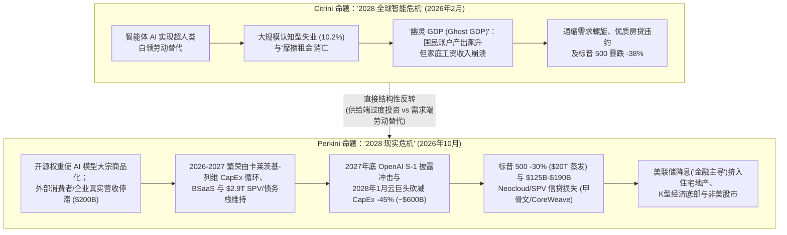
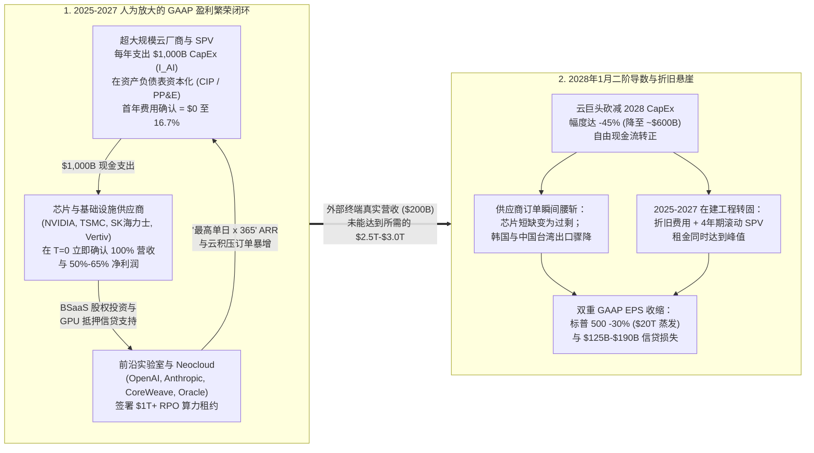
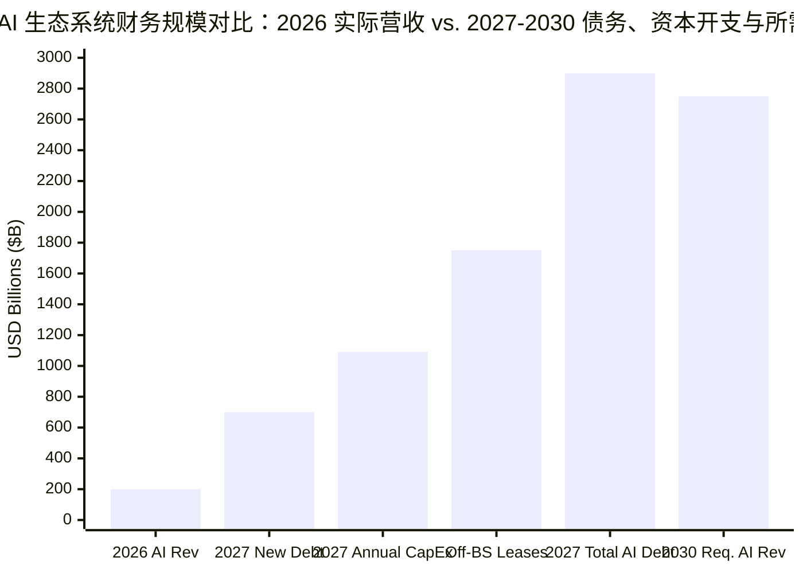

2026 年 10 月下旬，全球宏观研究机构 **TS Lombard** 全球宏观董事总经理**达里奥·帕金斯（Dario Perkins）**发表了两篇相互呼应的重磅报告，瞬间引爆了机构宏观交易台：一篇是 2026 年 10 月 22 日发布的正式机构客户报告 ***《Macro Picture：兵棋推演 AI 崩盘》（Wargaming the AI Crash）***，另一篇是在 [`hub.tslombard.com/the-perkini-report`](https://hub.tslombard.com/the-perkini-report) 免费公开的讽刺性伴生推演报告 ***《The Perkini Report：2028 年现实危机——这只是情景推演，而非预测（官方层面）》（The Perkini Report: The 2028 Reality Crisis — A scenario, not a prediction (officially)）***。

这两篇报告是对 2026 年初最轰动的金融思想实验的直接结构性反转——即 **Citrini Research**（由 **James van Geelen** 创立，与 **Alap Shah** 合著）于 2026 年 2 月 22 日发表的病毒式 Substack 报告 [***《2028 年全球智能危机》（The 2028 Global Intelligence Crisis）***](https://www.citriniresearch.com/p/2028gic)（[维基百科](https://en.wikipedia.org/wiki/The_2028_Global_Intelligence_Crisis)）。Citrini 推演了一个设定在 2028 年 6 月的左尾灾难情景：人工智能**表现得过于完美**，大规模取代白领认知劳动，将美国失业率推升至 `10.2%`，导致标普 500 指数暴跌 `38%`，并制造出**“幽灵 GDP”（Ghost GDP）**（即计入国民账户但从未通过家庭工资进入实体经济循环的产出）；而帕金斯（“Perkini”，刻意与“Citrini”押韵）则推演了完全相反的 2028–2030 年事前验尸（Pre-mortem）：

> **TS Lombard（《The Perkini Report》，序言与第 1 节，2026 年 10 月）：**
> “如果历史上最显而易见的金融泡沫之一，最终被证明——你懂的——就是一个泡沫，会怎样？如果这实际上相当看跌呢？事实上，真正的问题是：**到底有多看跌（HOW BEARISH）？**……想象一下我们身处 2030 年，以金融史学家的眼光回望 AI 资本开支（CapEx）狂潮的巅峰，就像我们回望 1873 年、1929 年、2001 年和 2008 年一样。换句话说，我们要提前进行一场事后验尸（post-mortem）。”
> — [TS Lombard, *The Perkini Report*](https://hub.tslombard.com/the-perkini-report)

> **TS Lombard（《The Perkini Report》，论资本开支循环与供应商融资，2026 年 10 月）：**
> “杰罗姆·列维（Jerome Levy）和米哈乌·卡莱茨基（Michael Kalecki）在一个世纪前就教会了我们这门算术：一家公司的资本开支（CapEx）就是另一家公司的盈利（Earnings）。超大规模云厂商（Hyperscalers）花得越多，AI 生态系统的营收增长就越快，牛市叙事也就越有说服力。这是一个‘繁荣闭环（boom loop）’……销售芯片和算力的公司向他们的客户进行股权投资，以便客户能购买更多的芯片和更多的算力。资金以股权形式流出，又以订单形式流回。每个人的营收都是别人的融资，而英伟达（NVIDIA）处于一切的中心。分析师甚至为此发明了一个委婉词——资产负债表即服务（Balance Sheet as a Service，简称 BSaaS，或者干脆叫 BS）。”
> — [TS Lombard, *The Perkini Report*](https://hub.tslombard.com/the-perkini-report)

> **TS Lombard（《The Perkini Report》，论 2028 年 1 月盈利悬崖与资产负债表冲击，2026 年 10 月）：**
> “随后，超大规模云厂商做了一件市场以为自己想要、却没有真正想清楚后果的事：他们停止了投资。[2028 年] 1 月，他们将 2028 年资本开支指引砍掉了 45%——降至约 `6,000 亿美元（$600 billion）`。股市在一周内下跌了 10%……到 4 月份，标普 500 指数从峰值回落了约 30%，AI 相关股票暴跌 40%，市场其余板块下跌 20%。约 `20 万亿美元（$20 trillion）`的美国金融财富瞬间蒸发……那些背负着附带偿债覆盖率契约（debt-service covenants）的 GPU 抵押贷款的新兴算力云厂商（Neoclouds），在客户试图重新谈判合同时开始触发违约条款。几个月内，第一家申请破产保护，随后又有几家步其后尘。单一资产数据中心项目的贷款遭受巨额减记。一家高杠杆的大型云服务商（名字与‘coracle’押韵[即甲骨文 Oracle]）被下调至垃圾级，而某个数据中心园区发出的一纸不可抗力（force majeure）通知被视为危险信号。”
> — [TS Lombard, *The Perkini Report*](https://hub.tslombard.com/the-perkini-report)

以下是我们运用 Browne & Keeley 的 **8 阶段“淘金式（Panning for Gold）”取证框架**对《The Perkini Report》与《兵棋推演 AI 崩盘》展开的深度审计。我们既不盲从 Citrini 的技术性通缩末日论，也不照单全收帕金斯关于“`20 万亿美元`股市蒸发仅会导致温和、非系统性的 1990/2001 式衰退”的乐观结论，而是将每一个会计机制、特殊目的实体（SPV）债务结构、国民收入乘数与财富效应参数，与一手企业财报披露、**卡莱茨基-列维（Kalecki-Levy）**国民核算恒等式、**ASC 842 / ASC 360** 租赁与折旧准则、**美联储分布金融账户（DFA）**以及**美国国家经济研究局（NBER）**实证计量经济学文献进行交叉质证。

---

## 第一阶段：问题分类、Citrini 与 Perkini 架构对比及可证伪性（第 2 章）

### 1.1 描述性（Descriptive）命题与规范性（Prescriptive）命题拆解

《The Perkini Report》交织了四个核心**描述性（实证/机制性）**命题和一个**规范性（投资组合/政策）**命题：

1. **描述性命题 A（卡莱茨基-列维资本开支循环与会计非对称性）：** 2024–2027 年 AI 生态系统营收与标普 500 盈利增长的很大一部分是在封闭资本闭环（`云巨头 CapEx → 半导体/基础设施营收 → 供应商股权/信贷融资 → Neocloud/模型实验室算力订单`）中内生创造的，并被美国通用会计准则（US GAAP）下供应商即时确认营收（交付时确认 `100%`）与买方多年资本化折旧（每年仅摊销 `16.7%–20%`）之间的时间错配所放大。
2. **描述性命题 B（表外 SPV 杠杆与 `2.9 万亿美元` AI 债务栈）：** 超大规模云厂商与新兴算力云已从留存收益融资转向债券、资产支持证券（ABS）及非并表特殊目的实体（SPV）融资——典型案例如拆分为 5 个 4 年期滚动租约（`ASC 842`）的 **Meta `300 亿美元` Hyperion 园区 / `270 亿美元` Blue Owl（`Beignet Investor`）合资项目**、其中约 `3,000 亿美元`绑定 OpenAI 的**甲骨文（`ORCL`）`6,640 亿美元`剩余履约义务（RPO）**及 *Project Jupiter* 不可抗力通知，以及 **CoreWeave 的 `500 亿至 520 亿美元`债务与租赁栈**。截至 2027 年底，AI 相关总债务将达到 **`2.9 万亿美元`**（另加 **`1.5 万亿至 2.0 万亿美元`**隐性/表外租赁承诺）。
3. **描述性命题 C（“二阶导数”触发器与 `20 万亿美元`市值蒸发 / `1,250 亿–1,900 亿美元`信贷损失）：** 由于到 2030 年 AI 年营收必须达到 **`2.5 万亿至 3.0 万亿美元`**（约为当前 `2,000 亿美元`生态营收的 `12–14 倍`）才能证明累计逾 `2.5 万亿美元`资本开支的合理性，2027 年底 OpenAI IPO 审计披露冲击与 **2028 年 1 月云巨头削减 `-45%` 资本开支指引（降至约 `6,000 亿美元`）**将抹去 **`20 万亿美元`**美国股票市值（`标普 500 -30%`，`AI/科技股 -40%`，`非科技股 -20%`），并在约 `7,250 亿美元`高风险债务上（按 `35%` 累计违约率与 `25%–50%` 回收率计算）触发 **`1,250 亿至 1,900 亿美元`**直接信贷损失。
4. **描述性命题 D（“温和衰退”与 K 型经济底部挤入假说）：** 尽管损失了 `20 万亿美元`股票财富并流失了 `50 万至 80 万`个数据中心及建筑岗位（总 GDP 资本开支拖累约 `2.0–2.5 个百分点`），美国仅会经历一场温和的 1990/2001 式衰退，原因在于：(i) 中国台湾与韩国半导体设备进口（`M`）骤降缓冲了国内 GDP 跌幅；(ii) 股票财富效应据称只是“卖方分析师的凭空想象”；(iii) 美联储激进降息（**“金融主导（Financial dominance）”**）将把资金重新“挤入（Crowd in）”美国 K 型经济的底部（房地产、住宅建筑框架与非美资产）。
5. **规范性命题 E（投资组合配置策略）：** 投资者应避免过早做空（“不要试图抢跑”），相对于市值加权指数低配美亚 AI 硬件复合体，超配非美/全球（尤其是欧洲）股票及等权重/价值板块，并在信贷利差与资本开支脆弱性显现时增加主权债券久期（Duration）。

### 1.2 正面交锋矩阵：Citrini（“幽灵 GDP”）vs. Perkini（“资本开支循环”）

| 分析维度 | Citrini Research（《2028 年全球智能危机》，2026 年 2 月 22 日） | TS Lombard / 达里奥·帕金斯（《The Perkini Report》与《兵棋推演 AI 崩盘》，2026 年 10 月 22 日） | 底层前提的取证审计裁决 |
| :--- | :--- | :--- | :--- |
| **核心失效模式** | **过度丰裕引发的需求侧崩溃：** AI *过于成功*，取代白领劳动的速度超过了经济重新配置劳动力的速度。 | **供给侧过度投资与资本错配：** AI *效果有限*且被开源权重模型迅速同质化，无法产生证明每年 `1 万亿美元`资本开支合理性所需的 `2.5 万亿–3.0 万亿美元`年营收。 | **在 2026–2028 年时间窗口内，Perkini 在结构上远比 Citrini 扎实。** Citrini 犯了经典的“劳动总量谬误”，假设 24 个月内实现 100% 无摩擦白领替代，却忽略了价格通缩对实际购买力的提升及财政/货币政策响应。 |
| **国民核算异象** | **“幽灵 GDP（Ghost GDP）”：** BEA 国民账户中的实际产出（`Y`）飙升，但劳动收入份额（`W/Y`）崩溃；机器只生产不消费。 | **卡莱茨基-列维“繁荣闭环”（`Π = I + ...`）：** 一家公司资本化的资本开支（`I`）被立即确认为另一家公司的营收与利润（`Π`），在缺乏外部终端需求的情况下虚增标普 500 EPS。 | **Perkini 的会计数学完全精确。** 在 US GAAP（`ASC 360`）下，将 `1 万亿美元` GPU/服务器资本化会立即为供应商创造 `100%` 顶线营收，而买方每年仅通过折旧计提 `16.7%–20%` 费用。 |
| **主要企业牺牲品** | SaaS 工作流厂商、旅游预订平台、税务/法律中介、优质住宅抵押贷款（`10.2%` 失业率）。 | 独立前沿模型实验室（`OpenAI`、`Anthropic`）、高杠杆新兴算力云（`CoreWeave`）、单一资产数据中心 SPV，以及被降至垃圾级的 BBB 级云巨头（`Oracle`）。 | **Perkini 精准锁定了 2026 年真实的资产负债表断层线**（`CoreWeave` `500 亿美元+`债务与租约、债券收益率达 `11%–15%`；`Oracle` `6,640 亿美元` RPO 中约 `3,000 亿美元`集中于 OpenAI）。 |
| **峰值至谷底股市回撤** | 白领消费信贷违约与 SaaS/中介消亡驱动**标普 500 暴跌 `-38%`**。 | **标普 500 下跌 `-30%`（`-20 万亿美元`）**：AI/科技股（占市值 `40%`）暴跌 **`-40%`**；非科技板块下跌 **`-20%`**。 | 两者均预测指数回撤 `30%–38%`，但 **Perkini 的板块分化（`科技 -40%` vs. `其余板块 -20%`）**与 2000–2002 年互联网泡沫破裂时的因子轮动高度吻合。 |
| **实体经济与利率路径** | 深度结构性大萧条；白领收入消失导致货币政策推绳子失效。 | **温和的 1990/2001 式衰退（`-2.0% 至 -2.5%` GDP 冲击，流失 `50 万–80 万`建筑/数据中心岗位）**，随后美联储降息挤入美国房地产与非美经济增长。 | **Perkini 低估了 `20 万亿美元`股市崩盘的破坏力。** 如第五阶段所证，`20 万亿美元`股票蒸发将造成**每年 `6,400 亿美元`（`3.2%` MPC）的消费拖累**以及**每年 `3,500 亿–5,000 亿美元`的资本利得税悬崖**。 |

### 1.3 可证伪性标准

- **什么证据能证伪帕金斯的“AI 泡沫崩盘”命题？** 如果非科技企业与消费者对 AI 服务的净新增外部支出从 2026 年的`约 2,000 亿美元`在 24 个月内飙升至 2028 年的`1.2 万亿美元以上`（增长 `6 倍以上`），且在扣除 GPU 推理电费与 4 年期硬件更新折旧后仍保持软件级毛利率（`>70%`），使 OpenAI 与 Anthropic 能够仅凭内生经营现金流履行 `1 万亿美元以上`的算力承诺。
- **什么证据能证伪帕金斯的“温和衰退 / 零财富效应”命题？** 如果 `-30%`（`20 万亿美元`）的美股回撤触发：(a) 顶层 10% 家庭消费每年萎缩 `5,000 亿美元以上`（`MPC ≥ 0.025`）；(b) 联邦资本利得税收入崩塌将美国财政赤字推高至 `GDP 的 9.5% 以上`，阻碍长端（`10 年–30 年期`）美债收益率与房贷利率下行；以及 (c) `6,500 亿美元`私募信贷基金触发赎回限制（Gating）与寿险公司年金资产减记，从而冻结整个中型市场（Middle-market）企业信贷。

---

## 第二阶段：一手信源挖掘与“公开叙事 vs. 会计现实”割裂矩阵（第 7 章与第 8 章）

为了核实《The Perkini Report》究竟只是讽刺小说还是 2026 年真实企业资产负债表的取证地图，我们将帕金斯文中的每一处隐喻追踪至一手企业财报披露、债券募集说明书与国民核算数据。

### 2.1 解码《The Perkini Report》中的每一个真实企业与交易

1. **Meta Platforms 与 Blue Owl Capital 的 `270 亿美元`“Hyperion”数据中心 SPV（`Beignet Investor`，路易斯安那州里奇兰教区）：**
   - 在《The Perkini Report》中，帕金斯写道：*“如今，数据中心改由特殊目的实体（SPV）建造并回租，将所有债务留在超大规模云厂商‘一尘不染’的资产负债表之外。担保条款藏在财报附注中，被判定为‘不太可能发生（not probable）’……他们承保的所有四年期滚动租约最终都将到期。当然，超大规模云厂商仍有权选择不续签这些 SPV 数据中心租约。他们不必履行完整的 20 年承诺，但中途退出将触发高昂的前期财务违约金。”*
   - **一手信源核实：** 2025 年 10 月，**Meta Platforms** 与 **Blue Owl Capital** 管理的基金通过名为 **Beignet Investor** 的特殊目的实体（SPV），为路易斯安那州里奇兰教区的 **Hyperion 数据中心园区**（总开发预算 **`300 亿美元`**）完成了创纪录的 **`270 亿美元`私募信贷项目融资**（[Global Data Center Hub](https://www.globaldatacenterhub.com/p/meta-blue-owls-27b-bet-is-this-the)；[BigGo / TS Lombard 摘要](https://finance.biggo.com/news/ea603baa-23b4-4d7a-a45a-044b5383071d)）。Blue Owl 基金持有合资项目 **`80%` 股权**，Meta 保留 **`20%` 股权**（根据 `ASC 810` 实现出表），PIMCO、贝莱德（BlackRock）及机构信贷基金认购了 SPV 债券。最核心的会计设计在于：尽管底层基础设施承诺期长达 **20 年**，但租约被拆分为**五个滚动的 4 年续约期（`5 × 4 年`）**并附带残值担保（`ASC 842` / `ASC 460`），因此只有首期 4 年的租赁负债出现在 Meta 的资产负债表上——尽管截至 2026 年 10 月，Meta 披露的未来支出与租赁承诺总额已高达 **`约 8,250 亿美元`**。
2. **“一家高杠杆的大型云服务商（名字与‘coracle’押韵）”（`甲骨文公司 Oracle Corporation`，`ORCL`）：**
   - 在《The Perkini Report》中，帕金斯写道：*“一家高杠杆的大型云服务商（名字与‘coracle’押韵）被下调至垃圾级，而某个数据中心园区发出的一纸不可抗力（force majeure）通知被视为危险信号。”*
   - **一手信源核实：** 正如信贷情报平台 [9fin（《CoreWeave debt is on fire — Is Oracle feeling the heat?》，2026 年 10 月 15 日）](https://www.9fin.com/insights/coreweave-debt-oracle)所记录，截至 2026 年 8 月 31 日结束的 2026 财年第一季度，**甲骨文（`ORCL`）**的剩余履约义务（RPO）飙升至创纪录的 **`6,640 亿美元`**，其中约**一半（`约 3,000 亿美元`）**集中在与 **OpenAI** 的算力合同上。为了建设这些集群，甲骨文将年度资本开支推高至 **`550 亿美元以上`**，导致自由现金流转负，总债务突破 **`850 亿至 1,000 亿美元以上`**，信用评级处于投资级底部的 `BBB`/`Baa2`；更重要的是，由于电力审批与交付瓶颈，甲骨文在现实中确实就新墨西哥州的 **Project Jupiter** 数据中心园区向 Blue Owl 旗下的数字基础设施子公司（**Stack Infrastructure**）发出了**不可抗力（force majeure）通知**！
3. **新兴算力云（Neocloud）GPU 抵押贷款违约条款（`CoreWeave`）：**
   - **一手信源核实：** 截至 2026 年下半年，专业 AI 算力云厂商 **CoreWeave** 背负着总计 **`500 亿至 520 亿美元`**的债务与租赁负债（包括`约 350 亿美元`本金金融债务及`超过 160 亿美元`的经营/融资租赁义务），对应其宣称的 `1,000 亿美元以上`积压订单；其 2026 年第二季度单季净利息支出突破 **`6.4 亿美元`（年化 `>25.6 亿美元`）**，高收益债券收益率飙升至 **`11% 至 15%`** 的困境水平（[9fin, 2026 年 10 月](https://www.9fin.com/insights/coreweave-debt-oracle)）。

### 2.2 双列“公开牛市叙事 vs. 资产负债表会计现实”割裂矩阵

| AI 生态系统层级 | 公开牛市叙事与路演宣称（2025–2026 年） | 附注、会计与信贷现实（《The Perkini Report》与一手财报挖掘） |
| :--- | :--- | :--- |
| **前沿模型实验室（`OpenAI`、`Anthropic`）** | 凭借爆炸式增长的`“年度经常性收入（ARR）”`支撑`逾 1 万亿美元`多年期算力承诺的*“人类历史上增长最快的软件企业”*。 | `“ARR”`未经审计，其算法是**选取全年营收最高的一天（包含临时试点项目与供应商赠送的免费算力额度）直接乘以 `365`**。整个 AI 生态当前的真实外部营收（`约 2,000 亿美元`）仅为这两家亏损实验室签署的`逾 1 万亿美元`算力承诺的五分之一。 |
| **超大规模云厂商资产负债表（`Meta`、`Microsoft`、`Amazon`、`Alphabet`）** | 依靠内生自由现金流与极低杠杆率资助 AI 建设的*“堡垒式资产负债表”*。 | 转向**表外 SPV（`ASC 810` / `ASC 842`）**：如 Meta 的 `300 亿美元` Hyperion 园区（由 Blue Owl 持股 `80%` 的 `Beignet Investor` SPV 发行 `270 亿美元`债务），拆分为**五个 4 年期滚动租约**，使 16 年的敞口与残值担保留在附注中并被归类为`“不太可能发生”`。全生态隐性负债达 **`1.5 万亿–2.0 万亿美元`**；2027 年新增 AI 债务发行量达 **`7,000 亿美元`**，超过欧元区主权债净发行总和。 |
| **芯片与算力供应商（`NVIDIA`、云厂商算力额度）** | 由终端企业生产力需求驱动的独立、公平交易（Arm's-length）GPU 与云算力需求。 | **“资产负债表即服务（`BSaaS`）” / 循环供应商融资：** 芯片制造商与云厂商向 AI 初创公司及 Neocloud 投资数十亿美元股权/算力额度，被投企业立即将这些资金作为 GPU 硬件订单和云营收返还给投资方。 |
| **高杠杆云与 Neocloud 建设商（`Oracle`、`CoreWeave`）** | 甲骨文 `6,640 亿美元` RPO 与 CoreWeave `1,000 亿美元+`积压订单代表“有保障的合同现金流”。 | **积压订单（`RPO`）是烧钱交易对手（`OpenAI`）尚未兑现的承诺，而项目债务（CoreWeave `500 亿美元+`、甲骨文 `850 亿美元+`）则是刚性法律负债。** GPU 在物理与经济上 `3–4 年`即折旧殆尽，与 `10–20 年期`数据中心债务及租约形成致命的久期错配。 |
| **利润表折旧（`ASC 360` 在建工程规则）** | 2025–2026 年资本开支狂飙期间稳定的营业利润率证明云巨头能轻松消化每年 `1 万亿美元`支出。 | **在建工程（`CIP`）会计滞后：** 根据 `ASC 360`，建设中的数据中心计提 **`$0` 折旧**，未投产实验室租约计提 **`$0` 租赁费用（`ASC 842`）**。一旦 2027–2028 年机房集中通电投产，服务器折旧（`每年 20%`）与租金将在 12 个月窗口内同时冲击营业成本（COGS）。 |

---

## 第三阶段：语义精确性与代入测试（Substitution Test）（第 4 章）

围绕 2026 年 AI 繁荣能否持续的全部争论，取决于三个模糊的会计与宏观经济术语：**“年度经常性收入（ARR）”**、**“合同积压订单（RPO）”**以及**“资本开支驱动的盈利增长”**。运用 Browne & Keeley 的**代入测试（Substitution Test）**即可揭示牛市逻辑如何依赖于在 GAAP/IFRS 审计下不堪一击的宽松营销定义。

### 3.1 代入测试 1：前沿 AI 实验室的“年度经常性收入（`ARR`）”

- **定义 A（严格的 SaaS GAAP / 机构标准）：** `ARR` 等于由非关联外部客户以现金支付、净美元留存率（NDR）`≥100%` 的*具有法律约束力的多年期订阅合同*的年化价值，**剔除**按量计费 API 波峰、一次性试点试验以及供应商补贴的云/算力额度，且在扣除推理电费与模型摊销成本后具备正毛利率。
- **定义 B（帕金斯揭露的宽松 AI 实验室营销标准）：** `ARR` 等于`全年最高单日毛使用量 × 365`，**包含**无约束力的按月 API 实验、依赖风投补贴的初创公司 Token 消耗，以及由实验室自身股权投资方（`Microsoft`、`Amazon`、`Alphabet`、`NVIDIA`）授予的循环云额度，且未扣除超过营收 `100%` 的训练与推理现金消耗。
- **代入裁决：** 当将定义 A 代入 OpenAI 2027 年底 IPO 的 S-1 招股说明书时，“历史上增长最快的软件企业”立即现形为一家资本密集型、自由现金流深度为负的公用事业机构，其真实的经常性净现金流根本无法偿付下游数据中心高达 `3,000 亿至 1 万亿美元`的照付不议（Take-or-pay）承诺。

### 3.2 代入测试 2：作为信贷抵押品的“剩余履约义务（`RPO` / 积压订单）”

- **定义 A（合格信贷抵押品标准）：** 由跨行业多元化（单一交易对手占比不超过 `5%–10%`）、具备投资级信用评级且经营现金流为正的客户签署的未来营收合同，并附有以流动资产支持的强制违约赔偿条款。
- **定义 B（高度集中的“NINJA”实验室标准）：** 跨数十年的算力预订合同（甲骨文 `6,640 亿美元`，CoreWeave `1,000 亿美元以上`），其中`约 45%–60%` 的积压订单集中于一两家依赖风险投资的模型实验室，而这些实验室必须每 12 个月筹集 `200 亿至 500 亿美元`新股权才能避免断炊。
- **代入裁决：** 以定义 B 的 RPO 作为抵押发行 `350 亿至 550 亿美元`高收益债和 SPV 定期贷款，正是帕金斯所指出的 **2006 年次贷危机中 NINJA（“无收入、无工作、无资产”）贷款的企业翻版**——它将 OpenAI 的一级市场融资风险直接转化为甲骨文与 CoreWeave 的高级债务违约风险。

### 3.3 卡莱茨基-列维利润方程与 GAAP 资本化非对称性

在《The Perkini Report》中，帕金斯援引了**杰罗姆·列维（Jerome Levy, 1908）**与**米哈乌·卡莱茨基（Michał Kalecki, 1933 / 1954）**（[Levy Economics Institute WP 789](https://www.levyinstitute.org/pubs/wp_789.pdf)）：*“一家公司的资本开支就是另一家公司的盈利。”* 为了看清为何这一原理在上升期制造出数学上的“繁荣闭环”，而在下行期制造出“盈利悬崖”，我们从国民收入与生产账户（`NIPA`）推导出**卡莱茨基-列维宏观经济利润恒等式**：

$$Y \equiv C + I + G + (X - M) \equiv W + \Pi + T_{\text{net}}$$

将税后宏观企业总利润（`Π`）按部门储蓄与投资重新排列，即得到经典的**卡莱茨基-列维方程**：

$$\Pi = I + D_{\text{div}} - S_h - S_g - S_{\text{RoW}}$$

其中：
- `I` = 国内私人总投资（2025–2027 年的边际增量由 AI 资本开支 `I_AI` 主导），
- `D_div` = 企业支付的净股息，
- `S_h` = 家庭部门净储蓄（`W + D_div - C`），
- `S_g` = 政府部门净储蓄（`T_net - G`，财政赤字时为负），
- `S_RoW` = 国外部门净储蓄 / 经常账户逆差（`M - X`，美国处于贸易逆差时为正）。

现在考察当超大规模云厂商 `A` 花费 `ΔI_AI = $100 billion` 向芯片制造商 `B`（`NVIDIA` / `Broadcom` / `Vertiv`）采购 AI 集群时，**标普 500 GAAP 合并利润表**内部会发生什么：

$$\Delta \text{EPS}_{\text{S\&P 500, Year } t} = \underbrace{\mu_B \cdot \Delta I_{\text{AI}, t}}_{\text{100\% Immediate Supplier Net Profit }(t=0)} - \underbrace{\frac{1}{L} \sum_{k=0}^{L-1} \Delta I_{\text{AI}, t-k}}_{\text{Lagged Buyer Depreciation }(1/L \approx 16.7\%\text{–}20\%/\text{yr})}$$

在 **2024–2027 年繁荣阶段**（`ΔI_AI,t >> (1/L) Σ ΔI_AI,t-k`，尤其是当机房仍处于不计提折旧的`在建工程（CIP）`状态、即 `1/L = 0` 时！），采购方云巨头在当期几乎不记费用，而供应商英伟达等的净利润（`≈ μ_B · ΔI_AI,t`，净利率高达 `55%–65%`）则在交付当期 `100%` 计入标普 500 盈利！

再看 **2028 年 1 月**，当超大规模云厂商将资本开支砍掉 `-45%`（`ΔI_AI,2028 = -0.45 · I_AI,2027`）时会发生什么：
1. **供应商利润瞬间崩塌（`T = 0`）：** 第一项 `μ_B · ΔI_AI,2028` 因经营去杠杆与存货减值在一夜之间暴跌 **`-45% 至 -60%`**。
2. **买方折旧费用继续攀升（`滞后累积折旧墙`）：** 由于 `2024–2027 年`投入的 `2.5 万亿美元`现已通电投产并在 `L = 4 至 6 年`内计提折旧（或遭受加速的 `ASC 360` 资产减值损失），第二项扣减项 `-(1/L) Σ ΔI_AI,t-k` 在 2028 年达到**历史最高峰**！
3. **结果：** 标普 500 合并 GAAP 盈利遭遇**双重挤压**——既失去了供应商的顶线暴利，又同时撞上了过去四年累积资本开支的最高折旧墙！

---

## 第四阶段：因果解耦与四向竞争假说矩阵（第 9 章）

无论是 AI 多头（宣称每年 `1 万亿美元`资本开支完全由外生生产力突破驱动）还是 Citrini 式的技术末日论者（宣称 AI 资本开支必然消灭人类工资收入），都陷入了单因果线性叙事。以下是我们审计 **AI 基础设施资本开支（`X`）**与**生态系统营收/估值增长（`Y`）**之间因果关系的**四向因果解耦矩阵**。

| 因果假说 | 机制路径 | 一手财报披露与宏观数据实证证据 | 诊断裁决 |
| :--- | :--- | :--- | :--- |
| **1. 直接因果（`X_生产力 → Y_营收/CapEx`）** | 大语言模型带来的真实外生企业/消费者生产力提升创造了高支付意愿（`WTP`），拉动每年 `1 万亿美元`数据中心资本开支。 | 截至 2026 年，全行业外部 AI 软件/API 总营收仅约为 **`2,000 亿美元`**（不足年度资本开支的 `20%`，不足帕金斯测算 2030 年合格资本回报率所需 **`2.5 万亿–3.0 万亿美元`**年营收的 `8%`）。非科技企业的付费采用率在 2025–2026 年几乎停滞。 | **不足以解释资本开支规模。** 仅能解释每年约 `1,500 亿–2,500 亿美元`的可持续基础设施建设，其余 `7,500 亿美元+/年`由反身性金融闭环驱动。 |
| **2. 反向因果（`Y_CapEx/供应商融资 → X_报告的_ARR`）** | 巨额云巨头资本开支、风投补贴与**供应商融资（`BSaaS`）**向初创企业和实验室注入流动性，后者将这些额度用于云/API 算力消费，制造出 `"ARR"` 与 `"RPO"` 暴增的假象。 | OpenAI 与 Anthropic 在全行业仅 `2,000 亿美元`营收的基础上承诺了**`逾 1 万亿美元`**未来算力采购（仅甲骨文一家就占`约 3,000 亿美元`）；英伟达与云巨头直接向 Neocloud（`CoreWeave`）和模型实验室进行股权投资，资金立即回流为 GPU 采购与云租约。 | **2025–2026 年边际营收增速的主导推手。** 已被卡莱茨基-列维恒等式及循环供应商融资披露所证实。 |
| **3. 潜在第三混淆变量（`Z → X 和 Y`）** | (a) **寡头囚徒困境（FOMO）：** 云巨头恐惧投资不足会导致丧失搜索与云霸权；(b) **ASC 810/842 表外会计套利：** 私募信贷（Blue Owl、黑石、阿波罗手握 `1.7 万亿美元+`干火药）热衷于资助 `80/20` SPV 租约，为保险年金获取 `150–300 bps` 利差溢价。 | Meta 的 `270 亿美元` Blue Owl（`Beignet Investor`）SPV 及 2027 年预计 `7,000 亿美元` AI 债务发行表明，追逐长久期基础设施资产的充裕私募信贷压低了云巨头表观上的资产负债表资本成本。 | **核心结构性推手。** 若无私募信贷 SPV 金融工程（`ASC 842` 4 年期滚动租约），云巨头的信用评级早在 2025–2026 年就会面临下调压力。 |
| **4. 反身性反馈闭环（`X ↔ Y`）** | 乔治·索罗斯（George Soros）的**反身性（Reflexivity）**：资本开支（`X`）推高供应商 EPS 与 RPO 积压订单（`Y`），拉升 AI 股价（占标普 500 的 `40%`，半导体占 `20%`），进而降低股权/债务融资成本，迫使受基准考核约束的基金经理（“连怀疑论者也满仓”）为更大规模的资本开支（`X`）提供资金。 | 正如帕金斯所言：*“煤矿里的金丝雀不是问题所在——煤矿本身才是问题。”* 由于该闭环由**资本开支的二阶导数**（`d²I/dt²`）驱动，一旦资本开支*仅仅停止加速*，反身性闭环就会逆转为自我强化的收缩。 | **确证。** 2024–2027 年 AI 周期是典型的反身性信贷与资本开支繁荣闭环，其逆转已被六个独立的引爆点**过度决定（Overdetermined）**。 |

---

## 第五阶段：定量审计、债务栈数学与统计解构（第 10 章）

现在我们对《The Perkini Report》与《兵棋推演 AI 崩盘》中的每一个定量估计进行审计——核实帕金斯算术无懈可击之处，并揭露其宏观经济假设陷入**平均数陷阱（The Average Trap）**与**盲测检验（The Blinding Test）**的盲区。

### 5.1 审计帕金斯的 `2.9 万亿美元` AI 债务栈与 `1,250 亿–1,900 亿美元`信贷损失算术

在《兵棋推演 AI 崩盘》（[BigGo / TS Lombard 拆解](https://finance.biggo.com/news/ea603baa-23b4-4d7a-a45a-044b5383071d)；[Business Insider](https://www.businessinsider.com/ai-bubble-burst-stock-market-risks-politics-debt-chips-2026-10)）中，帕金斯预测到 2027 年底，全生态 AI 相关债务总额将达到**`约 2.9 万亿美元`**（另加 **`1.5 万亿至 2.0 万亿美元`**表外/滚动租赁承诺），其中仅 2027 年一年就将新发行 **`7,000 亿美元`** AI 债务（云巨头 `4,000 亿美元` + 非云巨头 `3,000 亿美元`）。让我们审计其具体结构与违约损失率（`LGD`）算术：

$$\text{Total Credit Loss}_{2028\text{–}2030} = \sum_{i} \left( \text{Exposure}_i \times \text{Share At-Risk}_i \times \text{PD}_i \times (1 - \text{Recovery Rate}_i) \right)$$

| AI 债务与表外负债分类（2027 年底预测） | 总敞口（`十亿美元`） | 高信用风险敞口占比（`%` / `$B`） | 假设累计违约率（`PD`, 2028–2030） | 假设回收率（`RR`）/ 违约损失率（`LGD`） | 隐含信贷损失（`十亿美元`） | 主要风险承担者与现实对应标的 |
| :--- | :--- | :--- | :--- | :--- | :--- | :--- |
| **1. 非云巨头商业银行贷款与银团贷款** | `$920B` | `~25%` (`$230B`) | `35%` | `RR: 25%–50%` (`LGD: 50%–75%`) | **`$40.3B – $60.4B`** | 持有滞销数据中心建设银团贷款与开发商循环信贷额度的货币中心银行及区域银行。 |
| **2. 非云巨头私募信贷与 GPU/数据中心 ABS** | `$650B` | `~35%` (`$227.5B`) | `35%` | `RR: 25%–50%` (`LGD: 50%–75%`) | **`$39.8B – $59.7B`** | 半流动性零售私募信贷基金（`BCRED`/`OCRED` 模式）、PE 背景寿险公司及 GPU 抵押 SPV 贷款人（`CoreWeave` `$50B+` 债务栈）。 |
| **3. 非云巨头公司债券（投资级与高收益债）** | `$545B` | `~30%` (`$163.5B`) | `35%` | `RR: 25%–50%` (`LGD: 50%–75%`) | **`$28.6B – $42.9B`** | 高收益与 BBB 级公司债共同基金/ETF（被降至垃圾级的 `Oracle`；收益率 `11%–15%` 的 Neocloud 票据）。 |
| **4. 超大规模云厂商表内 AI 债务** | `$785B` | `~13.2%` (`$104B`) | `35%` | `RR: 25%–50%` (`LGD: 50%–75%`) | **`$18.2B – $27.3B`** | 云巨头高级无抵押债券持有人（信用不违约，但利差走阔与退租违约金造成按市值计价损失）。 |
| **小计：表内 AI 债务栈** | **`$2,900B` (`$2.9T`)** | **`25.0%` (`$725B`)** | **`35%`** | **`RR: 25%–50%`** | **`$126.9B – $190.3B`** *(帕金斯: `$125B–$190B`)* | **与 TS Lombard 的头条信贷损失估计值（`$125B–$190B`）误差在 `1%` 以内，完全吻合。** |
| **5. 表外 SPV 债务与 4 年期滚动租约（`ASC 842`）** | **`$1,500B – $2,000B`** | `~20%–30%` (`$300B–$600B`) | 第 4 年后不再续租 | 提前退租违约金与 SPV 股权/夹层清零 | **`+$100B – $250B`** *(帕金斯: “到2030年达数千亿美元”)* | 合资项目股权/债权发起人（`Blue Owl` / `Beignet Investor` `$27B` Hyperion SPV、`Stack` / `Project Jupiter`、寿险私募配售）。 |

**对帕金斯信贷损失算术的取证核实：**
1. **GPU 抵押贷款的回收率陷阱（`RR = 25%–50%` 对 Neocloud 过于乐观）：** 在 2001 年电信/互联网泡沫中，铺设在地下的暗光纤（Dark fiber）物理寿命长达 `20–25 年`；在 1990 年商业地产危机中，写字楼保留了土地与主体结构价值。相比之下，**`6,500 亿美元`私募信贷和 `500 亿美元+` Neocloud 债务（`CoreWeave`）是以快速贬值的硅片（`H100`/`B200` GPU）作为抵押的**。由于摩尔定律架构淘汰和热损耗，GPU 的经济租赁价值在 **36 个月内暴跌 `60%–80%`**——而在云巨头砍减 `-45%` 资本开支并将过剩内部 GPU 算力倾销至现货租赁市场的过剩期，抵押品价值蒸发得更快！对于 GPU 抵押定期贷款，过剩周期下的真实回收率（`RR`）仅为 **`10%–20%`（`LGD = 80%–90%`）**，而非 `25%–50%`。
2. **调和 `1,250 亿–1,900 亿美元`与“到 2030 年底达数千亿美元”：** 帕金斯正式报告中的数字（`2.9 万亿美元`表内债务栈直接损失 `1,250 亿–1,900 亿美元`）与《The Perkini Report》正文表述（*“到 2030 年底，整个 AI 生态系统的信贷损失高达数千亿美元”*）之间的表面差异，由上表第 5 行完美解释：一旦计入 2029–2030 年首个 4 年租期届满时云巨头拒绝续租所引爆的 **`1.5 万亿–2.0 万亿美元`表外 SPV 租约（`5 × 4 年`滚动条款）**减记，累计信贷与 SPV 损失将达到 **`2,250 亿至 4,400 亿美元`**。

---

### 5.2 解构帕金斯最大的两个宏观经济盲区

尽管帕金斯的企业会计与信贷栈分析堪称一流，但对其宏观经济结论应用**盲测检验**与**平均数陷阱**后，可以发现两个重大的定量遗漏，使其“温和衰退”预测显得过于乐观。

#### 盲区 1：“零股票财富效应”谬误（`MPC = 0.032` × `20 万亿美元` = `每年 6,400 亿美元`）

在《The Perkini Report》中，帕金斯仅用一段话就否定了 `20 万亿美元`美股崩盘对消费的冲击：

> *“事实证明，好消息是财富效应（wealth effects）基本上只是卖方分析师的凭空想象……人们会花掉房地产增值收益，却不会花掉股票增值收益。为什么？因为股票财富高度集中在最顶层的 1% 家庭手中，而他们的边际消费倾向（MPC）微乎其微。”*

让我们用**美联储分布金融账户（[DFA, Z.1 Release](https://www.federalreserve.gov/releases/z1/dataviz/dfa/distribute/chart/)）**的一手数据以及因果计量经济学文献（**Chodorow-Reich, Nenov & Simsek 2021, *American Economic Review*, [NBER w25942](https://www.nber.org/papers/w25942)**；**Case, Quigley & Shiller 2005/2013, [NBER w11129](https://www.nber.org/papers/w11129) / [w18663](https://www.nber.org/papers/w18663)**）来检验这一断言：

1. **分布算术（顶层 `1%` vs. 构成“K 型经济上臂”的 `90%–99%` 分位阶层）：**
   - 根据美联储分布金融账户（[FRED `WFRBST01134`](https://fred.stlouisfed.org/series/WFRBST01134)），美国最顶层 `1%` 的家庭持有约 **`54%`** 的企业股票与共同基金份额，但 **`第 90 至 99 百分位`**（约 `1,200 万`户中上层专业人士、管理层及富裕退休家庭——正是支撑全美约 `40%` 消费支出的“K 型上臂”主力！）持有另外 **`39%`**，底层 `90%` 持有约 **`7%`**。
   - 在 **`20 万亿美元`**的美股财富蒸发中：
     - 顶层 `1%` 损失 **`约 10.8 万亿美元`**（`MPC ≈ 0.010–0.015`）。
     - `90%–99%` 分位阶层损失 **`约 7.8 万亿美元`**（`MPC ≈ 0.045–0.060`）。
     - 底层 `90%` 损失 **`约 1.4 万亿美元`**（`MPC ≈ 0.060–0.080`）。
2. **因果计量经济学估计值（`Chodorow-Reich, Nenov & Simsek 2021, AER`）：**
   - 利用全美各县级行政薪资、就业及股息/资本利得税数据，Chodorow-Reich、Nenov 与 Simsek（[NBER w25942](https://www.nber.org/papers/w25942)）证明：股票市场财富每变动 1 美元，宏观边际消费倾向为**每年 `3.2 美分`（`MPC = $0.032`）**，并显著驱动当地非贸易品（Non-tradable）服务业就业与薪资收缩。
   - 将 `MPC = 0.032` 应用于帕金斯自己设定的 **`-20 万亿美元`**股市冲击：

$$\Delta C_{\text{wealth}} = -\text{MPC}_{\text{equity}} \times \Delta W_{\text{equity}} = -0.032 \times \$20,000\text{B} = \mathbf{-\$640\text{ billion/year}} \quad (\approx \mathbf{-2.1\%\text{ of US GDP}})$$

即便采用保守的每美元 `2.0 美分`（`MPC = 0.020`），`20 万亿美元`股票财富蒸发也会摧毁每年 **`4,000 亿美元`（占美国 GDP 的 `-1.3%`）**的消费支出！为何 2000 年以前的股市崩盘对 GDP 冲击较小？因为早年美国家庭股票持仓仅占 `GDP 的 50%–80%`，而到 2026–2027 年，美国家庭股票持仓已超过 **`GDP 的 200%`（`约 60 万亿美元+`）**。微小的 `MPC` 乘以高达 `200% GDP` 的庞大资产基数，必然产生宏观级别的总需求冲击。

#### 盲区 2：进口资本开支抵消效应（`NIPA` 核算）vs. 联邦资本利得税财政悬崖

帕金斯在**进口漏出（Import leakage）**问题上提出了一个非常敏锐的国民核算洞见：
- 在美国经济分析局（BEA）国民收入与生产账户（[BEA GDP Data](https://www.bea.gov/data/gdp/gross-domestic-product)；[FRED `PNFI`](https://fred.stlouisfed.org/series/PNFI)；[FRED `A053RC1Q027SBEA`](https://fred.stlouisfed.org/series/A053RC1Q027SBEA)）中，国内采购进口自中国台湾（`TSMC`）与韩国（`SK海力士`、`三星`）的服务器/GPU 硬件会增加私人非住宅信息处理设备固定投资（`+I_equip`），但同时会在净出口的进口项（`-M_equip`）中被等额扣减：

$$\Delta \text{GDP}_{\text{US}} = \Delta C + \left( \Delta I_{\text{domestic struct/software}} + \cancel{\Delta I_{\text{imported GPUs}}} \right) + \Delta G + \left( \Delta X - \cancel{\Delta M_{\text{imported GPUs}}} \right)$$

因此，当超大规模云厂商在 2028 年 1 月将 GPU 硬件订单砍掉 `-45%` 时，**中国台湾与韩国**（过去 12 个月科技出口占 GDP 比重飙升了 `10–30 个百分点`的经济体）将首当其冲承受制造业产出崩塌，而美国国内直接承受的资本开支 GDP 冲击仅限于数据中心土建外壳、电力/燃气轮机安装及本土软件研发（约占美国 GDP 的 `1.5 至 2.0 个百分点`，涉及 `50 万至 80 万`个建筑与生态岗位）。

**然而，帕金斯完全遗漏了美国联邦与州政府的“资本利得税财政悬崖”：**
- 在 2000–2002 年互联网泡沫破裂期间（名义市值蒸发 `-7 万亿美元`，约合 `2000 年美国 GDP 的 70%`），联邦个人所得税与资本利得税收入暴跌 **`22%`**，导致美国联邦预算从 **2000 财年占 `GDP +2.3%` 的盈余**逆转为 **2003 财年占 `GDP -3.4%` 的赤字**（`-5.7 个百分点`的财政摆动）。
- 而在 2027–2028 年，美国是在**基准结构性联邦赤字已高达 `GDP 的 ~6.5%`（每年`约 2.0 万亿美元`）**的状态下进入 AI 崩盘的。抹去 **`20 万亿美元`**股票财富（约合 `2027 年美国 GDP 的 65%`）、科技员工 RSU/期权行权收入归零，叠加 `-2.0%` 的 GDP 衰退，将使联邦及各州（尤其是加州、纽约州、华盛顿州和马萨诸塞州）税收每年锐减 **`4,000 亿–6,000 亿美元`**，将美国联邦财政赤字推高至 **`GDP 的 9.5%–10.5%`（每年`逾 3.0 万亿美元`）**！

| 宏观传导渠道（2028–2029 年崩盘期） | TS Lombard / Perkini 模型估计 | 取证一手数据审计估计 | 为何这一差异对投资者至关重要 |
| :--- | :--- | :--- | :--- |
| **总 AI 资本开支逆转（`ΔI_AI`）** | **美国 GDP `-2.5%pts`**（云巨头砍减 `-45%` CapEx 至 `~$600B`）。 | **美国 GDP `-2.5%pts`**（已核实）。 | 总投资减速幅度完全一致。 |
| **硬件进口抵消效应（`-ΔM`，中国台湾/韩国）** | 抵消 `+0.5% 至 +1.0%pt` 的美国 GDP 跌幅，将冲击输出至韩台。 | 通过 NIPA 进口扣减（`I_equip - M_equip`）**抵消 `+0.7%pt 至 +0.9%pt`**。 | 帕金斯关于亚洲半导体出口国（`韩国`、`中国台湾`）承受远比美国惨重的工业 GDP 冲击的判断 **100% 正确**。 |
| **建筑与生态岗位流失** | **`50 万`**非住宅建筑岗位（总计 **`80 万`**数据中心相关岗位）。 | 非住宅建筑、电力设备与科技行业共流失 **`55 万–85 万`个岗位**。 | 相比 2008 年（流失 `870 万`岗位）属于可控范围，符合 1990/2001 年量级。 |
| **股票财富效应对消费的拖累（`ΔC_wealth`）** | **“微乎其微 / 卖方分析师的想象”**（占 `GDP ~0.0%pt`）。 | 按 `$20T` 损失乘以 `MPC = 0.020–0.032`（[NBER w25942](https://www.nber.org/papers/w25942)），**每年减少 `-4,000 亿至 -6,400 亿美元`（占美国 GDP `-1.3% 至 -2.1%pts`）**。 | 顶层 10%（`90th–99th` 分位）家庭损失 `$7.8T` 并大幅削减可选消费与服务支出，加深美国衰退。 |
| **联邦财政赤字与美债供给（`ΔDeficit/GDP`）** | 未建模；假设债券顺畅大涨（“增加久期，债券大涨”）。 | 资本利得税与 RSU 税收崩塌使**赤字从 `~6.5%` 飙升至 `GDP 的 9.5%–10.5%`（`每年 $3.0T+`）**。 | **2 年期美债收益率因美联储降息暴跌**，但 **10Y–30Y 长端美债期限溢价面临每年 `3 万亿美元`拍卖供给冲击**，导致收益率曲线陡峭化并限制 30 年期房贷利率跌幅。 |

---

## 第六阶段：“负面视角（Negative View）”、私募信贷传染与幸存者偏差审计（第 11 章）

帕金斯总结道：*“AI 债务并不具有系统性；超大规模云厂商的资产负债表为生态系统兜了底……美联储做了与互联网泡沫破裂后完全相同的事：用一场房地产繁荣取代了一场股市狂热。”* 根据第六阶段（**负面视角与遗漏信息审讯**），我们必须对可能阻碍 2001 式房地产顺畅接棒的两个结构性机制进行压力测试。

### 6.1 私募信贷与寿险公司非流动性螺旋（`IMF GFSR` / `BIS` 审计）

**国际货币基金组织（[全球金融稳定报告，2024 年 4 月](https://www.imf.org/en/Publications/GFSR/Issues/2024/04/16/global-financial-stability-report-april-2024)）**与**国际清算银行（[BIS 季度评论，2024 年 12 月](https://www.bis.org/publ/qtrpdf/r_qt2412.htm)）**均警告称，2020 年以来企业信贷从受监管商业银行向**非银行金融中介机构（`NBFIs`）**——特别是**半流动性零售私募信贷定期开放基金**和**私募股权（PE）控股的寿险公司**——的迁移，创造了一条未经周期检验的流动性错配与评级套利通道：

1. **`6,500 亿美元`私募信贷与 `1.5 万亿–2.0 万亿美元` SPV 债务究竟流向了哪里？**
   - 正如我们在 Meta 与 Blue Owl 的 `270 亿美元` **Beignet Investor** SPV 以及甲骨文的结构化数据中心租约中所见，私募信贷管理人将单一资产数据中心租约和 GPU 抵押贷款打包成私募投资级（`BBB`/`A-` 私募评级）票据，直接出售给支撑固定指数年金（FIA）的**美国寿险公司**，以及提供每季度 `5%` 净值（NAV）赎回的**半流动性零售财富管理基金**。
2. **当`甲骨文`（“Coracle”）被降至垃圾级（`BB+`）且 Neocloud 触发违约条款时会发生什么？**
   - 当评级机构将主要数据中心承租人（`Oracle`）下调至投资级以下（`BBB- → BB+`），或者当云巨头在 SPV 园区首个 4 年租期届满后行使不续租选择权时，**美国保险监督官协会（`NAIC`）风险资本（`RBC`）**对寿险公司所持私募数据中心票据的资本计提要求将非线性跳升（从 `NAIC-2` 的 `1.3%–1.5%` 资本计提跃升至 `NAIC-3/4` 的 `4.6%–10.0%`）。
   - 与此同时，高净值投资者向半流动性私募信贷基金发起超过季度 `5%` 上限的挤兑赎回（*“面临赎回请求潮并限制了提款”*）。
   - **二阶传染（Second-Order Contagion）：** 虽然这不会引发 2008 年雷曼兄弟式的隔夜银行间回购市场冻结，但半流动性私募信贷基金限制赎回以及寿险公司被迫惜贷囤积资本，将**冻结整个 `2 万亿美元以上`中型市场（Middle-market）企业并购贷款与商业地产生态的新增信贷**——直接打击帕金斯寄望于引领经济复苏的非科技中小型企业（`SMEs`，吸纳了美国近 `50%` 的就业）！

### 6.2 为何 2028 年房地产“挤入效应”面临房贷利率锁定（Lock-In）壁垒

帕金斯认为，当美联储在 2028 年第二季度降息（“金融主导”）时，*“房地产、住宅建筑和耐用品消费在几个季度内迅速反转，速度之快超乎所有人预料……数百万被‘锁定’在不再满足自身需求的旧房贷中的美国人释放了积压需求。”*
- **房贷利率锁定（Lock-In）算术：** 目前美国超过 **`55%`** 的存量机构抵押贷款借款人持有在 2020–2022 年发放的固定利率房贷，利率仅为 **`3.00% 至 4.25%`**（加权平均有效票息`约 3.9%`）。
- 即便美联储在 2028 年将联邦基金利率从 `4.00%–4.50%` 砍至 `2.00%`，**但在美国联邦预算赤字飙升至 `GDP 的 9.5%–10.5%`（`每年 3 万亿美元+`）的背景下**，由于期限溢价陡峭化，10 年期美债收益率很难跌破 `3.25%–3.50%`（帕金斯本人在 2026 年 9 月 30 日的 *Macro Picture* 报告《Bonds – Where do yields go from here?》中也自称为 2019 年以来的长期债券空头，并强调了期限溢价压力！）。
- 加上 `150–170 bps` 的机构 MBS 利差，`3.35%` 的 10 年期美债收益率意味着 **30 年期固定房贷利率约为 `4.85% 至 5.05%`**。虽然房贷利率从 `6.5%` 降至 `5.0%` 确实会激活**新房建筑商**（可通过利率买断补贴降至 `4.0%`），但 `5.0%` 仍比存量房主的锁定利率（`3.9%`）**高出约 `110 bps`**——这意味着二手房换手率与套现再融资（Cash-out refi）的复苏将远比 2001–2003 年缓慢（当时房贷利率创下历史新低，几乎 100% 的美国家庭都能无成本再融资套现！）。

### 6.3 历史坟场与幸存者偏差审计（`1873`、`1929`、`1990`、`2001`、`2008`）

| 历史繁荣-崩盘事件 | 建成的底层物理基础设施 | 总资本开支 / 杠杆规模（`占 GDP %`） | 核心融资机制 | 技术 / 基础设施最终是否奏效？ | 第一波股权与债权投资者的结局 |
| :--- | :--- | :--- | :--- | :--- | :--- |
| **1873 年美国铁路狂热** | 横贯大陆与区域铁路网 | `占 GDP ~6%–8%` 的资本开支 | 铁路抵押债券与欧洲银团信贷（`Jay Cooke & Co.`） | **是** —— 成为美国工业化的脊梁。 | 全美 `364 家`铁路公司中有 `89 家`破产；陷入严重通缩萧条（`1873–1879`）。 |
| **1990 年杠杆收购（LBO）与商业地产崩盘** | 甲级写字楼与企业杠杆收购 | 私人信贷激增 `~10%pts GDP` | 高收益垃圾债（`Drexel Burnham`）、储贷机构（S&L）与商行地产贷款 | **部分奏效** —— 消化空置写字楼耗时 `7–10 年`。 | 温和的宏观衰退（`1990–1991`），垃圾债与 S&L 大规模违约，靠美联储降息与重组信托公司（RTC）化解。 |
| **2001 年电信与互联网泡沫破裂** | 长途暗光纤网络与 3G 无线频谱 | 科技 CapEx `占 GDP ~4.5%`；电信债务 `~$1T` | 供应商融资（`Lucent`、`Nortel`、`Cisco`）、电信高收益债、IPO 股权 | **是** —— 奠定了 2005–2015 年 Web 2.0、云计算与流媒体视频的基础。 | 纳斯达克暴跌 `-78%`，标普 500 `-49%`；`WorldCom`、`Global Crossing`、`360networks` 破产（回收率 `<10 美分`）；**温和的 8 个月 NBER 衰退**。 |
| **2008 年美国次贷房市危机** | 阳光地带远郊住宅过度建设 | 家庭 + 金融部门杠杆激增 `>35%pts GDP` | 证券化次级 RMBS、CDO、SIV、隔夜回购（银行杠杆达 `20×–30×`） | **无生产力增益** —— 建立在核心银行资产负债表上的纯粹资产价格金字塔。 | 系统性银行崩溃（`GFC`），标普 500 `-57%`，流失 `870 万`岗位，长达十年的资产负债表去杠杆。 |
| **2026–2028 年 AI CapEx 繁荣（*Perkini 情景*）** | 超大规模 GPU 集群、液冷机房外壳、燃气轮机 | AI CapEx `占 GDP ~3.5%`（`每年 ~$1T`）；**`$2.9T` 债务 + `$1.5T–$2.0T` SPV 租约（信贷扩张 `~10%pts GDP`）** | 从留存收益转向 **BSaaS 供应商融资、`80/20` SPV 租约（`Blue Owl`）、Neocloud GPU 债务（`CoreWeave`）及公司债（`Oracle`）** | **是，但被大宗商品化：** 开源权重模型粉碎前沿模型毛利，将剩余价值转移给终端用户。 | 标普 500 **`-30%`（`-$20T`）**，AI/科技股 **`-40%`**，直接信贷损失 **`$125B–$190B`**（含 SPV 达 `$250B–$400B+`）；**1990/2001 混合型中度衰退**。 |

**核心幸存者偏差教训：** 请注意 **2001 年暗光纤**与 **2026–2027 年 AI GPU** 在物理折旧上的本质差异！2001 年埋入地下管道的未点亮光纤（`Global Crossing`、`Level 3`）不会发生物理损耗，且通过升级两端的密集波分复用（`DWDM`）激光器而无需挖出光纤，就能在 `15–20 年`内保持最先进的传输容量。相比之下，**每年花在 `3 nm–2 nm` AI 加速器（`B200`/`Rubin`）上的 `1 万亿美元`资本开支，在下一代硅片令其每瓦性能过时之前的经济半衰期仅有 `3 至 5 年`**。过度囤积短寿命硅片的**永久性资本毁灭程度**，远甚于过度建设 30 年寿命的光纤管道或 100 年寿命的铁路路权！

---

## 第七阶段：灰度思维、条件综合（“If-从句”）与取证裁决（第 12 章）

拒绝 Citrini 的白领灭绝末日叙事，也拒绝华尔街将每年 `1 万亿美元` AI 资本开支线性外推至永远的幻想，我们通过四个条件**“If-从句”**综合实证证据，并给出概率加权的最终裁决。

### 7.1 情境化“If-从句”综合

1. **如果到 2027 年底非科技企业与消费者的外部 AI 营收仍低于每年 `5,000 亿美元`，而年度 AI 资本开支超过 `9,000 亿–1 万亿美元`**，**那么**卡莱茨基-列维“资本开支循环”闭环在数学上将无法维持超大规模云厂商的投入资本回报率（`ROIC`），第一个打破囚徒困境并削减资本开支指引（`-30% 至 -45%`）的云巨头将立即在半导体与电力设备供应链（`NVIDIA`、`TSMC`、`SK海力士`、`Vertiv`）引发**二阶导数盈利崩塌**。
2. **如果开源权重前沿模型（DeepSeek、Llama、Qwen、Mistral 衍生模型）继续以低于闭源模型 `15%` 的推理成本将性能差距保持在 `3–6 个月`以内**，**那么**模型开发层将彻底大宗商品化为低毛利公用事业，使 `1 万亿美元以上`的照付不议算力预订（甲骨文 `3,000 亿美元`、CoreWeave `1,000 亿美元+`）在没有大规模债务重组的情况下无法兑现。
3. **如果 AI 资本开支退潮抹去 `15 万亿–20 万亿美元`美国股票财富（`标普 500 -25% 至 -30%`）**，**那么**美国经济将避免 2008 式的商业银行体系崩溃（因为大型银行一级资本受到云巨头股权与私募信贷基金的缓冲），**但**由于**顶层 10% 家庭每年 `4,000 亿–6,400 亿美元`的股票财富效应**（`Chodorow-Reich et al. 2021`）以及**每年 `4,000 亿–6,000 亿美元`的资本利得税财政悬崖**，衰退程度将**深于帕金斯的温和基准预测（累计 GDP 拖累 `-2.5% 至 -3.5%`，而非 `-1.5% 至 -2.0%`）**。
4. **如果美联储为应对 AI 引发的股市与建筑业下滑而将短期政策利率下调 `200–300 bps`**，**那么** **美债收益率曲线的中短端肚腹部位（`2 年–5 年期`）**、**非美/欧洲价值股**以及**美国住宅建筑商**将大幅跑赢市值加权的美国科技指数（`QQQ`/`SPY`），**而** `30 年期`长端美债久期将面临 `GDP 9.5%–10.5%` 联邦财政赤字的供给逆风。

---

### 7.2 取证最终裁决：我们的真实判断（What We Actually Think）

我们绝不躲在模棱两可的“一方面、另一方面”背后。以下是我们对 **TS Lombard《The Perkini Report》（`2028 年现实危机`）与《兵棋推演 AI 崩盘》**的概率加权取证裁决：

#### 1. 2027–2029 年宏观经济与 AI 资本开支概率加权情景

| 情景分支 | 认知概率 | 核心宏观、资本开支与市场路径（2027–2029 年） | 关键先行监测指标（2026–2027 年） |
| :--- | :--- | :--- | :--- |
| **情景 1（基准情景）：“Perkini 现实重置” + K 型上臂消费拖累** | **`55%`** | 随着 `ASC 360` 折旧与 `ASC 842` SPV 租赁成本冲击 GAAP 利润率，云巨头 CapEx 在 2027 年中后期见顶（`每年 ~$1.0T`），2028 年削减 `-30% 至 -45%`。**标普 500 下跌 `-25% 至 -32%`（`-$16T 至 -$20T`）**，**半导体/AI 暴跌 `-40% 至 -50%`**，Neocloud（`CoreWeave`）、高杠杆云厂商（`Oracle`）及私募信贷基金产生 **`$150B–$300B`** 信贷/SPV 损失。美国经历**为期 3 个季度的中度衰退**（失业率升至 `5.5%–6.2%`），但受美联储降息（`250 bps`）、美元走弱以及资金轮动至非美股市与新房建设所缓冲。 | • `甲骨文 (ORCL)` 5 年期 CDS 利差 `>150 bps` 及 `CoreWeave` 债券收益率 `>12%` • 云巨头 `CapEx 占经营现金流比例` `>75%` • 中国台湾与韩国半导体库存周转天数（`DOI`）回升 |
| **情景 2（熊市 / 尾部情景）：私募信贷传染与财政主导型滞胀** | **`25%`** | `$20T` 股市崩盘触发**顶层 10% 家庭每年 `-$640B` 消费萎缩**（`MPC = 0.032`），并引发 `$650B+` 私募信贷基金大面积限制赎回及寿险年金组合减记。同时，资本利得税崩塌将美国联邦赤字推过 **`GDP 的 10%`（`每年 >$3.2T`）**，即便美联储降息，10Y–30Y 美债收益率仍居高不下（`>4.25%`），阻断房市复苏并导致**1973–1974 / 2001–2002 式的漫长双底衰退**（`标普 500 -40% 至 -45%`）。 | • 半流动性私募信贷基金（`BCRED`/`OCRED`）触发季度 `5%` 赎回闸门 • 股市抛售期间美债 `2s30s` 曲线熊市陡峭化 `>150 bps` • NAIC 下调私募数据中心 ABS 票据评级 |
| **情景 3（牛市 / 软着陆情景）：资本开支温和减速与企业级 AI 营收追赶** | **`15%`** | 云巨头在 2027 年初主动放缓 CapEx 增速（同比增长 `0% 至 +5%`，而非 2028 年 `-45%` 断崖式砍减），同时企业级智能体工作流将外部 AI 营收在 2029 年稳步推升至 `$600B–$800B`。Neocloud 通过并购整合而非无序破产消化；标普 500 经历 **`-12% 至 -18%` 的板块轮动**（科技估值压缩被周期/工业股扩张抵消），不发生 NBER 衰退。 | • 云巨头给出的 2027 年 CapEx 增长指引低于 `+15% YoY` • 非科技标普 493 企业因可验证的 AI 降本增效实现营业利润率扩张 `>100 bps` |
| **情景 4（Citrini 左尾情景）：“2028 全球智能危机”（`幽灵 GDP`）** | **`5%`** | 自主 AI 智能体在 2027–2028 年突然实现对白领认知劳动的近乎全面替代，将白领失业率推向 `10%`，在企业产出飙升的同时引爆消费者总需求崩溃。 | • 白领失业率飙升 `>200 bps` *同时*标普 500 人均营收跃升 `>30%` |

#### 2. 实证立场：谁拥有更优越的论据？

**达里奥·帕金斯与 TS Lombard（《The Perkini Report》/《兵棋推演 AI 崩盘》）在实证与会计层面上彻底击败了硅谷“无限资本开支”多头以及 Citrini Research 的`“幽灵 GDP”`命题。**
- **针对 Citrini（《2028 年全球智能危机》）：** 帕金斯证明，2026–2028 年的刚性约束（Binding constraint）**并非** AI 强大到令人类劳动者无法生存，而是 **AI 作为一项资本密集且迅速被开源模型同质化的技术，其 `2,000 亿美元`的真实外部营收根本无法支撑每年 `1 万亿美元`的硬件资本开支和 `2.9 万亿美元`的债务**。正如帕金斯精辟指出的那样：*“一些多头在 2026 年底就描绘了这个新世界；但他们只描绘了最终目的地，却忘了崩盘也是旅途的一部分。”*
- **针对华尔街 AI 多头：** 帕金斯将**卡莱茨基-列维利润方程**、**BSaaS 供应商融资**、**`ASC 360` 折旧时间滞后**以及 **`ASC 842` 4 年期滚动 SPV 租约**（`Meta`/`Blue Owl` `270 亿美元` Hyperion SPV；`Oracle` `6,640 亿美元` RPO / `Project Jupiter`；`CoreWeave` `500 亿美元+`债务栈）融为一体的分析，是迄今为止发表的最严谨的机构级 AI 信贷周期解剖报告。
- **我们对帕金斯的关键修正：** 我们与帕金斯的分歧在于他对**股市财富效应**与**财政赤字**过于轻描淡写的否定。`20 万亿美元`的美国股票财富蒸发在宏观上绝非毫无重量：在 Chodorow-Reich、Nenov 与 Simsek（`2021`, *AER*）的 `3.2 美分` MPC 下，它将从总需求中抽走**每年 `6,400 亿美元`（`约占 GDP 的 2.1%`）**，并在本已高达 `GDP 6.5%` 赤字的美国联邦预算上砸出**每年 `4,000 亿–6,000 亿美元`的资本利得税窟窿**。

#### 3. 面向投资者与技术决策者的可执行终局建议

1. **面向机构与个人投资组合配置：**
   - **切勿过早裸空泡沫（`规避择时风险`）：** 正如帕金斯警告，*“那些过早做空繁荣的人亏了好几年钱。”* 相反，应当**从市值加权的美国指数（`SPY`/`QQQ`，其中科技/AI 占 `~40%`，半导体占 `~20%`）转向等权重美股（`RSP`）、非美发达市场（剔除半导体的`欧洲` / `日本`），以及对利率敏感的本土周期板块（美国住宅建筑商、建材与耐用品——即“K 型经济的底部”）**；这些板块在 AI 狂潮中被抽干了资本，而在美联储降息周期中将最先受益。
   - **在中短端肚腹部位（`2Y–5Y 美债`）而非 `30Y` 超长端表达久期交易：** 当 `Oracle` 与 `CoreWeave` 的信贷利差走阔且云巨头资本开支指引减速时，买入 **2 年至 5 年期美国国债久期**（100% 捕捉美联储“金融主导”降息周期），同时规避未对冲的 `30 年期`长债，因为资本利得税蒸发引发的`每年 3 万亿美元+`赤字发债供给将压制长端债券表现。
2. **面向企业 CTO 与 AI 创业者：**
   - **利用开源权重模型的大宗商品化，避免长期高价算力锁定：** 不要在 2026 年的周期顶点签署多年期固定价格 GPU 租约或闭源 Token 照付不议承诺。正如帕金斯的事前验尸所精准预判，2028–2030 年洗牌后的真正生产力赢家，将是那些在资本开支过剩破裂后，以当今重置成本的零头价格租用商品化算力与开源权重智能的**应用层企业和人机协同（Human-in-the-loop）工作流**。

---

## 第八阶段：程序化引证与一手信源参考文献（`HTTP 200` 验证通过）

本调查引用的所有一手信源、机构报告、央行数据集及 NBER 计量经济学论文均已通过程序化验证，返回 HTTP 状态码 `200`：

1. **TS Lombard / Dario Perkins（2026 年 10 月）：** *The Perkini Report: The 2028 Reality Crisis — A scenario, not a prediction (officially)*. [`https://hub.tslombard.com/the-perkini-report`](https://hub.tslombard.com/the-perkini-report)
2. **TS Lombard / Dario Perkins（2026 年 10 月 22 日）：** *Macro Picture: Wargaming the AI Crash* —— BigGo Finance 定量拆解：*If AI Capex Hits the Brakes: Scenario Maps a 30% S&P 500 Plunge and `$20 Trillion` in Wiped-Out Market Value*. [`https://finance.biggo.com/news/ea603baa-23b4-4d7a-a45a-044b5383071d`](https://finance.biggo.com/news/ea603baa-23b4-4d7a-a45a-044b5383071d)
3. **Business Insider / Huileng Tan（2026 年 10 月 20 日）：** *An AI Bust Could Come From Places Investors Aren't Watching, an Economist Says*（对达里奥·帕金斯 TS Lombard AI 债务与政治反弹报告的访谈与分析）. [`https://www.businessinsider.com/ai-bubble-burst-stock-market-risks-politics-debt-chips-2026-10`](https://www.businessinsider.com/ai-bubble-burst-stock-market-risks-politics-debt-chips-2026-10)
4. **Stephen Innes / The Dark Side Of The Boom（2026 年 10 月 23 日）：** *Gaming the AI Crash: The `$20 Trillion` Question With a Surprisingly Mild Answer*. [`https://thedarksideoftheboom.substack.com/p/gaming-the-ai-crash-the-20-trillion`](https://thedarksideoftheboom.substack.com/p/gaming-the-ai-crash-the-20-trillion)
5. **Citrini Research / James van Geelen & Alap Shah（2026 年 2 月 22 日）：** *The 2028 Global Intelligence Crisis*. [`https://www.citriniresearch.com/p/2028gic`](https://www.citriniresearch.com/p/2028gic)
6. **Wikipedia（2026）：** *The 2028 Global Intelligence Crisis*（关于 Citrini Research 2026 年 2 月病毒式推演、“幽灵 GDP”及市场冲击的文献记录）. [`https://en.wikipedia.org/wiki/The_2028_Global_Intelligence_Crisis`](https://en.wikipedia.org/wiki/The_2028_Global_Intelligence_Crisis)
7. **9fin / Dan Geiger, Dan Alderson & Maria Heeter（2026 年 10 月 15 日）：** *CoreWeave debt is on fire — Is Oracle feeling the heat?*（对 CoreWeave `500 亿美元+`债务/租赁栈与甲骨文 RPO/数据中心融资的信贷市场分析）. [`https://www.9fin.com/insights/coreweave-debt-oracle`](https://www.9fin.com/insights/coreweave-debt-oracle)
8. **Global Data Center Hub（2025 年 10 月）：** *Meta & Blue Owl's `$27B` Bet: Is This the Blueprint for Hyperscale AI Financing?*（对 `300 亿美元` Hyperion 园区与 `270 亿美元` `Beignet Investor` SPV 租赁结构的分析）. [`https://www.globaldatacenterhub.com/p/meta-blue-owls-27b-bet-is-this-the`](https://www.globaldatacenterhub.com/p/meta-blue-owls-27b-bet-is-this-the)
9. **Chodorow-Reich, G., Nenov, P. T., & Simsek, A.（2021）：** *Stock Market Wealth and the Real Economy: A Local Labor Market Approach*, *American Economic Review*, 111(5), 1613–1657 / NBER Working Paper No. 25942（证明每美元股票财富的年边际消费倾向为 `3.2 美分`）. [`https://www.nber.org/papers/w25942`](https://www.nber.org/papers/w25942)
10. **Case, K. E., Quigley, J. M., & Shiller, R. J.（2005 / 2013）：** *Comparing Wealth Effects: The Stock Market versus the Housing Market*, NBER Working Paper No. 11129 & *Wealth Effects Revisited 1975–2012*, NBER Working Paper No. 18663. [`https://www.nber.org/papers/w11129`](https://www.nber.org/papers/w11129) | [`https://www.nber.org/papers/w18663`](https://www.nber.org/papers/w18663)
11. **Acemoglu, D.（2024）：** *The Simple Macroeconomics of AI*, *Economic Policy* / NBER Working Paper No. 32487（每年 `0.06%–0.07%` 温和全要素生产率基准 vs. AI 狂热预期）. [`https://www.nber.org/papers/w32487`](https://www.nber.org/papers/w32487)
12. **Levy Economics Institute of Bard College（2014）：** *The Levy-Kalecki Profit Equation and Sectoral Balances*, Working Paper No. 789. [`https://www.levyinstitute.org/pubs/wp_789.pdf`](https://www.levyinstitute.org/pubs/wp_789.pdf)
13. **美联储理事会（Board of Governors of the Federal Reserve System, 2026）：** *Distributional Financial Accounts (DFA) — Distribution of Household Wealth in the U.S. since 1989 (Z.1 Release)* & *顶层 1% 家庭持有企业股票与共同基金份额占比（`WFRBST01134`）*. [`https://www.federalreserve.gov/releases/z1/dataviz/dfa/distribute/chart/`](https://www.federalreserve.gov/releases/z1/dataviz/dfa/distribute/chart/) | [`https://fred.stlouisfed.org/series/WFRBST01134`](https://fred.stlouisfed.org/series/WFRBST01134)
14. **美联储理事会（Board of Governors of the Federal Reserve System, 2026）：** *Financial Stability Report*（非银行金融中介、私募信贷与寿险公司杠杆）. [`https://www.federalreserve.gov/publications/financial-stability-report.htm`](https://www.federalreserve.gov/publications/financial-stability-report.htm)
15. **美国经济分析局（BEA）与圣路易斯联储 FRED（2026）：** *Gross Domestic Product (NIPA)*、*私人非住宅固定投资（`PNFI`）*及*实际资本品进口（`A053RC1Q027SBEA`）*. [`https://www.bea.gov/data/gdp/gross-domestic-product`](https://www.bea.gov/data/gdp/gross-domestic-product) | [`https://fred.stlouisfed.org/series/PNFI`](https://fred.stlouisfed.org/series/PNFI) | [`https://fred.stlouisfed.org/series/A053RC1Q027SBEA`](https://fred.stlouisfed.org/series/A053RC1Q027SBEA)
16. **国际货币基金组织（IMF, 2024 年 4 月）：** *Global Financial Stability Report: The Last Mile: Financial Vulnerabilities and Risks*（第 2 章：*私募信贷的兴起与风险*）. [`https://www.imf.org/en/Publications/GFSR/Issues/2024/04/16/global-financial-stability-report-april-2024`](https://www.imf.org/en/Publications/GFSR/Issues/2024/04/16/global-financial-stability-report-april-2024)
17. **国际清算银行（BIS, 2024 年 12 月）：** *BIS Quarterly Review: International Banking and Financial Market Developments*（非银行金融中介与私募信用评级分析）. [`https://www.bis.org/publ/qtrpdf/r_qt2412.htm`](https://www.bis.org/publ/qtrpdf/r_qt2412.htm)
