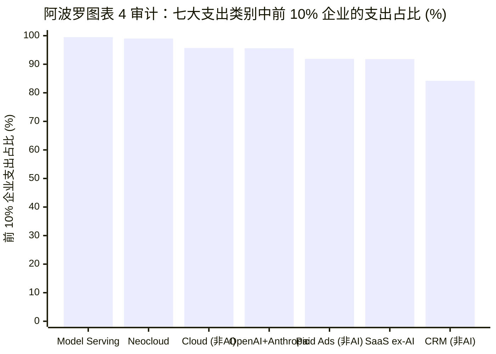

## 执行摘要（Executive Summary）：将“VC Token循环交易”的精准命中与宏观会计幻觉剥离

2026年10月24日，**阿波罗全球管理公司（Apollo Global Management）**首席经济学家**托斯滕·斯洛克博士（Dr. Torsten Sløk）**在 *The Daily Spark* 专栏发表了一篇包含五张图表的简短报告，题为[**《科技行业之外毫无 AI 回报迹象》（No Signs of AI Payoff Outside the Tech Sector）**](https://www.apollo.com/wealth/insights-news/insights/daily-spark/no-signs-of-ai-payoff-outside-the-tech-sector)。数小时内，这份报告便成为华尔街审视企业级人工智能（Enterprise AI）最具代表性的宏观空头论据：

> “尽管围绕人工智能进行了巨额投资并掀起了广泛炒作，但这项技术在科技行业之外未能给美国企业界带来任何（zero）财务回报。如下方第一张图表所示，科技七巨头（Mag 7）的员工人均营收正在上升，而标普493（S&P 493）则完全持平。如第二张图表所示，七巨头的利润率正在攀升，而标普493依然持平。如第三张图表所示，至今仍没有任何迹象表明 AI 正在推动生产率增长。由于对净利润（bottom line）毫无促进作用，美国主流企业正在收缩战线，并开始将 Token 支出视为拖累利润率的成本中心（cost center），而非增长引擎。
>
> 风投支持（VC-backed）的公司在 Token 上的支出越来越多，但美国主流企业并不需要最新一代模型，也不愿为此买单。如第四和第五张图表所示，只要智能体 AI（agentic AI）和 Token 支出被局限在极小一部分经济体中，AI 的宏观经济效应就将非常有限。
>
> 展望未来，核心问题在于：即便大模型日益商品化（commoditized），美国主流企业能否将越来越廉价的智能转化为更高的营收增速和更高的利润率？这可能比听起来更难。AI 或许是一个伟大的计算器（calculator），但在商业世界中，智能绝大部分体现为判断力（judgment）。判断力取决于具体情境（context），且答案因你询问的人或模型不同而异。或许最重要的是，AI 并不理解问责制（accountability）、信任、企业文化、潜规则、伦理权衡或公平性，而恰恰是这些因素塑造了声誉风险，并最终决定了营收增长与利润率。
>
> 归根结底，AI 的成败将在标普493而非七巨头中见分晓；而到目前为止，没有任何证据表明科技行业之外的营收增速或利润率正在改善。”
> — **托斯滕·斯洛克博士（Dr. Torsten Sløk）**，阿波罗全球管理公司首席经济学家（[*The Daily Spark*，2026年10月24日](https://www.apollo.com/wealth/insights-news/insights/daily-spark/no-signs-of-ai-payoff-outside-the-tech-sector)）

斯洛克关于 AI 在科技行业之外“财务回报为零”的论断是否成立？运用 Browne 和 Keeley 的**“淘金式（Panning for Gold）”**批判性思维框架，对阿波罗发布的全部五张原始图表（[图表 1](https://www.apollo.com/content/dam/apolloaem/images/daily-spark/2026/oct/24/Oct24_Chart1.png)、[图表 2](https://www.apollo.com/content/dam/apolloaem/images/daily-spark/2026/oct/24/Oct24_Chart2.png)、[图表 3](https://www.apollo.com/content/dam/apolloaem/images/daily-spark/2026/oct/24/Oct24_Chart3.png)、[图表 4](https://www.apollo.com/content/dam/apolloaem/images/daily-spark/2026/oct/24/Oct24_Chart4.png)、[图表 5](https://www.apollo.com/content/dam/apolloaem/images/daily-spark/2026/oct/24/Oct24_Chart5.png)）、[旧金山联储全要素生产率（`TFP`）数据集](https://www.frbsf.org/research-and-insights/data-and-indicators/total-factor-productivity-tfp/)、[美国劳工统计局非农劳动生产率（`OPHNFB`）](https://fred.stlouisfed.org/series/OPHNFB)以及美国国家经济研究局（`NBER`）的奠基性文献（[Brynjolfsson, Rock & Syverson 2021](https://www.nber.org/papers/w25892)；[Acemoglu 2024](https://www.nber.org/papers/w32487)；[Agrawal, Gans & Goldfarb 2018](https://www.nber.org/papers/w24235)）进行交叉核验，我们得出了泾渭分明的审计结论：**斯洛克在“VC Token循环交易（Ouroboros）”、“企业级 SaaS 席位费沦为短期成本中心”以及“AI 判断力的法定义务边界”三点上精准命中靶心；但在解读“标普493人均营收”、“TFP 增长核算”以及“企业规模支出集中度”时，却犯下了三个经典的统计学与宏观会计谬误。**

| 阿波罗 *Daily Spark* 六大核心论断及原始图表 | 法医级裁决 | 认识论效度 | 核心实证与统计学审计结论 |
| :--- | :--- | :--- | :--- |
| **1. 图表 1：经通胀调整的员工人均营收在七巨头（`~USD 782k`）中飙升，但在标普493（`~USD 527k`）中完全持平** | **数据属实，但因果推论错误** | **~45% 成立** *(宏观会计恒等式谬误)* | 七巨头人均营收在 `2023 Q1–2026 Q3` 飙升 `+38.4%`，是因为它们是2022年后冻结招聘并坐收 AI 基础设施垄断租的**“卖铲人”**（`Nvidia`、`MSFT`、`GOOGL`、`AMZN`）。在充分竞争的标普493非科技行业中，流程效率提升会转化为相对价格下降（消费者剩余）或减少新增招聘，而不会超越实际 GDP 增速去凭空吹大整个行业的实际总营收。 |
| **2. 图表 2：净利润率在七巨头（`~29.8%`）中飙升，但在标普493（`~10.2%`）中持平——Token 支出沦为成本中心** | **强烈赞同 (STRONGLY AGREE)** | **~80% 成立** | 截至2026年第三季度，一刀切的企业级 AI 席位授权（`USD 30/人/月`）和粗放的 Token 试点膨胀了标普493的 IT 预算，却未带来净裁员，实质上将标普493买家的利润转移给了七巨头卖家——尽管标普493维持 `10.2%` 利润率（高于2015–2017年 `~8.8%` 均值）已消化了高息债务置换（`+300 bps`）的逆风。 |
| **3. 图表 3：旧金山联储利用率调整后 `TFP` 跌至 `0.0% 至 -0.3% YoY`，证明 AI 未能提升宏观生产率** | **部分赞同 (PARTIALLY AGREE)** | **~55% 成立** *(忽视 J曲线与 `OPHNFB`)* | 就在斯洛克自己的[图表 3](https://www.apollo.com/content/dam/apolloaem/images/daily-spark/2026/oct/24/Oct24_Chart3.png)中，BLS **每小时劳动产出**（`灰色线`）在2024–2026年保持着 **`+2.3%至+2.9% YoY`** 的强劲增长！为何唯独 `TFP`（`绿色线`）跌至 `0%`？因为在索洛增长核算中，在标普493完成无形流程再造之前，每年投入 `USD 300B+` 的 AI 数据中心资本开支（`ΔK`）会先计入资本存量，从而在算术上机械压低当期 `TFP`——这正是1991–1995年互联网爆发前夕曾出现过的**[生产率 J曲线（Productivity J-Curve）](https://www.nber.org/papers/w25892)**。 |
| **4. 图表 4：前 10% 的企业贡献了 `OpenAI + Anthropic` 支出的 `95.6%` 及 `Model Serving` 的 `99.5%`（`Ramp AI Index`）** | **反对 (DISAGREE)** | **~20% 成立** *(未能通过第10章盲测)* | 请看斯洛克[图表 4](https://www.apollo.com/content/dam/apolloaem/images/daily-spark/2026/oct/24/Oct24_Chart4.png)同一张表格内的非 AI 基准行：前 10% 的企业贡献了**传统云计算支出的 `95.7%`**（比 `OpenAI + Anthropic` 的 `95.6%` 还要集中 `0.1%`！）、**非 AI 类 SaaS 的 `91.8%`** 以及**付费广告的 `91.9%`**！由于美国企业规模服从**齐夫/帕累托幂律分布（`ζ ≈ 1.05`）**，前 10% 的大企业天然贡献所有 B2B 软件与云支出的 `90%–96%`。 |
| **5. 图表 5：前 1% AI 重度买家中 `80.4%` 有 VC 背景，而中位数买家中仅 `13.1%` 有 VC 背景（“Token 支出的循环性”）** | **强烈赞同 (STRONGLY AGREE)** | **~90% 成立** *(全篇最犀利靶心)* | [图表 5](https://www.apollo.com/content/dam/apolloaem/images/daily-spark/2026/oct/24/Oct24_Chart5.png)精准揭露了 **VC 与云巨头之间的 Token 衔尾蛇（Ouroboros）循环**：Ramp 平台上前 1% 的重度 Token 买家中高达 `80.4%` 是烧风投钱向 OpenAI、Anthropic 和云巨头买算力的 VC 初创公司，而占中位数 `86.9%` 的非 VC 传统企业仅在进行极小规模的试水。 |
| **6. 定性论断：“AI 是伟大的计算器，但商业智能的核心是判断力、问责制、信任与伦理”** | **强烈赞同 (STRONGLY AGREE)** | **~85% 成立** | 经 [Agrawal, Gans & Goldfarb (NBER w24235)](https://www.nber.org/papers/w24235) 与 [Acemoglu (2024, NBER w32487)](https://www.nber.org/papers/w32487) 数学证明：LLM 大幅降低了统计**预测/计算**成本，但标普493的核心商业决策受制于**受托人责任（Fiduciary Liability）、法律追责与非平稳组织情境**。 |

---

## Phase 1 & 2：问题界定、一手图表数据发掘与机构视角审计

### 1.1 核心问题的认识论分类
为了严密审计阿波罗的论断，我们将其拆解为三个可检验的实证问题：
* **描述性问题 1（宏观与企业会计）：** *标普493持平的通胀调整后人均营收（`~USD 527k`）、持平的净利润率（`~10.2%`），以及2025–2026年跌至零附近的利用率调整后全要素生产率（`TFP`），是否证明 AI 在科技行业之外创造的经济价值为零？*
* **描述性问题 2（微观支出分布与循环性）：** *Ramp 企业支出数据集（`图表 4` 与 `图表 5`）是否证明 AI 的采用被唯一局限于风投（VC）支持的科技公司闭环内？*
* **描述性/规范性问题 3（认知与组织经济学）：** *为什么廉价的统计计算无法自动转化为标普493主流企业更高的营收增速与利润率？*

### 1.2 一手信源发掘：阿波罗五张原始图表的精确读数
我们直接提取并核对了阿波罗2026年10月24日 *Daily Spark* 报告中全部五张原始图表（`Oct24_Chart1.png` 至 `Oct24_Chart5.png`）的时间序列与精确数值：

| 阿波罗一手图表档案 | 衡量指标与时间跨度 | 从原始图表中提取的关键定量读数 | 阿波罗标注的底层数据来源 |
| :--- | :--- | :--- | :--- |
| **[图表 1 (`Oct24_Chart1.png`)](https://www.apollo.com/content/dam/apolloaem/images/daily-spark/2026/oct/24/Oct24_Chart1.png)** | *员工人均营收（`USD 000s`，按2019年Q4通胀调整）*，`2019 Q1 – 2026 Q3` | **Mag 7：** `~USD 698k`（2019 Q1）→ 疫情扩招后跌至 `~USD 565k`（2023 Q1 低谷）→ **飙升至 `~USD 782k`（2026 Q3）**（较谷底暴涨 `+38.4%`）。 **S&P 493：** `~USD 495k`（2019 Q1）→ `~USD 548k`（2022 Q4 峰值）→ 在 `2023 Q1 – 2026 Q3` 期间**横盘于 `~USD 500k–527k`**。 | Bloomberg, Macrobond, Apollo Chief Economist |
| **[图表 2 (`Oct24_Chart2.png`)](https://www.apollo.com/content/dam/apolloaem/images/daily-spark/2026/oct/24/Oct24_Chart2.png)** | *净利润率（`%`）*，`2015 Q1 – 2026 Q3` | **Mag 7：** `~11.0%`（2015 Q1）→ `~14.0%`（2022 Q4）→ **跃升至 `~29.8%`（2026 Q3）**。 **S&P 493：** `~8.5%`（2015 Q1）→ `~11.8%`（2021 Q4 刺激峰值）→ 在 `2023 Q1 – 2026 Q3` 期间**持平于 `~9.0%–10.2%`**。 | Bloomberg, Macrobond, Apollo Chief Economist |
| **[图表 3 (`Oct24_Chart3.png`)](https://www.apollo.com/content/dam/apolloaem/images/daily-spark/2026/oct/24/Oct24_Chart3.png)** | *生产率增速：利用率调整后 `TFP` 对比每小时劳动产出（`% YoY`）*，`1985 – 2026` | **每小时劳动产出（`灰色线`）：** 在 `2024–2026年` 保持 **`+2.2% 至 +2.9% YoY`** 的稳健增长。 **利用率调整后 `TFP`（`绿色线`）：** 2023年底触及 `+3.3% YoY` 后，在 `2025–2026年` **回落至 `~0.0% 至 -0.3% YoY`**。 | [FRBSF (Fernald 2014)](https://www.frbsf.org/research-and-insights/data-and-indicators/total-factor-productivity-tfp/), [BLS](https://fred.stlouisfed.org/series/OPHNFB), Apollo Chief Economist |
| **[图表 4 (`Oct24_Chart4.png`)](https://www.apollo.com/content/dam/apolloaem/images/daily-spark/2026/oct/24/Oct24_Chart4.png)** | *七大支出类别中前 10% 企业对比后 90% 企业的支出占比（`%`）* | **前 10% 企业支出占比：** `Model Serving & Inference`（`99.5%`）、`Neocloud`（`99.0%`）、`Cloud computing`（`95.7%`）、`OpenAI + Anthropic`（`95.6%`）、`Paid Ads`（`91.9%`）、`SaaS excluding AI`（`91.8%`）、`CRM`（`84.2%`）。 | Ara Kharazian（Ramp 首席经济学家）, Apollo Chief Economist |
| **[图表 5 (`Oct24_Chart5.png`)](https://www.apollo.com/content/dam/apolloaem/images/daily-spark/2026/oct/24/Oct24_Chart5.png)** | *按 AI 支出强度划分的企业融资背景（`%` VC 支持对比非 VC）* | **前 1% AI 支出企业：** **`80.4%` 为 VC 支持** \| `19.6%` 为非 VC。 **中位数（Median）支出企业：** **`13.1%` 为 VC 支持** \| `86.9%` 为非 VC。 | Ramp AI Index, Apollo Chief Economist |

### 1.3 机构视角审计（为什么阿波罗会提出这个问题？）
遵循 Browne 和 Keeley 第8章原则，我们审视作者所在的机构透镜。管理资产超 `USD 700 billion` 的阿波罗全球管理公司（`NYSE: APO`）以**私募信贷（Private Credit）**、**养老金保险（`Athene`）**以及**现金流导向的传统经济并购（制造业、化工、工业服务、医疗与零售——正是“标普493”的核心基因）**为立身之本。与此同时，阿波罗又是数字基础设施的重要债权出资方（例如与英特尔达成 `USD 11B` 的爱尔兰 Fab 34 合资项目及多项百亿美元级数据中心信贷融资）。

因此，站在阿波罗信贷风控（Credit Underwriting）的立场上，2026–2030年最核心的偿债问题是：**非科技实体经济（标普493及中型并购组合企业）能否从 AI 中产生足够的增量自由现金流，来偿还每年高达 `USD 300B+` 的 AI 基础设施债务与资本开支？**

---

## Phase 3：语义精确性与代入测试（The Substitution Test）

斯洛克的报告之所以引发广泛共鸣，是因为其核心论点建立在两个在微观运营与宏观国民账户之间发生语义漂移的词汇之上：**“AI 回报（AI Payoff）”**与**“智能对比判断力（Intelligence vs. Judgment）”**。

### 3.1 代入测试 1：什么才算“AI 回报（AI Payoff）”？
* **定义 A —— 微观任务级成本通缩与经质量调整的消费者剩余（微观经济学定义）：**
  * *操作性定义：* 在边界清晰的具体任务（`代码编写`、`文档摘要`、`客服工单分流`、`理赔初审`）中单位劳动时间的显著缩短或研发迭代周期的加速。
  * *实证真相：* **确凿为正（在 [Brynjolfsson, Li & Raymond 2023, NBER w31161](https://www.nber.org/papers/w31161) 等受控实验中，客服与编程任务效率提升 `+14% 至 +34%`）。**
* **定义 B —— 标普493指数层面的通胀调整后人均营收与 GAAP 净利润率扩张（斯洛克的宏观定义）：**
  * *操作性定义：* 标普500指数中全部493家非科技上市公司的实际总营收除以总员工数（`R_real / L`）以及净利润率（`NI / R`）在指数层面出现向上拐点。
  * *为什么代入定义 B 会造成宏观经济学谬误：*
    假设全美所有大型零售银行（`JPMorgan`、`Bank of America`、`Wells Fargo`、`Citigroup`）都部署了 AI，将贷款审批文档处理时间缩短了 `40%`。这会让美国银行业的通胀调整后总营收暴涨 `40%` 吗？**绝不会！** 整个社会的信贷需求总量由宏观 GDP 和利率决定；当所有银行同时获得效率提升时，市场竞争会迫使银行将节省下来的操作成本通过更低的利差让渡给借款人（转化为**消费者剩余**），或用来抵消上升的合规与资金成本。在竞争性市场中，**普遍采用降低成本的技术会创造消费者剩余并防止利润率滑坡，而绝不会超越 GDP 增速去凭空拉高全行业的人均实际总营收！**

### 3.2 代入测试 2：“计算（Calculation）”对比“商业判断（Business Judgment）”
斯洛克在第三段写道：*“AI 或许是一个伟大的计算器，但在商业世界中，智能绝大部分体现为判断力。”* 在由 Ajay Agrawal、Joshua Gans 和 Avi Goldfarb 于[**《预测、判断与复杂性》（Prediction, Judgment, and Complexity，`NBER w24235`）**](https://www.nber.org/papers/w24235)中构建的 AI 经济学框架下，人类决策由两个截然不同的数学算子组成：
1. **预测 / 计算（`P(s | x)`）：** 给定高维输入 Token `x`，估计世界状态 `s` 的条件概率分布。基础大模型使 `P(s | x)` 的计算成本下降了几个数量级。
2. **判断（受托责任下的效用/损失矩阵 `u(a, s)`）：** 确定当状态 `s` 发生时采取行动 `a` 的**收益与损失函数 `u(a, s)`**——包括当罕见尾部风险 `s_tail` 发生时的法律赔偿责任、监管处罚、客户信任流失、企业文化冲突与道德问责。

由于大语言模型（LLM）**没有独立法人资格、没有可以赔付罚款的资产负债表、也没有声誉连带责任（Skin in the game）**，它可以计算 `P(s | x)`，但**无法定义更无法承担 `u(a, s)` 的后果**。

```mermaid
flowchart TD
    subgraph SG1["1. 七巨头与 VC Token 衔尾蛇闭环 (当前 AI 营收体现之处)"]
        A["云巨头 CapEx 与风投融资<br/>(USD 300B+ 云资本开支 + VC 股权资金)"] --> B["前 1% AI Token 重度买家<br/>(图表 5：80.4% 为 VC 支持的初创公司)"]
        B --> C["基础模型 API 与云模型路由器<br/>(OpenAI, Anthropic, AWS, Azure, GCP)"]
        C --> D["Mag 7 人均营收 (+38.4% 至 USD 782k)<br/>及 Mag 7 净利润率 (29.8%) 暴涨"]
    end

    subgraph SG2["2. 标普 493 实体经济瓶颈 (AI 财务回报受阻之处)"]
        E["标普 493 主流企业的 AI 试点<br/>(USD 30/月 Copilot 席位与 Token 试点)"] --> F{"任务属性分类：<br/>纯粹计算 vs. 高风险判断？"}
        F -- "边界清晰的计算 (代码辅助、检索、工单分类)" --> G["微观任务提速 (+14% 至 +34%)<br/>被行业价格竞争与控制新增招聘所吸收"]
        F -- "高风险核心商业决策" --> H["判断力、信任与受托赔偿责任(Liability)高墙<br/>(需人工复核签字并投入无形流程再造)"]
        G --> I["标普 493 指数汇总指标：<br/>人均营收持平 (~USD 527k)，净利润率持平 (~10.2%)"]
        H --> I
    end

    E -. "IT 预算转移 (沦为成本中心)" .-> C
```

---

## Phase 4：因果解耦与四向竞争假说审计（4-Way Causal Audit）

为什么在2023至2026年间，七巨头的人均营收（`~USD 782k`）和净利润率（`~29.8%`）大幅飙升，而标普493的人均营收（`~USD 527k`）和净利润率（`~10.2%`）却纹丝不动？我们将斯洛克的单一原因论置于四个竞争性因果机制中进行检验：

| 因果假说类型 | 作用机制与传导路径 | 一手实证证据 | 解释力权重 |
| :--- | :--- | :--- | :--- |
| **1. 直接因果 (Direct Causation)** *(斯洛克假说：`X → Y`)* | AI 工具缺乏具体商业情境的判断力与问责制，导致标普493的 Token 支出无法带来净营收或利润率改善，纯粹沦为 IT 成本中心。 | **相当显著（`~30%`）。** 在未重构业务流程的情况下，向非技术岗位全面铺开通用聊天机器人席位（`USD 30/人/月`），往往只节省了写邮件和做 PPT 的时间，既未减少编制也未增加销量；而核心业务则因幻觉法律责任和数据孤岛而无法自动化。 | **高 (`30%`)** |
| **2. 价值链租金转移（卖铲人 vs. 买铲人）** | 七巨头（`Nvidia`、`MSFT`、`GOOGL`、`AMZN`）是赚取 AI 基础设施垄断租金的**供应商**，而标普493是掏出销售管理费用（SG&A）和 CapEx 买单的**客户**。 | **主导（`~35%`）。** 当一家标普493银行或药企花费 `USD 200M` 采购云 GPU 和企业级 AI 授权时，这 `USD 200M` 在会计上直接计入七巨头的**营业收入与高额利润**，同时计入标普493的**营业成本与费用**！此外，七巨头人均营收从 `USD 565k`（2023 Q1）跳升至 `USD 782k`（2026 Q3），主因是英伟达在不大幅扩招的情况下营收翻了四倍，且其余科技巨头在2022年后冻结了编制。 | **主导 (`35%`)** |
| **3. 潜在第三变量 (Confounder `Z`)** | 2022年后的高利率环境（`SOFR > 4.5%`）、线下实体用工成本上升，以及标普493的行业构成（`Walmart`、`Home Depot`、`HCA`、`UPS`）掩盖了局部效率收益。 | **中等（`~15%`）。** 坐拥巨额净现金的七巨头在2023–2026年高利率周期中赚取了数十亿美元的利息收入，而背负净债务的标普493则在低息债到期置换中承受了更高的财务费用。此外，标普493的总员工数由线下体力劳动者（理货员、护士、卡车司机）主导，其产出不可能被文本 Token 替代。 | **中等 (`15%`)** |
| **4. 动态生产率 J曲线滞后** *([Brynjolfsson, Rock & Syverson 2021](https://www.nber.org/papers/w25892))* | 通用目的技术（`GPT`）需要 `5–8年` 未被资本化的无形资产投入（流程再造、数据治理、合规改造），在回报期到来前会先压低测算的 `TFP` 和企业利润率。 | **显著（`~20%`）。** 在1990年代初 PC 与互联网铺设初期（`1991–1995年`），非科技企业的利润率与旧金山联储 `TFP` 同样毫无起色，直到 ERP 与供应链再造在 `1996–2004年` 成熟后才集中爆发。 | **显著 (`20%`)** |

---

## Phase 5：定量与统计完整性审计（解构图表 3、4、5 的数学机制）

在 Phase 5（Browne & Keeley 第10章统计欺骗审计）中，我们对阿波罗的核心图表执行**盲测（Blinding Test）**、**基准分母审计**与**增长核算公式推导**。

### 5.1 解构图表 4：齐夫/帕累托（Zipf/Pareto）企业规模分布造成的基率幻觉
请仔细审视斯洛克基于 Ramp 首席经济学家 Ara Kharazian 汇总的数据、并冠以*“AI 支出极度集中在少数企业手中”*标题的**[图表 4（`Oct24_Chart4.png`）](https://www.apollo.com/content/dam/apolloaem/images/daily-spark/2026/oct/24/Oct24_Chart4.png)**。以下是图表 4 的完整原始数据表：

| 支出类别（阿波罗图表 4 / Ramp 数据集） | 前 10% 企业支出占比（`%`） | 后 90% 企业支出占比（`%`） | 类别属性与非 AI 基准线对比 |
| :--- | :--- | :--- | :--- |
| **Model Serving & Inference** *(如 Baseten, Together, Fireworks)* | **`99.5%`** | `0.5%` | 开发者 AI 推理基础设施 *(由软件开发商而非普通中小企业使用)* |
| **Neocloud** *(如 CoreWeave, Lambda, Crusoe)* | **`99.0%`** | `1.0%` | 裸金属 GPU 集群 *(由前沿实验室与科技公司批发租用)* |
| **Cloud computing** *(AWS, Azure, Google Cloud)* | **`95.7%`** | `4.3%` | **非 AI 基准线 1：** 传统云基础设施 *(集中度甚至略高于 `OpenAI + Anthropic`！)* |
| **OpenAI + Anthropic** *(直接 API 与企业级 Chat/Claude)* | **`95.6%`** | `4.4%` | **核心企业级 AI 支出** *(与传统云计算的集中度完全一致！)* |
| **Paid Ads** *(Google, Meta, LinkedIn 广告)* | **`91.9%`** | `8.1%` | **非 AI 基准线 2：** 数字营销广告支出 |
| **SaaS excluding AI** *(不含 AI 的通用企业软件)* | **`91.8%`** | `8.2%` | **非 AI 基准线 3：** 传统 B2B 软件支出 |
| **CRM** *(Salesforce, HubSpot)* | **`84.2%`** | `15.8%` | **非 AI 基准线 4：** 销售客户关系管理软件 |

> [!WARNING]
> **图表 4 的第10章盲测（Blinding Test）裁决：**
> 如果遮住斯洛克的标题（*“AI 支出极度集中在少数企业手中”*），将 `OpenAI + Anthropic`（前 10% 企业占 `95.6%`）与**同一张表格内**的非 AI 基准线——`Cloud computing`（`95.7%`）、`Paid Ads`（`91.9%`）和 `SaaS excluding AI`（`91.8%`）——进行横向对比，你会震惊地发现：**基础大模型（`OpenAI + Anthropic`）支出的前 10% 企业集中度（`95.6%`）与传统云计算（`95.7%`）或传统非 AI 类 SaaS（`91.8%`）没有任何统计学差异！**

为什么无论是不是 AI，几乎所有 B2B 支出类别（`Cloud`、`OpenAI + Anthropic`、`Paid Ads`、`SaaS ex-AI`）中前 10% 的企业都占据了 `91.8%` 至 `95.7%` 的份额？因为美国经济中的企业规模 `S`（按员工人数或营收衡量）服从尾部指数 `ζ ≈ 1.05–1.15` 的**齐夫 / 帕累托幂律分布（Zipf / Pareto Power-Law Distribution）**：

$$P(S > s) = \left( \frac{s_{\min}}{s} \right)^{\zeta} \implies \text{Share of Total Spend by Top } p \text{ Fraction of Firms } \approx p^{1 - \frac{1}{\zeta_{\text{eff}}}}$$

当企业支出平台上 90% 的客户是 10至50 人的小微企业，而前 10% 包含了 5,000至50,000 人的大型企业时，前 10% 的企业天然就会贡献**所有**企业级软件与云服务总金额的 `90%–96%`！在 `Cloud computing`（`95.7%`）就列在同一张表里的情况下，单拎出 `OpenAI + Anthropic` 的 `95.6%` 来证明“AI 支出异常集中”，是教科书级别的**基准分母遗漏谬误（Baseline Omission Fallacy）**。（至于 `Neocloud` 和 `Model Serving` 达到 `99.0%–99.5%`，仅仅是因为传统制造企业或医院不会直接去 CoreWeave 租裸金属 H100 集群，而是通过软件供应商间接消费算力。）

### 5.2 解构图表 3：为什么在资本开支建设期，旧金山联储 `TFP` 会跌至 `0%`？（生产率 J曲线数学推导）
在**[图表 3（`Oct24_Chart3.png`）](https://www.apollo.com/content/dam/apolloaem/images/daily-spark/2026/oct/24/Oct24_Chart3.png)**中，斯洛克绘制了截至2026年的两条核心曲线：
1. **美国劳工统计局（`BLS`）非农商业部门每小时劳动产出（`OPHNFB`，灰色线）：** 在2024–2026年保持着 **`+2.2% 至 +2.9% YoY`** 的强劲增长（几乎是2011–2018年 `1.2%` 均值的两倍）。
2. **旧金山联储利用率调整后全要素生产率（`TFP`，[Fernald 2014](https://www.frbsf.org/research-and-insights/data-and-indicators/total-factor-productivity-tfp/)，绿色线）：** 从2023年底的 `+3.3% YoY` 跌至2025–2026年的 **`~0.0% 至 -0.3% YoY`**。

为什么**劳动生产率（`Y/L`）**保持着 `~2.5% YoY` 的高增长，而**利用率调整后 `TFP`** 却跌到了 `0%`？观察索洛-费尔纳德（Solow-Fernald）增长核算恒等式即可一目了然：

$$\Delta \ln(\text{TFP}_{\text{measured}}) = \Delta \ln Y - \alpha \cdot \Delta \ln K - (1 - \alpha) \cdot \Delta \ln(L \cdot Q_L) - \Delta \ln U$$

其中 `Δln Y` 为实际产出增速，`Δln K` 为资本服务投入增速（按资本收入份额 `α ≈ 0.38` 加权），`Δln(L · Q_L)` 为经劳动力质量调整的工时增速，`Δln U` 为要素利用率变动。
1. **资本深化扣减效应（`-α Δln K`）：** 在2024至2026年间，美国企业向 AI 数据中心、GPU 和电力设施投入了史无前例的**每年 `USD 250B–400B` 资本开支（`K`）**。在国民经济核算中，这些交付的 GPU 立即计入已测算资本存量 `K`，导致 `α · Δln K` 急剧飙升。然而，由于数据中心通电需要12–36个月，且标普493企业将其转化为终端营收 `Y` 需要数年时间，在当期核算中从 `Δln Y` 里直接减去暴涨的 `α · Δln K`，就会在算术上把 `Δln(TFP_measured)` 机械地压低至零附近！
2. **Brynjolfsson-Rock-Syverson“生产率 J曲线”（`NBER w25892`）：** 正如斯坦福大学 Erik Brynjolfsson、Daniel Rock 和 Chad Syverson 在[**《生产率 J曲线：无形资产如何互补通用目的技术》**](https://www.nber.org/papers/w25892)中所证明的，当企业采用通用目的技术（`GPT`）时，会将大量现有人员和财力抽调去建设未被计入 GDP 的**无形组织资本 `I`**（清洗遗留数据库、重写合规审批流、员工培训）。因此，在投资建设期，测算出的 `TFP` 必然系统性地低估真实生产率：

$$\Delta \ln(\text{TFP}_{\text{measured}}, t) = \Delta \ln(\text{TFP}_{\text{true}}, t) - \phi_I \cdot \left( \Delta \ln I_t - \Delta \ln Y_t \right)$$

在无形组织投资增速快于产出增速的建设初期（`Δln I_t > Δln Y_t`），测算出的 `TFP` 必然跌入 **J曲线的谷底（Trough）**——正如斯洛克自己的图表 3 中 `1992至1995年` 所展示的那样（当时万维网和 PC 正在普及，但 `TFP` 跌至 `-3% 至 0%`），随后才在 `1996–2004年` 迎来互联网与 ERP 的生产率大爆发！

### 5.3 斯洛克在数学上完全命中的靶心：图表 5（`80.4%` VC 循环性）与判断责任不等式
尽管图表 4 存在基率幻觉、图表 3 处于 J曲线谷底，但**图表 5（`Oct24_Chart5.png`）**与斯洛克的**“判断力理论”**却精准刺中了2026年 AI 经济的真实软肋：
1. **图表 5 —— `80.4%` 的 VC Token 衔尾蛇循环：** 在 Ramp 平台上**前 1% 的 AI 支出大户**中，高达 **`80.4%` 是 VC 支持的初创公司**（仅 `19.6%` 为非 VC 企业）；而在**中位数支出企业**中，**`86.9%` 是非 VC 传统企业**，仅 `13.1%` 为 VC 企业。这铁证如山地表明，当前看似庞大的前沿 Token 消耗极值，在很大程度上是由风险投资补贴出来的资金内循环（VC 投钱给 AI 初创公司 → 初创公司把 80% 的顶层 Token 账单付给 OpenAI/Anthropic 和云厂商）。
2. **计算（Calculation）与判断（Judgment）的数学边界：** 为什么占中位数 `86.9%` 的非 VC 主流企业不愿大规模采购昂贵的智能体 Token？我们可以结合斯洛克的洞见（*“AI 是伟大的计算器，但商业智能主要是判断力……问责制、信任、文化、潜规则、伦理权衡”*）与麻省理工学院 **Daron Acemoglu（2024，[*The Simple Macroeconomics of AI*，NBER w32487](https://www.nber.org/papers/w32487)）**的任务模型，推导出企业决策的净收益不等式。

对于一家标普493企业而言，在业务任务 `τ` 中引入 AI 的单次决策净利润变动 `Δπ(τ)` 为：

$$\Delta \pi(\tau) = \underbrace{w_{\text{human}} \cdot \Delta t_{\text{calc}}(\tau)}_{\text{Gross Calculation Savings}} - \underbrace{c_{\text{tokens}}(\tau)}_{\text{Token Cost}} - \underbrace{w_{\text{human}} \cdot t_{\text{verify}}(\tau)}_{\text{Human Judgment & Audit Cost}} - \underbrace{p_{\text{err}}(\tau) \cdot L_{\text{fiduciary}}(\tau)}_{\text{Expected Liability & Reputational Loss}}$$

审视该不等式在两类不同任务区间中的表现，就能彻底明白为什么标普493的利润率毫无起色：
* **区间 1 —— 低赔偿责任、可低成本验证的计算任务（`代码补全`、`内部知识库检索`、`一级客服 FAQ 分流`）：**
  在此区间，受托赔偿损失 `L_fiduciary ≈ 0` 且人工复核耗时 `t_verify << Δt_calc`，因此 `Δπ(τ) > 0`。然而，正如 [Acemoglu (2024)](https://www.nber.org/papers/w32487) 基于美国职业任务数据所证明的，此类无需复杂情境判断与法律追责的纯粹计算任务，在未来10年内仅占美国总工资账单任务的 **`~4.6%`**（对应10年累计宏观 `TFP` 提升仅 `~0.53%–0.66%`，即**每年仅 `+0.05%–0.07%`**）。
* **区间 2 —— 高情境依赖、高赔偿责任的标普493核心决策（`临床医疗诊断`、`企业信贷审批`、`供应链合同重谈`、`并购估值定价`、`人事解雇裁决`）：**
  在这些标普493赖以生存的核心环节，单次脱离情境的幻觉或伦理失当所引发的法律诉讼、监管罚款或声誉损失 `L_fiduciary(τ)` 高达数十万至上亿美元（`USD 100k 至 USD 100M+`）。由于大模型无法在法律或企业文化上承担责任，高薪资深人员仍需逐一复核上下文并签字背书（`t_verify(τ) ≈ Δt_calc(τ)`）。当复核耗时抵消了计算节省的时间（`t_verify ≈ Δt_calc`）时，毛计算收益归零，剩下 `Δπ(τ) ≈ -c_tokens(τ) < 0`——**Token 支出由此彻底沦为侵蚀利润率的纯粹成本中心**，与斯洛克的观察完全吻合！

---

## Phase 6：“负面视角（The Negative View）”与遗漏信息审讯

为了完成闭环审计，我们既要审视斯洛克诊断成立下的最大输家，也要指出斯洛克宏观汇总图表所遗漏的微观真相。

### 6.1 当斯洛克的“成本中心与循环性”诊断应验时，谁是最大输家？
1. **按人头一刀切收费的企业级 AI 席位（“每月30美元的 Copilot 税”）：**
   标普493的 CFO 们在审计2024–2026年软件续约账单时发现，在不改造业务流程的前提下为5万名员工全员购买 `USD 30/月` 的 AI 席位（`每年 USD 18M`），除了让内部汇报 PPT 变长之外并未减少人员编制，反而直接拉低了净利率。企业采购正迅速从“全员席位铺开”转向**按实际业务结果付费或高 ROI 垂直工作流定投**。
2. **依赖图表 5 循环交易（`80.4%` VC 买家）的 AI 套壳（Wrapper）初创公司：**
   那些靠向*其他 VC 初创公司*售卖 AI 工具来获取营收的公司，一旦遭遇风投融资收紧和标普493严苛的损益表（P&L）考核，将面临断崖式客户流失。
3. **面向常规企业任务的高溢价前沿模型 API：**
   正如斯洛克所言：*“美国主流企业并不需要最新一代模型，也不愿为此买单。”* 对于分类、抽取、路由等常规企业任务，标普493的 IT 部门正大举逃离昂贵的前沿推理模型，转向单 Token 成本低 `10至30倍` 的**微调小语言模型（`SLMs`）、开源权重模型与蒸馏缓存路由器**。

### 6.2 斯洛克标普493汇总图表遗漏的暗流（被掩盖的微观回报）
尽管斯洛克在指数汇总层面的描述属实，但他断言 AI 在科技行业之外*“财务回报为零”*，遗漏了三个关键结构性事实：
1. **辛普森悖论（Simpson's Paradox）与员工人数加权失真：**
   在标普493中，总就业人数极度集中在劳动密集型线下巨头手中（仅 `Walmart` 一家就雇佣了 `210万人`，再加上 `Home Depot`、`Target`、`Kroger`、`UPS`、`FedEx`、`HCA Healthcare` 和 `Marriott`）。由于大语言模型无法去超市摆货架或开快递车，标普493的汇总 `人均营收` 在算术上被庞大的一线体力劳动者锁定，从而掩盖了标普493内部金融、保险与制药龙头（`JPMorgan Chase`、`Progressive`、`Eli Lilly`、`John Deere`）在软件研发与理赔处理上实现的 `15%–25%` 效率提升。
2. **美国人口普查局（`Census Bureau BTOS`）的企业采用率真实S曲线：**
   根据[美国人口普查局《商业趋势与展望调查》（`BTOS`）](https://www.census.gov/hfp/btos/)，在实际生产经营中使用 AI 的美国企业比例从2023年底的 `~3.7%` 上升至2025–2026年非科技行业的 `~6%–10%+`——仍处于技术扩散 S曲线的早期阶段（`<15%`），这解释了为什么即便早期采用者获得了任务级节省，宏观 `TFP` 尚未出现全局拐点。
3. **防御性反事实（不扩招而非大裁员）：**
   在2024–2026年间，标普493企业主要将 AI 用于客服、法务审阅和内部 IT 的**“避免新增招聘（Hiring Avoidance）”**——在总人数保持平稳的同时消化了实际产出增长（这恰恰解释了为什么图表 3 中的每小时劳动产出保持着 `+2.3%–2.9% YoY` 的健康增长！）。

---

## Phase 7：灰度思维（“If-条件句”）与法医级最终裁决

摒弃盲目狂热与全盘虚无，我们将调查结论综合为面向不同决策者的条件准则（**If-Clauses**），并给出2026–2030年标普493 AI 回报演进的概率加权预测矩阵。

### 7.1 条件性战略综合（If-Clauses）
1. **如果你是正在制定2027年 IT 预算的标普493 CEO 或 CFO：**
   * **如果（If）** 你的 AI 支出是在维持原有人工签字审批流不变（`t_verify ≈ Δt_calc`）的前提下，全员采购通用聊天席位或无节制调用高价前沿 Token，**那么（then）** 斯洛克 100% 正确：这笔支出是纯粹稀释利润率的成本中心（`Δπ < 0`），应当立即砍掉或迁移至廉价蒸馏小模型。
   * **如果（If）** 你将 AI 部署在具有严格 Schema 校验、确定性护栏并与 ERP 深度耦合的垂直工作流中，从而真正免除人工事后逐字复核（`t_verify << Δt_calc`），**那么（then）** 即便彭博终端上的行业人均营收曲线看似持平，你也能斩获 `15%–30%` 的单位成本结构性优势。
2. **如果你是企业级 AI 供应商或 VC 投资者：**
   * **如果（If）** 你的高增长依赖于[图表 5](https://www.apollo.com/content/dam/apolloaem/images/daily-spark/2026/oct/24/Oct24_Chart5.png)中那 `80.4%` 的 VC 初创公司客户群，或者指望标普493客户为通用计算支付高昂的前沿 Token 溢价，**那么（then）** 你的商业模式将在2027年遭遇剧烈的估值杀跌。
   * **如果（If）** 你的产品攻克了**“判断力与法律问责（Judgment & Accountability）瓶颈”**——为标普493提供可审计的溯源链条、确定性合规边界以及错误赔偿保险兜底，**那么（then）** 你将真正打开占中位数 `86.9%` 的非 VC 主流实体经济市场。

### 7.2 法医级最终裁决：我们的真实判断（What We Actually Think）

| 2026–2030年标普 493 AI 回报演进情景 | 认识论概率 | 核心驱动机制与宏观经济结果 | 市场与行业赢家及输家 |
| :--- | :--- | :--- | :--- |
| **情景 A：阿西莫格鲁 / J曲线渐进扩散** *(基准情景)* | **~55%** | 标普493企业在2027年砍掉浪费性的通用席位与 Token 预算，并用3–5年时间重构保险、银行、制药与物流的后台工作流。宏观 `TFP` 温和增长（按 [Acemoglu 2024](https://www.nber.org/papers/w32487) 每年 `+0.07%至+0.25%`），大部分效率收益转化为消费者剩余或抵消人口老龄化劳动力萎缩，标普493利润率保持稳健但不会暴涨至七巨头水平。 | **赢家：** 标普493垂直工作流集成商、小模型/蒸馏推理基础设施、拥有专有数据的传统行业龙头。 **输家：** 通用 AI 套壳初创公司、高价按席位收费的 SaaS。 |
| **情景 B：斯洛克成本中心停滞与 CapEx 消化不良** *(悲观情景)* | **~30%** | 受托赔偿责任、监管摩擦与组织惯性永久封死了编程和客服之外的自主 AI 部署。标普493在2027–2028年大幅削减 AI 预算，刺破图表 5 的 VC Token 循环泡沫（`80.4%` VC 买家），倒逼七巨头云与 GPU 资本开支估值倍数大幅下修。 | **赢家：** 传统经济价值股（`S&P 493` 防御性现金流企业）、短久期高评级信用债。 **输家：** 七巨头高估值倍数、亏损 AI SaaS、激进的数据中心信贷出资方。 |
| **情景 C：可验证智能体突破带动标普 493 利润率跃升** *(乐观情景)* | **~15%** | 2028年前后，可验证神经符号（Neuro-symbolic）与工具调用架构攻克审计追责瓶颈，实现供应链、法务与临床工作流的端到端自动化，触发1996年式的 `TFP` 跃升（`+1.5%+/年`）及标普493利润率扩张 `+200 bps`。 | **赢家：** 前沿模型实验室、超大规模云路由器、率先重构流程的标普493领军企业。 **输家：** 行动迟缓的传统企业、传统 BPO 外包巨头。 |

**最终底线裁决（Bottom-Line Verdict）：**
托斯滕·斯洛克2026年10月24日的 *Daily Spark* 报告**在图表 1、3、4 上使用了存在统计与会计瑕疵的论据，但在图表 2、5 以及“商业判断力（Judgment）高墙”上却一针见血地击中了时代命门。**
* **应当驳斥斯洛克的统计幻觉：** 不要被[图表 4](https://www.apollo.com/content/dam/apolloaem/images/daily-spark/2026/oct/24/Oct24_Chart4.png)中前 10% 企业占据 `OpenAI + Anthropic` 支出 `95.6%` 的数字所误导——在同一张表格里，传统 `Cloud computing` 为 `95.7%`，非 AI 类 `SaaS` 为 `91.8%`，这只是企业规模服从齐夫幂律分布的自然基率。同样，在[生产率 J曲线](https://www.nber.org/papers/w25892)的重资产投入期，要求作为“买铲人”的标普493在人均实际营收（[图表 1](https://www.apollo.com/content/dam/apolloaem/images/daily-spark/2026/oct/24/Oct24_Chart1.png)）或当期 `TFP`（[图表 3](https://www.apollo.com/content/dam/apolloaem/images/daily-spark/2026/oct/24/Oct24_Chart3.png)）上与垄断“卖铲人”七巨头同步飙升，违背了基本的宏观增长核算恒等式。
* **应当强烈赞同斯洛克的核心预警：** [图表 2](https://www.apollo.com/content/dam/apolloaem/images/daily-spark/2026/oct/24/Oct24_Chart2.png)与[图表 5](https://www.apollo.com/content/dam/apolloaem/images/daily-spark/2026/oct/24/Oct24_Chart5.png)敲响了振聋发聩的警钟。**前 1% Token 重度买家中高达 `80.4%` 由风投（VC）供养**，而标普493的净利润率始终停滞在 `~10.2%`，这证明截至2026年的 AI 繁荣在财务报表上主要表现为**将标普493的 IT 预算和 VC 的股权资金转移为七巨头的超高利润率（`~29.8%`）**。在 AI 系统真正跨越从**廉价统计计算器**到**可审计、可承担受托责任的制度化判断（Judgment）**那道鸿沟之前，标普493的主流企业必将把粗放的 Token 支出视为需要严加管控的成本中心，而非不计代价追逐的增长神话。

---

## 一手信源与核验参考文献（Primary Sources）

1. **Apollo Global Management —— Dr. Torsten Sløk（`2026年10月24日`）：** *"No Signs of AI Payoff Outside the Tech Sector"*, *The Daily Spark* — [Apollo 官方原文](https://www.apollo.com/wealth/insights-news/insights/daily-spark/no-signs-of-ai-payoff-outside-the-tech-sector)
   * **一手图表档案：** [图表 1：员工人均营收（`Oct24_Chart1.png`）](https://www.apollo.com/content/dam/apolloaem/images/daily-spark/2026/oct/24/Oct24_Chart1.png) | [图表 2：净利润率（`Oct24_Chart2.png`）](https://www.apollo.com/content/dam/apolloaem/images/daily-spark/2026/oct/24/Oct24_Chart2.png) | [图表 3：TFP 对比每小时劳动产出（`Oct24_Chart3.png`）](https://www.apollo.com/content/dam/apolloaem/images/daily-spark/2026/oct/24/Oct24_Chart3.png) | [图表 4：前 10% 企业支出集中度（`Oct24_Chart4.png`）](https://www.apollo.com/content/dam/apolloaem/images/daily-spark/2026/oct/24/Oct24_Chart4.png) | [图表 5：VC 对比非 VC 企业的 AI 支出强度（`Oct24_Chart5.png`）](https://www.apollo.com/content/dam/apolloaem/images/daily-spark/2026/oct/24/Oct24_Chart5.png)
2. **旧金山联邦储备银行（`FRBSF` —— John Fernald）：** *Total Factor Productivity (`TFP`) —— 利用率调整后季度时间序列数据集* — [FRBSF 官方数据门户](https://www.frbsf.org/research-and-insights/data-and-indicators/total-factor-productivity-tfp/)
3. **圣路易斯联邦储备银行（`FRED`）与美国劳工统计局（`BLS`）：** *Nonfarm Business Sector: Labor Productivity (Output per Hour) for All Workers (`OPHNFB`)* — [FRED 序列 `OPHNFB`](https://fred.stlouisfed.org/series/OPHNFB)
4. **美国人口普查局（`U.S. Census Bureau`）：** *Business Trends and Outlook Survey (`BTOS`) —— 人工智能采用情况调查* — [U.S. Census BTOS 门户](https://www.census.gov/hfp/btos/)
5. **Brynjolfsson E, Rock D, Syverson C（`2021`）：** *"The Productivity J-Curve: How Intangibles Complement General Purpose Technologies"*, *American Economic Journal: Macroeconomics* 13(1):333–372 — [NBER Working Paper `w25892`](https://www.nber.org/papers/w25892) | [NBER Working Paper `w24001` (*AI and the Modern Productivity Paradox*)](https://www.nber.org/papers/w24001)
6. **Acemoglu D（`2024`）：** *"The Simple Macroeconomics of AI"*, *Economic Policy* / MIT — [NBER Working Paper `w32487`](https://www.nber.org/papers/w32487)
7. **Agrawal A, Gans JS, Goldfarb A（`2018`）：** *"Prediction, Judgment, and Complexity: A Theory of Decision Making and Artificial Intelligence"* — [NBER Working Paper `w24235`](https://www.nber.org/papers/w24235)
8. **Brynjolfsson E, Li D, Raymond LR（`2023/2025`）：** *"Generative AI at Work"*, *Quarterly Journal of Economics* — [NBER Working Paper `w31161`](https://www.nber.org/papers/w31161) | [arXiv 预印本（`2304.06435`）](https://arxiv.org/abs/2304.06435)
