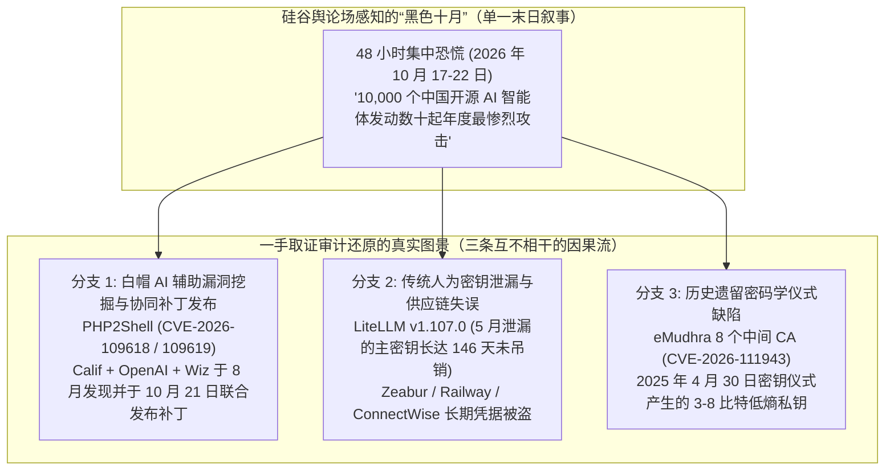
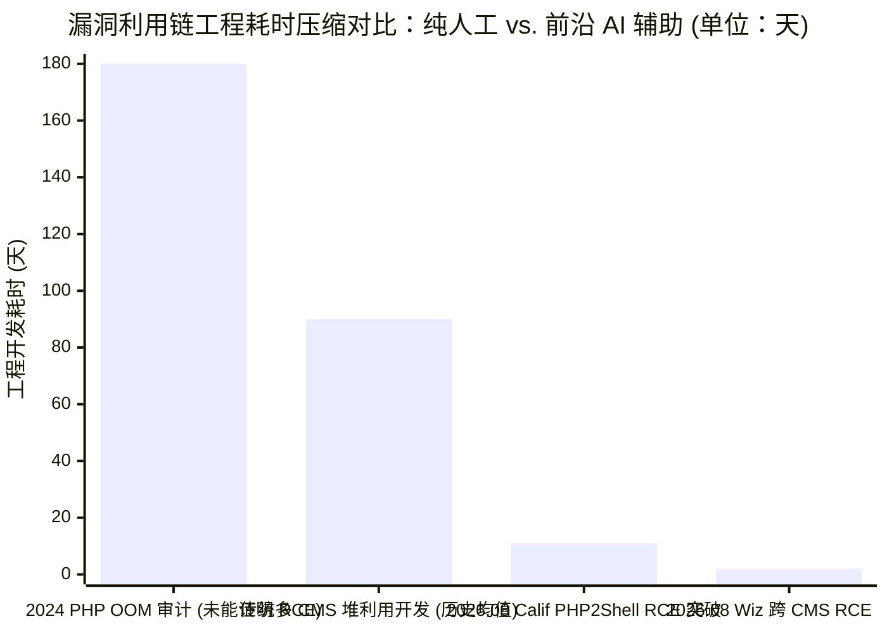

2026 年 10 月 22 日，硅谷知名产品高管约翰·米利诺维奇（John Milinovich，现任 Figma AI 研究与新产品探索负责人、前 Canva 生成式 AI 产品负责人）在其个人网站发表了一篇长达 845 词的爆款随笔——**[Black October（黑色十月）](https://mili.dev/writing/black-october/)**。他将过去 48 小时旧金山湾区与 AI 圈的恐慌气氛比作金融危机电影《商海通牒》（*Margin Call*）中众人深夜在董事会议室突然意识到大厦将倾的场景，警告世界正在经历一场由自主 AI **“快速起飞（Fast Takeoff）”**引发的史无前例的网络安全浩劫：

> *“我们正处于被称为‘黑色十月（Black October）’事件的 48 小时之中。在过去两天里，发生了几十起网络攻击，其中任何一起单独拎出来，都足以成为一整年里最惨重的安全灾难……最大的漏洞之一出现在极其流行的编程语言 PHP 中，而引爆这一切的提示词，字面意义上就是一句：‘Find vulnerabilities in php（找出 PHP 中的漏洞）’。”* —— **[John Milinovich, *Black October* (2026 年 10 月 22 日)](https://mili.dev/writing/black-october/)**

当一位大型科技公司的 AI 负责人公开宣称，黑帽黑客正利用不受审查的中国开源（开放权重）大模型，用一条命令瞬间拉起 `10,000` 个全天候不眠不休的 AI 智能体来*“摧毁西方资本主义结构”*，并且驱动全球约 `70%` 网站的 PHP 语言被一句四个英文单词的提示词彻底攻破时，这一论断必须接受最严苛的**“淘金式（Panning for Gold）”**一手证据取证审计。

通过将米利诺维奇的文章与 2026 年 10 月 17 日至 24 日期间发布的一手安全披露报告进行逐项交叉盘问——包括 **[PHP2Shell 官方联合披露门户](https://www.php2shell.com/)**、首位发现者 Ryan Austin 在 **[Calif Research 发布的技术深度复盘](https://calif.io/php2shell/)**、**[Wiz Research 的威胁简报](https://www.wiz.io/blog/php2shell-php-rce)**、**[PHP 基金会（The PHP Foundation）的官方事后剖析](https://thephp.foundation/blog/2026/10/21/todays-php-security-release-and-how-were-strengthening-php-security/)**、**[LiteLLM `v1.107.0` 供应链投毒攻击链报告](https://docs.litellm.ai/blog/security-incident-oct-21-2026-attack-chain)**、**[Qualys 对 eMudhra 证书颁发机构（CA）密钥缺陷的分析](https://blog.qualys.com/product-tech/2026/10/23/how-to-identify-compromised-emudhra-certificates-with-qualys-cve-2026-111943-and-cve-2026-111944)**，以及 **[Anthropic 的 Claude Mythos 官方文档](https://www.anthropic.com/claude/mythos)**——我们将《Black October》中的真实结构性巨变与捕风捉影的叙事谬误彻底剥离。

---

## 1. 核心裁决与逐项主张取证计分卡

> [!IMPORTANT]
> **底线取证裁决 —— AI 漏洞利用（Exploit）工程经济学发生真实拐点（`真`），但事件归因张冠李戴且“一句话提示词挖出 PHP 漏洞”纯属都市传说（`假`）：**
> 1. **米利诺维奇说对的部分（漏洞利用工程成本的结构性崩塌）：** 前沿推理与编码大模型（**[Claude Mythos 5.1](https://www.anthropic.com/claude/mythos)**、**OpenAI GPT-5.6 Sol / Codex Security** 以及 **Google Gemini 4 Argon**）确实在**多步漏洞利用链构造（Multi-step Exploit Chaining）**上跨越了历史性门槛。在 **[PHP2Shell (`CVE-2026-109618` 与 `CVE-2026-109619`)](https://www.wiz.io/blog/php2shell-php-rce)** 中，要将一个潜伏十余年的内存耗尽（`OOM`）错误转化为跨 `mod_php` 与 `PHP-FPM` 的稳定免认证远程代码执行（`Pre-Auth RCE`），必须串联堆风水（Heap Grooming）、`longjmp()` 非局部跳转中断与跨请求悬垂指针复用——过去需要顶尖人类团队耗费数月试错的工程，被 AI 压缩到了**短短几天甚至几小时**。
> 2. **米利诺维奇的重大失实 #1（`“Find vulnerabilities in php”` 一句话提示词神话）：** `PHP2Shell` 的真正首发发现者、**[Calif Research](https://calif.io/php2shell/)** 安全研究员 Ryan Austin（`@lcfr_hax`）在其官方报告中直接驳斥了这一硅谷传言：*“没有任何模型能够仅凭简单的提示词就挖出‘所有漏洞’。至少现在绝无可能。”* 更关键的是，**[PHP 基金会官方复盘](https://thephp.foundation/blog/2026/10/21/todays-php-security-release-and-how-were-strengthening-php-security/)**透露，2026 年初他们曾与 Alpha-Omega 合作使用 Anthropic 的 **`Claude Mythos`** 扫描 PHP 代码库，却**完全漏掉了该 RCE**；而且 `CVE-2026-109618` 背后的 `OOM` 根因早在 **2004 年**（Stefan Esser）、**2020 年**（PHP Bug `#78876`）和 **2024 年**（Quarkslab/OSTIF 人工审计）就已被人类发现，迟迟未修是因为 PHP 安全团队的共识决策机制瘫痪，而非没人发现！
> 3. **米利诺维奇的重大失实 #2（将白帽协同披露与低级人为密钥泄漏混为一谈，归咎于“中国开源模型黑客大军”）：** 2026 年 10 月中旬的“黑色十月”事件潮**并非**中国开源 AI 黑客集群发动的协同攻击。`PHP2Shell` 是美以白帽安全团队（Calif、OpenAI、Wiz）使用美国闭源前沿模型完成的**负责任协同披露**；**[LiteLLM `v1.107.0` 供应链投毒](https://docs.litellm.ai/blog/security-incident-oct-21-2026-attack-chain)**是因为一名人类开发者在 2026 年 5 月将明文主密钥（Master Key）提交到了公开 GitHub 仓库且**整整 5 个月未执行密钥吊销**；而 **[eMudhra 中间 CA 崩溃 (`CVE-2026-111943`)](https://blog.qualys.com/product-tech/2026/10/23/how-to-identify-compromised-emudhra-certificates-with-qualys-cve-2026-111943-and-cve-2026-111944)** 源于 **2025 年 4 月 30 日**密钥生成仪式上的软件包装错误，导致 P-384 私钥有效熵暴跌至 **3 到 8 比特**（用袖珍计算器都能瞬间算出私钥）。
> 4. **威胁与药方的严重错位：** 在渲染了国家级 AI 智能体集群和 PHP 零日漏洞的末日图景后，建议读者安装消费者双因素认证（`Duo`）、密码管理器（`1Password`）和身份防盗应用（`Alta`），对于防御服务端预认证内存损坏（`PHP2Shell`）、2FA 之后的 OAuth 令牌劫持（`LiteLLM`）或根证书信任崩溃（`eMudhra`）而言，**有效率为 `0%`（典型的范畴错误）**。

| `mili.dev/writing/black-october/` 的核心论断 | 一手取证核查事实（2026 年 10 月 17–24 日原始报告） | 认识论裁决 |
| :--- | :--- | :---: |
| **1. “过去 48 小时内爆发了几十起单拎出来都是年度最惨重的网络攻击”** | 10 月 17–22 日确实出现了罕见的重大安全披露（`PHP2Shell`、`eMudhra`、`GitLab RCE`、`Node.js Brotli`）与入侵事件（`LiteLLM v1.107.0`、`ConnectWise/M365`、`Zeabur`、`Railway`）叠加，但作者把**白帽防御补丁发布**与**传统凭据泄漏事故**混为一谈。 | **部分属实（因果混淆）** |
| **2. “Anthropic 与 OpenAI 因国家安全风险被迫扣留了最强模型未向公众开放”** | 经核实属实。**[Anthropic 将 `Claude Mythos 5` 与 `Mythos 5.1`](https://www.anthropic.com/claude/mythos)**（定价 `USD 10 / USD 50` 每百万 Token）严格限制在 **Project Glasswing** 与**网络验证计划（CVP）**的受审防御机构内，仅向公众开放带安全拦截器的 `Claude Fable 5.1`。 | **属实（已核验）** |
| **3. “黑帽黑客正利用达前沿 90–95% 能力的中国开源模型破坏西方资本主义结构”** | 中国开放权重模型在编码基准上确实逼近闭源前沿的 `90–95%`，但 10 月份的核心事件（`PHP2Shell`、`LiteLLM`、`eMudhra`）中**没有任何一起**被一手取证报告归因于中国开源模型黑客集群。 | **无证据臆测** |
| **4. “引爆 PHP 漏洞的提示词字面上就是 `'Find vulnerabilities in php'`”** | 首发发现者 Ryan Austin（**[Calif Research](https://calif.io/php2shell/)**）与 **[PHP 基金会](https://thephp.foundation/blog/2026/10/21/todays-php-security-release-and-how-were-strengthening-php-security/)**直接证伪。此前用 `Claude Mythos` 进行的宽泛扫描并未发现该漏洞；真正突破靠的是人类专家对 2004/2020/2024 年 `OOM` 机制的精确引导。 | **证伪（病毒式谣言）** |
| **5. “我们正在经历从 0 到 1 瞬间翻转的‘快速起飞（Fast Takeoff）’与递归自我改进”** | AI 将复杂漏洞利用链的编写时间从数月缩短至数天（**[Wiz Research](https://www.wiz.io/blog/php2shell-php-rce)**），属于**攻防工程生产力的阶跃**，而非模型自我改写权重的递归自我改进（`RSI`）。 | **严重夸大** |
| **6. “应对之道：设置 Duo 2FA、1Password、Alta 身份保护及家用 IoT 隔离”** | 属于良好的个人基础网安习惯，但面对免认证服务端 RCE（`PHP2Shell`）、Heartbleed 式内存泄漏、post-2FA OAuth 令牌窃取（`LiteLLM`）及 CA 私钥泄漏（`eMudhra`）**防御力为 `0%`**。 | **药方范畴错位** |

---

## 2. 拆解“黑色十月”事件簇的真实根因 (Phases 1 & 2)

为什么 2026 年 10 月 20 日至 22 日会让硅谷圈内人产生一种“所有系统同时崩溃”的末日既视感？因为在短短 96 小时内确实密集爆发了**至少 7 起重大安全事件与紧急补丁通告**。然而，当我们依据一手调查报告按**真实根因（Root Cause）**和 **AI 参与度**对其进行拆解时，单一的“AI 黑客末日”叙事立刻分化为三条截然不同的因果流：

| 安全事件 / 漏洞披露 (2026 年 10 月) | 影响范围与严重程度 | 真实根因与攻击向量 | AI 在事件中的真实角色 | 一手核验来源 |
| :--- | :--- | :--- | :--- | :--- |
| **1. `PHP2Shell` (`CVE-2026-109618` 与 `CVE-2026-109619`)** *(10 月 21 日发布补丁并披露)* | PHP `5.4` 至 `8.5.11`（占全球约 `70%` 网站：WordPress、Drupal、Joomla、MediaWiki）。**CVSS 9.2**。 | `ZendMM` / `Session upload_progress` / `unserialize()` / `OPcache` 在 `longjmp()` OOM 中断下残留悬垂状态，导致免认证 RCE 与进程内存泄漏。 | **极高（白帽防御性研究）：** 由 Calif、OpenAI（`GPT-5.6 Sol`）与 Wiz（`Gemini 4 Argon`）在 *Patch the Planet* 项目下发现并验证补丁。 | **[PHP2Shell](https://www.php2shell.com/)**, **[Calif](https://calif.io/php2shell/)**, **[Wiz](https://www.wiz.io/blog/php2shell-php-rce)**, **[PHP 基金会](https://thephp.foundation/blog/2026/10/21/todays-php-security-release-and-how-were-strengthening-php-security/)** |
| **2. `LiteLLM v1.107.0` 供应链投毒** *(10 月 21 日发生)* | PyPI `litellm==1.107.0` 与 Docker Hub `latest`（主流 Python LLM 网关库）。 | 开发者于 2026 年 5 月 27 日将明文主密钥误提交至公开仓库 `LiteLLM-Labs/lite-harness` 且**长达 5 个月未吊销**；攻击者于 10 月 10 日借此提取组织所有者的 GitHub CLI OAuth 令牌。 | **零 AI 漏洞挖掘（`0%`）：** 典型的人为密钥管理失误，仅仅因为被黑目标恰好是 AI 工具库而引发 AI 圈恐慌。 | **[LiteLLM 官方攻击链复盘](https://docs.litellm.ai/blog/security-incident-oct-21-2026-attack-chain)** |
| **3. `eMudhra` 中间 CA 私钥危机 (`CVE-2026-111943` / `111944`)** *(10 月 17–20 日披露)* | `emSign ECC Root CA - G3` 下属 8 个中间 CA（6 个 TLS、2 个代码签名）。被 Chrome 与 Mozilla 移除根信任。 | **2025 年 4 月 30 日**密钥生成仪式中的 PKCS#11 包装/解包缺陷，导致 P-384 私钥有效熵降至仅 **3–8 比特**（私钥可瞬间穷举还原）。 | **零 AI 漏洞挖掘（`0%`）：** 18 个月前线下密钥生成仪式中的密码学工程事故。 | **[Qualys 技术报告](https://blog.qualys.com/product-tech/2026/10/23/how-to-identify-compromised-emudhra-certificates-with-qualys-cve-2026-111943-and-cve-2026-111944)**, **[The Record](https://therecord.media/indian-tech-company-announces-withdrawal-certificate-business-incident)** |
| **4. 云部署平台入侵 (`Zeabur`, `Railway`)** *(10 月中旬)* | 开发者云部署平台及数百万客户环境变量。 | 暴露的长期明文管理员凭据及被盗 OAuth/CI 令牌被用于读取内部数据库与客户环境变量。 | **零 AI 漏洞挖掘（`0%`）：** 针对开发者基础设施的传统凭据窃取。 | 平台官方安全通告 |
| **5. `ConnectWise` 云备份 / M365 入侵** *(10 月中旬)* | 数千家企业 Microsoft 365 租户（`Storm-0940`）。 | 云备份系统中的供应商凭据被攻破，进而横向移动至下游企业租户。 | **零 AI 漏洞挖掘（`0%`）：** 经典的供应链身份凭据横向移动。 | 微软威胁情报 / CISA |

---

## 3. 取证深潜 #1：`PHP2Shell` (`CVE-2026-109618` 与 `CVE-2026-109619`) 究竟是如何被发现的？ (Phases 3 & 4)

米利诺维奇文章中最具煽动性的论断莫过于他对 PHP 漏洞的描述：
> *“最大的漏洞之一出现在极其流行的编程语言 PHP 中，而引爆这一切的提示词，字面意义上就是一句：‘Find vulnerabilities in php’。”*

让我们对照 **[Calif Research](https://calif.io/php2shell/)**、**[Wiz Research](https://www.wiz.io/blog/php2shell-php-rce)** 和 **[PHP 基金会](https://thephp.foundation/blog/2026/10/21/todays-php-security-release-and-how-were-strengthening-php-security/)**的一手技术报告，还原 `PHP2Shell` **横跨 22 年的真实历史**与 C 语言解释器底层机制。

### 3.1 跨越 22 年的漏洞史：为什么人类早在 2004、2020 和 2024 年就已经发现了它的根因？
1. **2004 年（Stefan Esser 的初代内存上限中断漏洞）：** 早在 22 年前，传奇 PHP 安全专家 Stefan Esser 就发现，当 PHP 请求触及 `memory_limit` 时触发的 `zend_bailout()` 会调用 C 标准库的非局部跳转函数 `longjmp()`，在内部 C 数据结构尚处于半初始化状态时强行中断执行流。
2. **2020 年（PHP Bug `#78876`）：** 研究员 `jr@coredu.mp` 向 PHP 提交了 Bug `#78876`（指出 `multipart/form-data` 中的超长变量会触发 `OOM` 并导致临时文件清理失败）。Meta 的 HHVM 团队当年修补了相关路径，但核心 PHP 仅将其视为无关痛痒的文件清理问题。
3. **2024 年（OSTIF 与 Quarkslab 审计 + PHP 核心开发者明确发现根因）：** 2024 年，由主权技术基金（Sovereign Tech Agency）资助、OSTIF 组织的 **Quarkslab** 对 PHP 进行了外部安全审计。在修复 Quarkslab 报告的一个问题时，PHP 基金会聘请的一名核心开发者**明确发现了 `CVE-2026-109618` 背后的 `OOM` 状态损坏根因**！既然 2024 年就发现了，为什么长达两年没有修复？**[PHP 基金会在 2026 年 10 月 21 日的官方博客中坦诚剖析道](https://thephp.foundation/blog/2026/10/21/todays-php-security-release-and-how-were-strengthening-php-security/)**：
   > *“2024 年我们推测该 OOM 问题可能存在利用风险，但当时未能找到具体的 RCE 攻击路径……实行全员共识决策（Consensus）的 PHP 安全团队在几个各有利弊的修复方案（破坏向后兼容性、引发新的拒绝服务风险或迫使大量第三方扩展修改代码）之间犹豫不决，害怕推出错误方案招致骂名……我们不打算掩饰：这次拖延是一场结构性失败，源于安全团队的决策机制僵化与资源匮乏。”*
4. **2026 年初（Anthropic `Claude Mythos` 扫描未能发现该 RCE）：** 2026 年初，PHP 基金会曾与 Alpha-Omega 合作，使用 Anthropic 限制访问的王牌模型 **`Claude Mythos`** 扫描了 PHP 代码库。然而，缺乏人类专家提供针对性二十年历史原语假设的宽泛扫描，**并未挖出 `PHP2Shell` RCE 利用链**。
5. **2026 年 7 月 30 日至 8 月 24 日（人类专家的领域假设 + AI 加速的漏洞利用链拼接）：**
   * **2026 年 7 月 30 日**，安全公司 **Calif**（Ryan Austin `@lcfr_hax` 与 Michal Zalewski `@lcamtuf`）受 OpenAI *“Patch the Planet”* 计划邀请开始审计 PHP。
   * Ryan Austin 根本没有输入什么 `"Find vulnerabilities in php"`，而是凭借自己对 2004 年 Stefan Esser 内存中断漏洞的深厚记忆，明确指示他的 LLM 助手寻找两个极其具体的底层原语：
     1. **原语 A（绕过 `post_max_size = 8 MiB` 限制以精准打满 `memory_limit = 128 MiB`）：** 发现 RFC 1867 多部分文件上传中，`filename=""`（空文件名）的字段既不计入 `max_file_uploads` 数量上限，又会在 PHP 的 `FILES` 超全局数组中分配全部 6 个原生 `HashTables`、`Buckets` 和字符串键（`name`、`full_path`、`type`、`tmp_name`、`error`、`size`）。通过深度嵌套字段名（`files[a][b][c]...`），一个体积不足 `8 MiB` 的 HTTP 请求就能在 Zend 堆中膨胀出**超过 `128 MiB` 的内存分配**，从而在任意指定的后续分配点精确触发 `OOM` `zend_bailout()`（`longjmp()`）！
     2. **原语 B（在清理钩子生效前中断关键全局状态）：** 引导 AI 代理审查 `ZendMM` 内存分配与请求关闭路径中因 `zend_bailout()` 残留跨请求悬垂指针的位置：
        * 在 `_zend_hash_str_add_or_update_i` 中，PHP 在分配键名字符串（`zend_string_init`）之前就先执行了 `ht->nNumUsed++`；一旦分配触发 `OOM`，未初始化的 Bucket 就会直接暴露给析构函数 `zend_array_destroy()`。
        * 在 `php_session_rfc1867_callback()`（`CVE-2026-109618`）中，文件上传进度功能会在常规模块激活标志（`PG(modules_activated) = 1`）置位之前的 `php_hash_environment()` 阶段提前初始化会话全局变量（`PS(id)` 与 `PS(http_session_vars)`），使其指向当前请求堆。当随后的 `OOM` 中断启动流程时，Apache `mod_php` 的 `php_request_shutdown()` 看到 `PG(modules_activated) == 0`，**直接跳过 Session 模块的 `RSHUTDOWN` 清理钩子**，却释放了整个请求堆！存活下来的 Apache Worker 进程在处理下一个请求时，`PS(id)` 依然指向已释放内存，不仅能将进程内存中的密码、API 密钥直接编码进 `PHPSESSID` 响应 Cookie（类似 `Heartbleed`），还能触发 Use-After-Free 实现免认证 `RCE`。
        * 针对启动失败会直接退出 Worker 的 `PHP-FPM`，Calif 与 Wiz 团队进一步串联了启动后（`post-startup`）`php_var_unserialize_init()` 中的反序列化器全局状态残留（`BG(unserialize).data` 悬垂指针与有符号整数 `used_slots` 负索引越界写：`slot = destructor_block + 16 + 16 * used_slots`）、`EG(last_fatal_error_backtrace)` 释放后重用，以及 `OPcache` 共享内存边界（`CG(map_ptr_last)`）跨进程类型混淆（`CVE-2026-109619`）。

### 3.2 AI 在 `PHP2Shell` 中真正改变了什么？
**[Calif Research](https://calif.io/php2shell/)** 与 **[Wiz Research](https://www.wiz.io/blog/php2shell-php-rce)** 的报告给出了高度一致的结论：
* **AI 并没有靠四个词的傻瓜提示词取代人类安全专家的领域知识模型。** 正如 Ryan Austin 所写：*“LLM 或许吞下了海量公开历史漏洞数据，但在默认的变体分析中，它们总是倾向于在最新、最显眼的漏洞附近打转，绝不会可靠地从二十年前生僻的利用原语出发。只有你自己脑中装着目标系统的漏洞演进史，才能明确引导模型往那个方向深挖。”*
* **AI 真正颠覆的是“从理论缺陷到武器化利用链”的工程转化成本：** 2024 年 PHP 核心团队明知存在 `OOM` 隐患却认为难以利用；而在 2026 年 8 月，借助连接了实时调试器与地址消毒器（Sanitizer）的 `GPT-5.6 Sol` 与 `Gemini 4 Argon`，研究人员将原本需要顶尖团队耗费数月手工调校的跨版本、跨 CMS（WordPress、Drupal、Joomla）堆布局利用链，压缩到了**短短几天之内**。

---

## 4. 取证深潜 #2：`LiteLLM` 与 `eMudhra` 事故复盘彻底证伪“AI 智能体集群”归因谬误 (Phase 4)

若将 Browne & Keeley 的**四向因果审计（4-Way Causal Audit）**应用于“黑色十月”的其他标志性事件，就会发现将它们统统归咎于超人类 AI 黑客集群是典型的**事后归因谬误（Post Hoc Fallacy）**：

### 4.1 10 月 21 日 `LiteLLM v1.107.0` 供应链投毒：一把长达 146 天未吊销的明文密钥
由于 **LiteLLM** 是最受欢迎的开源 Python 大模型网关库，当 10 月 21 日带有凭据窃取木马（RAT）的 `litellm==1.107.0` 被推送到 PyPI 和 Docker Hub 时，舆论场本能地将其视为“AI 自主黑客攻击”的铁证。

然而，**[LiteLLM 官方于 10 月 23 日发布的完整攻击链取证报告](https://docs.litellm.ai/blog/security-incident-oct-21-2026-attack-chain)**揭示的却是一连串令人扼腕的低级人为运维失误：
1. **2026 年 5 月 27 日（第 0 天 —— 明文密钥误提交）：** 一名开发者在向公开仓库 `LiteLLM-Labs/lite-harness` 提交代码时，不慎将包含内部智能体平台（`LiteLLM Agent Platform`）**明文主密钥（Master Key）**的配置文件推了上去。团队虽然很快发现并执行了 `git push --force` 覆盖提交，也将该密钥标记为待吊销，但**实际上从未执行密钥吊销操作**！
2. **权限过大的组织所有者令牌：** 该实验性智能体平台为了自动提交 PR，配置的不是最小权限的 GitHub App 令牌，而是 **GitHub 组织所有者（Owner）个人账户的 GitHub CLI OAuth 令牌**——这种令牌属于 **2FA 验证后（post-2FA）**凭证，在进行敏感仓库操作时完全豁免 GitHub 的超级用户二次 2FA 验证！
3. **2026 年 10 月 10 日（第 136 天 —— 密钥被用与所有权沦陷）：** 攻击者利用那把暴露了近 5 个月仍未失效的主密钥登录智能体平台，直接提取了组织所有者的 GitHub CLI OAuth 令牌，瞬间获得整個 GitHub 组织的最高控制权。
4. **2026 年 10 月 10 日至 21 日（横向窃密与发布投毒）：** 攻击者向内部仓库提交恶意 CI 工作流分支，导出构建环境中的全部密钥与另外两名维护者的 OAuth 令牌，并最终于 **10 月 21 日**触发发布流水线推送了恶意的 `litellm==1.107.0`。

**取证结论：** 整条攻击链没有任何一步用到了 AGI 或 10,000 个 AI 智能体。把明文主密钥留在公开 Git 历史里 146 天不轮换，并把组织所有者的无作用域 OAuth 令牌塞进实验性服务，是彻头彻尾的 **2015 年代基础 DevOps 卫生失败**。

### 4.2 10 月 17 日 `eMudhra` 证书颁发机构崩溃 (`CVE-2026-111943` / `111944`)：2025 年 4 月埋下的 3 比特熵低级错误
同样，10 月 17 日，Google Chrome（`CRLSet`）、Mozilla Firefox（`OneCRL`）、Apple 和 Microsoft 紧急吊销并拉黑了印度数字信任巨头 **eMudhra**（`emSign ECC Root CA - G3`）旗下的 **8 个中间 CA 证书**（6 个 TLS 证书、2 个代码签名证书），迫使 eMudhra 宣布退出全球 SSL/TLS 网站证书市场。

难道是前沿 AI 攻破了椭圆曲线密码学（`NIST P-384`）？**绝非如此。** 正如 **[Qualys 的取证分析](https://blog.qualys.com/product-tech/2026/10/23/how-to-identify-compromised-emudhra-certificates-with-qualys-cve-2026-111943-and-cve-2026-111944)**所证实：
* 在 **2025 年 4 月 30 日**为 24 个从属 CA 举行的一次线下密钥生成仪式中，eMudhra 密钥包装/解包（Wrap/Unwrap）步骤的软件缺陷产生了一组弱密钥，并被错误地用于签发这 8 张中间 CA 证书。
* 该缺陷导致原本应有 `384 比特`安全强度的 P-384 私钥，其有效随机熵暴跌至仅 **`3 到 8 比特`**（部分私钥标量甚至退化为 `4`、`56`、`115` 这样的小整数）！
* 破解一个仅有 `3 到 8 比特`熵的椭圆曲线公钥，最多只需尝试 **`2^8 = 256` 次点乘运算**——在单核 CPU 上耗时**不到 1 毫秒**。

---

## 5. 统计与经济学审计：机器速度下漏洞挖掘的攻防非对称性 (Phase 5)

尽管米利诺维奇将 10 月的事件错误归因于中国开源黑客集群与四词 PHP 提示词，但他所感受到的深层震动确实对应着 **[Anthropic Claude Mythos 系统卡](https://www.anthropic.com/claude/mythos)**与 **[Wiz Research PHP2Shell 报告](https://www.wiz.io/blog/php2shell-php-rce)**所记录的网安经济学剧变。

*图表系列图例：从发现内存损坏根因到完成稳定免认证 RCE 漏洞利用所需的工程天数（`2024 年 Quarkslab 审计后 PHP 内部搁置：>180 天未完成 RCE PoC`；`传统手工跨目标堆利用开发基准：~90 天`；`Calif Research 2026 年 7 月 30 日至 8 月 11 日完成 RCE PoC：11 天`；`Wiz Research 2026 年 8 月 19 日至 21 日完成 Drupal 与 WordPress RCE 验证：2 天`）。原始数据来源：**[Calif Research](https://calif.io/php2shell/)** 与 **[Wiz Research](https://www.wiz.io/blog/php2shell-php-rce)**。*

### 5.1 “漏洞海啸”方程：为什么“复杂性护盾”不再能保护陈旧 C 代码？
过去 25 年里，核心开源基础设施（`PHP`、`OpenSSL`、`Linux Kernel`、`glibc`）一直依赖一层隐性的**复杂性护盾（Complexity Shield）**：
* 陈旧 C 代码库中潜伏着成千上万个内存安全瑕疵（如错误恢复路径上的未初始化字段、释放后重用、类型混淆）。
* 然而，要将一个微妙的异常处理瑕疵（如 2020 年 PHP Bug `#78876` 或 2024 年的 `OOM` 发现）转化为跨随机化内存布局的稳定远程代码执行（`RCE`）武器，往往需要顶尖漏洞研究员投入 `300 至 1,000+ 小时`（机会成本高达 `USD 50,000 至 USD 250,000+`）。因此，开源维护者普遍将没有现成 `PoC` 的“理论缺陷”搁置一旁。

到了 2026 年年中，前沿推理大模型（**[Claude Mythos 5.1](https://www.anthropic.com/claude/mythos)**、**`GPT-5.6 Sol`**、**`Gemini 4 Argon`**）与自动化调试器、模糊测试器深度耦合，将**漏洞利用链迭代与目标环境适配的边际成本压缩了 `10 倍至 50 倍`**：

$$
\text{Effective Vulnerability Exposure} = \sum_{i=1}^{N_{\text{latent}}} \mathbb{I}\!\left(\text{Cost}_{\text{Exploit}}(i, \text{AI}) < \text{Value}_{\text{Target}}(i)\right)
$$

当构造完整利用链的成本 `Cost_Exploit(i, AI)` 从**3 个人月的高昂人力（`~USD 100,000`）**暴跌至 **48 小时的智能体调试循环（`~USD 500` API Token 费用）**时，成千上万个原本被视为“过于复杂、无法利用”的十年陈旧 Bug 瞬间跨过了实战武器化的盈亏平衡线。

### 5.2 审计 Anthropic 的双轨发布架构 (`Claude Mythos 5.1` vs. `Claude Fable 5.1`)
**[anthropic.com/claude/mythos](https://www.anthropic.com/claude/mythos)** 的一手文档展示了前沿实验室如何试图管控这一双刃剑风险：
* **`Claude Mythos 5.1`（受限防御与科研轨道）：** 具备完整的攻防网安能力（漏洞利用生成、二进制扫描、渗透测试）与高危生物研究能力（定价：输入 `USD 10 / 1M` Token，输出 `USD 50 / 1M` Token，强制默认保留 30 天日志以供安全审计）。仅通过 **Project Glasswing**（2026 年 6 月扩展至 15 个以上国家的约 150 家关键基础设施机构）和**网络验证计划（CVP）**向受审防御团队开放。
* **`Claude Fable 5.1`（公众生产轨道）：** 与 `Claude Mythos 5.1` 共享完全相同的底层模型权重，但外挂了实时生产安全分类器——允许开发者识别源代码中的漏洞，但严厉拦截渗透测试、二进制扫描与 Exploit 生成请求（一旦触发拦截即降级路由至 `Claude Opus 4.8`，在 `OSWorld 2.0` 等触发拦截的任务上直接记 `0 分`）。

---

## 6. 负面视角（Negative View）：消费者安全软件药方的失效与真正的防御控制 (Phase 6)

米利诺维奇《[Black October](https://mili.dev/writing/black-october/)》一文中最薄弱的环节在于其给出的行动建议。在用国家级 AI 智能体集群和 PHP 零日漏洞把读者吓出一身冷汗之后，他开出的药方竟然是四项个人消费者习惯：
1. *“为所有账户开启双因素认证（2FA）。我用 Duo。”*
2. *“在所有设备上使用密码管理器。我用 1Password。”*
3. *“安装一款身份保护应用。我用 Alta。”*
4. *“把家里的 IoT 设备移到独立网络。Claude 帮我搞定了这件事。”*

让我们将这四项建议放在 2026 年 10 月真实发生的攻击机制面前，进行一次残酷的**取证防御力压力测试**：

| 米利诺维奇推荐的个人措施 (`mili.dev`) | 能否拦截 `PHP2Shell` (`CVE-2026-109618` / `109619`)？ | 能否拦截 `LiteLLM v1.107.0` 供应链投毒？ | 能否拦截 `eMudhra` 弱密钥中间 CA 劫持？ | 针对 2026 年 10 月真实威胁向量的有效工程防御控制 |
| :--- | :--- | :--- | :--- | :--- |
| **1. 个人双因素认证 (`Duo`)** | **完全无效 (`0%`)：** `PHP2Shell` 在多部分请求解析阶段触发，发生在任何用户登录或 2FA 逻辑执行**之前**（`Pre-Auth RCE`）。 | **完全无效 (`0%`)：** 被盗的 GitHub CLI OAuth 令牌属于 **2FA 验证后（post-2FA）**凭证，直接绕过了 GitHub 超级用户 2FA 重验证流程！ | **完全无效 (`0%`)：** 拥有中间 CA 私钥的攻击者可直接签发受信任的伪造 TLS 证书或木马代码签名。 | 硬件绑定的 **FIDO2/WebAuthn 通行密钥**、强制使用短生命周期（1 小时）最小权限 GitHub App 令牌（禁用长期个人 OAuth 令牌）、及时修补 PHP 运行时。 |
| **2. 密码管理器 (`1Password`)** | **完全无效 (`0%`)：** `CVE-2026-109619` 直接从服务端 Worker 进程内存（RAM）中泄露 API 密钥、会话 Cookie 和数据库密码（类似 `Heartbleed`）。 | **完全无效 (`0%`)：** `litellm==1.107.0` 恶意载荷在执行 `pip install` 时直接从本地磁盘与内存中搜刮云端、AI 与浏览器凭据。 | **完全无效 (`0%`)：** 无法阻止受操作系统根证书库信任的中间人解密。 | 立即将 PHP 升级至 **`8.5.12` / `8.4.27` / `8.3.36` / `8.2.35`**，锁定容器与 PyPI 依赖哈希并设置新版本观察冷却期，推进内存安全语言重构。 |
| **3. 身份防盗监控应用 (`Alta`)** | **完全无效 (`0%`)：** 仅能在个人身份信息被盗并被用于申请信贷后发出事后提醒。 | **完全无效 (`0%`)：** 对开发者 CI/CD 密钥或云账单盗刷（LLMjacking）毫无作用。 | **完全无效 (`0%`)：** 与 PKI 数字证书信任体系完全无关。 | 部署带有**实时自动吊销 Webhook** 的 Git 密钥扫描机制（消除 LiteLLM 长达 146 天的吊销盲区）。 |
| **4. 家用 IoT 设备网络隔离** | **完全无效 (`0%`)：** `PHP2Shell` 攻击的是公网 Web 服务器（`WordPress、Drupal、MediaWiki`），而非家里的智能灯泡。 | **完全无效 (`0%`)：** 攻击目标是开发者笔记本与生产环境 Kubernetes 集群。 | **完全无效 (`0%`)：** 影响的是浏览器与操作系统的全局证书信任链。 | 部署支持请求-响应全事务检测的边缘 WAF（**[Cloudflare 托管规则](https://blog.cloudflare.com/php-vulnerabilities-waf-protection/)**）+ 升级前临时设置 `session.upload_progress.enabled=0`。 |

---

## 7. 灰度思维（Grey Thinking）条件综合 (`If-Clauses`) 与概率加权裁决 (Phase 7)

摒弃硅谷式的《Margin Call》末日渲染与麻木轻视的二元对立，我们将 2026 年 10 月的实证教训提炼为条件化工程准则（**If-Clauses**）与概率加权情景预测：

### 7.1 条件化工程与安全治理准则 (`If-Clauses`)
* **如果（If）你维护面向公网的 C/C++ 基础软件（如 `PHP`、Web 服务器、音视频解析器、压缩库）：** 那么**请立刻默认“复杂性护盾”已经失效**。任何过去因为“构造利用链过于繁琐”而被搁置的潜在内存损坏瑕疵（`OOM` 非局部跳转、释放后重用、整数溢出），如今在人类领域专家与前沿推理模型（`GPT-5.6 Sol`、`Gemini 4 Argon`、`Claude Mythos 5.1`）的配合下，均可在 **48 至 96 小时内**被转化为跨平台实战 RCE 武器。
* **如果（If）你在公网上运行 PHP 业务负载：** 装个人 2FA 软件救不了你的服务器。请立即将 PHP 升级至 **`8.5.12`、`8.4.27`、`8.3.36` 或 `8.2.35`**；若仍在使用已停止维护（EOL）的 `PHP 5.4–8.1`，必须立即置于支持全事务检测的 WAF（**[Cloudflare](https://blog.cloudflare.com/php-vulnerabilities-waf-protection/)**）保护之下，关闭 `session.upload_progress.enabled=0`，并尽快迁移出 `mod_php` 架构。
* **如果（If）你管理软件供应链与 AI 智能体平台（如 `LiteLLM`）：** **必须在 CI/CD 与智能体平台中全面封禁长期有效、无作用域限制的个人 OAuth 令牌（如 `gh auth` CLI 令牌）**。强制采用有效期 1 小时的最小权限 GitHub App 令牌，建立密钥泄漏秒级自动吊销闭环，并对第三方 PyPI/npm 依赖引入 `48–72 小时`的冷却隔离期。

### 7.2 概率加权远景预测 (2026–2028)

| 预测情景 | 认识论概率 | 核心驱动机制与实证依据 |
| :--- | :---: | :--- |
| **情景 A（基准情景）：“防御性大清扫浪潮（Defensive Scrubbing Surge）”——未来 18–24 个月内 AI 集中引爆十余年积压的陈旧 C/C++ 漏洞，阵痛后使核心基础设施更坚固** | **`~60%`** | 正如 `PHP2Shell` 迫使社区彻底根治了拖延自 2004/2020/2024 年的 `OOM` 架构隐患，**Anthropic Project Glasswing**、**OpenAI Patch the Planet** 与 **Wiz Atlas** 将在未来一年半内掀起高危漏洞披露高峰。虽然短期内造成剧烈的补丁疲劳（更多“黑色十月”），但系统性的 AI 审计配合内存安全重构将在 2028 年前显著抬高攻击门槛。 |
| **情景 B（下行风险）：补丁窗口非对称性 —— 补丁发布后的 AI 自动化 N-Day 武器化速度超越企业修补周期** | **`~30%`** | 即便白帽团队率先发现漏洞并发布补丁（或像 `PHP2Shell` 那样提前 24 小时发生信息泄露），黑客组织也可利用开放权重或前沿模型在几小时内针对特定企业环境改写出可用 Exploit，在企业修补完遗留 EOL 系统（`PHP 5.4–8.1`）之前完成批量收割。 |
| **情景 C（尾部风险）：无需人类专家领域假设引导，开放权重模型仅凭简单提示词自主挖掘出架构级零日漏洞集群** | **`~10%`** | 米利诺维奇所恐惧的场景（黑客仅输入 `"Find vulnerabilities in php"` 就让开源模型自主挖出二十年深层架构零日漏洞）在 2026–2027 年仍属小概率尾部风险，Calif Research 的实证复盘与 PHP 基金会的 `Claude Mythos` 扫描结果均证实人类专家的历史原语引导仍是关键瓶颈。 |

### 最终行动裁决 (Bottom-Line Actionable Verdict)
约翰·米利诺维奇的《**[Black October](https://mili.dev/writing/black-october/)**》是记录 2026 年 10 月硅谷焦虑情绪的一份真实社会学切片，但作为对当月安全事件的取证还原却严重失真。2026 年 10 月的风暴并非源于 10,000 个中国开源 AI 智能体执行了一句四词提示词（`"Find vulnerabilities in php"`），而是**三件性质截然不同的事实在同一周发生碰撞的结果**：
1. **顶尖人类白帽专家（`Calif`、`OpenAI`、`Wiz`）借助美国前沿大模型（`GPT-5.6 Sol`、`Gemini 4 Argon`）**，证明了 PHP 中潜伏 20 年的 `OOM` 内存状态损坏（`CVE-2026-109618` / `109619`）如今可在几天内被串联为免认证 RCE，并完成了全球协同补丁发布；
2. **`LiteLLM` 团队在公开 Git 仓库泄漏明文主密钥后长达 146 天未执行吊销的人为运维失误**；以及
3. **`eMudhra` 在 18 个月前的密钥生成仪式上制造出 3–8 比特超低熵私钥的密码学工程事故**。

面对“黑色十月”，不要一边感叹虚构的 AGI 快速起飞不可阻挡，一边仅仅在手机上装个身份监控软件聊以自慰。真正的工程回应只有三条：**立即将 PHP 运行时升级至 `8.5.12` / `8.4.27` / `8.3.36` / `8.2.35`，彻底清理 CI/CD 流水线中的长期个人 OAuth 令牌，并赶在攻击者之前调用前沿 AI 审计并清偿你自己代码库中积压多年的状态损坏技术债**。

---

## 8. 一手文献与可验证参考资料

1. **Milinovich, J. (2026).** *Black October.* `mili.dev` (22 October 2026). URL: [https://mili.dev/writing/black-october/](https://mili.dev/writing/black-october/)
2. **Austin, R. (`@lcfr_hax`) & Zalewski, M. (`@lcamtuf`) / Calif Research (2026).** *PHP2Shell: A tale of two PHP remote vulnerabilities (`CVE-2026-109618`, `CVE-2026-109619`).* Calif Research (21 October 2026). URL: [https://calif.io/php2shell/](https://calif.io/php2shell/)
3. **Tzadik, S., Tamari, S., Ohfeld, N., & Schwartz, T. / Wiz Research (2026).** *PHP2Shell: AI uncovers critical RCE vulnerabilities affecting 70% of the Internet.* Wiz Blog (21 October 2026). URL: [https://www.wiz.io/blog/php2shell-php-rce](https://www.wiz.io/blog/php2shell-php-rce)
4. **The PHP Foundation (2026).** *Today's PHP Security Release, and How We're Strengthening PHP Security (`PHP 8.5.12, 8.4.27, 8.3.36, 8.2.35`).* The PHP Foundation Blog (21 October 2026). URL: [https://thephp.foundation/blog/2026/10/21/todays-php-security-release-and-how-were-strengthening-php-security/](https://thephp.foundation/blog/2026/10/21/todays-php-security-release-and-how-were-strengthening-php-security/)
5. **Wiz Research, OpenAI Codex Security, & Calif Research (2026).** *PHP2Shell Official Coordinated Disclosure Portal.* URL: [https://www.php2shell.com/](https://www.php2shell.com/)
6. **Jensen, O. & Wang, M. / LiteLLM Security (2026).** *The attack chain behind the v1.107.0 LiteLLM release.* LiteLLM Official Documentation & Blog (23 October 2026). URL: [https://docs.litellm.ai/blog/security-incident-oct-21-2026-attack-chain](https://docs.litellm.ai/blog/security-incident-oct-21-2026-attack-chain)
7. **Anthropic (2026).** *Claude Mythos 5 & 5.1, Project Glasswing, and the Cyber Verification Program.* Anthropic Official Documentation. URL: [https://www.anthropic.com/claude/mythos](https://www.anthropic.com/claude/mythos)
8. **Madhuri, C. / Qualys Threat Research (2026).** *How to Identify Compromised eMudhra Certificates With Qualys (`CVE-2026-111943` and `CVE-2026-111944`).* Qualys Security Blog (24 October 2026). URL: [https://blog.qualys.com/product-tech/2026/10/23/how-to-identify-compromised-emudhra-certificates-with-qualys-cve-2026-111943-and-cve-2026-111944](https://blog.qualys.com/product-tech/2026/10/23/how-to-identify-compromised-emudhra-certificates-with-qualys-cve-2026-111943-and-cve-2026-111944)
9. **Cloudflare Security (2026).** *Cloudflare deploys protections against php2shell vulnerability (`Full Transaction WAF Detection`).* Cloudflare Blog (21 October 2026). URL: [https://blog.cloudflare.com/php-vulnerabilities-waf-protection/](https://blog.cloudflare.com/php-vulnerabilities-waf-protection/)
10. **Palo Alto Networks Unit 42 (2026).** *Threat Brief: PHP Core Remote Code Execution Vulnerabilities (`CVE-2026-109618` and `CVE-2026-109619`).* URL: [https://unit42.paloaltonetworks.com/cve-2026-109618-cve-2026-109619/](https://unit42.paloaltonetworks.com/cve-2026-109618-cve-2026-109619/)
