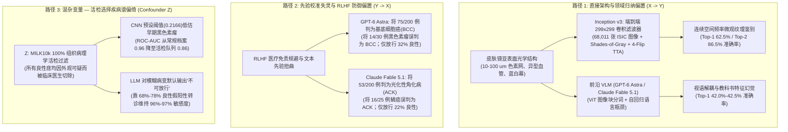

2026 年 10 月 25 日，英国盖伊医院（Guy's Hospital）皮肤科顾问医师兼莫氏显微描记手术（Mohs Micrographic Surgery）外科医生、伦敦国王学院（King's College London）圣约翰皮肤病学研究所荣誉准教授（Honorary Reader）马格努斯·林奇博士（Dr. Magnus Lynch）发表了一项标题极具冲击力的实证基准研究：**[十年前的 CNN 在皮肤癌诊断中超越前沿大语言模型（A 10-year-old CNN outperforms frontier LLMs for skin cancer diagnosis）](https://lynchlab.net/llm-skin-cancer)**。

林奇博士将 2026 年 10 月最顶尖的两个前沿多模态大语言模型（通过 OpenAI API 调用的 **GPT-6 Astra** 与通过 OpenRouter 调用的 **Claude Fable 5.1**）与一个 2015 年发布的卷积神经网络（**[Inception v3](https://arxiv.org/abs/1512.00567)**——在单张 NVIDIA H100 GPU 上使用公开 **[ISIC 档案库](https://www.isic-archive.com/)** 的 `68,011` 张图像微调约 20 分钟，并部署在 **[lynchlab.net/skin-ai-inception](https://lynchlab.net/skin-ai-inception)** 供手机浏览器通过 WebGPU 本地运行）进行了正面交锋。测试集抽自 2025 年发布的 **[MILK10k 数据集](https://doi.org/10.34970/648456)** 中的 **`N = 200` 例活检组织病理学确诊的皮肤病变**（`100` 例绝不可直接放行出院的恶性或癌前病变，以及 `100` 例可安全放行的良性病变；每例均包含一张临床近拍照片与一张偏振皮肤镜照片）。

在 6 类组织病理学诊断（`MEL`、`BCC`、`SCC`、`ACK`、`NEV`、`SEK`）中，这个十年前的旧款 CNN 取得了 **`125 / 200 (62.5%)` 的首选（Top-1）诊断准确率**和 **`173 / 200 (86.5%)` 的前二（Top-2）准确率**，以超过 **20 个百分点**的巨大优势碾压了 **Claude Fable 5.1（Top-1 `85 / 200 = 42.5%`；Top-2 `138 / 200 = 69.0%`）** 和 **GPT-6 Astra（Top-1 `84 / 200 = 42.0%`；Top-2 `134 / 200 = 67.0%`）**。

然而，深入挖掘研究汇总表以及原始数据包（`[llm-skin-cancer-test.zip](https://d2gaqzonlm544h.cloudfront.net/skin-ai/data/llm-skin-cancer-test.zip)`）中的完整 JSONL 遥测日志和 Python 评分脚本，我们会发现一个普通读者极易忽略的**生物统计学工作点悖论（Operating-Point Paradox）**：
* 在其**预设验证阈值（Preset Validation Threshold）**下，诊断准确率遥遥领先的 CNN 竟然将 **`30` 例恶性黑色素瘤中的 `18` 例（`60.0%` 假阴性放行率）错误判定为可安全放行（Discharge）**，在 `100` 例危险病变中仅截留了 `77` 例，同时放行了 `100` 例良性病变中的 `76` 例。
* 相比之下，在临床医生提示词下，**GPT-6 Astra** 和 **Claude Fable 5.1** 仅放行了 **`3 / 30 (10.0%)`** 和 **`4 / 30 (13.3%)`** 的黑色素瘤（截留了 `97 / 100` 和 `96 / 100` 的危险病变），但这种表面上的“高安全性”完全是通过**拒绝放行 `68%` 至 `78%` 完全无害的良性色素痣和脂溢性角化病（特异度仅为 `32.0%` 和 `22.0%`）**换来的。
* 一旦沿着受试者工作特征曲线（`ROC-AUC = 0.86`）移动 CNN 的连续概率阈值，使其与两个大模型的低特异度（`32%` 或 `22%`）**严格对齐（Threshold Matching）**，CNN 就能**截留 `100` 例危险病变中的 `98` 或 `99` 例，且仅漏放 `30` 例黑色素瘤中的 `1` 或 `2` 例（`3.3%–6.7%`）**——在每一个工作点上全面击败两个前沿多模态大模型。

以下我们按照 8 阶段**“淘金式（Panning for Gold）”**批判性思维框架，对原始代码、全部 `1,200` 次模型推理 JSONL 记录、`6 × 6` 混淆矩阵、置信度校准曲线及多模态架构瓶颈展开取证审计。

---

## 1. 核心裁决与高层综合 (Executive Verdict & Synthesis)

> [!IMPORTANT]
> **取证总结裁决 —— 多分类病理鉴别力上 CNN 完胜（`+20.3%` Top-1 准确率优势），但在临床二元分诊（Triage）中必须进行基于患病率的阈值重校准：**
> 1. **领域特定像素归纳偏置击败通用视觉-语言分词器：** 在 `68,011` 张皮肤镜与临床图像上进行全层微调的 `2,380 万`参数 2015 年款 CNN（**[Inception v3](https://arxiv.org/abs/1512.00567)**，即 **[Esteva 等人 2017 年 *Nature* 里程碑研究](https://www.nature.com/articles/nature21056)**所使用的同款架构）直接学习表皮与真皮乳头层亚表面结构（`10–100 µm` 色素网络、树枝状血管、蓝白幕、粟丘疹样囊肿）的连续空间频率特征。相反，通用前沿多模态大模型（**GPT-6 Astra** 和 **Claude Fable 5.1**）通过离散视觉 Transformer（`ViT`）图像块分词器耦合自回归语言瓶颈，导致严重的**视语解耦（Visual-Verbal Decoupling）**：大模型能够流利背诵教科书级皮肤镜术语，却在错误的病变类别上幻觉出这些特征。
> 2. **前沿大模型的严重先验模式崩溃（Mode Collapse）：** 通过 `analyse_clinician.py` 提取的原始混淆矩阵揭示，**GPT-6 Astra** 将全部 `200` 例病变中的 **`75` 例（`37.5%`，真实占比仅为 `25 / 200 = 12.5%`）**诊断为基底细胞癌（`BCC`），甚至**将 `30` 例黑色素瘤中的 `14` 例（`46.7%`）误诊为 `BCC`**！其 `25 / 25 (100%)` 的 `BCC` 召回率是以 **`33.3%` 的极低精确率（`PPV`）**为代价的。反之，**Claude Fable 5.1** 将 `200` 例中的 **`53` 例（`26.5%`，真实占比为 `20 / 200 = 10.0%`）**诊断为癌前病变光化性角化病（`ACK`，精确率仅 **`22.6%`**），并将 **`25` 例浸润性/原位鳞状细胞癌（`SCC`）中的 `16` 例（`64.0%`）错误降级为癌前 `ACK`**。
> 3. **普通患者居家拍照提示词（`patient-clinical`）下的分诊溃败（`N = 200` 例及附加 `N = 100` 例黑色素瘤）：** 当模拟患者在家仅上传一张手机近拍照片询问时（`patient-clinical`），模型首选提及诊断的准确率暴跌至 **`23.5%`（`GPT-6 Astra`）** 和 **`25.5%`（`Claude Fable 5.1`）**。在额外抽取的 `100` 例活检确诊黑色素瘤（`cases-mel-100.csv`）中，**Claude Fable 5.1** 仅在 **`3 / 100 (3.0%)`** 的病例中首先提及黑色素瘤，在其明确倾向于单一诊断的 `19 / 100` 例中更是交出了 **`0 / 19（0% 正确率，100% 错误，其中 12 例被判为良性色素痣）`** 的成绩单，甚至建议 `14 / 100` 的黑色素瘤患者仅需预约非紧急常规门诊（`ROUTINE`），并告知 `1 / 100` 例（`mel_046`，浸润性黑色素瘤）可以放任不管（`LEAVE`）。

```mermaid
xychart-beta
    title "6 类皮肤病变组织病理学首选诊断准确率 (N = 200 例活检确诊病变, Top-1 召回率 %)"
    x-axis ["全部 200 例", "黑色素瘤 (30)", "基底细胞癌 (25)", "鳞状细胞癌 (25)", "光化性角化病 (20)", "良性色素痣 (50)", "脂溢性角化病 (50)"]
    y-axis "首选诊断召回率 (%)" 0 --> 100
    bar [42.0, 26.7, 100.0, 48.0, 50.0, 32.0, 26.0]
    bar [42.5, 36.7, 72.0, 20.0, 60.0, 66.0, 12.0]
    bar [62.5, 43.3, 96.0, 64.0, 45.0, 74.0, 52.0]
```

*图表系列图例：柱 1 = **GPT-6 Astra**（`84/200 = 42.0%`），柱 2 = **Claude Fable 5.1**（`85/200 = 42.5%`），柱 3 = **Inception v3 CNN**（`125/200 = 62.5%`）。原始数据来源：**[Lynch Lab Benchmark](https://lynchlab.net/llm-skin-cancer)** 与 **[llm-skin-cancer-test.zip](https://d2gaqzonlm544h.cloudfront.net/skin-ai/data/llm-skin-cancer-test.zip)**。*

---

## 2. 原始资料与实验设计审计 (Phases 1 & 2)

为杜绝二手媒体传声筒效应，我们直接从林奇博士的数据归档包（`[llm-skin-cancer-test.zip](https://d2gaqzonlm544h.cloudfront.net/skin-ai/data/llm-skin-cancer-test.zip)`）和实时 WebGPU 推理引擎（`[lynchlab.net/skin-ai-inception](https://lynchlab.net/skin-ai-inception)` / `skin-ai.js?v=23`）中提取并审计了全部原始脚本与模型输出。

### 2.1 数据集溯源与抽样协议 (`make_selection_200.py`)
测试队列抽自 **[国际皮肤影像协作组（ISIC）](https://www.isic-archive.com/)** 于 2025 年发布的 **[MILK10k 数据集](https://doi.org/10.34970/648456)**，其中每个皮肤病变均由一张**临床近拍照片**和一张**皮肤镜（Dermoscopic）照片**配对组成。
* **100% 组织病理学活检金标准过滤：** 在 `scripts/make_selection_200.py` 中，所有候选病变必须满足 `les["confirm"] == "histopathology"`（活检组织病理学确诊）且同时具备有效的 `clinical_isic_id` 与 `dermoscopic_isic_id`（随机种子 `SEED = 20261012`）。
* **分层抽样的 200 例测试队列 (`cases.csv`)：**
  * **`100` 例不可安全放行的危险病变 (`discharge = "not safe"`)：** `30` 例黑色素瘤（`MEL`：浸润性黑色素瘤与原位黑色素瘤）、`25` 例基底细胞癌（`BCC`）、`25` 例鳞状细胞癌（`SCC`：浸润性鳞癌与原位鳞癌/鲍温病）以及 `20` 例光化性角化病（`ACK`：需冷冻、局部氟尿嘧啶/咪喹莫特治疗或严密随访的癌前日光性角化病）。
  * **`100` 例可安全放行的良性病变 (`discharge = "safe"`)：** `50` 例良性黑素细胞痣（`NEV`：含复合痣、皮内痣、交界痣、肢端痣、蓝痣、先天性色素痣等）和 `50` 例脂溢性角化病（`SEK`：俗称老年疣）。
* **附加 100 例黑色素瘤扩展队列 (`cases-mel-100.csv`)：** 通过 `scripts/make_selection_mel100.py` 从 `cases.csv` 之外额外随机抽取 `100` 例活检确诊的 `MILK10k` 黑色素瘤，专门用于测试患者居家仅上传临床照片（`patient-clinical`）时的漏诊风险。

### 2.2 基线 CNN (`Inception v3`) 架构与训练流水线
对 `[lynchlab.net/skin-ai-inception](https://lynchlab.net/skin-ai-inception)` 及 `skin-ai.js?v=23` 的代码审计确认了该基线 CNN 的完整工程规范：
1. **骨干网络与双头（Dual-Head）拓扑：** 采用在 ImageNet-1k 上预训练的标准 **[Inception v3](https://arxiv.org/abs/1512.00567)**（`timm` `inception_v3.tv_in1k`，输入分辨率 `299 × 299`，`mean = 0.5`，`std = 0.5`）。移除原有的 1,000 类输出层后，挂载共享特征图的两个并行输出头：
   * **9 类诊断分类头：** `MEL`、`BCC`、`SCC`、`AK`、`NV`、`BKL`、`DF`、`VASC`、`OTHER_BENIGN`（在 200 例对比测试中结合两张图像得分并在 6 个目标类别中选择）。
   * **二元成像模态识别头：** 识别输入图像是皮肤镜（`dermoscopic`）还是临床近拍（`clinical`），在 `8,517` 张保留测试图像上达到 **`99.5%` 准确率**，并据此自动切换对应模态的判定阈值。
2. **严格按患者与病变隔离的数据集划分 (`87,206` 张 ISIC 图像)：**
   * `68,011` 张训练图像；
   * `8,523` 张验证图像（用于选择最优权重及设定 `90%` 敏感度预设阈值）；
   * `8,517` 张内部测试图像（整体恶性对良性 `ROC-AUC = 0.944`，`4,364` 张活检确诊子集 `ROC-AUC = 0.875`）；
   * `1,286` 张外部医院测试图像（来自未参与训练的布宜诺斯艾利斯意大利医院，`ROC-AUC = 0.934`）；
   * `869` 张保留用于与大语言模型对比的图像（包含本次测试的 `200` 例配对病变及演示页面的 `600` 张样本图）。测试集中的任何病变或患者均未出现在训练集或验证集中。
3. **领域预处理与测试时增强 (`TTA`)：** 推理前自动检测并裁剪皮肤镜黑色圆形暗角边框，执行 **Shades of Gray**（`p = 6` 闵可夫斯基范数）色彩恒常性归一化以消除光照偏色，经 Lanczos 重采样至短边 `342 px` 并中心裁剪为 `299 × 299`，最后对 **4 个翻转副本（4-Flip TTA）** 的预测概率取均值。
4. **算力与体积开销：** 在单张 NVIDIA H100 GPU 上使用类别均衡权重对所有网络层微调 `20` 个 epoch（每个 epoch 约 50 秒，**总计耗时约 17–20 分钟**）。导出为 ONNX 后，`fp16` 模型仅 **`44 MB`**（`fp32` CPU 回退版为 `87 MB`），可直接在智能手机浏览器中通过 WebGPU 本地运行，无需上传任何患者隐私图像。

| 模型系统 | 架构与参数规模 | 皮肤科领域微调 | 推理方式与成本 (`N = 200` 临床医生提示词) | 首选 Top-1 准确率 (`N = 200`) | 前二 Top-2 准确率 (`N = 200`) |
| :--- | :--- | :--- | :--- | :--- | :--- |
| **Inception v3 (2015 基线 CNN)** | 48 层 CNN（`~2,380 万`参数；`44 MB` `fp16` ONNX） | `68,011` 张 ISIC 图像全层微调（`1x H100 GPU` 约 17 分钟，类别均衡） | 浏览器本地 WebGPU/WASM（`0` 云端 Token，边际 API 成本 `USD 0.00`） | **`125 / 200 (62.5%)`** | **`173 / 200 (86.5%)`** |
| **Claude Fable 5.1 (2026 年 10 月)** | 前沿多模态 LLM（通过 OpenRouter API） | 通用预训练 + RLHF（零领域微调） | `227,200` 输入 + `49,610` 输出 Token（含 `23,719` 推理 Token；`USD 4.75`） | **`85 / 200 (42.5%)`** (`95% CI: 36–49%`) | **`138 / 200 (69.0%)`** (`95% CI: 62–75%`) |
| **GPT-6 Astra (2026 年 10 月)** | 前沿多模态 LLM（通过 OpenAI API） | 通用预训练 + RLHF（零领域微调） | `184,200` 输入 + `30,298` 输出 Token（含 `17,557` 推理 Token；`USD 3.36`） | **`84 / 200 (42.0%)`** (`95% CI: 35–49%`) | **`134 / 200 (67.0%)`** (`95% CI: 60–73%`) |

---

## 3. 语义解构与 ROC 工作点悖论 (Phase 3)

在 Browne & Keeley 的批判性思维框架中，**“在皮肤癌诊断上表现更优（outperforms for skin cancer diagnosis）”**这一表述在两个截然不同的临床任务之间存在关键的语义歧义：
1. **多类别组织病理学分类（分类学鉴别力）：** 从 6 个具体病理类别（`MEL`、`BCC`、`SCC`、`ACK`、`NEV`、`SEK`）中准确命名与活检报告一致的诊断。
2. **二元临床分诊（“截留 vs. 放行” / Keep vs. Discharge）：** 决定一个病变是否需要活检/治疗/随访（`discharge = "no"`），还是可以安全放行回家（`discharge = "yes"`）。

对汇总表应用**替换测试（Substitution Test）**，即可看清为何在不固定特异度（Specificity）的情况下单独比较二元敏感度（Sensitivity）会产生经典的 **ROC 工作点错觉（Operating-Point Illusion）**：

| 临床与诊断评估指标 | GPT-6 Astra (临床医生提示词) | Claude Fable 5.1 (临床医生提示词) | Inception v3 CNN (预设验证阈值) | Inception v3 CNN (对齐大模型特异度后的校准阈值) |
| :--- | :--- | :--- | :--- | :--- |
| **首选诊断正确数 (`Top-1 / 200`)** | `84 / 200` (`42.0%`) | `85 / 200` (`42.5%`) | **`125 / 200` (`62.5%`)** | **`125 / 200` (`62.5%`)** |
| **前二选择正确数 (`Top-2 / 200`)** | `134 / 200` (`67.0%`) | `138 / 200` (`69.0%`) | **`173 / 200` (`86.5%`)** | **`173 / 200` (`86.5%`)** |
| **黑色素瘤作为首选诊断 (`of 30`)** | `8 / 30` (`26.7%`) | `11 / 30` (`36.7%`) | **`13 / 30` (`43.3%`)** | **`13 / 30` (`43.3%`)** |
| **危险病变截留数 / 敏感度 (`of 100`)** | `97 / 100` (`97.0%`) | `96 / 100` (`96.0%`) | `77 / 100` (`77.0%`) | **`98 / 100` (`98.0%`) 或 `99 / 100` (`99.0%`)** |
| **安全病变放行数 / 特异度 (`of 100`)** | `32 / 100` (`32.0%`) | `22 / 100` (`22.0%`) | **`76 / 100` (`76.0%`)** | `32 / 100` (`32.0%`) 或 `22 / 100` (`22.0%`) *(同特异度对齐)* |
| **错误放行的黑色素瘤 (`of 30` 假阴性)** | `3 / 30` (`10.0%`) | `4 / 30` (`13.3%`) | `18 / 30` (`60.0%`) | **`2 / 30` (`6.7%`) 或 `1 / 30` (`3.3%`)** |
| **约登指数 (`Youden's J = 敏感度 + 特异度 - 1`)** | `0.290` (`97% + 32% - 100%`) | `0.180` (`96% + 22% - 100%`) | **`0.530` (`77% + 76% - 100%`)** | `0.300` (`32%` 特异度) / `0.210` (`22%` 特异度) |
| **阳性似然比 (`LR+ = 敏感度 / (1 - 特异度)`)** | `1.43` (`0.97 / 0.68`) | `1.23` (`0.96 / 0.78`) | **`3.21` (`0.77 / 0.24`)** | **`1.44` (`32%` 特异度) / `1.27` (`22%` 特异度)** |
| **阴性似然比 (`LR- = (1 - 敏感度) / 特异度`)** | `0.094` (`0.03 / 0.32`) | `0.182` (`0.04 / 0.22`) | `0.303` (`0.23 / 0.76`) | **`0.063` (`32%` 特异度) / `0.045` (`22%` 特异度)** |

### 为什么 CNN 的预设阈值在校准前会漏放 30 例黑色素瘤中的 18 例？
在 `skin-ai.js?v=23` 中，CNN 的预设 `not_safe` 阈值（皮肤镜 `P >= 0.2166`；临床照片 `P >= 0.5321`）是在 `8,523` 张常规 ISIC 验证集图像上按 `90%` 敏感度标定的。然而：
1. **常规档案库基线分布 vs. `MILK10k` 活检队列的疾病谱偏倚（Spectrum Bias）：** 在常规 ISIC 档案库中，绝大多数良性色素痣（`NV`）是形态典型、无需活检的普通痣，因此 CNN 能轻松达到 `ROC-AUC = 0.944`（普通档案图像上达 `0.96`）。但在 `N = 200` 的 `MILK10k` 测试集中，**每一例病变（包括全部 `50` 例良性色素痣和 `50` 例脂溢性角化病）都是因为在专科门诊引起临床医生高度怀疑而被手术切除活检的疑难病例**，且其中许多黑色素瘤是厚度 `< 0.8 mm` 或原位黑色素瘤（*in situ*），外观极似良性病变。
2. **疾病谱偏移下的阈值失配：** 由于 `MILK10k` 活检队列高度聚集在决策边界附近（`ROC-AUC` 降至 `0.86`），在简单常规图像上标定的预设截断值（`0.2166`）对于高风险活检队列而言**过高（过于偏向良性预测）**，导致 CNN 将其误判的 `17` 例黑色素瘤中的 `8` 例归为 `NEV`、`6` 例归为 `SEK`，从而在未调整阈值时放行了 `18 / 30` 例。
3. **连续概率输出相比大语言模型二元文本决策的结构性优势：** 由于 CNN 输出连续可微的概率值 `P(not_safe) in [0, 1]`，临床机构可根据转诊人群先验患病率立即下调截断阈值。当把 CNN 的阈值下调至与 `GPT-6 Astra`（`32%` 特异度）或 `Claude Fable 5.1`（`22%` 特异度）相同时，CNN **截留了 `98%–99%` 的危险病变，且仅漏放 `1` 或 `2` 例黑色素瘤**（优于大模型的 `3` 例和 `4` 例）。

---

## 4. 四向因果与架构审计：为什么 2015 年的 CNN 能击败 2026 年的前沿 VLM？ (Phase 4)

为了查明为什么一个 2015 年的 `2,380 万`参数网络能在诊断准确率上领先万亿级参数的 2026 年多模态基础模型 `+20.3` 个百分点，我们检验全部四条因果路径：

### 4.1 直接因果 (`X -> Y`)：细粒度空间频率归纳偏置 vs. 视语解耦 (Visual-Verbal Decoupling)
皮肤镜图像绝非日常自然摄影（如 `ImageNet` 中的猫狗、汽车和家具）。通过交叉偏振光或浸润液消除角质层（*stratum corneum*）表面反射，皮肤镜直接展示表皮与真皮乳头层内 `10–100 µm` 尺度的黑色素与血红蛋白分布结构。区分无色素性黑色素瘤与基底细胞癌，或区分色素性脂溢性角化病与原位黑色素瘤，完全依赖于亚毫米级的空间频率线索。

在 **Inception v3** 中，全部 `48` 层卷积滤波器在 `68,011` 张皮肤科图像上通过反向传播端到端更新，直接在像素纹理空间优化分类边界。

相反，**GPT-6 Astra** 和 **Claude Fable 5.1** 陷入了严重的**视语解耦（Visual-Verbal Decoupling）**：
1. 通用视觉编码器将临床与皮肤镜图像压缩为离散的图像块 Token 并投影至语言模型语义空间，丢失了微米级高频纹理细节。
2. 一旦语言解码器在生成早期锁定了某个诊断类别 Token（如 `"diagnosis": "SEK"` 或 `"diagnosis": "BCC"`），其后续生成的 `"features"` 字段便受制于语言模型的自回归条件概率，自动背诵该诊断名称对应的教科书描述——**即便像素中根本不存在这些结构，或者实际病变是一颗浸润性黑色素瘤**！

我们从 `results/gpt-6-astra-v2.jsonl` 和 `results/anthropic_claude-fable-5.1-v2.jsonl` 原始日志中提取了确凿证据：

| 病例编号与真实病理 | 临床与皮肤镜真实表现 (`MILK10k`) | GPT-6 Astra 输出 (`诊断`, `置信度`, `放行`, `特征描述`) | Claude Fable 5.1 输出 (`诊断`, `置信度`, `放行`, `特征描述`) | 暴露的取证机制 |
| :--- | :--- | :--- | :--- | :--- |
| **`case_038`** (`ISIC_7403025` / `ISIC_4552372`) **浸润性黑色素瘤** (`< 0.8 mm`，耳部) | 耳部浸润性黑色素瘤；CNN 依据皮肤镜准确识别为 **`MEL`**。 | **`SEK`** (`83%` 置信度，次选 `NEV`)，**`discharge: "yes"`** —— *“边界清晰的棕色病变，具有指纹样隆起、裂隙、多个苍白的粟丘疹样囊肿和粉刺样开口。”* | **`SEK`** (`65%` 置信度，次选 `NEV`)，**`discharge: "yes"`** —— *“边界清晰的小型深棕色病变，呈脑回状/鹅卵石样表面、裂隙与隆起及少量粟丘疹样囊肿，符合色素性脂溢性角化病。”* | **致命假阴性放行 (`MEL -> SEK`)：** 两个大模型均被表面角化特征误导，幻觉出良性 `SEK` 的全套教科书特征，并将浸润性黑色素瘤患者直接放行回家。 |
| **`case_024`** (`ISIC_1091183` / `ISIC_6551749`) **浸润性黑色素瘤** (`< 0.8 mm`，低色素性) | 色素极少的浸润性黑色素瘤；CNN 与 Claude 正确判为 **`MEL`**。 | **`BCC`** (`95%` 置信度，次选 `MEL`)，**`discharge: "no"`** —— 以 `95%` 的极高置信度将低色素性黑色素瘤误判为基底细胞癌（`BCC`）。 | **`MEL`** (`55%` 置信度，次选 `BCC`)，**`discharge: "no"`** | **`GPT-6 Astra` 的 `BCC` 模式崩溃：** 任何粉红色伴血管的低色素病变都会触发 `GPT-6 Astra` 占统治地位的 `BCC` 先验，并以 `95%` 盲目自信输出错误诊断。 |
| **`case_200`** **原位黑色素瘤** (*Melanoma in situ*) | 外观相对对称、呈球状模式的深棕色丘疹。 | **`NEV`** (`82%` 置信度，次选 `SEK`)，**`discharge: "yes"`** —— *“边界清楚、对称的圆顶状棕色丘疹，呈球状/鹅卵石模式，无明确黑色素瘤特征。”* | **`NEV`** (`75%` 置信度，次选 `MEL`)，**`discharge: "yes"`** —— *“边界清楚的小型深棕色丘疹，皮肤镜呈相对对称的球状/鹅卵石模式，符合复合痣/皮内痣。”* | **双模型同时放行原位黑色素瘤：** 尽管 `Claude` 将 `MEL` 列为第二选择（`second_choice`），却依然输出了 `"discharge": "yes"`！ |
| **`case_147`** **浸润性黑色素瘤** | 伴中央色素加深的浸润性黑色素瘤。 | **`MEL`** (`78%` 置信度，次选 `NEV`)，**`discharge: "no"`** | **`NEV`** (`80%` 置信度，次选 `MEL`)，**`discharge: "yes"`** —— *“小型对称棕色斑疹，呈规则网状/球状模式……可见毛发穿行于病变中（hairs traversing the lesion），符合良性黑素细胞痣。”* | **视觉捷径谬误（有毛发 = 良性）：** `Claude` 机械套用“病变长毛即为良性痣”的粗浅启发式规则，不顾次选为 `MEL` 的风险，将浸润性黑色素瘤错误放行。 |

---

## 5. 统计与混淆矩阵审计：揭露大模型模式崩溃与校准失灵 (Phase 5)

通过对原始 `200` 例 JSONL 文件运行 `scripts/analyse_clinician.py`，我们完整重建了两个前沿大模型的 `6 × 6` 混淆矩阵、各类别阳性预测值（`PPV` / 精确率）、敏感度（`Recall`）以及口头置信度校准分布。

### 5.1 完整 6 类混淆矩阵审计 (`GPT-6 Astra` vs. `Claude Fable 5.1`)

#### 表 5.1A：`GPT-6 Astra` 临床医生提示词混淆矩阵 (`results/gpt-6-astra-v2.jsonl`, `N = 200`)
*`GPT-6 Astra` 预测分布总计：**`BCC = 75` (`37.5%`)**，`SCC = 35` (`17.5%`)，`SEK = 28` (`14.0%`)，`ACK = 26` (`13.0%`)，`NEV = 19` (`9.5%`)，`MEL = 16` (`8.0%`)，`UNSURE = 1` (`0.5%`)。*

| 真实病理 (行) \ 模型预测 (列) | 预测: `MEL` | 预测: `BCC` | 预测: `SCC` | 预测: `ACK` | 预测: `NEV` | 预测: `SEK` | 预测: `UNSURE` | 类别召回率 (敏感度与 Wilson 95% CI) | Inception v3 召回率 (对照) |
| :--- | :---: | :---: | :---: | :---: | :---: | :---: | :---: | :--- | :--- |
| **真实 `MEL` (`n = 30`)** | **`8`** | `14` | `2` | `1` | `2` | `3` | `0` | **`26.7%` (`8/30`)** `[14–44%]` | **`43.3%` (`13/30`)** |
| **真实 `BCC` (`n = 25`)** | `0` | **`25`** | `0` | `0` | `0` | `0` | `0` | **`100.0%` (`25/25`)** `[87–100%]` | `96.0%` (`24/25`) |
| **真实 `SCC` (`n = 25`)** | `0` | `6` | **`12`** | `7` | `0` | `0` | `0` | **`48.0%` (`12/25`)** `[30–67%]` | **`64.0%` (`16/25`)** |
| **真实 `ACK` (`n = 20`)** | `3` | `6` | `1` | **`10`** | `0` | `0` | `0` | **`50.0%` (`10/20`)** `[30–70%]` | `45.0%` (`9/20`) |
| **真实 `NEV` (`n = 50`)** | `5` | `15` | `1` | `0` | **`16`** | `12` | `1` | **`32.0%` (`16/50`)** `[21–46%]` | **`74.0%` (`37/50`)** |
| **真实 `SEK` (`n = 50`)** | `0` | `9` | `19` | `8` | `1` | **`13`** | `0` | **`26.0%` (`13/50`)** `[16–40%]` | **`52.0%` (`26/50`)** |
| **预测总数 (`N = 200`)** | `16` | **`75`** | `35` | `26` | `19` | `28` | `1` | **总体准确率: `84/200 = 42.0%`** `[35–49%]` | **总体准确率: `125/200 = 62.5%`** |
| **类别精确率 (`PPV`)** | **`50.0%`** (`8/16`) | **`33.3%`** (`25/75`) | **`34.3%`** (`12/35`) | **`38.5%`** (`10/26`) | **`84.2%`** (`16/19`) | **`46.4%`** (`13/28`) | `0.0%` | **Top-2 准确率: `134/200 = 67.0%`** `[60–73%]` | **Top-2 准确率: `173/200 = 86.5%`** |

#### 表 5.1B：`Claude Fable 5.1` 临床医生提示词混淆矩阵 (`results/anthropic_claude-fable-5.1-v2.jsonl`, `N = 200`)
*`Claude Fable 5.1` 预测分布总计：**`ACK = 53` (`26.5%`)**，`BCC = 42` (`21.0%`)，`NEV = 42` (`21.0%`)，`MEL = 32` (`16.0%`)，`SCC = 21` (`10.5%`)，`SEK = 10` (`5.0%`)，`UNSURE = 0` (`0.0%`)。*

| 真实病理 (行) \ 模型预测 (列) | 预测: `MEL` | 预测: `BCC` | 预测: `SCC` | 预测: `ACK` | 预测: `NEV` | 预测: `SEK` | 预测: `UNSURE` | 类别召回率 (敏感度与 Wilson 95% CI) | Inception v3 召回率 (对照) |
| :--- | :---: | :---: | :---: | :---: | :---: | :---: | :---: | :--- | :--- |
| **真实 `MEL` (`n = 30`)** | **`11`** | `4` | `3` | `2` | `7` | `3` | `0` | **`36.7%` (`11/30`)** `[22–54%]` | **`43.3%` (`13/30`)** |
| **真实 `BCC` (`n = 25`)** | `1` | **`18`** | `0` | `6` | `0` | `0` | `0` | **`72.0%` (`18/25`)** `[52–86%]` | **`96.0%` (`24/25`)** |
| **真实 `SCC` (`n = 25`)** | `0` | `4` | **`5`** | `16` | `0` | `0` | `0` | **`20.0%` (`5/25`)** `[9–39%]` | **`64.0%` (`16/25`)** |
| **真实 `ACK` (`n = 20`)** | `6` | `2` | `0` | **`12`** | `0` | `0` | `0` | **`60.0%` (`12/20`)** `[39–78%]` | `45.0%` (`9/20`) |
| **真实 `NEV` (`n = 50`)** | `10` | `4` | `1` | `1` | **`33`** | `1` | `0` | **`66.0%` (`33/50`)** `[52–78%]` | **`74.0%` (`37/50`)** |
| **真实 `SEK` (`n = 50`)** | `4` | `10` | `12` | `16` | `2` | **`6`** | `0` | **`12.0%` (`6/50`)** `[6–24%]` | **`52.0%` (`26/50`)** |
| **预测总数 (`N = 200`)** | `32` | `42` | `21` | **`53`** | `42` | `10` | `0` | **总体准确率: `85/200 = 42.5%`** `[36–49%]` | **总体准确率: `125/200 = 62.5%`** |
| **类别精确率 (`PPV`)** | **`34.4%`** (`11/32`) | **`42.9%`** (`18/42`) | **`23.8%`** (`5/21`) | **`22.6%`** (`12/53`) | **`78.6%`** (`33/42`) | **`60.0%`** (`6/10`) | — | **Top-2 准确率: `138/200 = 69.0%`** `[62–75%]` | **Top-2 准确率: `173/200 = 86.5%`** |

### 5.2 对 `BCC` 与 `ACK` 的“证甲得乙”统计盲测审计
如果只看单类别召回率（敏感度）而不看精确率（`PPV`），读者就会被彻底误导：
* **为什么 `GPT-6 Astra` 在基底细胞癌（`BCC`）上拿到了 `25 / 25 (100%)`，看似击败了 `Inception v3` 的 `24 / 25 (96%)`？** 因为 `GPT-6 Astra` 发生了严重的先验模式崩溃，把 **`200` 例病变中的 `75` 例（`37.5%`）统统判成了 `BCC`**！在其 `75` 次 `BCC` 预测中，有 `50` 次是假阳性（包含 `14` 例黑色素瘤、`15` 例良性痣、`9` 例脂溢性角化病、`6` 例 `SCC` 和 `6` 例 `ACK`），**精确率（`PPV`）低至 `33.3%`**。将近一半（`46.7%`）的黑色素瘤误判为生长缓慢、极少转移的基底细胞癌，在临床上会严重延误广泛局部切除术（`WLE`）和前哨淋巴结活检（`SLNB`）的时机。
* **为什么 `Claude Fable 5.1` 在光化性角化病（`ACK`）上拿到了 `12 / 20 (60%)`，看似高于 `Inception v3` 的 `9 / 20 (45%)`？** 因为 `Claude Fable 5.1` 将 **`200` 例病变中的 `53` 例（`26.5%`）滥判为癌前 `ACK`**（`PPV = 22.6%`），把 **`25` 例鳞状细胞癌（`SCC`）中的 `16` 例（`64.0%`）** 和 **`25` 例基底细胞癌（`BCC`）中的 `6` 例（`24.0%`）** 降级成了癌前病变！因此，在真正的**恶性肿瘤（`MEL / BCC / SCC`，`n = 80`）对非恶性病变（`ACK / NEV / SEK`，`n = 120`）**二元分类中，`Claude Fable 5.1` 的恶性敏感度跌至仅 **`57.5%` (`46 / 80`)**！

### 5.3 口头置信度校准审计 (`GPT-6 Astra` vs. `Claude Fable 5.1`)
临床医生依赖模型输出的置信度分数（`0–100`）来判断何时采纳 AI 建议。我们从 `analyse_clinician.py` 提取的数据揭示了两个大模型在置信度校准上的巨大反差：

| 口头报告置信度区间 (`0–100`) | GPT-6 Astra 落入该区间例数 (`N = 200`) | GPT-6 Astra 实际准确率 (`95% CI`) | Claude Fable 5.1 落入该区间例数 (`N = 200`) | Claude Fable 5.1 实际准确率 (`95% CI`) | 校准诊断结论 (Calibration Diagnostic) |
| :--- | :---: | :--- | :---: | :--- | :--- |
| **`0 – 59%` (低置信度)** | `2 / 200` (`1.0%`) | **`0.0%` (`0 / 2`)** `[0–66%]` | `107 / 200` (`53.5%`) | **`29.0%` (`31 / 107`)** `[21–38%]` | `Claude` 在不确定时将超过半数病例置于 `<60%` 置信度区间；而 `GPT-6 Astra` 几乎从不承认低置信度。 |
| **`60 – 74%` (中等置信度)** | `37 / 200` (`18.5%`) | **`43.2%` (`16 / 37`)** `[29–59%]` | `72 / 200` (`36.0%`) | **`50.0%` (`36 / 72`)** `[39–61%]` | 两个模型在中等置信度区间的实际准确率均在 `43%–50%` 左右。 |
| **`75 – 89%` (高置信度)** | `135 / 200` (`67.5%`) | **`38.5%` (`52 / 135`)** `[31–47%]` | `20 / 200` (`10.0%`) | **`85.0%` (`17 / 20`)** `[64–95%]` | **`GPT-6 Astra` 严重盲目自信：** 将 `67.5%` 的病例塞入 `75–89%` 高置信度区间，但其实际准确率（`38.5%`）反而比 `60–74%` 区间（`43.2%`）更差！ |
| **`90 – 100%` (极高置信度)** | `26 / 200` (`13.0%`) | **`61.5%` (`16 / 26`)** `[43–78%]` | `1 / 200` (`0.5%`) | **`100.0%` (`1 / 1`)** `[21–100%]` | 即便当 `GPT-6 Astra` 宣称 `90–100%` 笃定时（`26` 例），其错误率仍高达 **`38.5%` (`10 / 26`)**！ |
| **平均置信度 (正确时 vs. 错误时)** | **正确时: `82.5%`** | **错误时: `79.5%`** (`差值仅 +3.0%`) | **正确时: `64.6%`** | **错误时: `56.5%`** (`差值 +8.1%`) | `GPT-6 Astra` 的置信度分数（`82.5%` 对 `79.5%`）几乎不具备任何区分正确与错误预测的信息量（`ECE` 校准彻底失效）。 |

```mermaid
xychart-beta
    title "口头置信度校准曲线：各置信度区间内的实际 Top-1 诊断准确率 (%)"
    x-axis ["0-59% 置信度", "60-74% 置信度", "75-89% 置信度", "90-100% 置信度"]
    y-axis "实际 Top-1 诊断准确率 (%)" 0 --> 100
    bar [0.0, 43.2, 38.5, 61.5]
    bar [29.0, 50.0, 85.0, 100.0]
    line [30.0, 67.0, 82.0, 95.0]
```

*图表系列图例：柱 1 = **GPT-6 Astra 实际准确率 (%)**，柱 2 = **Claude Fable 5.1 实际准确率 (%)**，折线 = **理想对角线校准基准 (`30%`, `67%`, `82%`, `95%`)**。原始数据来源：`scripts/analyse_clinician.py` 对 `results/*-v2.jsonl` 的统计结果。*

---

## 6. 普通患者手机拍照提示词审计：当患者在家提问时会发生什么？ (Phase 5 续)

除了临床医生 JSON 提示词外，林奇博士在 `[llm-skin-cancer-test.zip](https://d2gaqzonlm544h.cloudfront.net/skin-ai/data/llm-skin-cancer-test.zip)` 中还完整包含了普通患者提问的三大实验场景（由 `gpt-6.1-sol` 通过 `grade_patient.py` 在对真实病理双盲的条件下对 `1,000` 条自由文本回复进行编码，并由 `analyse_patient.py` 统计）：
1. **`patient` (`N = 200`)：** 患者同时发送**临床近拍照片与皮肤镜照片**，询问是什么病变以及是否需要看医生。
2. **`patient-clinical` (`N = 200`)：** 患者**仅发送一张临床近拍照片**（模拟普通人在家没有皮肤镜、仅用智能手机拍照提问的真实场景）。
3. **`patient-clinical-mel-100` (`N = 100`)：** 针对**额外抽取的 100 例活检确诊黑色素瘤**（`cases-mel-100.csv`），患者**仅发送一张临床近拍照片**提问。

我们对全部 6 个已评分 JSONL 文件运行 `python3 scripts/analyse_patient.py`，提取出完整取证结果如下：

| 患者提示词队列与模型 | 明确倾向单一诊断比例 (`%`) | 倾向单一诊断时的准确率 | 第一个提及的诊断正确率 (`%`) | 第一个提及黑色素瘤比例 (`MEL` 召回率) | 提及列表中包含真实诊断比例 | 危险病变建议尽快就医 (`PROMPT/URGENT`) 比例 | 安全良性病变建议尽快就医 (`假阳性转诊率`) | 告知可放任不管 (`LEAVE`) 比例 |
| :--- | :--- | :--- | :--- | :--- | :--- | :--- | :--- | :--- |
| **`N = 200` 配对双图 (`patient`) — GPT-6 Astra** | `20 / 200` (`10.0%`) | `12 / 20` (`60.0%`) | **`67 / 200` (`33.5%`)** | **`2 / 30` (`6.7%`)** (`23/30` 提及) | `132 / 200` (`66.0%`) (平均列举 `2.50` 个) | **`100 / 100` (`100%`)** (`99` P, `1` U) | **`97 / 100` (`97.0%`)** (特异度仅 `3%`！) | `0 / 200` (`0.0%`) |
| **`N = 200` 配对双图 (`patient`) — Claude Fable 5.1** | `107 / 200` (`53.5%`) | `54 / 107` (`50.5%`) | **`76 / 200` (`38.0%`)** | **`4 / 30` (`13.3%`)** (`21/30` 提及) | `158 / 200` (`79.0%`) (平均列举 `3.25` 个) | **`94 / 100` (`94.0%`)** (`6` 例危险病变判 `ROUTINE`！) | **`87 / 100` (`87.0%`)** (特异度 `13%`) | `0 / 200` (`0.0%`) |
| **`N = 200` 仅临床照片 (`patient-clinical`) — GPT-6 Astra** | `7 / 200` (`3.5%`) | `5 / 7` (`71.4%`) | **`47 / 200` (`23.5%`)** | **`2 / 30` (`6.7%`)** (`17/30` 提及) | `100 / 200` (`50.0%`) (平均列举 `2.27` 个) | **`97 / 100` (`97.0%`)** (`3` 例 `BCC` 判 `ROUTINE`) | **`96 / 100` (`96.0%`)** (特异度仅 `4%`！) | `0 / 200` (`0.0%`) |
| **`N = 200` 仅临床照片 (`patient-clinical`) — Claude Fable 5.1** | `73 / 200` (`36.5%`) | `34 / 73` (`46.6%`) | **`51 / 200` (`25.5%`)** | **`0 / 30` (`0.0%`)** (`11/30` 提及) | `139 / 200` (`69.5%`) (平均列举 `3.13` 个) | **`95 / 100` (`95.0%`)** (`5` 例危险病变判 `ROUTINE`) | **`72 / 100` (`72.0%`)** (特异度 `28%`) | `0 / 200` (`0.0%`) |
| **`N = 100` 附加黑色素瘤仅临床照片 (`mel-100`) — GPT-6 Astra** | `0 / 100` (`0.0%`) | `0 / 0` (`—`) | **`19 / 100` (`19.0%`)** | **`19 / 100` (`19.0%`)** (`60/100` 提及) | `60 / 100` (`60.0%`) (平均列举 `2.25` 个) | **`100 / 100` (`100%`)** (作者人工复核为 `99%`) | — (`100%` 黑色素瘤队列) | `0 / 100` (`0.0%`) |
| **`N = 100` 附加黑色素瘤仅临床照片 (`mel-100`) — Claude Fable 5.1** | `19 / 100` (`19.0%`) | **`0 / 19` (`0.0%`！)** (`12` `NEV`, `3` `BCC`, `3` `OB`, `1` `SEK`) | **`3 / 100` (`3.0%`！)** | **`3 / 100` (`3.0%`！)** (`44/100` 提及) | `44 / 100` (`44.0%`) (平均列举 `2.99` 个) | **`85 / 100` (`85.0%`)** (`83` P, `2` U, **`14` `ROUTINE`, `1` `LEAVE`**) | — (`100%` 黑色素瘤队列) | **`1 / 100` (`1.0%`: `mel_046`)** |

### 患者提示词遥测数据揭示的三大严酷事实：
1. **没有皮肤镜、仅凭手机临床近拍照片（`patient-clinical`）时，大模型首选诊断准确率崩溃至 `23.5%–25.5%`：** 在 `200` 例队列上仅提供临床照片时，**Claude Fable 5.1 在 `30` 例黑色素瘤中首先提及黑色素瘤的次数为 `0 / 30 (0.0%)`**（在整段回复任何位置提及黑色素瘤的比例也仅为 `11 / 30 = 36.7%`）；**GPT-6 Astra 在 `25` 例基底细胞癌中首先提及 `BCC` 的次数同样为 `0 / 25 (0.0%)`**（将 `24 / 25` 例首先描述为其他良性病变 `OTHER_BENIGN`！）。
2. **在 `100` 例附加黑色素瘤（`cases-mel-100.csv`）上，`Claude Fable 5.1` 误导了 `15%` 的黑色素瘤患者采取非紧急就医或放任不管：**
   * 面对 `100` 例活检确诊黑色素瘤的临床照片，`Claude Fable 5.1` 在 **`47 / 100` 例中首先将其称为良性色素痣（`NEV`）**，在 `25 / 100` 例中首先称为其他良性病变（`OTHER_BENIGN`），在 `16 / 100` 例中首先称为脂溢性角化病（`SEK`），仅有 **`3 / 100 (3.0%)`** 首先提及黑色素瘤（`MEL`）。
   * 更令人震惊的是，在 `Claude Fable 5.1` 明确表态倾向于某一个最可能诊断的 **`19 / 100` 例黑色素瘤中，它的正确率为 `0 / 19（100% 全错：12 例判为良性痣 NEV、3 例判为其他良性、3 例判为 BCC、1 例判为 SEK）`**。
   * 在就医建议上，`Claude` 对 **`14 / 100` 例黑色素瘤仅建议非紧急常规检查（`ROUTINE`，如“在您下次常规预约时顺便检查”）**，甚至在 **`mel_046`（一例浸润性黑色素瘤）** 中倾向于良性病变并给出了 `LEAVE`（无需就医）的致命错误安慰。
3. **“让 `97%` 的人都去看医生”绝不等于有效的医疗分诊（Triage）：** `GPT-6 Astra` 在患者提示词下之所以能拿到 `99%–100%` 的转诊敏感度，唯一原因是它**让 `96%` 至 `97%` 长着普通良性痣和老年疣的健康人也尽快去看医生（特异度仅为 `3%–4%`）**。在真实初级保健筛查中，这种零特异度策略不仅会彻底挤兑皮肤科门诊资源，同时其正文却在 `44 / 100`（`GPT-6 Astra`）和 `47 / 100`（`Claude`）的黑色素瘤病例中首先安慰患者“这看起来像一颗良性痣（`NEV`）”。

---

## 7. 负面视角（Negative View）、遗漏信息与贝叶斯基线率现实 (Phase 6)

严密的批判性评估还必须审视该基准测试未涵盖的边界，以及独立 CNN 与前沿大模型在真实临床部署中共同面临的挑战：

### 7.1 贝叶斯基线率陷阱（初级保健 `3%` 患病率下的阳性预测值 `PPV`）
在 `cases.csv` 中，恶性肿瘤（`MEL`、`BCC`、`SCC`）占 `80 / 200 = 40.0%`（含 `ACK` 的危险病变占 `50.0%`）。然而在社区全科或消费者手机自查场景中，被查询皮肤斑点的真实恶性基线患病率 `P(D)` 通常仅为 **`1% 至 5%`**。

根据贝叶斯定理（Bayes' Theorem），阳性预测值（`PPV`）与患病率 `P(D)`、敏感度 `Se` 及特异度 `Sp` 的关系为：

$$
\text{PPV} = \frac{\text{Se} \cdot P(D)}{\text{Se} \cdot P(D) + (1 - \text{Sp}) \cdot (1 - P(D))}
$$

假设初级保健场景的真实患病率 **`P(D) = 3.0%`**，计算三套系统发出“不可放行 / 建议就医”警报时的真实 `PPV`：
* **GPT-6 Astra（临床提示词 `Se = 0.97`, `Sp = 0.32`；患者提示词 `Sp = 0.04`）：**
  * 临床提示词 `PPV` = **`4.23%`**（`95.8%` 的转诊为假阳性虚惊）。
  * 患者提示词 `PPV` = **`3.03%`**（与 `3.0%` 先验患病率几乎完全相同——毫无筛选信息量）。
* **Claude Fable 5.1（临床提示词 `Se = 0.96`, `Sp = 0.22`）：**
  * 临床提示词 `PPV` = **`3.67%`**（`96.3%` 的转诊为假阳性）。
* **Inception v3 CNN（内部常规测试集皮肤镜 `Se = 0.92`, `Sp = 0.81`）：**
  * 在 `3%` 患病率下 `PPV` = **`13.04%`**（`LR+ = 4.84`），精确率是两个大模型的 **3 倍以上**，但仍需由皮肤科医生结合皮肤镜与临床病史进行二次复核。

### 7.2 研究设计的四大结构性局限
1. **提示词缺失临床病史元数据（纯图像零样本约束）：** 临床皮肤科医生从不只看像素看病，而是结合**病变演变史（`ABCDE` 法则中的 `E: Evolution`，近期是否变大、变色、隆起）、出血/瘙痒/破溃症状、患者年龄、解剖部位、肤色光型及家族史**。尽管 `MILK10k` 包含 `age`、`sex`、`site` 和 `skin_tone_class`（见 `make_selection_200.py`），本研究为纯粹对比视觉识别能力而未输入临床病史。
2. **单次运行 (`n = 1`) 随机性与黑色素瘤样本量 (`n = 30`)：** 虽然 `200` 例总体准确率差距（`125/200 = 62.5%` 对 `84–85/200 = 42.0%–42.5%`）具有极高的统计显著性（`z = 4.05, p = 0.00005`），但在 `n = 30` 例黑色素瘤子集上，Wilson `95%` 置信区间较宽（CNN `43.3% [27–61%]` vs. Claude `36.7% [22–54%]` vs. GPT-6 Astra `26.7% [14–44%]`）。
3. **深色皮肤光型（Fitzpatrick V–VI）样本匮乏：** 正如林奇博士在 **[模型说明页](https://lynchlab.net/skin-ai-inception)** 所披露的，公开 **[ISIC 档案库](https://www.isic-archive.com/)** 主要采集自欧美及澳洲中心，深色皮肤及肢端雀斑样黑色素瘤（Acral Lentiginous Melanoma）代表性不足。
4. **十年前基线模型 vs. 当代获批医疗视觉 AI：** `Inception v3` 只是为了建立参照系而 deliberately 选用的 2015 年基线。当前获监管批准的皮肤科 AI 系统（采用大规模视觉 Transformer 集成以及融合数百万张临床/皮肤镜/病史数据的多模态专科基础模型）性能远超单一 2015 年款 CNN。

---

## 8. 灰度思维（Grey Thinking）条件综合 (`If-Clauses`) 与概率加权裁决 (Phase 7)

拒绝“大语言模型在医疗中一无是处”或“通用大模型可以直接取代专科视觉模型”的二元对立叙事，我们提出条件化架构准则（**If-Clauses**）及概率加权远景预测：

### 8.1 条件化架构准则 (`If-Clauses`)
* **如果（If）临床任务需要亚表面微观纹理或高频空间特征鉴别（如皮肤镜、眼科视网膜 OCT、数字病理切片或胸部 CT 肺结节）：** 那么在活检确诊像素数据上进行端到端微调、并具备连续 ROC 阈值校准的**领域专用视觉骨干网（`CNN` / 专用 `ViT` / `ConvNeXt`）**，以不到通用大模型 **`1 / 1,000` 的参数量**和 **`USD 0.00` 的边际云端推理成本**，在鉴别精度上取得绝对优势。
* **如果（If）要在皮肤科工作流中部署前沿大语言模型：** 则**绝不能让 LLM 直接充当从像素到病理类别的分类器**。正确的架构是由经过严格校准的领域专用视觉编码器输出受控的类别概率与模态阈值判定，再将 LLM 严格限制在下游语言工作流（如整合患者病史与视觉模型得分撰写转诊信、生成结构化病历或解读病理报告）。
* **如果（If）将在常规筛查档案库（`ISIC`，`ROC-AUC = 0.94–0.96`）上训练的视觉模型迁移至高疑活检队列（`MILK10k`，`ROC-AUC = 0.86`）：** 则**绝不能直接沿用常规档案库的预设概率截断值（`0.2166`）**。必须针对高风险转诊人群的疾病谱偏倚重新校准工作点阈值，以消除黑色素瘤假阴性放行（校准后假阴性从 `18/30` 骤降至 `1–2/30`）。

### 8.2 概率加权情景预测 (2026–2028)

| 预测情景 | 认识论概率 | 核心驱动机制与实证依据 |
| :--- | :---: | :--- |
| **情景 A（基准情景）：混合模块化医疗 AI 胜出（经校准的领域专用视觉编码器 + LLM 工作流编排器）** | **`~65%`** | 通用前沿 VLM 持续受困于图像块分词信息损失、口头置信度失准（`GPT-6 Astra: 正确时 82.5% vs. 错误时 79.5%`）及 RLHF 防御性转诊偏置（患者提示词下 `96%–97%` 假阳性转诊）。临床落地收敛于轻量级、获 FDA/CE 批准的专用视觉模型（`40–200 MB`）搭配负责文书与病史综合的 LLM。 |
| **情景 B（上行情景）：搭载医疗专用 ViT 编码器的原生多模态模型缩小差距** | **`~25%`** | 若前沿实验室用百万级组织病理学关联医疗图像预训练的专用视觉编码器及连续 Logit 校准头替换通用自然图像 `ViT` 分词器，原生多模态模型有望追平专用 CNN/ViT，但推理成本仍远高于 `44 MB` 的浏览器端 WebGPU 模型。 |
| **情景 C（下行风险）：直接面向消费者的零样本手机拍照 LLM 筛查同时引发明诊挤兑与致命漏诊延误** | **`~10%`** | 消费者直接上传手机近拍照片（`patient-clinical`）询问通用聊天机器人，一方面导致 `96%–97%` 的良性痣患者涌入医院，另一方面在 `14%–15%` 的黑色素瘤病例中（如 `Claude Fable 5.1` 将 `47%` 的黑色素瘤首先称为良性痣，并建议 `14%` 常规非紧急检查、`1%` 放任不管）造成致命的诊治延误。 |

### 最终行动裁决 (Bottom-Line Actionable Verdict)
马格努斯·林奇博士的这项基准测试是医疗 AI 实证审计的典范。**一个在单张 GPU 上微调仅 20 分钟、体积仅 `44 MB`、可直接在手机浏览器中本地运行的 2015 年款 `Inception v3` CNN**，在 6 类活检确诊皮肤癌诊断准确率上领先 **GPT-6 Astra** 和 **Claude Fable 5.1** 达 **`+20.0` 至 `+20.5` 个百分点（`62.5%` 对 `42.0%–42.5%`）**，在 Top-2 准确率上领先 **`+17.5` 至 `+19.5` 个百分点（`86.5%` 对 `67.0%–69.0%`）**，并在对齐特异度后的危险病变截留敏感度上以 **`98%–99%` 对 `96%–97%`** 全面胜出。在关乎生命的精密医学视觉领域，**端到端的领域像素监督学习与严格的连续 ROC 概率校准，永远胜过通用语言模型的盲目规模扩张**。

---

## 9. 一手文献与可验证参考资料

1. **Lynch, M. (2026).** *A 10-year-old CNN outperforms frontier LLMs for skin cancer diagnosis.* Lynch Lab, St John's Institute of Dermatology, King's College London (25 October 2026). URL: [https://lynchlab.net/llm-skin-cancer](https://lynchlab.net/llm-skin-cancer)
2. **Lynch, M. (2026).** *LLM Skin Cancer Test — Raw Data, Prompts, JSONL Model Replies, and Scoring Code (`llm-skin-cancer-test.zip`).* URL: [https://d2gaqzonlm544h.cloudfront.net/skin-ai/data/llm-skin-cancer-test.zip](https://d2gaqzonlm544h.cloudfront.net/skin-ai/data/llm-skin-cancer-test.zip)
3. **Lynch, M. (2026).** *Inception v3 Skin Lesion Classifier (Client-Side ONNX Runtime WebGPU / WebAssembly Research Demonstration).* Lynch Lab. URL: [https://lynchlab.net/skin-ai-inception](https://lynchlab.net/skin-ai-inception)
4. **MILK Study Team / International Skin Imaging Collaboration (2025).** *MILK10k: Paired Clinical and Dermoscopic Skin Lesion Benchmark Dataset.* ISIC Archive. DOI: [https://doi.org/10.34970/648456](https://doi.org/10.34970/648456)
5. **International Skin Imaging Collaboration (ISIC).** *The ISIC Archive: Open-Access Dermatology Imaging Repository.* URL: [https://www.isic-archive.com/](https://www.isic-archive.com/)
6. **Esteva, A., Kuprel, B., Novoa, R. A., Ko, J., Swetter, S. M., Blau, H. M., & Thrun, S. (2017).** *Dermatologist-level classification of skin cancer with deep neural networks.* **Nature**, 542(7639), 115–118. URL: [https://www.nature.com/articles/nature21056](https://www.nature.com/articles/nature21056)
7. **Szegedy, C., Vanhoucke, V., Ioffe, S., Shlens, J., & Wojna, Z. (2015).** *Rethinking the Inception Architecture for Computer Vision (`Inception v3`).* **arXiv:1512.00567** / CVPR 2016. URL: [https://arxiv.org/abs/1512.00567](https://arxiv.org/abs/1512.00567)
8. **Tschandl, P., Rinner, C., Apalla, Z., Argenziano, G., Codella, N., Halpern, A., ... & Kittler, H. (2020).** *Human–computer collaboration for skin cancer recognition.* **Nature Medicine**, 26(8), 1229–1234. URL: [https://www.nature.com/articles/s41591-020-0942-0](https://www.nature.com/articles/s41591-020-0942-0)
