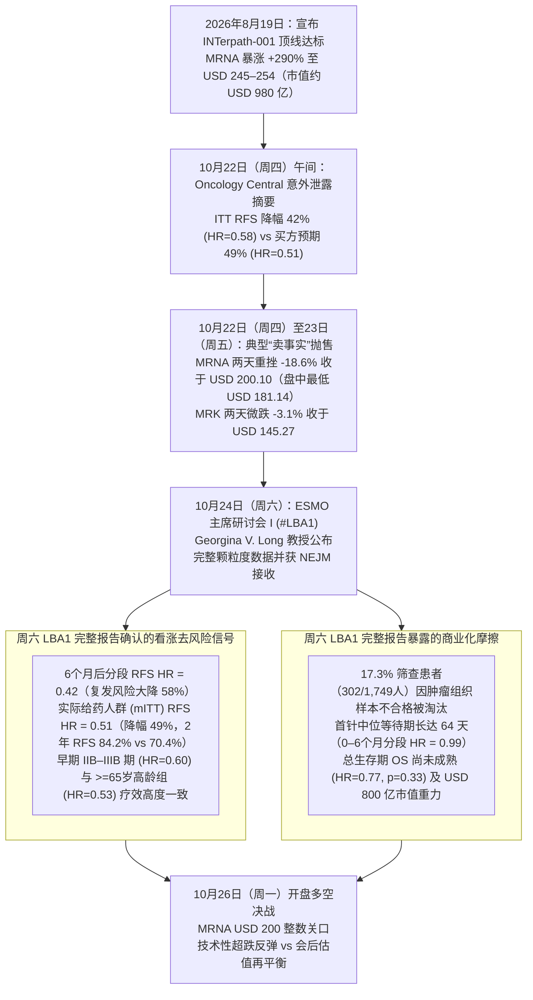
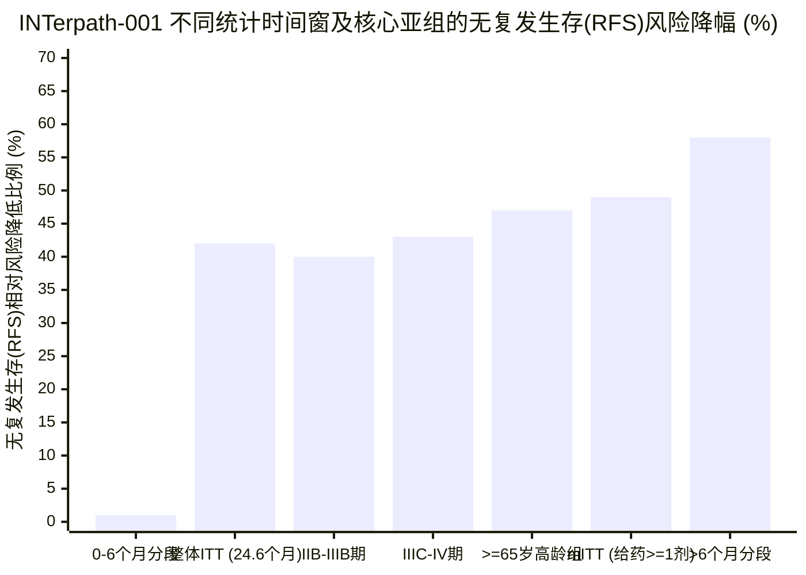

## 执行摘要（Executive Summary）：围绕 `INTerpath-001` 的“两阶段”市场博弈

在 2026 年 10 月 24 日（周六）于西班牙马德里举行的欧洲肿瘤内科学会（**ESMO 2026**）第一场主席研讨会（Presidential Symposium I，摘要编号 `#LBA1`）上，主要研究者、澳大利亚黑色素瘤研究所（MIA）的 **Georgina V. Long 教授**正式公布了 **[INTerpath-001 (`NCT05933577`)](https://clinicaltrials.gov/study/NCT05933577)** 的完整数据。这是全球首个取得阳性结果的个体化 mRNA 新抗原（Neoantigen）癌症疫苗随机双盲 III 期临床试验，评估由 **Moderna (`NASDAQ: MRNA`)** 与 **默沙东 (`Merck, NYSE: MRK`)** 联合研发的 **intismeran autogene**（曾用名 `V940` / `mRNA-4157`）。在 `1,137` 名完全切除的高危（IIB–IV 期）皮肤黑色素瘤患者中，中位随访 `24.6 个月`的结果显示：与标准疗法 **Keytruda（帕博利珠单抗）**联合安慰剂相比，`intismeran autogene` 联合 Keytruda 将**疾病复发或死亡风险（RFS）显著降低了 42%**（`风险比 [HR] = 0.58`；`95% CI: 0.45–0.75`；双侧 `p < 0.001`），并将**远处转移或死亡风险（DMFS）降低了 38%**（`HR = 0.62`；`95% CI: 0.45–0.85`；`p = 0.002`）。

要回答 **Moderna (`MRNA`)** 和 **默沙东 (`MRK`)** 的股价在下一个交易日（**2026 年 10 月 26 日周一，即“明天”**）会上涨还是下跌，投资者必须首先纠正一个关键的**时间线错觉（Temporal Illusion）**：

1. **核心头条数据“降低 42% 复发风险”早在本周四（10 月 22 日）就已意外泄露，并导致 `MRNA` 提前上演了 `-18.6%` 的“卖事实（Sell-the-News）”暴跌：** 在周六 ESMO 主席研讨会正式召开前 48 小时，医学网站 *Oncology Central* 意外打破禁令提前挂出了摘要核心数据（`RFS 降低 42%, HR = 0.58`），迫使 ESMO 提前解除禁令，[默沙东与 Moderna 随即于美东时间 10 月 22 日周四下午 2:59 紧急发布了官方新闻稿](https://www.merck.com/news/merck-and-moderna-will-present-results-from-landmark-phase-3-interpath-001-trial-for-intismeran-autogene-plus-keytruda-pembrolizumab-at-esmo-2026-presidential-symposium/)。由于自 8 月 19 日宣布 III 期顶线达标以来，`MRNA` 股价已累计暴涨 **+290%**（较 52 周低点 `USD 22.28` 更是飙升逾 **6 倍**至最高点 `USD 254.48`），短线动量资金将 III 期意向性治疗人群（`ITT`）的 `42%` 降幅与此前 IIb 期 `KEYNOTE-942` 的 `49%`（`HR = 0.51`）做简单对比后大举抛售。[Moderna 股价在周四盘中一度暴跌 `-26%` 至 `USD 181.14`](https://www.forbes.com/sites/maryroeloffs/2026/10/22/moderna-stock-plunges-25-after-possible-cancer-vaccine-data-leak/)，周四收盘大跌 **`-17.57%` 报 `USD 202.63`**（成交量高达 `4,930 万股`，为均量的 `2.5 倍`），并在周五（10 月 23 日）收于 **[`USD 200.10`（`-1.25%`，总市值 `USD 798.9 亿`）](https://www.fool.com/coverage/stock-market-today/2026/10/22/stock-market-today-oct-22-moderna-stock-plummets-18-on-melanoma-vaccine-data-leak-reports/)**，两天内蒸发了近 `USD 185 亿`市值。相比之下，市值逾 `USD 3,650 亿`的制药巨头默沙东（`MRK`）周四仅微跌 **`-1.76%`（`USD 147.24`）**，周五微跌 **`-1.34%`（`USD 145.27`）**。
2. **因此，明天（10 月 26 日周一）开盘交易的不是已被计价的“42% 头条数字”，而是周六（10 月 24 日）ESMO 主席研讨会完整报告（`#LBA1`）中首次披露的深层颗粒度数据：** 随着近 `USD 185 亿`的短线获利盘已在周四、周五出清，周一盘面将取决于 [Georgina V. Long 教授周六完整 PPT](https://www.cancernetwork.com/view/interpath-001-data-detail-survival-subgroup-and-safety-findings-in-melanoma) 中揭示的**两大对立力量**的博弈：
   - **看涨的生物统计学平反（为何 `42%` 是“制备周期滞后”造成的假象）：** 周六展示的生存曲线证明，`ITT` 人群 `42%`（`HR = 0.58`）与 IIb 期 `49%`（`HR = 0.51`）之间的差距，完全是由个体化疫苗**从随机入组到打上第一针所需的 `64 天`中位制备时间**造成的。在 **`0 至 6 个月`**窗口期内（患者正处于肿瘤测序、34 个新抗原 mRNA 定制合成及初始免疫激活期），疫苗组与单用 Keytruda 组的复发风险完全相同（**分段 `HR = 0.99`**）。而**在 6 个月之后（完成疫苗免疫程序后），`intismeran + Keytruda` 将复发或死亡风险大幅削减了 `58%`（分段 `HR = 0.42`；`95% CI: 0.30–0.58`）**；在排除未打上第一针患者的改良意向性治疗人群（`mITT`）中，复发风险降幅恰好为 **`49%`（`HR = 0.51`）**——与 IIb 期结果分毫不差。
   - **看跌的商业化摩擦与估值地心引力：** 但周六的完整报告也暴露了周四新闻稿中未曾提及的四大商业化阻力：(a) **在全部 `1,749` 名筛查患者中，多达 `17.3%`（`302 人`）因“肿瘤组织样本不合格”被直接淘汰**；(b) **总生存期（`OS`）数据尚不成熟（`HR = 0.77`, `p = 0.33`）**，未能跨越层级统计检验显著性边界；(c) 尽管样本量极小，**美国（US）亚组的 DMFS 点估计值越过了 1.0（`HR = 1.77`，基于 `10 例事件`）**；以及 (d) 即便回调至 `USD 200.10`（市值约 `USD 800 亿`），Moderna 的估值仍隐含了每年 `USD 100 亿–130 亿`的肿瘤管线峰值收入（且需与默沙东 `50/50` 平分利润），这意味着市场早已透支了 2027 年非小细胞肺癌（`INTerpath-002`）等高难度实体瘤的成功。

---

## 第一阶段：问题界定与时间线错位拆解

### 1.1 明确两大核心审计维度
- **描述性临床与生物统计学问题（Descriptive）：** III 期 `INTerpath-001`（`LBA1`）数据究竟是证实了 `intismeran autogene` 在 IIb 期 `KEYNOTE-942` 中的生物学疗效，还是在大样本 III 期试验中出现了真实的疗效衰减？
- **预测性资本市场问题（Predictive）：** 在经历了 10 月 22–23 日累计 `-18.6%` 的“卖事实”暴跌（`MRNA` 从 `USD 245.82` 跌至 `USD 200.10`；`MRK` 从 `USD 149.88` 跌至 `USD 145.27`）以及周六（10 月 24 日）ESMO 主席研讨会完整数据发布与 *NEJM* 接收发表之后，**10 月 26 日（周一）当天**及**未来 30 天**的股价概率分布如何？

---

## 第二阶段：一手信源挖掘 — `INTerpath-001`（`#LBA1`）完整数据全貌

交叉核验[默沙东与 Moderna 官方联合公告](https://www.merck.com/news/merck-and-moderna-will-present-results-from-landmark-phase-3-interpath-001-trial-for-intismeran-autogene-plus-keytruda-pembrolizumab-at-esmo-2026-presidential-symposium/)、[Moderna 首席开发官 David Berman 博士 10 月 24 日的临床简报](https://www.modernatx.com/recapping-the-phase-three-interpath-results)、[ESMO 官方大会报告](https://www.esmo.org/insights-by-esmo/all-news/first-positive-phase-iii-trial-data-for-an-individualised-mrna-based-neoantigen-therapy)以及 [CancerNetwork 对 Georgina V. Long 教授 `LBA1` 报告的详尽数据摘录](https://www.cancernetwork.com/view/interpath-001-data-detail-survival-subgroup-and-safety-findings-in-melanoma)，我们将 III 期与 IIb 期核心指标完整对标如下：

### 2.1 III 期 `INTerpath-001` 与 IIb 期 `KEYNOTE-942` 核心临床与运营记分卡

| 临床与运营维度 | IIb 期 `KEYNOTE-942` (`N = 157`) | III 期 `INTerpath-001` (`N = 1,137`) | 一手取证解读与临床意义 |
| :--- | :--- | :--- | :--- |
| **试验设计与设盲（Blinding）** | 开放标签（Open-label），`2:1` 随机分组（`107` vs. `50`），切除后 IIIB–IV 期黑色素瘤 | 随机、双盲、安慰剂对照，`2:1` 随机分组（`757` vs. `380`），切除后 IIB–IV 期黑色素瘤 | 金标准双盲安慰剂对照（`NCT05933577`）消除了开放标签评估偏倚，并将适应症前移至早期 IIB/IIC 期患者。 |
| **主要终点：ITT 无复发生存期（RFS）风险比** | `HR = 0.56`（约 2 年随访降低 44%）；`HR = 0.51`（3 年及 5 年随访降低 49%） | **`HR = 0.58`**（`95% CI: 0.45–0.75`；双侧 `p < 0.001`；中位随访 `24.6 个月`**降低 42%**） | 统计学显著性极强（`p < 0.001`），RFS 事件发生率分别为 `18.0%`（`136/757`）对比对照组 `29.2%`（`111/380`）。 |
| **24 个月无复发生存率（ITT 基准）** | `~78.6%` vs. `~62.2%`（更高危 IIIB–IV 期人群 18–24 个月数据） | **`82.2%` vs. `70.0%`**（绝对提升 `+12.2 个百分点`；需治人数 `NNT ≈ 8.2`） | 在活性对照药 Keytruda 基础上，每治疗 100 名术后黑色素瘤患者，2 年内可额外防止约 `12.2 人`复发或死亡。 |
| **改良 ITT（`mITT`）RFS（实际接受 ≥ 1 剂计划疫苗）** | 与 ITT 高度一致（3 年 `HR = 0.51`） | **`HR = 0.51`**（`95% CI: 0.39–0.67`；**降低 49%**）；2 年 RFS **`84.2%` vs. `70.4%`** | 剔除在 `64 天`疫苗制备等待期内提前复发或退出的患者后，**精准复刻了 IIb 期 `49%` 的风险降幅**。 |
| **分段（Piecewise）RFS：`0 至 6 个月`（制备与初始免疫激活期）** | 前 9 周制备与初始给药期间两条生存曲线重叠 | **`HR = 0.99`**（`95% CI: 0.66–1.49`；前 6 个月**额外获益为 0%**） | 揭示了为何整体 `ITT HR` 为 `0.58`：前 `64 天`（定制生产）+ `~12 周`（T 细胞扩增）内，患者仅靠 Keytruda 保护。 |
| **分段（Piecewise）RFS：`>6 个月`（完成免疫接种方案后）** | 后期曲线显著拉开驱动了 3 年与 5 年 `HR = 0.51` | **`HR = 0.42`**（`95% CI: 0.30–0.58`；6 个月后复发或死亡风险**大幅降低 58%**） | 一旦 9 剂 `intismeran` 完成新抗原特异性 CD8+/CD4+ T 细胞激活，6 个月后的复发风险骤降近五分之三。 |
| **关键次要终点：ITT 无远处转移生存期（DMFS）** | `HR = 0.38`（3 年随访远处转移或死亡风险降低 62%） | **`HR = 0.62`**（`95% CI: 0.45–0.85`；双侧 `p = 0.002`；**降低 38%**）；2 年 DMFS **`88.5%` vs. `80.2%`** | 跨越预设层级统计显著性边界（`p = 0.002`），但点估计值低于小样本 IIb 期的惊艳读数（`HR = 0.38`）。 |
| **分段及 `mITT` 人群 DMFS 风险比** | 头条摘要未单独拆分 | **`mITT DMFS HR = 0.55`**（降低 45%）；**`>6 个月分段 DMFS HR = 0.50`**（降低 50%） | 证实完成疫苗免疫接种后，患者发生肺、肝、脑等远处器官转移或死亡的风险直接减半（`HR = 0.50`）。 |
| **总生存期（`OS`，中位随访 `24.6 个月`）** | 3 年 OS `96.0%` vs. `90.2%`（`HR = 0.42`，探索性终点） | **`HR = 0.77`**（`95% CI: 0.45–1.31`；双侧 `p = 0.33`，**数据尚不成熟 / 未达显著**） | 辅助治疗阶段 `24.6 个月`死亡事件数较少，尚未跨过层级检验边界，需继续随访至 `4–5 年`。 |
| **临床分期亚组 RFS 一致性** | 仅纳入 IIIB/IIIC/IV 期 | **IIB–IIIB 期：`HR = 0.60`** (`0.41–0.88`) \| **IIIC–IV 期：`HR = 0.57`** (`0.41–0.79`) | 重大商业化胜利：证实在基数更大的**早期 IIB–IIIB 期患者中同样实现 40% 风险削减**，确立全分期适应症基础。 |
| **年龄亚组 RFS 一致性** | 不同年龄段均获益 | **`<65 岁`：`HR = 0.65`** (`0.47–0.91`) \| **`>=65 岁`：`HR = 0.53`** (`0.36–0.77`) | 打破老年免疫衰老（Immunosenescence）担忧，**65 岁及以上老年患者反而取得了 47% 的风险降幅（`HR = 0.53`）**。 |
| **筛查淘汰率与生产交付周期** | 小规模学术中心流程 | **`1,749` 名筛查者中 `17.3%`（`302 人`）因肿瘤样本不合格被排除**；制备成功率 `>99%`；**首针中位耗时 `64 天`** | 真实世界商业化核心瓶颈：**每 6 名术后筛查患者中就有 1 人**因肿瘤组织样本不足或质量不达标而无法定制疫苗。 |
| **安全性与反应原性（`联合组` vs. `对照组`）** | ≥ 3 级治疗相关不良事件（TRAE）`~25%` vs. `~18%` | 3–5 级 TRAE **`14.2%` vs. `13.4%`**；全因 3–5 级 AE **`23.6%` vs. `20.3%`**；发热 **`52.2%` vs. `8.2%`**；任一研究药物停药 **`14.0%` vs. `8.7%`** | 零例疫苗相关死亡，且未放大 Keytruda 免疫相关性不良反应（`36.0%` vs. `34.7%`）；但超半数患者出现短暂发热与注射痛。 |

---

## 第三阶段：语义精确性与代入测试（Substitution Test）

为什么在 ESMO 大会现场，牛津大学与伦敦大学学院的肿瘤学家盛赞 `INTerpath-001` 是[“临床试验界的劳斯莱斯（The Rolls-Royce of clinical trials）”](https://www.sciencemediacentre.org/expert-reaction-to-abstract-of-phase-3-interpath-001-trial-results-of-an-individualised-mrna-vaccine-for-resected-stage-iib-iv-melanoma-due-to-be-presented-at-esmo/)，而华尔街却在周四一天之内抹去了 Moderna 高达 `USD 185 亿`的市值？因为临床医学界与二级市场基金经理对**“里程碑式 III 期成功（Landmark Phase 3 Success）”**使用的是截然不同的操作性定义：

- **定义 A（临床医学与监管审批标准）：** 在一项纳入 `1,137` 名患者的随机双盲、活性对照 III 期临床试验中，主要终点达到双侧 `p < 0.001`（`RFS HR = 0.58`），关键次要终点达到 `p = 0.002`（`DMFS HR = 0.62`），在王牌药物 Keytruda 基础上将 2 年无复发生存率绝对值再拔高 `+12.2 个百分点`（`82.2%` vs. `70.0%`），而 3–5 级治疗相关重度毒性仅微增 `+0.8 个百分点`（`14.2%` vs. `13.4%`）。代入**定义 A**，`INTerpath-001` 是毫无争议的医学突破，几乎锁定了 FDA 和 EMA 在 IIB–IV 期黑色素瘤辅助治疗领域的全面批准。
- **定义 B（支撑华尔街泄露前 `USD 980 亿`市值的定价标准）：** 正如[花旗集团（Citigroup）分析师 Geoff Meacham 在研报中所指出的](https://www.forbes.com/sites/maryroeloffs/2026/10/22/moderna-stock-plunges-25-after-possible-cancer-vaccine-data-leak/)，要证明泄露前 `MRNA` 高达 `~USD 246/股`（市值 `~USD 980 亿`）的股价合理，Moderna 必须证明其肿瘤疫苗管线能轻松创造**每年 `USD 130 亿`以上的高毛利收入**。这要求 III 期数据在所有维度上“完美无瑕”（例如头条 `ITT HR <= 0.50`、零样本损耗、极短制备周期、早期总生存期 `OS` 显著获益），从而无缝外推至非小细胞肺癌（`NSCLC`）、肾癌、膀胱癌等大适应症。代入**定义 B**，`17.3%` 的组织样本淘汰率、`64 天`首针制备延迟（导致前 6 个月 `HR = 0.99`）以及尚未成熟的 `OS`（`p = 0.33`）打破了“无限外推”的完美叙事。

---

## 第四阶段：因果解耦 — 股价反应与周一行情的四向因果审计

| 因果路径（Causal Pathway） | 机制假说 | 2026 年 10 月市场交投数据与 `LBA1` 实证检验 | 解释权重 |
| :--- | :--- | :--- | :--- |
| **1. 直接因果（`临床数据不及预期` → `股价暴跌`）** | `42%` 的 RFS 降幅（`HR = 0.58`）与 `38%` 的 DMFS 降幅（`HR = 0.62`）本身疗效偏弱，较 IIb 期出现明显退步。 | **部分证伪 / 统计假象：** 剔除 `64 天`疫苗制备等待期后，实际给药人群（`mITT HR = 0.51`，降低 `49%`）及 `6 个月后分段分析`（`HR = 0.42`，降低 `58%`）完全追平甚至超越了 IIb 期疗效。 | **中低权重（`~20%`）** |
| **2. 反向 / 预期透支因果（`会前暴涨 290%` → `利好兑现抛售`）** | 自 8 月 18 日以来 `MRNA` 暴涨 `+290%`（较 52 周低点暴涨 `>600%`）并纳入纳斯达克 100 指数，市场提前透支了极端的买方耳语预期（`HR <= 0.48`），导致任何真实世界的 III 期读数都成为动量基金获利了结的流动性出口。 | **核心主导驱动力：** 如 [Forbes](https://www.forbes.com/sites/maryroeloffs/2026/10/22/moderna-stock-plunges-25-after-possible-cancer-vaccine-data-leak/) 与 [The Motley Fool](https://www.fool.com/coverage/stock-market-today/2026/10/22/stock-market-today-oct-22-moderna-stock-plummets-18-on-melanoma-vaccine-data-leak-reports/) 所述，泄露前 `MRNA` 市值（`~USD 980 亿`）高达花旗 DCF 合理估值的 `7 倍`。周四当天放出 `4,930 万股`天量（均量的 `2.5 倍`），典型属于量化与动量多头踩踏平仓。 | **首要驱动力（`~55%`）** |
| **3. 潜在结构性混杂变量（`与默沙东 50/50 分成` + `组织损耗与物流摩擦`）** | 即便 `intismeran` 统治黑色素瘤辅助治疗，Moderna 仍需与默沙东 `50/50` 平分全球利润，且面临 `17.3%` 组织样本不合格淘汰率及高昂的单人定制 GMP 生产成本（COGS）。 | **周六 `LBA1` 报告实锤证实：** 筛查 `1,749 人`仅成功入组 `1,137 人`（`302 人`因肿瘤组织样本不足被拒）且首针中位耗时 `64 天`，证明个体化 mRNA 疫苗在运营属性上更接近自体细胞疗法（`CAR-T`），而非高毛利季节性流感/新冠疫苗。 | **结构性驱动力（`~20%`）** |
| **4. 互相强化反馈回路（`禁令泄露` → `盘中临停` → `恐慌抛售与尾盘修复`）** | 周四午间 *Oncology Central* 泄露的仅是剥离了上下文（无 `mITT` 与 `>6 个月分段 HR=0.42`）的 `42%` 头条数字，引发算法恐慌抛售（盘中跌 `-26%` 至 `USD 181.14`）；而在下午 2:59 官方发布含分段数据的完整新闻稿后，股价大幅收窄跌幅。 | **分时行情完全印证：** 周四下午官方公告披露 `6 个月后分段 HR = 0.42`（降低 `58%`）与 `mITT HR = 0.51`（降低 `49%`）后，`MRNA` 从盘中低点 `USD 181.14` 迅速拉升 `+12%` 收于 `USD 202.63`，并在周五企稳于 `USD 200.10`。 | **短期微观结构驱动（`~5%`）** |

---

## 第五阶段：定量与生物统计学审计（Quantitative & Biostatistical Audit）

### 5.1 拆解分段风险函数（Piecewise Hazard Function）：为何必须区分 `0–6 个月`与 `>6 个月`？
标准 Cox 比例风险模型假设风险比 `HR(t) = h_combo(t) / h_control(t)` 在整个随访期内恒定不变。然而，针对每位患者切除肿瘤单独测序定制的 `intismeran autogene` 存在客观的**生物学起效滞后期（Activation Lag）** `τ ≈ 4 至 6 个月`，由以下两部分构成：
1. **术后恢复、病理组织寄送、NGS 全外显子/转录组测序、34 个新抗原 mRNA 定制合成及 GMP 放行质检：** 从随机入组到注射第一针的**中位耗时高达 `64 天`（`~2.1 个月`）**。
2. **肌肉注射初始免疫扩增（`1 mg Q3W`）：** 初始 T 细胞克隆扩增并分化为具有杀伤活性的效应性 CD8+/CD4+ T 细胞还需**额外的 `6 至 12 周`（`2 至 4 剂`）**。

因此，将累积无复发生存概率 `S(t)` 按两个分段区间（`t ≤ 6 个月` 与 `t > 6 个月`）展开可得：

$$
S_{\text{combo}}(t) = \exp\left( -\int_{0}^{6} \text{HR}_{0\text{–}6} \cdot h_0(u)\,du - \int_{6}^{t} \text{HR}_{>6} \cdot h_0(u)\,du \right) = \left[S_0(6)\right]^{0.99} \cdot \left[\frac{S_0(t)}{S_0(6)}\right]^{0.42}
$$

由于前 6 个月的分段风险比 `HR_0–6 = 0.99`（`95% CI: 0.66–1.49`），**在高危 IIIC–IV 期患者中发生于前 6 个月内的所有早期复发事件，均发生在疫苗产生免疫保护之前**，从而将 24.6 个月整体 `ITT` 风险比稀释至 `0.58`。一旦跨过 `t > 6 个月` 门槛，疫苗真实的稳态治疗风险比高达 **RFS `0.42`（风险降低 `58%`）** 和 **DMFS `0.50`（风险降低 `50%`）**。

### 5.2 商业化潜在市场规模（TAM）与估值审计（`MRNA` 股价 `USD 200.10` / 市值 `USD 798.9 亿`）
即便我们赋予 `intismeran autogene` 在术后 IIB–IV 期黑色素瘤领域 `95% 以上`的 FDA/EMA 获批概率，其商业化现金流能否支撑 Moderna 当前 **`USD 798.9 亿`的总市值（`USD 200.10/股`）**？我们对分母（目标患者基数）与单人经济模型审计如下：

| 商业化测算维度 | 仅限术后 IIB–IV 期黑色素瘤 (`INTerpath-001`) | 乐观多瘤种扩张情景（`NSCLC`、肾癌、膀胱癌等 5+ 实体瘤） | 取证现实核验（Reality Check） |
| :--- | :--- | :--- | :--- |
| **美 + 欧五国 + 英 + 日每年术后符合条件患者数** | 每年约 `32,000 – 38,000` 人 | 5 个以上辅助治疗实体瘤合计每年约 `180,000 – 250,000` 人 | 据牛津大学 Lennard Lee 博士估算，英国每年符合条件患者约 `3,000–4,000 人`；美欧日合计约 `3.2万–3.8万人`。 |
| **扣减：肿瘤组织样本不合格淘汰率（`INTerpath-001` 为 `-17.3%`）** | 每年约 `26,500 – 31,400` 名可测序患者 | 每年约 `140,000 – 195,000` 名可测序患者（肺癌/肾癌小标本淘汰率更高） | III 期顶级学术中心尚且有 `302/1,749`（`17.3%`）因组织不合格被拒；社区医院真实淘汰率或达 `20–25%`。 |
| **真实世界峰值市场渗透率（辅助治疗份额）** | `55% – 65%`（每年约 `15,000 – 20,000` 名实际治疗患者） | `30% – 45%`（每年约 `45,000 – 85,000` 名实际治疗患者） | 受限于 `64 天`首针制备等待期及 `52.2%` 的发热发生率。 |
| **单人 9 剂疗程净实现价格（美国/非美加权平均）** | 每名患者 `USD 140,000 – USD 180,000` | 每名患者 `USD 120,000 – USD 160,000`（大适应症需向欧洲/医保让利） | 叠加在 Keytruda（`~USD 180,000/年`）之上，联合疗法总费用超过 `USD 320,000/人`。 |
| **全球年度峰值总销售额（`100%` 口径）** | **`USD 21 亿 – USD 36 亿`** | **`USD 54 亿 – USD 136 亿`** | 单靠黑色素瘤仅是一款峰值销售额 `USD 25亿–35亿`的品种，绝非单品 `USD 130 亿`的超级重磅炸弹。 |
| **归属 Moderna 的 `50%` 权益收入/利润分成** | **归属 Moderna 每年 `USD 10.5 亿 – USD 18.0 亿`** | **归属 Moderna 每年 `USD 27 亿 – USD 68 亿`** | 根据 2016/2022 年与默沙东签署的合作协议，**Moderna 与默沙东按 `50/50` 对半平分全球成本与利润**。 |

> [!IMPORTANT]
> **解释 `MRNA` 剧烈波动的核心估值悖论：** 由于 Moderna 仅能分得全球利润的 **50%**（黑色素瘤峰值分成仅约 **`USD 10.5 亿–18 亿/年`**），**黑色素瘤单一适应症仅能支撑 Moderna 约 `USD 80 亿–150 亿`的企业价值（折合每股约 `USD 20–38`）**。在当前 `USD 200.10`（市值 `USD 798.9 亿`）的价格中，其余 **`~USD 650 亿`市值（每股 `USD 160+`）**完全是市场对 2027 年即将揭晓的 **III 期非小细胞肺癌（`INTerpath-002` / `NCT06077760`）**及肾癌、膀胱癌试验大获全胜所支付的高杠杆看涨期权溢价！

---

## 第六阶段：“负面视角”（The Negative View）— 为何当前估值下默沙东（`MRK`）比 Moderna（`MRNA`）具备更优的风险收益比？

1. **`17.3%` 的肿瘤样本淘汰率与 `64 天`制备周期的商业化摩擦：**
   - 在 `INTerpath-001` 筛查的 `1,749` 名患者中，**`302` 人（`17.3%`）因手术切除的肿瘤样本质量或体积不达标而无法进行新抗原测序**。此外，随机入组的患者中有 `30.2%` 未能完成全部 9 剂接种（`10.8%` 因早期复发停药，`14.0%` 因治疗相关不良事件停用任一研究药物）。
2. **总生存期（`OS`）尚未成熟（`p = 0.33`）与美国亚组 DMFS 统计噪音（`HR = 1.77`）：**
   - 由于试验采用严格层级检验（`RFS` → `DMFS` → `OS`），`OS` 未跨过显著性边界（`HR = 0.77; 95% CI: 0.45–1.31; p = 0.33`）意味着首版 FDA 说明书大概率无法写入总生存期获益声明。同时，周六披露的美国（US）DMFS 亚组点估计值为 `HR = 1.77`（`95% CI: 0.38–8.35`，仅 `10 例事件`），尽管属于典型的小样本统计噪音，但仍可能成为空头与北美商保机构（PBM）压价的口实。
3. **默沙东（`MRK`）不对称的专利悬崖护城河优势：**
   - 对**默沙东（`NYSE: MRK`，周五收盘 `USD 145.27`，市值 `~USD 3,650 亿`）**而言，`intismeran` 的意义远超一款分成新药——它是守护年销 `USD 300 亿+`“药王” **Keytruda 抵御 2028 年专利悬崖（LOE）与生物类似药冲击的生物学护城河**。一旦 `intismeran + Keytruda` 成为高危术后辅助治疗的金标准，未来肿瘤医生很难单独将处方中的 Keytruda 替换为廉价的 PD-1 生物类似药，使默沙东在稳拿 `100%` Keytruda 销售额的同时，白得 `50%` 的 `intismeran` 利润分成。

---

## 第七阶段：灰度思考与最终取证裁决 — 明天（10 月 26 日周一）股价会涨还是会跌？

### 7.1 条件化综合推演（"If-Clauses"）
- **如果你基于“市场还没对 42% 复发风险降幅做出反应”来交易周一（10 月 26 日）开盘：** 你已经**晚了整整 72 小时**。`42%`（`HR = 0.58`）这一头条数字早在周四（10 月 22 日）午间就已泄露，并已在周四、周五两天内将 `MRNA` 砸跌了 **`-18.6%`**（从 `USD 245.82` 跌至 `USD 200.10`，盘中最低触及 `USD 181.14`）。
- **如果我们严格基于周六（10 月 24 日）ESMO 主席研讨会（`LBA1`）新披露的颗粒度数据（`mITT HR = 0.51`、`>6 个月分段 HR = 0.42`、早期 `IIB–IIIB 期 HR = 0.60`）来评估周一（10 月 26 日）当日走势：** 周四引发恐慌抛售的“III 期疗效缩水论”已被生物统计学彻底证伪，叠加 `USD 200` 整数关口的技术支撑，**周一当日 `MRNA` 极大概率迎来空头回补与超跌技术性反弹（预计上涨 `+3% 至 +8%`，修复至 `USD 206–215` 区间），而 `MRK` 则有望稳步走高（上涨 `+1% 至 +2.5%`，至 `USD 146.70–148.90`）**。
- **如果我们将视野从周一的 1–3 天短线反弹拉长至未来 1–3 个月的会后走势：** 随着 ESMO 最大催化剂落地兑现、`17.3%` 组织样本淘汰率与 `OS` 未成熟（`p = 0.33`）浮出水面，在缺乏年内新 III 期催化剂的真空期里，市值仍高达 `USD 800 亿`的 `MRNA` 在短线反弹后仍面临**二次估值回归（向 `USD 165–185` 区间阴跌消化）**的中期压力。

### 7.2 2026 年 10 月 26 日（周一，“明天”）股价走势概率加权情景矩阵

| 10 月 26 日（周一）行情情景 | 认知概率权重 | `Moderna (MRNA)` 预期涨跌幅（基准：周五收盘 `USD 200.10`） | `默沙东 (MRK)` 预期涨跌幅（基准：周五收盘 `USD 145.27`） | 核心微观结构与基本面催化因素 |
| :--- | :--- | :--- | :--- | :--- |
| **情景 1（基准情景）：抛压出清后的技术性修复反弹（“`>6 个月 HR=0.42` 与 `mITT HR=0.51` 平反”）** | **`~55%`** | **上涨 `+3.0% 至 +7.5%`** (`USD 206 – USD 215`) | **上涨 `+1.0% 至 +2.5%`** (`USD 146.70 – USD 148.90`) | 周四、周五已暴跌 `-18.6%`（成交 `4,930 万股`）充分释放了短线失望抛压；周末卖方研报重点解读周六公布的**`6 个月后分段 HR = 0.42`（大降 58%）**、**`mITT HR = 0.51`（降低 49%）**、极佳的重度毒性控制（`14.2%` vs. `13.4%`）及 *NEJM* 接收发表，触发 `USD 200` 关口空头回补与抄底买盘。 |
| **情景 2（悲观情景）：会后估值继续下移（“17.3% 样本淘汰率与 OS 未成熟压制”）** | **`~30%`** | **下跌 `-3.0% 至 -8.0%`** (`USD 184 – USD 194`，回测周四盘中低点 `USD 181`) | **持平至微跌 `-0.5% 至 -1.5%`** (`USD 143.00 – USD 144.50`) | 长线公募机构聚焦周六新暴露的 **`17.3%` 肿瘤样本不合格淘汰率（`302/1,749`）**、**`64 天`制备延迟**、**尚未成熟的 `OS`（`p = 0.33`）**以及花旗 `USD 80` 的目标价警告，在年内催化剂出尽后继续减持年内已涨逾 5 倍的 `MRNA`。 |
| **情景 3（乐观逼空情景）：华尔街集体上调全分期（IIB–IV 期）适应症峰值预期** | **`~15%`** | **大涨 `+8.0% 至 +14.0%`** (`USD 216 – USD 228`) | **上涨 `+2.5% 至 +4.0%`** (`USD 148.90 – USD 151.00`) | 多家顶级投行在周一盘前聚焦 **IIB–IIIB 期早期亚组（`HR = 0.60`）**与 **`>=65 岁`高龄亚组（`HR = 0.53`）**的强劲表现，认为宽泛的 IIB–IV 期 FDA 标签将使可及患者池翻倍，从而密集上调目标价引发逼空。 |

### 最终可执行裁决（Bottom-Line Actionable Verdict）
1. **明天（2026 年 10 月 26 日周一）短线方向：** **Moderna (`MRNA`) 与默沙东 (`MRK`) 明天收涨的综合概率高达 `~70%`（基准情景 `55%` + 乐观情景 `15%` 对比悲观情景 `30%`）**，预计 **`MRNA` 从 `USD 200.10` 反弹 `+3% 至 +8%`**，**`MRK` 从 `USD 145.27` 上涨 `+1% 至 +2.5%`**。核心原因在于：针对 `42%` 头条数字的“卖事实”暴跌（`-18.6%`）**已经在周四和周五提前发生完毕**，而周六 ESMO 主席研讨会（`LBA1`）披露的 **`>6 个月分段 HR = 0.42`（风险降低 58%）**与 **`mITT HR = 0.51`（风险降低 49%）**有力地反驳了“疗效退步论”。
2. **中期（1–6 个月）持仓配置裁决：** **默沙东（`MRK`，`USD 145.27`）是风险调整后显著占优的长期标的**，在稳健估值下同时收获 Keytruda 专利期延长壁垒与 `intismeran` 全球 `50%` 利润分成；而 **Moderna（`MRNA`，`USD 200.10` / 市值 `USD 800 亿`）**即便在经历 18% 回调后，其市值依然远超黑色素瘤单一适应症所能贡献的现金流（Moderna 50% 权益峰值仅 `USD 10.5 亿–18 亿/年`），短期技术反弹后仍面临 `17.3%` 样本损耗率及 2027 年非小细胞肺癌 III 期（`INTerpath-002`）成败的高波动二元风险。

---

## 一手信源与可验证引用链接（Primary Sources）
1. **默沙东与 Moderna 官方 III 期 `INTerpath-001` 联合新闻稿（2026 年 10 月 22 日）：** [Merck and Moderna Will Present Results From Landmark Phase 3 INTerpath-001 Trial for Intismeran Autogene Plus KEYTRUDA at ESMO 2026 Presidential Symposium](https://www.merck.com/news/merck-and-moderna-will-present-results-from-landmark-phase-3-interpath-001-trial-for-intismeran-autogene-plus-keytruda-pembrolizumab-at-esmo-2026-presidential-symposium/)
2. **Moderna 首席开发官 David Berman 博士临床复盘简报（2026 年 10 月 24 日）：** [David Berman, M.D., Ph.D. — IR Insights: Recapping the Phase 3 INTerpath-001 Results](https://www.modernatx.com/recapping-the-phase-three-interpath-results)
3. **ESMO 2026 主席研讨会 I (`#LBA1`) 生存期、亚组、安全性与生产数据完整拆解（2026 年 10 月 24 日）：** [CancerNetwork — INTerpath-001 Data Detail Survival, Subgroup, and Safety Findings in Melanoma (Prof. Georgina V. Long)](https://www.cancernetwork.com/view/interpath-001-data-detail-survival-subgroup-and-safety-findings-in-melanoma)
4. **欧洲肿瘤内科学会（ESMO）官方新闻稿（2026 年 10 月）：** [First Positive Phase III Trial Data for an Individualised mRNA-Based Neoantigen Therapy](https://www.esmo.org/insights-by-esmo/all-news/first-positive-phase-iii-trial-data-for-an-individualised-mrna-based-neoantigen-therapy)
5. **英国科学媒介中心（SMC）独立肿瘤学家同行评议（2026 年 10 月 23 日）：** [Expert Reaction to Abstract of Phase 3 INTerpath-001 Trial Results at ESMO](https://www.sciencemediacentre.org/expert-reaction-to-abstract-of-phase-3-interpath-001-trial-results-of-an-individualised-mrna-vaccine-for-resected-stage-iib-iv-melanoma-due-to-be-presented-at-esmo/)
6. **10 月 22–23 日数据泄露抛售与花旗集团估值模型分析：** [Forbes — Moderna Stock Plunges 25% After Possible Cancer Vaccine Data Leak](https://www.forbes.com/sites/maryroeloffs/2026/10/22/moderna-stock-plunges-25-after-possible-cancer-vaccine-data-leak/) 与 [The Motley Fool — Stock Market Today, Oct. 22–23: Moderna Stock Plummets 18% on Melanoma Vaccine Data Leak Reports](https://www.fool.com/coverage/stock-market-today/2026/10/22/stock-market-today-oct-22-moderna-stock-plummets-18-on-melanoma-vaccine-data-leak-reports/)
7. **ClinicalTrials.gov 官方临床试验注册库：** [INTerpath-001 / V940-001 黑色素瘤 III 期 (`NCT05933577`)](https://clinicaltrials.gov/study/NCT05933577) 与 [INTerpath-002 / V940-002 非小细胞肺癌 III 期 (`NCT06077760`)](https://clinicaltrials.gov/study/NCT06077760)
