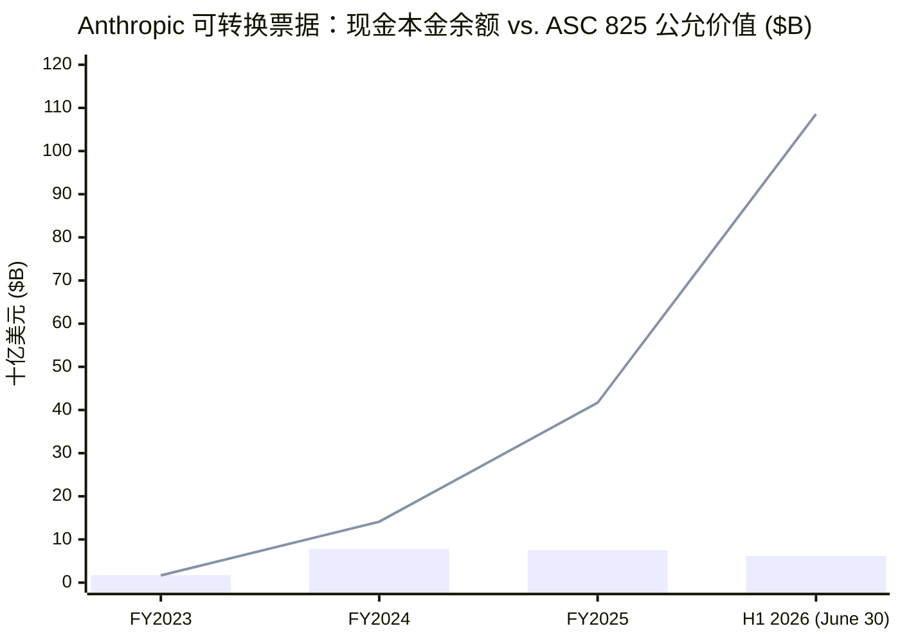
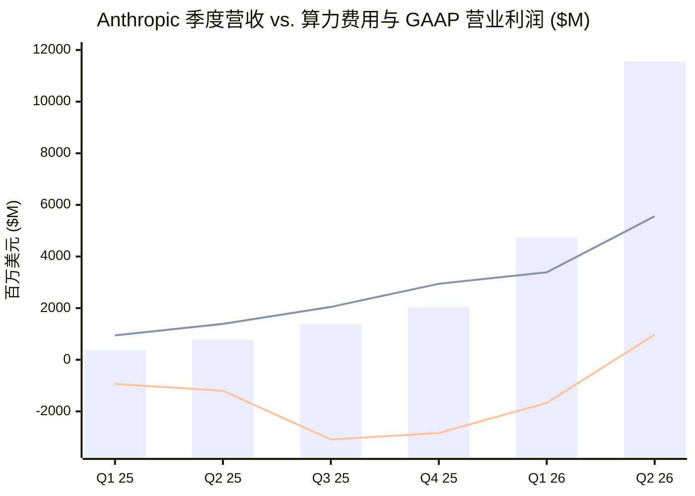

2026 年 10 月 26 日，随着 **Anthropic, PBC** 向美国证券交易委员会（SEC）公开提交 Form S-1 招股说明书（`CIK 0002130357`，备案号 `0001628280-26-067168`，拟用股票代码 `ANT`），投资人兼评论员 **Roger（[@rdd147](https://x.com/rdd147)）** 在 X 平台上引用软件分析师 [Jamin Ball（@jaminball）](https://x.com/jaminball) 的帖子，发表了一条疯传的两段式推文，指控 Anthropic 耍了 2000 年互联网泡沫时期的会计花招，通过可转换票据（Convertible Notes）隐瞒了高达 `1080 亿美元` 的运营费用：

> *"Yikes. Anthropic just pulled the exact accounting trick that companies did in 2000 bubble for IPO. They hid all their expenses via convertible notes redeemable at IPO. $108 billion worth. Dotcom firms often paid suppliers, ad agencies, lawyers and even landlords with stock or equity to save cash. AOL swapped shares for services and ads (e.g., Homestore, DrKoop). Telecom suppliers like Lucent, Cisco and Nortel used vendor financing, sometimes with equity or warrants, to drive equipment sales."*
> *（天哪。Anthropic 刚刚在 IPO 中耍了与 2000 年泡沫时期公司一模一样的会计花招。他们通过可在 IPO 时赎回/转换的可转换票据隐藏了所有费用。价值高达 1080 亿美元。当年互联网泡沫公司经常用股票或股权向供应商、广告代理商、律师甚至房东支付费用以节省现金。AOL 用股票交换服务和广告（如 Homestore、DrKoop）。朗讯、思科和北电等电信设备商则使用供应商融资，有时还附带股权或认股权证，来拉动设备销售。）*
> — **Roger ([@rdd147](https://x.com/rdd147))**, 2026 年 10 月 26 日

> *"So we’re all in agreement Anthropic was paying all of its expenses in convertible notes?"*
> *（所以我们都同意 Anthropic 一直在用可转换票据支付其所有费用，对吧？）*
> — **Roger ([@rdd147](https://x.com/rdd147))**，引用 [@jaminball](https://x.com/jaminball)，2026 年 10 月 26 日

本研究直接对照 Anthropic Form S-1 招股说明书中经审计与未经审计的合并财务报表及附注（`附注 1 至 17`，第 `F-1` 至 `F-66` 页），对 `@rdd147` 的指控执行完整的 **8 阶段取证会计审计（Forensic Audit）**。

我们的核心取证结论呈现出清晰的 **双层认知切分（Two-Layer Epistemic Split）**：
1. **在资产负债表上 `1086 亿美元` 可转债数字的来源及 GAAP 费用会计机制上，`@rdd147` 在事实与会计原理上均完全错误（`有效性约 5%`）：** Anthropic **从未**为了支付或隐瞒运营费用而发行 `1086 亿美元` 的可转换票据。根据 **合并现金流量表（`第 F-9 页`）** 和 **附注 4（`第 F-29 页`）**，Anthropic 自成立以来通过发行可转换票据筹集的**累计现金流入总额仅为 `112.5 亿美元`（`$11,250M`）**（2023 年 `17.5 亿美元`、2024 年 `60.5 亿美元`、2025 年 `34.5 亿美元`，以及 **2026 年上半年 `0 美元`**）。截至 2026 年 6 月 30 日（`附注 9，第 F-42 页`），Anthropic 资产负债表上**唯一尚未偿还的可转换票据面值本金（Principal）合计仅为 `62.0 亿美元`**——全部由 **亚马逊（Amazon）** 以现金投资的 2023 年展期票据（本金 `22.0 亿美元`，拆股后转换价格上限为 `$2.0928/股`）和 2024 年票据（本金 `40.0 亿美元`，拆股后转换价格上限为 `$5.0478/股`）组成。由于 Anthropic 选择了 **公允价值计量选项（`ASC 825`）** 以避免复杂的嵌入式衍生工具分拆，且其优先股股价在 2026 年 5 月 Series H 融资中飙升 **11.7 倍至 28.1 倍** 达到 **`$58.9010/股`**（1拆10前为 `$589.0095/股`），美国通用会计准则（US GAAP）强制要求 Anthropic 将亚马逊票据可转换的 `18.4045 亿股` 底层股票按其公允股权价值重估为 **`1085.66 亿美元`（`$108,566M`）**。简言之，**`1085.7 亿美元` 负债中有 `94.3%`（即 `1023.7 亿美元`）是 `62.0 亿美元` 现金票据上的未实现股权增值**，并作为非现金按市价计价亏损（2026 年上半年 `-$72,388M`，2025 年 `-$34,308M`）计入利润表的 `其他收入（费用）`。`ASC 825` 不仅没有“隐藏费用”，反而使 Anthropic 2026 年上半年的 GAAP 净亏损看起来**恶化了 `723.9 亿美元`**（2026 年上半年 GAAP 净亏损 `-$80,748M`，而同期 GAAP 营业亏损仅为 `-$693M`，且 **2026 年第二季度已实现 `+$974M` 的 GAAP 营业利润转正**）。
2. **然而，`@rdd147` 与 `@jaminball` 在附注 9 中确实触及了一个真实的结构性风险（`在潜在供应商融资与循环云承诺维度上有效性约 75%`）：** 尽管 `@rdd147` 误读了现有的 `1085.7 亿美元` 负债，但在 **附注 7（`第 F-35 页`）** 和 **附注 9（“其他票据购买协议”，`第 F-43 页`）** 深处，确实存在一个真实的供应商融资机制：在 **2025 年 8 月（`100 亿美元` 额度）** 和 **2026 年 3 月（`420 亿美元` 额度，年化 `9.0%` 实物支付 PIK 利息）**，Anthropic 签署了两项协议，允许其发行总额高达 **`520 亿美元`** 的可转换本票，***“专门用于为算力和基础设施协议下的租金义务融资（solely to finance rent obligations under a compute and infrastructure agreement）”***。截至 2026 年 6 月 30 日，这两项额度下的**实际发行额均为 `0 美元`**（`第 F-36、F-43 页`），意味着历史算力费用中没有一分钱是用票据支付的。然而，当这一机制与 **`8530 亿美元` 的表外多年期算力及数据中心租赁承诺**（截至 2026 年 6 月底未开始租赁 `3214 亿美元` + 云采购承诺 `2656 亿美元` + 2026 年第三、四季度新签 `2660 亿美元`）以及 IPO 生效时立即触发的 **`352 亿美元` 未确认员工 RSU/期权股权激励费用**叠加时，这些附注构成了二级市场投资者必须定价的巨大结构性悬顶之剑。

---

### 执行摘要与取证核查记分卡

| 核查维度与核心争议 | 疯传论点 (`@rdd147`) | SEC Form S-1 一手披露证据 (`CIK 0002130357`) | 取证有效性评级 |
| :--- | :--- | :--- | :--- |
| **1. `1086 亿美元` 可转债负债的真实来源** | Anthropic 发行了 `1080 亿美元` 可转债来支付并隐藏其运营费用。 | **完全失实。** 尚未偿还的票面本金**仅为 `62.0 亿美元`**（亚马逊 2023 NPA 余额 `22 亿美元` @ `$2.0928/股` 上限 + 亚马逊 2024 NPA `40 亿美元` @ `$5.0478/股` 上限）。其余 **`1023.7 亿美元`（`94.3%`）** 是股价飙升至 `$58.901/股` 带来的非现金 `ASC 825` 公允价值重估增值（`18.4045 亿股 × $58.901 ≈ $108.57B`）。 | **事实错误 (`~5% 有效`)** |
| **2. 在利润表上“隐藏运营费用”** | 用可转债支付费用从而将算力、薪酬和供应商成本排除在利润表之外。 | **在 GAAP 下机制上不可能且与事实相反。** Anthropic 在 2026 年上半年全额确认了 **`169.79 亿美元` 的运营费用**（`算力 89.45 亿美元`、`人员 31.52 亿美元`、`销售与合作伙伴分成 31.68 亿美元`、`行政管理 17.14 亿美元`），并在上半年创造了 **`+39.29 亿美元` 的正向经营活动现金流**。 | **彻底证伪 (`0% 有效`)** |
| **3. 核心经营盈利能力与毛利率** | 暗示 Anthropic 是一家靠做假账掩盖巨额经营烧钱的 2000 年式亏损泡沫公司。 | **核心业务基本面被颠倒。** 在 2026 年上半年 `162.86 亿美元` 营收（仅 Q2 单季即达 `115.55 亿美元`）中，`营业成本（Cost of revenue）` 仅为 `23.80 亿美元`（**GAAP 毛利率高达 `85.39%`**）。2026 年 Q2 已实现 **`+9.74 亿美元` 正向 GAAP 营业利润（营业利润率 `8.4%`）**，账面现金及短期投资达 `1316.5 亿美元`。 | **事实颠倒 (`~10% 有效`)** |
| **4. 发行可转债支付算力租金 (`附注 9`)** | 断言 Anthropic 正在用可转换票据向基础设施供应商支付费用（`@jaminball` / `@rdd147`）。 | **历史提取为 `0 美元`，未来额度达 `520 亿美元`。** 2025 年 8 月（`100 亿美元`）和 2026 年 3 月（`420 亿美元`，`9.0%` PIK 利息）签署的 NPA 确实*“专门用于为算力与基础设施租金义务融资”*，但**截至 2026 年 6 月 30 日发行额为 `0 美元`**；且即便未来提取，在 `ASC 842` 准则下仍必须在利润表全额计入租赁费用。 | **需甄别 (`历史 0%` / `远期风险 80%`)** |
| **5. 云厂商循环融资与供应商股权互换** | 将 AI 云巨头交易比作 2000 年代朗讯/思科/AOL 的循环供应商融资。 | **具有很强的结构相似性。** 亚马逊（`86 亿美元` 票据 + `50 亿美元` Series G-2 + `150 亿美元` 远期 NPA）和谷歌（`33 亿美元` 已转换票据 + `100 亿美元` Series G-2 + `200 亿美元` 远期 NPA）既是领投股东，又是最大的云供应商与分销渠道（上半年收取 `27 亿美元` 云市场分成 + `89.5 亿美元` 算力支出），此外 AMD 于 2026 年 7 月签署了附带 `50 亿美元` 购股承诺的 MI450 硬件供应协议。 | **大体成立 (`~80% 有效`)** |
| **6. 真正未确认的 IPO 费用炸弹与表外承诺悬顶** | 唯一只盯着 `1080 亿美元` 可转债作为 IPO 的隐蔽陷阱。 | **漏掉了财报附注中真正的 GAAP 雷区：** (a) 根据 `ASC 718` 在 IPO 前计为 **`0 美元`**、但在上市生效瞬间触发的 **`352 亿美元` 未确认员工 RSU/期权股权激励费用**（其中上市日立即补提 `29 亿美元`）；以及 (b) **`8530 亿美元` 的表外多年期算力与租赁承诺**（`2026–2046 年`）。 | **重大风险遗漏** |

---

## Phase 1 & 2: 议题分类与一手招股书原件挖掘 (Anthropic Form S-1)

### 1.1 合并利润表全量拆解 (`FY2023 – H1 2026`)
为了检验 Anthropic 是否“通过可转换票据隐藏了所有费用”，我们首先直接从 Form S-1 提取完整的 **合并利润表（`第 F-4 页`）** 和 **季度合并利润表（`第 158 页`）** 数据。

| 利润表项目 (`百万美元`，百分比除外) | FY2023 (经审计) | FY2024 (经审计) | FY2025 (经审计) | H1 2025 (未经审计) | H1 2026 (未经审计) | Q1 2026 (未经审计) | Q2 2026 (未经审计) |
| :--- | :--- | :--- | :--- | :--- | :--- | :--- | :--- |
| **营业收入 (Revenue)** | **$71** | **$637** | **$4,585** | **$1,163** | **$16,286** | **$4,731** | **$11,555** |
| **按性质分类的运营费用 (Operating Expenses by Nature):** | | | | | | | |
| 算力与基础设施 (Compute and infrastructure) | $402 | $1,708 | $7,326 | $2,334 | $8,945 | $3,387 | $5,558 |
| 人员薪酬 (Personnel，含股权激励 SBC) | $109 | $562 | $1,839 | $538 | $3,152 | $1,295 | $1,857 |
| *— 其中：期权/RSA 股权激励费用 (SBC)* | *$29* | *$192* | *$1,165* | *$286* | *$2,185* | *$924* | *$1,261* |
| *— 其中：RSU 股权激励费用 (`ASC 718` IPO 绩效条件未触发)* | *$0* | *$0* | *$0* | *$0* | *$0* | *$0* | *$0* |
| Bartz 版权集体诉讼和解金 | $0 | $0 | $1,500 | $0 | $0 | $0 | $0 |
| 销售、营销与合作伙伴关系 (含云市场收入分成) | $10 | $44 | $568 | $120 | $3,168 | $1,033 | $2,135 |
| 其他运营与行政管理费用 | $49 | $1,288 | $1,412 | $306 | $1,714 | $683 | $1,031 |
| **总运营费用 (Total Operating Expenses)** | **$570** | **$3,602** | **$12,645** | **$3,298** | **$16,979** | **$6,398** | **$10,581** |
| **GAAP 营业利润（亏损）** | **$(499)** | **$(2,965)** | **$(8,060)** | **$(2,135)** | **$(693)** | **$(1,667)** | **+$974** |
| *GAAP 营业利润率 (占收入 %)* | *-702.8%* | *-465.5%* | *-175.8%* | *-183.6%* | *-4.3%* | *-35.2%* | ***+8.4%*** |
| **非经营性项目 (`Other Income / Expense`):** | | | | | | | |
| 利息收入 (Interest income) | $13 | $90 | $431 | $115 | $1,111 | $349 | $762 |
| **可转换票据、衍生负债及 SAFE 公允价值变动损益** | **$(1,045)** | **$(5,434)** | **$(34,308)** | **$(10,942)** | **$(72,388)** | **$(12,791)** | **$(59,597)** |
| 其他收入（费用）净额 (含 2026 NPA 远期合约亏损) | $0 | $1 | $(8) | $0 | $(8,757) | $(309) | $(8,448) |
| **GAAP 净亏损 (Net Loss)** | **$(1,531)** | **$(8,309)** | **$(41,965)** | **$(12,969)** | **$(80,748)** | **$(14,439)** | **$(66,309)** |
| **Non-GAAP 调整后营业利润（亏损）** | **$(470)** | **$(1,648)** | **$(4,693)** | **$(1,849)** | **+$1,618** | **$(617)** | **+$2,235** |
| **经营活动产生的现金流量净额 (Operating Cash Flow)** | **$(387)** | **$(2,053)** | **$(4,487)** | **$(1,551)** | **+$3,929** | *N/A* | *N/A* |

### 1.2 按功能分类的费用拆解：发现 `85.39%` 的 GAAP 毛利率 (`附注 8，第 F-39 页`)
由于 Anthropic 在主利润表中采用**按性质分类（Natural Classification）**列示费用（`算力与基础设施`、`人员薪酬`、`销售、营销与合作伙伴`），许多评论者忽略了 **附注 8（`第 F-39 页`）** 中完整的**按功能分类费用拆解（Functional Expense Disaggregation）**。附注 8 将服务客户的推理（Inference）成本（`营业成本 / Cost of revenue`）与前沿模型预训练成本（`研发费用 / Research and development`）清晰地分开列示：

| 按功能分类的费用类别 (`百万美元`) | FY2023 | FY2024 | FY2025 | H1 2025 (6M) | H1 2026 (6M) | H1 2026 (占收入比例) |
| :--- | :--- | :--- | :--- | :--- | :--- | :--- |
| **营业收入 (Revenue)** | **$71** | **$637** | **$4,585** | **$1,163** | **$16,286** | **100.00%** |
| **营业成本 (Cost of revenue：客户推理算力与托管)** | $143 | $434 | $1,622 | $426 | $2,380 | 14.61% |
| **GAAP 毛利润 (Gross Profit)** | **$(72)** | **+$203** | **+$2,963** | **+$737** | **+$13,906** | **85.39%** |
| **研发费用 (R&D：前沿模型训练算力 + AI 研究人员薪酬)** | $348 | $1,729 | $7,077 | $2,337 | $9,741 | 59.81% |
| **销售与营销费用 (S&M：含 `$2.7B` AWS/GCP 云市场分成)** | $16 | $109 | $855 | $213 | $3,808 | 23.38% |
| **一般及行政管理费用 (G&A：含 2025 年 `$1.5B` Bartz 和解金)** | $63 | $1,330 | $3,091 | $322 | $1,050 | 6.45% |
| **总运营费用 (Total Operating Expenses)** | **$570** | **$3,602** | **$12,645** | **$3,298** | **$16,979** | **104.26%** |

仔细观察 `附注 8`（`第 F-39 页`）揭示的两个关键事实：
1. **2026 年上半年推理业务的 GAAP 毛利率高达 `85.39%`：** 在 2026 年上半年总计 `89.45 亿美元` 的算力与基础设施费用中，仅需 **`23.80 亿美元`** 即可支撑 `162.86 亿美元` 的客户 API、Claude Code 和订阅收入——创造了 **`139.06 亿美元` 的 GAAP 毛利润（毛利率 `85.39%`）**，较 2025 财年的 `64.62%` 和 2024 财年的 `31.87%` 大幅跃升。
2. **其余 `65.7 亿美元` 算力支出的去向：** 2026 年上半年其余约 `65.65 亿美元` 的算力费用全部在发生当期直接计入**研发费用（总计 `97.41 亿美元`）**，用于训练前沿 Claude 模型。没有任何算力成本被资本化为无形资产，也没有任何费用被藏在可转换票据里。

---

## Phase 3: 语义精确性检验与 Level 3 可转债公允价值滚动表 (`附注 4 与附注 9`)

### 3.1 对 `@rdd147` 核心主张的歧义消除与替换检验 (Substitution Test)
当 `@rdd147` 写道：
> *“他们通过可在 IPO 时赎回/转换的可转换票据隐藏了所有费用。价值高达 1080 亿美元……所以我们都同意 Anthropic 一直在用可转换票据支付其所有费用，对吧？”*

让我们应用 **Browne & Keeley 替换检验（Substitution Test）**，将“可转换票据”替换为 `@rdd147` 混为一谈的两个截然不同的会计概念：
* **解释 A（向供应商发行抵债票据支付运营费用）：** Anthropic 是否向 AWS、Google Cloud、房东和员工发放了面值 `1086 亿美元` 的欠条（可转换票据）来代替现金支付运营费用，从而将 `1086 亿美元` 的成本排除在营业利润表之外？**（事实真实度：0%。）**
* **解释 B（对早期现金可转债的 `ASC 825` 公允价值重估）：** Anthropic 是否在 `2023–2025 年` 间通过发行可转换票据筹集了 `112.5 亿美元` 现金（其中截至 2026 年 6 月 30 日仅剩亚马逊的 `62.0 亿美元` 本金未偿还），选择了 `ASC 825` 公允价值计量选项，随后因优先股股价从 `$2.09/股` 暴涨至 `$58.90/股` 而通过 `其他费用` 计提了 **`1023.7 亿美元` 的非现金公允价值重估增值**？**（事实真实度：100%。）**

### 3.2 逐美元追踪 `1085.66 亿美元` 负债的来龙去脉 (`附注 4，第 F-29 页` 与 `附注 9，第 F-40–F-42 页`)
让我们直接从 **附注 4（`第 F-29 页`）** 的 **Level 3 应付可转换票据公允价值滚动表（Rollforward）** 和 **现金流量表（`第 F-9 页`）** 进行核实：

| 公允价值滚动表构成项目 (`百万美元`) | FY2023 | FY2024 | FY2025 | H1 2026 (截至 6 月 30 日止六个月) | 累计总额 (`2023–H1 2026`) |
| :--- | :--- | :--- | :--- | :--- | :--- |
| **期初公允价值余额 (Beginning Fair Value Balance)** | **$0** | **$1,678** | **$14,116** | **$41,677** | **$0** |
| **(+) 发行时新增金额 (扣除分拆衍生工具后净额)** | +$1,394 | +$5,900 | +$3,450 | **+$0** | **+$10,744** *(现金流入总额：`$11,250M`)* |
| **(-) 转换为可赎回可转换优先股的扣减额** | $0 | $0 | $(10,347) | $(5,499) | **$(15,846)** |
| **(+) 非现金公允价值按市价计价调整 (`ASC 825`)** | +$284 | +$6,538 | +$34,458 | **+$72,388** | **+$113,668** |
| **期末资产负债表公允价值余额** | **$1,678** | **$14,116** | **$41,677** | **$108,566** | **$108,566** |

那么，截至 2026 年 6 月 30 日，究竟是哪几笔具体的可转换票据构成了这 **`1085.66 亿美元`** 的余额？**附注 9（`第 F-40 至 F-42 页`）** 和 **附注 12（`第 F-59 页`）** 提供了逐笔明细：

| 可转换票据协议 (`附注 9`) | 发行日期 | 原始现金流入 / 本金 | 截至 2026 年 6 月 30 日状态 | 拆股后转换价格上限 (`Cap`) | 剩余未偿还本金 (`2026.6.30`) | 底层可转换普通股数 (`附注 12`) | 按 Series H 股价 (`$58.901/股`) 计算的隐含股权价值 |
| :--- | :--- | :--- | :--- | :--- | :--- | :--- | :--- |
| **Google 2023 NPA** (`$2.0B`) | 2023.11 – 2024.11 | `$2,000M` 现金 | **100% 已转换**为 Series E 优先股（`2025.5–11`，公允价值 `$7.9B`） | `$2.0928 / 股`（拆股前 `$20.93`） | **$0** | 0 | $0 |
| **Google 2024 NPA** (`$1.3B`) | 2024.10 – 2025.10 | `$1,300M` 现金 | **100% 已转换**为 Series G 优先股（`2026.1`，公允价值 `$5.5B`） | `$5.0478 / 股`（拆股前 `$50.48`） | **$0** | 0 | $0 |
| **Amazon 2023 NPA (`首期票据`)** | 2023.10 | `$1,250M` 现金（本金 `$1,437.5M`） | **100% 已转换**为 Series E 优先股（`2025.10`，公允价值 `$2.4B`） | `$2.0928 / 股`（拆股前 `$20.93`） | **$0** | 0 | $0 |
| **Amazon 2023 NPA (`二期 / 展期票据`)** | 2024.3（2024.11 修订） | `$2,750M` 现金（本金 `$3,162.5M`） | 2025 年已转换 `$1.0B`；**剩余 `$2,200M` 本金未偿还** | **`$2.0928 / 股`**（价内增值 `28.14 倍`！） | **$2,200M** | ~1,048.0M 股 | **~$61,729M** |
| **Amazon 2024 NPA (`第 1 及第 2 批`)** | 2024.11 (`$1.3B`) & 2025.1 (`$2.7B`) | `$4,000M` 现金（本金 `$4,000M`） | **100% 未偿还**（IPO 时自动转换为普通股） | **`$5.0478 / 股`**（价内增值 `11.67 倍`！） | **$4,000M** | ~792.4M 股 | **~$46,675M** |
| **2025 年 8 月与 2026 年 3 月算力租金 NPA** | 2025.8 (`$10B`) & 2026.3 (`$42B`) | 提取额 `$0` | **未提取授信额度**（截至 2026 年 6 月 30 日发行额为 `$0`） | IPO / 下轮融资折扣价 | **$0** | 0 | $0 |
| **未偿还合计 (`2026 年 6 月 30 日`)** | — | **累计筹集现金 `$11,250M`** | 仅剩亚马逊 2023 展期票据与 2024 票据 | **`$2.0928` – `$5.0478 / 股`** | **本金 `$6,200M`** | **1,840.445M 股** | **`$108,404M`（账面公允价值 `$108,566M`）** |

```mermaid
flowchart TD
    subgraph SG1["疯传流言 (@rdd147)：'用可转债支付并隐藏了 1080 亿美元运营费用'"]
        M1["Anthropic 发生 1086 亿美元云算力、法律与薪酬费用"] --> M2["向供应商发行 1086 亿美元可转换票据代替现金支付"]
        M2 --> M3["声称运营费用因此被排除在利润表之外"]
        M3 --> M4["核查结论：0% 真实 — 违背 US GAAP (ASC 718 / ASC 842) 且与 S-1 原件直接矛盾"]
    end

    subgraph SG2["S-1 真实披露 (附注 4、9、12)：对亚马逊 62 亿美元现金票据的 ASC 825 公允价值重估"]
        R1["2023-2025年：亚马逊通过两项可转债协议累计投入 67.5 亿美元现金"] --> R2["扣除 2025 年部分转股后，截至 2026 年 6 月底剩余面值本金 62.0 亿美元"]
        R2 --> R3["合同锁定转换价格上限为 $2.0928/股（22 亿美元票据）与 $5.0478/股（40 亿美元票据）"]
        R3 --> R4["2026 年 5 月 Series H 融资将优先股定价推升至 $58.901/股（暴涨 11.7 倍至 28.1 倍）"]
        R4 --> R5["ASC 825 公允价值选项强制要求通过其他费用计提 +1023.7 亿美元非现金负债重估增值"]
        R5 --> R6["2026 年 6 月 30 日资产负债表负债：18.4045 亿底层股数 x $58.901/股 = 1085.66 亿美元"]
    end
```

---

## Phase 4: Anthropic 2026 年上半年 `-$807.5 亿美元` GAAP 净亏损的四维因果审计

为什么 Anthropic 在核心业务创造 **`+39.29 亿美元` 正向经营活动现金流**和 **2026 年第二季度 `+9.74 亿美元` GAAP 营业利润**的同时，会在 2026 年上半年录得惊人的 **`$(80,748) 百万美元`（`-$807.5 亿美元`）GAAP 净亏损**？让我们对四条因果路径逐一检验。

| 因果路径 (Causal Pathway) | 机制假说 | Form S-1 中的实证证据 | 占 H1 2026 GAAP 税前亏损 (`-$80,727M`) 比例 |
| :--- | :--- | :--- | :--- |
| **1. 直接经营因果 (`经营烧钱 -> 净亏损`)** | 经营性现金消耗（算力、员工、营销支出超过客户收入）是否导致了 2026 年上半年 `807.5 亿美元` 的净亏损？ | **否（仅占亏损的 `0.86%`）。** 2026 年上半年营收为 `162.86 亿美元`，总运营费用为 `169.79 亿美元`，GAAP 营业亏损仅为 **`$(693)M`**（Q1 亏损 `-$1,667M`，**Q2 已扭亏为盈实现 `+$974M` 营业利润**）。 | **`0.86%` (`-$693M`)** |
| **2. 反向因果 (`爆发式增长推升估值 -> GAAP 会计重估亏损`)** | Anthropic 爆发式的商业成功（上半年营收同比增长 `14 倍` 至 `162.9 亿美元`，毛利率 `85.4%`）是否导致其股价在 6 个月内暴涨 `3.5 倍`（至 `$58.901/股`），进而触发了折价可转债和远期合约上的巨额非现金公允价值重估亏损？ | **是（占亏损的 `99.14%`！）。** 在 `ASC 825` 和 `ASC 815` 下，Anthropic 股价每上涨 `$1.00/股`，就会在亚马逊的 `18.4045 亿股` 底层票据股数上自动产生 **约 `18.4 亿美元` 的非现金 GAAP 费用**（上半年为 `-$72,388M`），外加谷歌/亚马逊 2026 年 3–4 月 Series G-2 远期承诺带来的 **`-$9,405M` 总额（`-$8,720M` 净额）** 衍生品重估亏损（`附注 8，第 F-37 页`）。 | **`99.14%` (`-$80,034M` 净非经营性费用)** |
| **3. 潜在第三变量 (`IPO 前资本结构设计`)** | 为什么 Anthropic 当初向亚马逊和谷歌发行带有 `$2.09/股` 和 `$5.05/股` 转换上限的可转换票据，而不是普通优先股？ | **反垄断与投票权隔离。** 如 `附注 9` 所披露，亚马逊和谷歌将其巨额投资设计为无投票权可转债和无投票权 Series G-2/H-2 优先股，以便在锁定早期股权增值上限的同时，保持在监管投票权审查门槛之下。 | **结构性促成因素** |
| **4. 双向反馈闭环 (`云巨头资本 <-> 云算力支出`)** | 亚马逊和谷歌投入的数十亿美元可转债和优先股资金是否回流为 AWS 和 GCP 的云收入？ | **是。** 2026 年上半年，Anthropic 支出了 **`89.45 亿美元` 算力费用**和 **`27.00 亿美元` 云市场收入分成费**（合计 `116.45 亿美元`），绝大部分流向 AWS 和 Google Cloud，同时借助 Bedrock 和 Vertex AI 的企业级分发网络将 Q2 营收推升至 `115.6 亿美元`。 | **自我强化飞轮** |

---

## Phase 5: 定量与会计审计

### 5.1 `ASC 825` 可转换票据负债与悖论式损益冲击的形式化推导
在美国通用会计准则（**`ASC 825-10`，金融工具——公允价值选项**）下，当发行人选择按公允价值计量带有转换价格上限 `P_cap` 的可转换票据时，报告日 `t` 的资产负债表负债 `L_FV(t)` 由底层可转换股数 `N_conv` 的内在价值和期权价值主导：

$$
N_{\text{conv}}(t) = \frac{F_{\text{principal}} + I_{\text{PIK}}(t)}{P_{\text{cap}}}, \qquad L_{\text{FV}}(t) \approx N_{\text{conv}}(t) \cdot S(t) \cdot (1 - \delta_{\text{DLOM}})
$$

其中 `F_principal` 为剩余票面本金，`I_PIK(t)` 为累计实物支付（PIK）应计利息，`S(t)` 为 `t` 时刻底层股票的每股公允市场价值，`δ_DLOM` 为缺乏市场流通性折扣或跨转换情景的概率加权调整项（`附注 4，第 F-28 页`）。

因此，在 `[t-1, t]` 期间计入利润表 `其他收入（费用）` 的季度损益冲击等于公允价值变动额的负值：

$$
\Delta \text{P\&L}_{\text{Notes}}(t) = -\Big(L_{\text{FV}}(t) - L_{\text{FV}}(t-1) - \text{Additions}(t) + \text{Conversions}(t)\Big) \approx -N_{\text{conv}} \cdot \Delta S(t)
$$

代入 **附注 9（`第 F-41–F-42 页`）**、**附注 11（`第 F-48 页`）** 和 **附注 12（`第 F-59 页`）** 截至 2026 年 6 月 30 日的精确参数（已按 2026 年 9 月 1拆10 股票分割调整）：
1. **Amazon 2023 展期票据（本金 `$2,200M`，转换上限 `P_cap,1 = $2.0928/股`）：**
   - 基础本金对应股数 = `$2,200M / $2.0928` = `10.5122 亿股`（经具体批次调整后在 `附注 12` 中约为 `10.4802 亿股`）。
   - 按 Series H 价格（`S(2026年6月) = $58.9010/股`）计算的回报倍数：**`28.14 倍`**。
   - 隐含股权公允价值 = `1,048.02M × $58.9010` = **`617.29 亿美元`（`$61,729M`）**。
2. **Amazon 2024 票据（本金 `$4,000M`，转换上限 `P_cap,2 = $5.0478/股`）：**
   - 基础本金对应股数 = `$4,000M / $5.0478` = `7.9242 亿股`。
   - 按 Series H 价格（`$58.9010/股`）计算的回报倍数：**`11.67 倍`**。
   - 隐含股权公允价值 = `792.42M × $58.9010` = **`466.75 亿美元`（`$46,675M`）**。
3. **合并总额（`附注 12，第 F-59 页`）：**
   - 可转换票据底层普通股总数 `N_conv = 18.40445 亿股`。
   - 隐含内在价值总额 = `1,840.445M × $58.9010` = **`1084.04 亿美元`（`$108,404M`）**（与 2026 年 6 月 30 日资产负债表上的 Level 3 公允价值 **`1085.66 亿美元`（`$108,566M`）** 误差在 `0.15%` 以内！）。

*图表阅读指南：* **柱状图（Bar）** 显示 Anthropic 未偿还可转换票据的剩余现金面值本金（`$1.75B` -> `$7.80B` -> `$7.50B` -> 截至 2026 年 6 月 30 日的 **`$6.20B`**），而 **折线（Line）** 追踪 `ASC 825` 资产负债表账面价值（`$1.68B` -> `$14.12B` -> `$41.68B` -> **`$108.57B`**）。尽管由于票据转股，剩余债务本金从 `$7.80B` *下降*至 `$6.20B`，但仅因 Anthropic 股价涨至 `$58.90/股`，资产负债表负债账面值便飙升至 `$108.57B`。

*图表阅读指南：* 在 `2025 年 Q1` 至 `2026 年 Q2` 的六个季度中（`第 158 页`），季度**营业收入**（柱状图）从 `$376M` 暴涨 **`30.7 倍`** 至 **`$11,555M`**（年化运行率达 `$46.2B`），使得**算力与基础设施费用**（上方折线，`$944M` 至 `$5,558M`）占收入的比例从 **2025 年 Q1 的 `251%` 骤降至 2026 年 Q2 的 `48%`**，并推动 **GAAP 营业利润**（下方折线）从 2025 年 Q3 的 `-$3,089M` 亏损扭转为 **2026 年 Q2 的 `+$974M` 正向 GAAP 营业利润**。

---

## Phase 6: “负面视角（Negative View）”——`@rdd147` 搞错的事实与 Anthropic S-1 附注中真正埋藏的四大定时炸弹

严谨的 Browne & Keeley 批判性思维审计绝不止步于驳斥一条有缺陷的社交媒体推文。我们必须追问反向问题：**即便 `@rdd147` 误读了资产负债表上的 `1086 亿美元` 项目，Anthropic 的 S-1 附注深处究竟埋藏着哪些真正的结构性负债、供应商融资机制和股权稀释悬顶？**

通过对 `附注 7、9、10、12、13、16 和 17` 的取证挖掘，我们发现了每一位潜在 IPO 投资者都必须评估的**四大结构性风险**：

### 6.1 风险 1：`520 亿美元` 的“算力租金专用可转换票据”授信额度 (`附注 7，第 F-35 页` 与 `附注 9，第 F-43 页`)
这正是 `@jaminball` 和 `@rdd147` 触及到的真实痛点——尽管他们把一项**尚未提取的未来授信额度（已提取 `$0`）**与**历史上的亚马逊现金票据（公允价值 `$108.6B`）**混淆了：
* 在 **附注 9（“其他票据购买协议”，`第 F-43 页`）** 以及 **附注 7（“尚未开始的租赁”与“通过合并可变利益实体 VIE 持有的租赁”，`第 F-35–F-36 页`）** 中，Anthropic 披露了两项与算力基础设施出租人签署的特殊安排：
  1. **2025 年 8 月算力租赁票据购买协议（NPA，`最高 100 亿美元`）：** 允许 Anthropic 发行最高 **`100 亿美元`** 的可转换本票，***“专门用于为算力和基础设施设备租赁协议下的租金义务融资”***。该额度在 IPO 完成时终止，且截至 2026 年 6 月 30 日，**已发行票据为 `0 美元`**（`第 F-43 页`）。
  2. **2026 年 3 月算力租金票据购买协议（NPA，`最高 420 亿美元`，年化 `9.0%` PIK 利息）：** 2026 年 3 月，结合一项大型算力与基础设施协议，Anthropic 签署了一项票据购买协议，允许其在设备准备就绪投入服务后的 **5 年可用期内**，发行最高 **`420 亿美元`** 的可转换本票，***“专门用于为算力和基础设施协议下的租金义务融资”***（`第 F-43 页`）。这些票据按**年化 `9.0%` 计提实物支付（PIK）复利利息**，首次发行满 5 年后到期，由合并可变利益实体（`VIE`）提供担保并将租赁的 GPU 集群质押给出租人作为担保物（`第 F-36 页`），且**在 IPO 完成后依然有效**！
* **为什么这至关重要：** 尽管截至 2026 年 6 月 30 日**提取额为 `0 美元`**，但 2026 年 3 月签署的 `420 亿美元` 额度赋予了 Anthropic 在上市后通过向基础设施房东印发可转债（而非支付现金）来支付高达 `420 亿美元` 数据中心及 GPU 租金的选择权。在 `ASC 842` 租赁准则下，这样做**依然会在利润表上全额确认租赁运营费用**（因此绝不会隐瞒营业费用），但它会将原本的现金算力租金转化为向二级市场股东转嫁的年化 `9.0%` PIK 复利可转债稀释负担。

### 6.2 风险 2：高达 `8530 亿美元` 的表外（Off-Balance-Sheet）算力与租赁承诺悬顶 (`附注 7、13、16 与 17`)
在 Anthropic 截至 2026 年 6 月 30 日的资产负债表（`第 F-3 页`）表内，确认的租赁负债总额仅为 **`15.22 亿美元`**（经营租赁负债 `$1,079M` + 融资租赁负债 `$443M`）。然而，分散在四个不同附注中的表外合同承诺时间表合计高达 **`约 8530 亿美元`**：

| 表外合同承诺类别 | Form S-1 附注来源 | 合同期限 | 未折现最低付款义务 (`十亿美元`) | 是否计入 2026.6.30 资产负债表？ |
| :--- | :--- | :--- | :--- | :--- |
| **1. 已签署但尚未开始的算力与数据中心租赁（截至 2026.6.30）** | `附注 7 (第 F-35 页)` | `2026–2028 年` 开始（期限 `1 至 20 年`） | **`$321.4B`** *(较 2025 年底的 `$50.2B` 暴增)* | **否 (`$0`)** |
| **2. 不可撤销的云服务商 (CSP) 托管与基础设施采购承诺（截至 2026.6.30）** | `附注 13 (第 F-59 页)` | `1 至 20 年` | **`$265.6B`** *(较 2025 年底的 `$54.6B` 暴增)* | **否 (`$0`)** |
| **3. 2026 年 6 月 30 日后新签的长期算力与租赁承诺（`2026 年 7–10 月`）** | `附注 17 (第 F-66 页)` | `2026–2036 年` 开始（期限 `1 至 20 年`） | **`$245.0B`** | **否 (`$0`)** |
| **4. 2026 年 6 月 30 日后新签的短期不可撤销算力合同** | `附注 17 (第 F-66 页)` | `< 1 年` | **`$21.0B`** | **否 (`$0`)** |
| **已披露的合同算力与租赁承诺总额** | `附注 7、13 与 17` | **`2026–2046 年+`** | **`$853.0 Billion` (`8530 亿美元`)** *(外加 `$125B–$150B` 条款未最终敲定的 2028–2031 扩建协议，`第 F-64 页`)* | **否 (6 月 30 日表内为 `$0`)** |

### 6.3 风险 3：云巨头与 AI 芯片供应商的循环融资 (`Amazon、Google 与 AMD`)
尽管 `@rdd147` 认错了 `1086 亿美元` 项目的性质，但他对 2000 年代供应商循环融资的历史类比在审视 Anthropic 的“资本—算力三角闭环”时却切中要害：
* **亚马逊（`AWS`）与谷歌（`GCP`）：** 除了早期的可转换票据外，在 **2026 年 3 月和 4 月**，谷歌（`Google 2026 NPA`，`第 F-41 页`）和亚马逊（`Amazon 2026 NPA`，`第 F-42 页`）按 `$259.14/股`（拆股后 `$25.91/股`）的价格分别认购了 `100 亿美元` 和 `50 亿美元` 的 Series G-2 优先股——由于随后的 5 月 Series H 融资立即将股价重估至 `$589.01/股`，这直接导致 Anthropic 在 2026 年上半年确认了 **`87.20 亿美元` 净额（`94.05 亿美元` 总额）的非现金远期合约衍生品亏损**（`附注 4，第 F-27 页` 与 `附注 8，第 F-37 页`）——同时两家巨头还承诺在未来分别提供最高 **`200 亿美元`（谷歌）** 和 **`150 亿美元`（亚马逊）** 的后续债务/股权融资。值得注意的是，根据 `Amazon NPA`（`第 F-42 页`），亚马逊持有的票据甚至可以通过*“抵销亚马逊在某些商业协议下应付给公司的款项”*（即 AWS Bedrock 云市场销售回款）来结算。
* **AMD（`2026 年 7 月硬件供应框架协议`，`附注 17，第 F-66 页`）：** 2026 年 7 月，Anthropic 签署了一份硬件供应框架协议，以购买或租赁搭载 **AMD Instinct MI450 GPU 的 Helios 机架级系统**，根据该协议，若满足特定商业部署条件，**AMD 同时承诺购买最高 `50 亿美元` 的 Anthropic Class N 普通股**。

### 6.4 风险 4：真正未确认的 GAAP 费用炸弹（`352 亿美元` 员工 RSU 与期权）及 `86.4%` 股权稀释悬顶
极具讽刺意味的是，确实有一笔巨额运营费用被合法地排除在 Anthropic 上市前的利润表之外——但不是通过可转换票据，而是通过 **`ASC 718` 准则下的双层归属条件员工限制性股票单位（`RSU`）**：
* 根据 **附注 10（`第 F-53 页`）**，截至 2026 年 6 月 30 日，Anthropic 累计授予了 **`10.496 亿股` RSU**（此外在 2026 年 7 月至 10 月间又新授予了 **`9100 万股`、公允价值达 `58 亿美元` 的 RSU**，`附注 17，第 F-65 页`），这些 RSU 需同时满足 4 年服务期条件和 **IPO 上市流动性事件条件**方可归属。
* 由于在美国 GAAP 下，直到招股说明书正式生效前，IPO 均被视为“不很可能发生（not probable）”，因此 Anthropic 在 2023 年、2024 年、2025 年和 2026 年上半年确认的 **RSU 股权激励费用严格为 `0 美元`**（`第 F-53 页`）！
* 在 S-1 招股书生效的 IPO 瞬间，Anthropic 将立即在利润表上一次性补提 **`29 亿美元` 的累计 RSU 费用**，外加在加权平均 `2.1 年` 内摊销的 **`237 亿美元` 上半年未确认 RSU 成本**，外加 **`58 亿美元` 的 Q3 新授 RSU 成本**，以及 **`28 亿美元` 的未确认股票期权成本**（`第 F-52 页`）——合计高达 **`352 亿美元` 的未来 GAAP 运营费用冲击**！

让我们审计 **IPO 前的全稀释股权结构表（Fully Diluted Cap Table）**（`附注 10、11、12 与 17`，1拆10后口径）：

| 证券类别 (`2026.6.30` 余额 + 已披露的 Q3/Q4 新授份额) | 拆股后股数 (`百万股`) | 占 IPO 前全稀释股本比例 | 按 Series H 股价 (`$58.901/股`) 计算的隐含价值 | 2026.6.30 资产负债表账面价值 |
| :--- | :--- | :--- | :--- | :--- |
| **已发行基本普通股 (`Class A + Class N`)** | **2,098.4M** | **13.57%** | **$123.60B** | `$(103,646)M` *(股东权益赤字)* |
| **可赎回可转换优先股 (`Series A – H`)** | **8,558.9M** | **55.34%** | **$504.13B** | `$157,493M` *(夹层权益)* |
| **可转换票据 (`亚马逊 $6.20B 本金余额`)** | **1,840.4M** | **11.90%** | **$108.40B** | `$108,566M` *(非流动负债)* |
| **未行权员工股票期权 (加权平均行权价 `$4.25`)** | **1,797.1M** | **11.62%** | **$105.85B** *(内在价值 `$98.2B`)* | `$0` *(行权时计入资本公积)* |
| **未归属员工 RSU (`上半年 1,049.6M` + `Q3 91.0M`)** | **1,140.6M** | **7.38%** | **$67.18B** | `$0` *(`$32.4B` 未确认股权激励费用)* |
| **未归属 RSA (`13.5M`)、预留扣款股 (`1.6M`) 及 Q3 捐赠配比发行股 (`28.0M`)** | **43.1M** | **0.28%** | **$2.54B** | `$94M` *(预留扣款负债)* |
| **IPO 发行新股前全稀释总股本 (不含预留池)** | **15,478.5M** | **100.00%** | **$911.70B** | — |
| *备忘：预留员工捐赠配比池 (`905.7M`) 与公益子公司授权池 (`846.8M`) Class N 股* | *最高 1,752.5M* | *潜在额外稀释 +11.3%* | *最高 $103.22B* | *由董事会酌情分批发行* |

---

## Phase 7: 灰度思维综合（“If-条件句”）与概率加权终极裁决

我们拒绝非黑即白的社交媒体煽动（*“Anthropic 靠把 1080 亿美元费用藏进可转债来伪造利润”*）与盲目的 IPO 吹捧（*“不用管附注，Q2 营业利润已经转正了”*），将调查结论综合为三条条件性 **“If-条件句”** 及概率加权终极裁决：

1. **如果（If）投资者评估的是 Anthropic 的历史 GAAP 会计完整性与核心单位经济模型（`2026 年上半年`），** 那么 `@rdd147` 的论点必须作为**对 `ASC 825` 准则的根本性误读予以摒弃**。Anthropic 的 `1085.7 亿美元` 可转债负债中有 `94.3%`（`1023.7 亿美元`）是亚马逊按 `$2.09–$5.05/股` 转换上限投入的 `62.0 亿美元` 现金票据所产生的未实现股权增值。在 IPO 转换为 `18.4045 亿股` 普通股时，这整笔 `1085.7 亿美元` 负债将在**零现金流出**的情况下从负债端彻底消失并转入永久性股东权益，留给 Anthropic 一张坐拥 **`1316.5 亿美元` 现金及短期投资**、**`85.39%` GAAP 毛利率**、**上半年 `+39.3 亿美元` 经营现金流**以及 **Q2 `+9.74 亿美元` GAAP 营业利润**的堡垒级资产负债表。
2. **如果（If）投资者评估的是 IPO 后的 GAAP 盈利轨迹（`2026–2028 年`），** 那么真正的会计冲击绝不是可转换票据，而是 **`352 亿美元` 的未确认员工 RSU 与期权费用悬顶（`附注 10`）** 以及 **`520 亿美元`（其中 `420 亿美元` 在 IPO 后依然有效、按 `9.0%` PIK 计息）的算力租金可转债授信额度（`附注 9`）**。在 S-1 生效瞬间，`29 亿美元` 的累计 RSU 补提费用和每年约 `110 亿–140 亿美元` 的持续 RSU 摊销将直接冲击 GAAP 营业利润，而亚马逊的 `62.0 亿美元` 现金票据投资将稀释二级市场股东 **`18.4045 亿股`（占公司总股本约 `11.9%`，按 Series H 价格计算价值约 `1084 亿美元`）**。
3. **如果（If）前沿 AI 营收增速放缓至不足以消化 `8530 亿美元` 多年期算力与数据中心租赁承诺（`附注 7、13 与 17`）的水平，** 那么 Anthropic 庞大的固定基础设施义务（`3214 亿美元` 未开始租赁 + `2656 亿美元` 云采购承诺 + `2660 亿美元` 2026 下半年新增承诺）及其年化 `9.0%` PIK 的 `420 亿美元` 算力租金票据额度，将从经营杠杆变成沉重的固定成本枷锁。

### 概率加权终极取证裁决 (“What We Actually Think”)

| 情景与取证结果 | 认知概率 | 机制与财务依据 |
| :--- | :--- | :--- |
| **情景 A（基准情景）：IPO 资产负债表彻底出清重置 + 上市后沉重的 SBC 与算力承诺悬顶** | **65%** | 在 IPO 时，`1085.7 亿美元` 亚马逊可转债负债与 `1574.9 亿美元` 优先股干净利落地转换为普通股权益，消除 `ASC 825` 按市价计价噪音，留下 `1317 亿美元+` 现金的堡垒资产负债表。然而，由于 `$2.9B` RSU 一次性补提和每年 `$12B+` 的 RSU 摊销，GAAP 营业利润在上市初期将暂时重回亏损，华尔街的焦点将集中在 `85%+` 的推理毛利率能否支撑 `8530 亿美元` 的长期算力承诺。 |
| **情景 B（悲观情景）：算力过度承诺与循环云利润率压缩** | **25%** | 企业级 AI API 定价遭到压缩，而 Anthropic 的 `8530 亿美元` 表外算力/租赁承诺在 `2026 至 2028 年` 间开始密集生效。为保存现金，Anthropic 大举动用 2026 年 3 月签署的 **`420 亿美元` 年化 `9.0%` PIK 算力租金可转债额度（`附注 9`）**，使 `@jaminball` 和 `@rdd147` 警告的供应商融资风险在*未来时态*下成真，加剧公众股东的复利稀释。 |
| **情景 C（`@rdd147` 字面论点）：历史资产负债表上的 `1086 亿美元` 负债是被隐瞒的运营费用** | **0% (彻底证伪)** | **被一手 SEC 招股书文件完全证伪。** 资产负债表上 `$108,566M` 负债的每一分钱都在 `附注 4` 和 `附注 9` 中有据可查（亚马逊投入的 `$6,200M` 现金本金 + 对应 `18.4045 亿股` 在 `$58.901/股` 下的 `$102,366M` 非现金 `ASC 825` 股权升值），且截至 2026 年 6 月 30 日，2025 年 8 月与 2026 年 3 月算力租金票据额度的实际提取额严格为 `0 美元`。 |
| **情景 D（乐观情景）：内生经营杠杆增长彻底跑赢算力承诺** | **10%** | Anthropic 的营收（2026 年 Q2 单季 `115.6 亿美元`；2026 年 7 月 ARR 达 `300 亿美元`）在保持 `85%+` 毛利率的同时复合增长突破每年 `600 亿–800 亿美元+`，使公司完全依靠内生经营现金流（2026 上半年为 `+39.3 亿美元`）支付算力租赁，无需动用一分钱的 `420 亿美元` 算力租金可转债额度。 |

---

## Phase 8: 经核验的一手及权威参考文献 (Verified Primary References)

1. **美国证券交易委员会 (SEC) — Anthropic, PBC Form S-1 招股说明书 (`CIK 0002130357`，备案号 `0001628280-26-067168`，2026 年 10 月 26 日提交)：** 一手经审计（`FY2023–FY2025`）及未经审计（`H1 2025–H1 2026`）合并财务报表（`第 F-1 至 F-66 页`）、季度合并利润表（`第 158 页`）、附注 4（`公允价值计量`，`第 F-25 至 F-29 页`）、附注 7（`租赁`，`第 F-34 至 F-36 页`）、附注 8（`补充财务信息与按功能分类费用`，`第 F-36 至 F-39 页`）、附注 9（`可转换票据、循环信贷协议与 SAFE`，`第 F-40 至 F-44 页`）、附注 10（`股权激励`，`第 F-50 至 F-54 页`）、附注 12（`每股净亏损`，`第 F-58 至 F-59 页`）、附注 13（`承诺与或有事项`，`第 F-59 至 F-61 页`）以及附注 16–17（`期后事项`，`第 F-63 至 F-66 页`）。官方企业门户：[https://www.anthropic.com](https://www.anthropic.com) 及新闻中心：[https://www.anthropic.com/news](https://www.anthropic.com/news)
2. **Roger (`@rdd147`) — 指控 `1080 亿美元` 可转债费用花招的疯传 X 推文（2026 年 10 月 26 日）：** 接受取证审计的一手社交媒体源：[https://x.com/rdd147](https://x.com/rdd147)
3. **Jamin Ball (`@jaminball`) — 对 Anthropic S-1 附注 9 算力租金可转债额度的分析帖（2026 年 10 月 26 日）：** `@rdd147` 引用的一手分析来源：[https://x.com/jaminball](https://x.com/jaminball)
4. **Amazon.com, Inc. — 关于向 Anthropic 追加投资 `40 亿美元` 可转换票据及战略云合作的官方新闻稿 (`Amazon 2023 & 2024 NPAs`)：** 印证现金投资结构及 AWS 首选云服务商条款的一手企业披露：[https://www.aboutamazon.com/news/aws/amazon-invests-additional-4-billion-anthropic-ai](https://www.aboutamazon.com/news/aws/amazon-invests-additional-4-billion-anthropic-ai) 及 AWS Bedrock Claude 官方文档：[https://aws.amazon.com/bedrock/claude/](https://aws.amazon.com/bedrock/claude/)
5. **Google Cloud — Anthropic Claude 的 Vertex AI 合作伙伴模型官方文档 (`Google 2023, 2024 & 2026 NPAs`)：** 一手技术与商业合作文档：[https://cloud.google.com/vertex-ai/generative-ai/docs/partner-models/claude](https://cloud.google.com/vertex-ai/generative-ai/docs/partner-models/claude)
6. **Advanced Micro Devices, Inc. (AMD) — 投资者关系门户 (`2026 年 7 月 Instinct MI450 Helios 系统硬件供应框架协议`)：** 一手企业投资者关系来源：[https://ir.amd.com](https://ir.amd.com)
