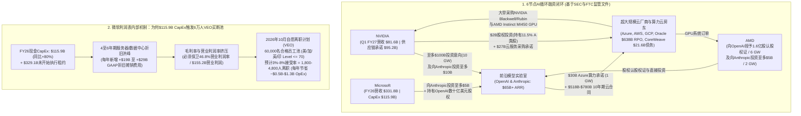
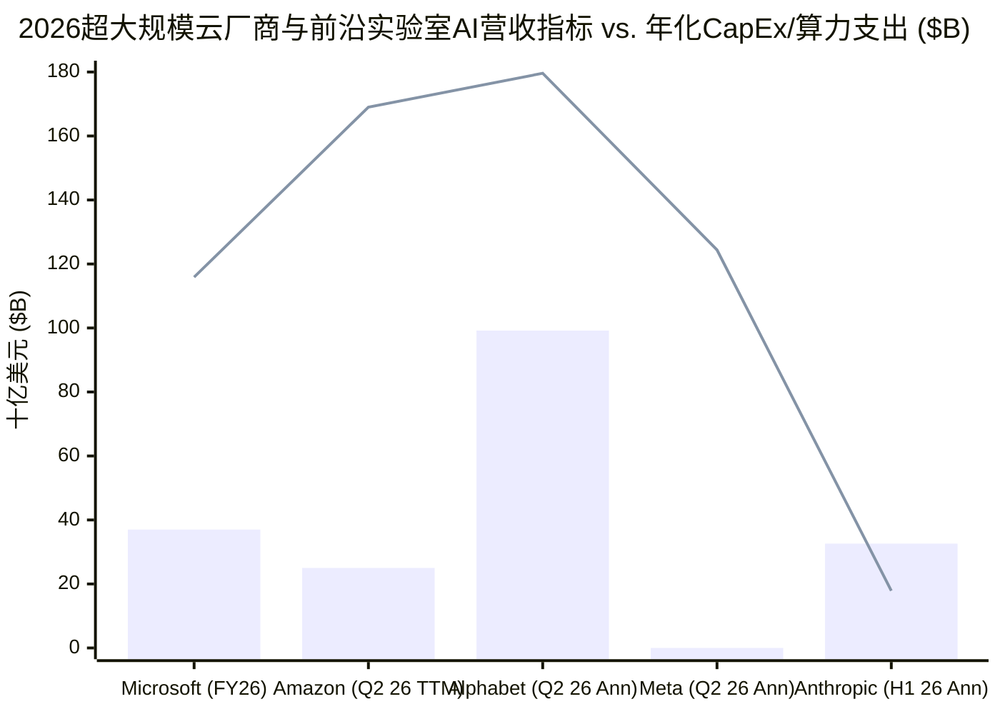
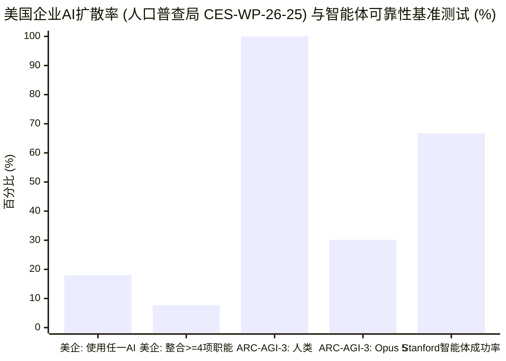

## 执行摘要（Executive Summary）：剥离6万名员工买断分母的统计幻觉与AI循环融资的精准靶心

2026年10月下旬，在*彭博社（Bloomberg）*披露微软首席人力官**艾米·科尔曼（Amy Coleman）**的内部备忘录后，财经评论账号 **The Kobeissi Letter**（`@KobeissiLetter`）与企业级AI顾问 **布拉德·格鲁（Brad Groux，`@BradGroux` — Digital Meld首席执行官、前微软高级现场工程师[PFE]）** 在X（原Twitter）上引发了一场病毒式辩论：微软面向6万名员工推出的**自愿离职买断计划（Voluntary Exit Offer, `VEO`）**是否证明前沿人工智能（AI）的经济账已经算不通了？

> "突发：据彭博社报道，作为在AI普及背景下削减成本努力的一部分，微软（$MSFT）正向60,000名员工提供买断方案（buyouts）。
>
> 美国、加拿大、印度和英国特定团队中副总裁（VP）及以下级别的员工符合资格……"
> — **The Kobeissi Letter**（`@KobeissiLetter`，2026年10月）

> "各位，这就是煤矿里的金丝雀。AI的这笔账根本算不通（The AI math doesn't math）。微软正在向其近四分之一的员工提供买断。
>
> 哪怕在最完美的设想下，企业的AI落地也是一场长达24个月的旅程。他们没有看到足够快的普及速度来抵消其资本开支（CapEx）……而且不止他们一家。再加上Anthropic（与其CapEx相比）微不足道的营收数字，希望你能明白其中的要害。
>
> 这些买断并不是因为微软通过AI找到了效率，而是因为他们（整个AI行业）合计砸下了数万亿美元，造出了人类历史上最强大的工具，却根本没有人知道该怎么用。
> digitalmeld.io/blog/who-is-pa..."
> — **Brad Groux**（`@BradGroux`，附Digital Meld研究报告 [*Who Is Paying for the AI Boom?*](https://digitalmeld.io/blog/who-is-paying-for-the-ai-boom) 链接，2026年10月）

微软面向6万名员工的买断提议真的证明了**"AI的账算不通"**，且微软和Anthropic相对于其基础设施投入而言只有**"微不足道的营收"**吗？运用M·尼尔·布朗（M. Neil Browne）与斯图尔特·M·基利（Stuart M. Keeley）的**"淘金式（Panning for Gold）"**批判性思维框架，我们对微软 [2026财年Form 10-K年报及第四季度财报](https://www.microsoft.com/en-us/Investor/earnings/FY-2026-Q4/press-release-webcast)、Anthropic 2026年Form S-1上市招股书、[美国人口普查局2026年4月AI扩散研究（`CES-WP-26-25`）](https://www.census.gov/library/working-papers/2026/adrm/CES-WP-26-25.html)，以及格鲁本人在Digital Meld发表的一手源研究白皮书（[*Who Is Paying for the AI Boom?*](https://digitalmeld.io/blog/who-is-paying-for-the-ai-boom)）进行了交叉核验，结果发现了一个极具戏剧性的分裂：**格鲁的病毒式推文犯下了三个严重的统计与财务错误——甚至直接违背了他自己发表的白皮书中关于AI供应商营收的结论；然而，他底层白皮书中关于AI供应商循环融资、微软CapEx转折旧的利润率挤压，以及企业端24个月集成高墙的研究，却精准命中了行业靶心。**

| 病毒式推文主张与研究命题 | 法医级裁决 | 认识论效度 | 核心实证与统计审计 |
| :--- | :--- | :--- | :--- |
| **1. "微软正向其近四分之一的员工提供买断（`60,000` / `223,000` = `26.9%`）"** | **分母属实，推论误导** | **~35% 有效** *(合格申请池 vs. 实际接受率谬误)* | `60,000人`是获准在2026年12月初前申请自愿离职的**合格员工池（`N_eligible`，涵盖美、加、英、印特定部门Level 70及以下员工）**，而**绝非**裁员`26.9%`的目标。按大企业自愿离职计划的历史接受率（`3%–8%`）计算，实际预计离职人数为 **`1,800至4,800人`（仅占微软223,000名总员工的 `0.8%–2.15%`）**。 |
| **2. "他们没有看到足够快的普及来抵消CapEx……这些买断并非因为微软用AI实现了效率"** | **部分赞同** | **~65% 有效** *(CapEx转折旧引发的利润率保卫战)* | 微软AI业务年化营收运行率（ARR）在 [FY26 Q3](https://www.microsoft.com/en-us/investor/earnings/fy-2026-q3/press-release-webcast) 突破 **`370亿美元+`（同比`+123%`）**，FY26营业利润增长`20.8%`至 **`1,552亿美元`（营业利润率`46.8%`）**。但FY26 CapEx暴增约`80%`至 **`1,159亿美元`**（另有 **`3,291亿美元`** 未开始执行的数据中心租约），导致自由现金流下滑`-6.5%`至 **`670亿美元`**。随着每年`1,159亿美元`的CapEx转化为每年 **`+190亿至290亿美元`的新增GAAP折旧摊销（`D&A`）**，微软正在用削减人力运营费用（`OpEx`）来对冲硅片折旧。 |
| **3. "再加上Anthropic（与其CapEx相比）微不足道的营收数字，希望你能明白要害"** | **当期流量完全失实，10年承诺口径成立** | **~30% 有效** *(忽略了上半年`162.9亿美元`营收与`650亿美元+` ARR)* | 根据Anthropic 2026年Form S-1招股书，其2026上半年（H1）确认营收同比**暴增`14倍`至`162.9亿美元`**（2026年7月突破 **`650亿美元+` ARR**，Q3单季营收达`168亿美元`），超过H1算力开支 **`89.5亿美元`**（营收/算力比为`1.82倍`），并在 **2026年Q2实现`9.74亿美元` GAAP营业利润转正**。真正的风险并非当期营收"微不足道"，而是其高达 **`5,180亿至7,800亿美元`的10年期多云刚性算力采购承诺**。 |
| **4. Digital Meld白皮书命题：前沿AI需求被6节点循环供应商融资闭环人为放大** | **强烈赞同** | **~95% 有效** *(法医级靶心)* | 经SEC文件及官方公告证实：[微软+英伟达向Anthropic投资至多`150亿美元`，同时Anthropic承诺采购`300亿美元` Azure算力](https://blogs.microsoft.com/blog/2025/11/18/microsoft-nvidia-and-anthropic-announce-strategic-partnerships/)；[英伟达与OpenAI签署`10 GW`/至多`1,000亿美元`投资意向书](https://nvidianews.nvidia.com/news/openai-and-nvidia-announce-strategic-partnership-to-deploy-10gw-of-nvidia-systems)；[AMD向OpenAI授予`1.6亿股`AMD认股权证（`6 GW`）](https://newsroom.amd.com/news/amd-and-openai-announce-strategic-partnership-to-d/)并[向Anthropic投资至多`50亿美元`（`2 GW`）](https://ir.amd.com/news-events/press-releases/detail/1292/amd-and-anthropic-announce-strategic-partnership-to-deploy-up-to-2-gigawatts-of-amd-instinct-mi450-series-gpus)；英伟达持有CoreWeave（背负`216亿美元`债务）`11.5%`的A类股。 |
| **5. "企业AI落地在完美设想下也是24个月的旅程……没有人知道怎么用"** | **强烈赞同** | **~85% 有效** *("模型外围工作"的运营瓶颈)* | 获 [美国人口普查局（`CES-WP-26-25`，2026年4月）](https://www.census.gov/library/working-papers/2026/adrm/CES-WP-26-25.html) 证实：仅 **`18%`的美国企业**（按就业加权为`32%`）在任一业务职能中使用AI，且其中 **`57%`仅在3个或更少职能中使用**。跑通演示只需2周，但ERP/应付账款/CRM生产级落地因`Entra ID`权限清洗、脏数据治理、确定性代码校验及参差不齐的智能体可靠性（[ARC-AGI-3](https://arcprize.org/results/anthropic-claude-opus-5) 仅`30.2%`）而耗时`18–24个月+`。 |
| **6. Digital Meld白皮书命题：物理电网并网排队（中位数`5年`）与晶圆厂瓶颈限制近期AGI规模化部署** | **强烈赞同** | **~90% 有效** | [美国能源部（DOE，`2024`）](https://www.energy.gov/articles/doe-releases-new-report-evaluating-increase-electricity-demand-data-centers) 预计美国数据中心用电量将从`176 TWh`激增至2028年的`325–580 TWh`（占全美电力的`6.7%–12%`），而LBNL *Queued Up* 研究证明电网并网排队中位耗时达 **`5年`（建成率仅`14%`）**，[Vogtle核电站3号和4号机组（`EIA`）](https://www.eia.gov/todayinenergy/detail.php?id=61963) 更是耗费了`11年`和`300亿美元+`。 |

---

## 第一与第二阶段：问题分类、一手信源挖掘与"推文 vs. 白皮书"分裂矩阵

### 1.1 核心问题的分类与界定
遵循布朗与基利批判性思维框架第2章，我们将病毒式推文及底层Digital Meld研究论文拆解为四个可证伪的核心问题：
1. **描述性问题 1（企业人力资源与重组机制）：** *微软2026年10月面向60,000名合格员工推出的自愿离职计划（`VEO`）是否旨在裁减27%的员工？为什么数据中心运营和销售团队被排除在外，而Copilot和CoreAI团队却被纳入其中？*
2. **描述性问题 2（超大规模云厂商与前沿实验室会计学）：** *微软FY26财报（营收`3,318亿美元`、CapEx `1,159亿美元`、AI ARR `370亿美元+`）和Anthropic 2026年Form S-1招股书（H1营收`162.9亿美元`、H1算力开支`89.5亿美元`、长期承诺`5,180亿美元+`）究竟反映了当期AI营收匮乏，还是长期经营杠杆与折旧摊销的利润率挤压？*
3. **描述性问题 3（生态系统的融资结构）：** *英伟达、AMD、微软、亚马逊、OpenAI、Anthropic、甲骨文与CoreWeave之间的循环供应商融资，在多大程度上放大了前沿AI的账面营收与剩余履约义务（`RPO`）积压订单？*
4. **描述性/规范性问题 4（企业扩散周期与物理约束）：** *尽管模型基准测试突飞猛进，为什么可持续的企业AI运营转型仍需18至24个月以上？企业今天应如何规划AI投资？*

### 1.2 "推文 vs. 白皮书"的主张分裂矩阵（Claim Schism Matrix）
在法医级深度调查的第二阶段，我们必须核查作者在社交媒体上的病毒式宣传是否与其亲手附上链接的一手研究文档相吻合。当我们把布拉德·格鲁2026年10月的X推文与他自己于2026年8月18日发表的Digital Meld白皮书（[*Who Is Paying for the AI Boom?*](https://digitalmeld.io/blog/who-is-paying-for-the-ai-boom)）及SEC一手财报并列对比时，发现了教科书级别的**社交媒体 vs. 白皮书自我否定分裂**：

| 分析维度 | Brad Groux的病毒式X推文（`@BradGroux`，2026年10月） | Brad Groux本人链接的Digital Meld白皮书（[*Who Is Paying for the AI Boom?*，2026年8月18日](https://digitalmeld.io/blog/who-is-paying-for-the-ai-boom)）及SEC一手文件 |
| :--- | :--- | :--- |
| **头部供应商的AI营收规模** | *"AI的账根本算不通……他们没有看到足够快的普及来抵消CapEx……再加上Anthropic（与其CapEx相比）微不足道的营收数字，希望你能明白要害。"* | **白皮书"AI营收正在增长，但回报依然模糊"章节中的直接自我反驳：** *"人们很容易把论点简单化：供应商在AI上花了数千亿美元，却几乎没有营收可言。**但当前的监管披露文件并不支持这一说法。**英伟达拥有实打实的营收。微软和亚马逊现在均报告了庞大的AI年化营收运行率……**假装这些业绩不存在，就会重蹈我们正在批评的覆辙：先选定故事，再去拼凑数字。**"* |
| **微软披露的AI与云业务增速** | 暗示微软AI产品未能产生可观商业收入来覆盖CapEx，迫使公司对近四分之一员工发起紧急买断。 | 明确引用 [微软FY26 Q3财报](https://www.microsoft.com/en-us/investor/earnings/fy-2026-q3/press-release-webcast) 与 [FY26全年财报](https://www.microsoft.com/en-us/Investor/earnings/FY-2026-Q4/press-release-webcast)：*"其AI业务在2026财年第三季度突破了**370亿美元的年化营收运行率，同比增长123%**。Azure及其他云服务营收在第四季度**增长了43%**。"* |
| **Anthropic的营收对比算力支出** | 嘲讽*"Anthropic（与其CapEx相比）微不足道的营收数字（measly revenue numbers）"*。 | 根据Anthropic向SEC提交的2026年Form S-1上市注册声明（股票代码：`ANT`），Anthropic仅在**2026上半年（6个月）就实现了`162.9亿美元`确认营收**（较2025上半年的`11.6亿美元`暴增`14倍`），并于2026年7月突破 **`650亿美元+` ARR**，远超其2026上半年`89.5亿美元`的算力与基础设施开支（且在**2026年Q2实现`9.74亿美元` GAAP营业利润**）。 |
| **当前AI工具的实用性** | *"他们（整个AI行业）合计砸下数万亿美元造出了人类有史以来最强大的工具，却**根本没有人知道怎么用**。"* | **白皮书摘要与运营章节的严谨表述：** *"人工智能**已经在边界清晰的业务工作流中创造了可衡量的价值**……有用的AI已经到来。真正的工作是将模型能力转化为人们能够信任、维护并持续改进的受控工作流。"* |

> [!IMPORTANT]
> **为什么这一分裂具有重要的认识论意义：**
> 如果读者只看格鲁那条110个单词的推文，会以为这又是一篇宣称"AI毫无收入、科技巨头即将崩盘"的极端看空帖。但如果你仔细研读他那篇4,500词的Digital Meld白皮书，就会发现它是2026年关于AI循环融资和企业工作流摩擦最冷静、一手信源最扎实的深度报告之一。我们的任务是剔除推文中的修辞夸张，同时提炼并从数学上扩展白皮书的核心结构性洞见。

### 1.3 一手财务记分卡：2026年SEC监管文件真实披露的数据
为了将审计建立在第一层级（Level-1）一手证据之上，以下为我们从FY26/2026年SEC财报及官方业绩公告中提取的跨公司财务总账：

| 公司与一手信源出处 | 最新披露的AI / 云业务营收指标 | 资本开支（`CapEx`）与基础设施承诺义务 | 现金流、盈利能力与关键披露事项 |
| :--- | :--- | :--- | :--- |
| **Microsoft**（[FY26 10-K及Q4财报](https://www.microsoft.com/en-us/Investor/earnings/FY-2026-Q4/press-release-webcast)，[Q3财报](https://www.microsoft.com/en-us/investor/earnings/fy-2026-q3/press-release-webcast)） | FY26总营收：**`3,318亿美元`**（同比`+17.8%`）。 AI业务运行率：**`370亿美元+` ARR**（Q3 FY26同比`+123%`）。 Q4 FY26 Azure及云服务增速：**同比`+43%`**。 | FY26购建财产和设备支出（`CapEx`）：**`1,159亿美元`**（同比`+80%`）。 尚未开始执行的数据中心租赁承诺：**`3,291亿美元`**（截至2026年6月30日）。 | 营业利润：**`1,552亿美元`**（营业利润率`46.8%`，同比`+20.8%`）。 经营活动现金流：**`1,829亿美元`**。 自由现金流（FCF）：**`670亿美元`**（较FY25的`716亿美元`同比下滑`-6.5%`）。 全球全职员工：**`223,000人`**（较FY25的`228,000人`减少`-2.2%`）。 |
| **Anthropic**（*2026 Form S-1招股书*，[微软/英伟达2025年11月公告](https://blogs.microsoft.com/blog/2025/11/18/microsoft-nvidia-and-anthropic-announce-strategic-partnerships/)） | 2025全年营收：**`~46亿美元`**（年末ARR `~90亿美元`）。 2026上半年（H1）营收：**`162.9亿美元`**（Q1 `47.3亿美元` + Q2 `115.6亿美元`，较H1 2025的`11.6亿美元`暴增`14倍`）。 2026年7月ARR：**`650亿美元+`**（Q3 2026单季营收`~168亿美元`）。 | 2025全年算力支出：**`73亿美元`**。 2026上半年算力支出：**`89.5亿美元`**（每`1美元`算力产生`1.82美元`营收）。 10年期多云与芯片采购总承诺：**`5,180亿至7,800亿美元`**（含Azure `300亿美元`、AWS、GCP、博通、AMD `2 GW`）。 | 2026年Q2 GAAP营业利润：**`+9.74亿美元`（首次转正）**。 2026上半年GAAP净亏损：**`-807亿美元`**，其中 **`724亿美元`为可转债/SAFE公允价值重估带来的非现金会计账面费用**。 现金及短期投资储备：**`1,317亿美元`**。 |
| **NVIDIA**（[Q1 FY27财报，2026年5月20日](https://nvidianews.nvidia.com/news/nvidia-announces-financial-results-for-first-quarter-fiscal-2027)；FY26 10-K及Q1 FY27 10-Q） | Q1 FY27总营收：**`816亿美元`**（同比`+85%`）。 Q1 FY27数据中心营收：**`752亿美元`**（同比`+92%`）。 | 制造/供应链采购承诺：**`952亿美元`**。 多年期云服务采购承诺：**`270亿美元`**。 对外股权投资承诺：**`270亿美元`**（截至2026年4月26日，较1月的`114亿美元`翻倍）。 | 赚取惊人的硬件现金毛利（毛利率`>75%`），但越来越多地将资本反哺给下游客户（`OpenAI`、`Anthropic`、`CoreWeave`）。 |
| **Amazon**（*Q2 2026财报，2026年7月30日*） | AWS Q2 2026营收：**`422亿美元`**（同比`+37%`）。 AWS AI业务运行率：**`250亿美元+` ARR**（同比三位数百分比增长）。 | 过去12个月（`TTM`）购建财产和设备支出：**`1,690亿美元`**（主要由AI基础设施驱动）。 | 受`1,690亿美元` CapEx拖累，TTM自由现金流跌至 **`-76亿美元`（转负）**。 因重估Anthropic股权投资录得 **`534亿美元`非经常性税前投资收益**。 |
| **Alphabet**（*Q2 2026 Form 10-Q，2026年7月23日*） | Q2 2026谷歌云营收：**`248亿美元`**（同比`+82%`，受AI基础设施、平台服务及TPU销售推动）。 | Q2 2026单季 `CapEx`：**`449亿美元`**（年化速率约`1,800亿美元`）。 | 未将生成式AI的独立营收或利润率从谷歌云及TPU系统销售中拆分披露。 |
| **Meta**（*Q2 2026 Form 10-Q，2026年7月30日*） | Q2 2026总营收：**`608亿美元`**（同比`+28%`，几乎全部来自广告业务）。 | Q2 2026单季 `CapEx`：**`311亿美元`**（年化速率约`1,244亿美元`）。 | 管理层将广告排名与转化率提升归功于AI，但财报中无独立的AI软件直接营收项。 |
| **Oracle & CoreWeave**（*Oracle FY26财报，2026年6月；CoreWeave FY25 10-K，2026年2月*） | 甲骨文FY26剩余履约义务（`RPO`）：**`6,380亿美元`**。 CoreWeave：计划到2030年部署 **`5 GW+`** 英伟达算力设施。 | 甲骨文FY26通过**发债融资`430亿美元` + 股权融资`50亿美元`**，计划FY27再融资**`~400亿美元`**（另有客户预付/提供的 **`750亿美元`** GPU）。 CoreWeave背负 **`216亿美元`总债务**。 | 高度依赖高杠杆及少数前沿模型实验室大租户，若下游算力消耗放缓将面临集中违约与再融资风险。 |

---

## 第三阶段：语义精确性与替换测试（Substitution Test）

遵循布朗与基利方法论第4章，我们锁定驱动这场病毒式叙事的三个核心模糊词组——**"向60,000名员工提供买断"**、**"与CapEx相比微不足道的营收"**以及**"AI营收"**——并执行**替换测试（Substitution Test）**。

### 3.1 替换测试 1："向60,000名员工提供买断"
当`@KobeissiLetter`写下*"微软正向60,000名员工提供买断"*，且`@BradGroux`将其转译为*"微软正向其近四分之一的员工提供买断"*时，**"向60,000名员工提供买断"**这一短语具有两种截然不同的操作定义：
* **定义 A —— 目标裁员人数（`ΔL = 60,000人`）：** 微软打算通过买断方式削减60,000个工作岗位（占其223,000名员工总数的`26.9%`）。
  * *代入格鲁的论证：* 如果全球最大的企业软件巨头要裁掉`27%`的员工，那确实是史无前例的经营危机（"煤矿里的金丝雀"）。**然而，定义 A 在事实上是完全错误的。**
* **定义 B —— 自愿申请合格员工池（`N_eligible = 60,000人`）：** 微软划定了一个组织边界——四个国家（**美国、加拿大、英国、印度**）参与业务部门（**Windows + Devices、Xbox、Copilot、CoreAI、财务和人力资源**）中**内部职级Level 70及以下**（从普通工程师到合伙人/总经理/部分享有VP头衔的人员，但不含公司副总裁[CVP]及高管）的员工，*有资格*在2026年12月初之前申请标准遣散费方案（于`2026年12月31日`正式离职）。
  * *代入格鲁的论证：* 面向60,000人的合格池开放非强制性的自愿离职计划（`VEO`），按照大型科技企业的历史自愿接受率（`τ_takeup`）**`3%至8%`**计算，实际离职人数仅为 **`1,800至4,800人`（占微软全球员工总数的 `0.8%至2.15%`）**——这与微软在FY26全年净缩减`5,000名`员工（从`228,000人`降至`223,000人`，降幅`-2.2%`）的常规人员新陈代谢规模几乎完全一致！

### 3.2 替换测试 2："AI营收"与"CapEx"（当期流量 vs. 远期承诺会计学）
无论是AI狂热看多者还是极端看空者，都习惯性地将以下五个完全不同的会计量混为一谈：
1. **经审计确认的GAAP营收（`R_GAAP`）：** 当期实际交付并开具账单的公认会计准则营收（例如：Anthropic在2026上半年的`162.9亿美元`；英伟达在Q1 FY27的`816亿美元`）。
2. **年化营收运行率（`ARR`）：** 将单个季度或单个月份归因于AI的营收乘以4或12（例如：微软Q3 FY26的`370亿美元+` AI运行率；AWS Q2 2026的`250亿美元+` AI运行率；Anthropic 2026年7月的`650亿美元+` ARR）。
3. **剩余履约义务（`RPO`）与多年期采购承诺：** 未来5至10年内购买或供应云算力的跨年度合同承诺（例如：甲骨文的`6,380亿美元` RPO；Anthropic的`5,180亿至7,800亿美元` 10年算力承诺；微软的`3,291亿美元`未开始执行数据中心租约）。
4. **当期现金资本开支（`CapEx_cash`）：** 当年为购建财产和设备实际支付的现金（例如：微软FY26的`1,159亿美元`；亚马逊TTM的`1,690亿美元`）。
5. **供应商融资 / 循环需求（`R_circular`）：** 直接或间接由确认销售收入的同一供应商通过股权投资、认股权证（Warrants）或预付款提供资金支持的云服务或芯片采购。

---

## 第四阶段：因果拆解与四向竞争原因审计（4-Way Causal Audit）

为什么微软会在2026年10月面向60,000名合格员工池推出自愿离职计划（`VEO`）——而且为什么它**将Copilot、CoreAI、Windows + Devices、Xbox、财务和人力资源部门纳入买断范围**，却明确**将数据中心运营、安全、市场营销和企业级销售团队排除在外**？

遵循布朗与基利框架第9章，我们对四个竞争性因果假说进行检验：

| 因果假说 | 机制传导路径 | 一手实证证据与部门划分线索 | 解释权重 |
| :--- | :--- | :--- | :--- |
| **1. AI直接需求失败假说** *(Brad Groux的推文命题：`X → Y`)* | 企业客户采用微软AI产品的速度太慢，导致微软面临搁浅CapEx并被迫紧急裁员。 | **低至中等（`~20%`）。** 尽管M365 Copilot企业席位转化确实面临18–24个月的运营整合滞后，但微软AI年化营收运行率在Q3 FY26**同比暴增`+123%`至`370亿美元+`**，且Azure在Q4 FY26**同比增长`+43%`**。最关键的是，如果AI需求正在崩盘，微软绝不可能在豪掷`1,159亿美元` CapEx的同时，**把数据中心运营和企业销售团队排除在买断计划之外**！ | **次要（`20%`）** |
| **2. CapEx转折旧的利润率置换假说** *(用人力`OpEx`置换硅片折旧`D&A`)* | 巨额AI基础设施投入（FY26 `1,159亿美元` CapEx + `3,291亿美元`租约）将在FY27–FY29转化为每年数百亿美元的GAAP折旧摊销费用（`D&A`）。为了保卫`46.8%`的营业利润率，微软必须削减非基础设施人力`OpEx`。 | **主导因素（`~45%`）。** 在FY26，微软经营现金流增至`1,829亿美元`，但`1,159亿美元`的CapEx账单使其自由现金流同比下降`-6.5%`至`670亿美元`。根据GAAP会计准则，现金CapEx不会立即计入当期损益表，而是在数据中心通电投产后分4–6年通过**折旧与摊销（`D&A`）**进入成本费用。削减中层员工薪酬可在营业利润率线上1比1对冲即将到来的服务器折旧洪峰。 | **主导（`45%`）** |
| **3. 后零利率时代中层管理扁平化与重叠团队整合** *(潜伏第三变量 `Z`)* | 针对Windows、Xbox（动视暴雪收购后整合）、财务、HR以及重叠的Copilot/CoreAI产品团队中`Level ≤ 70`的人员去层级化，规避《工人调整和再培训通知法》（WARN Act）及强制绩效淘汰（PIP）摩擦。 | **显著（`~20%`）。** 为什么**Copilot**和**CoreAI**会出现在合格买断名单上？因为在2023–2025年间，微软在Windows、Office、Dynamics和消费端成立了数十个职能重叠的"Copilot"套壳小团队，随后将开发者基础设施统一整合至Jay Parikh领导的**CoreAI**部门，并在OpenAI之外引入了**Claude**（[2025年11月宣布](https://blogs.microsoft.com/blog/2025/11/18/microsoft-nvidia-and-anthropic-announce-strategic-partnerships/)）。自愿买断让冗余的产品经理在12月31日前平稳自我出清。 | **显著（`20%`）** |
| **4. 内部AI编程与后台自动化的人力替代效应** *(反向因果 / 相互反馈)* | 软件维护、财务和HR领域的内部AI编程助手与自动化流程，降低了单位存量软件产出所需的人力配置。 | **中等（`~15%`）。** 微软在FY26将全球总人数缩减了`5,000人`（`-2.2%`，降至`223,000人`），同时总营收增长`+17.8%`至`3,318亿美元`（**人均创收跃升至`148.8万美元`**）。向财务、HR、Windows和Xbox提供自愿买断，反映了常规维护与行政岗位边际人力需求的下降。 | **中等（`15%`）** |

---

## 第五阶段：定量与统计完整性审计（Quantitative & Statistical Integrity Audit）

在第五阶段（布朗与基利第10章），我们对病毒式推文与Digital Meld报告中的定量主张进行形式化数学推导与基线分母核验。

### 5.1 VEO自愿接受率（Take-Up Rate）与实际减员方程
当一家拥有 `N_total = 223,000名` 员工的企业向 `N_eligible = 60,000名` 合格员工池（美、加、英、印参与部门中 `Level ≤ 70` 的人员）提供非强制性、按司龄标准赔付的自愿离职计划（`VEO`）时，实际减员人数 `ΔL_VEO` 与年化人力成本毛节省额 `ΔOpEx_labor` 取决于自愿接受率 `τ_takeup` 以及离职人员的完全加载薪酬成本 `w_loaded`：

$$\Delta L_{\text{VEO}} = \tau_{\text{takeup}} \cdot N_{\text{eligible}}, \qquad \Delta \text{OpEx}_{\text{labor, annual}} = \Delta L_{\text{VEO}} \cdot w_{\text{loaded}} \cdot (1 - \rho_{\text{backfill}})$$

其中 `ρ_backfill ∈ [0, 0.3]` 为空缺岗位后续在低成本地区或核心AI工程岗位补招的比例，`w_loaded ≈ $280,000–$350,000` 为微软美/加/英/印 `Level ≤ 70` 员工群体的平均完全加载年薪（含基本工资+奖金+年度股权激励费用[SBC]+福利）。在三种接受率区间下：
* **低接受率（`τ_takeup = 3%`）：** `ΔL_VEO = 1,800人` 离职（占全球员工的 `0.81%`）→ 每年节省 **`~$4.5亿–$6.3亿美元`** 人力成本。
* **基准接受率（`τ_takeup = 5%–6%`）：** `ΔL_VEO = 3,000至3,600人` 离职（占全球员工的 `1.35%–1.61%`）→ 每年节省 **`~$8.4亿–$12.6亿美元`** 人力成本（在计提FY27 Q2约 `~$4亿–$6.5亿美元` 一次性遣散费之后）。
* **高接受率（`τ_takeup = 10%`）：** `ΔL_VEO = 6,000人` 离职（占全球员工的 `2.69%`）→ 每年节省 **`~$15亿–$21亿美元`** 人力成本。

在任何符合现实的情景下，实际裁员比例均为 **`1%至2.7%`**，而**绝不是 `25%`（"近四分之一的员工"）**。

### 5.2 CapEx转折旧的利润率挤压方程（CapEx-to-Depreciation Margin Squeeze）
为什么一家年营收高达`3,318亿美元`（同比`+17.8%`）、营业利润达`1,552亿美元`（营业利润率`46.8%`）的印钞机巨头，会如此迫切地想要削减每年`10亿至20亿美元`的中层人力`OpEx`？让我们审视微软现金资本开支 `CapEx_t`、未开始执行的租赁承诺 `L_uncommenced = $329.1B` 与其GAAP营业利润率 `m_op,t = OpInc_t / R_t` 之间的会计动力学方程：

$$\Delta \text{D\&A}_{t+1} = \frac{\alpha_{\text{server}} \cdot \text{CapEx}_t}{\tau_{\text{GPU}}} + \frac{(1 - \alpha_{\text{server}}) \cdot \text{CapEx}_t}{\tau_{\text{shell}}} + \Delta \text{Lease Amortization}_{t+1}$$

其中：
* `CapEx_FY26 = 1,159亿美元`（较FY25的约 `645亿美元` 在短短一年内激增 `+514亿美元`）。
* `α_server ≈ 0.60–0.65` 为用于购买短寿命服务器、GPU和网络设备并按 `τ_GPU ≈ 4至6年` 折旧的CapEx占比，而 `(1 - α_server) ≈ 0.35–0.40` 为按 `τ_shell ≈ 15至25年` 折旧的长寿命数据中心厂房/土建占比。

代入 `CapEx_FY26 = 1,159亿美元`，仅单一年份的CapEx在通电投产后，就会**每年新增 `145亿至206亿美元` 的GAAP折旧摊销费用**！当企业客户的AI软件收入确认比数据中心投产滞后12–24个月时（微软在FY26 Form 10-K风险因素中明确警告了这一风险），为了防止GAAP营业利润率 `m_op` 下滑，微软必须满足以下利润率中性不等式：

$$\Delta R_{\text{AI}, t+1} \cdot m_{\text{gross, AI}} - \Delta \text{OpEx}_{\text{labor}, t+1} \ge \Delta \text{D\&A}_{t+1}$$

只要 `ΔD&A_t+1` 的攀升速度超过近期高毛利AI软件收入的确认速度，**`ΔOpEx_labor,t+1` 就必须为负数**（即中层去层级化与自愿离职买断）。

### 5.3 解构Anthropic S-1招股书与循环营收乘数（Circular Revenue Multiplier）
现在，让我们结合Digital Meld对供应商循环融资的分析，审计格鲁关于*"Anthropic（与其CapEx相比）微不足道的营收数字"*的指控。

首先，核查Anthropic 2026年Form S-1上市招股书中的真实财务数据：
* **2026上半年（H1）确认营收：** **`162.9亿美元`**（Q1 `47.3亿美元` + Q2 `115.6亿美元`；相比之下2025上半年为`11.6亿美元`，2025全年为`46亿美元`），并在2026年7月突破 **`650亿美元+` ARR**。
* **2026上半年（H1）算力与基础设施开支：** **`89.5亿美元`**（2025全年为`73亿美元`）。
* **当期算力效率比（`H1 2026`）：**

$$\eta_{\text{compute, H1 2026}} = \frac{R_{\text{Anthropic, H1 2026}}}{C_{\text{compute, H1 2026}}} = \frac{\text{USD } 16.29\text{ billion}}{\text{USD } 8.95\text{ billion}} = 1.82\times \quad (\text{2026年Q2 GAAP营业利润} = +\text{USD } 974\text{ million})$$

既然如此，为什么舆论场会把Anthropic的财务状况误读为"相对于CapEx营收微不足道"或巨额亏损呢？原因在于S-1招股书中的两个特殊会计特征：
1. **`724亿美元`非现金估值重估亏损幻觉：** Anthropic在2026上半年报告了 **`-807亿美元`** 的表面GAAP净亏损，但**其中高达`724亿美元`（占亏损总额的`89.7%`）是因公司IPO前估值飙升，按GAAP准则对可转换债券、SAFE及衍生负债进行公允价值重估所产生的非现金账面费用**！
2. **`5,180亿至7,800亿美元`的10年期照付不议（Take-or-Pay）算力承诺悬顶：** 为了锁定直到2035年的前沿算力集群，Anthropic向AWS、谷歌云、微软Azure（2025年11月宣布的`300亿美元`承诺）、博通以及AMD（2026年7月宣布的`2 GW`承诺）签署了累计高达 **`5,180亿至7,800亿美元`** 的多年期云与芯片采购承诺。

这正是Digital Meld所揭示的**AI循环融资闭环（Circular AI Financing Loop）**。当硬件供应商（`NVIDIA`或`AMD`）与超大规模云厂商（`Microsoft`或`Amazon`）向一家前沿模型实验室（`Anthropic`或`OpenAI`）注入现金 `I_vendor`，而模型实验室按合同约定将该笔资金的 `β_cloud ∈ [0.7, 1.0]` 比例用于购买该云厂商的算力，云厂商进而又将其中 `β_GPU ∈ [0.5, 0.7]` 的比例用于向该硬件供应商采购GPU时，1美元的供应商原始资本会在整个生态系统中衍生出如下**账面总交易额乘数（`M_circular`）**：

$$M_{\text{circular}} = \frac{\Delta \text{Valuation/Investment} + \Delta \text{Cloud RPO/Revenue} + \Delta \text{GPU Revenue}}{I_{\text{vendor}}} = 1 + \beta_{\text{cloud}} + \beta_{\text{cloud}} \cdot \beta_{\text{GPU}} \approx 2.2\times \text{ to } 2.7\times$$

以Digital Meld引用的 [2025年11月18日微软-英伟达-Anthropic战略合作](https://blogs.microsoft.com/blog/2025/11/18/microsoft-nvidia-and-anthropic-announce-strategic-partnerships/) 为例：英伟达承诺向Anthropic投资至多`100亿美元`，微软承诺投资至多`50亿美元`（合计`150亿美元`）；与此同时，Anthropic承诺向微软采购 **`300亿美元`基于英伟达系统的Azure算力容量（`1 GW`）**。哪怕外部独立的非科技企业客户还没有掏出一分钱购买API Token，仅这一项三角协议就在账面上同时创造了`150亿美元`的前沿实验室融资额、`300亿美元`的微软Azure商业积压订单（RPO），以及数百亿美元的英伟达数据中心硬件需求！

*（图表说明：柱状图[Bar]展示微软[`370亿美元`]与AWS[`250亿美元`]披露的AI年化营收运行率[ARR]、Alphabet年化谷歌云总营收[`992亿美元` = 4 × `248亿美元`，因未单独拆分AI]、Meta单独披露的AI软件营收[`0亿美元`，未从单季`608亿美元`广告收入中拆分]，以及Anthropic 2026上半年年化确认营收[`326亿美元` = 2 × `162.9亿美元`，其ARR随后在7月突破`650亿美元+`]。折线图[Line]展示全年/年化资本开支或算力支出：微软`1,159亿美元`、亚马逊TTM `1,690亿美元`、Alphabet年化`1,796亿美元`[4 × `449亿美元`]、Meta年化`1,244亿美元`[4 × `311亿美元`]，以及Anthropic上半年年化算力开支`179亿美元`[2 × `89.5亿美元`]。）*

---

## 第六阶段："负面视角（The Negative View）"与遗漏信息审讯

为什么布拉德·格鲁断言*"企业的AI落地在完美设想下也是一场长达24个月的旅程"*——而在超高速CapEx狂飙与慢节奏企业运营的巨大时差背后，究竟是谁在承担隐性代价？

### 6.1 企业AI落地的24个月运营瓶颈（为何"模型外围的工作"决定成败）
无论是在X推文还是Digital Meld白皮书中，长期为中型工业与工程企业集成Microsoft 365、Azure、Entra ID与OpenAI系统的格鲁，都精准指出了当前AI经济的核心瓶颈：**前沿实验室按3个月的时钟发布模型，物理电网按60个月的时钟建设电站，而主流企业按24个月的时钟重构业务工作流。**

请看 [美国人口普查局2026年4月工作论文（*The Microstructure of AI Diffusion*，`CES-WP-26-25`）](https://www.census.gov/library/working-papers/2026/adrm/CES-WP-26-25.html) 披露的实证扩散数据：
* 在全美企业中（2025年11月至2026年1月调查期），仅有 **`18.0%`的企业**（按就业人数加权为`32.0%`）在至少一项业务职能中使用了AI。
* 在这`18.0%`采用AI的企业中，**`57.0%`仅在3项或更少的业务职能中使用AI**——这意味着全美仅有 **`7.7%`的企业**（`18% × 43%`）将AI深度整合到了4项或以上的业务职能中！

为什么从耗时2周的聊天机器人试点（Pilot）走向生产级（Production）企业工作流需要整整 **24个月**？
1. **身份治理、权限收敛与数据清洗（`第1–9个月`）：** 在SharePoint、ERP或CRM上部署智能体，会瞬间暴露内部文件"权限过度开放"的安全隐患。在开启智能体检索之前，IT部门必须全面审计基于角色的访问控制（`Entra ID` RBAC），规范混乱的供应商/发票数据结构，并清理相互冲突的历史遗留记录。
2. **确定性代码护栏 vs. 参差不齐的模型可靠性（`第6–15个月`）：** 正如Digital Meld白皮书所记录的，前沿模型依然呈现锯齿状（jagged）且本质上是概率性的：在交互式智能体推理基准 **[ARC-AGI-3](https://arcprize.org/blog/arc-agi-3-launch)** 上，人类得分为 **`100%`**，而截至2026年7月24日得分最高的前沿模型（**[Claude Opus 5](https://arcprize.org/results/anthropic-claude-opus-5)**）仅为 **`30.2%`**；在 **[2026斯坦福AI指数](https://hai.stanford.edu/ai-index/2026-ai-index-report/technical-performance)** 中，AI智能体在结构化任务上的失败率仍高达 **`~33%`（三分之一）**，识别指针式时钟的准确率仅约`50%`；且 **[NIST生成式AI风险管理框架](https://www.nist.gov/publications/artificial-intelligence-risk-management-framework-generative-artificial-intelligence)** 将虚构（幻觉）列为生成式采样的固有数学副产品。因此，应付账款（AP）或工程管理系统绝不能依赖概率模型来计算金额总和、付款限额或职责分离（Segregation of Duties）——工程师必须在每个概率推理步骤外围编写确定性（deterministic）代码校验层。
3. **法务合规、变革管理与责任归属确权（`第12–24个月`）：** 企业必须建立异常升级路径、人工审批阈值、错误问责机制以及防止供应商锁定的数据与提示词可移植性（Portability）退出机制。

### 6.2 分配效应（Who Loses?）：谁在为CapEx置换OpEx买单？
1. **超大规模云厂商的中层行政与产品人员（`Level ≤ 70`）：**
   每年GPU与数据中心折旧每增加`100亿美元`，云巨头就必须压缩非AI领域的人力运营开支。中层项目经理、HR/财务人员以及非前沿产品团队（`Windows`、`Xbox`、通用型`Copilot`套壳团队）成为了维持`46.8%` GAAP营业利润率的财务减震器。
2. **高杠杆算力云（Neoclouds）与举债扩建的云服务商（`CoreWeave`、`Oracle`）：**
   微软（拥有`1,829亿美元`经营现金流）和Alphabet可以用自有现金流为CapEx买单并承受企业客户24个月的落地滞后，但高杠杆中间商却无法承受。CoreWeave背负着 **`216亿美元`债务**（据其FY25 10-K），甲骨文为了兑现`6,380亿美元`的RPO积压订单，在FY26融资 **`480亿美元`**（发债+配股）后，计划在FY27**再融资`400亿美元`**。在循环融资闭环中，一旦模型实验室下调Token消耗预期，或电网并网延期12个月，高杠杆资产负债表将首当其冲遭受反噬。
3. **普通居民与非AI工业电力用户（Ratepayers）：**
   根据 [美国能源部（DOE，`2024`）](https://www.energy.gov/articles/doe-releases-new-report-evaluating-increase-electricity-demand-data-centers) 预测，美国数据中心耗电量将从2023年的`176 TWh`飙升至2028年的 **`325–580 TWh`（占全美总用电量的`6.7%–12%`）**，IEA预计到2030年全球数据中心用电量将达 **`945 TWh`**。如果未来数据中心的实际利用率低于电力公司按20年周期规划的容量，输配电网升级与变压器投资的固定成本极有可能转嫁给普通家庭与传统企业电费账单。

---

## 第七阶段：灰度思维（"If-Clauses"）与最终法医级裁决（The Forensic Verdict）

我们拒绝非黑即白的二元叙事（既反对*"AI毫无收入、微软正在崩盘"*的末日论，也拒绝*"全自动智能体下个季度就能取代整个公司部门"*的AGI盲目吹捧），将调查结论综合为条件式 **If-从句（If-Clauses）** 与概率加权情景预测。

### 7.1 条件式战略综合（"If-Clauses"）
1. **如果你正在评估微软（`$MSFT`）与超大规模云厂商股票：**
   * **如果（If）** 你将`60,000名员工`的自愿离职计划（`VEO`）解读为因AI零收入导致的`27%`大裁员崩盘，**那么（Then）** 你既算错了人力资源买断数学（`3%–8%`接受率对应`1,800–4,800人`离职），也无视了微软FY26 10-K年报的基本面（`3,318亿美元`营收、`1,552亿美元`营业利润、`370亿美元+` AI运行率）。
   * **如果（If）** 你将此次VEO视为 **FY27–FY29折旧高墙（Depreciation Wall）的早期预警**——即每年`1,159亿美元`的现金CapEx和`3,291亿美元`的未执行租约，迫使科技巨头在主流企业完成24个月工作流改造之前持续压缩`SG&A`和人力成本——**那么（Then）** 你就抓住了未来36个月决定科技巨头估值倍数的核心利润率瓶颈。
2. **如果你是企业CIO、COO或运营负责人：**
   * **如果（If）** 你轻信供应商的AGI时间表而采购产品，或者直接将概率性模型架设在未清洗的权限体系和确定性财务/合规流程之上，**那么（Then）** 你的AI项目将陷入那`82%`未落地/试点炼狱（Pilot Purgatory）的泥潭。
   * **如果（If）** 你遵循Digital Meld的务实操作准则——立即在边界清晰的上下文汇总、分类和起草任务（`Claude Code`、文档分诊、异常路由）中部署AI，同时用确定性代码严格把控权限、金额汇总与人工审批，并保留模型可移植性（Portability）——**那么（Then）** 你将在切合实际的12至24个月周期内收获可持续的运营回报。
3. **如果你正在审计前沿模型实验室（`Anthropic`、`OpenAI`）的估值：**
   * **如果（If）** 你只看当期营收增速（Anthropic 2026上半年营收同比暴增`14倍`至`162.9亿美元`，7月突破`650亿美元+` ARR，且Q2实现`9.74亿美元` GAAP营业利润），**那么（Then）** 你将忽略其`5,180亿至7,800亿美元` 10年期照付不议（Take-or-Pay）云采购承诺中暗藏的巨大固定经营杠杆风险。
   * **如果（If）** 你持续追踪**独立非VC/非循环企业客户真实收入**与**年化最低算力采购义务**的覆盖比率，**那么（Then）** 你就掌握了判断前沿实验室长期偿付能力的真正领先指标。

### 7.2 最终法医级裁决：我们的真实判断（What We Actually Think）

| 2026–2029 AI CapEx与企业落地情景 | 认识论概率 | 核心驱动机制与财务结果 | 结构性赢家与输家 |
| :--- | :--- | :--- | :--- |
| **情景 A：OpEx置换CapEx的持久战与24个月企业消化期** *(基准情景)* | **~55%** | 微软VEO最终产生约`3,000–4,500人`（约`1.5%–2.0%`）自愿离职，部分对冲FY27–FY28攀升的GPU折旧费用。随着咨询机构与企业IT团队在业务工作流外围筑起确定性代码护栏，全美企业AI采用率在24–36个月内从`18%`（`人口普查局BTOS`）稳步爬升至`35%–45%`。云巨头CapEx增速在2027–2028年从`+80% YoY`温和回落至`+10%–15% YoY`，未发生系统性崩盘。 | **赢家：** 现金流充沛的超大规模云厂商（`MSFT`、`GOOGL`）、高ROI编程与工作流模型（`Anthropic`）、务实的系统集成商（`Digital Meld`）。 **输家：** 科技巨头中层行政官僚（`Level ≤ 70`通用型PM）、未嵌入工作流的平铺席位制SaaS。 |
| **情景 B：循环承诺反噬与CapEx需求断层** *(看空情景)* | **~30%** | 企业端24个月的整合滞后与前沿实验室`5,180亿–7,800亿美元`算力承诺及云厂商`6,380亿美元` RPO迎头相撞。当VC Token补贴退潮且标普493传统企业落地耗时36–48个月时，模型实验室被迫重新谈判或推迟吉瓦级云合同，引发GPU订单出现`25%–40%`的断崖式下滑，高杠杆算力云陷入严重债务危机。 | **赢家：** 资产负债表坚如磐石的价值买家、高杠杆AI债务做空者（`CoreWeave`及高收益数据中心债券）。 **输家：** 绑定股权/认股权证的芯片股估值倍数（`NVDA`、`AMD`）、重债扩建的云服务商（`ORCL`、`CRWV`）。 |
| **情景 C：智能体工作流突破与ROI周期大幅压缩** *(看多情景)* | **~15%** | 可验证工具调用、自动化数据模式/权限修复以及神经符号（neuro-symbolic）护栏技术的突破，在2027年底前将企业AI集成周期从24个月大幅压缩至6–9个月。独立企业客户现金流呈爆发式增长，完全消化每年`5,000亿美元+`的云巨头CapEx洪峰并推动营业利润率扩张。 | **赢家：** 前沿模型实验室（`Anthropic`、`OpenAI`）、超大规模云业务部门、GPU供应商。 **输家：** 传统BPO/IT外包服务商、行动迟缓的传统工业竞争对手。 |

**底线裁决（Bottom-Line Verdict）：**
布拉德·格鲁的病毒式X推文及其链接的Digital Meld白皮书，完美诠释了为什么严谨的批判性思维要求**将社交媒体的情绪化包装与一手信源的硬核实质剥离开来**：
1. **否定推文中的三项夸大其词：** 微软**绝不是**在裁减四分之一的员工（`60,000人`只是自愿买断的合格申请池，实际减员比例预计在`1.5%–2%`左右）；Anthropic当期的营收**绝不**"微不足道"（2026上半年确认营收高达`162.9亿美元`，7月突破`650亿美元+` ARR，且Q2实现`+9.74亿美元` GAAP营业利润）；企业级AI也**绝不是**没人会用的废品。
2. **吸纳白皮书中的三项核心洞见：** 第一，微软的自愿离职买断计划是 **CapEx转折旧利润率挤压（CapEx-to-Depreciation Squeeze）** 的直接会计产物——每年在AI基础设施上砸下`1,159亿美元`并签署`3,291亿美元`未来租约，迫使科技巨头必须持续用削减人力`OpEx`来置换硅片折旧`D&A`。第二，**6节点AI循环融资闭环**（`NVIDIA ↔ OpenAI/Anthropic ↔ Microsoft/Amazon/Oracle/CoreWeave ↔ AMD`）将投资资本循环记作云积压订单（`RPO`）与硬件收入，一旦终端需求放缓将产生高度共振的下行风险。第三，**企业按运营的时钟（`24个月`）而非模型权重的时钟（`3个月`）演进**：在围绕概率性模型建立起完善的权限治理、数据清洗、确定性代码校验与人类问责机制之前，超大规模云厂商利润表上迎来折旧洪峰的速度，注定会快于企业客户损益表上迎来AI转型回报的速度。

---

## 一手信源与核验参考文献（Primary Sources & Verification References）

1. **Digital Meld — Brad Groux（`2026年8月18日`）：** *"Who Is Paying for the AI Boom? Circular deals, physical limits, and why AI regulation needs independent authors"* — [Digital Meld官方研究报告原文](https://digitalmeld.io/blog/who-is-paying-for-the-ai-boom)
2. **Microsoft Corporation（`2026年7月29日`及`2026年4月29日`）：** *2026财年第四季度及全年财务业绩（总营收`3,318亿美元`、营业利润`1,552亿美元`、CapEx `1,159亿美元`、总员工`223,000人`）* 及 *2026财年第三季度业绩（AI年化营收运行率`370亿美元+`）* — [微软FY26 Q4财报公告](https://www.microsoft.com/en-us/Investor/earnings/FY-2026-Q4/press-release-webcast) | [微软FY26 Q3财报公告](https://www.microsoft.com/en-us/investor/earnings/fy-2026-q3/press-release-webcast)
3. **Microsoft, NVIDIA & Anthropic（`2025年11月18日`）：** *"Microsoft, NVIDIA and Anthropic Announce Strategic Partnerships（`300亿美元` Azure算力采购承诺 / 至多`150亿美元`联合投资）"* — [微软官方博客公告](https://blogs.microsoft.com/blog/2025/11/18/microsoft-nvidia-and-anthropic-announce-strategic-partnerships/)
4. **NVIDIA Corporation（`2026年5月20日`及`2025年9月22日`）：** *2027财年第一季度财务业绩（总营收`816亿美元`、数据中心营收`752亿美元`）* 及 *OpenAI战略合作（`10 GW` / 至多`1,000亿美元`投资意向书）* — [英伟达Q1 FY27财报公告](https://nvidianews.nvidia.com/news/nvidia-announces-financial-results-for-first-quarter-fiscal-2027) | [英伟达-OpenAI 10 GW合作公告](https://nvidianews.nvidia.com/news/openai-and-nvidia-announce-strategic-partnership-to-deploy-10gw-of-nvidia-systems)
5. **Advanced Micro Devices（`AMD` — `2026年7月22日`及`2025年10月6日`）：** *AMD与Anthropic战略合作（至多`2 GW` Instinct MI450 GPU / 至多`50亿美元`投资）* 及 *AMD与OpenAI战略合作（`6 GW` / `1.6亿股`认股权证）* — [AMD-Anthropic官方新闻稿](https://ir.amd.com/news-events/press-releases/detail/1292/amd-and-anthropic-announce-strategic-partnership-to-deploy-up-to-2-gigawatts-of-amd-instinct-mi450-series-gpus) | [AMD-OpenAI官方新闻稿](https://newsroom.amd.com/news/amd-and-openai-announce-strategic-partnership-to-d/)
6. **U.S. Census Bureau（`2026年4月`）：** *Bonney K, Breaux CL, Dinlersoz E, Foster LS, Haltiwanger JC, Pande AA — "The Microstructure of AI Diffusion: Evidence from Firms, Business Functions, and Worker Tasks" (`CES-WP-26-25`)* — [美国人口普查局工作论文 `CES-WP-26-25`](https://www.census.gov/library/working-papers/2026/adrm/CES-WP-26-25.html) | [美国人口普查局BTOS门户](https://www.census.gov/hfp/btos/)
7. **U.S. Department of Energy（`2024年12月20日`）& U.S. Energy Information Administration（`2024年5月1日`）：** *2024美国数据中心能源使用报告（`176 TWh`增至`325–580 TWh`）* 及 *Vogtle核电站4号机组投入商业运营分析* — [DOE数据中心能源报告发布页](https://www.energy.gov/articles/doe-releases-new-report-evaluating-increase-electricity-demand-data-centers) | [EIA Vogtle核电站分析](https://www.eia.gov/todayinenergy/detail.php?id=61963)
8. **ARC Prize（`2026年7月24日`）、METR（`2026年5月8日`）、Stanford HAI（`2026`）& NIST（`2024/2026`）：** *ARC-AGI-3基准测试与Claude Opus 5评测结果（`30.2%`）*、*METR任务完成时间跨度研究*、*2026斯坦福AI指数技术性能报告* 及 *NIST生成式AI风险管理框架* — [ARC-AGI-3发布页](https://arcprize.org/blog/arc-agi-3-launch) | [Claude Opus 5 ARC-AGI评测结果](https://arcprize.org/results/anthropic-claude-opus-5) | [METR Time Horizons](https://metr.org/time-horizons/) | [Stanford 2026 AI Index](https://hai.stanford.edu/ai-index/2026-ai-index-report/technical-performance) | [NIST生成式AI框架](https://www.nist.gov/publications/artificial-intelligence-risk-management-framework-generative-artificial-intelligence)
9. **NBER基础生产率与AI宏观经济学研究（`Brynjolfsson, Rock & Syverson 2021`；`Acemoglu 2024`）：** *生产率J曲线（`w25892`）* 及 *AI的简单宏观经济学（`w32487`）* — [NBER工作论文 `w25892`](https://www.nber.org/papers/w25892) | [NBER工作论文 `w32487`](https://www.nber.org/papers/w32487)
