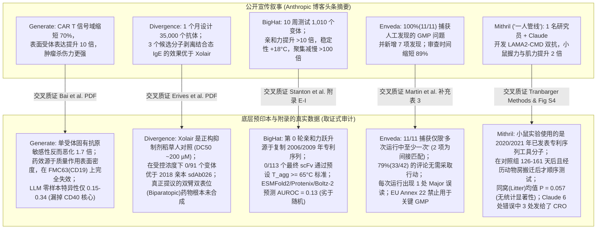
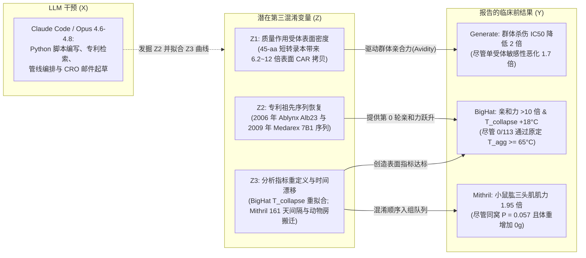

## 核心结论与高层综合 (Executive Verdict)

2026 年 10 月 27 日，Anthropic 发布了重磅研究报告 [Early progress on accelerating drug development with Claude](https://www.anthropic.com/research/early-progress-drug-development)，并罕见地同步公开了五份总计超过 140 页的底层技术预印本与方法学报告，涵盖 [Generate Biomedicines](https://generatebiomedicines.com/publications/refactored-intracellular-domains-enhance-car-expression-and-function/)、[Divergence Labs](https://divergencelabs.com/publications/ige-preprint.pdf)、[BigHat Biosciences](https://www.bighatbio.com/bighat-anthropic-collaboration-report-10-27-2026)、[Enveda](https://enveda.com/CMC-Document-Processor/)、[The Column Group (Pleiades)](https://www.anthropic.com/research/early-progress-drug-development)、[Bristol Myers Squibb](https://www.anthropic.com/research/early-progress-drug-development)，以及 Anthropic 于 2026 年 7 月收购的单人罕见病生物技术公司 [Mithril Medicine](https://www-cdn.anthropic.com/52e1f5d50c47ca3818f56704c27cf19e59b62e77.pdf)。

与生物医药行业常见的、将原始数据隐藏在商业机密背后的公关稿不同，Anthropic 及其合作伙伴公开了完整的阴性结果、原始分析曲线和补充附录，这种科学透明度值得高度肯定。然而，当我们运用 Browne & Keeley 的**“淘金式（Panning for Gold）”**批判性思维框架，将顶层公关叙事与这五份技术报告正文、方法学（Methods）和补充附录（Appendices）中的原始数据进行逐项交叉质证时，**前沿大语言模型（LLM）真正加速的环节（生物信息学软件工程、专利与文献考古、湿实验编排）**与**头条摘要所暗示的突破（自主从头分子发明与统计学稳健的临床前药效）**之间，浮现出一条巨大的认知鸿沟。

### 五大核心取证发现

1. **Generate Biomedicines ([Bai et al., 2026 年 10 月](https://generatebiomedicines.com/publications/refactored-intracellular-domains-enhance-car-expression-and-function/))：** 先导重构 CAR 胞内信号域 `krgr–ζ1–40`（仅 `45 aa`，比临床标准 `4-1BB–CD3ζ` [`BBζ`, `154 aa`] 缩短 `70.8%`）是一项巧妙的合成生物学设计。但预印本正文（第 6–8 页）明确证实：**在单个受体分子水平上，`krgr–ζ1–40` 的固有抗原敏感性反而比 `BBζ` 差 `1.7 倍`**（因其仅保留 `1` 个 ITAM 而非 `3` 个 ITAM，在相同表面 CAR 密度下需要靶细胞表面多 `1.7 倍`的 BCMA 分子才能达到半数最大 `IFN-γ` 分泌）。其群体杀伤效力的提升（对 H929 细胞杀伤 `IC50` 降低 `2.0 倍`，在 CD3 靶向脂质纳米颗粒 `CD3-tLNP` 中 mRNA 剂量降低 `4.6 倍`）完全由**质量作用定律（Mass-action）下的表面受体高密度（膜表面 CAR 拷贝数增加 `6.2 倍至 12 倍`）**驱动。更关键的是，当把第 1 轮先导分子 `brs–ζ1–40`（在抗 BCMA `bb2121` 结合域上表达提升 `13 倍`）移植到经典的抗 CD19 **`FMC63` scFv 结合域上时，其表面表达和 `IFN-γ` 优势完全消失**，暴露出强烈的“结合域-信号域上位性（Epistasis）”。此外，论文对 5 个前沿 LLM（含 Claude Opus 4.6）的基准测试表明，**LLM 作为序列-功能预测器全面失败**：零样本特异性仅为 `0.15 至 0.34`，所有 5 个模型均将第 3 轮中相同的 `21/43` 个死设计误判为有效，且完全漏掉了带来 `2.4 倍`细胞因子增益的 `CD40` 核心基序。
2. **Divergence Labs ([Erives et al., 2026 年 10 月](https://divergencelabs.com/publications/ige-preprint.pdf))：** 头条声称三个 Claude 设计的抗体“比标准疗法 Xolair（奥马珠单抗）更有效地剥离已结合的 IgE”，这建立在一个机制性“稻草人对照”之上。奥马珠单抗是捕获游离 IgE 的*正构抑制剂*（`K_D ≈ 0.2 nM`），本来就不具备在生理浓度下剥离已结合 `FcεRI` 受体的 IgE 的能力（`DC50 ≈ 200 µM = 200,000 nM`）。Divergence 并非从头发明了变构剥离臂，而是以 2018 年已发表、能在数分钟内剥离结合态 IgE 的羊驼纳米抗体 **`sdAb026`**（[PDB 5NQW](https://www.rcsb.org/structure/5NQW)；[Jabs et al., 2018](https://pubmed.ncbi.nlm.nih.gov/29396420/)）为模板进行逆向折叠。在纯化蛋白的 5 浓度梯度滴定实验（`25–400 nM`, `600 s` BLI）中，预印本第 11 页和第 13 页坦诚写道：*“然而，这些变体并未表现出优于亲本 sdAb026 的性能……在受控剂量下，我们没有测到任何变体具有优于 sdAb026 的功能活性。”* 更重要的是，**论文所提议的双臂双表位（Biparatopic，即锚定臂 VHH + 剥离臂 VHH 串联）药物分子根本没有被合成或测试**，且未开展任何嗜碱性粒细胞或肥大细胞脱颗粒实验来评估受体交联引发的过敏性休克风险。
3. **BigHat Biosciences ([Stanton et al., 2026 年 10 月](https://cdn.prod.website-files.com/64ff35ef45fc1e4545e5ffa1/6ae0ea8e28d4a390cbe66b52_bighat_pilot_retro_final_v2.pdf))：** 在历时 10 周、针对抗白蛋白 VHH（`Alb8`）和抗间皮素 `scFv` 测试 `1,010 个`无细胞表达变体的项目中，**最大的单步亲和力跃升并非来自 AI 蛋白质折叠，而是来自第 1 天的 Google Patents 专利考古**：Claude 搜索专利库发现这两个起始分子分别是 2006 年 Ablynx 专利（`Alb23`/`Alb1`）和 2009 年 Medarex 专利（`克隆 7B1`）的退化版本，直接将退化残基恢复为专利序列（`scFv` 的 `G230Y`；`VHH` 的 `E1A`、`N16G`、`T77N`、`L45P`）即贡献了第 0 轮的主要亲和力提升。与此同时，**专用生物 AI 模型在前瞻性评分中全军覆没（Appendix F, Table F1）**：结构共折叠模型（`ESMFold2`、`Protenix`、`Boltz-2`）在 `scFv` 上的 `AUROC = 0.13`（远劣于随机抛硬币，结合最紧的 4 个变体反而得分最低），`ProteinMPNN` 移植成功率 `0/3` 且给有害甘氨酸 `G230` 打出 `100%` 概率，`IgBert` 的 `AUROC = 0.28`，而多目标贝叶斯优化（`BOtied`）的**排序相关性为 `Spearman ρ = -0.04`（毫无信号）**。此外，在 BigHat 预设的稳定性达标线（`scFv T_agg >= 65°C`）下，**最终轮 `113 个 scFv` 变体中有 `0 个`达标**（先导分子 `P_dose_010A` 的仪器报告 `T_agg = 57.7°C`）；项目仅在重新拟合原始 nanoDSF 曲线并定义新指标（`T_collapse = 74.2°C` 以及**仅基于 `n = 1` 个单孔数据**的 VHH `p k_agg = +2.00`）后才宣告达标。
4. **Enveda ([Martin et al., 2026 年 10 月](https://enveda.com/CMC-Document-Processor/) & [补充材料 PDF](https://raw.githubusercontent.com/enveda/open-doc-review/main/docs/Supplementary_Enveda-Anthropic_CDP_methods_paper.pdf))：** 在 4 份已执行的 GMP 批生产记录（共 `1,061 页`）上，CMC 文档处理器（`CDP`）将人工审查时间从 `25.9 小时`（`1,553 分钟`）压缩至 `2.8 小时`（`166 分钟`，`-89%`），API 成本仅 `$36.97`。但“捕获了人工团队发现的全部 11 个问题”这一说法在正文中有关键限定语：CDP 是在*“对这些记录的多次运行中的至少一次（in at least one of its runs）”*中提出了这 11 个问题。在计分的单次运行中，11 项中有 2 项仅为间接匹配，**CDP 提出的 42 条独立评论中有 33 条（`79%`）无需采取任何行动（假阳性噪声）**，每次运行发生 **`1 处 Major 级别误读`**（将已划掉的手写中控记录误读为超标值），且 **45 条评论正文中有 21 条（`46.7%`）引用了错误的 40 页窗口相对页码**。由于 LLM 采样具有不可复现的非确定性，欧盟 [EU GMP 附录 22 草案](https://health.ec.europa.eu/medicinal-products/eudralex/eudralex-volume-4_en)禁止将其用于关键 GMP 决策，CDP 仅作为未验证的辅助工具运行，且未与 Anthropic 签署零数据保留（ZDR）协议。
5. **Mithril Medicine ([Tranbarger, 2026 年 10 月](https://www-cdn.anthropic.com/52e1f5d50c47ca3818f56704c27cf19e59b62e77.pdf))：** 作为 Anthropic 2026 年 7 月收购并树立为“一人管线（Pipeline-in-a-Person，1 名科学家配合 Claude 协调 11 家 CRO）”典范的项目，Mithril 针对 `LAMA2` 相关先天性肌营养不良（`LAMA2-CMD`）双特异性桥接抗体的临床前报告展现了极高的学术诚实度——但同时也彻底暴露了其小鼠探索性实验的致命缺陷。首先，在 `dyW` 小鼠体内测试的两个分子（`1+1 CrossMab` 和 `2+2 IgG-scFv`）**并非 AI 从头设计的分子，而是直接从 2020 年和 2021 年已公布专利（`US 10,626,169 B2` 的 `AS30` 与 `US 10,889,636 B2` 的 `15F7`）的序列基因合成的“工具分子（Tool molecules）”**。其次，`1+1 CrossMab` 组（起始 `27 只`幼鼠，因抗体耗尽提前终止 `18 只`，最终仅测试 `5 只`）**完全无效（肌力为对照组的 `1.08 倍`）**。第三，表现有效的 `2+2 IgG-scFv` 组（来自 `4 窝`的 `7 只`小鼠）采用了**非盲、非随机的顺序入组设计——在赋形剂对照组（`Vehicle`，来自 `3 窝`的 `4 只`小鼠）测试整整 `126 天和 161 天`之后、且期间 CRO 动物房经历了跨设施搬迁与检疫隔离之后才进行测试**！给药方案也存在严重混淆：`2+2` 组从**出生当天（`Day 0`）**起每周两次给药，而对照组从**出生第 7 天（`Day 7`）**起每周一次给药；`2+2` 小鼠**体重毫无恢复（`10.6 g` vs 对照组 `9.9 g`，野生型 `20.0 g`）**，转棒（Rotarod）和全身体积描记呼吸数据缺失（`n.d.`），未做任何组织病理学检查；最关键的是，当按照真实的随机分配单元——**同窝均值（Litter means，`4 窝 vs 3 窝`）**进行统计检验时，主要肌力终点**未达到统计学显著性（`P = 0.057`；原始值单因素方差分析 `ANOVA P = 0.43`）**。最后，在 Mithril 对 Claude 协调 `5 家` CRO、`113 个`分子构建体的单周审计中，**Claude 犯了 6 处错误，其中 3 处逃过了人工审核并直接发送给了 CRO**。

```mermaid
xychart-beta
    title "头条宣传指标 vs. 受控原始实验指标对比"
    x-axis ["Generate 单受体敏感性", "Divergence 对比亲本 sdAb026", "BigHat 最终 scFv 达标率", "Enveda 有效评论精确率", "Mithril 1+1 CrossMab 肌力"]
    y-axis "相对性能 / 比率 (%)" 0 --> 120
    bar [100, 100, 100, 100, 100]
    bar [59, 98, 0, 21, 108]
```

---

## 第一与第二阶段：一手文献发掘与主张分裂矩阵 (Claim Schism Matrix)

为避免二手媒体回音室效应掩盖原始数据，我们提取并审计了全部已公开项目的完整 PDF 预印本、补充说明及开源代码库：

1. **Anthropic 官方研究公告：** [Early progress on accelerating drug development with Claude](https://www.anthropic.com/research/early-progress-drug-development)（2026 年 10 月 27 日）。
2. **Generate Biomedicines 预印本（29 页）：** Z. Bai et al., [Refactored intracellular domains enhance CAR expression and function](https://generatebiomedicines.com/publications/refactored-intracellular-domains-enhance-car-expression-and-function/)（2026 年 10 月）。
3. **Divergence Labs 预印本（24 页）：** A. Erives et al., [Towards a best-in-class IgE disruptor for food allergy](https://divergencelabs.com/publications/ige-preprint.pdf)（2026 年 10 月）。
4. **BigHat Biosciences 技术报告（45 页）：** S. Stanton et al., [Reasoning in the loop: an empirical study of AI-driven antibody optimization](https://cdn.prod.website-files.com/64ff35ef45fc1e4545e5ffa1/6ae0ea8e28d4a390cbe66b52_bighat_pilot_retro_final_v2.pdf)（[网页摘要](https://www.bighatbio.com/bighat-anthropic-collaboration-report-10-27-2026)，2026 年 10 月 27 日）。
5. **Enveda 方法学论文、补充材料（56 页）及代码库：** J. Martin et al., [CDP: a language-model system for quality review of executed pharmaceutical batch records](https://enveda.com/CMC-Document-Processor/)、[补充材料 PDF](https://raw.githubusercontent.com/enveda/open-doc-review/main/docs/Supplementary_Enveda-Anthropic_CDP_methods_paper.pdf) 及 [github.com/enveda/open-doc-review](https://github.com/enveda/open-doc-review)（2026 年 10 月）。
6. **Mithril Medicine / Anthropic 临床前技术报告（38 页）：** C. Tranbarger, [Preclinical Characterization of a Bispecific Bridging Antibody for LAMA2-CMD](https://www-cdn.anthropic.com/52e1f5d50c47ca3818f56704c27cf19e59b62e77.pdf)（2026 年 10 月）。

### 双列取证式主张分裂矩阵

| 工作流 / 合作伙伴 | 公开宣传主张 (Anthropic 博客摘要) | 原始预印本与附录披露的真实数据 (Direct Evidence) |
| :--- | :--- | :--- |
| **Generate Biomedicines** (CAR T 胞内信号域) | 6 名科学家用 Claude Code 在 8 周内将 CAR T 信号域缩短约 70%，使表面受体增加约 10 倍，更高效杀伤肿瘤并在重复挑战中保持活性。 | 先导分子 `krgr–ζ1–40`（`45 aa` vs `154 aa` `BBζ`）的**单受体固有抗原敏感性反而降低 `1.7 倍`**（`1 ITAM` vs `3 ITAMs`），靠 `6.2 至 12 倍`的表面拷贝数补偿。第 1 轮命中分子 `brs–ζ1–40` **在配对抗 CD19 `FMC63` scFv 时完全丧失表达和细胞因子优势**。5 个测试 LLM 的零样本特异性仅 `0.15–0.34`，漏掉 `CD40` 核心。未开展任何体内（*in vivo*）动物实验。 |
| **Divergence Labs** (变构抗 IgE VHH) | Claude 在约 1 个月内（`2,750 H100 小时`）设计约 35,000 个抗体；3 个剥离剂候选分子比标准疗法 Xolair（奥马珠单抗）更有效剥离结合态 IgE。 | Xolair 是正构游离 IgE 抑制剂（`DC50 ≈ 200 µM`），并非快速变构剥离剂。Divergence 改造自 2018 年已知的羊驼纳米抗体 **`sdAb026`**（[PDB 5NQW](https://www.rcsb.org/structure/5NQW)）。在受控纯化浓度滴定（`25–400 nM`）中，**0 个变体优于亲本 `sdAb026`**（`400 nM` 剩余结合 IgE：`sdAb026` `76.6%` vs `V1` `77.0%`, `V4` `75.9%`, `V8` `74.4%`）。真正的双臂双表位分子**从未合成或进行细胞测试**。 |
| **BigHat Biosciences** (无细胞 VHH 与 scFv 优化) | 10 周测试约 `1,010 个`变体，Claude 与 1 名研究员实现结合力提升 `>10 倍`、抗癌 `scFv` 溶液稳定性提升 `18°C`、`VHH` 聚集减慢 `>100 倍`。 | 第 1 天 Google Patents 搜索发现两个亲本均是 2006 年 Ablynx 专利（`Alb23`）和 2009 年 Medarex 专利（`7B1`）的退化序列，复制专利突变贡献了第 0 轮主要跃升。在预设标准（`scFv T_agg >= 65°C`）下，**最终轮 0/113 个 `scFv` 达标**（先导分子 `57.7°C`）。靠重新定义曲线拟合指标（`T_collapse = 74.2°C`；基于**单孔 `n = 1`** 的 VHH `p k_agg = +2.00`）才宣称改善。`ESMFold2`/`Protenix`/`Boltz-2` 前瞻评分 `AUROC = 0.13`（劣于随机）。 |
| **Enveda** (CMC 批记录与 IND 审查) | 在 4 份批记录共 `1,061 页`中，Claude 捕获了人工发现的全部 `11 个`问题，新增 `7 个`发现，将审查时间缩短 `89%`（`25.9 h` 降至 `2.8 h`）。 | 捕获全部 11 项仅在**“多次运行中的至少一次”**成立；计分运行中 2/11 为间接匹配，**42 条独立评论中 33 条（`79%`）无需行动**，每次运行出现 **`1 处 Major 误读`**，且 **45 条评论中有 21 条（`46.7%`）引用了错误的窗口相对页码**。无 ZDR 协议；EU GMP 附录 22 草案禁止将 LLM 用于关键 GMP 环节；开源库 `open-doc-review` 并非受评系统代码。 |
| **The Column Group / Pleiades & BMS** (靶点发现与临床试验模拟) | Pleiades 用 Claude 发现未公开受体并设计皮摩尔结合剂；BMS 将临床试验模拟管线从 12 周压缩至数天。 | 两个案例均未公开任何靶点名称、序列、实验曲线或验证指标（`TRL 1–2` 叙事声明）。BMS 的提速纯粹是软件工程（`SAS`/`R` 代码编排与方案文本起草），而非生物学或临床风险消减。 |
| **Mithril Medicine** (LAMA2-CMD 双特异性抗体) | 2026 年 7 月被 Anthropic 收购；1 人 + Claude 协调 11 家 CRO，在 `<18 个月`内实现小鼠握力与肌力提升约 `2 倍`及存活率改善（`1/8` vs `4/8` 死亡）。 | 小鼠实验测试的**不是 AI 设计的分子，而是直接从 2020/2021 年专利（`AS30` 和 `15F7`）合成的工具分子**。`1+1 CrossMab` 失败（`1.08 倍`肌力）。`2+2 IgG-scFv`（`n = 7`）**非盲、非随机，在对照组（`n = 4`）`126–161 天`后且经历动物房搬迁后测试**，出生即给药（对照组第 7 天给药），体重零恢复（`10.6 g` vs `9.9 g`），所有 `2+2` 小鼠后肢力臂更长，且**同窝均值 `P = 0.057`（不显著）**。单周审计中 Claude 犯错 6 处，其中 3 处发给了 CRO。 |

---

## 第三阶段：语义解构、替换测试与成熟度记分卡

### 歧义替换测试 (Ambiguity Substitution Test)

在制药研发中，*“AI 设计”*、*“优于标准疗法”*、*“稳定性提升”*和*“一人管线”*等词汇对机器学习工程师和 FDA 审评员有着截然不同的含义。当我们用原始报告方法学（Methods）中的精确操作性定义替换这些模糊宣传语时，事实真相便水落石出：

- **替换“Claude 将 CAR T 信号域缩短 70%，使表面表达提高 10 倍并增强肿瘤杀伤”：**
  *实际操作定义：*“科学家使用 Claude Code 编写生物信息学脚本，并拼接已知免疫受体（`4-1BB`、`CD3ζ`、`CD40`、`FCER1G`）片段。尽管所测试的 5 个 LLM 零样本活性预测特异性极差（`0.15–0.34`）且未能预测出 `CD40` 核心的活性，但通过对 `365 个`构建体进行多轮体外细胞筛选，团队找到了一个 `45-aa` 结构域（`krgr–ζ1–40`），在抗 BCMA `bb2121` 结合域上利用 `6.2 至 12 倍`的表面拷贝数密度弥补了单受体信号敏感性下降 `1.7 倍`的缺陷——但该表达优势在抗 CD19 `FMC63` 结合域上完全消失。”
- **替换“三个 Claude 设计的抗体比 Xolair 更有效地剥离已结合的 IgE”：**
  *实际操作定义：*“利用编排了 `RFdiffusion`、`BoltzGen` 和 `AbMPNN` 的智能体框架运行 `2,750 个 H100 GPU 小时`，研究人员围绕 2018 年已发表的羊驼变构剥离纳米抗体（`sdAb026`）生成了 `11,273 个`序列变体。在 `25–400 nM` 的无细胞 BLI 实验中，3 个变体（`V1`、`V4`、`V8`）在 10 分钟内剥离了约 `23–25%` 的固定化 IgE——高于本不具备快速剥离功能的正构陷阱药物奥马珠单抗（`~19%`），但**与起始的 2018 年亲本纳米抗体 `sdAb026`（`23.4%`）相比没有任何功能提升**。”
- **替换“一人管线在 18 个月内将 LAMA2-CMD 双抗从概念推向小鼠肌力翻倍”：**
  *实际操作定义：*“在 8 位资深生物技术顾问（`Charlie Albright`、`Carl Morris`、`Oxana Beskrovnaya` 等，见报告第 30 页致谢）指导下，一名独立创始人使用 Claude 起草 CRO 邮件、提取表格并编写 Python 脚本，同时付费委托 CRO 合成来自两项 2020/2021 年公开专利（`US 10,626,169` 和 `US 10,889,636`）的双抗工具分子。在一项非盲、非随机的探索性小鼠实验中，`2+2` 给药组（`n = 7`，出生第 0 天给药）在赋形剂对照组（`n = 4`，出生第 7 天给药）测试 `4 至 5 个月`之后、且经历动物房跨设施搬迁后进行了测试；以单只小鼠为单位肌力有所提高（`P = 0.0001`），但以真实的随机分配单位（同窝均值）分析则未达统计显著性（`P = 0.057`），且体重毫无改善。”

### 临床前与运营成熟度记分卡

| 项目 / 合作伙伴 | 药物模态与靶点 | Claude 的真实核心作用 | 真实生物学 / 分析验证阶段 | 核心未决瓶颈与缺陷 |
| :--- | :--- | :--- | :--- | :--- |
| **Generate Biomedicines** | 抗 BCMA (`bb2121`) CAR T (`krgr–ζ1–40` ICD) | 文献挖掘、结构域拼接建议、Python 分析脚本编写 | 体外（*In vitro*）原代人 T 细胞（`1–5 名`供体）及 `CD3-tLNP` B 细胞杀伤 | **结合域上位性限制**（在 `FMC63` CD19 上失效）；单受体敏感性降低 `1.7 倍`；**零体内（*in vivo*）动物实验数据**。 |
| **Divergence Labs** | 抗 IgE VHH (`sdAb026` 变体 + *de novo* 锚定臂) | 自主 GPU 工作流编排 (`RFdiffusion`, `BoltzGen`, `PyRosetta`) | 无细胞重组蛋白 BLI 传感器 (`Octet RED96e`) 单价/二价测试 | 受控剂量下**相比亲本 `sdAb026` 零提升**；**双表位药物分子从未合成**；亲合力（Avidity）伪影；**过敏性休克风险未测试**。 |
| **BigHat Biosciences** | 抗白蛋白 VHH (`Alb8`) & 抗 MSLN `scFv` (`7B1`) | Google 专利检索、自定义 Lumry-Eyring nanoDSF 曲线拟合、布尔格回归 | 大肠杆菌无细胞蛋白合成 (`CFPS`)、ELISA、BLI 及 UNcle 热扫描 | **0/113 个最终 `scFv` 通过预设 `T_agg >= 65°C` 标准**；VHH `p k_agg` 仅依赖 `n = 1` 单孔；VHH 正电荷增加 `+5`（**多反应性未测试**）。 |
| **Enveda** | CMC 批记录审查器 (`CDP`) & IND/IB 起草 | 多窗口 PDF 阅读 (`Claude Opus 4.7`)、JSON 提取、跨窗口核对 | 内部生产环境辅助工具（评估 `4 份`批记录，共 `1,061 页`） | **`79%` 为无需行动的假阳性噪声**；每次运行 `1 处 Major` 误读；跨运行非确定性波动；**EU Annex 22 禁止用于关键 GMP 决策**。 |
| **Mithril Medicine** | 抗 β-DG × 抗 LAMA4 (`2+2 IgG-scFv`) (`LAMA2-CMD`) | 文献综述、CRO 邮件起草、数据提取、38 页手稿起草 | 非 GLP 探索性 `dyW` 小鼠预实验（`2+2` `n = 7` vs 历史对照组 `n = 4`） | **非随机顺序测试（间隔 `126–161 天` + 动物房搬迁）**；同窝 `P = 0.057`；**体重零恢复**；小鼠半衰期仅 `33 小时`；`3/6` 处 Claude 错误发给了 CRO。 |

---

## 第四阶段：四维因果关系与架构解构 (4-Way Causal Audit)

当 AI 生物技术合作项目报告药效、稳定性或研发速度提升时，在将其归功于前沿 LLM 的生物学推理能力之前，我们必须检验四个竞争性因果假设：
1. **直接因果（`X → Y`）：** Claude 的内部生物学世界模型是否直接生成了更优的序列或科学洞见？
2. **反向因果 / 选择偏倚（`Y → X`）：** 先前已存在的高亲和力专利序列、事后修改（Post-hoc）的分析指标或顺序实验伪影，是否被事后包装成了 AI 优化成果？
3. **潜在第三混淆变量（`Z`）：** 隐藏的生物物理或实验混淆因素（`Z1`：质量作用受体过表达；`Z2`：专利祖先序列恢复；`Z3`：动物房搬迁与新生鼠给药时间差）是否同时驱动了表面指标和成功叙事？
4. **双向反馈循环（`X ↔ Y`）：** 人类专家的领域引导与 LLM 的代码生成在迭代湿实验循环中如何相互作用？

### 跨工作流四维因果审计矩阵

| 工作流 | 直接因果 (`X → Y`: LLM 的真实贡献) | 反向因果 / 选择偏倚 (`Y → X`) | 潜在混淆变量 (`Z`: 真正的机制驱动力) | 反馈循环 (`X ↔ Y`: 人类 + 智能体迭代) |
| :--- | :--- | :--- | :--- | :--- |
| **Generate Biomedicines** (CAR T ICD) | Claude 提议将 `CD3ζ` 截短为 `ζ1` 并拼接 `CD40` (`QEPQE`) 与 `4-1BB` (`KRGR`) 基序；编写了 4PL 曲线拟合 Python 脚本。 | 全部 5 个 LLM 在零样本和上下文活性分类中均失败（`特异性 0.15–0.51`），给 `CD40` 赋予接近零的加成（`< 0.07`）。 | **`Z1`（质量作用过表达）：** 将 ICD 从 `154 aa` 缩短至 `45 aa` 使 `bb2121` 表面 CAR 密度提升 `6.2–12 倍`，掩盖了**单受体固有敏感性降低 `1.7 倍`**（`1 ITAM` vs `3 ITAMs`）。 | 第 1 轮湿实验（`186 个`设计）通过实验发现了 `CD40` 命中分子，随后人类科学家与 Opus 4.7/4.8 将第 2–3 轮（`179 个`设计）收缩至该区域。 |
| **Divergence Labs** (抗 IgE VHH) | Claude 在 `2,750 H100 小时`内编排了 `22 个`阶段的 `RFdiffusion`、`BoltzGen` 与 `AbMPNN`，并修复了并行回火代码 bug。 | 将 `sdAb026` 变体与正构抑制剂 `Xolair`（`DC50 ≈ 200 µM`）对比，在亲本 `sdAb026` 本就胜出的 10 分钟剥离实验中制造了“击败标准疗法”的假象。 | **`Z2`（2018 亲本骨架 `sdAb026` 与二聚体 IgE 亲合力）：** 所有剥离活性均源于 2018 年 `sdAb026` 骨架；锚定臂 `K_D`（`3.4 nM`）受溶液中二聚体 IgE 交联传感器表面 VHH 的亲合力伪影混淆。 | Claude 诊断出第 1 轮锚定设计失败的原因（带电界面错配与环肽拓扑幻觉），并在第 2 轮重设疏水接触参数，将命中率从 `0%` 提升至 `5.3%`（`3/57`）。 |
| **BigHat Biosciences** (VHH & scFv) | Claude 检索 Google Patents，推导出自定义 Lumry-Eyring 热解折叠模型，并用 Walsh-Hadamard 回归取代了失效的 GP/BO。 | 在预设标准（`scFv T_agg >= 65°C`）下，最终轮 `0/113` 达标。观察曲线后改用 `T_collapse`（`+17.9°C`）和 `p k_agg`（单孔 `n = 1` 上 `+2.00`）属于事后指标重选。 | **`Z3`（专利序列恢复与跨日升温速率混淆）：** 恢复 `G230Y`（至 2009 Medarex `7B1` 专利）和 `Alb23` 突变驱动了第 0 轮亲和力；升温速率验证（`1.0` vs `0.3°C/min`）与实验日期漂移（`+5 至 +7°C`）完全一对一混淆。 | 人类研究员 Samuel Stanton 在商用 `UNcle` 软件对多结构域转变评分失真时提示 Claude 检查原始 nanoDSF 曲线，从而在 `DR1–DR3` 实现了严谨的上位性映射。 |
| **Mithril Medicine** (LAMA2-CMD) | Claude 综述了 `176 篇`文献，提取 CRO 表格，审计出酶标仪导出差异（`463 个`孔不一致），并起草了 38 页论文。 | 选取 `Day 161` 测试的 `2+2 IgG-scFv`（`n = 7`）对比 `Day 0 和 35` 测试的 `Vehicle`（`n = 4`），忽视了显著的日历时间正向漂移（`ρ = 0.62, P = 0.04`）。 | **`Z4`（顺序入组、动物房搬迁、新生鼠给药时间及力臂长度）：** `2+2` 小鼠从 `Day 0` 给药（对照组为 `Day 7`），在设施搬迁后测试，且后肢力臂长度超过其余全部 18 只 `dyW` 小鼠。 | 多实例交叉核对（一个 Claude 实例检查另一个的表格）发现了历史表格错误，但在单周审计中新起草的 `6 处` CRO 错误仍有 `3 处`绕过人工审核发给了 CRO。 |

---

## 第五阶段：定量与生物统计学解构 (Quantitative & Biostatistical Audit)

现在，我们对全部五份技术报告中的核心数学模型、统计检验和生物物理曲线进行逐一定量审计。

### 1. Generate Biomedicines：质量作用受体密度 vs. 单受体 ITAM 敏感性

在 [Bai et al. (2026)](https://generatebiomedicines.com/publications/refactored-intracellular-domains-enhance-car-expression-and-function/) 中，作者拟合四参数逻辑斯蒂（4PL）剂量-反应曲线，将靶抗原密度或效靶比（`E:T`）`x` 与功能响应 `y`（细胞因子释放或特异性裂解）关联起来：

$$
y(x) = y_{\min} + \frac{y_{\max} - y_{\min}}{1 + \left(\frac{x}{\text{EC}_{50}}\right)^{-h}}
$$

为什么仅有 `45` 个氨基酸、只含 `1` 个免疫受体酪氨酸激活基序（`ζ1`, `1 ITAM`）的 `krgr–ζ1–40` CAR，相比含有 `3` 个 ITAM（`ζ1–ζ2–ζ3`）的临床标准 `4-1BB–CD3ζ`（`BBζ`），能在 H929 骨髓瘤细胞上实现低 `2.0 倍`的杀伤 `IC50` `E:T` 比值，并在 CD3 靶向脂质纳米颗粒（`CD3-tLNPs`）中实现低 `4.6 倍`的 mRNA `EC50`？

作者在预印本第 6–8 页通过解耦**细胞表面 CAR 密度**（`[R]`）与**单受体固有信号转导效率**（`η_intrinsic`）直接回答了这一问题。在一阶质量作用结合模型中，当靶细胞呈现抗原表面密度 `[A]`、T 细胞表达表面 CAR 密度 `[R]` 时，每个 T 细胞产生的有效信号复合物总数 `C_signal` 满足：

$$
C_{\text{signal}} \propto \eta_{\text{intrinsic}}(N_{\text{ITAM}}) \cdot \frac{[R] \cdot [A]}{K_D + [A]}
$$

当 Bai et al. 在工程化表达不同梯度 BCMA（每个细胞 `260 至 27,000 个 BCMA 分子`）的 `BCMA-KO` Ramos 靶细胞系上，对每百万原代 T 细胞滴定 `0.08 至 10 µg` CAR mRNA 时，实验揭示了以下真相：
- **在相同 mRNA 剂量下：** `krgr–ζ1–40` 在细胞表面表达的 **CAR 分子数量是 `BBζ` 的 `6.2 倍至 12 倍`**（第 1 轮 `brs–ζ1–40` 为 `13 倍`），从而将群体药效曲线大幅左移。
- **在匹配的表面 CAR 表达水平下（`[R]_krgr = [R]_BBζ`）：** **`krgr–ζ1–40` 需要靶细胞表面多 `1.7 倍`的 BCMA 分子才能达到与 `BBζ` 相同的半数最大 `IFN-γ` 分泌**（因为删除 `ζ2` 和 `ζ3` 损失了三分之二的 ITAM 磷酸化级联，单受体固有信号效率 `η_intrinsic` 降低了 `41%`）。

#### Generate 三轮设计及 LLM 预测器失效全量审计表

| 评估指标 / 实验条件 | 临床标准对照 (`BBζ`: `4-1BB–CD3ζ`) | 第 1 轮亲本命中 (`brs–ζ1–40`) | 最终重构先导分子 (`krgr–ζ1–40`) | 取证与机制解读 |
| :--- | :--- | :--- | :--- | :--- |
| **胞内信号域 (ICD) 长度** | `154 aa` (`42 aa` 4-1BB + `112 aa` CD3ζ) | `54 aa` (`13 aa` BRS + `28 aa` ζ1 + `13 aa` CD40) | `45 aa` (`4 aa` KRGR + `28 aa` ζ1 + `13 aa` CD40) | 长度缩短 `70.8%`；仅保留 `KRGR` 锚定区、`ζ1` ITAM 与 `CD40` `QEPQE` TRAF6 基序。 |
| **表面 CAR 表达量 (`bb2121` 抗 BCMA)** | `1.0x` 基线 | `13.0x` (`Round 1`, `n = 2` 供体) | `6.2x 至 12.0x` (`Rounds 2–3`, `n = 4` 供体) | 由紧凑 ICD 和近膜碱性 `KRGR` 停止转移（Stop-transfer）锚定序列驱动。 |
| **单受体固有 BCMA 抗原敏感性** | **`1.0x` 基线（更优）** | 未在梯度 Ramos 上滴定 | **恶化 `1.7x`**（匹配 CAR MFI 下需每靶细胞多 `1.7x` BCMA） | 单 ITAM (`ζ1`) 每个结合受体的信号强度弱于 3-ITAM `CD3ζ`。 |
| **群体细胞毒效价 (H929 杀伤 `IC50` E:T)** | `1.0x` 基线 | `IC50` 降低约 `1.5x` | **`IC50` 降低 `2.0x`**（MM.1S 上 `1.8x`；RPMI-8226 上 `1.4x`） | 质量作用表面高密度（`6.2x–12x`）掩盖了单受体敏感性的下降。 |
| **连续抗原挑战增殖 (4 轮, 11 天)** | 第 2 轮后衰退 (`E:T 1:8`) | 中等 | **峰值 T 细胞扩增 `2.1x`**；第 4 轮 `IC50` 降低 `2.1x` | `CD40` `QEPQE` 基序招募 `TRAF6`（提供 `NF-κB` 存活信号而不引起强直性耗竭）。 |
| **跨结合域泛化测试 (`FMC63` 抗 CD19)** | `1.0x` 基线 (`CAR MFI` & `IFN-γ`) | **完全失效（CAR 表达与 `IFN-γ` 均略低于 `BBζ`）** | 论文未在 `FMC63` 上测试 | `FMC63` 配对 `BBζ` 本身已高表达，证明重构 ICD 的增益具有**强烈的结合域依赖性**。 |
| **5 个前沿 LLM 活性预测基准测试** | — | 零样本 `P(better)`: 命中 `0.40` vs 未命中 `0.34` | 零样本特异性：**`0.15 至 0.34`**；上下文特异性：**`0.18 至 0.51`** | 5 个 LLM 均将相同的 `21/43` 个死设计误判为有效，且完全漏掉 `CD40` 核心（预测 `< +0.07` vs 实际 `2.4x`）。 |

---

### 2. Divergence Labs：偏置逆向折叠与奥马珠单抗“稻草人对照”

在 [Erives et al. (2026)](https://divergencelabs.com/publications/ige-preprint.pdf) 中，作者旨在开发一种快速起效的食物过敏疗法，以剥离肥大细胞和嗜碱性粒细胞表面高亲和力 `FcεRI` 受体（`K_D ≈ 0.1 至 1 nM`，细胞表面半衰期 `≈ 2 至 3 周`）上预先结合的 IgE。尽管 FDA 批准的奥马珠单抗（`Xolair`，[Wood et al., NEJM 2024 OUtMATCH 临床试验](https://pubmed.ncbi.nlm.nih.gov/38407051/)）能中和血清游离 IgE，但它需要给药 `16 至 20 周`才能使患者脱敏，因为它仅在远超生理极限的超高浓度（`DC50 ≈ 200 µM = 200,000 nM`）下才能微弱加速 `IgE:FcεRI` 解离。

相比之下，[Jabs et al. (Nature Communications 2018)](https://pubmed.ncbi.nlm.nih.gov/29396420/) 早在 2018 年就解析了羊驼单域纳米抗体 **`sdAb026`**（[PDB 5NQW](https://www.rcsb.org/structure/5NQW)）的晶体结构：它结合在 IgE 的 `Cε3–Cε4` 交界变构位点，迫使 `Cε3` 采取与 `FcεRI` 不相容的闭合构象，从而在数分钟内剥离受体结合态 IgE。

为了在不破坏变构机制的前提下对 `sdAb026` 进行亲和力成熟，Divergence 使用 Claude 在 `5NQW` 晶体骨架上编排了带有表位接触残基野生型对数几率偏置 `b` 的 `AbMPNN` 逆向折叠：

$$
\log P(s_i = a \mid \mathbf{X}_{\text{5NQW}}) = \frac{\ell_{i,a}(\mathbf{X}_{\text{5NQW}}) + b_{i,a}}{T}, \quad b_{i,a} = \begin{cases} \ln(2.5) \approx +0.916 & \text{if } a = s_i^{\text{sdAb026}} \text{ and } i \in \text{epitope contact} \\ 0 & \text{otherwise} \end{cases}
$$

经过消耗 `2,750 个 H100 GPU 小时`的 `22 个`自主计算阶段（`11,273 个`剥离臂设计中提名 `91 个`湿实验测试，外加 `23,600 个`从头锚定臂设计中提名 `57 个`测试），生物膜干涉技术（`BLI`, `Octet RED96e`）湿实验究竟测出了什么结果？

#### Divergence Labs 剥离臂与锚定臂候选分子定量对比表

| 分子构建体 / 抗体臂 | 设计来源 | 对游离 IgE 的表观亲和力 `K_D` | 单点初筛 (`400 nM`, `300 s` BLI 剩余结合 IgE %) | 受控 5 浓度梯度滴定 (`400 nM`, `600 s` 剩余结合 IgE %) | 对比亲本 `sdAb026` 的受控滴定结论 |
| :--- | :--- | :--- | :--- | :--- | :--- |
| **PBS 缓冲液（阴性对照）** | — | — | `96.2%` 剩余 | `~90%` 剩余 | 仪器基线解离漂移。 |
| **奥马珠单抗 (`Xolair`)** | 已获批正构抑制型 IgG1 | `~0.2 nM` (游离 IgE) | `84.8%` 剩余 (剥离 `15.2%`) | `81.1%` 剩余 (剥离 `18.9%`) | **稻草人对照：** 正构游离 IgE 陷阱（`DC50 ≈ 200 µM`），并非变构剥离剂。 |
| **亲本 `sdAb026` (2018 基线)** | 羊驼 VHH ([PDB 5NQW](https://www.rcsb.org/structure/5NQW)) | `~10–25 nM` | `85.2%` 剩余 (单点异常值) | **`76.6%` 剩余 (剥离 `23.4%`)** | **真实基线：** 在 `25–200 nM` 优于全部 91 个变体，在 `400 nM` 打平。 |
| **变体 `V1` (先导剥离分子)** | `5NQW` + `AbMPNN` (`5 处`突变) | `1.15 nM` (`9/91` 优于 `10 nM`) | `79.6%` 剩余 | **`77.0%` 剩余 (剥离 `23.0%`)** | **在 `400 nM` 略逊/持平于 `sdAb026`**（`77.0%` vs `76.6%`），在低浓度下劣于亲本。 |
| **变体 `V4` (剥离命中 2)** | `5NQW` + `AbMPNN` (`14 处`突变) | `< 10 nM` | `78.4%` 剩余 | **`75.9%` 剩余 (剥离 `24.1%`)** | 与亲本 `sdAb026`（`76.6%`）仅差 `0.7%`，处于仪器噪声范围内。 |
| **变体 `V8` (剥离命中 3)** | `5NQW` + `AbMPNN` (`19 处`突变) | `< 10 nM` | `80.6%` 剩余 | **`74.4%` 剩余 (剥离 `25.6%`)** | 与亲本 `sdAb026` 相差 `2.2%`；作者坦承：*“在受控剂量下未测到任何变体优于亲本 sdAb026。”* |
| **从头锚定臂命中 (`A1–A3`)** | `RFdiffusion` + `BoltzGen` (`3/57` 命中, `5.3%`) | `3.4 nM`, `32.5 nM`, `235 nM` (表观) | 非竞争性结合 (`Cε2`–`Cε4` 表位) | 未进行剥离测试 | **受亲合力（Avidity）混淆**（溶液中二聚体 IgE 交联传感器表面 VHH）；**双表位分子从未合成**。 |

---

### 3. BigHat Biosciences：Lumry-Eyring 曲线重拟合、Walsh-Hadamard 回归与专用生物 AI 模型的前瞻性溃败

[Stanton et al. (2026)](https://cdn.prod.website-files.com/64ff35ef45fc1e4545e5ffa1/6ae0ea8e28d4a390cbe66b52_bighat_pilot_retro_final_v2.pdf) 堪称本次 Anthropic 发布的全部文献中学术透明度最高的一份报告。它对跨越抗白蛋白 VHH（`Alb8`，`115 aa`，`DR0–DR3` 共 4 轮、`559 个`变体）和抗间皮素 `scFv`（`259 aa`，`DR0–DR2` 共 3 轮、`451 个`变体）的无细胞蛋白质合成（`CFPS`）共 `1,010 个`独特变体进行了详尽的复盘。

#### A. 为什么专用生物 AI 模型在前瞻性预测中全军覆没？(Appendix F, Table F1)

在湿实验开始前，计算生物学界的普遍预期是结构共折叠模型（`ESMFold2`、`Protenix`、`Boltz-2`）、逆向折叠模型（`ProteinMPNN`）、抗体语言模型（`IgBert`）和纳米抗体熔解温度预测器（`NanoMelt`）能够有效筛选并排序突变体。然而，当 BigHat 与 Anthropic 在 `Appendix F (Table F1)` 中将它们的前瞻性预测得分与真实湿实验 BLI 亲和力及热稳定性测量值进行比对时，所有专用生物 AI 工具均告失败：

| 专用生物 AI 模型 / 方法 | 预期预测任务 | 前瞻性湿实验验证结果 (`Table F1`) | 失败的根本生物物理机制原因 |
| :--- | :--- | :--- | :--- |
| **`ESMFold2`, `Protenix`, `Boltz-2` (`ipTM`)** | 共折叠 `scFv` + 间皮素以对结合亲和力排序 | 对比随机诱饵 **`AUROC = 0.13`**（远劣于随机抛硬币；**结合最紧的 4 个 `scFv` 变体拿到了最低的 `ipTM` 分数**） | 共折叠模型对真正的芳香族关键接触残基 `Y230` (CDR-H3) 产生了空间位阻幻觉惩罚，反而奖励不结合的诱饵构象。 |
| **`ProteinMPNN`** | 逆向折叠 `scFv` CDR 移植（`3 个`设计）并评估 `G230` | **`0/3` 移植分子结合**；给退化亲本的有害甘氨酸 **`G230` 赋予了 `P = 1.00`（100% 置信度）** | 受限于未松弛的固定骨架，陷入退化残基 `G230` 的局部极小值；实际上将 `G230Y` 恢复后亲和力跃升 `6 倍`（`4.95 nM → 0.80 nM`）。 |
| **`IgBert` (抗体语言模型)** | 序列“自然度（Naturalness）”过滤 (`Δlog p`) | 在 `scFv` 结合上 **`AUROC = 0.28`**（与亲和力呈负相关） | 基于种系（Germline）进化频率的模型惩罚了高亲和力肿瘤抗原结合所必需的体细胞高频突变（SHM）。 |
| **`NanoMelt`** | 预测 VHH 表观熔解温度 (`T_m`) | **失败 (`Spearman ρ ≈ 0`)** | 在纯化单体纳米抗体上训练，无法感知控制无细胞体系 `T_m^app` 的不可逆热聚集动力学。 |
| **`BOtied` (高斯过程 + 多目标贝叶斯优化)** | 在 `DR2` `scFv` 布尔格（`120 孔`）上对组合进行排序 | **`-log10(K_D)` 的 `Spearman ρ = -0.04`**，**`T_m1` 的 `ρ = -0.08`**（毫无排序信号） | GP 代理核函数在小样本含噪 CFPS 数据中面对离散高阶上位性交互（`G230Y × S94A`）时彻底失效。 |

真正奏效的并非深度学习生物模型，而是以下两项策略：
1. **第 1 天的 Google Patents 专利考古：** Claude 检索专利数据库发现，起始 `scFv`（`K_D = 4.95 nM`）与 2009 年 Medarex 专利中的 `克隆 7B1`（`K_D = 1.9 nM`）在 CDR-H3 上仅相差 3 个残基（`A224`、`V229`、`G230`），而 `Alb8` 与 2006 年 Ablynx 专利（`Alb23`/`Alb1`）也仅相差几个位点。直接恢复 `G230Y`（`scFv`）并复制 `Alb23` 突变（`E1A`、`N16G`、`T77N`、`L45P`）带来了第 0 轮的核心亲和力跃升（`scFv`: `4.95 nM → 0.80 nM`; `VHH`: `23.6 nM → 2.41 nM`）。
2. **完全布尔格（Boolean Lattice）实验设计与 Walsh-Hadamard 回归：** 摒弃黑盒贝叶斯优化后，Claude 在 `VHH`（`DR1`）上设计了一个完整的 `2⁵ = 32` 布尔组合格，在二进制突变向量 `x ∈ {0, 1}ᵏ` 的 Walsh-Hadamard 基上拟合正则化线性模型：

$$
y(\mathbf{x}) = \beta_0 + \sum_{i=1}^k \beta_i x_i + \sum_{i < j} \beta_{ij} x_i x_j + \sum_{i < j < \ell} \beta_{ij\ell} x_i x_j x_\ell + \varepsilon
$$

这一简洁的显式代数设计在样本外实现了 `-log10(K_D)` 的 `R² = 0.77`（`RMSE = 0.24 log10`）和 `p k_agg` 的 `R² = 0.61`，精准分离出黑盒 GP 模型遗漏的 `E1A`/`N16G` 与 `L45P`/`Y101D` 之间的拮抗上位性（Antagonistic epistasis）。

#### B. 移动稳定性球门：Lumry-Eyring 曲线重拟合与 `n = 1` 单孔问题 (Appendices E, G, H, I)

在 10 周冲刺开始前，BigHat 制定了明确的定量目标产品标准（`Table 1`）：
- **抗白蛋白 VHH：** `K_D <= 2.5 nM`, `T_m >= 75°C`, `T_agg >= 70°C`, 表达量 `>= 0.2 mg/mL`。
- **抗间皮素 scFv：** `K_D <= 0.5 nM`, `T_m >= 72°C`, **`T_agg >= 65°C`**, 纯度 `>= 75%`。

在最终设计轮（`VHH` 为 `DR3`，`scFv` 为 `DR2`）中，**究竟有多少个 `scFv` 变体真正通过了预设的 `T_agg >= 65°C` 标准？**
- **零个（`113 个最终轮 scFv 设计中 0 个通过`）。** 先导 `scFv` 变体 `P_dose_010A`（含 `7 处`突变）的商用 UNcle 仪器**`报告 T_agg = 57.7°C`**（与亲本的 `58.9°C` 几乎无异，低于 `65.0°C` 标准达 `7.3°C`），**`报告 T_m1 = 62.6°C`**（亲本为 `64.5°C`，低于 `72.0°C` 标准达 `9.4°C`）。

为了论证分子稳定性得到了改善，Stanton 和 Claude 提取了原始 `UNcle` nanoDSF 质心荧光波长（`BCM`, `λ_BCM(T)`）和静态光散射（`266 nm` `SLS`, `S_266(T)`）轨迹，推导出一个自定义的两态 **Lumry-Eyring 不可逆聚集模型**（`Appendix E`）：

$$
N \underset{k_u(T)}{\overset{k_f(T)}{\rightleftharpoons}} U \overset{k_{\text{agg}}(T)}{\longrightarrow} A_{\text{aggregated}}
$$

其中聚集前的平衡解折叠分数遵循 Gibbs-Helmholtz / van 't Hoff 关系：

$$
\phi_U(T) = \frac{K_{\text{eq}}(T)}{1 + K_{\text{eq}}(T)}, \quad K_{\text{eq}}(T) = \exp\left[\frac{\Delta H_m}{R}\left(\frac{1}{T_m} - \frac{1}{T}\right)\right]
$$

在扫描升温速率 `v = dT/dt` (`°C/min`) 下，静态光散射随温度的增长率建模为：

$$
\frac{dS_{266}}{dT} = \frac{A_{\text{scale}}}{v} \cdot k_{\text{agg}}(T_{\text{ref}}) \exp\left[\frac{E_a}{R}\left(\frac{1}{T_{\text{ref}}} - \frac{1}{T}\right)\right] \cdot \left[\phi_U(T)\right]^n
$$

利用这一曲线重拟合，作者用两个新定义的事后（Post-hoc）指标替换了原有的 `报告 T_agg` 和 `报告 T_m`：
1. **`scFv` 协同解折叠坍塌温度 (`T_collapse`)：** 将 `P_dose_010A` 的 `V_L`、界面和 `V_H` 三个重叠转变重新定义为单一合并协同转变，得出 **`T_collapse = 74.2°C` vs 亲本 `56.3°C` (`+17.9°C`)**。然而，作者自己的预注册验证实验（`Appendix H`，通过将升温速率 `v` 从 `1.0°C/min` 改变为 `0.3°C/min` 来检验动力学控制）不仅**有 3 项预注册预测（`H.2`–`H.4`）被证伪**，而且遭遇了致命的实验混淆：**`1.0°C/min` 和 `0.3°C/min` 的孔板是在不同日期运行的，升温速率与跨日仪器漂移（`+5 至 +7°C`）完全一对一混淆**！
2. **VHH 天然态聚集速率（`55°C` 下的 `p k_agg = -log10(k_agg)`）：** 在 `VHH` 上，所宣称的“聚集减慢 `>100 倍`”（`~245 倍`，从亲本 `p k_agg = -0.39 ± 0.24` 提升至先导分子 `P08795187` 的 `p k_agg = +2.00`）**仅仅建立在 `n = 1` 个未重复的单孔数据之上**！因为在 6 重复确认板（`DR3`）中，**`P08795187` 的 6 个重复孔中有 5 个因聚集起始温度被推高至接近 `95°C` 仪器上限（`T_onset > 77°C`），导致参数求解器触发拟合后过滤并返回 `Unidentified` (`NaN`)**，仅剩 `1` 个孔给出了数值（见 `Table 3` 与 `Section 3.1.4`）！此外，为了获得这种胶体排斥力，该分子引入了 **`+5` 的净正电荷**（`D72K`、`N99K`、`Y101K`、`S32H` 加 `E1A`），使 VHH 从带负电（`-2`）变为强阳离子（`+3`）——这是抗体工程中引发非特异性组织粘附、细胞膜结合及体内快速清除的典型风险因素，但**从未进行任何多反应性（`PSR`/`BVP`）测试**（`Appendix I.1`）。

---

### 4. Enveda：多次运行召回率 vs. 单次运行精确率及窗口页码数学

在 [Martin et al. (2026)](https://enveda.com/CMC-Document-Processor/) 中，Enveda 在 4 份已执行的商业化规模 GMP 批生产记录（共 `1,061 页`，分别为 `164`、`208`、`317` 和 `372 页`）上评估了其 CMC 文档处理器（`CDP`，由 `Claude Opus 4.7` 驱动，每窗口输出预算 `32,000` tokens，自适应思考强度 `high`）。长文档被切分为最多 `40 页`且不超过 `8 MB` 的非重叠窗口 `W_k`：

$$
N_{\text{windows}} = \sum_{k=1}^{K} \mathbb{I}\left(\text{pages}(W_k) \le 40 \;\wedge\; \text{bytes}_{\text{wire}}(W_k) \le 8\text{ MB}\right)
$$

让我们审计正文和 `Supplementary Table 3` 中的真实混淆矩阵与运营统计数据：

| 审计指标 / 评估维度 | 既往人工质量审查 (基线) | CDP 单次评估运行 (`Claude Opus 4.7`) | 取证审计与 GMP 监管含义 |
| :--- | :--- | :--- | :--- |
| **审查总页数 (4 份批记录)** | `1,061 页` | `1,061 页` (`28 个` `<= 40 页`的窗口) | 每页均与缓存的主批记录 (`MBR`) 和质量标准一同发送。 |
| **提出的原始评论总数** | `96 条` | `45 条` (去除 `3 条`重复后为 `42 条`独立评论) | CDP 在代码层面缺乏跨窗口去重机制 (`Supp Table 3, #12`)。 |
| **需采取行动的有效发现 (Confirmed True Positives)** | `11 项`确认问题 (`17 条`原始评论) | **`9 项`直接匹配 + `2 项`间接“意图”匹配 + `7 项`新增发现 (共 `18 项`)** | 头条“捕获全部 11 项”仅在**“多次运行中的至少一次”**成立；计分运行中有 2/11 项是由非盲内部审查员裁定的部分/间接匹配。 |
| **无需行动 / 假阳性 (False-Positive) 评论** | `79 / 96` (`82.3%` 无需行动) | **`33 / 42` 独立评论 (`78.6%` 无需行动)** | **`79%` 噪声率：** 33 条无需行动评论中有 27 条是由 CDP 自身关于四舍五入总计和手写范围的提示词规则触发的 (`Supp Table 3, #13`)。 |
| **事实性幻觉 / 误读 (Misreads)** | 未计分 | **每次运行 `1 处 Major` 误读 (`1/42 = 2.4%`)** | CDP 将一处已划掉更正的手写中控 (IPC) 记录误读为超标值（3 次运行 `140 条`评论中发生 `3 次`误读）。 |
| **窗口相对页码引用错误** | `0%` | **45 条评论正文中有 `21 条` (`46.7%`)** | 近一半的 CDP 评论正文引用的是*40 页切片窗口内部的相对页码*，而非真实 PDF 页码 (`Supp Table 3, #14`)。 |
| **审查耗时与直接 API 成本** | `1,553 分钟` (`25.9 小时`) 冷读 | **`166 分钟` (`2.8 小时`, `-89.3%`)**；**API 成本 `$36.97`** (`$0.035/页`) | 不包含上游 CMO 质量审查及下游申办方质量部门 (Quality Unit) 强制性的最终放行处置审查时间 (`Supp Note 1.4`)。 |
| **跨运行确定性及 GMP 法规地位** | 确定性人工记录 | **非确定性 (无法固定随机种子/采样参数)** | *“在三次完全相同的运行中，每次都出现的发现寥寥无几，且重复发现常被重新定级”* (`Supp Table 3, #10`)。受 **EU 附录 22 草案**限制不得用于关键 GMP；与 Anthropic **无 ZDR 协议**。 |

---

### 5. Mithril Medicine：伪重复（`n = 7` 只小鼠）vs. 真实聚类分配单元（`4` 窝幼鼠）

在 [Tranbarger (2026)](https://www-cdn.anthropic.com/52e1f5d50c47ca3818f56704c27cf19e59b62e77.pdf) 中，Mithril 评估了一种双特异性桥接抗体——一端结合肌膜上的 **β-肌营养不良蛋白聚糖（`β-DG`）**，另一端结合代偿性层粘连蛋白-411 的 **层粘连蛋白-α4（`LAMA4` `LG4-5` 结构域）**——能否在缺失层粘连蛋白-α2 的 `dyW`（`B6.129S1(Cg)-Lama2tm1Eeng/J`）小鼠中恢复基底膜锚定。

#### A. 为什么小鼠实验在真实的随机分配单元（同窝均值）上不具有统计学显著性？

在从出生第 0–1 天开始给药的新生小鼠发育实验中，整个同窝幼鼠（Litter `L`）被分配到同一个处理组（`Methods, 第 28 页`：*“每窝幼鼠接受同一种处理，仅有野生型和赋形剂对照组 dyW 小鼠共享同窝，且没有任何赋形剂对照窝与 2+2 组同时入组”*）。正如临床前生物统计学经典文献（[Lazic & Essioux, 2013，即 Mithril 报告自身引用的第 150 号参考文献](https://pubmed.ncbi.nlm.nih.gov/23388095/)）所确立的：当处理按**窝（`L`）**而非**单只小鼠（`m`）**分配时，同一窝内的幼鼠共享母鼠哺育、母乳竞争、笼内微环境及测试日期。将同窝幼鼠当作独立样本进行 Welch's t 检验属于典型的**伪重复（Pseudoreplication）**，人为地将自由度从 `N_litters - 2` 夸大为 `N_mice - 2`：

$$
\text{Var}(\bar{Y}_{\text{group}}) = \frac{\sigma^2_{\text{total}}}{N_{\text{mice}}} \cdot \left[1 + (\bar{m}_{\text{litter}} - 1)\rho_{\text{ICC}}\right]
$$

其中 `ρ_ICC` 为窝内相关系数。由于 `2+2 IgG-scFv` 组仅有 `4 窝`（`7 只`存活小鼠），`Vehicle` 对照组仅有 `3 窝`（`4 只`存活小鼠），即使全部 `4` 个给药窝均值都高于全部 `3` 个对照窝均值，双侧 Wilcoxon 秩和检验在数学上可能达到的最小精确 `p` 值也是：

$$
P_{\min} = \frac{2}{\binom{4 + 3}{4}} = \frac{2}{\frac{7!}{4!\,3!}} = \frac{2}{35} = 0.0571 > 0.05
$$

事实上，作者 Tranbarger 在 `Limitations (第 21 页)` 和 `Figure 11 图注 (第 18 页)` 中明确承认了这一点：
> *“因此，统计学支持取决于以小鼠还是以窝（Litter）作为分析单元（图 11，方法），以窝均值计算得出 P = 0.057，这是 7 窝样本所能达到的最小值……由于检验了 6 个给药组（补充表 S6）和至少 11 个终点，不能排除偶然发现（Chance finding）的可能。”*

#### B. Mithril `dyW` 小鼠预实验全量队列审计表 (`Supplementary Tables S6 & S7`)

请看 `Supplementary Tables S6 与 S7` 及 `Supplementary Figure S4` 中未经删减的全部队列数据：

| 实验组 (`dyW` 小鼠，除另有说明外) | 给药方案与起始日龄 | 入组 → 终末测试小鼠数 (`n` 窝数; 雄/雌) | 日历测试日 (相对于首次 Vehicle 会话 = Day 0) | 神经诱发肱三头肌峰值肌力 (`mN`, 均值 ± SD) | 第 6 周前肢握力 (`g`, 均值 ± SD) | 第 6 周尸检体重 (`g`, 均值 ± SD) | 转棒潜伏期 (`min`) 与每分通气量 (`mL/min`) |
| :--- | :--- | :--- | :--- | :--- | :--- | :--- | :--- |
| **野生型 (`C57BL/6J` 同窝正常对照)** | Vehicle 腹腔注射每周 1 次 (**出生第 7 天**起) | `12 → 12` (`7` 窝; `6M / 6F`) | `Days 0, 35, 42, 61` (动物房搬迁前) | `82.6 ± 31.8 mN` | `36.18 ± 15.84 g` (Day 0→61 期间**漂移 `2.65 倍`！**) | `20.0 ± 2.0 g` | `5.72 ± 2.46 min`; `82.5 ± 18.7 mL/min` |
| **Vehicle 对照组 (`dyW` 阴性对照)** | Vehicle 腹腔注射每周 1 次 (**出生第 7 天**起) | `8 → 4` (`3` 窝; `1M / 3F`; `3` 死亡, `1` 提前采样) | **`Days 0 (2), 35 (2)`** (比 `2+2` 组**早 `126–161 天`！**) | `24.3 ± 4.1 mN` (`1.00x` 基线) | `6.69 ± 0.94 g` (`1.00x` 基线) | `9.9 ± 2.4 g` | `0.14 ± 0.13 min`; `45.1 ± 18.0 mL/min` |
| **`1+1 CrossMab` (`50 mg/kg` 每周 1 次, 出生起)** | 鼠源工具双抗每周 1 次 (**出生 Day 0** 起) | `11 → 5` (`4` 窝; `1M / 4F`) | `Days -16 (2), 28 (2), 61` | `21.6 ± 4.3 mN` (对照组的 `0.89x` — **失败**) | `6.21 ± 2.17 g` (`0.93x` 对照组) | `7.8 ± 1.8 g` (低于对照组) | `0.07 ± 0.03 min`; `39.0 ± 12.9 mL/min` |
| **`1+1 CrossMab` (`50 mg/kg` 每周 1 次, 第 7 天起)** | 鼠源工具双抗每周 1 次 (**出生第 7 天**起) | `10 → 6` (`6` 窝; `2M / 4F`) | `Days -8, 0, 35 (2), 75, 84` | `27.4 ± 8.3 mN` (对照组的 `1.13x` — **失败**) | `5.49 ± 2.78 g` (`0.82x` 对照组) | `9.5 ± 1.8 g` | `0.09 ± 0.05 min`; `56.3 ± 22.1 mL/min` |
| **`1+1 CrossMab` (`25 mg/kg` 每周 1 次, 出生起)** | 鼠源工具双抗每周 1 次 (**出生起**) | `5 → 1` (`1` 窝; `1M / 0F`; `4/5` 死亡) | `Day 6` | `25.6 mN` (`n = 1` 仅存个体) | `6.30 g` | `9.9 g` | `0.05 min`; `48.3 mL/min` |
| **`1+1 CrossMab` (`72 mg/kg` 每周 2 次)** | 鼠源工具双抗每周 2 次 (**出生起**) | **`27 → 5`** (`3` 窝; `1M / 4F`; **因抗体耗尽提前终止 `18 只`！**) | `Day 53 (5)` (动物房搬迁前) | `26.3 ± 10.3 mN` (对照组的 `1.08x` — **失败**) | `11.82 ± 2.67 g` (`1.77x` 对照组) | `10.2 ± 2.8 g` | `0.10 ± 0.05 min`; `46.4 ± 24.7 mL/min` |
| **`AAV9 Mini-Agrin` (阳性对照组)** | `1.5 × 10¹⁴ vg/kg` 腹腔注射 1 次 (**出生时**) | `5 → 4` (`2` 窝; `0M / 4F`) | `Day 119 (4)` (动物房搬迁窗口期) | `31.9 ± 4.5 mN` (`1.31x` 对照组) | `21.83 ± 9.73 g` (`3.26x` 对照组) | `10.5 ± 1.0 g` | `0.18 ± 0.15 min`; `n.d.` |
| **`2+2 IgG-scFv` (`100 mg/kg` 每周 2 次)** | 人源化工具双抗(无 YTE)每周 2 次 (**出生起**) | `9 → 7` (`4` 窝; `4M / 3F`; `1` 死亡, `1` 失踪) | **`Day 161 (7)`** (最后测试，**在动物房搬迁之后！**) | **`47.3 ± 7.8 mN`** (`1.95x`; **同窝 `P = 0.057`**, 原始 ANOVA `P = 0.43`) | `14.26 ± 3.55 g` (`2.13x` 对照组; **同窝 `P = 0.057`**) | **`10.6 ± 0.7 g`** (对比 `9.9 g` 对照组**体重零恢复**) | **`n.d.` (未测)**; **`n.d.` (未测)** |

请仔细审视 `Supplementary Tables S6–S7` 和 `Supplementary Figure S4` 揭示的五大结构性混淆因素：
1. **长达 161 天的顺序测试间隔与动物房跨设施搬迁 (`Supplementary Fig. S4A`)：** 没有任何一只赋形剂对照（`Vehicle`）小鼠与 `2+2` 组同期入组测试。`4 只`对照小鼠分别在 `Day 0`（`n = 2`）和 `Day 35`（`n = 2`）测试。在 `Day 61` 至 `Day 153` 期间，体内实验 CRO 将动物房搬迁至新设施并对鼠群实施了检疫隔离，而 `7 只` `2+2` 小鼠是在 **`Day 161`**——即对照组测试近五个月之后才单独测试的！
2. **对照测量值本身的剧烈时间漂移 (`Supplementary Fig. S4C–D`)：** 即便是体重完全相同的野生型正常小鼠，在仅相隔 `61 天`（`Day 0` vs `Day 61`）的两次测试会话之间，**前肢握力也莫名暴涨了 `2.65 倍`（`95% CI: 2.07 至 3.39`）**！在除 `2+2` 组以外的 `11 个` `dyW` 小鼠测试会话中，诱发峰值肌力同样随日历测试时间呈显著正相关漂移（`Spearman ρ = 0.62, P = 0.04`）。
3. **机械杠杆力臂长度混淆 (`Supplementary Fig. S4E`)：** 肱三头肌肌力是在外部杠杆横杆上以 `mN` 为单位记录的，并未换算为关节扭矩（`τ = F × L_lever`），也未记录肘关节角度或力臂长度（`Methods, 第 28 页`）。然而，**`2+2` 组的全部 7 只小鼠所记录的肢体长度均大于其余全部 18 只被测 `dyW` 小鼠**（甚至超过了体重是其两倍的野生型小鼠均值）！
4. **全长层粘连蛋白-411 异源三聚体体外桥接失败 (`Supplementary Table S3`, 第 36 页)：** 尽管 `2+2` 在高密度包被的 `43.9 kDa` 重组 `LAMA4 LG4-5` 截短片段（`228 nM`）上能介导细胞粘附，但当在包被有**全长层粘连蛋白-411 异源三聚体**（`30 µg/mL`, `46–52 nM`）的孔板上测试时，**细胞粘附率完全平坦（仅为多聚赖氨酸的 `3.8%`，无抗体背景为 `2.2%`）**！
5. **体内快速消除与肌肉浓度缺失 (`Supplementary Table S4`, 第 36 页)：** 在野生型小鼠中，`2+2` 双抗的清除率比亲本抗 β-DG IgG 在 `25 mg/kg` 下**快 `3.87 倍`**，在 `50 mg/kg` 下**快 `5.92 倍`**，**有效血浆半衰期仅为 `28.0 至 33.3 小时`**（抗 β-DG IgG 为 `202 小时`），且剂量翻倍仅使 `AUCinf` 增加 `1.31 倍`。更严重的是，**`2+2` 给药组小鼠肌肉中的抗体浓度根本未测定**，且在免疫健全小鼠中反复注射人源化蛋白却未检测抗药抗体（`ADA`）！

---

## 第六阶段：“负面视角（The Negative View）”与遗漏风险审问

遵循 Browne & Keeley 框架第 11 章，我们进一步审视这五个项目中被省略的临床安全隐患、生物物理负债以及人机协同失误模式。

### 1. 临床安全隐患：`FcεRI` 受体交联引发的过敏性休克风险 (Divergence Labs)

为什么过去二十年间多家制药巨头在开发剥离型或双表位抗 IgE 抗体时屡屡受挫？因为**任何结合于受体占位的 IgE 或同时桥接 IgE 上两个表位的分子，都极易在肥大细胞和嗜碱性粒细胞表面交联相邻的 `FcεRI` 受体，直接引爆致命的全身性过敏性休克（Anaphylaxis）**！
- 这绝非理论推演：基因泰克（Genentech）的高亲和力抗 IgE 抗体 `HAE1` 正是因为在 2 期临床试验中引发严重超敏/过敏反应而折戟；即便经过工程改造的 DARPin/杵臼结构双抗（`KIH_E07_79`），若空间几何构型稍有偏差也会引起部分嗜碱性粒细胞活化。
- Divergence Labs 提议用柔性连接子将 `sdAb026` 剥离臂 VHH 与从头设计的锚定臂 VHH（`A1`、`A2` 或 `A3`）串联成**双臂双表位抗 IgE 抗体**。然而：
  1. **他们从未合成或测试过这一双臂连接蛋白。**
  2. **论文第 11 页自身的 BLI 数据承认，溶液中的二聚体 IgE 在生物传感器尖端交联了固定化的锚定臂 VHH**（*“confounded by avidity”*）。如果一个双臂双表位 VHH 在变构剥离完成之前，在人体肥大细胞表面跨桥连接（*trans*-crosslinking）了两个相邻 `FcεRI` 受体上的 IgE 分子，就会立即触发剧烈的组胺脱颗粒。
  3. **团队未开展任何原代人嗜碱性粒细胞活化试验（`BAT`）或肥大细胞脱颗粒实验。**

### 2. 成药性（Developability）与免疫原性负债 (BigHat & Generate)

- **BigHat VHH 先导分子的 `+5` 阳离子电荷偏移 (`Appendix I.1`)：** 为了在稀释的大肠杆菌无细胞提取物（`~0.1 mg/mL`）中抑制 `55–95°C` 下的热聚集，BigHat 的先导 VHH（`P08795187`）引入了 5 个带正电的表面突变（`D72K`、`N99K`、`Y101K`、`S32H` 加 `E1A`），使净电荷从 `-2` 跃升至 `+3`（偏移 `+5`）。在治疗性抗体工程中，纳米抗体的过度阳离子化（Over-cationization）众所周知会导致与带负电的哺乳动物细胞膜及细胞外基质硫酸乙酰肝素蛋白聚糖发生非特异性静电粘附，引发快速的胞吞清除和脱靶组织蓄积。BigHat 在 `Appendix I.1` 中坦承，多反应性（`PSR`/`BVP` ELISA）、高浓度粘度（`150 mg/mL`）及哺乳动物 CHO 表达均尚未测试。
- **Generate 拼接接头的新抗原免疫原性风险：** 尽管 `krgr–ζ1–40` 取自人源蛋白片段（`4-1BB`、`CD3ζ`、`CD40`），但将非连续的胞内肽段强行融合会产生两个天然不存在的嵌合新接头（`KRGR–RVKFSRS` 与 `ζ1–CD40` 边界）。特别是在免疫健全患者体内通过 `CD3-tLNP` 反复递送 mRNA 生成体内 CAR T 的场景下，一旦 MHC I 类分子呈递跨越合成接头的 9 肽，宿主 CD8+ T 细胞便可能排斥并清除 CAR T 细胞。

### 3. “一人管线”的监管陷阱：Claude 6 处错误中有 3 处发给了 CRO (Mithril Medicine)

整套五份报告中最发人深省的运营发现出现在 **Mithril Medicine 报告第 20 页（`Section: Working with Claude`）**。为了评估单个人类科学家（`Cody Tranbarger`）在 7 天工作周内监督多个 Claude 实例协调 `5 家` CRO、`113 个`抗体构建体的真实表现（Claude 在 `16 封` CRO 邮件草稿中起草了 `4,938 词`，经人工删改后在 `10 封`发出邮件中保留 `3,409 词`），Mithril 审计了该周的每一条消息与计算。

结果如何？
- **Claude 在该审计周内共犯下 6 处记录在案的错误。**
- **人工审核仅拦截了其中 3 处，另外 3 处（`50%` 逃逸率）逃过人工编辑并直接发送给了 CRO：**
  1. *发出前被人工拦截的错误（`3 处`）：* 第 1 天 Claude 的初始分析交接计划存在 **5 处错误**需修正；在关于数据包的两版回答之间，Claude 需进行 SEC 纯化的分子列表从 `41 个`莫名缩水至 `7 个`；在一封邮件草稿中报错了孔板数量。
  2. *逃过人工审核并实际发送给 CRO 的错误（`3 处`）：*
     - **订购的离心管体积不足：** Claude 在实际发送给分析 CRO 的邮件中算错并订购了体积不足的冻存管。
     - **生产数据审查中的两处事实性错误：** Claude 在审查生产 CRO 数据时犯下两处事实错误，**人类创始人和负责复核的 Claude 实例均未察觉，错误潜伏长达 4 天以上**！

这一真实数据有力驳斥了“单人操作员可以零质量损耗地靠 AI 智能体大军管理 11 家外包湿实验室”的技术乌托邦幻想。当 AI 以每周近 `5,000 词`的速度生成高密度技术指令时，**人类审阅者的疲劳与自动化懈怠（Automation complacency）会导致 50%（`3/6`）的操作错误直接渗透到物理 CRO 实验执行中**。

---

## 第七阶段：灰度思维（“If-Clauses”）与最终取证裁决

摒弃盲目吹捧 AI 制药与全盘否定这两种二元对立思维，我们将全篇证据综合为条件性 **If-从句（If-Clauses）**与概率加权裁决。

### 语境化条件综合 ("If-Clauses")

- **如果（If）你的核心瓶颈是科学软件工程、遗留代码库粘合、数据表审计或专利/文献考古，** 那么前沿 LLM（`Claude Opus 4.6–4.8` / `Claude Code`）能够带来**立竿见影的 `3 倍至 10 倍`生产力跃升**。BigHat 第 1 天的 Google 专利发掘、Generate 的序列拼接脚本、Mithril 查出 5 块 CRO 酶标板中 `463 个`孔的数据导出差异，以及 Enveda 仅花 `$36.97` 完成千页批记录初筛，均证明 LLM 是代码与文本处理领域极其强大的**科学力量倍增器（Force multiplier）**。
- **如果（If）你的核心瓶颈是零样本序列-功能预测、多参数成药性（`T_agg`、多反应性）同步达标，或全新变构机制的从头发明，** 那么**当前的前沿 LLM 和开源生物分子共折叠模型（`ESMFold2`、`Protenix`、`Boltz-2`、`ProteinMPNN`）仍会常规性失效（`AUROC 0.13–0.51`）**，绝不能替代严谨的正交析因湿实验设计（如 BigHat 的 `2⁵ = 32` Walsh-Hadamard 布尔格）。
- **如果（If）你在 GxP / CMC 法规质量审查中部署 LLM，** 那么**非确定性输出波动、高达 `79%` 的无需行动噪声率、`47%` 的窗口相对页码误引率以及欧盟 GMP 附录 22 的监管禁令**意味着 LLM 必须被严格限制为**预审辅助检查表**，绝不能取代独立质量部门（Quality Unit）的核验。
- **如果（If）你在体内（*in vivo*）临床前新药开发中尝试“一人管线（Pipeline-in-a-Person）”模式，** 那么**在缺乏随机分配、盲法、同期赋形剂对照（Concurrent vehicle control）及专职生物统计/QA 团队的情况下将实验外包给 11 家 CRO，极易招致严重的实验混淆**（如 Mithril 跨越动物房搬迁的 `161 天`对照间隔，以及 Claude 起草 CRO 指令 `50%` 的错误逃逸率）。

### 概率加权情景预测 (2026–2029 年周期)

| 情景假设 | 认知概率 | 机制与结构性驱动因素 | 关键可证伪里程碑 (2027–2029) |
| :--- | :--- | :--- | :--- |
| **情景 A：基准情景 (Base Case) —— “高速湿实验副驾驶普及，临床淘汰率不变”** | **`65%`** | Claude Code 成为生物技术行业在生信脚本、CRO/CMC 文档初筛和组合文库设计上的标准基础设施，将临床前*迭代周期时间*缩短 `25–40%`。但临床转化成功率（`1 期 → 获批`）仍受制于 LLM 无法预测的体内毒理、免疫原性、生物分布和疾病生物学。 | 到 2028 年底，`>80%` 的生物技术公司使用 LLM 编程/CMC 智能体，但 Mithril 的 LAMA2-CMD 项目必须补做完整的随机、盲法、同期对照小鼠重复实验并完成新分子优化，方能获批 FDA IND。 |
| **情景 B：悲观情景 (Bear Case) —— “指标球门通胀与自动化懈怠反噬”** | **`25%`** | 在缺乏成比例人工 QA 核验的情况下过度依赖智能体编排，导致昂贵的 CRO 执行事故（`3/6` 逃逸率）、无法复现的非盲顺序动物实验，以及 FDA/EMA 对未验证 LLM 摘要和非 ZDR 云端处理 GMP 记录的监管叫停。 | 一个或多个头条宣传的“AI 加速”临床前候选分子因未检测的多反应性（`+5` VHH 电荷）、过敏原性（IgE 交联）或结合域上位性而在 GLP 毒理或同期对照重复实验中宣告失败。 |
| **情景 C：乐观情景 (Bull Case) —— “闭环析因湿实验 + LLM 推理协同突破”** | **`10%`** | 将前沿 LLM 推理与高重复、全析因（Factorial）自动化无细胞/细胞湿实验（融合 BigHat 的 Walsh-Hadamard 布尔格与 Generate 的多轮筛选优势）深度耦合，系统性绘制人类未曾探索的上位性景观，以历史一半的时间交付经验证的临床候选药物。 | Generate 的 `krgr–ζ1–40` CAR 在多种 scFv 结合域和人源化小鼠模型中证实持久的体内肿瘤清除，且 Mithril 的人源化 `2+2` 候选分子在盲法、随机、同期同窝匹配的 `dyW` 小鼠研究中复现 `~2 倍`肌力恢复（`P < 0.01`）。 |

### 最终底线裁决：我们的真实判断 (What We Actually Think)

Anthropic 2026 年 10 月的药物研发报告树立了**激进科学透明度（Radical scientific transparency）**的标杆：通过将 140 余页的完整预印本与附录同宣传摘要一并公开，作者亲手为科学界提供了审计其全部主张所需的原始证据。

我们的取证式审计得出了一个清晰、毫不含糊的结论：**Claude 是一位世界级的科学软件工程师、文献档案管理员和生物统计数据清洗专家，但它不是分子生物学的神谕（Oracle）。** 在全部五份技术报告中，每当要求 Claude 零样本预测蛋白质活性（Generate：特异性 `0.15–0.34`）、通过黑盒生物 AI 模型对突变体排序（BigHat：`ESMFold2/Protenix/Boltz-2 AUROC = 0.13`）、在受控滴定中击败真正的亲本分子（Divergence：`0/91` 个变体击败 `sdAb026`）、确定性地审查 GMP 批记录（Enveda：`79%` 无需行动噪声及每次运行 `1 处 Major` 误读），或替代随机同期对照动物实验设计（Mithril：跨越动物房搬迁的 `161 天`顺序间隔，同窝 `P = 0.057`）时，生物学现实都给头条叙事上了深刻的一课。此次发布中真正淘出的“真金”并非 AI 自主发明新药，而是证明了**将 LLM 不知疲倦的编程与文献综合速度，同严谨的正交析因湿实验（`Walsh-Hadamard` 布尔格、生物物理曲线建模与多轮经验筛选）相结合，能够帮助人类科学家以前所未有的速度发现并修正错误假设**。

---

## 一手文献与可验证参考资料 (Primary Sources)

1. **Anthropic Research:** [Early progress on accelerating drug development with Claude](https://www.anthropic.com/research/early-progress-drug-development)（2026 年 10 月 27 日）。
2. **Generate Biomedicines 预印本：** Z. Bai et al., [Refactored intracellular domains enhance CAR expression and function](https://generatebiomedicines.com/publications/refactored-intracellular-domains-enhance-car-expression-and-function/)（2026 年 10 月）。
3. **Divergence Labs 预印本：** A. Erives et al., [Towards a best-in-class IgE disruptor for food allergy](https://divergencelabs.com/publications/ige-preprint.pdf)（2026 年 10 月）。
4. **BigHat Biosciences & Anthropic 报告：** S. Stanton et al., [Reasoning in the loop: an empirical study of AI-driven antibody optimization](https://cdn.prod.website-files.com/64ff35ef45fc1e4545e5ffa1/6ae0ea8e28d4a390cbe66b52_bighat_pilot_retro_final_v2.pdf) 与 [合作概述](https://www.bighatbio.com/bighat-anthropic-collaboration-report-10-27-2026)（2026 年 10 月 27 日）。
5. **Enveda & Anthropic CMC 报告：** J. Martin et al., [CDP: a language-model system for quality review of executed pharmaceutical batch records](https://enveda.com/CMC-Document-Processor/)、[补充材料 PDF](https://raw.githubusercontent.com/enveda/open-doc-review/main/docs/Supplementary_Enveda-Anthropic_CDP_methods_paper.pdf) 及 [Open-Doc-Review GitHub 仓库](https://github.com/enveda/open-doc-review)（2026 年 10 月）。
6. **Mithril Medicine & Anthropic 临床前报告：** C. Tranbarger, [Preclinical Characterization of a Bispecific Bridging Antibody for LAMA2-CMD](https://www-cdn.anthropic.com/52e1f5d50c47ca3818f56704c27cf19e59b62e77.pdf)（2026 年 10 月）。
7. **变构抗 IgE 亲本纳米抗体 (`sdAb026`)：** F. Jabs et al., [Trapping IgE in a closed conformation by mimicking CD23 binding prevents and disrupts FcεRI interaction](https://pubmed.ncbi.nlm.nih.gov/29396420/), *Nature Communications* (2018)；RCSB Protein Data Bank [PDB 5NQW](https://www.rcsb.org/structure/5NQW)。
8. **奥马珠单抗 (`Xolair`) 食物过敏临床基准 (OUtMATCH)：** R. A. Wood et al., [Omalizumab for the Treatment of Multiple Food Allergies](https://pubmed.ncbi.nlm.nih.gov/38407051/), *New England Journal of Medicine* (2024)。
9. **LAMA2-CMD 连接蛋白与 Mini-Agrin 基准研究：** J. R. Reinhard et al., [Linker proteins restore basement membrane and correct LAMA2-related muscular dystrophy in mice](https://pubmed.ncbi.nlm.nih.gov/28659438/), *Science Translational Medicine* (2017)；J. Moll et al., [An agrin minigene rescues dystrophic symptoms in a mouse model for congenital muscular dystrophy](https://pubmed.ncbi.nlm.nih.gov/11565003/), *Nature* (2001)。
10. **动物模型中的同窝变异与伪重复 (Pseudoreplication)：** S. E. Lazic & L. Essioux, [Improving basic and translational science by accounting for litter-to-litter variation in animal models](https://pubmed.ncbi.nlm.nih.gov/23388095/), *BMC Neuroscience* (2013)。
11. **GMP 与药品生产中的 AI 监管指南：** 欧盟委员会 [EudraLex Volume 4 — 药品生产质量管理规范 (GMP) 指南（附录 11 与关于人工智能的附录 22 草案）](https://health.ec.europa.eu/medicinal-products/eudralex/eudralex-volume-4_en) 与美国 FDA [Considerations for the Use of Artificial Intelligence to Support Regulatory Decision-Making for Drug and Biological Products](https://www.fda.gov/media/184829/download) (2025)。
