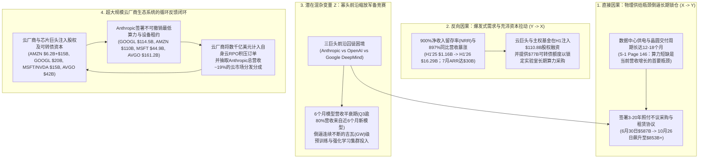
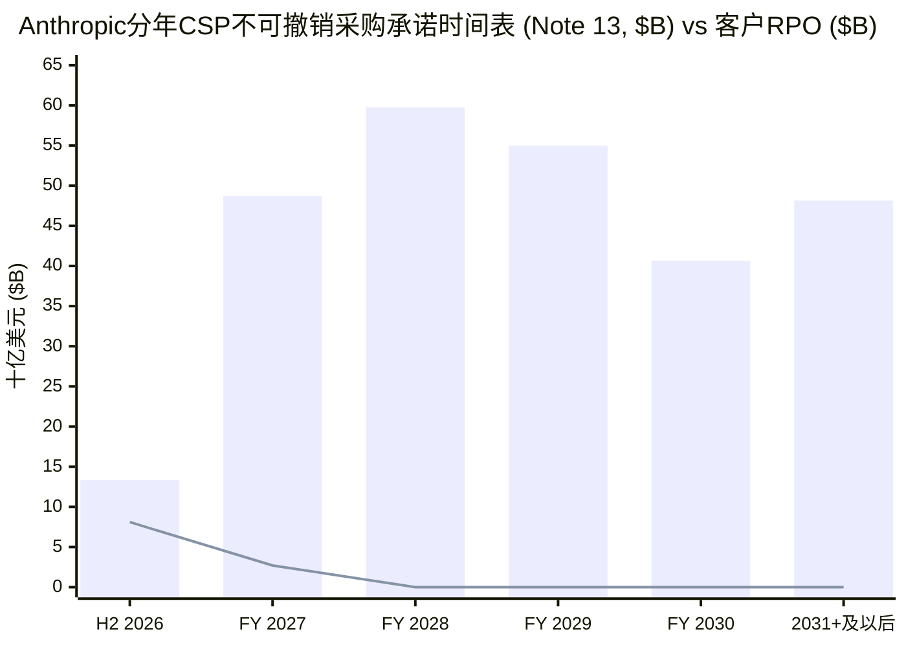

2026年10月27日——距离**Anthropic, PBC**向美国证券交易委员会（SEC）提交具有里程碑意义的首次公开发行注册声明（**SEC Form S-1**，`CIK 0002130357`）还不到24小时——**Snowflake**首席执行官、**Greylock**风险合伙人、前谷歌广告业务高级副总裁**Sridhar Ramaswamy**（`@RamaswmySridhar`）在X平台上发表了一篇由16条推文组成的深度分析，精准刺中了前沿人工智能时代最核心的资产负债表焦虑：

> **Sridhar Ramaswamy (`@RamaswmySridhar`)，2026年10月27日 (`1/16` & `16/16`)：**
> *“1/16 AI行业正在下一场罕见的赌注：按年买断算力（buy compute for years），按Token售卖智能（sell intelligence by the token）。银行、大宗商品贸易商、航空公司、公用事业（电力）和云服务提供商（CSP）各自解释了这种风险的不同切面…… 14/16 Anthropic的S-1招股书将这一风险具象化了。截至2026年6月30日，它披露了2656亿美元的未来固定或最低采购承诺（主要是云和算力），外加3214亿美元已签署但尚未开始的租赁合同。这些属于不同的长期承诺口径，且部分附带先决条件…… 16/16 核心结论：AI技术栈同时叠加了倒置的久期转换（inverted duration transformation）、照付不议（take-or-pay）经营杠杆、易逝的GPU工时、极快的硬件与模型折旧、项目融资集中度风险以及循环的云需求。比起银行挤兑（bank run），产能过剩崩盘（capacity bust）发生的概率要大得多。”*
> — 一手推文来源：[Sridhar Ramaswamy on X (2026年10月27日)](https://x.com/RamaswmySridhar/status/2115159261533929911)

Ramaswamy的长文随即在科技投资人、信贷分析师与基础设施工程师（`@aadi29494`、`@GravityRsch`、`@Dabeer_builds`、`@xtbot`、`@BitWhitman`、`@eequityresearch`）之间引发了一场高信噪比的激烈辩论。前沿AI实验室的批评者认为，Ramaswamy实际上*低估*了这种脆弱性，因为AI实验室不仅在主动大幅砍价（每代模型将单任务客户成本降低约`40%`），而且为了维持领先地位，必须每6个月烧掉数百亿美元用于前沿模型预训练——这使得研发费用（`R&D`）在经济实质上变成了周期性的**维持性资本开支（`Maintenance CapEx`）**。相反，前沿实验室的捍卫者则反驳称，将AI算力比作航空公司的空置座位或WeWork的写字楼租约，忽略了**杰文斯悖论（Jevons Paradox，单价暴跌激发智能体Token消耗量百倍扩张）**、高达`900%`的企业净收入留存率（`NRR`）、跨芯片软件编排能力，以及将20年数据中心供电外壳（powered shell）租约与3至5年硅片周期解耦的基础设施架构。

本报告严格遵循Browne与Keeley的**“淘金式（Panning for Gold）”**批判性思维方法论，将Ramaswamy的16条推文及各方反驳观点与**Anthropic, PBC于2026年10月26日提交的SEC Form S-1原始文件（`Pages 1–172`及财务报表附注`Notes 1–17`，`Pages F-1 to F-66`）**、**CoreWeave, Inc.的FY2025 SEC年报文件（`CIK 0001769628`）**以及**亚马逊（`AMZN`）**、**Alphabet（`GOOGL`）**、**微软（`MSFT`）**、**英伟达（`NVDA`）**和**AMD（`AMD`）**的一手披露文件进行逐项交叉审计。

---

## 核心摘要与财务取证计分卡 (Executive Summary & Forensic Scorecard)

我们的一手文件审计表明：**Sridhar Ramaswamy关于资产负债久期错配的结构性诊断在方向上是准确的，但他遗漏了深埋在Anthropic S-1招股书中的四项关键定量披露（`Note 2`、`Note 9`、`Note 17`以及`MD&A Pages 143 & 170–172`）**。补齐这四块拼图后，无论是短期经营杠杆的锋利程度，还是Anthropic在合同中暗藏的退出安全阀，都比社交媒体上的表面争论深刻得多：

1. **供给承诺与需求积压的精确久期错配倍数（总口径`54.4x`至`79.0x`；1年以上长期口径`>200x`）：**
   虽然Ramaswamy引用了Anthropic截至2026年6月30日的供给侧义务（**`Note 13`中不可撤销云采购承诺`$265.6B`** + **`Note 7`中已签署未开始的数据中心/设备租赁`$321.4B`** = **`$587.0B`**，另加`$2.1B`已开始租赁付款额），但他并未交叉核对**`Note 2（收入确认 — 剩余履约义务RPO，Page F-27）`**与**`Note 17（期后事项，Page F-66）`**：
   - **需求侧（`Note 2`）：** 在Anthropic 2026年上半年（H1 2026）`$16,286M`的总营收中，高达**`80.22%`（`$13,064M`）**来自**按Token计费的消耗型收入（pay-per-token consumption）**，仅有**`19.78%`（`$3,222M`）**来自订阅合同（期限均`≤12个月`）。更令人震惊的是，截至2026年6月30日，Anthropic已签约且不可撤销的客户收入积压（**剩余履约义务，`RPO`**）总额仅为**`$10.8B`（108亿美元）**——其中**`75%`（`$8.1B`）**将在`12个月内`确认，**超过1年的长期客户RPO仅有区区`25%`（`$2.7B`）**！
   - **供给侧（`Note 17`）：** 在2026年7月1日至10月26日期间，Anthropic**额外签署了`$245.0B`的长期（`1–20年`）最低算力/租赁承诺**以及**`$21.0B`的短期（`<1年`）承诺**——使其已签约固定/最低供给承诺总额飙升至**`$855.1B`（8551亿美元）**（尚不包含`Note 16`中披露的2028–2031年`$125.0B–$150.0B`条件性谷歌TPU扩容承诺及`$20.0B+`的AMD Helios机柜系统）。
   - **取证错配倍数：** Anthropic的多年期供给承诺总额是其已签约客户RPO积压（`$10.8B`）的**`54.4倍`（截至2026年6月30日，`$587.0B / $10.8B`）**至**`79.0倍`（截至2026年10月26日，`$853.0B / $10.8B`）**。在超过12个月的长期区间内，已签约供给义务（`~$800B+`）更是超过长期客户需求承诺（`$2.7B`）**`近300倍`**。
2. **Token现货收入波动性与“6个月模型营收半衰期”的实证证据（`MD&A Page 143`）：**
   Anthropic S-1招股书第143页的两项披露，从实证层面同时验证了Ramaswamy的短期需求波动论以及`@aadi29494` / `@eequityresearch`的模型快速折旧论：
   - **年末代码冻结期收入骤降（两周内下跌`-20%`）：** 在截至2026年1月2日的两周内，受企业客户年末代码冻结（code freeze）影响，Anthropic的总客户支出较截至2025年12月19日的前两周**骤降了约`20%`**——与此同时，其`提前12至18个月采购`（`Page 146`）的承诺算力成本在短期内却是`100%`刚性固定的。
   - **不足`6个月`的模型商业半衰期：** Anthropic在`Page 143`明确披露：*“在截至2026年9月30日的六个月内发布的模型版本，贡献了截至2026年9月30日止三个月（2026年第三季度）**超过80%的营业收入**。”* 由于前沿模型权重在两个季度内就会丧失商业定价权，且Anthropic高达**`85.39%`的GAAP毛利率（H1营收`$16,286M`对应营业成本`$2,380M`，`Page 151`）**将**计入`$9,741M` H1研发费用中的约`$6,565M`训练算力支出（`Note 8, Page F-39`）**排除在外，前沿模型训练算力在经济实质上完全等同于**周期性维持性资本开支（`Maintenance CapEx`）**，而非可自由裁量的传统软件研发。
3. **具名交易对手合同台账与隐藏的解约安全阀（`Pages 170–172`）：**
   无论是Ramaswamy还是高呼“AI版WeWork”的看空者（`@xtbot`），都没有查阅S-1招股书`Pages 170–172`披露的具名合同明细台账。拆解该台账可以发现，Anthropic高达`$853B+`的承诺栈实际上由四个风险属性截然不同的层级构成：
   - **超大规模云厂商硬性照付不议最低承诺（`$269.4B`）：** **谷歌（`$114.5B`，2026年4月–2033年7月）**、**亚马逊（`$110.0B`，2026年5月–2036年4月）**和**微软（`$44.9B`，2026年11月–2033年5月）**——全部要求*“无论实际使用量如何（regardless of actual usage）”*必须履行最低支出，若实际消费不足必须以现金支付**差额补足款（true-up）**。
   - **由PIK可转债兜底的硬件融资租赁（`$161.2B`）：** 与**博通（Broadcom）**签署的5年期TPU硬件主设备融资租赁（`不含利息合计$161.2B`，`Page 171`），附带母公司担保、交叉违约加速到期条款，并由**`$42.0B`博通可转换票据融资额度（`Note 9`，基础利率`9.00%` PIK，若未达营收增长目标则跳升至惩罚性的`13.00%` PIK并按30日VWAP的`85%`折价转股）**提供租金支付兜底。
   - **`$120.5B` SpaceX.AI（`xAI`）合同的“提前90天通知解约权”安全阀（`Page 171`）：** 2026年5月至10月间，Anthropic与**SpaceX.AI LLC（前身为X.AI LLC）**签署了总额最高达**`$120.5B`**（2026年12月全部交付后**每月约`$3.1B`**，持续至2029年）的英伟达GPU算力协议。然而`Page 171`披露了一项极其关键的条款：**在2027年1月和3月初始不可撤销期结束后，任何一方只需提前`90天书面通知`即可无责取消整份每月`$3.1B`的算力合同**！
   - **以项目融资与交付为先决条件的新云合同（`$85.9B`）：** 与GPU新云厂商**Nscale（`$44.6B`，至2033年）**和**Lambda（`$41.3B`，至2034年）**签署的服务协议仅在算力实际交付并验收后才开始计费，且若新云厂商未能按期落实项目融资或数据中心场地租约，Anthropic有权直接终止合同。

| 审计维度 / 核心命题 | 来源 / 提出者 | 一手SEC文件证据 (`Anthropic S-1` / `CoreWeave 10-K`) | 取证裁定与证据强度评级 |
| :--- | :--- | :--- | :--- |
| **1. 倒置的久期转换（银行类比）** | Sridhar Ramaswamy (`Tweets 2–4`) | `Note 2 (Page F-27)`：H1营收的`80.22%`为按Token计费，客户`RPO`仅`$10.8B`（`1年内$8.1B`，`1年以上$2.7B`），而多年供给承诺高达`$587.0B`（`6/30`）/ `$853.0B`（`10/26`），错配达`54.4x–79.0x`。 | **实证成立 (`9.5/10`)** — 准确区分了“无储户挤兑”与“固定承诺放大融资收缩传染”的机制。 |
| **2. LNG照付不议经营杠杆 (`3.0x DOL`)** | Sridhar Ramaswamy (`Tweets 5–6`) | `Pages 170–171`：谷歌（`$114.5B`）、亚马逊（`$110.0B`）、微软（`$44.9B`）合同要求*“无论实际使用量如何”*强制履约并支付现金true-up。H1算力（`$8.95B`）+ 分成（`~$3.09B`）占营收`74%`，实际`DOL = 3.11x`。 | **实证成立 (`9.0/10`)** — 与LNG照付不议机制完全吻合，短期由`$131.65B`现金与`$77.0B`未提用NPA缓冲。 |
| **3. 航空座位易逝性与资产快速折旧** | Sridhar Ramaswamy (`Tweets 7–8`) | `Page 143`：2025年12月至2026年1月年末代码冻结期客户支出骤降`~20%`，而`提前12–18个月采购`的固定算力成本不变。闲置GPU工时不可储存，但推理闲置算力可转用于训练。 | **附技术修正成立 (`8.0/10`)** — 不同于客机座位，AI实验室可将闲置推理集群动态重分配至后台预训练与强化学习（RL）任务。 |
| **4. 自残式降价与6个月模型半衰期** | `@aadi29494` & `@eequityresearch` (回复) | `Page 10`：`Claude Opus 5.5`较`Opus 5`将单任务客户成本降低`~40%`。`Page 143`：发布`<6个月`的模型贡献了Q3 2026 `>80%`的营收。`Note 8`：H1算力中`$6.57B`计入R&D，仅`$2.38B`计入营业成本。 | **极高价值补充 (`9.5/10`)** — 揭示了Ramaswamy遗漏的核心机制：`85.39%`的GAAP毛利率掩盖了占营收`40.3%`的周期性训练算力开支。 |
| **5. 新云项目融资与信贷集中度风险** | Sridhar Ramaswamy (`Tweets 9–10`) & `@Dabeer_builds` | CoreWeave FY25年报：`>98%`营收来自承诺合同，微软占`~62%`，资产支持债务达`$21.6B`。`Anthropic S-1 Page 171`：Nscale（`$44.6B`）与Lambda（`$41.3B`）合同以项目融资和交付验收为前提。 | **实证成立 (`9.0/10`)** — GPU新云处于英伟达硬件资本开支与实验室/云厂商承购合同之间的高杠杆夹层。 |
| **6. 云厂商多租户池化 vs 循环云需求** | Sridhar Ramaswamy (`Tweets 11–13`) & `@GravityRsch` | 亚马逊（`$6.2B`票据+`$15B` NPA vs `$110B` AWS承诺+`19%`分成）、谷歌（`$20B` NPA vs `$114.5B`+`$125B–$150B` TPU承诺）、微软/英伟达（`$15B` G轮 vs `$44.9B` Azure承诺）。 | **实证成立 (`9.5/10`)** — 资本注入、算力采购、云市场分发（`Bedrock`/`Vertex`/`Foundry`）与云厂商RPO积压构成自我强化闭环。 |
| **7. “AI版WeWork” 20年租约破产论** | `@xtbot` (回复) | `Pages 137, 141 & 171`：在`Anthropic Direct`架构下，10–20年未开始租约（`$321.4B`）主要为占总成本`15–25%`的**数据中心供电外壳（shell）**，与3–5年芯片周期（`博通5年TPU租约`、`可90天解约的$120.5B SpaceX.AI`）解耦。 | **证伪/过度简化 (`3.5/10`)** — 忽略了外壳与芯片久期分离、四芯片架构可移植性以及`$120.5B` SpaceX.AI合同的90天解约权。 |

---

## Phase 1 & Phase 2: 核心议题界定、一手文件挖掘与利益冲突审计

### 1.1 完整还原Sridhar Ramaswamy的16条推文逻辑链与六大核心反驳

为避免任何稻草人谬误（straw-man distortion），我们完整保留Sridhar Ramaswamy于2026年10月27日发布的16条推文（`1/16`至`16/16`）结构，以及评论区最具代表性的六条专业推演：

* **推文 `1/16–4/16`（银行类比 —— 倒置的久期转换与融资收缩传染）：**
  > *“2/16 先看银行。银行是借短（随时可能流出的存款）、贷长（房贷、多年期贷款）。3/16 AI实验室恰恰相反：它们锁定多年期的算力承诺，却售卖客户明天就能削减或路由切换（reroute）的短期Token用量。4/16 与银行不同，客户无法要求退还过去已经花掉的Token费用，因此不会发生古典意义上的‘银行挤兑’。真正的风险在于固定承诺会放大需求冲击，而一旦外部融资收缩就会引发连锁反应。”*
* **推文 `5/16–6/16`（大宗商品贸易商类比 —— LNG照付不议合同与残酷的经营杠杆）：**
  > *“5/16 更贴切的经营类比是大宗商品贸易商（commodity merchant）：签下一份10年期照付不议（take-or-pay）液化天然气（LNG）长约，然后在现货市场上出售船货。6/16 这会制造残酷的经营杠杆。如果你承诺了100美元的固定产能，预期获得150美元营收，扣除其他费用前的贡献毛利是50美元。一旦营收不及预期30%（降至105美元），你的贡献毛利就会暴跌90%，只剩5美元。”*
* **推文 `7/16–8/16`（航空公司类比 —— 易逝库存与加速的硬件/模型折旧）：**
  > *“7/16 再加上航空公司的特征。飞机起飞那一刻的空座位永远消失了，昨天没用掉的GPU工时（gpu-hour）也一样。8/16 就像航空公司一样，AI的商业模式取决于客座率（load factor）× 单位收益率（yield）。但不同于飞机可以飞25到30年，GPU代际和模型架构在12到36个月内就会老化。”*
* **推文 `9/16–10/16`（公用事业类比 —— 作为AI项目融资层的GPU新云）：**
  > *“9/16 公用事业（电力公司）解释了为什么长期合同会存在：你不可能靠现货需求去给一座发电厂融资，你必须靠长期购电协议（PPA）来融资。10/16 GPU新云（neo-clouds）就是AI行业的项目融资层。CoreWeave表示其2025年超过98%的营收来自承诺合同，利用签约现金流为采购GPU融资。这降低了现货价格风险，却高度集中了信用违约和展期再融资（rollover）风险。”*
* **推文 `11/16–13/16`（云服务商类比 —— 多租户池化 vs 生态系统循环交易）：**
  > *“11/16 云服务商（AWS、Azure、GCP）同样提前数年建设基础设施并按用量变现。为什么它们当年没有爆雷？12/16 因为传统云计算拥有跨数百万工作负载的多样化池化（diversified pooling）、1至3年的企业承诺折扣、慢得多的硬件折旧、可重复调配的通用基础设施，以及背后庞大的现金牛业务支撑。13/16 而在AI领域，循环性（circularity）模糊了真实图景：一家云厂商可以投资一家AI实验室，向其出售算力，分发其模型，并从同一个生态闭环中记入多年期的云积压订单（backlog）。”*
* **推文 `14/16–16/16`（Anthropic S-1实证案例与总结）：**
  > *“14/16 Anthropic的S-1将这一切具象化了。截至2026年6月30日，它披露了2656亿美元的未来固定或最低采购承诺（主要是云和算力），外加3214亿美元已签署但尚未开始的租约。这些是独立的长期口径，部分附带条件。15/16 只有当营收扩张速度超过固定承诺时，这套模式才能运转。Anthropic 2026年上半年营收达到163亿美元，算力支出占营收比例从2025年上半年的201%降至55%。16/16 总结：AI技术栈同时具有倒置的久期转换、照付不议经营杠杆、易逝的GPU工时、快速的硬件/模型衰减、项目融资集中度以及循环云需求。产能过剩崩盘比银行挤兑更可能发生。”*

在随后的高质量回复链中，六位行业分析者提出了关键推演：
1. **`@aadi29494`（自残式Token降价）：** *“大宗商品贸易商是整篇长文最犀利的类比。但比LNG更糟糕的是，AI实验室自己还在主动砍价。航空公司不会每六个月造出一架新飞机，让去年的座位变得一文不值。每一次新模型发布都在把旧产能重新向下定价，而算力租约账单却纹丝不动。”*
2. **`@eequityresearch`（训练成本实质是维持性资本开支）：** *“最让我感到恐惧的是：当你处于领跑位置时，训练成本（training costs）根本不是研发费用（R&D），而是维持性资本开支（maintenance capex）。”*
3. **`@GravityRsch`（循环交易与价格弹性悖论）：** *“13/16是核心症结。当资本、算力和分发渠道全部装进同一个闭环里时，财报上呈现的需求看起来会比真实的终端市场需求坚挺得多。而且不同于LNG或航空业，AI实验室是在锁定多年期固定产能的同时，亲手压低单Token价格。”*
4. **`@Dabeer_builds`（新云的再融资窗口悬崖）：** *“大宗商品贸易商类比最干净利落。固定100美元 / 预期150美元 -> 营收差30%抹平90%贡献毛利的算术极其残酷且被市场低估了。我反复思考的是8/16与10/16的结合：新云厂商正在用当年为25年寿命发电厂发明的项目融资结构，为24–36个月就会折旧完毕的资产融资。当第一个再融资窗口到来、而抵押品变成N-1代旧硬件时，会发生什么？”*
5. **`@xtbot`（“AI版WeWork”看空论）：** *“14/16是所有人都不敢直视的数字：在24个月折旧完毕的资产上背负5870亿美元综合义务，对应320亿美元年化营收，售卖的却是零转换成本的产品。WeWork当年就是一模一样的结构：15年租约义务，按月付费会员。唯一的区别是写字楼不会每18个月就彻底过时。”*
6. **`@BitWhitman`（杰文斯悖论与算力集群高利用率看多反驳）：** *“LNG和航空公司的类比只有在需求是外生的、且价格弹性方向错误时才成立。每当Token价格下降10倍，单任务消耗100倍Token的新一类智能体（agentic）工作负载就会具备经济可行性。实验室赌的不是静态的提问量——它们赌的是杰文斯悖论（Jevons paradox）填满算力集群的速度快于硬件折旧的速度。”*

### 1.2 作者专业权威性与商业利益冲突（Conflict of Interest）审计

根据`.agents/rules/deep-research.md`准则，我们必须严格审视主作者的领域资历与商业激励：
* **领域专业权威性（`高`）：** Sridhar Ramaswamy曾执掌谷歌核心广告与商务工程体系十余年（管理逾`$100B+`年化流水的大规模实时竞价基础设施），随后联合创立AI搜索引擎**Neeva**（2023年5月被Snowflake收购），并自2024年2月起出任**Snowflake（`NYSE: SNOW`）首席执行官**。他本人既直接与AWS、Azure和GCP谈判数十亿美元级别的云承诺合同，又在企业级规模采购前沿模型Token。
* **商业利益冲突（`重大 —— 必须披露`）：** 作为**Snowflake**的首席执行官，Ramaswamy核心推广的企业级数据云AI平台（**Snowflake Cortex AI**）向财富500强CIO兜售的核心价值主张正是**模型无关抽象层（model-agnostic abstraction）与多模型无缝路由**——帮助企业客户在Anthropic Claude、OpenAI GPT、Meta Llama、Mistral以及Snowflake自研模型之间一键切换，消除单一模型供应商锁定（vendor lock-in）。
  * *取证意义：* 在推文`3/16`中，Ramaswamy强调AI实验室售卖的是*“客户明天就能削减或路由切换的短期Token用量”*。将**模型层Token定义为零转换成本的同质化大宗商品**，直接有利于凸显Snowflake受治理企业数据层的不可替代性。因此，我们的审计必须用S-1一手数据检验：Anthropic的企业客户究竟是像大宗商品买家一样“随时零成本切换”，还是表现出极强的多年期队列粘性（`NRR`）？

---

## Phase 3: 核心概念语义消歧与七大行业结构性风险矩阵

### 3.1 三大核心术语的语义消歧与替换测试（Substitution Tests）

1. **“久期错配（Duration Mismatch）”（`银行资产负债期限转换` vs `表外经营承诺久期缺口`）：**
   * *替换测试：* 当商业银行倒闭时（如`2023年3月硅谷银行SVB`），短期负债持有人（**储户**）在法律上有权要求立即按面值`100%`提取现金本金，迫使银行折价甩卖长期资产（`持有至到期国债/MBS`）。如果API客户明天停止购买Token，AI实验室需要把客户过去花掉的钱退还给客户吗？**不需要。**
   * *精确定义：* AI实验室面临的**不是**负债端的流动性挤兑（`Asset-Liability Maturity Transformation`），而是**表外经营承诺久期缺口（Off-Balance-Sheet Operating Commitment Duration Gap）**：即签署了`3至20年`的刚性投入端采购与租赁义务（`算力采购承诺 + 数据中心租约`），却依赖`1至90天`无合同锁定的现货产出端收入（`按Token计费的API消耗`）来覆盖固定成本。
2. **“算力承诺与签署租约（`$587.0B` / `$853.0B`）”（`无条件债务性最低承诺` vs `里程碑条件性与可解约批次`）：**
   * *替换测试：* 能否将Anthropic截至6月30日的`$587.0B`或截至10月26日的`$853.0B`义务全额等同于WeWork无条件签署的15年写字楼死租约？**不能。**
   * *精确拆解（`Anthropic S-1 Notes 7, 13, 17 & Pages 170–172`）：* 如下文第5.2节所证，其中`$269.4B`属于超大规模云厂商无条件照付不议最低支出承诺（`谷歌`、`亚马逊`、`微软`），`$161.2B`属于不可撤销的5年期博通TPU融资租赁；但**高达`$120.5B`的`SpaceX.AI LLC`英伟达GPU合同在2027年一季度后可由任一方提前`90天书面通知`直接取消**，另有**`$85.9B`的新云合同（`Nscale`与`Lambda`）以新云厂商落实项目融资及按期交付机房为先决条件**。
3. **“毛利率（`85.39%`）”（`推理服务毛利率` vs `包含维持性训练算力的全周期算力毛利率`）：**
   * *替换测试：* 当一家传统SaaS软件公司（如`Adobe`或`Workday`）报告`85.39%`的毛利率时，其历史研发编写的软件代码在未来`5至10年以上`仍能持续产生订阅收入。如果Anthropic明天停止所有R&D训练集群，其现有模型代际维持`>80%`营收占比的时间有多长？**不到6个月（`MD&A Page 143`）。**
   * *精确定义：* 在前沿AI行业，**GAAP毛利率（H1 2026为`85.39%`）**仅衡量**服务客户的推理毛利**（`营业收入 - 营业成本`）；而反映真实经济实质的**全周期算力贡献毛利率（Full-Cycle Compute Contribution Margin，H1 2026为`26.1%`）**，必须同时扣除`营业成本`（`$2,380M`推理算力）、计入`销售与营销费用（S&M）`的第三方云市场分成（`$3,094M`）以及计入`研发费用（R&D）`的训练算力开支（`~$6,565M`）。

### 3.2 七大行业结构性风险全景对比矩阵

为了严格检验Ramaswamy的五大行业类比，我们将**商业银行**、**LNG大宗商品贸易商**、**客运航空公司**、**电力公用事业**、**超大规模云厂商（CSP）**、**GPU新云（`CoreWeave`）**与**前沿AI实验室（`Anthropic`）**在七个核心资产负债表维度上进行横向映射：

| 结构性维度 | 商业银行 (Banks) | LNG大宗商品贸易商 | 客运航空公司 (Airlines) | 电力公用事业 (Utilities) | 超大规模云厂商 (`AWS` / `Azure` / `GCP`) | GPU新云 (`CoreWeave`) | 前沿AI实验室 (`Anthropic S-1`) |
| :--- | :--- | :--- | :--- | :--- | :--- | :--- | :--- |
| **投入端 / 负债久期** | **极短** (`随时可提现的活期存款`) | **长** (`10–20年照付不议液化SPA长约`) | **长** (`10–15年飞机租赁与航空债务`) | **超长** (`20–40年项目债务与电厂寿命`) | **长** (`15–30年机房外壳`，`4–6年服务器周期`) | **中** (`3–6年GPU DDTL贷款与5–15年机房租约`) | **长** (`3–10年CSP照付不议`，`5年TPU租约`，`10–20年机房外壳租约`) |
| **产出端 / 收入久期** | **长** (`5–30年固息/浮息贷款与按揭`) | **短** (`现货及短期JKM / TTF船货销售`) | **短** (`现货及提前1–90天机票预售`) | **长** (`10–25年受监管电价与PPA长约`) | **中长混合** (`1–3年企业CUD承诺 / $600B+ RPO + 按量计费`) | **中** (`3–5年照付不议合同；>98%为承诺收入`) | **短** (`80.2%按Token现货计费；客户RPO仅$10.8B，75% <12个月`) |
| **库存易逝性** | 低 (现金与信贷按利率跨期结转) | 中等 (蒸发损耗与高昂浮式储存成本) | **100%易逝** (`起飞时的空座位永久消失`) | **100%易逝** (`未储能的MWh电力瞬间消失`) | 高 (闲置CPU/GPU周期消失，靠数百万租户池化对冲) | 高 (通过照付不议合同转嫁给承购方) | **高但半可替代** (`闲置推理GPU工时可动态转入预训练与RL`) |
| **底层资产有效寿命** | 金融债权 (`5–30年`) | 液化生产线与LNG船 (`25–40年`) | 商用客机机身 (`25–30年`) | 发电燃气轮机与电网 (`30–50年`) | 通用服务器 (`5–6年`)，数据中心外壳 (`20–30年`) | AI GPU (`物理寿命3–5年`，`前沿峰值18–36个月`) | **数据中心外壳 (`15–20年`)，芯片 (`3–5年`)，模型权重 (`<6个月半衰期`)** |
| **自残式价格通缩** | 无 (利率随央行周期波动) | 无 (现货LNG随全球气候与供需波动) | 无 (新波音/空客客机不会每年将票价砍掉`40%`) | 无 (受监管准许收益与通胀挂钩上调) | 温和 (摩尔定律带来每年`~10–15%`性价比提升) | 合同续签时极高 (`N-1`代GPU租金下跌`40–60%`) | **极端 (每6–12个月发布新模型将单任务成本砍掉`~40%+`)** |
| **转换成本与工作负载粘性** | 中低 (数字银行转账仅需数小时) | **零** (甲烷分子100%同质可替代) | 低 (消费者比价购票；靠常旅客里程缓冲) | **无穷大** (区域电网自然垄断) | **高** (数据重力、IAM权限、VPC与企业深度集成) | 合同期内高 (`3–5年锁定`)，到期续签时低 | **两极分化** (`简单API套壳极低；企业级智能体与代码库极高 / 900% NRR`) |
| **核心失效模式 (Failure Mode)** | **经典流动性挤兑** (储户提现快于长期资产变现) | **价差碾压 (Spread Crush)** (现货价跌破固定液化加工费) | **客座率 × 收益率衰退破产** (刚性机队成本吞噬利润) | **搁浅资产 / 承购方违约** (监管机构不予核准电价) | **资本开支过剩 / ROIC压缩** (由传统现金牛业务吸收) | **再融资 / 残值抵押品悬崖** (租约到期时`N-1`代GPU残值暴跌) | **照付不议利润率虎钳** (营收增速放缓至低于固定CSP差额补足与训练开支) |

---

## Phase 4: 四向因果审计（为什么AI实验室要用`$853B+`长期承诺去赌现货Token？）

既然已签约客户RPO积压只有**`$10.8B`**（`Note 2`），为什么Anthropic会签下总额高达**`$855.1B`**的算力与租赁承诺（`Notes 7, 13 & 17`）？为了避免将系统性结果简单归咎于管理层盲目乐观的归因谬误，我们执行严格的**四向因果审计（4-Way Causal Audit）**：

| 因果路径 (Causal Pathway) | 作用机制方向 | 一手招股书证据 (`Anthropic Form S-1`) | 因果解释权重 |
| :--- | :--- | :--- | :--- |
| **1. 直接因果 (`物理供给瓶颈 -> 长期承诺`)** | `基础设施交付周期 (12–18个月) -> 多年照付不议合同` | `MD&A Page 146`：*“客户对我们产品的需求目前超过了我们的可用算力容量……我们必须比预期客户使用时间提前12至18个月做出产能承诺。”* `Page 140`：每建设**1 GW（吉瓦）**数据中心容量需耗资**`$20B–$25B`**（其中`75–85%`为`3–5年`周期的芯片与服务器，`15–25%`为`10–20年`周期的供电外壳）。没有多年期照付不议合同，任何电力公司或云厂商都不会投资250亿美元建设吉瓦级集群。 | **35% (首要运营驱动力)** |
| **2. 反向因果 (`超高速增长与资本过剩 -> 激进锁仓`)** | `900%客户队列扩张与$131.7B现金储备 -> 承接多年风险的底气` | `Page 142`：年化收入（ARR）`≥$100K`的企业客户队列在2026年第二季度实现了**超过`900%`的净收入留存率（`NRR`）**（自2024年Q1以来每个季度均超过`300%`）。H1 2026融资活动现金流入高达**`$110.8B`**（`Page 168`），账面现金及短期投资达**`$131.65B`**（`Page 161`）。空前的历史扩张率与资本充裕度促使管理层将未来`12–18个月`的指数外推视为确定性事件。 | **20% (行为与资产负债表驱动)** |
| **3. 潜在混杂变量 `Z` (`6个月前沿模型淘汰跑步机`)** | `寡头缩放竞赛 (Z) -> 同步降价与多吉瓦集群锁仓` | `Page 143`：**2026年第三季度超过`80%`的营收**来自**过去6个月内发布的模型版本**。如果Anthropic不提前18个月锁定下一代多吉瓦算力集群（`Trainium3`、`TPU v7/v8`、`Blackwell/Rubin`、`MI450`），竞争对手就会夺走前沿代码与智能体市场，导致Anthropic现有Token营收在两个季度内枯竭。 | **25% (结构性博弈论驱动)** |
| **4. 生态系统循环反馈闭环 (`云厂商资本 <-> 实验室算力RPO`)** | `战略股权/可转债融资 <-> 不可撤销云积压订单与19%收入分成` | `Pages 164–172`：亚马逊（`$6.2B`票据+`$15B` 2026 NPA）、谷歌（`$20B` 2026 NPA+`$10B` IPO配售期权）、微软/英伟达（`$15B` G轮）及博通（`$42B` 2026 NPA）在向Anthropic提供资金的同时，向其售出**`$430.6B`**承诺云服务与硬件（谷歌`$114.5B`+亚马逊`$110.0B`+微软`$44.9B`+博通`$161.2B`），并通过云市场分发抽成拿走**Anthropic总营收的`~19%`（H1 2026为`$3,094M`，`Page 151`）**！ | **20% (金融工程放大器)** |

---

## Phase 5: 定量与金融工程取证审计 (Quantitative & Financial Engineering Audit)

现在，我们对Ramaswamy推文及Anthropic Form S-1中的所有数学与财务命题进行严格公式推导与压力测试。

### 5.1 审计推文 `6/16`：经营杠杆系数（`DOL`）与照付不议价差压缩推导

在推文`6/16`中，Sridhar Ramaswamy给出了一个典型的大宗商品贸易商照付不议算术模型：
* 固定照付不议产能承诺成本 `F = $100`
* 预期现货营业收入 `R₀ = $150`
* 扣除其他费用前的预期贡献毛利 `Π₀ = R₀ - F = $150 - $100 = $50`
* 当营收不及预期`30%`（`ΔR / R₀ = -0.30`）时，实际营收降至`R₁ = $150 × (1 - 0.30) = $105`，贡献毛利暴跌至`Π₁ = $105 - $100 = $5`，即**贡献毛利坍塌了`90%`**（`ΔΠ / Π₀ = -$45 / $50 = -90%`）。

从一般意义上推导，当企业背负固定算力承诺成本`F`，且需按营收比例支付非算力类的云合作伙伴分发分成比例`v`时（此时贡献毛利为`Π(R) = R(1 - v) - F`），其对营收变动的**经营杠杆系数（Degree of Operating Leverage, `DOL`）**为：

$$
\text{DOL}(R_0) = \frac{\partial \Pi / \Pi_0}{\partial R / R_0} = \frac{R_0 (1 - v)}{R_0 (1 - v) - F} = \frac{1}{1 - \frac{F}{R_0 (1 - v)}}
$$

在Ramaswamy的简化算例中（`v = 0`，`F = $100`，`R₀ = $150`），`DOL = 150 / (150 - 100) = 3.0x`，因此`-30%`的营收冲击会导致`3.0 × (-30%) = -90%`的贡献毛利坍塌。

现在，让我们把**Anthropic在`MD&A Pages 149–152`及`Note 8 (Page F-39)`中披露的2026年上半年（H1 2026）真实财务数据**代入这一方程：
* **H1 2026 营业收入（`R₀`）：** **`$16,286M`**（2026年Q1 `$4,731M` + 2026年Q2 `$11,555M`，`Page 158`）。
* **H1 2026 可变云合作伙伴收入分成比例（`v`）：** 在`Page 151`中，Anthropic披露在销售与营销费用（总额`$4,102M`）内部，**支付给云与分发合作伙伴（`AWS Bedrock`、`Google Vertex AI`、`Microsoft Azure Foundry`）的收入分成（revenue sharing）占总营收的`19%`**，即**`~$3,094M`**（`v = 0.19`）。
* **H1 2026 总算力支出（`F`）：** 在`Page 152`中（验证了Ramaswamy推文`15/16`），Anthropic利润表全口径的总算力支出为**`$8,945M`**（**占总营收的`54.92%`**，较H1 2025在`$1,163M`营收上支出`$2,334M`即**`200.69%`**大幅下降）：
  * 服务客户的推理算力（`营业成本 Cost of revenue`，`Page 151` & `Note 8 Page F-39`）：**`$2,380M`**（**占营收的`14.61%`**，从而呈现出高达**`85.39%`的表观GAAP毛利率**）。
  * 研发训练与研究算力（`R&D`，`Note 8 Page F-39`）：**`~$6,565M`**（**占营收的`40.31%`**，包含在`$9,741M`的总研发费用内部）。

将Anthropic H1 2026的真实参数（`R₀ = $16,286M`，`v = 0.19`，承诺算力支出`F = $8,945M`）代入上述经营杠杆方程，可得：

$$
\Pi_{\text{H1 2026}} = R_0 (1 - v) - F = 16,286 \times (1 - 0.19) - 8,945 = 13,191.66 - 8,945 = \$4,246.66\text{ million (26.08\% of Revenue)}
$$

$$
\text{DOL}_{\text{Anthropic H1 2026}} = \frac{13,191.66}{4,246.66} = 3.106\times
$$

**核心取证发现：** Sridhar Ramaswamy在推文`6/16`中构造的大宗商品贸易商算例（`DOL = 3.0x`，营收差`30%`抹平`90%`贡献毛利）绝非夸张比喻——**Anthropic在2026年上半年的真实全口径算力与分成后经营杠杆系数恰好就是`3.11x`！** 如果Anthropic的营收较计划水平回落`30%`，而其提前12–18个月锁定的H1算力开支（`$8,945M`）保持刚性不变，其扣除算力与云渠道分成后的贡献毛利将暴跌`3.106 × (-30%) =` **`-93.2%`**，从`$4,247M`萎缩至仅剩**`$289M`**——甚至连支付其`$3,176M`的研发薪酬或`$1,277M`的一般及行政开支（G&A）的零头都不够！

| 财务指标 (`单位：百万美元($M)`，百分比及比率除外) | FY 2023 | FY 2024 | FY 2025 | H1 2025 (`截至6月30日止6个月`) | H1 2026 (`截至6月30日止6个月`) | 一手招股书出处 (`Anthropic S-1`) |
| :--- | :--- | :--- | :--- | :--- | :--- | :--- |
| **营业总收入 (`R`)** | **$70** | **$607** | **$4,435** | **$1,163** | **$16,286** | `合并利润表 (Page F-4)` |
| **按量消耗型 (Pay-Per-Token) 收入** | — | — | — | — | **$13,064 (`80.22%`)** | `Note 2 — 收入拆解 (Page F-26)` |
| **订阅型 (Subscription，`≤12个月`) 收入** | — | — | — | — | **$3,222 (`19.78%`)** | `Note 2 — 收入拆解 (Page F-26)` |
| **GAAP营业成本 (推理服务算力)** | **$244** | **$1,020** | **$2,223** | **$795** | **$2,380 (`14.61%`)** | `Page F-4` & `Note 8 (Page F-39)` |
| **GAAP毛利 / (毛损)** | **$(174)** | **$(413)** | **$2,212** | **$368** | **$13,906** | `MD&A Page 151` |
| **GAAP毛利率 (`占营收%`)** | **-248.6%** | **-68.0%** | **49.88%** | **31.64%** | **85.39%** | `MD&A Page 151` (`H1同比提升+53.75个百分点`) |
| **R&D算力支出 (预训练与研究算力)** | **$266** | **$1,558** | **$4,102** | **$1,539** | **$6,565 (`40.31%`)** | 推导：`总算力支出(Page 152) - 营业成本(Note 8)` |
| **总算力支出 (`推理 + R&D合计`)** | **$510 (`729%`)** | **$2,578 (`425%`)** | **$6,325 (`143%`)** | **$2,334 (`201%`)** | **$8,945 (`54.92%`)** | `MD&A Page 152` (与Ramaswamy推文`15/16`完全一致) |
| **云合作伙伴收入分成 (`计入S&M`)** | **$9 (`13%`)** | **$134 (`22%`)** | **$976 (`22%`)** | **$267 (`23%`)** | **$3,094 (`19.00%`)** | `MD&A Page 151` (`FY24–25为22%`；`H1 2026为19%`) |
| **扣除全周期算力与分成后贡献毛利** | **$(449)** | **$(2,105)** | **$(2,866)** | **$(1,438)** | **+$4,247 (`26.08%`)** | `营业收入 - 总算力支出 - 云伙伴分成` |
| **研发费用总额 (`R&D`)** | **$472** | **$2,265** | **$5,764** | **$2,315** | **$9,741 (`59.81%`)** | `Page F-4` & `Note 8 (Page F-39)` |
| **GAAP营业利润 / (亏损)** | **$(860)** | **$(3,195)** | **$(5,882)** | **$(2,553)** | **$(1,274)** *(`Q2盈利+$974M`)* | `Page F-4` & `季度利润表 (Page 158)` |

### 5.2 拆解`$855.1B`供给承诺栈 vs `$10.8B`客户RPO的期限结构与法律可执行性

下面我们将Anthropic供给侧义务（`Notes 7, 13, 16, 17`及`Pages 170–172`）的分年到期时间表及法律约束力，与其已签约客户收入积压（`Note 2, Page F-27`）进行严格比对：

$$
\text{Aggregate Duration Mismatch Ratio} = \frac{\text{Contracted Multi-Year Supply Commitments}}{\text{Contracted Customer RPO}} = \begin{cases} \frac{\$587.02\text{B}}{\$10.80\text{B}} = \mathbf{54.35\times} & \text{(As of June 30, 2026)} \\[8pt] \frac{\$853.02\text{B}}{\$10.80\text{B}} = \mathbf{78.98\times} & \text{(Including Q3/Q4 Note 17 Additions)} \end{cases}
$$

而在客户RPO仅有**`$2.70B`**（占`$10.8B`的`25%`，`Note 2 Page F-27`）的**1年以上长期承诺区间**，供需久期错配比率高达：

$$
\text{Long-Dated (>1 Year) Mismatch Ratio} = \frac{\text{Supply Commitments Due } >1\text{ Year}}{\text{Customer RPO Due } >1\text{ Year}} = \frac{\$538.49\text{B (Jun 30)} \text{ to } \$783.49\text{B (Oct 26)}}{\$2.70\text{B}} = \mathbf{199.4\times \text{ to } 290.2\times}
$$

下表是直接从S-1原始财务报表附注提取的Anthropic全部算力与基础设施义务栈的完整勾稽核对表：

| 承诺口径 / 会计分类 | 披露金额 (`$B`) | 合同期限 / 到期时间表 | 法律约束力与解约机制 (`Anthropic S-1 Pages 170–172 & Notes 7, 13, 16, 17`) | 是否计入6月30日`$587B`？ |
| :--- | :--- | :--- | :--- | :--- |
| **1. 不可撤销采购承诺 (`Note 13`)** | **$265.62B** | `H2 2026: $13.34B; 2027: $48.72B; 2028: $59.75B; 2029: $54.99B; 2030: $40.66B; 2031+: $48.16B` | 截至2026年6月30日剩余期限超过1年的不可撤销固定或最低CSP云托管承诺。不含`$26.7B`剩余期限`≤1年`的短期或可取消承诺（`Note 13 Page F-61`）。 | **是 (`$265.6B`)** |
| **2. 已签署但尚未开始的租约 (`Note 7`)** | **$321.40B** | 起租期`2026–2029年`；租期`<2年至20年` | 数据中心（`10–20年`供电外壳）及算力硬件（`5年`博通TPU）的未折现未来租赁付款总额。通常以出租方完成交付里程碑为先决条件（`Note 7 Page F-36`）。 | **是 (`$321.4B`)** |
| **3. 已开始执行的经营与融资租赁 (`Note 7`)** | **$2.12B** | `2026–2031+` (`加权平均租期：经营8.7年 / 融资3.0年`) | 已计入2026年6月30日资产负债表的`$1,601M`未折现经营租赁付款额（现值`$1,231M`）+ `$523M`未折现融资租赁付款额（现值`$465M`，`Page F-36`）。 | 未计入`$587B` (`已入表`) |
| **4. Q3/Q4期后新增长期承诺 (`Note 17`)** | **$245.00B** | `2026年7月1日 – 10月26日` (`期限1至20年`) | 2026年6月30日之后新签署的不可撤销算力与基础设施采购承诺及租约（`Note 17 Page F-66`）。 | **否 (`Ramaswamy遗漏`)** |
| **5. Q3/Q4期后新增短期承诺 (`Note 17`)** | **$21.00B** | `2026年7月1日 – 10月26日` (`剩余期限≤1年`) | 2026年6月30日之后新签署的短期最低算力付款承诺（`Note 17 Page F-66`）。 | **否 (`Ramaswamy遗漏`)** |
| **固定 / 可确定供给承诺栈总计 (`1–5`)** | **$855.14B** | `2026 – 2046年` | **Ramaswamy引用的`$587.02B`（`6月30日`）+ `$2.12B`已开始租约 + `$266.00B` Q3/Q4新增承诺（`Note 17`）。** | — |
| *备查项A：条件性谷歌TPU扩容承诺 (`Note 16`)* | *+$125B–$150B* | `交付窗口2028 – 2031年` | 向谷歌等TPU供应商采购额外TPU算力的协议（`Pages 170 & F-63`）；因付款额取决于交付容量与部署条件而未计入固定承诺表。 | 未计入 (`可变/条件性`) |
| *备查项B：条件性AMD Helios MI450供应 (`Note 16`)* | *+$20B–$40B+* | `首批于2027日历年交付` | 首批AMD Helios机架级系统预计支出`>$20.0B`（`Page 171 & F-63`），另附带采购同等规模（`~$20.0B`）第二批容量的选择权。 | 未计入 (`可变/条件性`) |

再看S-1招股书`Pages 170–172`披露的**八大具名交易对手合同**如何映射至上述会计科目：

| 具名交易对手 (`S-1 Pages 170–172`) | 合同金额 (`$B`) | 合同执行窗口 | 硬件 / 云技术栈 | 具体法律与财务条款 (`Pages 170–172`) |
| :--- | :--- | :--- | :--- | :--- |
| **Broadcom Inc. (`设备融资租赁`)** | **$161.2B** *(不含利息)* | `5年期租约` (`2026–2027年起租`) | 部署于专用第三方数据中心的定制**TPU算力硬件** | 核算为**融资租赁**（`Note 7`）。除违约外不可取消；由Anthropic, PBC母公司担保；以租赁设备及受限现金存款质押；含交叉违约加速到期条款。可通过发行最高**`$42.0B`的`9.0%–13.0%` PIK可转换票据支付季度租金（`Note 9`）**。 |
| **SpaceX.AI LLC (`前身为X.AI LLC`)** | **最高 $120.5B** | `2026年5月 – 2029年` (2026年12月起`每月~$3.1B`) | **NVIDIA GPUs** | **核心退出安全阀 (`Page 171`)：** 在分别于**2027年1月和2027年3月**结束的初始不可撤销期之后，**每份协议均可由任一方提前`90天书面通知`予以取消！** |
| **Google (`Alphabet Inc.`)** | **$114.5B** *(+$125B–$150B条件性)* | `2026年4月 – 2033年7月` (`7.25年`) | **Google Cloud & TPUs** | *“无论实际使用量如何”*均不可取消的最低支出承诺。若实际支出不足，必须支付**现金差额补足款（true-up）**。由`$20.0B` **Google 2026 NPA**提供融资支持（`Page 167`）。 |
| **Amazon (`AWS`)** | **$110.0B** | `2026年5月 – 2036年4月` (`10.0年`) | **AWS Cloud & Trainium2 / Trainium3** | *“无论实际使用量如何”*均不可取消的最低支出承诺。若实际支出不足，必须支付**现金差额补足款（true-up）**。由已发行`$6.2B`票据 + `$15.0B` **Amazon 2026 NPA**提供支持（`Page 166`）。 |
| **Microsoft Corp. (`Azure`)** | **$44.9B** | `2026年11月 – 2033年5月` (`6.5年`) | **Microsoft Azure & NVIDIA GPUs** | 除微软未纠正重大违约或按批次未交付容量外，*“无论实际使用量如何”*均不可取消的最低支出承诺。 |
| **Nscale Global Holdings Ltd. (`新云`)** | **最高 $44.6B** | `2026年8月 – 2033年` | **NVIDIA GPUs** | **仅在算力实际交付并经Anthropic验收后才开始计费**。以Nscale在规定期限内尽最大努力获得**合格项目融资**为先决条件。 |
| **Lambda, Inc. (`新云`)** | **$41.3B** | `2026年5/8月 – 2034年` | **NVIDIA GPUs** | **仅在算力实际交付并验收后才开始计费**。对于2026年8月签署的`$34.9B`协议，**若Lambda未能按期落实数据中心场地租约，任一方均有权终止合同**。 |
| **Advanced Micro Devices (`AMD`)** | **>$20.0B** *(+~$20B选择权)* | `2027日历年交付` | **AMD Instinct MI450 Helios机柜** | 部署方案条件满足后不可取消；在所有订购的AMD GPU容量交付完毕满12个月后自动终止。 |

*图表解读说明：* 柱状图（bar）展示的是截至2026年6月30日Anthropic按年度排期的不可撤销采购承诺（`Note 13, Page F-61`，合计**`$265.62B`**，尚未叠加`$321.40B`未开始租约及Q3/Q4 `Note 17`新增的`$266.00B`），而折线图（line）展示的是Anthropic全部已签约客户收入积压（`RPO`合计**`$10.80B`**，`Note 2, Page F-27`：未来12个月内确认**`$8.10B`**，12个月以后所有年份合计仅**`$2.70B`**）。

### 5.3 审计`@aadi29494`、`@eequityresearch`与`@BitWhitman`：自残式Token降价与杰文斯弹性边界条件

为什么`@aadi29494`与`@eequityresearch`认为前沿AI实验室的商业模式比LNG航运或航空公司*更加残酷*？让我们将时刻`t`前沿AI实验室的收入动力学形式化：
设`P(t)`为经质量调整后的单次智能体任务完成价格（或每百万Token有效价格），`Q(t)`为在价格`P(t)`下的总Token需求量，则总营收为`R(t) = P(t) · Q(t)`。对时间求导可得：

$$
\frac{\dot{R}(t)}{R(t)} = \frac{\dot{P}(t)}{P(t)} + \frac{\dot{Q}(t)}{Q(t)} = \frac{\dot{P}(t)}{P(t)} \left( 1 - \varepsilon_d \right) + g_{\text{exo}}(t)
$$

其中`ε_d = -(∂ ln Q / ∂ ln P) > 0`为Token需求的价格弹性，`(dP/dt)/P < 0`为实验室主动实施的单任务价格/成本通缩率，`g_exo(t)`为外生企业渗透增长率。

核对**Anthropic Form S-1**披露的实证参数：
1. **自残式单任务价格通缩（每代模型`(dP/dt)/P ≈ -40%`）：** 在S-1招股书`Page 10`中，Anthropic明确指出**`Claude Opus 5.5`通过更高的Token效率与架构改进，将客户的单任务成本（cost per task）较`Claude Opus 5`降低了约`40%`**。
2. **6个月商业营收半衰期（`MD&A Page 143`）：** Anthropic披露**在截至2026年9月30日止六个月内发布的模型版本贡献了2026年第三季度超过`80%`的营收**。如果旧模型版本的营收占比在`T = 0.5年`内衰减至`20%`以下，则固定模型权重的商业营收份额指数衰减率`λ`与半衰期`t_{1/2}`为：

$$
e^{-\lambda (0.5)} \le 0.20 \implies \lambda \ge \frac{\ln(5)}{0.5} \approx 3.22\text{ yr}^{-1} \implies t_{1/2} = \frac{\ln(2)}{\lambda} \le 0.215\text{ years (\textbf{2.6 months!})}
$$

3. **为什么`@eequityresearch`关于“训练算力是维持性资本开支”的判断完全正确：**
   由于任何一代前沿模型营收份额的有效半衰期只有**2.6至4.0个月**，Anthropic根本不可能像航空公司运营一架飞25年的波音787、或者甲骨文（Oracle）靠20年前的数据库收取维护费那样停止训练新模型并躺着收割`85.39%`的推理毛利率。为了防止营收在两个季度内归零，Anthropic**必须**每半年持续投入`$6.57B`（年化`$13B+`且仍在攀升）的R&D训练算力开支（`Note 8, Page F-39`）。
4. **为什么`@BitWhitman`关于杰文斯悖论的判断迄今为止（`2024–2026年`，`ε_d >> 1`）同样正确：**
   尽管每代模型将单任务Token成本砍掉约`40%`，Anthropic的季度营收依然从**`$219M`（`Q3 2024`）-> `$311M`（`Q4 2024`）-> `$494M`（`Q1 2025`）-> `$669M`（`Q2 2025`）-> `$1,422M`（`Q3 2025`）-> `$2,519M`（`Q4 2025`）-> `$4,731M`（`Q1 2026`）-> `$11,555M`（`Q2 2026`）**（`Page 158`）一路狂飙，并在2026年7月突破**`$30.0B`年化经常性收入（`ARR`）**（`Page 139`）。**7个季度内季度营收暴涨`52.8倍`**证明在`2024–2026年`期间，`ε_d >> 1`（杰文斯悖论完全生效：更便宜、更聪明的Token解锁了以**Claude Code**为代表的自主软件工程与多步企业智能体工作流，单任务Token消耗量激增了`10倍至100倍`）。
   * **关键边界条件：** 然而，Anthropic若要在`2027至2033年`间顺利消化每年`$50B–$85B`的稳态算力承诺成本，即便在企业编程辅助市场趋于饱和之后，杰文斯需求弹性（`ε_d > 1`）也必须持续跑赢自残式降价与开源权重模型（`DeepSeek`、`Llama`、`Qwen`）的商品化侵蚀！

### 5.4 审计推文 `9/16–10/16` 与 `@Dabeer_builds`：GPU新云项目融资与再融资悬崖（`CoreWeave`、`Nscale`、`Lambda`）

Ramaswamy（`Tweets 9–10`）与`@Dabeer_builds`精准指出了**GPU新云（Neo-Clouds）**作为AI项目融资层的结构性脆弱性：
* **CoreWeave（`CIK 0001769628`）核验：** 与Ramaswamy推文`10/16`完全一致，CoreWeave披露其FY2025营收中**`>98%`**来自长期照付不议承诺合同（加权平均期限`3–5年`），其中**微软（`MSFT`）单一客户贡献了约`62%`的总营收**，并依靠直接以英伟达GPU和签约应收账款质押的约**`$21.6B`**高息（实际收益率`9%–14%`）延迟提款定期贷款（`DDTLs`）进行重资产融资。
* **Anthropic如何将再融资与交付风险转嫁给新云厂商（`S-1 Page 171`）：**
  仔细审视Anthropic在`Page 171`披露的与**Nscale（`$44.6B`）**及**Lambda（`$41.3B`）**签署的合计**`$85.9B`** GPU新云合同条款：
  1. **交付前零负债义务：** 在Nscale（至2033年最高`$44.6B`）与Lambda（至2034年`$41.3B`）协议下，**只有当GPU算力实际完成物理交付并经Anthropic验收合格后，才开始产生费用**。
  2. **项目融资与场地租赁先决条件：** Nscale被合同强制要求在规定窗口期内获得合格项目融资；而在Lambda于2026年8月签署的`$34.9B`合同下，**如果Lambda未能按时锁定底层数据中心场地租约，任一方均有权直接解约**。
  3. **新云的信贷夹层困境（`@Dabeer_builds`所指出的再融资窗口）：** 尽管`>98%`的照付不议合同在首个`3–4年`合同期内保护了新云厂商（前提是承购方不违约），但**新云厂商100%承担了合同到期时（第4–5年）的N-1代硬件残值风险**——届时面对新一代`Rubin`或`Feynman`架构集群，旧一代`Hopper`或`Blackwell`集群的小时租金将暴跌`60%–80%`，而新云厂商背负的却是长达`10–15年`的数据中心外壳租约！

---

## Phase 6: “负面视角（The Negative View）”与遗漏信息审计（双方都忽略了什么？）

真正严谨的强批判性（strong-sense）取证调查，必须同时揭示Sridhar Ramaswamy与社交媒体多空双方在争论中遗漏的一手披露事实：

### 6.1 Sridhar Ramaswamy低估或遗漏的三大隐性风险

1. **`Note 17`期后事项（短短118天内激增`+$266.0B`承诺）：** Ramaswamy仅引用了截至2026年6月30日的快照数据（`$265.6B`采购承诺 + `$321.4B`未开始租约 = `$587.0B`）。他遗漏了`Note 17 (Page F-66)`：在2026年7月1日至10月26日的不到四个月内，Anthropic又**额外签署了`$245.0B`的长期（`1–20年`）和`$21.0B`的短期（`<1年`）算力与租赁承诺**——使总承诺义务暴增**`+45.3%`至`$853.0B`（含已开始租约为`$855.1B`）**！
2. **博通`$42.0B` `9% -> 13%` PIK可转债抵租陷阱（`Pages 164–166 & 171–172`）：** 如果Anthropic遭遇Ramaswamy推文`6/16`所模拟的`30%`营收不及预期，它该如何支付**`$161.2B` 5年期博通TPU融资租赁（`Page 171`）**的季度租金？根据**博通`Infrastructure Partner 2026 NPA`（`Pages 164–166`）**，Anthropic可发行最高**`$42.0B`（IPO前为`$52.0B`）**的可转换本票来抵扣季度设备租金。然而，一旦Anthropic未能达到规定的过去12个月（`TTM`）营收增长门槛，这些票据的利率将**从`9.00%` PIK直接跳升至惩罚性的`13.00%` PIK（按季复利计息）**，转股价格下调至**Anthropic 30日成交量加权平均价（VWAP）的`85%`**（在业务逆风期以`15%`折价大幅摊薄二级市场公众股东），且一旦发生控制权变更将触发**`150%`本金的清算赔付**！
3. **违规客户贡献的营收占比高达`5%至7%`（`MD&A Page 145`）：** 在`Page 145`中，Anthropic披露了一项极具警示意义的风险因素：在截至2026年9月30日的九个月内，**因违反Anthropic使用政策（Usage Policy）或商业条款（例如未经授权的模型蒸馏distillation、爬虫抓取或违规跨境路由）而被封禁账户的客户，在被封禁前贡献了总营收的`5%至7%`（年化约`$1.5B–$2.1B`）**！此外，`Page 143`还披露2026年第一季度和第二季度**超过`50%`的环比季度营收增长集中在极少数超大型客户身上**。

### 6.2 “AI版WeWork”看空者（`@xtbot`）忽略的四大结构性护城河

1. **`Anthropic Direct`将20年供电外壳租约与3–5年芯片周期彻底解耦（`Pages 137 & 141`）：**
   `@xtbot`声称Anthropic“在24个月折旧完毕的资产上签署了5870亿美元的15–20年租约”，是对数据中心基础设施工程与融资结构的严重误读。在`Pages 137, 140 & 141`中，Anthropic详细阐述了其**`Anthropic Direct`**基础设施战略：
   - **数据中心供电外壳（`10–20年未开始租约`）：** 仅占每吉瓦总建设成本（`$20B–$25B`）的**`15%至25%`（每GW约`$3B–$6B`）**，包括土地、高压电网并网接口（interconnect）、变电站、液冷冷水机组和混凝土建筑外壳，这些物理基础设施在**连续4至5代AI芯片更替周期内均保持核心物理与经济价值**。
   - **AI加速器与服务器机架（`3–5年承诺`）：** 占建设成本**`75%至85%`**的算力芯片是按**3至5年周期**签约的（例如博通的**5年期**TPU租约或SpaceX.AI**可提前90天取消**的GPU协议），从而使Anthropic能够在同一个20年供电外壳内无缝轮换`Trainium3`、`TPU v8`、`Vera Rubin`或`Instinct MI450`机柜！
2. **`$120.5B` SpaceX.AI（`xAI`）合同的90天解约安全阀（`Page 171`）：**
   不同于WeWork除非申请破产保护否则无法摆脱长期写字楼死租约，Anthropic与**SpaceX.AI LLC签署的高达`$120.5B`（`每月$3.1B`）的英伟达GPU算力协议**，在**2027年第一季度之后可由任一方提前`90天书面通知`直接取消**（`Page 171`）。仅此一项条款，就允许Anthropic在需求放缓时在一个季度内砍掉每年高达**`$37.2B`**的峰值GPU租赁开支！
3. **横跨四大芯片家族的软件可移植性（`Pages 136–138`）：**
   不同于被单一锁定在英伟达CUDA生态上的GPU新云，Anthropic的训练与推理工作负载同时运行在**四大异构加速器架构**之上：**AWS Trainium（`Trainium2/3`）**、**Google TPUs**、**NVIDIA GPUs（`Hopper/Blackwell/Rubin`）**以及**AMD GPUs（`Instinct MI450`）**。这种底层编译器与软件抽象层不仅消除了单一芯片供应商的定价挟持，还使Anthropic能够将低延迟稳态推理路由至成本最低的自有TPU/Trainium集群，仅将峰值溢出需求弹性分发至外部GPU云。
4. **高达`$223.7B`的总流动性堡垒（`Pages 161–168`）：**
   WeWork当年是在面对`$47B`租赁义务时账面可用流动性不足`$2B`而资金链断裂的。而截至2026年6月30日（`Pages 161–168`），Anthropic坐拥：
   - **`$131.65B`**的非受限现金、现金等价物及短期有价证券（`$68.08B`现金 + `$63.57B`短期美国国债及高评级证券，主要来自H1 2026高达`$110.77B`的优先股股权融资）；
   - **`+$3.93B`**的H1 2026正向经营活动现金流（2026年Q2实现`+$974M` GAAP营业利润）；
   - **`$15.0B`**未提用的高级循环信贷额度（`Note 9`，附带`$5.0B`最低流动性契约）；以及
   - **`$77.0B`**未提用的IPO后战略合作伙伴可转换票据融资额度（博通`$42.0B` + 谷歌`$20.0B` + 亚马逊`$15.0B`，`Page 165`）。
   即便明天营收增长完全停滞，Anthropic高达**`$223.65B`的流动性与合作伙伴融资缓冲垫**也足以覆盖其2026年下半年至2027年全年全部排期采购承诺（`Note 13`中H2 2026与FY2027合计`$62.06B`）**超过3.6年**！

---

## Phase 7: 灰度思维综合（“If-Clauses”）与概率加权取证裁定

我们拒绝非黑即白的二元对立——既摒弃“WeWork 2.0 / 立即破产清算”的灾难渲染，也不盲从“杰文斯悖论永远自动消化一切产能”的线性外推，而是将实证证据综合为四条条件性**“If-从句（If-Clauses）”**及概率加权最终裁定：

1. **如果（If）企业级AI渗透能够维持需求价格弹性`ε_d > 1.7`（`杰文斯机制区间`，即单任务成本每下降`40%`带动总Token消耗量扩张`>2.0倍`），** 那么Anthropic高达`$853B+`的多年期算力与供电外壳承诺将成为**竞争对手无法逾越的物理护城河**。由于超大规模云厂商与电力公用事业需要`12–18个月`的交付周期（`Page 146`）以及每吉瓦`$20B–$25B`的资本投入（`Page 140`），提前锁定AWS、谷歌、微软、博通与SpaceX.AI的多吉瓦产能将直接抽干中小竞争对手的电力与芯片配额，同时使Anthropic高达`85.39%`的推理毛利率转化为巨额自由现金流。
2. **如果（If）在`2027–2029年`期间企业Token营收增速较内部产能规划低`25%–35%`（`大宗商品贸易商价差碾压情境`），** 那么Sridhar Ramaswamy在**推文`6/16`中推导的经营杠杆算术（`DOL = 3.11x`）将立即触发**。第一步，Anthropic将行使**`$120.5B`（`每月$3.1B`）SpaceX.AI英伟达GPU合同的90天解约权（`Page 171`）**——将算力利用率冲击波立即向上游第三方GPU供应商传导。第二步，由于其与**谷歌（`$114.5B`）、亚马逊（`$110.0B`）和微软（`$44.9B`）签署的`$269.4B`承诺不可取消且强制要求现金差额补足（true-up）**，且**`$161.2B`博通TPU租约在5年内不可取消**，Anthropic的全周期营业利润率将急剧压缩，迫使其消耗`$131.65B`现金储备，或动用惩罚性的**`9.0% -> 13.0%` PIK博通/谷歌/亚马逊可转债额度（`Pages 164–168`）**，对二级市场公众股东造成严重的股权摊薄。
3. **如果（If）开源权重模型或竞争对手的追赶将前沿模型权重的商业半衰期压缩至`3个月以内`，同时年度`R&D`训练集群开支突破`$25B+/年`，** 那么`@eequityresearch`提出的**维持性资本开支（Maintenance CapEx）命题**将主导市场定价：机构投资者将不再按软件公司`85%`的推理毛利率（`EV / Gross Profit`）给前沿AI实验室估值，而是切换至**扣除训练R&D与租赁摊销后的全周期自由现金流（`EV / FCF`）**估值体系，使其估值倍数向资本密集型云与工业基础设施（`15x–25x FCF`）回归。
4. **如果（If）AI基础设施信贷周期在`2027–2028年`收紧，** **最先倒下的绝不会是手握`$131.65B`现金的Anthropic或三大超大规模云厂商（`AWS`/`Azure`/`GCP`），而是高杠杆的GPU新云厂商（`推文10/16`与`@Dabeer_builds`）**。因为Anthropic与Nscale（`$44.6B`）和Lambda（`$41.3B`）签署的`$85.9B`合同仅在验收交付后计费，且一旦项目融资或机房租约延期即可无责解约（`Page 171`），加之作为贷款抵押品的`N-1`代GPU每`24–36个月`就会丧失`50%–70%`的租金收益率，GPU新云面临着整个生态系统中最陡峭的再融资与残值悬崖。

### 概率加权最终取证裁定 ("What We Actually Think")

| 情景假设 (`2026–2030年时间窗口`) | 认知概率权重 | 核心传导机制与资产负债表影响 |
| :--- | :--- | :--- |
| **情景 1 (基准情景)：周期性产能消化、行使SpaceX.AI / 新云解约权与估值倍数压缩（Ramaswamy所言“产能过剩调整，而非银行挤兑”）** | **55%** | 到`2027年底–2028年`，Anthropic的企业AI营收保持强劲增长（达到每年`$50B–$70B+`量级），但低于`$853B`总承诺所隐含的极端指数曲线。Anthropic对**`$120.5B` SpaceX.AI合同的部分批次行使90天解约权**并砍掉延期的Nscale/Lambda批次，凭借**`$131.65B`现金堡垒**安然度过周期，绝无流动性危机。但强制性的CSP现金差额补足（`谷歌`/`亚马逊`/`微软`）以及每年`$15B–$20B`的刚性R&D训练算力支出将全周期营业利润率压缩至`10%–18%`，促使华尔街将AI实验室从纯SaaS估值倍数重估为混合云与公用事业倍数；与此同时，高杠杆GPU新云遭遇严峻的再融资困境。 |
| **情景 2 (乐观情景)：杰文斯智能体工作负载大爆发完全吸收多吉瓦算力供给（`@BitWhitman`命题）** | **25%** | 自主软件工程（`Claude Code`）与企业级多智能体工作流维持每年`>150%`的Token消耗量增长（财富500强客户队列维持`900%` NRR）。Anthropic的`$161.2B`博通TPU租约与`$269.4B`云厂商最低承诺保持`>80%`的高利用率，推动`2028–2029年`营收突破`$80B–$120B/年`，在不提用一分钱`9%–13%` PIK博通抵租可转债的情况下实现`25%–30%+`的全周期营业利润率。 |
| **情景 3 (悲观情景)：照付不议利润率虎钳夹击与摊薄性PIK可转债提款（`推文6/16` + `@aadi29494` / `@eequityresearch`命题）** | **20%** | 开源权重模型性能追平与企业AI投资回报率（ROI）疲劳导致实际营收较承诺产能出现`30%+`缺口，同时单任务Token价格每年下跌`50%`。刚性CSP差额补足款（`$269.4B`）、不可撤销的5年期博通TPU租金（`$161.2B`）以及每6个月一次的强制性前沿训练开支（`$15B+/年`）耗尽经营现金流，迫使Anthropic大举提用**`$42.0B`博通（按`85%` VWAP转股、`9% -> 13%` PIK）**及**`$35.0B`谷歌/亚马逊可转债额度**，对IPO后公众股东造成`15%–25%+`的严重摊薄。 |
| **情景 4 (极端尾部风险)：`2026–2027年`内发生硅谷银行式即时流动性挤兑或WeWork式破产保护（`@xtbot`字面命题）** | **<1% (证伪)** | **在一手招股书算术面前，在`2026–2028年`窗口内被彻底证伪。** 客户无法要求退还过去已消费的Token费用（`推文4/16`），`$131.65B`现金及国债 + `$92B`信贷与合作伙伴票据额度足以覆盖超过3.5年的总合同义务，`10–20年`长租约属于可跨代复用的数据中心供电外壳（仅占总成本`15–25%`），且`$120.5B`峰值GPU开支（`SpaceX.AI`）在2027年Q1后附带90天无责解约权。 |

---

## Phase 8: 经核验的一手与权威参考文献 (Verified Primary References)

1. **Sridhar Ramaswamy (`@RamaswmySridhar`，Snowflake首席执行官) — 关于AI多年算力承诺与按Token销售风险的16条X分析长文 (2026年10月27日)：** 本次取证审计的一手社交媒体源文本（含`Tweets 1/16–16/16`及`@aadi29494`、`@GravityRsch`、`@Dabeer_builds`、`@xtbot`、`@BitWhitman`、`@eequityresearch`的核心回复）：[https://x.com/RamaswmySridhar/status/2115159261533929911](https://x.com/RamaswmySridhar/status/2115159261533929911)
2. **美国证券交易委员会 (SEC) — Anthropic, PBC Form S-1 首次公开发行注册声明 (`CIK 0002130357`，Accession No. `0001628280-26-067168`，2026年10月26日提交)：** 经审计（`FY2023–FY2025`）及未经审计（`H1 2025–H1 2026`）合并财务报表（`Pages F-1 to F-66`）、业务与`Anthropic Direct`基础设施战略（`Pages 136–141`）、关键业务指标、客户队列NRR、节假日季节性波动及6个月模型营收集中度（`Pages 142–146`）、经营业绩构成（`Pages 149–157`）、分季度利润表（`Page 158`）、流动性、可转换票据（`Amazon`、`Broadcom Infrastructure Partner`、`Google 2026 NPAs`）及合同义务/基础设施服务协议明细（`Pages 161–172`）、附注2（`剩余履约义务RPO`，`Pages F-26 to F-27`）、附注7（`租赁`，`Pages F-34 to F-36`）、附注8（`按职能划分的费用明细`，`Page F-39`）、附注9（`可转换票据与循环信贷额度`，`Pages F-40 to F-44`）、附注13（`承诺与或有事项`，`Pages F-59 to F-61`）以及附注16–17（`期后事项`，`Pages F-63 to F-66`）。官方企业门户：[https://www.anthropic.com](https://www.anthropic.com) 与 [https://www.anthropic.com/news](https://www.anthropic.com/news)
3. **Amazon.com, Inc. (`AWS`) — 关于对Anthropic战略投资、可转换票据及AWS Trainium云算力承诺的官方披露：** 官方新闻稿及AWS Bedrock合作伙伴文档：[https://www.aboutamazon.com/news/aws/amazon-invests-additional-4-billion-anthropic-ai](https://www.aboutamazon.com/news/aws/amazon-invests-additional-4-billion-anthropic-ai) 与 [https://aws.amazon.com/bedrock/claude/](https://aws.amazon.com/bedrock/claude/)
4. **Google Cloud (`Alphabet Inc.`) — Anthropic Claude官方Vertex AI合作伙伴模型与TPU基础设施文档：** 一手技术与商业分发文档：[https://cloud.google.com/vertex-ai/generative-ai/docs/partner-models/claude](https://cloud.google.com/vertex-ai/generative-ai/docs/partner-models/claude)
5. **Microsoft Corporation & NVIDIA Corporation — 关于与Anthropic达成战略合作伙伴关系、股权投资及Azure算力承诺的官方联合公告 (2025年11月18日)：** 印证循环资本投资与算力采购承诺结构的一手企业披露：[https://blogs.microsoft.com/blog/2025/11/18/microsoft-nvidia-and-anthropic-announce-strategic-partnerships/](https://blogs.microsoft.com/blog/2025/11/18/microsoft-nvidia-and-anthropic-announce-strategic-partnerships/)
6. **Advanced Micro Devices, Inc. (`AMD`) — 关于与Anthropic达成部署最高2吉瓦（GW）AMD Instinct MI450系列GPU（`Helios`机架级系统）多年期战略合作关系的官方新闻稿：** 一手半导体供应商披露：[https://ir.amd.com/news-events/press-releases/detail/1292/amd-and-anthropic-announce-strategic-partnership-to-deploy-up-to-2-gigawatts-of-amd-instinct-mi450-series-gpus](https://ir.amd.com/news-events/press-releases/detail/1292/amd-and-anthropic-announce-strategic-partnership-to-deploy-up-to-2-gigawatts-of-amd-instinct-mi450-series-gpus)
7. **CoreWeave, Inc. (`CIK 0001769628`) — 官方企业与AI云基础设施门户：** 关于GPU新云照付不议承诺收入结构（`>98%`承诺合同）与资产支持GPU项目融资的一手背景资料：[https://www.coreweave.com](https://www.coreweave.com)
8. **Snowflake Inc. (`NYSE: SNOW`) — Snowflake Cortex AI多模型企业平台官方文档：** 关于Sridhar Ramaswamy作为模型无关企业AI路由平台CEO商业定位的一手背景文献：[https://www.snowflake.com/en/data-cloud/cortex/](https://www.snowflake.com/en/data-cloud/cortex/)
