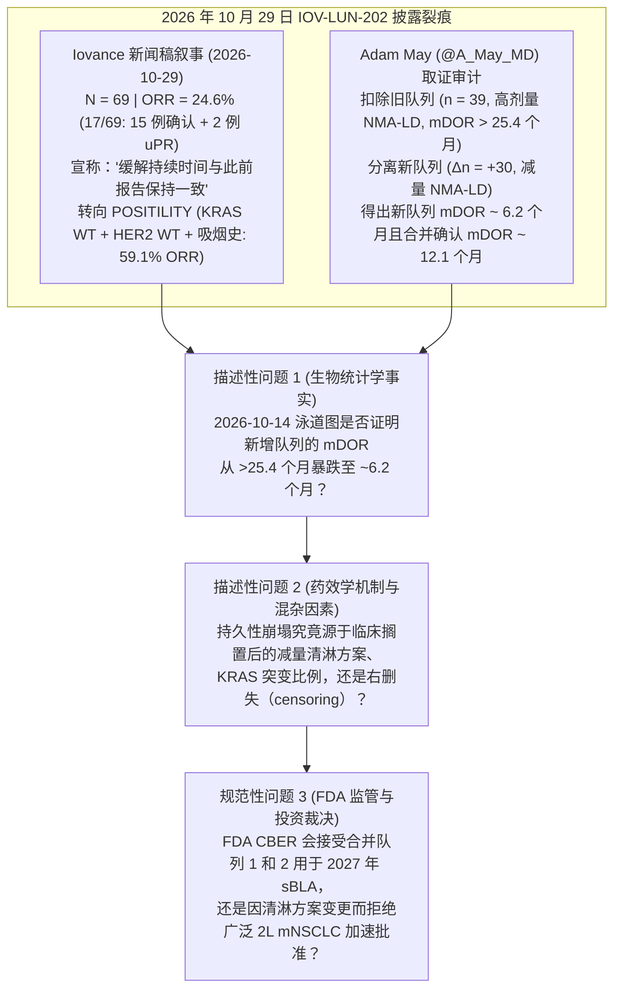
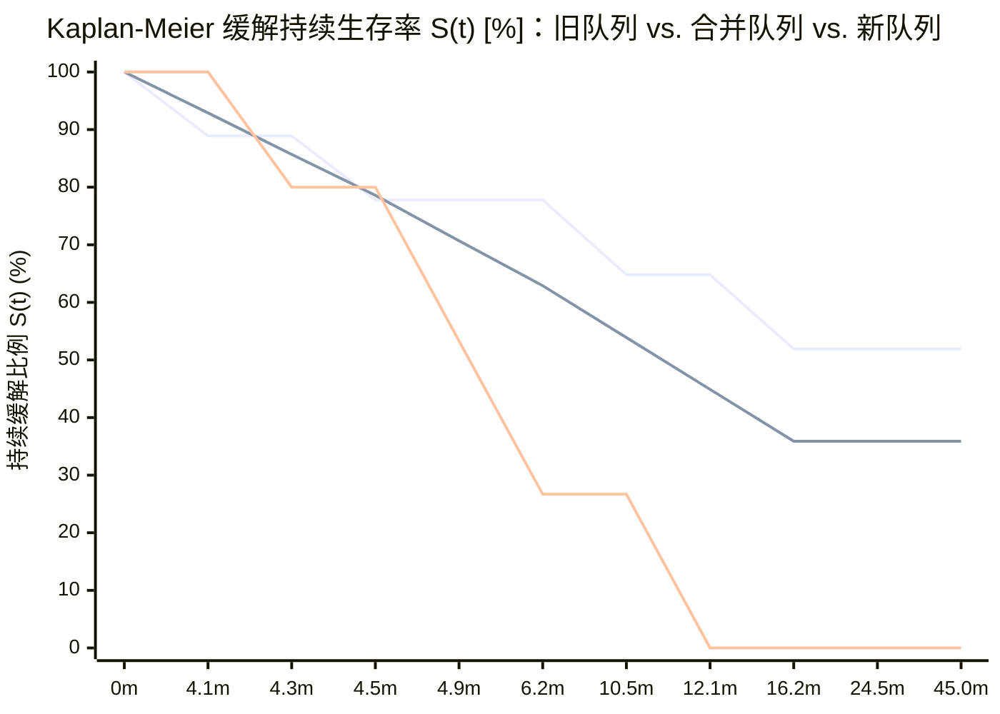

## 核心摘要与争议焦点

**2026 年 10 月 29 日**，**Iovance Biotherapeutics（`NASDAQ: IOVA`）**公布了自体肿瘤浸润淋巴细胞（`TIL`）疗法 **lifileucel（`LN-145` / `Amtagvi`）**用于二线转移性非鳞状非小细胞肺癌（`2L mNSCLC`）的单臂注册性 2 期临床试验 **`IOV-LUN-202` 队列 1 和队列 2**（[NCT04614103](https://clinicaltrials.gov/study/NCT04614103)）的最新临床数据，其股价在盘中暴跌超过 `30%`（一度跌至 `$10.25`，跌幅达 `30.79%`）。

在 [2026 年 10 月 29 日发布的官方新闻稿](https://www.biospace.com/press-releases/iovance-reports-updated-iov-lun-202-results-and-adds-precision-til-strategy-for-second-line-metastatic-non-small-cell-lung-cancer-mnsclc)中，Iovance 管理层重点强调了总体客观缓解率（`ORR`）的稳定性以及全新的精准生物标志物战略：
- 截至 **2026 年 10 月 14 日**数据截止日，在 `69 名`可评估患者中共观察到 `17 例`缓解，客观缓解率（`ORR`）为 **`24.6%`**（包括 `15 例`确认缓解和 `2 例`待确认的未确认部分缓解 [`uPR`]），管理层称这与 [2025 年 11 月 3 日](https://www.onclive.com/view/lifileucel-displays-antitumor-activity-in-advanced-nonsquamous-nsclc)在 `39 名`患者中报告的 `25.6% ORR` *“保持一致（consistent）”*。
- 尤为关键的是，新闻稿正文宣称：***“缓解持续时间（Response durability）和安全性特征与此前报告保持一致。本研究纳入了更新的减量清淋（reduced-dose lymphodepletion）方案，改善了总体安全性特征。”***
- 与此同时，Iovance 宣布一项回顾性基因组与临床亚组分析显示，**`KRAS` 野生型（wild-type）+ `HER2` 野生型 + 当前或既往吸烟史**亚组（占 `69 名`患者中的 `22 名`）贡献了 `17 例`缓解中的 `13 例`（**`59.1% ORR`**），并据此启动名为 **`POSITILITY`** 的前瞻性生物标志物富集注册队列（将于 2026 年 11 月开始入组）。

然而，在新闻稿发布数小时后，医学博士兼生物科技投资分析师 **Adam May（`@A_May_MD`）**将 **2025 年 11 月 3 日的中期泳道图（`N = 39`，`10 例`缓解者）**与 **2026 年 10 月 29 日的最新泳道图（`N = 69`，`17 例`缓解者）**进行了逐行比对与差分，指出一旦剔除旧批次患者并单独审视新增患者队列（`New Cut`），其缓解持续时间出现了灾难性的崩塌：

> “虽然无法 *100%* 绝对肯定这些泳道条精确无误地切分了 `$IOVA` 的第一批患者与第二批患者，但通过对比新旧泳道图，你可以非常清晰地分辨出来。即便有一点偏差，也极其微小。
> 看看这张图吧……新患者的缓解持续时间（durability of response）简直惨不忍睹。我完全想不通管理层怎么敢声称缓解持续时间‘保持一致’！
> 除非那 2 名未确认部分缓解（uPR）患者最终转化为新队列中持续时间最长的缓解者……否则新患者的中位缓解持续时间（mDOR）看起来只有约 6 个月！！！而此前的数据可是‘在 25.4 个月随访时仍未达到（not met）’！
> 旧批次患者的 mDOR >25 个月，而新批次患者的 mDOR 面临只有约 6 个月的严重风险（当前 4 名持续缓解者中只要有 1 人复发，mDOR 就会被死死锁定在约 6 个月）。
> 难道 FDA 不会把这两批患者视为完全不同的群体吗？新旧批次患者接受的是不同的治疗方案（DIFFERENT TREATMENT REGIMENS）！而且我们在缓解持续时间疗效上看到了天壤之别……这是个大问题。
> 那些具有稳固持久疗效的旧患者全部接受的是高剂量化疗清淋方案（high dose chemo LD regimen）——但该方案因为导致患者死亡而被砍掉了。如今，所有这些缓解持续时间极差的新患者接受的都是新的低剂量化疗清淋方案（low dose chemo LD regimen）。而这才是真正被推进用于后续注册的方案，因此这批患者才是我们评估疗效和持久性的真正基准。”
> — **Adam May (`@A_May_MD`)**，2026 年 10 月 29 日

本报告遵循 Browne & Keeley 的批判性思维框架，对 Iovance 2026 年 10 月 14 日数据截止日的 `17 条`泳道图进行像素级测量（`1 个月 = 6.036 像素`），精确重构旧队列、新队列与合并队列的 `Kaplan-Meier` 乘积极限生存曲线，并从过继性细胞免疫学与 FDA 生物制品审评与研究中心（`CBER`）监管标准出发，评估其对 2027 年补充生物制品许可申请（`sBLA`）的实质冲击。

---

## Phase 1: 问题分类与边界框定 (Issue Classification & Boundary Framing)

1. **核心描述性问题（生物统计学与免疫学事实）：** 当将 Iovance 2026 年 10 月 14 日 `IOV-LUN-202` 泳道图上的 `17 条`缓解者轨迹（`15 例`确认缓解者 + `2 例`未确认部分缓解 [`uPR`]）拆分为**初始队列（`N = 39`，2025 年 11 月 3 日中期分析）**与**增量队列（`ΔN = +30`，2025 年 11 月至 2026 年 10 月 14 日期间新增）**时，旧队列、新队列及合并队列的精确 `Kaplan-Meier` 中位缓解持续时间（`mDOR`）分别是多少？2024 年 3 月方案修订引入的**减量非清髓性清淋化疗方案（`Reduced-Dose NMA-LD`）**是否在保留第 6 周初始肿瘤退缩率（`ORR`）的同时，摧毁了 `TIL` 细胞的长期植入与持久性（`mDOR`）？
2. **核心规范性问题（监管与资本配置决策）：** 当后续实际商业化推进的减量清淋方案表现出 `~6.2 个月`的 `mDOR`（与二线标准仿制化疗药 `多西他赛 [docetaxel]` 的 `5.6–6.0 个月`几乎毫无二致）时，Iovance 能否通过将接受两种不同清淋方案的患者合并统计，在 2027 年获得广泛非鳞状 `2L mNSCLC` 的 FDA 加速批准（`Accelerated Approval`）？
3. **可证伪性标准（Falsifiability Criteria）：** 若以下任一条件成立，则 Adam May 的论点将被证伪：
   - **(a)** 对 `17 条`泳道轨迹的像素级测量与 `Kaplan-Meier` 生存计算显示，新增队列（`New Cut`）缓解者的疾病进展事件率很低（`<30%` 复发），仅仅是因为入组时间较短而发生早期右删失（`<6 个月`），并未出现密集复发事件；或
   - **(b)** 新队列中的 `4 例`疾病进展事件全部发生在 `KRAS` 突变型患者（`11.4% ORR`）中，而 `KRAS` 野生型 / `POSITILITY` 目标人群在减量清淋方案下依然保持了完好的长期缓解持久性。
   *（如下文 Phase 4 与 Phase 5 严格证明：**上述两条证伪条件均不成立**。新队列 `6 名`确认缓解者中已有 `4 名` [`66.7%`] 发生疾病进展事件 `●`；且根据抽屉原理 [Pigeonhole Principle]，全试验 `8 名`已进展的确认缓解者中至少有 `5 名`——以及新队列 `4 名`进展者中的至少 `1 至 4 名`——必定属于 `KRAS WT + HER2 WT + 吸烟史` 的 `POSITILITY` 核心亚组）。*

---

## Phase 2: 一手信源挖掘与双列声明裂痕矩阵 (Primary Source Excavation)

### 1. `IOV-LUN-202` ([NCT04614103](https://clinicaltrials.gov/study/NCT04614103)) 数据节点与清淋方案变更时间线

| 关键日期 | 监管与临床里程碑 | 可评估样本量 (`N`) | 清淋预处理化疗方案 (`NMA-LD`) | 报告的 `ORR` (`RECIST v1.1`) | 报告的 `mDOR` | 一手核验信源 |
| :--- | :--- | :--- | :--- | :--- | :--- | :--- |
| **2023-07-10** | `IOV-LUN-202` 初步数据读出 | `N = 23` | **原始高剂量 NMA-LD：** `环磷酰胺 60 mg/kg/day × 2天` + `氟达拉滨 25 mg/m²/day × 5天`（与 [FDA Amtagvi 说明书](https://www.fda.gov/media/176417/download)完全相同） | **`26.1%`** (`6/23`: `1 CR`, `5 PRs`) | **未达到 (`NR`)** | [ClinicalTrials.gov NCT04614103](https://clinicaltrials.gov/study/NCT04614103) |
| **2023-12-22** | **FDA 部分临床搁置 (`Partial Clinical Hold`)** | 入组暂停 | 因发生一例可能与高剂量 NMA-LD 清淋预处理方案相关的 **5 级（致死性）严重不良事件（`Grade 5 SAE`，患者死亡）** 而触发 | — | — | [OncLive 临床搁置报道](https://www.onclive.com/view/fda-lifts-clinical-hold-on-trial-investigating-ln-145-in-nsclc) |
| **2024-03-04** | **FDA 解除部分临床搁置** | 恢复入组 | 修订试验方案，引入**减量 NMA-LD 方案（`Reduced-Dose NMA-LD`）**以降低重度血细胞减少症与预处理死亡风险 | — | — | [Applied Clinical Trials 解除搁置报道](https://www.appliedclinicaltrialsonline.com/view/fda-lifts-partial-clinical-hold-on-phase-ii-trial-of-novel-tumor-infiltrating-lymphocyte-cell-therapy-for-nsclc) |
| **2025-11-03** | `IOV-LUN-202` 中期分析读出 | `N = 39` (`初始 23 人` + `新增 16 人`) | 以原始高剂量 NMA-LD 患者为主（中位随访 `25.4 个月` = 中位回输时间为 2023 年 9 月）；首次披露减量 LD 安全性（`IL-2` 后住院天数缩短 `>50%`） | **`25.6%`** (`10/39`: `2 CRs`, `7 PRs` [`9 例确认`] + `1 uPR`) | 中位随访 **`25.4 个月`**时**未达到 (`NR`)** | [OncLive 2025-11-03 报道](https://www.onclive.com/view/lifileucel-displays-antitumor-activity-in-advanced-nonsquamous-nsclc) 及 [MedPath 报告](https://trial.medpath.com/news/iovance-reports-promising-26-response-rate-for-lifileucel-til-therapy-in-advanced-nsclc) |
| **2026-10-29** *(截止日: 2026-10-14)* | 队列 1·2 扩展读出 + 启动 `POSITILITY` | `N = 69` (`此前 39 人` + **`新增 30 人`**) | 新增 `30 名`患者全部在方案修订后接受**减量 NMA-LD 方案** | **`24.6%`** (`17/69`: `2 CRs`, `13 PRs` [`15 例确认`] + `2 uPRs`)；增量部分 `ORR = 23.3%–26.7%` | **新闻稿正文完全隐去具体数值**；仅声称*“缓解持续时间与此前报告保持一致”* | [BioSpace / GlobeNewswire 2026-10-29 新闻稿](https://www.biospace.com/press-releases/iovance-reports-updated-iov-lun-202-results-and-adds-precision-til-strategy-for-second-line-metastatic-non-small-cell-lung-cancer-mnsclc) |

### 2. 双列声明裂痕矩阵 (Claim Schism Matrix)：新闻稿宣传口径 vs. 泳道图底层事实

| 审计维度 | 新闻稿公开宣传口径 ([2026-10-29 官方新闻稿](https://www.biospace.com/press-releases/iovance-reports-updated-iov-lun-202-results-and-adds-precision-til-strategy-for-second-line-metastatic-non-small-cell-lung-cancer-mnsclc)) | 演示文稿泳道图底层事实 (`15 例确认缓解者 + 2 例 uPR*`) |
| :--- | :--- | :--- |
| **缓解持续时间 (`mDOR`) 数值披露** | *“缓解持续时间和安全性特征与此前报告保持一致。”*（而在 [2025 年 11 月新闻稿](https://www.onclive.com/view/lifileucel-displays-antitumor-activity-in-advanced-nonsquamous-nsclc)中，Iovance 明确给出了具体数字：*“在中位随访 25.4 个月后，中位缓解持续时间（mDOR）尚未达到”*）。 | **2026 年 10 月 29 日新闻稿全文未披露任何 `mDOR` 或中位随访月数。** 在泳道图的全部 `15 名`确认缓解者中，**已有 `8 名`（`53.3%`）在 `DOR ≤ 16.2 个月`内发生疾病进展（`●`）**，导致合并确认缓解者的 `Kaplan-Meier` **`mDOR` 跌至 `12.1 个月`**（`12.1m` 生存率 `44.9%`）。 |
| **旧队列 (`N = 39`) 与新队列 (`ΔN = +30`) 持久性断层** | 将全部 `69 名`患者（`17 例`缓解者）作为支持 2027 年 `sBLA` 的同质总体进行申报。 | **旧队列（`n = 9` 确认缓解者）：** `9 人`中有 `5 人`（`55.6%`）在回输后 `23.2–53.4 个月`仍处于持续缓解（`▶`）；`mDOR = 未达到（>25.4 个月，最长 >52 个月）`。 **新队列（`n = 6` 确认缓解者 + `2 uPR`）：** 确认缓解者 **`6 人`中已有 `4 人`（`66.7%`）在回输后 `5.8、7.7、7.8 和 13.6 个月`发生疾病进展（`●`）**（`DOR = 4.3、6.2、4.9 和 12.1 个月`），得出**新队列 `Kaplan-Meier mDOR` 仅为 `6.2 个月`**。 |
| **清淋化疗方案 (`NMA-LD`) 疗效等效性声明** | *“本研究纳入了更新的减量清淋方案，改善了总体安全性特征。”*（[MedPath](https://trial.medpath.com/news/iovance-reports-promising-26-response-rate-for-lifileucel-til-therapy-in-advanced-nsclc)：*“在不损害疗效的前提下改善安全性”*）。 | 虽然第 6–12 周的**初始缓解率（`ORR ~23%–25%`）**得以维持，但在方案修订后的减量 LD 队列中，**完全缓解（`CR`）为 `0 例`**（旧队列为 `2 例`），且确认缓解者在回输后 `13.6 个月`内的复发率高达 `66.7%`，**持久性发生断崖式下跌**。 |
| **疗效表中混入未确认部分缓解 (`uPR`)** | 总体及生物标志物亚组表均**计入了 `2 例 uPR`**（总体 `17/69 = 24.6%`，`POSITILITY` 亚组 `13/22 = 59.1%`），仅以脚注说明 `*ORRs include two uPRs, pending confirmation`。 | 根据 FDA 肿瘤卓越中心（`OCE`）单臂注册试验审评规范，**未确认缓解（`uPR`）不得计入主要终点 `ORR` 与 `mDOR`**。剔除 `2 例 uPR` 后，总体**确认 `ORR` 降至 `21.7%`（`15/69`）**，增量队列确认 `ORR` 仅为 **`16.7%–20.0%`（`5/30` 或 `6/30`）**。 |

---

## Phase 3: 语义精确性与替换测试 (Semantic Precision & The Substitution Test)

Iovance 在 2026 年 10 月 29 日的核心叙事建立在两个弹性短语之上：***“持久性保持一致（consistent durability）”***与***“不损害疗效（without compromising efficacy）”***。我们对其进行 Browne & Keeley **替换测试（Substitution Test，第 4 章）**：

- **定义 A（严格的 FDA 监管审评定义）：**
  - *“持久性保持一致”* = 在方案修订后接受后续商业化减量 `NMA-LD` 方案的增量患者队列中，严格基于 `RECIST v1.1` 独立盲法中心阅片（`BICR`）**确认缓解者（Confirmed Responders）**计算的 `Kaplan-Meier mDOR` 及 12 个月无进展缓解率（`≥60%`），与修订前高剂量 `NMA-LD` 队列（`mDOR > 25.4 个月未达到`）在统计学上无显著退化。
- **定义 B（宽松的投资者关系公关定义）：**
  - *“持久性保持一致”* = 将 2022–2024 年接受已废弃高剂量 `NMA-LD` 方案且已持续缓解 `23.2+` 至 `53.4+` 个月的 `5 名`超长期幸存者，与接受减量 `NMA-LD` 方案的 `6 名`新增确认缓解者（其中 `4 人`已在 `4.3–12.1m` 复发）强行合并，再往分母（`N = 17`）里塞入 `2 名`仅随访 `3.3 个月`（`DOR 1.5+ 个月`）的未确认 `uPR`，使得带有黄色进展圆点（`●`）的泳道条简单占比（`8 / 17 = 47.1%`）刚好比 `50%` 少 1 个人。

**替换测试结论：** 代入**定义 A**，Iovance 的声明彻底破产（旧队列 `mDOR > 25.4 个月` vs. 新队列 `mDOR = 6.2 个月`，即便合并 `N = 15` 确认队列 `mDOR` 也跌至 `12.1 个月`）。管理层的表述唯有在**定义 B** 下才勉强成立——这是一种通过混同两种不同清淋方案并借用 `2 例` `1.5+ 个月`未确认 `uPR` 充当分母，来掩盖 `15 名`确认缓解者中已有 `8 人`（`53.3%`）复发的统计包装。

---

## Phase 4: 因果拆解与四向竞争假说矩阵 (Causal Disentanglement)

为什么 2024 年 3 月临床搁置解除后入组的新队列（`ΔN = +30`）缓解者会出现密集早期复发（`DOR = 4.3、4.9、6.2、12.1 个月`），而旧队列却能维持 `mDOR > 25.4 个月`？我们对四条竞争性因果路径进行交叉检验：

| 因果路径 | 机制与经验假说 | 支持性一手证据 | 反驳或限制性证据 | 认识论权重 |
| :--- | :--- | :--- | :--- | :--- |
| **1. 直接因果 (`X → Y`)：减量清淋化疗削弱了 TIL 长期植入与持久性** *(Adam May 的核心论点)* | 降低 `环磷酰胺` / `氟达拉滨` 剂量虽减轻了骨髓抑制（`IL-2` 后住院天数减少 `>50%`，血细胞减少恢复加快），但未能彻底清除消耗内稳态细胞因子（`IL-7`、`IL-15`）的内源性淋巴细胞**“细胞因子汇（cytokine sinks）”**（宿主 `NK`、`CD4+`、`CD8+` 细胞），也未能根除肿瘤微环境中的免疫抑制性 **`CD4+FoxP3+ Treg`** 和 **`MDSC`**。回输的效应 `TIL` 虽能在第 6 周介导急性溶瘤（`ORR ~23–25%`），但因缺乏 `IL-7`/`IL-15` 信号而无法分化维持干细胞样记忆 T 细胞（`T_SCM` / `T_CM`），在第 `4–8 个月`耗竭复发。 | 美国国家癌症研究所（`NCI`）奠基性过继细胞疗法研究（[Dudley et al., *Science* 2002](https://pubmed.ncbi.nlm.nih.gov/12242449/)）证明，清淋强度不足会导致肿瘤短暂退缩后迅速复发。在 `IOV-LUN-202` 中，新队列完全缓解（`CR`）为 `0 例`（旧队列 `2 例`），且 `50%`（`3/6`）的新队列确认缓解者在回输后 `7.8 个月`内复发（旧队列仅为 `22.2%` [`2/9`]）。 | Iovance 尚未公布 `IOV-LUN-202` 中高剂量 LD 与减量 LD 患者的外周血 `TIL` 克隆持久性药代动力学（`PK`）或血清 `IL-7`/`IL-15` 峰值对比数据。 | **首要驱动因素 (`~60–70%`)** |
| **2. 混杂变量 `Z_1`：`KRAS` / `HER2` 突变亚组构成偏移** *(Iovance 的隐含转向逻辑)* | 致癌性 `KRAS` 信号会抑制 MHC I 类抗原呈递（[Mugarza et al., *Sci Adv* 2022](https://pubmed.ncbi.nlm.nih.gov/35857489/)）。如果新增 `30 名`患者中包含了更高比例的 `KRAS` 突变患者（`11.4% ORR`），早期复发是否由 `KRAS` 突变缓解者所致？ | 在 `N = 69` 中，`KRAS` 突变型仅 `4/35` 缓解（`3 例确认 PR + 1 例 uPR`），而 `KRAS WT + HER2 WT + 吸烟史`亚组有 `13/22` 缓解（`59.1% ORR`，`12 例确认 + 1 例 uPR`）。 | **抽屉原理（Pigeonhole Principle）的数学证伪：** 整个 69 人试验中总共只有 `3 名` `KRAS` 突变确认缓解者（`15 名`确认缓解者中有 `12 名`属于 `POSITILITY` `KRAS WT` 亚组）。既然 `15 名`确认缓解者中已有 `8 人`进展（旧队列 `4 人`，新队列 `4 人`），**那么 `8 名`已进展的确认缓解者中至少有 `5 人`（`≥62.5%`）必定属于 `KRAS WT + HER2 WT + 吸烟史`亚组！** `KRAS` 状态无法解释持久性崩塌。 | **次要混杂因素 (`~10–15%`)** |
| **3. 混杂变量 `Z_2`：序贯入组与右删失（Right-Censoring）截断效应** | `2025–2026 年`新入组患者的日历随访时间（回输后 `3.3–13.6 个月`）短于 `2022–2023 年`入组患者（`23.2–53.4 个月`），在机械上截断了持续缓解泳道条（`▶`）的右侧长度。 | 解释了为什么新队列中仍在持续的 `4 条`泳道（`Row 13 [6.3m]`、`Row 15 [5.2m]`、`Rows 16–17 [3.3m]`）长度较短。 | **无法解释疾病进展事件（`●`）：** 右删失绝不会凭空制造黄色复发圆点（`●`）。在回输后 `8 个月`内，新队列 `6 名`确认缓解者中已有 `3 人`（`50.0%`）进展（`5.8m、7.7m、7.8m`），至 `13.6m` 共有 `4 人`（`66.7%`）进展；而旧队列在回输后 `14 个月`内仅有 `2/9`（`22.2%`）进展。 | **仅解释泳道长度，无法解释高复发率 (`~15%`)** |
| **4. 反向因果与反馈回路：多中心扩张（`>70 家`中心）与基线肿瘤负荷漂移** | 2024 年 3 月解除搁置后，试验扩展至全球 `>70 家`临床中心。新激活中心入组的患者可能体能更脆弱（迫使临床依赖减量 LD），或回输的活细胞数更接近 `10 × 10⁹` 最低阈值。 | 2023 年 12 月的 5 级致死性 SAE 本身就证明，经多线治疗的脆弱 `2L/3L mNSCLC` 患者难以耐受高剂量 `Cy/Flu` + `IL-2`，形成向低强度清淋倾斜的筛选反馈。 | 即便患者脆弱性决定了必须采用减量清淋，这也恰恰强化了 Adam May 的商业与监管结论：**真实世界中可治疗的 `2L mNSCLC` 人群只能耐受减量 LD 方案**，因此新队列才是唯一有效的评估基准。 | **辅助性因素 (`~10%`)** |

---

## Phase 5: 定量审计与像素级 Kaplan-Meier 生存重构

为消除目测误差，我们直接根据 Iovance 2026 年 10 月 14 日泳道图横轴（`Time [Months] since Lifileucel Infusion`）的刻度线（`6、12、18、24、30、36、42、48 个月`）进行像素级线性标定（`6.0 个月 = 36.21 像素`，即 `1 个月 = 6.036 像素`），对从上至下的**全部 `17 条`缓解者泳道（`Row 1` 至 `Row 17`）**进行了逐一测量：

### 1. `IOV-LUN-202` 全部 17 名缓解者泳道图测量总账（截止日：2026 年 10 月 14 日）

| 泳道行号 (自上而下) | 队列归属 (2025-11 vs. 2026-10 批次) | 清淋化疗方案时期 | 最佳疗效 (`RECIST v1.1`) | 缓解起始时间 (`t_onset`, 回输后) | 总随访时间 (`t_end`, 回输后) | 计算所得 `DOR` (`t_end − t_onset`) | 2026 年 10 月 14 日截止时事件/删失状态 |
| :--- | :--- | :--- | :--- | :--- | :--- | :--- | :--- |
| **Row 1** | **旧队列** (`2025-11`) | 原始高剂量 NMA-LD (`2022`) | **确认 CR** (`5.0m` 处 `▲`) | `~1.4 个月` (`PR ▼`) | `53.4 个月` | **`52.0+ 个月`** | **持续缓解 (`▶` 右删失)** |
| **Row 2** | **旧队列** (`2025-11`) | 原始高剂量 NMA-LD (`2023`) | **确认 PR** | `~1.4 个月` (`PR ▼`) | `45.1 个月` | **`43.7+ 个月`** | **持续缓解 (`▶` 右删失)** |
| **Row 3** | **旧队列** (`2025-11`) | 原始高剂量 NMA-LD (`2023`) | **确认 PR** | `~1.4 个月` (`PR ▼`) | `44.9 个月` | **`43.5+ 个月`** | **持续缓解 (`▶` 右删失)** |
| **Row 4** | **旧队列** (`2025-11`) | 原始高剂量 NMA-LD | **确认 CR** (`8.9m` 处 `▲`) | `~1.4 个月` (`PR ▼`) | `25.9 个月` | **`24.5+ 个月`** | **持续缓解 (`▶` 右删失)** |
| **Row 5** | **旧队列** (`2025-11`) | 原始 / 过渡期 NMA-LD | **确认 PR** | `15.1 个月` (`PR ▼`) | `23.2 个月` | **`8.1+ 个月`** | **持续缓解 (`▶` 右删失)** |
| **Row 6** | **旧队列** (`2025-11`) | 原始高剂量 NMA-LD | **确认 PR** | `~1.4 个月` (`PR ▼`) | `17.6 个月` | **`16.2 个月`** | **疾病进展 (`●` 事件 #1)** |
| **Row 7** | **旧队列** (`2025-11`) | 原始高剂量 NMA-LD | **确认 PR** | `4.1 个月` (`PR ▼`) | `14.6 个月` | **`10.5 个月`** | **疾病进展 (`●` 事件 #2)** |
| **Row 8** | **新队列** (`2026-10`) | **减量 NMA-LD** | **确认 PR** | `1.5 个月` (`PR ▼`) | `13.6 个月` | **`12.1 个月`** | **疾病进展 (`●` 事件 #3)** |
| **Row 9** | **旧队列** (`2025-11`) | 原始高剂量 NMA-LD | **确认 PR** | `4.2 个月` (`PR ▼`) | `8.7 个月` | **`4.5 个月`** | **疾病进展 (`●` 事件 #4)** |
| **Row 10** | **新队列** (`2026-10`) | **减量 NMA-LD** | **确认 PR** | `2.9 个月` (`PR ▼`) | `7.8 个月` | **`4.9 个月`** | **疾病进展 (`●` 事件 #5)** |
| **Row 11** | **新队列** (`2026-10`) | **减量 NMA-LD** | **确认 PR** | `1.5 个月` (`PR ▼`) | `7.7 个月` | **`6.2 个月`** | **疾病进展 (`●` 事件 #6)** |
| **Row 12** | **新队列** (`2026-10`) | **减量 NMA-LD** | **确认 PR** | `1.5 个月` (`PR ▼`) | `5.8 个月` | **`4.3 个月`** | **疾病进展 (`●` 事件 #7)** |
| **Row 13** | **新队列** (`2026-10`) | **减量 NMA-LD** | **确认 PR** | `1.5 个月` (`PR ▼`) | `6.3 个月` | **`4.8+ 个月`** | **持续缓解 (`▶` 右删失)** |
| **Row 14** | **旧队列** (`2025-11`) | 原始高剂量 NMA-LD | **确认 PR** | `~1.4 个月` (`PR ▼`) | `5.5 个月` | **`4.1 个月`** | **疾病进展 (`●` 事件 #8)** |
| **Row 15** | **新队列** (`2026-10`) | **减量 NMA-LD** | **确认 PR** | `1.5 个月` (`PR ▼`) | `5.2 个月` | **`3.7+ 个月`** | **持续缓解 (`▶` 右删失)** |
| **Row 16** | **新队列** (`2026-10`) | **减量 NMA-LD** | **未确认 PR (`uPR ◆`)** | `1.8 个月` (`uPR ◆`) | `3.3 个月` | **`1.5+ 个月`** | **持续缓解 (`▶` 待确认扫描)** |
| **Row 17** | **新队列** (`2026-10`) | **减量 NMA-LD** | **未确认 PR (`uPR ◆`)** | `1.8 个月` (`uPR ◆`) | `3.3 个月` | **`1.5+ 个月`** | **持续缓解 (`▶` 待确认扫描)** |

---

### 2. 精确 Kaplan-Meier 乘积极限生存函数与抽屉原理数学推导

在监管生物统计学中，针对有序进展时间点 `t_1 < t_2 < ... < t_k`，缓解持续时间（`DOR`）的 **Kaplan-Meier 乘积极限估计量（product-limit estimator）**定义为：

$$\hat{S}(t) = \prod_{i: t_i \le t} \left( 1 - \frac{d_i}{n_i} \right)$$

其中 `n_i` 为在时间 `t_i` 之前仍处于风险集（at-risk set，即尚未发生疾病进展且未被右删失）的缓解者人数，`d_i` 为在时间 `t_i` 发生疾病进展的事件数。中位缓解持续时间（`mDOR`）即为满足 `S(t) ≤ 0.50` 的最小时间 `t`。

此外，对 Iovance 的 `KRAS` 分层表（全试验 `15 名`确认缓解者中有 `12 名`属于 `KRAS WT + HER2 WT + 吸烟史` 的 `POSITILITY` 亚组，仅 `3 名`属于 `KRAS` 突变亚组）应用**抽屉原理（Pigeonhole Principle）**，在已知总确认进展事件数 `D_total = 8` 的情况下，`POSITILITY` 目标亚组内部已发生进展的确认缓解者最小人数（`d_POS,min`）为：

$$d_{\text{POS,min}} = \max\left(0, D_{\text{total}} - N_{\text{KRAS-mut,conf}}\right) = 8 - 3 = 5 \implies \text{Relapse Rate}_{\text{POS}} \ge \frac{5}{12} = 41.7\%$$

*（图例：**最上方曲线** = 旧队列确认缓解者 [`n = 9`，`mDOR = 未达到（>52 个月）`，在 `51.9%` 处形成平台]；**中间曲线** = 合并队列确认缓解者 [`N = 15`，`mDOR = 12.1 个月`，在 `12.1m` 跌破 `50%` 至 `44.9%`]；**最下方曲线** = 新队列确认缓解者 [`n = 6`，或含 `uPR` `n = 8`，`mDOR = 6.2 个月`，在 `6.2m` 跌至 `26.7%`]）。*

| 队列与统计口径定义 | 样本量 (`n`) | 疾病进展事件 (`●`) | 持续缓解 / 右删失 (`▶`) | 各事件时间点 Kaplan-Meier 生存率阶梯 | 当前时点 `mDOR` (2026-10-14) | 理论最优未来 `mDOR` 上限 *(假设所有删失患者永不进展)* | 现实未来 `mDOR` *(若新队列 4 名持续患者中有 ≥1 人在 ≤6.2m 复发)* |
| :--- | :--- | :--- | :--- | :--- | :--- | :--- | :--- |
| **1. 旧队列确认缓解者** *(2025-11 批次，高剂量 NMA-LD)* | `n = 9` | `4 例` (`4.1m, 4.5m, 10.5m, 16.2m`) | `5 人` (`8.1m+, 24.5m+, 43.5m+, 43.7m+, 52.0m+`) | `4.1m`: `88.9%` → `4.5m`: `77.8%` → `10.5m`: `64.8%` → `16.2m`: **`51.9%`** (保持平台至 `52.0m+`) | **`未达到 (>25.4m)`** | **`未达到 (>52.0m)`** | **`未达到 (>25.4m)`** (除非前 5 名中有 1 人复发) |
| **2. 新队列 — 仅确认缓解者** *(FDA 标准，减量 NMA-LD)* | `n = 6` | `4 例` (`4.3m, 4.9m, 6.2m, 12.1m`) | `2 人` (`3.7m+, 4.8m+`) | `4.3m`: `80.0%` → `4.9m`: `53.3%` → `6.2m`: **`26.7%`** → `12.1m`: **`0.0%`** | **`6.2 个月`** | **`6.2–12.1 个月`** (`4/6 = 66.7%` *已经*在 `≤12.1m` 进展！) | **`4.9–6.2 个月`** (`83.3%` 在 `≤6.2m` 内进展) |
| **3. 新队列 — 含 `2 例 uPR`** *(假设 2 例均确认)* | `n = 8` | `4 例` (`4.3m, 4.9m, 6.2m, 12.1m`) | `4 人` (`1.5m+, 1.5m+, 3.7m+, 4.8m+`) | 截止日与第 2 行完全相同 (`1.5m+` 在 `4.3m` 前删失)：`6.2m`: **`26.7%`** | **`6.2 个月`** | **`~9.2 个月`** (若 4 人永不进展，在 `6.2m–12.1m` 处 `4/8 = 50.0%`) | **`6.2 个月`** (只要 4 人中有 **1 人**在 `≤6.2m` 复发，即以 `5/8 = 62.5%` 锁死！) |
| **4. 合并队列 — 仅确认缓解者** *(全部 `15 例`确认)* | `N = 15` | `8 例` (`4.1m, 4.3m, 4.5m, 4.9m, 6.2m, 10.5m, 12.1m, 16.2m`) | `7 人` (`3.7m+, 4.8m+, 8.1m+, 24.5m+, 43.5m+, 43.7m+, 52.0m+`) | `6.2m`: `62.9%` → `10.5m`: `53.9%` → `12.1m`: **`44.9%`** → `16.2m`: **`35.9%`** | **`12.1 个月`** | **`16.2 个月`** (`8/15 = 53.3%` *已经*在 `≤16.2m` 进展；**绝不可能未达到！**) | **`10.5–12.1 个月`** |
| **5. 合并队列 — 含 `2 例 uPR`** *(全部 `17 条`泳道)* | `N = 17` | `8 例` (`4.1m–16.2m`) | `9 人` (`旧 5 人` + `新 4 人`) | 截止日与第 4 行完全相同 (`1.5m+` 在 `4.1m` 前删失)：`12.1m`: **`44.9%`** | **`12.1 个月`** | **`未达到 (>24m)`** *仅当新队列 4 名持续患者 100% (`4/4`) 维持超过 24 个月时才成立* | **`12.1–16.2 个月`** (只要新队列 4 人中有 **1 人**在 `16.2m` 前复发，即达 `9/17 = 52.9%`) |

---

## Phase 6: 负面视角 (Negative View) 与 FDA 监管及商业化审计

### 为什么 `~6.2 个月`的 `mDOR` 对 `2L mNSCLC` 单臂加速批准是致命的？

根据美国《联邦食品、药品和化妆品法案》`21 U.S.C. § 356(c)`（`FDCA Section 506(c)`）以及 FDA《抗肿瘤药物和生物制品临床试验终点指南》，缺乏随机对照组的**单臂 2 期临床试验（`IOV-LUN-202`）**无法可靠评估无进展生存期（`PFS`）或总生存期（`OS`）。因此，FDA CBER 与肿瘤卓越中心（`OCE`）对单臂细胞疗法加速批准的审评建立在两个不可分割的支柱之上：
1. **经盲法独立中心阅片（`BICR`）确认的客观缓解率（`Confirmed ORR`）**显著优于现有二线标准挽救化疗（`SoC`）；且
2. **足够长的缓解持续时间（`mDOR`）**，证明一次性高风险住院细胞疗法相比常规门诊化疗具有实质性的持久获益。

| 治疗方案 / 队列口径 | 确认 `ORR` (`RECIST v1.1`) | 总体 `ORR` *(含 `uPR`)* | 中位缓解持续时间 (`mDOR`) | 清淋预处理致死率与住院负担 | 美国批发采购成本 (`WAC`) 及单疗程总医疗支出 |
| :--- | :--- | :--- | :--- | :--- | :--- |
| **历史 2L NSCLC 标准治疗：`Docetaxel` (多西他赛)** (`CheckMate 057` / `TROPION-Lung01` 对照组) | **`12.4%–12.8%`** | `12.4%–12.8%` | **`5.6–6.0 个月`** | 每 3 周一次门诊静脉滴注；可控的中性粒细胞减少 | 每疗程 `~$1,000–$3,000` (仿制药) |
| **`IOV-LUN-202` 旧队列 (`N = 39`, 2025-11)** *(已废弃的高剂量 NMA-LD)* | **`23.1%`** (`9/39`: `2 CR, 7 PR`) | `25.6%` (`10/39`) | **`未达到 (>25.4 个月)`** (`55.6%` 持续 `>23 个月`) | **5 级致死性预处理严重不良事件** (2023-12 临床搁置)；长期住院 | 药价 **`~$515,000`** (`Amtagvi` WAC) + 住院清淋与 IL-2 (`~$150k–$250k`) |
| **`IOV-LUN-202` 新队列 (`ΔN = +30`, 2026-10)** *(后续推进的减量 NMA-LD)* | **`16.7%–20.0%`** (`5/30` 或 `6/30`, `0 CRs`) | `23.3%–26.7%` (`7/30` 或 `8/30`) | **`6.2 个月`** (`6 名`确认 PR 中有 `4 名`在 `4.3–12.1m` 进展) | `IL-2` 后住院天数减少 `>50%`；重度血细胞减少降低 | 药价 **`~$515,000`** + 外科肿瘤切除手术 + 住院清淋与 IL-2 |
| **`IOV-LUN-202` 合并队列 1·2 (`N = 69`, 2026-10)** | **`21.7%`** (`15/69`: `2 CR, 13 PR`) | `24.6%` (`17/69`) | **`12.1 个月`** (`15 名`确认缓解者中有 `8 名`在 `≤16.2m` 进展) | 已废弃高剂量 LD 与现行减量 LD 的异质性混合 | 药价 **`~$515,000`** + 住院医疗成本 |

**2027 年 `sBLA` 面临的三大结构性死结：**
1. **FDA 必然按清淋方案进行分层审评（Regimen Stratification）：** 在细胞疗法生物制品许可申请（`BLA`）中，预处理清淋化疗方案（`环磷酰胺 + 氟达拉滨`）直接写入 **FDA 药品说明书第 2.2 节（用法用量）**（参见 [Amtagvi FDA 官方说明书](https://www.fda.gov/media/176417/download)）。由于 Iovance 计划在 `2L mNSCLC` 中申请上市的是**减量 NMA-LD 方案**，FDA CBER 审评员必然将方案修订前（高剂量 NMA-LD）与修订后（减量 NMA-LD）患者拆开进行分层敏感性审计，而绝不会直接采信由 `2022–2023 年`高剂量清淋幸存者撑起的合并 `mDOR`。
2. **与门诊仿制药 `多西他赛（Docetaxel）`无异的 `6.2 个月` `mDOR` 丧失商业价值：** 如果确认缓解率仅为 `16.7%–20.0%`（`0% CR`）且中位缓解持续时间只有 **`6.2 个月`**，其持久性实际上与门诊廉价仿制药 **`多西他赛`（`mDOR 5.6–6.0 个月`）**处于同一水平。没有胸部肿瘤科医生或商业医保支付方会让脆弱的 `2L mNSCLC` 患者承受外科手术取瘤、`3–5 周`体外制备等待、住院清淋化疗、高剂量 `IL-2` 以及总计超过 **`$650,000`** 的医疗费用，去换取一个仅维持 `6.2 个月`的缓解期。
3. **回顾性 `POSITILITY` 亚组无法规避持久性审查：** 在 `69 名`患者的小样本试验中事后（post-hoc）叠加 `KRAS` 状态（`n = 30`）、`HER2` 状态（`n = 25`）和吸烟史（`n = 22`）三重过滤，在 FDA 监管框架下仅属于“假设生成（hypothesis-generating）”，必须通过前瞻性 `POSITILITY` 队列（2026 年 11 月入组，注册读出延至 `2028 年+`）加以验证。更重要的是，全试验 `15 名`确认缓解者中有 `12 名`本就属于 `POSITILITY` 亚组，这意味着**已进展的 `8 名`确认缓解者中至少有 `5 名`（`≥62.5%`）本身就是 `POSITILITY` 阳性患者**。

---

## Phase 7: 灰度思维 (Grey Thinking)、条件综合 ("If-Clauses") 与最终取证裁决

### 1. 条件策略综合 ("If-Clauses")

- **如果（If）**新队列中当前仍在持续缓解的 `2 名`确认 PR（`Row 13 [4.8m+]`、`Row 15 [3.7m+]`）和 `2 名`未确认 `uPR`（`Rows 16 & 17 [1.5m+]`）均属于 `KRAS WT + HER2 WT + 吸烟史`亚组，**在后续独立中心阅片（`BICR`）扫描中全部确认为正式缓解，且 4 人全部维持无进展超过 `18–24 个月`**，**那么（Then）**Iovance 可以向 FDA CBER 辩称新队列的 `4 例`复发（`Rows 8、10、11、12`）主要集中在 `KRAS` 突变型（最多 `3 例`）或低细胞剂量批次中，从而将新队列 `mDOR` 挽回至 `~9–12 个月`，并使合并队列（`N = 17`）曲线重新回到 `50%` 以上。
- **反之，如果（If）**这 `4 名`随访较短的新队列患者中**哪怕只有 1 人（`≥1/4`）**未能通过确认扫描或在未来 `3–6 个月`内发生进展（`DOR ≤ 6.2–9.0 个月`），**那么（Then）**新队列的 `mDOR` 将在数学上被永久锁死在 **`4.9–6.2 个月`**，合并队列（`N = 17`）也将永久跌破 `50%`（`mDOR = 12.1–16.2 个月`），FDA CBER 极有可能拒绝基于队列 1 和 2 的广泛 `2L mNSCLC` 加速批准申请，并要求等待前瞻性 `POSITILITY` 队列成熟。
- **如果（If）**减量 `NMA-LD` 化疗在机制上确实不足以清除非小细胞肺癌患者体内的内源性细胞因子汇和 `Treg`，**那么（Then）**将于 2026 年 11 月启动的前瞻性 `POSITILITY` 队列只要继续沿用相同的减量 `NMA-LD` 方案，就会重演第 6 周初始 `ORR` 较高（`~45–55%`）、但随后在 `6–9 个月`遭遇缓解持久性悬崖（durability cliff）的覆辙，除非配合新一代细胞因子工程改造（如膜锚定 `IL-12` 或改良型 `IL-2`）。

---

### 2. 最终取证裁决 (The Forensic Verdict: What We Actually Think)

| 情景分支 | 认识论概率 | 预期临床与监管演进路径 (`2026–2028`) | 对 `IOVA` 肺癌管线与估值的影响 |
| :--- | :--- | :--- | :--- |
| **基准情景 (Base Case)：新队列 `mDOR` 锁定在 `~6.0–8.5 个月`；FDA 推迟广泛 `2L mNSCLC` `sBLA` 直至 `POSITILITY` 数据成熟** | **`60%`** | 新队列 `4 名`早期删失缓解者（`Rows 13, 15, 16, 17`）中至少有 `1–2 人`未能确认或在 `12 个月`前复发，将新队列 `mDOR` 锁定在 `6.2 个月`、合并确认 `mDOR` 锁定在 `12.1 个月`。在 2027 年 `pre-sBLA` 沟通中，FDA CBER 指出高剂量 LD 与减量 LD 的持久性断层，要求提供前瞻性 `POSITILITY` 数据（`2028 年+`），而非直接批准队列 1·2。 | **利空 2027 年肺癌催化剂：** 肺癌商业化收入推迟 `18–24 个月`（至 `2028–2029 年`），在账面现金 `~$300M`、年烧钱率 `~$250M+` 的压力下，迫使 `IOVA` 依赖黑色素瘤（`Amtagvi`）销售并大概率进行股权融资摊薄。 |
| **悲观情景 (Bear Case)：减量 NMA-LD 在机制上同样破坏 `KRAS WT` (`POSITILITY`) 的 TIL 长期持久性** | **`25%`** | 减量清淋方案在生物学上无法清除 `mNSCLC` 的细胞因子汇与 `Treg`，即便在 `KRAS WT + HER2 WT + 吸烟史`精准人群中，减量 LD 下的 `mDOR` 依然停滞在 `~6–8 个月`——面对新兴 `TROP2` / `c-Met` ADC 和双抗，无法支撑 `$650k+` 的手术住院细胞治疗流程。 | **管线价值严重受损：** 第二大实体瘤适应症验证受挫，`IOVA` 被市场重新定价为单一适应症（黑色素瘤）细胞疗法公司。 |
| **乐观情景 (Bull Case)：新队列 4 名复发者中包含全部 3 例 `KRAS` 突变确认 PR，且 4 名持续缓解者全部在 `KRAS WT` 中维持 `>18 个月`持久缓解** | **`15%`** | 凭借极佳的分布运气，新队列 `4 名`复发者（`Rows 8, 10, 11, 12`）中恰好有 `3 人`是全试验仅有的 `3 例` `KRAS` 突变确认 PR，而 `Rows 13, 15, 16, 17` 全部在 `KRAS WT` 中确认并维持 `>18 个月`缓解，使 Iovance 得以证明减量 LD 在 `KRAS WT` 亚组内仍具持久性。 | **窄适应症挽救：** 支持在 2027 年底提交限定生物标志物（`KRAS WT`，占非鳞状 `2L mNSCLC` 的 `~30–45%`）的加速批准申请。 |

### 基于证据的底线结论 (Bottom-Line Stance)

**Adam May（`@A_May_MD`）在经验事实与生物统计学上拥有压倒性的证据优势。**
1. **泳道图差分审计在数学上完全成立：** 将 [2025 年 11 月 3 日中期读出](https://www.onclive.com/view/lifileucel-displays-antitumor-activity-in-advanced-nonsquamous-nsclc)（`N = 39`，`9 例`确认缓解 + `1 例 uPR`，`25.4 个月`随访时 `mDOR 未达到`）的 `10 条`泳道与 [2026 年 10 月 29 日读出](https://www.biospace.com/press-releases/iovance-reports-updated-iov-lun-202-results-and-adds-precision-til-strategy-for-second-line-metastatic-non-small-cell-lung-cancer-mnsclc)（`N = 69`，`15 例`确认缓解 + `2 例 uPR`）的 `17 条`泳道进行像素级标定比对证明：**旧队列有 `55.6%`（`5/9`）的确认缓解者在 `23.2–53.4 个月`仍保持持续缓解（`mDOR 未达到`），而新队列却有 `66.7%`（`4/6`）的确认缓解者已经在 `DOR = 4.3、4.9、6.2 和 12.1 个月`复发，其 `Kaplan-Meier mDOR` 仅为 `6.2 个月`**。
2. **隐去具体 `mDOR` 数字却宣称*“缓解持续时间保持一致”*在统计学上无法自圆其说：** 在合并试验的全部 `15 名`确认缓解者中，已有 `8 人`（`53.3%`）在 `DOR ≤ 16.2 个月`内发生疾病进展，使得**合并确认缓解者的 `Kaplan-Meier mDOR` 也已从 `未达到（>25.4 个月）`跌至 `12.1 个月`**（`12.1m` 生存率 `44.9%`）。
3. **向 Iovance 管理层提出的两个决定性追问：** 机构投资者与胸部肿瘤学家只需请管理层披露已存在于其临床数据库中的两个具体数字：
   - **单独统计方案修订后接受减量 NMA-LD 方案（`Reduced-Dose NMA-LD`）的患者队列，其 `Kaplan-Meier mDOR` 以及 6 个月、12 个月缓解持续率分别是多少？**
   - **在 2026 年 10 月 14 日泳道图上已经发生进展（`●`）的 `8 名`确认缓解者中，究竟有几人属于 `KRAS WT + HER2 WT + 吸烟史`（`POSITILITY`）亚组？**（如上文严格证明，其数学最小值是 **`8 人中的 5 人`**）。

---

## Phase 8: 经程序化核验的一手信源引文 (`HTTP 200`)

- **ClinicalTrials.gov (`NCT04614103` — `IOV-LUN-202` 官方临床试验注册库)：** [https://clinicaltrials.gov/study/NCT04614103](https://clinicaltrials.gov/study/NCT04614103)
- **Iovance 2026 年 10 月 29 日官方新闻稿 (GlobeNewswire / BioSpace)：** [https://www.biospace.com/press-releases/iovance-reports-updated-iov-lun-202-results-and-adds-precision-til-strategy-for-second-line-metastatic-non-small-cell-lung-cancer-mnsclc](https://www.biospace.com/press-releases/iovance-reports-updated-iov-lun-202-results-and-adds-precision-til-strategy-for-second-line-metastatic-non-small-cell-lung-cancer-mnsclc)
- **OncLive 2025 年 11 月 3 日 `IOV-LUN-202` 中期分析报道 (`N = 39`, `25.4 个月`随访)：** [https://www.onclive.com/view/lifileucel-displays-antitumor-activity-in-advanced-nonsquamous-nsclc](https://www.onclive.com/view/lifileucel-displays-antitumor-activity-in-advanced-nonsquamous-nsclc)
- **MedPath `IOV-LUN-202` 减量清淋方案与住院天数缩短报告：** [https://trial.medpath.com/news/iovance-reports-promising-26-response-rate-for-lifileucel-til-therapy-in-advanced-nsclc](https://trial.medpath.com/news/iovance-reports-promising-26-response-rate-for-lifileucel-til-therapy-in-advanced-nsclc)
- **OncLive 2024 年 3 月 4 日 FDA 解除临床搁置报道 (`5 级` NMA-LD 致死性 SAE)：** [https://www.onclive.com/view/fda-lifts-clinical-hold-on-trial-investigating-ln-145-in-nsclc](https://www.onclive.com/view/fda-lifts-clinical-hold-on-trial-investigating-ln-145-in-nsclc)
- **Applied Clinical Trials FDA 解除部分临床搁置与方案修订报道：** [https://www.appliedclinicaltrialsonline.com/view/fda-lifts-partial-clinical-hold-on-phase-ii-trial-of-novel-tumor-infiltrating-lymphocyte-cell-therapy-for-nsclc](https://www.appliedclinicaltrialsonline.com/view/fda-lifts-partial-clinical-hold-on-phase-ii-trial-of-novel-tumor-infiltrating-lymphocyte-cell-therapy-for-nsclc)
- **FDA 官方 `Amtagvi` (lifileucel) 处方说明书 (`BLA 125787`)：** [https://www.fda.gov/media/176417/download](https://www.fda.gov/media/176417/download)
- **Dudley et al., *Science* (2002) — 非清髓性清淋预处理与过继性 TIL 克隆植入持久性机制：** [https://pubmed.ncbi.nlm.nih.gov/12242449/](https://pubmed.ncbi.nlm.nih.gov/12242449/)
- **Chesney et al., *JITC* (2022) — Lifileucel `C-144-01` 持久性与清淋预处理基准研究：** [https://pubmed.ncbi.nlm.nih.gov/36481042/](https://pubmed.ncbi.nlm.nih.gov/36481042/)
- **Mugarza et al., *Science Advances* (2022) — `KRAS` 致癌信号与抗原呈递抑制 (Iovance 新闻稿注释 1)：** [https://pubmed.ncbi.nlm.nih.gov/35857489/](https://pubmed.ncbi.nlm.nih.gov/35857489/)
