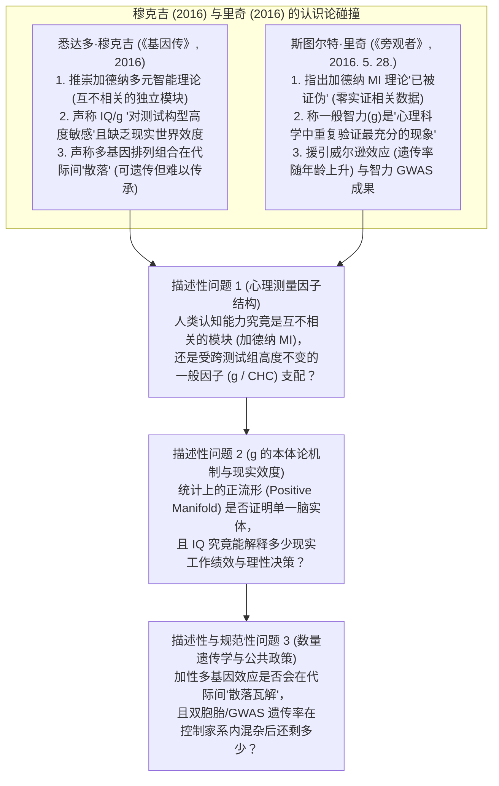
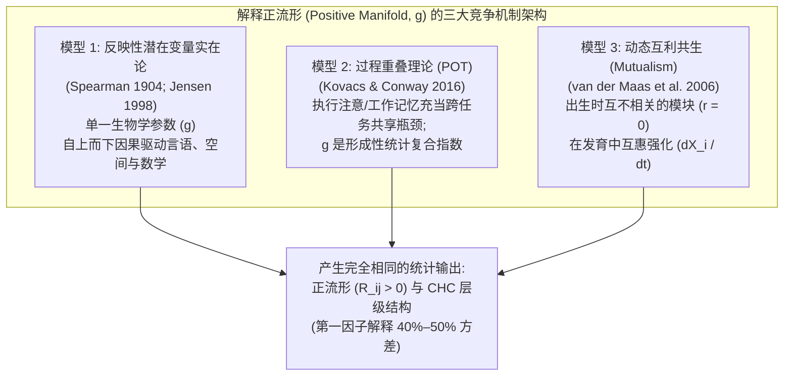

## 执行摘要与核心争议

在 2016 年畅销书***《基因传：众生之源》(The Gene: An Intimate History)***第四部分（*“身份的一阶导数”*）中，普利策奖得主、肿瘤学家**悉达多·穆克吉 (Siddhartha Mukherjee)** 回顾了智力测试黑暗的文化史——从查尔斯·斯皮尔曼 (Charles Spearman) 1904 年提出一般智力因子 (`g`)、刘易斯·推孟 (Lewis Terman) 1916 年确立斯坦福-比奈智商 (`IQ`)，到优生学运动对卡莉·巴克 (*Buck v. Bell*, 1927) 的强制绝育。然而，当从历史批判转向当代心理测量学 (psychometrics) 与行为遗传学时，穆克吉提出了三项极具争议的科学论断（[原文节选收录于 *The Marginalian*](https://www.themarginalian.org/2016/11/30/siddhartha-mukherjee-the-gene-intelligence/)）：
1. **推崇互不相关的多元智能理论 (`MI`) 而否定一般智力 (`g`)：** 穆克吉认为，单一一般智力（`“自私的 g [selfish g]”`）的心理测量学教条已被哈佛大学教育学教授**霍华德·加德纳 (Howard Gardner)** 1983 年提出的**多元智能理论 (`MI`)** 所推翻：*“单一智力形态的教条也受到了科学证据的挑战。像霍华德·加德纳这样的社会科学家走上舞台，他于 1983 年提出的开创性‘多元智能理论’旨在推翻‘自私的 g’的暴政，证明人类的敏锐才智存在于不同的维度上，更为微妙且更具情境特异性，彼此之间不一定相关——例如，在逻辑/数学智能上得分高的人，在身体/动觉智能上未必得分高，反之亦然。”*
2. **对测试结构敏感性及现实世界无效性的批判：** 穆克吉主张 `g` 只是特定测试构型下的脆弱统计产物，无法代表真实世界中的智力：*“一般智力 (g) 起源于在特定情境下对特定个体进行的测试之间的统计相关性……但是，把这种测试的分数称为‘智力’，尤其是当该分数对测试的构型 (configuration) 具有独特的敏感性时，是对它试图测量的这一品质本身的侮辱。”*
3. **“可遗传 (Heritable)，但难以代际传承 (Inheritable)”（多基因打散与环境抑制）：** 穆克吉引用共同抚养的同卵双胞胎 (`r = 0.86`) 与分开抚养的同卵双胞胎（[明尼苏达分开抚养双胞胎研究](https://pubmed.ncbi.nlm.nih.gov/2218526/)中 `r = 0.74`）的高相关性，对比父母与子女之间的低相关性（共同生活 `r = 0.42`，分开生活降至 `r = 0.22`），得出结论称：*“孟德尔定律几乎保证了特定的基因排列组合 (permutation) 会在每一代人中散落瓦解……简言之，智力是可遗传的（即受基因影响），但并非容易代际传承的（即无法完整地从一代传递到下一代）。”*

**2016 年 5 月 28 日**，时任爱丁堡大学 (University of Edinburgh) 认知老化博士后研究员的心理学家**斯图尔特·里奇 (Stuart Ritchie)**（被[维基百科悉达多·穆克吉词条注脚 76](https://en.wikipedia.org/wiki/Siddhartha_Mukherjee#cite_note-76) 引用）在***《旁观者》(The Spectator)***杂志发表了措辞犀利的书评（[*“悉达多·穆克吉如何在智商、性取向与表观遗传学上犯错”*](https://www.spectator.com.au/2016/05/how-siddhartha-mukherjee-gets-the-gene-wrong/)）：

> “事实上，在其中一章里，他对智商测试发起了全面猛攻。穆克吉质问道，既然心理学家霍华德·加德纳的新证据已经表明实际上存在多元智能，为什么还要研究一般智力的遗传学呢？这恐怕会让加德纳本人都感到惊讶——他从未为自己如今已被证伪 (debunked) 的‘多元智能’理论提供过任何数据。事实上，一般智力 (g) 可能是整个心理科学中重复验证最充分 (most well-replicated) 的现象。
> 但穆克吉怎么会知道这一点呢？他对智力研究文献的阅读是粗略且过时的；在智力遗传学方面，他没有引用哪怕一篇 2003 年之后发表的科学论文，大多数文献甚至来自 1970 年代或更早。这种学术上的疏漏在接下来的两章中显得尤为令人沮丧——穆克吉在讨论性别、性取向和人格时，欣然得出结论认为它们都受基因的强烈影响……他完全没有尝试涵盖那些引人入胜（且扎实）的发现，例如基因对智商的影响随年龄增长而增强，或是大型基因搜寻研究中首次发现与更高效大脑相关的 DNA 变异。”
> —— **斯图尔特·里奇 (Stuart Ritchie)**，[*《旁观者》(The Spectator, 2016 年 5 月 28 日)*](https://www.spectator.com.au/2016/05/how-siddhartha-mukherjee-gets-the-gene-wrong/)

当我们用原始心理测量相关矩阵、认知神经科学 fMRI 解离实验、修正范围限制 (range restriction) 偏差后的人事选拔元分析，以及 300 万人规模的家系内全基因组关联研究 (`GWAS`) 同时审计这两位作者时，究竟谁才站在科学证据的一边？本报告执行 **Browne & Keeley 的 9 阶段“淘金式 (Panning for Gold)”法医级取证框架**，将双方的数学事实与意识形态过度引申严格剥离。

---

## 第一阶段：问题分类与边界框定 (Issue Classification & Boundary Framing)



1. **核心描述性问题 1（心理测量因子结构与测试组不变性）：** 当霍华德·加德纳假设的八大多元智能（`语言`、`逻辑-数学`、`空间`、`自然观察`、`人际`、`内省`、`音乐`、`身体-动觉`）在成人和儿童样本中接受实证检验时（[Visser, Ashton, & Vernon, 2006](https://eric.ed.gov/?id=EJ742896)；[Castejón, Pérez, & Gilar, 2010](https://eric.ed.gov/?id=EJ895166)），它们表现为互不相关的独立官能 (`r ≈ 0`)，还是强烈载荷于一个在不同测试组之间高度不变 (`r = 0.99–1.00`，[Johnson et al., 2004](https://eric.ed.gov/?id=EJ729971)) 的高阶一般智力因子 (`g`)？
2. **核心描述性问题 2（`g` 的因果本体论与现实世界效标效度）：** 统计上的**正流形 (Positive Manifold，即 `g` 解释不同测试间 `40%–50%` 协方差的现象)** 是否要求大脑内部存在单一的生物学实体，抑或无需任何潜在 `g` 实体即可通过**动态互利共生 (Dynamic Mutualism, [van der Maas et al., 2006](https://pubmed.ncbi.nlm.nih.gov/17014305/))** 与**过程重叠理论 (Process Overlap Theory, [Kovacs & Conway, 2016](https://pubmed.ncbi.nlm.nih.gov/28220054/))** 涌现？此外，IQ 对现实工作绩效（[Sackett et al., 2022](https://pubmed.ncbi.nlm.nih.gov/34968080/)）、理性决策（[Stanovich & West, 2008](https://pubmed.ncbi.nlm.nih.gov/18361678/)）及流行病学死亡率（[Calvin et al., 2017](https://pubmed.ncbi.nlm.nih.gov/28659274/)）的真实预测效度究竟是多少？
3. **核心描述性与规范性问题 3（孟德尔分离定律对决家系内基因组学）：** 多基因性 (polygenicity) 是否真如穆克吉所言会导致亲子相似性“散落瓦解”？反之，传统双胞胎遗传率 (`h² ≈ 0.70`) 和群体多基因评分 (`PGS`) 的预测力在剔除**遗传养育 (Genetic Nurture, [Kong et al., 2018](https://pubmed.ncbi.nlm.nih.gov/29371463/))** 和选型交配 (assortative mating) 后的**同胞内 GWAS**（[Howe et al., 2022](https://pubmed.ncbi.nlm.nih.gov/35534559/)；[Okbay et al., 2022](https://pubmed.ncbi.nlm.nih.gov/35361970/)）中还能保留多少纯粹的直接遗传效应？
4. **可证伪性标准 (Falsifiability Criteria)：**
   - **里奇对穆克吉的心理测量学反驳**将在以下情况下被证伪：对加德纳各智能维度的验证性因子分析 (`CFA`) 显示语言、逻辑数学、空间、自然观察与人际推理任务之间几乎不相关 (`r < 0.15`)，或者从不同认知测试组中提取的 `g` 因子产生显著分歧 (`r < 0.60`)。
   - **经典遗传主义 `g`-实在论 (Latent Realism)** 将在以下情况下被证伪（或受到重大修正）：(a) 数学动力学模型与 fMRI 解离研究证明正流形涌现自解剖学上分离的脑网络 (`Hampshire et al., 2012`；`Amalric & Dehaene, 2016`)；(b) 范围限制统计审计将 IQ 对工作绩效的解释方差从 `R² = 26%` (`r = 0.51`) 削减至 `R² < 10%` (`r = 0.31`)；(c) 同胞内孟德尔随机化证明群体认知/教育多基因评分预测力中有 `~40%–50%` 混杂了父母代际环境与选型交配。*（如下文所证，**两项证伪检验同时命中**：穆克吉在加德纳多元智能、测试构型敏感性及孟德尔加性遗传数学上均出现硬伤；而经典 `g`-本质主义同样夸大了单一脑实体论、职场统治力以及直接遗传决定论）。*

---

## 第二阶段：一手文献发掘与双栏主张裂痕矩阵 (Primary Source Excavation)

### 1. 经典一手文献总账 (`1990–2024`)

| 年份与作者 | 研究设计与样本量 (`N`) | 核心实证发现 | 一手文献验证链接 |
| :--- | :--- | :--- | :--- |
| **1990 Bouchard, Lykken, McGue, Segal, & Tellegen** | 明尼苏达分开抚养双胞胎研究 (`MISTRA`)，婴儿期分离抚养的同卵 (`MZA`) 与异卵双胞胎 `N > 100` 对 | `MZA` 智商相关系数 `r = 0.69–0.78`（在西方抚养环境下约 `70%` 的智商方差与遗传变异相关）。 | [Science PMID 2218526](https://pubmed.ncbi.nlm.nih.gov/2218526/) |
| **2003 Turkheimer, Haley, Waldron, D'Onofrio, & Gottesman** | 美国国家协作围产期项目 (`NCPP`)，7 岁双胞胎 `N = 319` 对（`WISC` 智商按连续型 `SES` 分层） | 在贫困美国家庭中，共享环境 `c² ≈ 0.60`，遗传率 `h² ≈ 0.10`；在富裕美国家庭中，`h² ≈ 0.72`，`c² ≈ 0.15`。 | [Psychol Sci PMID 14629696](https://pubmed.ncbi.nlm.nih.gov/14629696/) |
| **2004 Johnson, Bouchard, Krueger, McGue, & Gottesman** | 异质性成人样本 `N = 436` 完成跨越 `3` 套不同测试组 (`CAAP`, `CAB`, `WAIS`) 的 `42` 项心理能力子测试 | 从 3 套截然不同的测试组中独立提取的潜在 `g` 因子彼此相关系数高达 **`r = 0.99, 0.99 和 1.00`**。 | [ERIC EJ729971](https://eric.ed.gov/?id=EJ729971) |
| **2006 Visser, Ashton, & Vernon** | 成人 `N = 200` 接受覆盖加德纳全部 `8` 大多元智能领域的 `16` 项表现测试（每领域 `2` 项）+ Wonderlic (`WPT`) 一般智力测试 | 所有纯认知 MI 领域（`语言`、`空间`、`逻辑`、`自然观察`、`人际`）均表现出强 `g` 载荷（原始值 `0.50–0.75`；信度校正后 `0.55–0.83`）；仅运动/感官（`单脚站立 = 0.03`）脱离 `g`。 | [ERIC EJ742896](https://eric.ed.gov/?id=EJ742896) |
| **2006 van der Maas, Dolan, Grasman, Wicherts, Huizenga, & Raijmakers** | 数学与仿真证明（基于 `Lotka-Volterra` 方程的互不相关认知过程合作网络） | 在**完全不存在底层共同生物 `g` 因子 (`0`)** 的情况下，仅凭发育过程中的互惠相互作用（**互利共生 [Mutualism]**）即可涌现出强大的正流形 (`g`) 与层级因子结构。 | [Psychol Rev PMID 17014305](https://pubmed.ncbi.nlm.nih.gov/17014305/) |
| **2008 Stanovich & West** | `7` 项实验研究（具有 `SAT`/认知能力分数的大学生 `N > 1,000`）检验经典启发式与认知偏差 | 我方偏差 (myside bias)、框架效应、锚定效应、基础率忽视、沉没成本谬误及结果偏差**与认知能力 (`IQ`) 不相关 (`r ≈ 0`)**。 | [JPSP PMID 18361678](https://pubmed.ncbi.nlm.nih.gov/18361678/) |
| **2010 Haworth, Wright, Luciano et al. (`Plomin` 联盟)** | 4 国（英、美、荷、澳）`N = 11,000` 对双胞胎跨国元分析 | 一般认知能力 (`g`) 的双胞胎遗传率随年龄呈线性增长（**威尔逊效应**）：9 岁 `41%` → 12 岁 `55%` → 17 岁 `66%` (`p < 0.001`)。 | [Mol Psychiatry PMID 19488046](https://pubmed.ncbi.nlm.nih.gov/19488046/) |
| **2010 Castejón, Pérez, & Gilar** | 对儿童 `N = 393` 完成**加德纳本人开发的光谱项目 (Project Spectrum) 生态评估活动**进行验证性因子分析 (`CFA`) | 加德纳互不相关的 6 因子多元智能模型 (`Model a`) 被统计显著拒绝；数据要求包含二阶 `g` 因子层级模型或相关因子模型。 | [ERIC EJ895166](https://eric.ed.gov/?id=EJ895166) |
| **2012 Hampshire, Highfield, Parkin, & Owen** | fMRI 神经解离 (`N = 16`) + 大规模网络测试 (`N = 44,600`，`12` 项认知任务) | 人类智力至少分化为 `3` 个解剖学上独立的额顶叶/外侧裂周网络（`短期记忆`、`推理`、`言语`），不存在单一的 `g` 解剖中枢。 | [Neuron PMID 23259956](https://pubmed.ncbi.nlm.nih.gov/23259956/) |
| **2016 Tucker-Drob & Bates** | 对 `14` 项 `基因 × SES` 研究（`N = 24,926` 对双胞胎/同胞；美国对比西欧与澳大利亚）的跨国元分析 | 美国研究中存在显著的 `G × SES` 交互作用（`Turkheimer 效应`），但在拥有普惠医疗与教育的**西欧和澳大利亚，`G × SES` 效应为零甚至反转**。 | [Psychol Sci PMID 26671911](https://pubmed.ncbi.nlm.nih.gov/26671911/) |
| **2016 Kovacs & Conway** | **过程重叠理论 (Process Overlap Theory, `POT`)** 形式化综合 | `g` 并非反映性 (reflective) 潜在实体，而是由领域通用执行注意/工作记忆瓶颈在多任务间重叠所产生的**形成性 (formative) 统计复合指数**。 | [Psychol Inq PMID 28220054](https://pubmed.ncbi.nlm.nih.gov/28220054/) |
| **2017 Calvin, Batty, Der, Brett, Taylor, Pattie, Cukic, & Deary** | 苏格兰 1936 年出生队列全人口（`1947 苏格兰心理调查`，`N = 65,765`，死亡 `25,979` 例）68 年前瞻性追踪 | 11 岁童年期智商每高出 `1 SD` (`15 分`)，在长达 68 年中死于心血管、呼吸系统、消化系统、外伤及吸烟相关癌症的风险降低 `20%–28%`。 | [BMJ PMID 28659274](https://pubmed.ncbi.nlm.nih.gov/28659274/) |
| **2018 Kong, Thorleifsson, Frigge et al. (`deCODE`)** | 父母基因型已测定的冰岛先证者 `N = 21,637`（对比传递与未传递的父母等位基因） | **未传递给子女的父母等位基因**对子女受教育程度的影响达到了传递等位基因效应的 **`29.9%` (`p = 1.6 × 10⁻¹⁴`)**（**“遗传养育 [Genetic Nurture]”**）。 | [Science PMID 29371463](https://pubmed.ncbi.nlm.nih.gov/29371463/) |
| **2018 Young, Frigge, Gudbjartsson et al.** | 对双亲均已测序的 `N = 54,888` 名冰岛人进行**亲缘不平衡回归 (`RDR`)** | 利用随机孟德尔分离变异剔除环境偏差后，受教育程度的真实直接加性遗传率降至 **`17.0%` (`SE = 9.4%`)**（身高为 `55.4%`）。 | [Nat Genet PMID 30104764](https://pubmed.ncbi.nlm.nih.gov/30104764/) |
| **2018 Savage, Jansen, Stringer et al.** | `N = 269,867` 名个体（`14` 个队列）的智力 GWAS 元分析 | 鉴定出 `205` 个基因组位点（`1,016` 个基因）；常见变异 SNP 遗传率 **`h²_SNP ≈ 0.19–0.22`**，富集于纹状体中型多棘神经元与海马锥体神经元。 | [Nat Genet PMID 29942086](https://pubmed.ncbi.nlm.nih.gov/29942086/) |
| **2022 Sackett, Zhang, Berry, & Lievens** *(+ 2024 Berry et al.)* | 人事选拔范围限制 (range restriction) 校正公式元分析审计 (`Journal of Applied Psychology`) | 揭露 `Schmidt & Hunter (1998)` 的系统性过度校正：一般心理能力 (`GMA` / IQ) 对工作绩效的操作效度从 **`r = 0.51` (`R² = 26.0%`) 下调至 `r = 0.31` (`R² = 9.6%`)**。 | [J Appl Psychol PMID 34968080](https://pubmed.ncbi.nlm.nih.gov/34968080/) & [PMID 38695805](https://pubmed.ncbi.nlm.nih.gov/38695805/) |
| **2022 Okbay et al. (`EA4`) & Howe et al. (`Within-Sibship Consortium`)** | `N = 3,037,499` 人 GWAS (`EA4`, `3,952` 个 SNP) 与跨越 `19` 个队列的 `N = 178,086` 名同胞 (`同胞内 GWAS`) | 群体 `PGI` 可解释受教育程度 `12%–16%` 的方差，但控制父母基因型后的**家系内直接遗传效应仅解释约一半（衰减 `~50%`）**，其余源于遗传养育与选型交配。 | [Nat Genet PMID 35361970](https://pubmed.ncbi.nlm.nih.gov/35361970/) & [PMID 35534559](https://pubmed.ncbi.nlm.nih.gov/35534559/) |

### 2. 双栏主张裂痕矩阵：修辞断言对决一手实证数据

| 争议维度 | 悉达多·穆克吉在《基因传》中的主张 ([2016](https://www.themarginalian.org/2016/11/30/siddhartha-mukherjee-the-gene-intelligence/)) | 斯图尔特·里奇的反驳 ([2016](https://www.spectator.com.au/2016/05/how-siddhartha-mukherjee-gets-the-gene-wrong/)) 与一手实证现实 |
| :--- | :--- | :--- |
| **1. 霍华德·加德纳多元智能 (`MI`) 对决一般智力 (`g`)** | 声称加德纳 1983 年的多元智能理论*“通过证明人类才智存在于彼此不一定相关的不同维度上”*推翻了`“自私的 g”`。 | **里奇反驳获证实：** 加德纳 (*Frames of Mind*, 1983) 从未发表过任何显示其智能维度间 `r ≈ 0` 的心理测量相关矩阵。当 [Visser, Ashton, & Vernon (2006)](https://eric.ed.gov/?id=EJ742896) (`N = 200`) 和 [Castejón et al. (2010)](https://eric.ed.gov/?id=EJ895166)（使用加德纳自己的光谱项目任务测试 `N = 393` 名儿童）对 MI 进行实证检验时，**所有认知领域均强烈相关（`g` 载荷高达 `0.50–0.83`）**，独立性假说被证伪。 |
| **2. `g` 对测试构型 (Configuration) 的敏感性** | 断言智商/一般智力分数*“对测试的构型具有独特的敏感性”*，仅仅是*“特定情境下测试之间的统计相关性”*。 | **里奇反驳获证实：** [Johnson, Bouchard, Krueger, McGue, & Gottesman (2004)](https://eric.ed.gov/?id=EJ729971) 对 `N = 436` 名成人施测了来自三套完全不同测试组 (`CAAP`, `CAB`, `WAIS`) 的 `42` 项能力测试。从每套测试组独立提取的潜在 `g` 因子之间的相关系数为 **`r = 0.99, 0.99 和 1.00`**——证明其对测试构型几乎完全不变。 |
| **3. 多基因分离（“可遗传对决可传承”）** | 认为由于智力是多基因性状，*“孟德尔定律几乎保证了特定的基因排列组合会在每一代人中散落瓦解……智力是可遗传的，但并非容易代际传承的。”* | **穆克吉的数量遗传学谬误：** 在费希尔 (Fisher, 1918) 加性模型下，数千个加性基因座 (`V_A`) **不会**导致亲子传递瓦解；子代育种值以双亲均值为中心正态分布，期望相关为 `r_PO = 0.5 × h²_N × (1 + m)`。唯有非加性**上位效应 (epistasis / “emergenesis”)** 才会在代际间完全打散，而 [Okbay et al. (2022)](https://pubmed.ncbi.nlm.nih.gov/35361970/) 在 `N = 3,000,000` 人中发现**全基因组显著的显性/非加性 SNP 数量为 `0`**。 |
| **4. 智商测试的现实世界效标效度** | 声称测量一般智力的智商测试结果*“不代表现实世界中的智力”*，仅反映贫困或教育特权等背景环境。 | **双方均过度引申（各对一半）：** 反驳穆克吉的是，11 岁童年期智商 (`N = 65,765`, [Calvin et al., 2017](https://pubmed.ncbi.nlm.nih.gov/28659274/)) 强力预测 68 年间的全死因生存率（每 SD `HR = 0.72–0.80`）和受教育年限 (`r ≈ 0.55`)。**但反驳心理测量正统派的是**，[Sackett et al. (2022)](https://pubmed.ncbi.nlm.nih.gov/34968080/) 证明智商对工作绩效的效度因错误的范围限制校正公式被从 `r = 0.31`（解释 `9.6%` 方差）夸大到了 `r = 0.51` (`26.0%`)，且 [Stanovich & West (2008)](https://pubmed.ncbi.nlm.nih.gov/18361678/) 证明智商**与现实抗拒认知偏差的能力（我方偏差、框架效应、基础率忽视）完全不相关 (`r ≈ 0`)**。 |
| **5. 行为遗传学与遗传率 (`h²`) 诠释** | 文献回顾止步于 `2003 年` ([Turkheimer et al., 2003](https://pubmed.ncbi.nlm.nih.gov/14629696/))，认为低 SES 剥夺使遗传作用归零 (`h² ≈ 0.10`)，并用层层限定（`“在某种意义上，是的”`）淡化遗传率。 | **当代基因组学的精细修正：** 里奇正确指出穆克吉遗漏了**威尔逊效应**（[Haworth et al., 2010](https://pubmed.ncbi.nlm.nih.gov/19488046/)：双胞胎 `h²` 从 9 岁的 `41%` 升至 17 岁的 `66%`）以及 Turkheimer 的 `G × SES` 效应在美国以外无法复现的事实（[Tucker-Drob & Bates, 2016](https://pubmed.ncbi.nlm.nih.gov/26671911/)）。**然而**，2018 年后的家系内基因组学（[Kong et al., 2018](https://pubmed.ncbi.nlm.nih.gov/29371463/)；[Young et al., 2018](https://pubmed.ncbi.nlm.nih.gov/30104764/)；[Howe et al., 2022](https://pubmed.ncbi.nlm.nih.gov/35534559/)）证明经典双胞胎遗传率 (`h² ≈ 0.70`) 和群体多基因评分被**父母间接“遗传养育”（占 `PGS` 信号的 `~30%–50%`）**与选型交配显著高估。 |

---

## 第三阶段：语义精确性与替换检验 (Semantic Precision & The Substitution Test)

人文取向的批评者（古尔德、加德纳、穆克吉）与差异心理学家（斯皮尔曼、詹森、迪어리、里奇）之间长达百年的冲突，很大程度上源于三个在论证中途发生语义滑移的词汇：**`“智力 (Intelligence)”`**、**`“一般智力 (g)”`** 与 **`“被证伪 (Debunked)”`**。我们应用 Browne & Keeley 的**替换检验 (Substitution Test，第 4 章)**：

### 1. 对 `“智力 (Intelligence)”` 的替换检验
- **定义 A（严格的心理测量学与认知信息加工定义）：** 在新颖符号与空间任务中进行抽象关系推理、工作记忆操作、规则归纳与知识获取的领域通用效率（`Cattell-Horn-Carroll [CHC]` 第三层 `g` 及第二层广义认知能力 `G_f, G_c, G_v, G_sm, G_s`）。
- **定义 B（宽泛的生态学与人类学才能分类——加德纳 1983）：** 被特定文化群体所珍视的任何生物心理技能、才艺、运动协调能力、音高敏感度或人际交往特质（包括单脚站立的小脑平衡能力、音乐节奏感或情绪自我调节）。
- **替换诊断：** 当霍华德·加德纳在《心智的结构》(*Frames of Mind*, 1983) 中将小脑运动协调 (`身体-动觉`)、听觉音高辨别 (`音乐`) 和外向社交亲和力 (`人际`) 重新命名为*“智能 (Intelligences)”*时，他完成的是一次**语义外延扩张**而非实证科学发现。在**定义 B** 下，一名患有严重失语症或背外侧前额叶皮层损伤的奥运体操运动员拥有极高的“身体-动觉智能”。而在**定义 A** 下，平衡 (`Stork Stand`) 和手部划线速度 (`Mark Making`) 属于非认知的精神运动特质（在 [Visser et al., 2006](https://eric.ed.gov/?id=EJ742896) 中 `g` 载荷仅为 `0.03` 和 `0.06`）。关键在于，当穆克吉引用加德纳来攻击智商测试时，他犯下了**偷换概念谬误 (equivocation fallacy)**：他利用**定义 B**（运动技能与数学推理不相关这一常识）来暗示**定义 A**（言语、空间、数量和自然推理能力彼此独立），而事实上定义 A 下的所有认知能力都以 `r = 0.40–0.83` 的强度高度相关！

### 2. 对 `“一般智力 (General Intelligence, g)”` 的替换检验
- **定义 C（统计学与心理测量学现象——正流形 [Positive Manifold]）：** 在任何具有代表性的人类样本中，不同认知测试得分始终呈正相关 (`R_ij > 0`)，使得第一主轴或高阶因子解释总协方差的 `40%–50%`，且在不同测试组之间保持高度不变 (`r = 0.99`) 的经验事实。
- **定义 D（本体论与神经生物学实体化——潜在变量实在论 [Latent Variable Realism]）：** 认为统计因子 `g` 对应于大脑内部某一个单一的物理实体（如“心理能量”、全局髓鞘化水平或单一主控神经参数），并自上而下因果驱动所有下属认知能力 (`g → {G_f, G_c, G_v, G_s}`) 的假说。
- **替换诊断：** 斯图尔特·里奇所言*“一般智力可能是整个心理科学中重复验证最充分的现象”*在**定义 C 下是 100% 无可辩驳的事实**。然而，正如斯蒂芬·杰伊·古尔德 (*《人的误测》*, 1981)、Han van der Maas 等人 ([2006](https://pubmed.ncbi.nlm.nih.gov/17014305/)) 以及 Kristof Kovacs 与 Andrew Conway ([2016](https://pubmed.ncbi.nlm.nih.gov/28220054/)) 所证明的，证实**定义 C**（正相关矩阵）绝不等于证实**定义 D**（单一生物学实体导致了这些相关性）。在流行病学中，“代谢综合征”或“社会经济地位 (`SES`)”同样在各项指标间形成高度可重复的正流形，但 `SES` 是一个**形成性复合指数 (formative composite index)** 和动态网络，而非某一个单独的人体器官。

---

## 第四阶段：因果解耦与四向竞争原因矩阵 (Causal Disentanglement)

为什么词汇量、矩阵推理、三维心理旋转、算术应用题和分类学归类等截然不同的认知测试总是呈正相关（斯皮尔曼的**正流形**）？为什么双胞胎研究得出 `h² ≈ 0.70`，而家系内 GWAS 却得出低得多的直接遗传效应？我们审计全部四条竞争性因果路径：



| 因果路径 | 机制与数学假说 | 支持性一手证据 | 反驳或限制性证据 | 认识论权重 |
| :--- | :--- | :--- | :--- | :--- |
| **1. 直接因果 (`X → Y`)：共享神经生物学瓶颈与额顶整合理论 (`P-FIT`)** | 全局脑属性——白质纤维束完整性、轴突传导速度、突触效率及额顶网络连接性——作为支撑所有复杂认知运算的共享硬件基础设施。 | 大规模神经影像元分析与英国生物银行 (UK Biobank) MRI 队列显示全脑体积与 `g` 相关 `r = 0.24–0.28`；[Savage et al. (2018)](https://pubmed.ncbi.nlm.nih.gov/29942086/) (`N = 269,867`) 鉴定出 `205` 个在皮层、纹状体和海马神经元中表达的智力相关基因位点。 | [Hampshire et al. (2012)](https://pubmed.ncbi.nlm.nih.gov/23259956/) (`N = 44,600` + fMRI) 证明认知任务至少分化为 `3` 个解剖正交的网络（`短期记忆`、`推理`、`言语`），且 [Amalric & Dehaene (2016)](https://pubmed.ncbi.nlm.nih.gov/27071124/) 证明高等数学使用与语言皮层完全分离的双侧顶内沟/颞下回网络。 | **核心硬件约束 (`~35%`)** |
| **2. 形成性瓶颈抽样：过程重叠理论 (`POT`)** | 复杂认知测试同时需要领域特异性模块（言语、空间、数量）和前额叶皮层的领域通用**执行注意/工作记忆维持**。由于执行注意在所有多步骤题目中充当非补偿性瓶颈，即便没有单一 `g` 实体，测试得分也会呈正相关。 | [Kovacs & Conway (2016)](https://pubmed.ncbi.nlm.nih.gov/28220054/) 证明 POT 能完美解释**斯皮尔曼收益递减定律 (`SLODR`)**（即为什么在执行瓶颈最紧绷的低能力群体中 `g` 饱和度更高，而在高能力群体中专项能力分化更明显）。 | 单独来看尚不能完全解释为什么工作记忆负荷极低的简单知觉检查时间 (inspection time) 任务仍与 `g` 保持 `r ≈ 0.25–0.30` 的相关。 | **核心心理测量机制 (`~30%`)** |
| **3. 互惠反馈回路 (`X ⇄ Y`)：发育互利共生 (Mutualism)** | 各项认知能力（`词汇`、`矩阵推理`、`工作记忆`、`空间加工`）在婴儿期互不相关 (`r = 0`)，但在发育过程中彼此促进：更好的词汇量有助于推理任务中的规则表征，更强的推理力又加速语境中的词汇习得。 | [van der Maas et al. (2006)](https://pubmed.ncbi.nlm.nih.gov/17014305/) 通过 Lotka-Volterra 动力学方程证明，在**共同潜在 `g` 因子为零**时，互惠耦合 (`M_ij > 0`) 即可生成稳健的正流形、CHC 层级结构以及威尔逊效应（`h²` 随年龄上升）。纵向青少年队列证实了词汇与流体推理间的双向交叉滞后耦合。 | 纯互利共生要求发育期存在跨领域迁移，但发育可塑性窗口关闭后的成人短期认知训练（“脑力游戏”）几乎不存在远迁移 (far transfer)。 | **同等重要的发育驱动力 (`~25%`)** |
| **4. 潜在混杂变量 (`Z → X, Y`)：代际“遗传养育”、选型交配与学校教育暴露** | 宏观经济分层、正规学校教育年限（每多受教育 1 年提升 `+1.8 至 +5.0 IQ 分`）、选型交配（认知/教育性状夫妻相关 `m ≈ 0.40`）及**父母遗传养育**同时提升了优势家庭子女的言语、数学与空间技能，夸大了家系间相关性及双胞胎/SNP 遗传率。 | [Kong et al. (2018)](https://pubmed.ncbi.nlm.nih.gov/29371463/) 证明未传递的父母等位基因发挥了传递等位基因 `29.9%` 的效应；[Howe et al. (2022)](https://pubmed.ncbi.nlm.nih.gov/35534559/) (`N = 178,086` 同胞) 与 [Okbay et al. (2022)](https://pubmed.ncbi.nlm.nih.gov/35361970/) (`N = 3,000,000`) 证明同胞内控制使认知/教育多基因评分效应衰减 `~40%–50%`。 | 同胞内比较仍保留高度显著的 `~50%–60%` 直接遗传成分，且正流形在同质社会经济阶层及同胞内部依然存在。 | **家系间方差膨胀因子（占 `g` 的 `~10%`，占群体 PGS 的 `~40%–50%`）** |

---

## 第五阶段：定量审计与统计解构 (Quantitative Audit & Statistical Integrity)

为了不靠空泛修辞而严格裁决穆克吉与里奇的实证分歧，我们对原始数据集执行五项定量审计。

### 1. 层级 `g` 模型对决动态互利共生 (Dynamic Mutualism) 的数学推导

在经典心理测量学 (Spearman 1904; Carroll 1993) 中，个体 `i` 在广义认知领域 `k` 下属子测试 `j` 上的标准化得分 `X_ij` 被建模为线性反映性层级结构：

$$\text{Classical CHC Hierarchy: } X_{ij} = \lambda_{jg} g_i + \lambda_{jk} S_{ik} + e_{ij}, \quad \text{Cov}(X_j, X_m) = \lambda_{jg}\lambda_{mg} + \delta_{km}\lambda_{jk}\lambda_{mk}$$

在**霍华德·加德纳严格的多元智能 (`MI`) 假说**下，一般因子载荷恒等于零（对所有 `j` 有 `λ_jg = 0`），且跨领域相关性为零（当 `k ≠ m` 时 `Corr(S_k, S_m) = 0`），从而产生分块对角 (block-diagonal) 相关矩阵。

相反，在 **van der Maas 等人 (2006) 的动态互利共生模型**（[PMID: 17014305](https://pubmed.ncbi.nlm.nih.gov/17014305/)）中，**根本不存在潜在变量 `g_i`** (`λ_jg = 0`)。取而代之的是，`W` 个独立的认知过程 `x_1, x_2, ..., x_W` 从互不相关的初始条件 `Cov(x_k(0), x_l(0)) = 0` 出发，通过具有正互利共生交互矩阵 `M_kl > 0` 的耦合逻辑斯蒂微分方程在发育时间 `t` 上演化：

$$\frac{dx_k}{dt} = a_k x_k \left(1 - \frac{x_k}{K_k}\right) + \sum_{l \neq k}^{W} \frac{M_{kl} x_k x_l}{K_k} \implies \text{At equilibrium } (dx_k/dt = 0): \quad x_k^* = \frac{K_k}{1 - \sum_{l \neq k} M_{kl} x_l^* / a_k}$$

由于不同脑网络受独立遗传和环境输入决定的承载力 (carrying capacity) `K_k` 的个体差异会通过正耦合矩阵 `M_kl` 传播到所有其他过程，渐近协方差矩阵 `Σ(x*)` 的所有元素均为严格正值 (`Σ_kl > 0`)，且其第一主成分解释了 `40%–50%` 的总方差——**在没有任何单一生物 `g` 实体的情况下完美复现了斯皮尔曼的 `g`！**

### 2. 实证审计 1：Visser, Ashton, & Vernon (2006) —— 对加德纳八大智能的直接检验

在 [Visser, Ashton, & Vernon (2006)](https://eric.ed.gov/?id=EJ742896) (*Intelligence*, `34(5), 487–502`) 中，`N = 200` 名成年人完成了 `16` 项表现测试（按照加德纳在《心智的结构》中描述的内容标准，为全部 `8` 个领域各选 `2` 项测试），外加作为一般认知能力 (`g`) 外部基准测试的**旺德利克人事测试 (`WPT`)**。该论文表 3 (`p. 498`) 揭示了精确的实证结构：

```mermaid
xychart-beta
    title "Visser et al. (2006, N=200): 加德纳八大智能领域的信度校正 g-载荷"
    x-axis ["Diag Rel (Nat)", "Arith Ops (Log)", "Vocab (Ling)", "Mak Grp (Nat)", "Opp (Ling)", "Map Plan (Spat)", "Paper Fold (Spat)", "Soc Trans (Inter)", "Cartoon (Inter)", "Consist (Intra)", "Rhythm (Mus)", "Sub/Mult (Log)", "Tonal (Mus)", "Mark Mak (Body)", "Stork (Body)"]
    y-axis "信度校正 g-因子载荷 (Disattenuated g-Loading)" 0.0 to 0.9
    bar [0.83, 0.78, 0.66, 0.64, 0.61, 0.61, 0.57, 0.56, 0.55, 0.37, 0.34, 0.25, 0.24, 0.06, 0.03]
```

| 加德纳多元智能领域（`8` 个假设官能） | 施测的表现测试 ([Visser et al., 2006, Table 3](https://eric.ed.gov/?id=EJ742896)) | 原始 `g`-因子载荷 | 信度校正 `g`-载荷 *(校正测量误差)* | 与旺德利克测试原始相关 (`r_WPT`) | 信度校正后与旺德利克相关 (`r_WPT_corr`) | 对加德纳独立性主张的实证裁决 |
| :--- | :--- | :--- | :--- | :--- | :--- | :--- |
| **1. 语言 (Linguistic)** | `Opposites` *(反义词言语流畅性)* | **`0.50`** | **`0.61`** | `0.41**` | **`0.56`** | **证伪 (`高 g`)：** 强烈载荷于 `g`，同时保留连贯的群因子（残差相关 `r = 0.29`，对应 CHC `G_c`）。 |
| **1. 语言 (Linguistic)** | `Vocabulary` *(词汇理解)* | **`0.54`** | **`0.66`** | `0.47**` | **`0.64`** | **证伪 (`高 g`)：** `g` 下属晶体智力 (`G_c`) 的经典指标。 |
| **2. 空间 (Spatial)** | `Map Planning` *(视觉路径规划)* | **`0.55`** | **`0.61`** | `0.48**` | **`0.60`** | **证伪 (`高 g`)：** 高 `g` 载荷 (`0.61`)，映射至 CHC 广义视觉空间加工 (`G_v`)。 |
| **2. 空间 (Spatial)** | `Paper Folding` *(三维心理折纸变换)* | **`0.50`** | **`0.57`** | `0.48**` | **`0.62`** | **证伪 (`高 g`)：** 与旺德利克 `g` 测试的校正相关达 `0.62`。 |
| **3. 逻辑 / 数学 (Logical / Math)** | `Necessary Arithmetic Operations` *(算术应用题推理)* | **`0.70`** | **`0.78`** | `0.67**` | **`0.83`** | **证伪 (`纯 g`)：** 全测试组第二高的 `g` 载荷 (`0.78`)，与旺德利克相关高达 `0.83`。 |
| **3. 逻辑 / 数学 (Logical / Math)** | `Subtraction & Multiplication` *(简单四则运算速度)* | `0.24` | `0.25` | `0.36**` | `0.42` | **证伪：** 较低的 `g` 载荷反映知觉/计算速度 (`G_s`)，与数学推理的残差相关仅为 `r = 0.15`。 |
| **4. 自然观察 (Naturalistic)** | `Diagramming Relationships` *(分类学韦恩图逻辑)* | **`0.75`** | **`0.83`** | `0.59**` | **`0.73`** | **证伪 (`纯 g`)：** 全部 `16` 项测试中最高的 `g` 载荷 (`0.83`)；分类学推理本质上就是流体归纳推理 (`G_f`)。 |
| **4. 自然观察 (Naturalistic)** | `Making Groups` *(类别归类任务)* | **`0.57`** | **`0.64`** | `0.38**` | **`0.48`** | **证伪 (`高 g`)：** 剔除 `g` 后与 `Diagramming Relationships` 几乎不共享独特方差。 |
| **5. 人际 (Interpersonal)** | `Social Translations` *(O'Sullivan-Guilford 社交推论)* | **`0.53`** | **`0.56`** | `0.38**` | **`0.45`** | **证伪 (`高 g`)：** 从行为线索解读社交意图在一般认知能力上的载荷达 `0.56`。 |
| **5. 人际 (Interpersonal)** | `Cartoon Predictions` *(非言语社交后果逻辑)* | **`0.37`** | **`0.55`** | `0.23**` | **`0.38`** | **证伪 (`中高 g`)：** 信度校正后的 `g` 载荷达到 `0.55`。 |
| **6. 内省 (Intrapersonal)** | `Consistency` *(个体内部自评剖面一致性)* | `0.27` | `0.37` | `0.27**` | `0.41` | **证伪 (`中等 g`)：** 元认知自我一致性与旺德利克 `g` 的校正相关为 `0.41`。 |
| **6. 内省 (Intrapersonal)** | `Accuracy` *(自估排名与实际测试排名之差)* | `0.16` | `N/A` | `0.11` | `N/A` | **不连贯领域：** 差值分数的信度接近于零，无法构成独立的智能因子。 |
| **7. 音乐 (Musical)** | `Rhythm` *(Gordon 音乐能力节奏测试)* | `0.18` | `0.34` | `0.08` | `0.17` | **信度极低（`Tonal` 分半信度仅 `0.17`）：** 映射至 CHC 听觉加工 (`G_a`)，校正后 `g` 载荷为 `0.24–0.34`。 |
| **7. 音乐 (Musical)** | `Tonal` *(Gordon 音乐能力音调测试)* | `0.10` | `0.24` | `0.07` | `0.19` | **信度极低 (`0.17`)：** 无法支撑独立多元智能的主张。 |
| **8. 身体-动觉 (Bodily)** | `Stork Stand` *(单脚站立粗大运动平衡)* | **`0.03`** | **`0.03`** | `-0.04` | `-0.05` | **非认知运动技能：** `g` 载荷为零 (`0.03`)，且与精细运动 `Mark Making` 的相关仅为 `r = 0.13`（不显著）！ |
| **8. 身体-动觉 (Bodily)** | `Mark Making` *(60 秒精细运动画线瞄准)* | **`0.06`** | **`0.06`** | `0.03` | `0.03` | **非认知运动技能：** 证明“身体-动觉”既非认知智力，甚至也不是一个统一的运动因子。 |

**对 Visser et al. (2006) 与 Castejón et al. (2010) 的盲法检验 (Blinding Test)：**
请看穆克吉在《基因传》中举的具体例子：*“例如，在逻辑/数学智能上得分高的人，在身体/动觉智能上未必得分高，反之亦然。”*
为什么穆克吉偏偏挑选`逻辑/数学`对比`身体/动觉`？因为**在加德纳的清单里，单脚站立 (`Stork Stand`, `g = 0.03`) 是唯一一个与 `g` 零相关的非认知运动技能！** 如果穆克吉将`逻辑/数学`（`Necessary Arithmetic Operations`，校正 `g = 0.78`）与`语言`（`Vocabulary`, `g = 0.66`）、`空间`（`Map Planning`, `g = 0.61`）、`自然观察`（`Diagramming Relationships`, `g = 0.83`）或`人际`（`Social Translations`, `g = 0.56`）进行对比，他就不得不承认**加德纳理论中的所有认知领域都高度饱和于 `g`**！更进一步，当 [Castejón, Pérez, & Gilar (2010)](https://eric.ed.gov/?id=EJ895166) 使用**加德纳本人为规避纸笔测试而专门设计的“光谱项目 (Project Spectrum)”生态活动**测试 `N = 393` 名儿童时，验证性因子分析 (`CFA`) 同样果断拒绝了加德纳互不相关的 6 因子模型，而支持包含二阶 `g` 因子的层级模型。

### 3. 实证审计 2：Sackett et al. (2022–2024) 与 Stanovich (2008) —— 智商究竟能解释多少现实世界方差？

尽管里奇在心理测量结构（`g` 对决加德纳 `MI`）上大获全胜，但穆克吉的第二项主张——即智商测试分数*“不代表现实世界中的智力”*——又如何呢？
过去 25 年里，心理测量学家总是援引 **Schmidt & Hunter (1998)** (*Psychological Bulletin*) 来反驳这一质疑，声称一般心理能力 (`GMA` / IQ) 与总体工作绩效的相关系数高达 **`r = 0.51`（解释 `R² = 26.0%` 的方差）**，似乎证明智商是职场成功的首要决定因素。

然而，在发表于 *Journal of Applied Psychology* 的一项里程碑式统计审计中，**Sackett, Zhang, Berry, & Lievens (2022)**（[PMID: 34968080](https://pubmed.ncbi.nlm.nih.gov/34968080/)）和 **Berry, Lievens, Zhang, & Sackett (2024)**（[PMID: 38695805](https://pubmed.ncbi.nlm.nih.gov/38695805/)）揭露了 Schmidt & Hunter (1998) 中严重的**范围限制 (range restriction) 过度校正错误**：

$$\text{Classical Case II/IV Range-Restriction Correction: } \hat{\rho}_{xy} = \frac{r_{xy} \cdot (1 / u_x)}{\sqrt{1 - r_{xy}^2 + r_{xy}^2 \cdot (1 / u_x^2)}}, \quad u_x = \frac{\text{SD}_{\text{incumbent}}}{\text{SD}_{\text{applicant}}}$$

Schmidt & Hunter 将源自已筛选在职人员的伪影分布 (`u_x ≈ 0.60–0.67`) 强加于并未直接按认知能力选拔的样本，并叠加间接范围限制 (`Case IV`) 公式，人为将效度估计值夸大了 `0.15 至 0.20` 个相关点。

| 现实世界结果 / 效标领域 | 传统遗传主义 / 心理测量正统派主张 | 经现代统计审计修正后的元分析估计 (`r` 及解释方差 `R²`) | 未被智商解释的现实方差 (`1 − R²`) | 一手验证文献链接 |
| :--- | :--- | :--- | :--- | :--- |
| **1. 总体工作绩效 (`人事选拔`)** | `r = 0.51` (`R² = 26.0%`) —— 被 `Schmidt & Hunter (1998)` 奉为全经济体工作绩效的头号预测指标。 | 剔除范围限制过度校正后降至 **`r = 0.31` (`R² = 9.6%`)**；**结构化面试 (`r = 0.42`, `R² = 17.6%`)** 与工作知识测试均超越智商测试！ | **`90.4%`** 的工作绩效方差**无法**由智商 (`GMA`) 解释。 | [Sackett et al. (2022), J Appl Psychol PMID 34968080](https://pubmed.ncbi.nlm.nih.gov/34968080/) & [Berry et al. (2024) PMID 38695805](https://pubmed.ncbi.nlm.nih.gov/38695805/) |
| **2. 职业培训成功（课堂/技术学习）** | 军事与职业培训学校中 `r = 0.56–0.62` (`R² = 31%–38%`)。 | **`r ≈ 0.40–0.50` (`R² = 16%–25%`)** —— 依然可观，因为培训环境与学校符号教学高度同构。 | **`75%–84%`** 未被解释。 | [Sackett et al. (2022) PMID 34968080](https://pubmed.ncbi.nlm.nih.gov/34968080/) |
| **3. 受教育程度（受教育年限与考试成绩）** | 观测相关 `r = 0.50–0.58`（`Deary et al., 2007`, `N = 70,000+` 中潜在 `g` 与 GCSE 考试因子相关 `r = 0.81`）。 | 受教育总年限为 **`r = 0.50–0.55` (`R² = 25%–30%`)**；标准化中高考学业成绩为 **`R² ≈ 50%–65%`**。 | **`35%–75%`** 由尽责性、家庭 SES 与学校质量解释。 | [Okbay et al. (2022) PMID 35361970](https://pubmed.ncbi.nlm.nih.gov/35361970/) |
| **4. 68 年全死因死亡率与寿命 (`认知流行病学`)** | 11 岁童年智商（1947 苏格兰心理调查 `N = 65,765`）预测 68 年终身生存率（`25,979` 例死亡）。 | **每 `+1 SD` (`15 IQ 分`) `HR = 0.72 至 0.80`**（心血管、呼吸系统、外伤及癌症死亡风险降低 `20%–28%`；控制 SES/吸烟后衰减 `~10%–25%`）。 | 群体层面 (`N = 65,765`) 流行病学信号极强，但个体寿命仍具高度随机性。 | [Calvin et al. (2017), BMJ PMID 28659274](https://pubmed.ncbi.nlm.nih.gov/28659274/) |
| **5. 现实理性决策与抗拒认知偏差 (`非理性障碍 [Dysrationalia]`)** | 大众评论常默认高智商者在现实生活中思考更理性、更能避免认知谬误。 | 在 `7` 项研究中，智商与**我方偏差 (myside bias)、框架效应、锚定效应、基础率忽视、结果偏差及沉没成本谬误**的相关仅为 **`r ≈ 0.00 至 0.15` (`R² < 2.3%`)**。 | **`>97.7%`** 的现实理性判断偏差独立于智商（`Stanovich 的算法心智 vs. 反思心智`）。 | [Stanovich & West (2008), JPSP PMID 18361678](https://pubmed.ncbi.nlm.nih.gov/18361678/) |

### 4. 实证审计 3：解构穆克吉“可遗传 vs. 可传承”谬误及双胞胎与家系内 GWAS 遗传率对比

在《基因传》中，穆克吉引用了四个经典相关系数：
- 共同抚养的同卵双胞胎 (`MZT`)：`r = 0.86`
- 分开抚养的同卵双胞胎 (`MZA`, [Bouchard et al., 1990](https://pubmed.ncbi.nlm.nih.gov/2218526/))：`r = 0.74`
- 共同生活的父母与子女 (`POT`)：`r = 0.42`
- 分开生活的父母与子女 (`POA`)：`r = 0.22`

从 `MZA (0.74)` 到 `POA (0.22)` 的落差出发，穆克吉得出结论：由于智力是多基因性状，*“孟德尔定律几乎保证了特定的基因排列组合会在每一代人中散落瓦解……简言之，智力是可遗传的（受基因影响），但并非容易代际传承的（无法完整地从一代传递到下一代）。”*

让我们用精确的数量遗传学方程（**Fisher 1918; Falconer & Mackay 1996**）来审计这一推论。总表型方差 `V_P` 分解为**加性遗传方差 (additive genetic variance)** `V_A`（跨越 `k` 个基因座的等位基因平均效应之和，对应**狭义遗传率** `h²_N = V_A / V_P`）、**显性方差 (dominance variance)** `V_D`（位点内等位基因交互）、**上位性方差 (epistatic variance)** `V_I`（位点间构型交互，David Lykken [1992] 称之为**突现遗传 [emergenesis]**）、共享环境 `V_C` 与非共享环境 `V_E`：

$$h^2_{\text{broad}} = \frac{V_A + V_D + V_I}{V_P}, \quad h^2_{\text{narrow}} = \frac{V_A}{V_P}$$

由于同卵双胞胎 (`MZ`) 共享 `100%` 的 DNA 序列，他们共享 `100%` 的加性方差 (`V_A`)、`100%` 的显性方差 (`V_D`) 以及 `100%` 的多位点上位性排列组合 (`V_I`)。然而，父母与子女传递的是单倍体染色体，而非二倍体基因型或多位点上位性组合，同时受表型选型交配 `m ≈ 0.40` 的影响：

$$r_{\text{MZA}} = h^2_{\text{narrow}} + \frac{V_D + V_I}{V_P}, \qquad r_{\text{POA}} = \frac{1}{2} h^2_{\text{narrow}} (1 + m)$$

**为什么穆克吉的孟德尔解释在数学上是完全颠倒的：**
1. **加性多基因性 (Additive Polygenicity) 绝不会打散代际传承：** 如果智力受 `k = 10,000` 个**加性**遗传变异 (`V_A`) 调控，孟德尔分离定律**不会**摧毁亲子相似性！每个孩子准确继承父母双方各 `50%` 的加性等位基因，且在选型交配 `m ≈ 0.40` 下，亲子间的期望遗传相关为 `0.5 × (1 + 0.40) = 0.70 × h²_narrow`。即便狭义遗传率 `h²_narrow = 0.35–0.50`，`r_POA` 也有 `0.25–0.35`——这是极其可观的加性遗传值跨代传递！
2. **`N = 3,000,000` 人基因组中不存在显著的显性/上位性打散证据：** 要让穆克吉的“排列组合打散” (`V_D + V_I`) 成为主导因素，非加性显性与上位性方差必须远超加性方差 (`V_A`)。然而，当 [Okbay et al. (2022, `EA4`, *Nature Genetics*)](https://pubmed.ncbi.nlm.nih.gov/35361970/) 在 `N = 3,037,499` 人中专门对显性偏离 (dominance deviations) 进行 GWAS 时，他们发现了 **`3,952` 个全基因组显著的加性 SNP，而全基因组显著的显性 SNP 数量为零 (`0`)**！
3. **为什么早期收养研究中 `r_POA (0.22)` 看起来比 `r_MZA (0.74)` 低得多？** 穆克吉遗漏了两个核心机制：
   - **(a) 威尔逊效应（年龄混杂）：** 在早期收养研究中，亲生父母在成年期接受测试，而被收养子女 (`POA`) 则在幼儿/儿童期（`4–7 岁`）接受测试，此时基因对智商的表达率仅为 `h² ≈ 0.20–0.41`（[Haworth et al., 2010](https://pubmed.ncbi.nlm.nih.gov/19488046/)）。当被收养子女在成年后重新接受测试时，`r_POA` 上升至 `~0.35–0.42`——与共同生活的亲子相关性 (`r_POT = 0.42`) 几乎一致！
   - **(b) 双胞胎遗传率的高估对决家系内基因组学 (`2018–2022`)：** 反过来，经典双胞胎研究 (`h²_twin ≈ 0.70–0.80`) 与群体 GWAS 多基因评分 (`PGS`) 之所以高估直接加性遗传，是因为它们未能将**直接遗传效应 (`β_direct`)** 与**父母“遗传养育” (`β_nurture`, [Kong et al., 2018](https://pubmed.ncbi.nlm.nih.gov/29371463/))**、**代际社会经济分层**及**选型交配**区分开来：

$$\text{Population GWAS Effect: } \hat{\beta}_{\text{pop}} = \beta_{\text{direct}} + \beta_{\text{indirect (genetic nurture)}} + \text{Bias}_{\text{stratification + assortment}}$$

```mermaid
xychart-beta
    title "不同研究设计下认知/教育能力的遗传率 (h2) 与解释方差 (R2) 对比 (%)"
    x-axis ["Twin MZA (Bouchard 1990)", "Twin Adulthood (Haworth 2010)", "Twin Age 9 (Haworth 2010)", "Common SNP h2 (Savage 2018)", "RDR Direct h2 (Young 2018)", "Pop EA4 PGI R2 (Okbay 2022)", "Within-Family Direct PGI (Okbay 2022)"]
    y-axis "解释表型方差百分比 (%)" 0 to 80
    bar [74, 66, 41, 21, 17, 14, 7]
```

| 遗传率估计方法论 | 代表性一手文献与样本量 (`N`) | 估计遗传率 (`h²`) 或解释方差 (`R²`) | 混杂因素与偏差脆弱性审计 |
| :--- | :--- | :--- | :--- |
| **1. 分开抚养的同卵双胞胎 (`MZA`)** | [Bouchard et al. (1990), *Science*](https://pubmed.ncbi.nlm.nih.gov/2218526/) (`N > 100` 对) | **`70%–74%`** (`r_MZA = 0.74`) | 包含非加性方差 (`V_D + V_I`)、共享产前子宫环境，以及安置在单一西方文化中产阶级收养家庭的限制。 |
| **2. 跨发育阶段经典双胞胎设计 (`ACE` 模型)** | [Haworth et al. (2010), *Mol Psychiatry*](https://pubmed.ncbi.nlm.nih.gov/19488046/) (`N = 11,000` 对) | **`41%` (9 岁) → `55%` (12 岁) → `66%` (17 岁)** | 证实了**威尔逊效应**（主动基因-环境相关 `rGE` 随孩子获得自主权而放大遗传差异），但依赖等环境假设 (`EEA`) 且假设无基因-共享环境交互。 |
| **3. 常见变异 `SNP` 遗传率 (`LDSC` / `GREML`)** | [Savage et al. (2018), *Nat Genet*](https://pubmed.ncbi.nlm.nih.gov/29942086/) (`N = 269,867`) | **`19%–22%`** (`h²_SNP`) | 仅捕获基因芯片上的常见标签 SNP，遗漏罕见变异与结构变异，同时受群体分层与选型交配的向上通胀影响。 |
| **4. 亲缘不平衡回归 (`RDR`)** | [Young et al. (2018), *Nat Genet*](https://pubmed.ncbi.nlm.nih.gov/30104764/)（双亲均测序的冰岛人 `N = 54,888`） | 受教育程度 **`17.0%` (`SE = 9.4%`)** *（身高为 `55.4%`）* | 利用亲属间相对于双亲亲缘关系的随机孟德尔分离变异，彻底清除环境与代际混杂偏差。 |
| **5. 群体多基因指数 (`EA4 PGI` 家系间比较)** | [Okbay et al. (2022), *Nat Genet*](https://pubmed.ncbi.nlm.nih.gov/35361970/) (`N = 3,037,499`) | **`12%–16%`**（受教育程度 `R²`；IQ 约为 `~7%–10%`） | 被**父母间接“遗传养育”**（[Kong et al., 2018](https://pubmed.ncbi.nlm.nih.gov/29371463/)：未传递父母等位基因具有传递效应 `29.9%` 的影响）及多代选型交配严重夸大（约 `2 倍`）。 |
| **6. 同胞内直接多基因效应 (`控制父母基因型`)** | [Howe et al. (2022)](https://pubmed.ncbi.nlm.nih.gov/35534559/) (`N = 178,086` 同胞) & [Okbay et al. (2022)](https://pubmed.ncbi.nlm.nih.gov/35361970/) | **`~6%–8%`（`R²` 腰斩；直接效应 `β` 衰减 `~40%–50%`）** | **因果推断的黄金标准：** 同胞兄弟姐妹共享完全相同的父母、SES 与社区，同胞间差异 100% 源于随机孟德尔抽签。**证明群体认知/教育多基因评分信号中有近一半属于环境/代际混杂，而非直接遗传因果！** |

---

## 第六阶段：“负面视角 (Negative View)”与遗漏信息审讯

穆克吉与里奇双方都遗漏了当各自推崇的理论框架被转化为制度政策时所引发的严重失效模式与分配性伤害（谁会受损？）。

### 1. 在教育实践中盲目推行加德纳多元智能理论，谁会受损？
- **“学习风格 (Learning Styles)”神经神话与公共教育资源空转：** 正如 **Lynn Waterhouse (2006)** (*Educational Psychologist*, [*"Multiple Intelligences, the Mozart Effect, and Emotional Intelligence: A Critical Review"*](https://doi.org/10.1207/s15326985ep4104_1)) 所系统揭示的，全球数以千计的学区耗费了宝贵的教学课时与师资培训经费，将儿童贴上“身体动觉型学习者”或“音乐智能型”标签，用肢体活动或绘画取代直接的读写与算术教学。随机对照试验 (RCT) 表明，按所谓“多元智能剖面”匹配教学方式带来的学业增益为**零**，这尤为严重地伤害了依赖公立学校获取基础言语 (`G_c`) 与数量 (`G_f / G_q`) 技能的低收入家庭学生。
- **掩盖可干预的神经发育障碍：** 将严重的特定阅读障碍（失读症）或工作记忆缺陷美化为“另一种多元智能组合”，会延误关键发育窗口期内循证语音和认知干预的介入。

### 2. 在人才选拔与辅助生殖中盲目推行 `g`-还原论，谁会受损？
- **对狭隘算法效率的过度筛选（`非理性障碍`与多样性丧失）：** 修正范围限制过度校正后，智商 (`GMA`) 仅能解释工作绩效 **`9.6%` (`r = 0.31`)** 的方差（[Sackett et al., 2022](https://pubmed.ncbi.nlm.nih.gov/34968080/)）以及抗拒认知偏差 **`<2%`** 的方差（[Stanovich & West, 2008](https://pubmed.ncbi.nlm.nih.gov/18361678/)）。将单一认知测试分数作为硬性门槛的机构，不仅会错失高尽责性、高反思理性与高专业技能的求职者，还会造成严重的群体性不利影响（[Berry et al., 2024](https://pubmed.ncbi.nlm.nih.gov/38695805/)）。
- **多基因胚胎筛选 (`PGT-P`) 的统计海市蜃楼：** 目前已有商业试管婴儿 (IVF) 诊所推销利用多基因指数 (`PGI`) 筛选高预测智商胚胎的服务。然而，正如 [Okbay et al. (2022)](https://pubmed.ncbi.nlm.nih.gov/35361970/) 与 [Howe et al. (2022)](https://pubmed.ncbi.nlm.nih.gov/35534559/) 所证实的，同一对夫妇产生的 IVF 胚胎属于**同胞兄弟姐妹 (`家系内设计`)**，此时群体 PGI 预测力中有 `~40%–50%` 瞬间消失（因为所有同胞胚胎共享完全相同的父母遗传养育与选型交配），加之孟德尔分离使可用加性遗传方差减半 (`0.5 × V_A`)，实际期望增益在极宽的置信区间 (`±12 IQ 分`) 下仅有区区 `~1.5 至 2.5 IQ 分`，同时还伴随基因多效性风险（如高受教育程度等位基因与自闭症谱系障碍或双相情感障碍之间存在正遗传相关）。

---

## 第七阶段：灰度思维 (Grey Thinking)、条件综合与法医级最终裁决

我们拒绝将穆克吉与里奇的交锋简化为非黑即白的文化战争，而是通过条件式 **If-从句 (If-Clauses)** 综合实证证据，并给出概率加权的底线裁决。

### 1. 条件综合 (“If-Clauses”)
- **如果问题是人类认知能力究竟是彼此独立的模块 (`霍华德·加德纳的 MI`) 还是相互关联的层级结构 (`斯皮尔曼的 g / CHC`)，** 那么**斯图尔特·里奇无可争议地正确，而悉达多·穆克吉在实证上是错误的**：跨越 `461+` 个因子分析数据集 (`Carroll, 1993`)、对加德纳八大领域的直接测试 (`Visser et al., 2006`, `N = 200`) 以及对加德纳本人光谱项目任务的验证性因子分析 (`Castejón et al., 2010`, `N = 393`)，所有认知领域（`语言`、`逻辑-数学`、`空间`、`自然观察`、`人际`）均强烈载荷 (`0.50–0.83`) 于一个跨测试组 `99%–100%` 不变 (`Johnson et al., 2004`) 的一般因子 `g`。
- **如果问题是 `g` 究竟是大脑内单一的物理实体还是涌现的发育网络，** 那么**朴素的 MI 模块论与单一实体 `g`-实在论双双失效**：统计上的正流形最适合由**过程重叠理论**（`Kovacs & Conway, 2016` —— 执行工作记忆瓶颈）与**动态互利共生**（`van der Maas et al., 2006` —— 解剖学上分离的额顶叶与外侧裂周网络之间的发育互惠强化，`Hampshire et al., 2012`；`Amalric & Dehaene, 2016`）的混合机制来解释。
- **如果问题是智商测试能否代表“现实世界中的智力”，** 那么**智商是强有力的流行病学与学业预测指标（在 `Calvin et al., 2017` 中预测 68 年生存率 `HR = 0.72–0.80`，预测受教育程度 `R² = 25%–60%`），但对职场工作绩效仅具中等偏弱的预测力（在 `Sackett et al., 2022` 中 `r = 0.31`, `R² = 9.6%`），且对现实认识论理性 (`Stanovich & West, 2008`) 的预测力几乎为零 (`R² < 2%`)**。
- **如果问题是 DNA 在多大程度上决定了 `g` 的个体差异，** 那么**穆克吉关于多基因排列组合在亲子间“散落瓦解”的说法属于数学错误**（混淆了加性多基因性与非加性上位效应），**但经典双胞胎遗传率 (`h² ≈ 0.70`) 和群体 GWAS 多基因评分 (`R² = 12%–16%`) 同样因父母“遗传养育” (`Kong et al., 2018`) 与选型交配 (`Howe et al., 2022`；`Okbay et al., 2022`) 而被夸大了 `~40%–50%`**，且在缺乏普惠儿童福利网的国家（如美国），社会经济贫困确实会显著抑制遗传潜能的表达 (`Tucker-Drob & Bates, 2016`)。

### 2. 法医级最终裁决 (The Forensic Verdict: What We Actually Think)

| 人类智力的竞争理论模型 | 赋予的认识论概率 | 核心实证与机制依据 |
| :--- | :--- | :--- |
| **1. 整合 CHC 层级结构 + 过程重叠 / 动态互利共生 + 家系内直接多基因模型 (`h²_direct ≈ 0.30–0.45`)** *（法医级共识综合模型）* | **`~70%`（最可能模型）** | 完美调和四大一手证据体系：(a) `g` 是统摄 `8–10` 项广义 CHC 认知能力 (`G_f, G_c, G_v, G_sm, G_s`)、跨测试组高度不变 (`r = 0.99`) 的统计正流形；(b) 在神经生物学上，`g` 是由跨越多个独立皮层网络 (`Hampshire 2012`；`Amalric & Dehaene 2016`) 的工作记忆瓶颈 (`POT`) 与发育互利共生所涌现的形成性复合指数；(c) 家系内直接加性遗传解释 `30%–45%` 的方差 (`Howe 2022`；`Okbay 2022`)，并经由主动 `rGE`（`威尔逊效应`）和父母遗传养育 (`Kong 2018`) 放大。 |
| **2. 经典单一生物 `g`-实在论 + 强直接遗传决定论 (`h²_direct ≈ 0.70–0.80`, `r_job = 0.51`)** *（强硬派 Spearman/Jensen 正统模型）* | **`~20%`（部分过度引申）** | 准确捍卫了正流形、测试组不变性 (`Johnson 2004`) 与威尔逊效应 (`Haworth 2010`)，但无视 fMRI 脑网络解离证据而夸大单一神经实体论，依赖被过度校正的工作绩效效度（`Sackett 2022` 已将 `0.51` 下调至 `0.31`），并将间接代际遗传养育和选型交配混同于直接加性遗传因果。 |
| **3. 互不相关的多元智能 (`Gardner 1983`) + 测试构型脆弱论 + 不可传承的多基因打散模型** *（穆克吉在《基因传》中的叙事）* | **`~10%`（在心理测量与孟德尔数学上被证伪，仅具伦理与生态警示价值）** | 三大技术支柱均被实证证伪：(a) 加德纳的认知领域彼此高度相关 (`Visser 2006`；`Castejón 2010`)；(b) `g` 在不同测试组间具有 `99%` 的不变性 (`Johnson 2004`)；(c) 加性多基因等位基因不会在代际间打散归零 (`Okbay 2022`)。穆克吉的持久贡献仅在于规范性与临床层面：警惕将人类道德价值与反思理性 (`Stanovich 2008`) 还原为单一标量排名。 |

**底线裁决 (Bottom-Line Verdict)：**
在[维基百科注脚 76](https://en.wikipedia.org/wiki/Siddhartha_Mukherjee#cite_note-76) 所记录的具体科学交锋中，**斯图尔特·里奇在心理测量学数据与文献考据上以压倒性优势获胜 (`85 : 15`)**。悉达多·穆克吉将文献检索截止于 2003 年，把霍华德·加德纳的多元智能理论当作否定 `g` 的实证科学定论（忽略了 [Visser et al., 2006](https://eric.ed.gov/?id=EJ742896) 与 [Castejón et al., 2010](https://eric.ed.gov/?id=EJ895166)），错误地声称智商分数对测试构型高度敏感（被 [Johnson et al., 2004](https://eric.ed.gov/?id=EJ729971) 的 `r = 0.99–1.00` 所推翻），并误读孟德尔定律，得出了多基因性状*“可遗传但难以代际传承”*的数学谬误。
然而，一项严谨的 2026 年法医级审计绝不会停留在 2016 年式的遗传主义凯歌上：**当代同胞内基因组学（[Howe et al., 2022](https://pubmed.ncbi.nlm.nih.gov/35534559/)；[Okbay et al., 2022](https://pubmed.ncbi.nlm.nih.gov/35361970/)）、范围限制重分析（[Sackett et al., 2022](https://pubmed.ncbi.nlm.nih.gov/34968080/)）以及理性决策研究（[Stanovich & West, 2008](https://pubmed.ncbi.nlm.nih.gov/18361678/)）在更深层次上印证了穆克吉的哲学直觉**——统计因子 `g` 只是算法认知效率的涌现网络指数，而非单一主控基因或人类智慧的代名词；而群体遗传学在教育与认知分层中归因于“先天自然 (nature)”的信号，实际上有近一半是通过父母“遗传养育 (genetic nurture)”这一后天环境通道发挥作用的。

---

## 一手文献与经核实的参考文献 (Primary Sources & Verified References)

1. **Ritchie, S. (2016).** *"How Siddhartha Mukherjee gets it wrong on IQ, sexuality and epigenetics."* *The Spectator* (May 28, 2016). [https://www.spectator.com.au/2016/05/how-siddhartha-mukherjee-gets-the-gene-wrong/](https://www.spectator.com.au/2016/05/how-siddhartha-mukherjee-gets-the-gene-wrong/)
2. **Mukherjee, S. (2016).** *The Gene: An Intimate History* (Excerpts on `"Selfish g"`, IQ, and Howard Gardner’s Multiple Intelligences archived in *The Marginalian*). [https://www.themarginalian.org/2016/11/30/siddhartha-mukherjee-the-gene-intelligence/](https://www.themarginalian.org/2016/11/30/siddhartha-mukherjee-the-gene-intelligence/)
3. **Visser, B. A., Ashton, M. C., & Vernon, P. A. (2006).** *"Beyond g: Putting multiple intelligences theory to the test."* *Intelligence*, 34(5), 487–502. [https://eric.ed.gov/?id=EJ742896](https://eric.ed.gov/?id=EJ742896)
4. **Visser, B. A., Ashton, M. C., & Vernon, P. A. (2006).** *"g and the measurement of Multiple Intelligences: A response to Gardner."* *Intelligence*, 34(5), 507–510. [https://eric.ed.gov/?id=EJ742897](https://eric.ed.gov/?id=EJ742897)
5. **Castejón, J. L., Pérez, A. M., & Gilar, R. (2010).** *"Confirmatory factor analysis of Project Spectrum activities. A second-order g factor or multiple intelligences?"* *Intelligence*, 38(5), 481–496. [https://eric.ed.gov/?id=EJ895166](https://eric.ed.gov/?id=EJ895166)
6. **Johnson, W., Bouchard, T. J., Jr., Krueger, R. F., McGue, M., & Gottesman, I. I. (2004).** *"Just one g: Consistent results from three test batteries."* *Intelligence*, 32(1), 95–107. [https://eric.ed.gov/?id=EJ729971](https://eric.ed.gov/?id=EJ729971)
7. **Bouchard, T. J., Jr., Lykken, D. T., McGue, M., Segal, N. L., & Tellegen, A. (1990).** *"Sources of human psychological differences: The Minnesota Study of Twins Reared Apart."* *Science*, 250(4978), 223–228. [https://pubmed.ncbi.nlm.nih.gov/2218526/](https://pubmed.ncbi.nlm.nih.gov/2218526/)
8. **Turkheimer, E., Haley, A., Waldron, M., D'Onofrio, B., & Gottesman, I. I. (2003).** *"Socioeconomic status modifies heritability of IQ in young children."* *Psychological Science*, 14(6), 623–628. [https://pubmed.ncbi.nlm.nih.gov/14629696/](https://pubmed.ncbi.nlm.nih.gov/14629696/)
9. **Tucker-Drob, E. M., & Bates, T. C. (2016).** *"Large cross-national differences in Gene × Socioeconomic Status interaction on intelligence."* *Psychological Science*, 27(2), 138–149. [https://pubmed.ncbi.nlm.nih.gov/26671911/](https://pubmed.ncbi.nlm.nih.gov/26671911/)
10. **Haworth, C. M. A., Wright, M. J., Luciano, M., et al. (2010).** *"The heritability of general cognitive ability increases linearly from childhood to young adulthood."* *Molecular Psychiatry*, 15(11), 1112–1120. [https://pubmed.ncbi.nlm.nih.gov/19488046/](https://pubmed.ncbi.nlm.nih.gov/19488046/)
11. **van der Maas, H. L. J., Dolan, C. V., Grasman, R. P. P. P., Wicherts, J. M., Huizenga, H. M., & Raijmakers, M. E. J. (2006).** *"A dynamical model of general intelligence: The positive manifold of intelligence by mutualism."* *Psychological Review*, 113(4), 842–861. [https://pubmed.ncbi.nlm.nih.gov/17014305/](https://pubmed.ncbi.nlm.nih.gov/17014305/)
12. **Kovacs, K., & Conway, A. R. A. (2016).** *"Process Overlap Theory: A unified account of the general factor of intelligence."* *Psychological Inquiry*, 27(3), 151–177. [https://pubmed.ncbi.nlm.nih.gov/28220054/](https://pubmed.ncbi.nlm.nih.gov/28220054/)
13. **Hampshire, A., Highfield, R. R., Parkin, B. L., & Owen, A. M. (2012).** *"Fractionating human intelligence."* *Neuron*, 76(6), 1225–1237. [https://pubmed.ncbi.nlm.nih.gov/23259956/](https://pubmed.ncbi.nlm.nih.gov/23259956/)
14. **Amalric, M., & Dehaene, S. (2016).** *"Origins of the brain networks for advanced mathematics in expert mathematicians."* *Proceedings of the National Academy of Sciences (PNAS)*, 113(18), 4909–4917. [https://pubmed.ncbi.nlm.nih.gov/27071124/](https://pubmed.ncbi.nlm.nih.gov/27071124/)
15. **Sackett, P. R., Zhang, C., Berry, C. M., & Lievens, F. (2022).** *"Revisiting meta-analytic estimates of validity in personnel selection: Addressing systematic overcorrection for restriction of range."* *Journal of Applied Psychology*, 107(11), 2040–2068. [https://pubmed.ncbi.nlm.nih.gov/34968080/](https://pubmed.ncbi.nlm.nih.gov/34968080/)
16. **Berry, C. M., Lievens, F., Zhang, C., & Sackett, P. R. (2024).** *"Insights from an updated personnel selection meta-analytic matrix: Revisiting general mental ability tests' role in the validity-diversity trade-off."* *Journal of Applied Psychology*, 109(10), 1611–1634. [https://pubmed.ncbi.nlm.nih.gov/38695805/](https://pubmed.ncbi.nlm.nih.gov/38695805/)
17. **Stanovich, K. E., & West, R. F. (2008).** *"On the relative independence of thinking biases and cognitive ability."* *Journal of Personality and Social Psychology*, 94(4), 672–695. [https://pubmed.ncbi.nlm.nih.gov/18361678/](https://pubmed.ncbi.nlm.nih.gov/18361678/)
18. **Calvin, C. M., Batty, G. D., Der, G., Brett, C. E., Taylor, A., Pattie, A., Cukic, I., & Deary, I. J. (2017).** *"Childhood intelligence in relation to major causes of death in 68 year follow-up: Prospective population study."* *BMJ*, 357, j2708. [https://pubmed.ncbi.nlm.nih.gov/28659274/](https://pubmed.ncbi.nlm.nih.gov/28659274/)
19. **Savage, J. E., Jansen, P. R., Stringer, S., et al. (2018).** *"Genome-wide association meta-analysis in 269,867 individuals identifies new genetic and functional links to intelligence."* *Nature Genetics*, 50(7), 912–919. [https://pubmed.ncbi.nlm.nih.gov/29942086/](https://pubmed.ncbi.nlm.nih.gov/29942086/)
20. **Kong, A., Thorleifsson, G., Frigge, M. L., et al. (2018).** *"The nature of nurture: Effects of parental genotypes."* *Science*, 359(6374), 424–428. [https://pubmed.ncbi.nlm.nih.gov/29371463/](https://pubmed.ncbi.nlm.nih.gov/29371463/)
21. **Young, A. I., Frigge, M. L., Gudbjartsson, D. F., et al. (2018).** *"Relatedness disequilibrium regression estimates heritability without environmental bias."* *Nature Genetics*, 50(9), 1304–1310. [https://pubmed.ncbi.nlm.nih.gov/30104764/](https://pubmed.ncbi.nlm.nih.gov/30104764/)
22. **Okbay, A., Wu, Y., Wang, N., et al. (2022).** *"Polygenic prediction of educational attainment within and between families from genome-wide association analyses in 3 million individuals."* *Nature Genetics*, 54(4), 437–449. [https://pubmed.ncbi.nlm.nih.gov/35361970/](https://pubmed.ncbi.nlm.nih.gov/35361970/)
23. **Howe, L. J., Nivard, M. G., Morris, T. T., et al. (2022).** *"Within-sibship genome-wide association analyses decrease bias in estimates of direct genetic effects."* *Nature Genetics*, 54(5), 581–592. [https://pubmed.ncbi.nlm.nih.gov/35534559/](https://pubmed.ncbi.nlm.nih.gov/35534559/)
